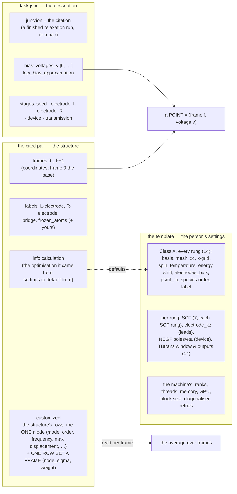
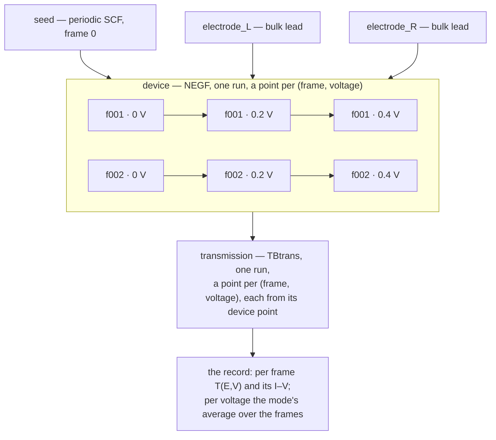

# Q17 — transport over a set of frames: the plan's record — 2026-10-10

**Role:** archive — the plan's Q17 section (§ 5z), its queue row and the
handover as they stood when the milestone closed on 2026-10-10: Q17-c … Q17-f
built, each with its real-junction e2e; the milestone reviewed in two rounds
of fresh agents; an H2 frame set walked through the road in Chrome
(`projects/claude-transport-walk/transport/h-frames`); the user's rulings on
the review's calls. Kept verbatim under the original headings. The rules now
live in the contracts named in the plan's pointer section (§ 5z there).

*(user, 2026-10-10: "ok. go ahead" — push, and condense the plan's Q17
section)*

---

## The queue row, as it stood

| # | item | state | next |
|---|---|---|---|
| **Q17** | **Transport over a set of frames** *(user, 2026-10-08: "what the transport receive is a multiframe .xyz/.json combination"; 2026-10-09: "this is the framework design period. I would rather to have this already built in")* — a frame set cited as its pair, each point a (frame, voltage), the record's average over frames, the family on the Results tab | **settled 2026-10-09** (D1–D5, both axes, the structure whole, frame 0 by default, the comment line never metadata — § 5z.1). **Built 2026-10-09/10**: the structure half (`36a485e6`, `c93da223`, `61db1660`), then Q17-c (the citation of a pair) → Q17-d (prep, launch, status at the point) → Q17-e / e2 (the record's average, the definition, the data file) → Q17-f (Results, the Transport tab, Task setup; checked on the page on an H2 frame set walked through the road) | **§ 5z.6**: the milestone review's round 2, then the plan cleaned; **the AuBDTAu workflow is the user's, on Sol**, once the framework is established (2026-10-10) |

---

## ▶ HANDOVER — where we are, and where to start *(2026-10-09; Q17-c to Q17-f 2026-10-10)*

*(user, 2026-10-09: "consolidate the plan and make sure we have all the
discussions persistent and ready so that when i come back here we can
continue without losing any context/details")* Read this first; each line
points at the row or section that holds the detail.

**Settled and built today, after the consolidation (`1423ad51`), in order:**

| commit | what | the user's word | where it lives |
|---|---|---|---|
| `5b25fb0e` | **One vibration mode per frame set**; the mode on the structure's `customized` rows, each frame's node and **weight stated, frame 0 included** (⅔, ⅙, ⅙), the sum checked to be 1; each mode its own transport task; no sum across modes — weighing modes is the person's post-processing | "i would rather let one multi-frame focus on one mode ... it is baseless to discuss how different normal mode would mix"; "all weights should add up to 1 that's an explicit rule within error tolerance" | § 5z.1; `transport.md` § 2a.9, § 2a.12; `vibration.md` § 5.10 ③ (D6 reversed); `science/vibrational-averaging.md` § 6, § 8 |
| `429a678e` | **TD12 settled**: the four SCF stages (seed, both leads, device) carry their own SCF settings; the transmission none, and its tab says why and where they live | "each stage would actually carry their own SCF setup ... one of them would carry no SCF with clarification" | § 2 TD12; `transport/stages.py` `RUNG_NOTES` |
| `cd0deeef` | **The cards' words have one home** (`template.GROUP_WORDS`, served with every schema as `group_words`); a rung's tab names the rung on every card (*seed · Convergence targets*) and says once whose its values are (`stage_words`) | "make sure the title and text in each panel ... so the user is not confused by the repetition"; "unified api is always required. do not reinvent wheels" | `form-schema.md` § 1.3; `transport.md` § 3.8.2a |
| `48a67f1e` | **The Transport tab's side panel** — the shared two-column page and rail (`form-components.css` `.page-cols` / `.page-aside`, Task setup's): the five stages in order, k-points, SCF settings, after you describe | "a side panel in the transport tab (just like the one in the task setup tab)"; "simple language (no jargon) ... with examples" | `transport.md` § 3.8.10; `tabs.md` § 4; `ui-contract.md` § 1 |
| `bf9e2846` | **TD6, option C built as way 1**: the cited run's SCF mixer and criteria start every SCF stage, the device included, marked *from the run you cited*, each stage free to change its own; the fdf reader reads them; the road runner gained `deck_reads` (a deck read through the one fdf reader, never by its lines) | "TD6 C option is fine"; "go with way 1" | § 2 TD6; `transport.md` § 3.1, § 2a.13; `template.md` § 6.4 |
| `54fd6e8a` | **Words for the k-point directions**: *in the electrode plane (x, y)* and *(z)*, never *across* (which reads as from one lead to the other) | "What do you mean cross? Is it the Z direction ... or the XY direction" | the three items' labels and help; the rail |
| `c5ef9f73` | **The k-point choices, with the literature**: a lead's points along z default to **100**; the transmission's in-plane mesh starts at **3×** the shared mesh's count (4×4 → 12×12); **one point along a repeating x or y is warned** — at prep and when the Transport tab describes, beside the control; six references checked against Crossref into `references.bib` | "I agree with your choice of these parameters" | `transport.md` § 0.3b (the consolidated section, with its references); `kmesh.transmission_start`, `kmesh.check`, `transport/deck.ladder_mesh_findings` |

**Next, in order** (the queue below, Q17):
1. **Q17-c — built 2026-10-09, reviewed and its e2e passed 2026-10-10**
   (§ 5z.6 step 1 says what): the pair citation, W56-2, a cited run read as
   the Results tab reads a run (`runs.view_of`), the SCF settings in the
   recorded contract.
2. **Q17-d — built and its e2e passed 2026-10-10** (§ 5z.6 step 2 says what):
   a transport point is a frame and a voltage. The real-junction e2e cites a
   three-frame set at 0 and 0.2 V and runs its whole ladder — 19 passed in
   281 s with SIESTA, TranSIESTA and TBtrans; its three new assertions each
   mutation-checked.
3. **Q17-e — built and its e2e passed 2026-10-10** (§ 5z.6 step 3 says what):
   the record of a frame set — each frame's point with its rows, the I–V per
   frame, the mode's average at each voltage, the weights checked first.
   25 passed in 281 s; every new assertion mutation-checked.
4. **Q17-e2 — built, its e2e passed and reviewed in two rounds 2026-10-10**
   (§ 5z.6 step 3b says what, items 8 and 9 what the reviews changed; the
   rulings are § 5z.1's last rows): a mode's frame set stated raw beside
   derived and checked at the citation door, one number for a person (a frame
   and an atom, `structure.to_display`), the data file `<label>.transport.nc`
   with its coordinates a NetCDF reader opens, the vibration result's masses
   and derived values on both engines. The real-junction e2e — a real SIESTA
   vibration, its highest mode's set cited, the definition's eleven refusals
   — 34 passed in 430 s; the vibration runs (SIESTA ×3, PySCF) passed; every
   new assertion mutation-checked on the run's own tree.
5. **Q17-f — built, checked on the page and reviewed in two rounds
   2026-10-10** (§ 5z.6 step 4 says what): the data file on its grid, the
   Transport tab citing a frame set, the report's frame axis, Task setup's
   echo, one Plotly box; the H2 frame set walked through the road in
   Chrome. Then the plan cleaned and the milestone pushed.
6. **The AuBDTAu workflow — the user's, on Sol, once the framework is
   established** (§ 5z.6 step 5; the user, 2026-10-10).

**Waiting on the user** (none blocks Q17-c):
- **The frame generator's amplitude** (V1.25; § 5z.4's generator row): proposed
  — the spread from the mode's state, `σ² = (ħ/2ω)(2n+1)`, the experiment's
  temperature by default, a stated effective occupation for a pumped (SERS)
  mode, max displacement then an output; a coherent drive the one case where
  max displacement is the input (Gauss–Chebyshev frames). Decided when the
  generator is designed.
- § 2's *the user's word* rows: E7, EL-W, PL-R's first question, K22's design,
  V1.26 (M10).

**Owed by the next e2e pass** (M2n; on the user's word): § 2's DOC-TOC (a
docs-tab test writes into the checkout) — retire. *(The real-junction e2e's
assertions of TD6 and Q17-c ran and passed 2026-10-10.)*

**Noted for the user:** the walk's AuBDTAu relaxation
(`claude-transport-walk/optimization/au-dta-relax2/01_coarse/run-1`) ran with
one k-point (1 × 1 × 1) on a slab periodic in x and y — exactly the case the
new warning names; check the user's own relaxation's mesh before citing it.

---


---

## 5z. Q17 — transport over a set of frames *(planned 2026-10-08; settled and its structure half built 2026-10-09)*

*The design record as it was argued and settled — § 5z.0–5z.8 of 2026-10-08/09,
with the Q16 measurement and F.1–F.7 in full — is in
[`archive/2026-10-09-plan-consolidation.md`](?doc=archive/2026-10-09-plan-consolidation.md)
§ 5z. What stands here: the goal, what is settled and where each ruling now
lives in a contract, what is built, and the order of what is left. § 5z.8 A–E
(the transport design still to build) stays below, verbatim.*

### 5z.0 The goal, in the user's words

> *(user, 2026-10-08)* "what the transport receive is a multiframe .xyz/.json
> combination, which contains the following: (1) info.calculation stating where
> the optimization of structure comes from and what parameters are used ...
> (2) correctly labeled frozen atoms, L-/R-electrodes, and bridge, and possibly
> other labels, (3) when more than one frame is present, each frame should
> (including the first one) have a meta data ... that has vibration related
> information, such as mode number, mode frequency, displacement max, and
> displacement for this frame (normal mode), and the probability/coefficient
> factor if we need to average this for a total calculation"
>
> *(user, 2026-10-09)* "this is the framework design period. I would rather to
> have this already built in and then later on we can tune it"; "the
> multi-frame is a tool for us to manage data set that's intrinsically
> consistent with each other ... the way we create them is a set of script
> that understand this. That's the contract."

### 5z.1 Settled — each ruling, and the contract that now holds it

| ruling | the user's word | the contract |
|---|---|---|
| **D1** — the Molbuilder tab's Load asks *add or clear* (Add focused); generators keep adding | 2026-10-09: "add one guard to the load button ... default is add" | `web/tabs.md` § 2 — built `a19ddfcc` (Q16) |
| **D2** — a frame set is cited as its pair carrying `info.calculation`; the settings default from its `contract`; the pseudopotentials from the directory the person gives (`--psml-lib DIR`), copied in and recorded | "D2 should use the same convention as in structure optimization: the user should provide the directory that holds all pseudopotentials"; "the record of transport shows where the files are copied from" | `engines/transport.md` § 3.1, the second citation kind — built 2026-10-09 (Q17-c) |
| **D3** — one row set per frame, as many as the frames, in the structure's `customized` section (W39), never `info` | "one list, having the same number of elements as the frames"; "I regret to give you that name ... info.customized" | `model/structure.md` § 2.2d–2.2e; `structure-molstruct.md` § 6.1 — built |
| **D4** — frames are levels inside one run, as bias points are | "D4 yes" | `engines/transport.md` § 2a.11 — *built 2026-10-10, Q17-d* |
| **D5** — Gauss–Hermite over the mode's frames, the thermal distribution's nodes; the mode's average, its change and curvature; the accuracy settings (the rule's order, the temperature, each frame's transport accuracy) — **one mode** (the next row); the cross-mode sum of the 2026-10-09 science draft withdrawn | "go ahead with the design as discussed"; one mode, 2026-10-09 | `science/vibrational-averaging.md`; `engines/transport.md` § 2a.12 — *built 2026-10-10, Q17-e (`transport/average.py`)* |
| **Both axes** — a point is (frame, voltage), either may be one; the one-bias ruling of 2026-09-16 withdrawn | "I would rather to have this already built in" | `engines/transport.md` § 2a.9 *Both axes*, § 2a.11 |
| **F** — frames and every per-frame list inside the structure, one API on each side; a frame set is a data set made by scripts and never edited | "a bundled data structure, a bundled model view ... and a bundled API"; "yes ... That's the contract." | `model/structure.md` § 1, § 2.2d–2.2e; `web/molview.md` § 6, § 9.4 — built `c93da223` |
| **Loading** — frame 0 by default; `frame=i` one frame; `frames=True` the set; the Molbuilder tab asks which frame | "keep the default reading, just take frame zero ... multi-frame true ... not breaking any existing behavior" | `model/structure.md` § 2.4; `web/web-api.md` (`/api/build/load`) — built |
| **The identity** — W39's identity hash waits on M2m; a frame-set citation is pinned by its two files' sha256 meanwhile | settled with F (F.3, F.7 row 8 — the question 4 put on 2026-10-09 is answered by *F as written*) | `structure-molstruct.md` § 3 |
| **An empty `customized` is written `null`** | "your recommendation on question A is okay" | `model/structure.md` § 2.2d — built |
| **The `.xyz` comment line is never metadata** — a lone file is atoms and coordinates, isolated, and the read says so, quoting the line; the codec writes plain XYZ, a block per frame | "The metadata have always have to come from the accompanied JSON file ... we would notify the user that we're dumping the comments" | `model/structure.md` § 2.3 — built `61db1660` |
| **Every frame states its weight, and the weights sum to 1**, frame 0 included, checked within a tolerance — for one mode, three frames at `⅔, ⅙, ⅙` | 2026-10-09: "why the weight is not explicitly assigned? ... all weights should add up to 1 that's an explicit rule within error tolerance" | `engines/transport.md` § 2a.9, § 2a.12; `engines/vibration.md` § 5.10 ③; `science/vibrational-averaging.md` § 6.1 — *built 2026-10-10, Q17-e; checked at the citation door with the whole definition since Q17-e2 (`frameset.read`, rule 5)* |
| **One mode per frame set; each mode its own transport task** — the structure's rows announce the mode (`mode`, `frequency_cm1`, `order`, the generator's parameters, `max_displacement_ang` among them), each frame's rows its node and weight; one rule a set (three or five points), so a rule comparison is two sets; weighing modes against each other is the person's post-processing; `vibration.md`'s D6 (*one set for many modes*, 2026-09-28) reversed | 2026-10-09: "i would rather let one multi-frame focus on one mode ... each vibration mode will have a separate prep and run as different task ... it is baseless to discuss how different normal mode would mix because there is not thermal dynamic data to support any claims at this point" | `engines/transport.md` § 2a.9, § 2a.12; `engines/vibration.md` § 5.10 ③, D6; `science/vibrational-averaging.md` § 6 |
| **The title** keeps `model/structure.md` § 2.2c's rule | "We already have rules on how to generate title ... Don't bug me with it" | `model/structure.md` § 2.2c, unchanged |
| **No curvature, no slope in the record** — the average and its change from the base frame only; what is derived across frames is the analysis's | 2026-10-10: "the curvature may be a wrong number to show"; "doing a derivative is trivial if the result are saved with these parameter and calcualtion results consistently aligned and logically organized" | `engines/transport.md` § 2a.12; `science/vibrational-averaging.md` § 8 — *built 2026-10-10, Q17-e2* |
| **A mode's frame set: what each frame is, raw beside derived**, the coordinates the truth, every derived value stated and checked, the units in the names; checked at the transport citation door; transport computes with the weights alone; how many frames is the script's | 2026-10-10: "we should save not only the mass correct value but also the raw values"; "full data record with clear meaning/definition is crucial"; "explicit is always better than implicit in data science"; "how many frames to construct ... is the job of the script" | `model/structure.md` § 2.2f (the one home); `engines/transport.md` § 2a.9; `engines/vibration.md` § 5.10 ③; `model/structure-annotations.md` (`mass_amu`) — *built 2026-10-10, Q17-e2 (`frameset.read`)* |
| **The index everywhere, a number only on the UI's display**: code, files, folders, the CLI and every message name the code's index, from 0, said as one (*frame index 1 (of 3)*, `f001` for frame index 1); the UI's own display numbers from 1 through MolView's `toDisplay` / `fromDisplay` | 2026-10-10: "unify the frame index, we have one api on the molview for frame"; "anything CLI means direct programming, so we don't reinterpret the meaning. only UI display would do so" | `model/overview.md` § 2; `model/structure.md` § 2.2e — *built 2026-10-10 (`6d7a6c94`)* |
| **The data file `<label>.transport.nc`** — NetCDF-4, frame × voltage × energy, raw beside derived, every variable defined; the JSON stays the report; `netCDF4` declared in the molbuilder env | 2026-10-10: "either in csv or in netcdf"; "I agree with your choice, both" | `engines/transport.md` § 2a.12; `execution/job-contracts.md` § 6.1 — *built 2026-10-10, Q17-e2 (`transport/datafile.py`)* |
| **The vibration result states its masses and stores its derived values on both engines**, one mass table stated at prep (`chemistry.atomic_mass`), the derived values by one function and checked on read; schema 7 | 2026-10-10: "make sure that they would be available at the end of the vibration calculation in all the engines"; "I agree with your choice, both" | `engines/vibration.md` § 6, I3, I16 — *built 2026-10-10, Q17-e2 step 1* |
| **The frame is an axis, orthogonal to every result**: each chart of the transport report — T(E), the DOS, the I–V, the device's convergence — shows one frame (the frame bar's) or every frame in one plot, a legend entry each; the mode's average beside the frames in T(E) | 2026-10-10: "frame is orthogonal to all those calculations so the logical way to present it is that each presentation of T(E), DOS etc would be able to either plot results from different frames in one plot with legends, or select a frame for display" | `web/results.md` § 2.5 — *contract next, Q17-f3* |
| **The data file holds every result on the grid it varies over** — the device's SCF history per frame and voltage on a cycle axis, the once-run rungs on a `rung` axis, each point's state, the leads' agreement — so any cross-section is one selection in xarray; a notebook recipe in the contract | 2026-10-10: "we should fully utilize xarray and netcdf to well organize these data in its multi-dimensional relations to make it easy to categorize and pull out cross sections with different combination of parameters" | `engines/transport.md` § 2a.12 — *built 2026-10-10, Q17-f1* |

### 5z.2 Built

- **Q16 — a structure loaded whole** (2026-10-09): the Load question
  (`a19ddfcc`); a merge names the record it does not carry; the Results file
  card calls a saved pair molbuilder's; the Metadata hint says what the opened
  file carries — checked on the page with `AuBDTAu_fine_optimized`.
- **The structure whole** (`36a485e6` the contract, `c93da223` the code):
  `Structure.frames` (F, N, 3) with `positions` its frame 0; `customized`
  `{rows, frames}` among `METADATA_FIELDS`; `n_frames`, `frame_at(i)`,
  `with_frames`, `take`, the `customized` doors; every edit of a frame set
  refused by one sentence; the sidecar at schema 11 with `n_frames_total`;
  `StructureCodec.load(path, frame=, frames=)`; `/api/build/load`'s `frame` /
  `frames` / `n_frames`; MolView's one aligner, `data.customized`, the
  Customized section, the editable viewer's one refusal, the frame chooser.
  One case table, `tests/data/frame_sets.toml` (runner
  `tests/test_frame_sets.py`), each mechanism mutation-checked; seen on the page.
- **The comment line** (`61db1660`): no key read from any `.xyz`; the lone-file
  sentence on every door that prints (notice `structure.lone_file`).
- **The contract text** (Q17-a): the frame set, its citation, its folders, its
  record and its Results family written, each unbuilt part marked with its step
  — `transport.md` § 2a.9, § 2a.11, § 2a.12, § 3.1; `vibration.md` § 5.10 ③;
  `normal-modes.md` § 4b.6 G; `results.md` § 2.5; `project-layout.md` § 1.6;
  the explicit weight rule (2026-10-09). Left of Q17-a: Task setup's echo of a
  frame set (`task-setup.md`), written with Q17-f.

### 5z.3 The input contract (`transport.md` § 2a.9, § 3.1)

1. **The pair**: one XYZ document, `N ≥ 1` frames, one sidecar.
2. **The labels**, shared by every frame: `frozen_atoms`, `L-electrode`,
   `R-electrode`, `bridge`, and any other label (the person's, read by nobody).
3. **`info.calculation`**: where the optimization came from and its
   parameters (engine, deck, `contract` — basis, functional, mesh, k-grid,
   temperature, spin, charge, and the five SCF settings TD6 starts each SCF
   stage from — and the deck's hash): the settings the transport template is
   defaulted from (D2). A pair with none is refused by name.
4. **The `customized` rows — one mode a set**, as `model/structure.md`
   § 2.2f defines them (its one home; `molbuilder/frameset.py` owns the
   names): the structure's `mode_index_1based`, `frequency_cm1`,
   `temperature_k`, `zero_point_amplitude_amu12_ang`, `sigma_amu12_ang`; each
   frame's `displacement_ang`, `max_atom_displacement_ang`, `q_amu12_ang`,
   `node_sigma`, `weight` — every frame's weight stated, frame 0's included
   (`⅔, ⅙, ⅙`), the set's summing to 1; the `mass_amu` channel and
   `info.vibration`. Transport computes with each frame's weight alone
   (§ 2a.9); the rest is stated and checked.
5. **The per-frame promises**, checked at the citation door frame by frame and
   naming the frame: the same atoms in the same order, the same species, the
   same cell (the structure's own invariant, already refused by its reader), no
   electrode atom moved beyond `wizard.FROZEN_TOL_ANG`; and a mode's set's
   definition, its weights' one sum among it (`model/structure.md` § 2.2f
   rule 5).

### 5z.4 The framework, layer by layer

| layer | the change | built on |
|---|---|---|
| **Q17-c** the citation door, the description — **built 2026-10-09, its e2e passed 2026-10-10** | a second kind beside the run: a pair carrying `info.calculation` — `compose.classify_citation` classifies it, `citation_defaults` reads its `contract`, `init --psml-lib` is taken for it (refused only for a cited run), the two files pinned by sha256 in `slot-provenance.json`, the per-frame promises checked naming the frame; `task.json` names the frame set, its count the citation's, never typed; with it, W56-2 (the run door for a cited run) | `compose.classify_citation`, `citation_defaults`, `init --psml-lib`; `Structure.frame_at`, `customized_value` |
| **Q17-d** prep, launch, status — **built 2026-10-10** | the device and the transmission carry a level per axis that varies (`run-<n>/f001/v0.2/`, § 5z.8 D — the frame token the frame's index, `f000` frame index 0, `model/overview.md` § 2); one door answers a rung's points — `(frame, voltage)` pairs with their folders — and the gather, the walk, the done-door, `status` and the record ask it; one walk per rung, each frame's 0 V from the seed, each further voltage from the one before it in the same frame, a failed voltage ending that frame's chain only; warm takes the done points, cold runs all; status *"k of N points done (F frames × V voltages)"*, `status <stage>` listing them | `transport.stages.Point` / `rung_points` / `point_folders` / `points_in`, `submit._walk_script` (a chain per frame), `continuation.done`, `runstatus.point_rows` |
| **Q17-e** the record — **built 2026-10-10** | each frame's T(E), current and channels; the mode's average `Σ_f W_f T_f` at every frame's stated weight, its change from frame 0's (no curvature since Q17-e2); the weights checked to sum to 1 within `1e-6`, refused by name otherwise; the assumptions beside the numbers; one mode a set, so no sum across modes | `transport/average.py` (`frame_weights`, `mode_average`), `record.collect_record` |
| **Q17-f** Results, the Transport tab, Task setup — **built 2026-10-10, checked on the page and reviewed** | the family of curves on every chart (*one frame* / *all frames*, `lib/frame-axis.js`), a point found by (frame, voltage) and named by `lib/results/point-words.js`, the selection PDOS at a frame, the citation card's frame set, Task setup's echo — § 5z.6 step 4 | `web/results.md` § 2.5, `engines/transport.md` § 3.8.1, `web/task-setup.md` § 3 |
| **the frame generator** (V1.25) | its own module: the relaxed structure and one mode of a vibration in, one frame set out through `with_frames` and `set_customized` (the mode on the structure's rows, each frame's node and weight), every weight stated at full precision. **Its amplitude, to design** (the user, 2026-10-09: *"how much should the max displacement of a selected vibrational mode use? ... temperature involved? how about local EF enhanced (such as SERS in Raman etc) mode? what's the good starting point"*): the spread is the mode's own, `σ² = (ħ/2ω)(2n+1)` — thermal `n` from the experiment's temperature (zero-point above ~300 cm⁻¹ at 300 K, temperature-driven for contact modes), a stated effective `n` / `T_eff` for a pumped mode (SERS: incoherent, still Gaussian, wider), the max displacement then an output; a coherently driven mode is the one case where the max displacement `A` is the input — the arcsine distribution, Gauss–Chebyshev frames at `0, ±0.866 A`, weights `⅓` each; always a warning past a stated fraction of the nearest-neighbour distance. Proposed to the user 2026-10-09; reconciles D7 (the thermal nodes) with *max displacement as the parameter fed in* | `vibration.md` § 5.10 ③ |

### 5z.6 The order of work

1. **Q17-c** — the citation of a pair and the description (with W56-2, and the SCF-RUNG road test of § 2); a cited pair's `info.calculation` carries the five SCF settings TD6's citation reads (`parse.contract.contract_of`). **Built 2026-10-09/10**: `compose.classify_citation` by what the path is — a run's folder read through the run door as the Results tab reads a run (`runs.view_of`, the Results load's composition moved down to the run layer and asked by the load, `xv2xyz --from-run` and the citation: the result through `openable`, parsed by the registry, its last step with its labels, box and record, its first for the lead gate; no file opened by name — user, 2026-10-10: *"all you fucking need in principle is a fucking dir"*), a pair's `.xyz` through the codec (every frame), its `info.calculation` required, every frame's electrode atoms where frame 0 has them (`_frames_keep_the_leads`); one reader of the recorded contract for both kinds (`citation_defaults.citation_answers` over the catalogue's `citation` items); the record by kind (`record_files(kind)`, every frame kept, a pair's files pinned, `_pair_unchanged`); the pseudopotentials by kind, one rule both describe roads ask (`citation_defaults.check_pseudopotentials`: a pair's from `psml_lib`, prep through the optimization's door `_siesta_provide_pseudos`); a frame set's seed and leads on frame 0 (its device and transmission per frame since Q17-d); `xv2xyz --from-run` carries `info` (`run_info`), the CLI's road to a citable pair. Tests: two assertions on the real-junction e2e (a pair saved from the run defaults the template as the run does, compared both ways; SCF-RUNG) — **passed 2026-10-10**, each mutation-checked; four tests of the old wording retired. **Parked from the review (2026-10-10), one line each**: a cited pair edited after its first stages ran — the pin refusal raises past `status` and the gather as a traceback, and an edit that leaves the pair unreadable skips it (the user: a pair is loaded as it is and said honestly; frame sets are made once by scripts); a pair whose record is marked `structure_modified` still defaults its charge and spin (`science/chemistry-correctness.md`'s *"a cited record whose structure was edited since answers no charge or spin"* is not applied to a pair); a frame set's device reads *ready* in `status` while its prep refuses — gone: Q17-d built.
2. **Q17-d** — prep, launch and status at the point (frame, voltage). **Built 2026-10-10**: a point is `transport.stages.Point` — a frame and a voltage, each `None` where its axis does not vary, its folder a level per axis that varies (`f001/v0.2`, `f001`, `v0.2`), said by `Point.words` — *frame index 1 (of 3) · 0.2 V* since the index convention (step 3b item 10), its folder `f001` — and one door, `rung_points`, answers a rung's points (the frames the citation's, read from the composed record by `frames_of`; the voltages the description's), asked by prep (each point's deck on its frame, `_at_frame`, at its voltage, `_at_point`), the gather (a transmission point takes the device point of its own frame and voltage), the walk (`submit._walk_script`: one job a rung, a chain per frame — each frame's first voltage from the seed, each next from the one before it in that frame, a failed point ending its frame's chain only; warm takes the done points over), `status` (*k of N points done (F frames × V voltages)*) and the record; the record of a frame set refused by name until Q17-e (`record._one_frame_or_refuse`). Tests: the real-junction e2e cites a three-frame set (the pair's bridge moved 0, +0.02 and −0.02 Å along z, written by the fixture through `with_frames`) at 0 and 0.2 V and runs its whole ladder; three assertions — each frame's device ran its own frame's geometry (read as the Results tab reads a run), each frame's first voltage started from the seed and the next from it, each transmission point took its own frame's and voltage's device — each mutation-checked (every frame on frame 0's geometry; a frame's first voltage continued from the frame before; a transmission point given frame 0's device: each fails alone) — **19 passed 2026-10-10**. Retired: `test_jobset.py::test_resources_fields_equal_the_contracts_list_exactly`, which pinned a document's text to the code (gate 5; it failed since `1423ad51`).
3. **Q17-e** — the record's average. **Built 2026-10-10**: `transport/average.py` owns the four names transport reads (`mode`, `order` on the structure's rows; `node_sigma`, `weight` on each frame's) and the rule — `frame_weights` refuses, naming each frame as a person counts it (*frame 2 of 3 (f001)*, `stages.frame_words`), a set where some frames state a weight and others do not, a weight that is not a number in (0, 1], and weights whose sum is not 1 within `1e-6`, with the sum; no weights stated is a family with no average, said so — and `mode_average`, at each voltage the weighted sum of every frame's T(E), its change from the base frame's, at E_F the averaged conductance with its change in per cent of the base's and the curvature `(T₊ + T₋ − 2T₀)/h²` per σ², the frames nearest equilibrium mirrored about the base, the voltage waiting while any frame's point is not done; science § 7's six assumptions beside it. `record.collect_record` checks the weights first (so a broken set is said at the record's first read after the first prep), gives every point, pending and failed entry its `frame`, `tokens` and words, each point its frame's `customized` rows, the I–V a `frame` column (under the low-bias approximation each frame's from its own 0 V slice), and the record `average`; the record's points are read by point, not by voltage (`result_folders`, `_stage_facts`, `gathered_device_run` — a frame set's device run found as many folders above its point as the point has levels), schema `@4`. The contract's curvature step corrected to the rule it sat beside: `h` in units of σ (`node_sigma`), not `Q`, since transport reads only the four names (`transport.md` § 2a.12). The compose refusal names frames the same way. Tests: on the real-junction e2e — the frame set written with its mode, nodes and weights; its record's points and I–V per frame; the average against the contract's formula over each frame's TBtrans file read through the parser; the weight rule as four rows of `tests/data/frame_weights.toml`, each a set written from the real relaxation's pair, described, its seed and leads prepared, its record read through `/api/transport/record` — **25 passed 2026-10-10**, every assertion mutation-checked (each check of the rule off, every point given frame 0's rows, equal weights, the step not squared: each fails alone). *Revised by step 3b the same day: the curvature removed, the weight check moved to the citation door with the whole definition, the names those of `model/structure.md` § 2.2f.*
3b. **Q17-e2 — a mode's frame set, raw beside derived, and the data file** *(designed and its contracts written 2026-10-10, from three read-only audits — the vibration result on both engines, the structure doors, the transport touchpoints — each claim checked against the code)*. In order:
   1. **The vibration result** — **built 2026-10-10** (`engines/vibration.md` § 6, schema 7; both engines' end-to-end runs read the masses and the derived values, each check mutation-checked): every atom's mass stated at prep by `chemistry.atomic_mass` — the PySCF deck's `MASSES_AMU` literal, checked in the deck against PySCF's own masses; the SIESTA deck's `vibration` block, read by the finish instead of ASE's table — and written as `equilibrium.masses_amu`; the derived per-mode values (activity classes, zero-point amplitude and displacement) computed by one function, `spectra/derived.py`, carried by both bundles (`activity.py` and `derived.py` join `PYSCF_COMPANIONS`), written by both engines, checked on read; `motion_share_by_element` from the file's masses; a Python helper for the thermal spread σ and the constant hc/k_B named in `constants.py`.
   2. **The structure** — **built 2026-10-10**: `molbuilder/frameset.py` — the definition's names, `MASS_CHANNEL`, `read` (`model/structure.md` § 2.2f's six rules, tolerances from the six-decimal coordinates); `structure.frame_words`, the one Python translation of a frame number (the stray `+ 1`s in `structure.from_xyz`, `cli.py`, `jobset/_cli.py` through it).
   3. **Transport** — **built 2026-10-10**: `frame_token` 1-based (`f001` frame 0) — the frame's index since item 10 (`f000` frame index 0); the citation door calls `frameset.read` after `_frames_keep_the_leads` and turns its refusal into a `ComposeError`; the record reads the checked weights (its own weight check gone), no curvature, the average stating the definition's structure rows, schema `@5`; `transport/datafile.py` — the writer of `<label>.transport.nc` from the composition and its reader; `summarize task` writes it; a `runfiles.WRITTEN` row and `project-layout.md` § 5 regenerated (`python -m tools.manifest`). A point's DOS sits on its transmission's grid within half the fifth decimal `.TBT.AVTRANS` prints (`f10.5`, `m_tbt_save.F90`) — found by the e2e: the two files hold the same 401 points, 5·10⁻⁶ eV apart at most.
   4. **The env** — **built 2026-10-10**: `netCDF4` declared in `envs/host-env.txt` and the host's `verify_argv` (approved 2026-10-10).
   5. **The browser** — **built 2026-10-10** in MolView: the export dialog's frame range and the Customized heading through `toDisplay` / `fromDisplay`, as the frame bar and the export file name already were (`web/molview.md` § 11.5 now says frames cross the same way). *Left as they are*: `vibrationview/_export.js`'s and the export's `frame k/K` count rendered images, not a structure's frames; the Modify tab's frame choice (`modify/selection-bootstrap.js`, `n - 1`) is outside MolView, whose entry point offers `mount` and `formula` only (§ 4) — taking it through `fromDisplay` widens that entry point, a design call for the user.
   6. **Tests** — **built and passed 2026-10-10** (31 in 406 s): the real-junction e2e's frame set states the whole definition from the real relaxation (its masses `chemistry.atomic_mass`'s, as a v7 result's would be); the definition's refusals as rows of a case table, each a set written from the real pair and refused at `jobset init`; the data file read back through its reader against the record; the vibration end-to-end runs (SIESTA and PySCF) read each result's masses and derived values. Mutation-checked on the e2e's own tree, in-process, no source edited: the door off fails all eight refusals, each rule off fails its own row alone; the data file's transmission at the wrong frame, every frame given frame 0's rows, frame 0's coordinates at every frame, the masses or the average not written, a raw variable's source dropped, the token counted from 0; the record's points given frame 0's rows; the average's definition rows not stated; the composed frames reversed — each fails its test.
   7. **Found by the audits, swept with the contracts**: `structure-annotations.md`'s schema text (v9 / {7, 8, 9} against the code's 11); `web/spectra.md`'s display-form sentence; `science/vibrational-averaging.md`'s Q_zp key name; `job-contracts.md`'s treatment words. **Parked**: `engines/vibration.md` § 5.10 ⑤'s slope and curvature, the `electronic` kind's, revisited before it is built; the lead model (`wizard.as_structure`) carries no channels, info or rows (X4 ②); a channel's values are not validated by `Structure` itself — a mode's set's `mass_amu` is, at the citation door.
   8. **The milestone review, round 1** (2026-10-10, three fresh agents — the vibration result, the frame set and numbering, the record and data file — every finding verified). **Fixed**: a set whose frames do not move passed rule 3 when it stated positions (no direction to measure along — now each frame must then neither move nor state one); a set at 0 K, or with a frequency, `Q_zp` or `σ` not positive, raised a traceback at the door (σ at 0 K is `Q_zp`, the domain stated in rule 4 and refused by name); the case table broke two rules in one row and none of rule 3's first half (now one rule a row, eleven rows); one Python translation for an atom's and a frame's number, `structure.to_display` — `frame_token`'s own `+ 1` and the transport refusals' 0-based atoms (`atom 0 (H)`, against `model/overview.md` § 2) through it, four test expectations set to that contract; the data file's I–V voltages are the description's list, not the points that finished in the order they finished; every dimension a coordinate of its own name (`bias_v`, `energy_ev`, `iv_bias_v`) and the labels of a dimension's points CF auxiliary coordinates — measured: xarray opened `bias_v` and the frame rows as data before, as coordinates now, `sel(bias_v=0.2)` working; the regions from `transport.sort`, the spin names from the record, one voltage rule (`stages.same_volts`) for the record, its average and the data file; the data file written before the JSON, so a refusal leaves the last pair; `done` and `point_folder` defined as the file fills them; a polarized point's DOS said to be K21's; the data-file test asserts the device facts, the I–V and the averaged conductance at their own points against the record, and the coordinate structure; the finish's needs said as numpy, not numpy and ASE, in the wrapper's refusal, its log line and two docs; § 6.7 lists what the reader refuses (a derived value not stated; masses without the geometry and the geometry without its masses); § 6.6's pre-v7 sentence corrected; one list of derived keys (`results._MODE_KEYS` from `DERIVED_MODE_KEYS`); one mass rule for every reader that weights (`results.mass_of`, the displacement sweep's matching from the file's masses); both vibration e2e runs pin `Σ m|L|² = 1` in the stated masses (I3). **Judged, not owed**: a test of the reader's value comparison and its mass gate — a disagreeing file comes only from a hand edit, and the test would have to fake one. **Parked**: the PySCF deck's first writes (the state before Phase 0's first step) carry `equilibrium = {0.0, [], 0}`, which `SpectraResults` refuses, so the viewer cannot read the live file during the relaxation (`engines/vibration.md` § 4.9; before this milestone). **For the user**: the Modify tab's frame choice writes its own `n - 1` (`modify/selection-bootstrap.js`) — MolView's entry point offers `mount` and `formula` only (`web/molview.md` § 4); **ASE stays in the SIESTA envs** (the user, 2026-10-10: *"keep ASE"*; *"monitor script could benefit from it in case of reading of files"* — the monitor bundle is stdlib-only today, `configuration.md`, so a monitor reader through ASE is a change of that rule, with ASE in every job env, made when such a reader is wanted) — `envs/recipes.py`'s comment still gives the finish as one reason for it, though the finish imports numpy alone since step 1 (its masses from the deck, stated at prep by `chemistry.atomic_mass`, whose table is ASE's, on the host); the comment corrected the same day, on the user's word (*"fix the recipes.py comment, go ahead"*) — comments only, no package changed.
   9. **The milestone review, round 2** (2026-10-10, three fresh agents on the revised milestone, every finding verified; the vibration result's found no wrong result and no contract mismatch). **Fixed**: the data file spelled both the ångström and the ampere `A` — the ångström is `angstrom` now in the file and in a frame set's rows (`model/structure.md` § 2.2f), `A` the ampere's alone; the I–V's variable states its formula and the file how it was computed (`iv_computed`, `iv_kt_ev`, `iv_window_ev`, `iv_notes`); `point_folder` said to be relative to the calculation's folder, as it is; `frame_token` empty for one structure, which has no frame level; the two leads always on `lead` (`transiesta.LEAD_NAMES`); one frame count for the record and the data file (`stages.frames_of`); the sentence calling the JSON the report the Results tab reads; `fermi_frames` in the record's row; the six written decimals named once (`structure.XYZ_DECIMALS`, the frame set's tolerance from it); refusals print plain floats; the weights' sum said beside a weight out of range; `mode_index_1based` a whole number from 1 written into rule 1; a row for rule 4's node check, which no row reached (twelve rows; every rule's row fails alone with the rule off); every Python message naming an atom counts it from 1 through `to_display` — the transport wizard's NOT FROZEN refusal, the sidecar's warning, the Cell page's and the deck's atoms outside the box (which said *(0-based)*), a sweep's free atoms — six test expectations set to that contract; four stale comments and doc lines (`results.py`'s bundles, I3's pinned-by, § 6.7's *in the working tree*, the spectra page's *no masses*). **Judged**: the exact-float joins in `record._stage_facts` join points one door gave both sides, so `same_volts`'s docstring now says when it is the rule. **Parked**: `molbuilder modify --delete` takes atom indices counted from 0, which a person types (`model/overview.md` § 2 says 1-based) — an input convention, the user's; the Modify tab's atom anchors (`modify/viewer.js`, `index + 1`) are the atom half of the frame chooser's question above.
   10. **The index convention, ruled** (the user, 2026-10-10: *"anything CLI means direct programming, so we don't reinterpret the meaning. only UI display would do so"*; *"we will give notification to user to agree that indices start from 0"*; *"on a cli, we do not allow direct operation on a multiframe file"*; *"as long as your message of index is clean, and internally consistent through contract and unified api, i would agree to it"*). **Built**: `model/overview.md` § 2 rewritten — the code's index everywhere (the CLI, files, folders, every message), said with the word *index*; a number from 1 only on the UI's display, through MolView's `toDisplay` / `fromDisplay`; Python's one spelling `structure.atom_words` / `frame_words` (`to_display` gone); a frame's folder `f000` for frame index 0; `molbuilder modify` refuses a file of several frames and asks agreement to its typed atom indices (`jobset.ask.confirm` on stderr, `--yes`); one frame taken out of several leaves a mode's definition behind (`StructureCodec.frame_choice`, `frameset.without_definition`; `model/structure.md` § 2.2e, `web/tabs.md` § 2); the UI's filter *By atom number*. Tests: the atom and frame words set to the rule; two CLI tests (the agreement, the multi-frame refusal) and a frame-set row (the definition left behind), each mutation-checked; the real-junction e2e, 34 passed. **A fresh agent checked the rule held everywhere** (2026-10-10); fixed from it: an export's file name keeps the frame's index (`wire_frame1-3`), the dialog asking in the frame bar's numbers; MolView's entry point offers `toDisplay` / `fromDisplay` beside `mount` and `formula` (`web/molview.md` § 4, § 9.1), so the Modify tab's frame picker and anchor text use the one translation instead of their own `± 1`; the old rule's restatements (`execution/job-contracts.md`, `README.md`, `web/molview.md` § 11.5, `_atom.js`); every remaining message naming an atom through `atom_words` (the frozen-set refusals, the `.XV` reader's rows, `modify`'s range refusal; `normal_modes` and `results` keep their literal *atom index* — they travel in the finish bundle, which carries no `structure.py`), *(0-based)* suffixes dropped where the word *index* says it; the PySCF deck's Raman line names the atom's index; `--orient-axis`'s help; a second `--electrode` centred on an atom an earlier slab added is checked against the grown structure again (the agreement step had refused it). Judged: no UI note beside a server message's index — the contract asks none; `mode_index_1based` states its count in its name. A stale pin found on the way: `test_the_metadata_dict_has_exactly_these_members` had not followed `customized` into `METADATA_FIELDS` (`c93da223`), set to `structure-molstruct.md`'s list.
4. **Q17-f** — Results, the Transport tab, Task setup — each checked on the page. In order *(2026-10-10, from two read-only maps of the code, each claim checked)*:
   1. **The data file, every result on its grid** — **built 2026-10-10**: the device's convergence per (frame, voltage) on an `scf_cycle` axis (each SCF row's columns from one table, `datafile._SCF_COLUMNS`, the true length beside the padding), the NEGF figures, charges by TranSIESTA's columns (`charge_part`) and contour; the once-run rungs on a `rung` axis, by the stage table; each point's state (the record now states a done point's, `state: finished`); the leads' agreement, the Fermi frames and each run's SCF tolerances as attributes; `Conventions` CF-1.8; zlib; a notebook recipe in § 2a.12. The real-junction e2e: 35 passed; a new test asserts every run's convergence against the record cell by cell; 20 mutations caught on the run's own tree; the recipe run unchanged in `molbuilder-jupyternb` on the real three-frame file — the family by `sel`, `swap_dims` to q and dG/dq, a point's SCF rows, the rungs' E_F, a selection's PDOS through sisl from `point_folder`.
   2. **Citing a frame set from the Transport tab** — **built 2026-10-10** (the real-junction e2e: 36 passed; seen on the page, step 5) — until then a pair could not be cited there (the picker took folders only, and there was no pseudopotential field): the picker takes a pair's `.xyz`, the pseudopotential directory shown for a pair, the junction card's mode line and per-frame table from one helper the describe door and Task setup both ask (`compose.frame_set_answer`; `describe_attempt` returns the definition as data, `frame_set`).
   3. **The report's frame axis** — **built 2026-10-10** (the same e2e; seen on the page, step 5) — every chart's *one frame / all frames* control, one component; points picked by (frame, voltage) everywhere the report picks by voltage alone (25 sites); the points table and the ladder's rows naming the frame (*Frame 2 of 3 · 0.2 V*) and opening the report there; the selection PDOS at a frame (`/api/transport/pdos` gains `frame`; `_one_frame_or_refuse` goes).
   4. **Task setup's echo** — **built 2026-10-10** (the same e2e; seen on the page, step 5) — *What came over* names the frame set (its count; a mode's line), from the same helper; each prepared point names its frame.
   5. **Checked on the page** — **done 2026-10-10**, in Chrome, on an H2 frame set walked through the designed road in `projects/claude-transport-walk` (`structure/h-junction.xyz` → `optimization/h-relax` → the pair `structure/h-relaxed.xyz` → `frequency/h-vib` → `structure/h-frames.xyz`, the junction and the set written by scripts through the Structure API → the Transport tab's citation and Describe → Task setup → the printed `prep` / `launch` → `transport/h-frames`, every rung finished in about four minutes): the Transport tab's frame-set card and its pseudopotential field, Task setup's echo, the ladder's rows and the points table named *Frame 2 of 3 · 0.2 V*, a row moving the frame bar, every chart's *all frames*. Found and fixed: the Transport tab's step 1 said a citation is a directory only (now both kinds, from `transport.md` § 3.1), and the T(E) note left out the record's assumptions (`results.md` § 2.5). Then the milestone review.
   6. **The milestone review, round 1** (2026-10-10, three fresh agents — the record and the data file; the Results page and the plot box; the Transport tab, Task setup and the contracts — every finding verified at its lines). **Fixed**: a late PDOS answer overwrote the current curve (each answer now kept with the point it was asked at, the newest ask's only); a chart that once said why it was empty never drew again (`plotBox.say`: the chart let go before the words); a frame pick while the junction loaded was lost, and a pick before the record was drawn could be held where nothing read it (MolView owns the frame once the junction is in it, the report until then; a pick after the record is drawn goes through `_select`; a disposal mid-load leaves nothing); the selected frame not bold on the I–V and the device's convergence, scfplot's runs not in their frame's colour; the points table picked nothing under the low-bias approximation (a row picks its frame's 0 V slice, as the chart's point does); the convergence card's own lookup falling back to the first point (one lookup, `_find`, and *this rung has not run at this point*); points worded outside `point-words.js`, and the average note dropping the record's reason; the selection PDOS reading the device's newest run, not the one the transmission gathered, accepting a frame for one structure, and deciding *does not sweep* by counting folders (each rung matched by the axes it varies); a point on the wire two ways (`stages.Point.to_wire`, one form for prep's answer and the run list; `Point.words` names the voltage always, its full form); two counts in the data file filled with 0, a real count (−1); a non-structure file's refusal without the citation condition; the pair's pseudopotential directory drawn optional (shown and required by one answer, `asks`); *from the run you cited* on a pair's values (*from the junction you cited*); Task setup's *What came over* left from the folder before, and the shared panel's late answer drawn under a newer citation (a sequence guard, as the rung tabs'); the contracts' stale lines (the schema and folder routes, the PDOS route's `frame`, *designed, not built* for the family) and the plan's. **Tests**: the PDOS of a selection asked at its frame and voltage — four rows, the sum rule (every atom is that point's total DOS and no other point's) and the two refusals — mutation-checked on the run's tree (the frame, the voltage, both refusals and the device run each broken: each caught); the tab test's expectation from § 2.2f's table and the rows the script wrote, not from `to_wire`; the family case chosen by what it is, not by file order. The real-junction e2e: **40 passed** in 651 s. **For the user**: the frame-set card's headings are the definition's names (`zero_point_amplitude_amu12_ang (amu^1/2 angstrom)`), as § 3.8.1 says, plain words would be a words column in `frameset.ROWS`; the pseudopotential field's help names a file-picker button this tab does not have, and the Setup card's line names a field (the run's name) the shared panel does not show — both words of the catalogue's one home.
   7. **The milestone review, round 2** (2026-10-10, three fresh agents on the revised milestone, every round-1 fix verified at its lines and every finding checked). **Fixed** — two regressions of round 1's: a chart's clicks died once a sentence had stood in its place (`plotBox.say` purged its listeners; the one handler is now set after every draw), and the device's convergence said *has not run* while the transmission had not (the report starts at the first point that exists, a pending or failed one among them, and those rows pick too); and the rest: the data file's SCF count written 0 for a run that never ran (−1, its fill, kept); `status` naming a point by its voltage alone (three frames read alike — now `Point.words`); every point dict of the record and the status rows by `Point.to_wire`; Task setup's citation resolved against the server's tree, not the calculation's (`find_projects_root`); the selection PDOS stating the point it was read at (under the low-bias approximation a voltage's frame's 0 V slice); `summarize`'s σ printed with the ampere's `A` (units from `frameset.ROWS`); the SCF plot naming a lone run as a run when several were asked; the all-frames DOS saying *no transmission* when the DOS was what was missing; words left in a box under the next chart (the door clears a box that holds no chart before it draws); a PDOS error shown at another point; step 1's frame-set sentence (each frame runs at every voltage; a frame set is a script's frames on the saved pair); the shared panel's no-settings line said by neither kind; the pseudopotential help, which told a pair's person the pseudopotentials beside the calculation would do (now scoped, `engines/transport.md` § 3.1); the frame-set card scrolling in its box, never past it; *a calculation's folder is its own* written into § 3.1 (the Describe guard had no contract); the stale words and comments swept. **Tests**: an orbital-type row refused by name — the filter itself, which the `s` row cannot see in a minimal basis; all six PDOS mutations caught on the run's tree. The real-junction e2e: **41 passed** in 585 s. **For the user, beside round 1's three**: Task setup's *What came over* reads the citation as it is now, while prep pins it by its sha256 — after a first prep, reading the composed record instead would be a contract change (a design call); and a transmission row's *open* does nothing when the root shows `<label>.transport.json` instead of the report (from B8): announcing the report from the ladder would leave the result menu naming another file, the very two-derivations defect § 2.2 records — a design call.
   8. **The user's rulings on the review's calls** *(2026-10-10)*: the frame-set card in plain words, the stored name on hover — each row's words and page unit beside its name in `frameset.ROWS`, and a column of `model/structure.md` § 2.2f's table (*"1B"*); the Setup card's line by the fields the form shows, simple, with an example — `template.SETUP_WORDS`, a form showing a combination with no line refused (*"2A but your language is still not simple enough … you can be elaborate for different situations"*); *What came over* left as it is — a person editing a cited input after prep is a broken state prep already refuses (*"Leave 3 … why the fuck do you propose to twist anything out of it"*); a transmission row's *open* with another file on screen says to open the report first, nothing re-routed (*"I would choose C. Don't outsmart user"*). The real-junction e2e: **41 passed**.
      **One Plotly box, found on the way** *(2026-10-10; the user: "review the css design of the plotly of all results from spectrum and transport")*: every Results chart drawn through one door, `lib/plot-box.js` + `lib/plot-box.css` (`web/results.md` § 2.5) — the thermochemistry figures overflowed their card after a width change, the transport charts kept their first width through a sidebar fold; each viewer's own resize way (spectra's `_watchEsWidth`, trajectory's `resizePlots`, the tab-show resizes) removed. Seen on the page with the sidebar open. **The CSS-system review** (a fresh agent, read-only, 2026-10-10): its findings on the new work verified and fixed — the `plot-box` class in each module's markup (`draw` refuses any other element), the box sized content-box, the half-plots' order-decided floor gone, the bench chart released between polls, page-shell's `.toggle-button` and `.num-table` in place of three copies, the frame-set sheet in its layer on Task setup; the defects already there are **Q18**, after Q17. **The page check is made on an H2 frame set run through the designed road in `projects/`** — the Transport tab citing it, Task setup's hand-over, the printed `prep` / `launch`, the Results tab (step 5: AuBDTAu is the user's, on Sol).
5. **The AuBDTAu workflow, end to end — the user's, on Sol** *(2026-10-10: "no, you should not run it on this workstation"; "we focus on workflow and validation of design of framework, not yet on science. i'll test real system on sol")* — so here the framework is validated on the H2 junction, and the page check (step 4.5) is made on an H2 frame set run through the designed road in `projects/`. For the Sol test, found 2026-10-10: `AuBDTAu/spectrum/siesta-vib`'s own result says its reference geometry is not a stationary point (0.37 eV/Å on the free atoms against its 0.01 eV/Å tolerance; MeshCutoff 300 Ry against the relaxation's 350 Ry), and both its `job-set.json` and `min_force_relax`'s predate the 2026-10-06 job keys (`jobset migrate`). The request as first written *(2026-10-09:
   "the whole point of the test is the workflow"; "don't keep shifting from one
   test to another")* — the user's later word for this workflow, beside
   `testing.md`'s hydrogen junction for mechanism tests: the `AuBDTAu` optimized structure, its frame set written
   by a script through the structure's API (frame 0 and one bridge mode's
   `±√3 σ` frames, every weight stated), cited, prepped, launched and
   summarized through `jobset`, read on the Results tab — the e2e on the user's
   word, launched with `--mode direct --background` when long.
6. The milestone review (two rounds, fresh agents, the full code text), then
   the plan cleaned.

### 5z.7 Rows this section carries

W32 (② – ⑤) → Q17-c … Q17-f. V1.25 — the generator, unblocked by W39 — writes
the frame sets Q17 reads. W56-2 rides with Q17-c. § 5u.1 step 11 is Q17.

### 5z.8 The transport design still to build — A–E as settled 2026-10-09

*(The user, 2026-10-09: "this is the framework design period. I would rather
to have this already built in and then later on we can tune it … we need to
have a clear diagram of the parameters in the transport that we allow and …
what's the logic of the cycle and how the task is managed when we submit
one".)* **Settled 2026-10-09** (*"I would rather to have this already built
in"*); A–E are below as written; F, the structure whole, is built and its text
is archived (the contract now holds it — § 5z.1).

#### A. Why one bias was proposed — and withdrawn

It was not a physics claim and not the user's: the contract carried a ruling
of 2026-09-16 (§ 2a.7, *"a frame group runs at one bias"*) and it was followed
without being asked. Its reason was the walk: a self-consistent sweep chains
each voltage from the one before it, so every frame at every voltage is a
second level of points. The level costs the walk one loop, not a new
mechanism — the walk script, the done-door, warm and cold are all per point
already. **Withdrawn: both axes are built in now**, either of them allowed to
be one.

#### B. The parameters of a transport calculation — where each lives



The **frame** comes from the citation and is never typed; the **voltage** from
`task.json`'s list. Neither is a template value: a point's deck is the one
template at that point's geometry and that point's voltage.

#### C. The cycle



Each frame's 0 V point starts from the seed's density; each further voltage
from the converged point before it **in the same frame**; frames never start
from one another. Under the low-bias approximation each frame runs once, at
0 V, and its I–V is computed from its own T(E, 0) at the listed voltages.

#### D. The folders — a level for each axis that varies, none for one that does not

| frames | voltages (self-consistent) | a swept rung's run holds |
|---|---|---|
| 1 | 1 (or low-bias) | no level: `run-0/` itself |
| 1 | several | `run-0/v0/ v0.2/ …` (today) |
| several | 1 (or low-bias) | `run-0/f001/ f002/ …` — `f001` frame 0 (§ 2.2e) |
| several | several | `run-0/f001/v0/ f001/v0.2/ … f002/v0/ …` |

The prepared decks sit the same way in the stage folder (`04_device/f002/v0.2/`).
One door answers a rung's points — `(frame, voltage)` pairs with their folder
— and the gather, the walk, the done-door, `status` and the record ask it.

#### E. When it is launched

```mermaid
sequenceDiagram
  participant P as you
  participant J as jobset
  participant W as the walk (one job)
  P->>J: prep task  (offers seed + both leads)
  P->>J: launch task  (one job: the three in order)
  P->>J: prep task  (offers the device: every point's deck, the gather once)
  P->>J: launch task --stage device
  J->>W: one job walking every point
  loop each frame, in file order
    W->>W: 0 V from the seed's density
    W->>W: each next voltage from the previous one (this frame)
    Note over W: a voltage that fails ends THIS frame's chain;<br/>the walk goes on to the next frame
  end
  P->>J: status  →  "k of N points done (F frames × V voltages)"
  P->>J: prep / launch the transmission  (every point independent; goes on past a failure)
  P->>J: summarize task  →  the record
```

Launched again: **warm** takes every done point over and walks the rest, a
not-done voltage starting from the closest done voltage before it in its
frame (else the seed); **cold** walks them all. `--background` leaves any of
these running here.

---

