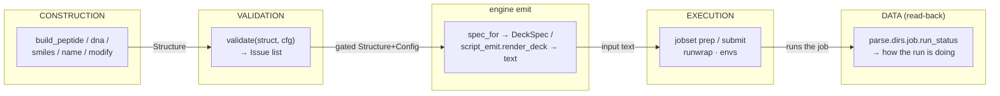

# Backend architecture — the four concerns (data · construction · validation · execution)

**Role:** reference
**Domain:** *(root — the spine)*
**Companions:** [`architecture.md`](?doc=architecture.md) — the **same backend
by *layer*** (L1/L2/L3), a task → tool index; [`design.md`](?doc=design.md) —
mission · principles · decisions (its Architecture section gives the concise
intro and cites this doc); [`README.md`](?doc=README.md) — the doc index.

> **What this is.** A map of the Python backend organised by **functional
> concern** — how the code separates *managing data*, *constructing
> structures*, *scientifically validating* a job, and *running the workflow*.
> It is the concern-lens complement to [`architecture.md`](?doc=architecture.md),
> which indexes the same modules by **layer** and points at each authoritative
> doc. This file answers a question the layer index does not ask head-on: *are
> the four backend concerns cleanly separated, and where do they leak into each
> other?*
>
> **The short answer:** yes — the separation is real and mostly clean. It rides
> on the load-bearing L1/L2/L3 import-direction rule (kept by review,
> `process/code-audit.md` § 1c (e)) plus the four core types as a shared
> vocabulary.
> Data management and structure construction are well isolated. Scientific
> validation is one pass for every engine and kind (§ 4). One execution seam
> remains, W3 (§ 5).

---

## 1. Two axes: layers × concerns

The backend is organised on **two orthogonal axes**, and both matter:

- **Layer** (reviewed): *import direction.* L1 core types import nothing above
  them; L2 domain verbs may import L1; L3 surfaces (`cli` / `web`) may import
  both. This is the invariant that stops the registry/abstraction tangle from
  growing back — review keeps it (`process/code-audit.md` § 1c (e)) against the
  index [`architecture.md`](?doc=architecture.md) § 3 holds; this is the axis it
  indexes.
- **Concern** (this doc): *functional responsibility.* Every L2 verb belongs to
  exactly one of four concerns. The concern is **not** enforced by a test — it
  is a design intent this document records so new code lands in the right
  module.

The concern axis cuts *across* layers. "Data management" owns L1 types **and**
L2 codecs; "scientific validation" owns L1 primitives **and** the L2 validation
pass. So a module's **layer** tells you *who it may import*; its **concern**
tells you *what job it does*. Keep both straight.

| Layer | Data management | Construction | Validation (science) | Execution (workflow) |
|---|---|---|---|---|
| **L3** surfaces | `web/blueprints/*` · `cli.py` — every surface is *deserialize → verb → serialize* | | | |
| **L2** domain verbs | `parse/` · `sidecars/` · `workingcopy_structure` · `script_emit` · `projects` | `peptide` · `nucleic` · `smiles` · `pubchem` · `modify` · `builders/backends` | `validation/` (the pass; the electronic state's one family) · `pseudos` | `jobset/` · `bench/` · `runwrap` · `envs/` · `diagnostics` · `runtime_config` · `transport/` (compose · stages · record) · `checkpoint` *(git-backed, parameterized glob tables)* |
| **L1** core types | `structure` · `frame` · `selection` · `config/` · `trajectory_log` · `persist` · `issues` | *(none — construction is all L2 verbs)* | `chemistry` · `residues` · `electronic_state` (the one charge-and-spin answer) | |

The four core types — `Structure`, `Frame`, `Config`, `Issue` — are the wire
between concerns: **construction** emits a `Structure`; **validation** reads a
`Structure`+`Config` and returns `List[Issue]`; the engine emitters render a job
from `Structure`+`Config`; **execution** runs it; **data management** owns the
round-trip of all of them to and from disk. § 6 draws the full pipeline.

---

## 2. Data management

**Job:** own every representation of structure / trajectory / config data and
its serialization — in memory (the dataclasses), on the wire (`to_dict`, and
`to_wire` for what the server derives beside it), and on
disk (the codecs). No domain logic: a data module never validates chemistry,
builds geometry, or runs a job.

| Module | L | Role | Public entry points |
|---|---|---|---|
| `structure.py` | L1 | the **one** structure codec + key-namer (coords + metadata) | `Structure`; `to_dict` / `from_dict` / `to_wire`; `from_xyz` / `to_xyz` / `from_pdb`; `resolve_cell` — full codec in [`model/structure.md`](?doc=model/structure.md) |
| `frame.py` | L1 | `Frame` / `Trajectory` per-step physics | `Frame`, `Trajectory` |
| `selection.py` | L1 | atom-selection rule algebra (duck-typed on `struct`) | `Rule`, `evaluate`, `to_json` / `from_json` |
| `config/` | L1 | the engine-knob **dataclasses** (the lingua franca): a field's name, type, default and validators — every other fact is the catalogue's (`engines/template.md` § 2.1a) | `SiestaConfig`, `PySCFConfig` (the two engine configs; `config/stages.py` the stage strategies both share) |
| `trajectory_log/` | L1 | the molwatch progress-log format, its vocabulary + writer | `format`, `keys`, `emitter` |
| `persist.py` | L1 | versioned-doc schema check + atomic JSON IO | `schema_major`, `check_schema`, `read_object`, `read_json`, `write_json` |
| `parse/` | L2 | the single **read-side** stack: File → typed `ParseResult`; a folder is the run door's (`runs.folder_answer`, `model/parse.md` § 5) | `parse.{detect,parse}`; `parse.dirs.job.run_status` — see [`model/parse.md`](?doc=model/parse.md) |
| `sidecars/` | L2 | write-side `.molstruct` / `.spectra` JSON | `molstruct.{to_dict,dumps,load,apply_to_structure}` |
| `workingcopy_structure.py` | L2 | the paired `.xyz`+`.molstruct.json` file door — one generator, one adapter per destination | `StructureCodec.{pair,files,write,load}` — see [`model/structure.md`](?doc=model/structure.md) § 2.4 |
| `script_emit.py` | L2 | write-side of the generated-script reserved blocks, and the deck conductor every engine's deck goes through | `DeckSpec`, `render_deck`, `prepare_deck`, `write_script`; `emit_*` |
| `projects.py` | L2 | filesystem layout / naming authority | `validate_name`, `projects_root`, `project_dir`, `list_structures` |

**Assessment: clean.** No data module imports execution, validation, or
construction code; every dependency points *down* to the L1
`Structure` / `selection` / `frame` authorities or *sideways* within the
read/write codec pair (`sidecars/` write ↔ `parse/sidecars/` read, resolved
with lazy imports). The structure-authority consolidation — one codec
(`Structure.to_dict` / `from_dict` / `to_wire`), sidecar `to_dict` spreading
`**fields` with no hand-listing — is effectively complete. Detail:
[`model/structure.md`](?doc=model/structure.md),
[`execution/job-contracts.md`](?doc=execution/job-contracts.md) (the data
vocabulary).

The CLI's load/save path goes through `StructureCodec` too — `xv2xyz`
included.

---

## 3. Structure construction

**Job:** synthesize or edit geometry — `sequence` / `SMILES` / `name` in,
`Structure` out; or `Structure` in, edited `Structure` out. A builder never
persists to a project file (the codec does that) and never runs the formal
validation pass (that gate is at generation time).

| Module | L | Role | Yields |
|---|---|---|---|
| `peptide.py` | L2 | peptide builder | `Structure` |
| `nucleic.py` | L2 | DNA / RNA builders (dispatch to backends) | `Structure` |
| `builders/backends/` | L2 | per-tool backends: `_rdkit` / `_amber` / `_threedna` | `Structure` (or `BackendUnavailable`) |
| `smiles.py` | L2 | SMILES → `Structure` (RDKit + OpenBabel fallback) | `Structure` |
| `pubchem.py` | L2 | name → SMILES → `Structure` | `Structure` |
| `modify.py` | L2 | atom-level edits (`delete_atoms` / `add_atom` / `orient_along_axis` / …) | `Structure` |

The construction surfaces are in [`engines/builders.md`](?doc=engines/builders.md).

**Assessment: clean, with two consistency nits.** Every builder returns a
`molbuilder.Structure`; none persists to the workspace (backends only write
scratch files into a `TemporaryDirectory` to feed an external tool). Build-time
chemistry (H-addition, phosphate protonation, backbone-connectivity self-check,
duplex clash relief) lives inline **by design** — it is structure *cleanup*,
not the scientific *gate*; what a build finds is said by the one check after it
(`validation.builders.check_built`, through the build door `builders.build`), and `modify.py` documents the boundary (it defers
zero-offset enforcement to `validate_geometry`). The nits, all minor:

1. **Non-uniform external-tool gating.** Four tools, four idioms: `_threedna` (a
   bespoke filesystem detection chain), `_amber` (defers to `diagnostics` +
   `envs.run_tool`), `_rdkit` (`importlib.util.find_spec`), OpenBabel-in-`smiles`
   (inline `try/import`). Only `_amber` reaches into the execution/env layer,
   and only for external-process routing — not `jobset` / `runwrap`.
2. **One return-type wart.** `smiles.build_from_smiles(…, return_backend=True)`
   returns an ad-hoc `(Structure, str)` tuple instead of a bare `Structure`.

---

## 4. Scientific validation — the concern that had real gaps

**Job:** answer "is this job scientifically defensible before we emit it?" —
chemistry (spin/charge parity, open-shell/metal), pseudopotential coverage,
engine-keyword sanity (k-grid, cutoff, basis, boundary conditions). The intended
contract ([`science/validation.md`](?doc=science/validation.md),
[`science/chemistry-correctness.md`](?doc=science/chemistry-correctness.md)):
**one shared chemistry analyzer**, and **one `validate()` pass per engine** that
a surface calls once.

### What is unified (was already good, still good)

The chemistry invariant — the charge and spin a calculation carries, the place
silent errors hide — is genuinely single-sourced: one class,
`electronic_state.electronic_state`, decides it from the structure's facts
(`chemistry.analyze_structure`, engine-agnostic) for the form, the checks and
every deck; its findings are one family, `validation/chemistry.py::check_electronic_state`,
asked once by `validate()` for every engine and kind
([`science/chemistry-correctness.md`](?doc=science/chemistry-correctness.md) § 2a).
`pseudos.check_coverage` is the single pseudopotential owner (C1–C6). No engine
reimplements the chemistry.

### One pass for every engine and kind

- **One `validate()` for every engine and kind.** A surface calls
  `validate(struct, cfg, calculation=…)` once. A kind's science is its
  record's `validator` in the kind table: every transport rung resolves a
  `SiestaConfig` and passes the SIESTA validator and the transport kind's
  `validate_transport_kind` in that one call; a vibration's science is
  `validate_vibration_kind`.
- **One grid-level check, shared by both PySCF sites.**
  `validation.pyscf.check_dft_grid_level(cfg, context=…)`, called by the
  optimization's check and the vibration's render gate; the message is
  context-selected (opt forces vs Hessian frequencies).

**The render gate is the science alone.** The vibration deck's gate is
`validation/spectra.py::spectra_render_checks` (grid, amplitude, the held
atoms; the charge and spin are the electronic state's family), run by the render path and by `validate()` through the
kind's own step (`validation/spectra.validate_vibration_kind`, the kind
table's `validator`).

---

## 5. Workflow / execution

**Job:** run a set of related jobs on any target — stage laddering, scheduling,
env dispatch, launcher emission, checkpointing, benchmarking. A calculation
that builds on a finished run **cites** it, and `prep` composes from the
citation.
The design intent ([`execution/job-system.md`](?doc=execution/job-system.md)):
**everything after the *producer* is engine-agnostic** — the core never parses a
`.fdf`, and sees only opaque script filenames.

| Module | L | Role | Engine knowledge? |
|---|---|---|---|
| `jobset/` (`model` / `materialize` / `prep` / `plan` / `submit` / `summarize` / `agreement` / `ledger` / `_cli`) | L2 | engine-agnostic staged-execution core | **none** (correct) |
| `jobset/runstatus.py` | L2 | read-only per-stage status + warm-file inventory | none — derives from the engines' `warm-files.toml` ([`job-contracts.md`](?doc=execution/job-contracts.md) § 4.2a) |
| `bench/` | L2 | the benchmark's result reader (`result.py`); `prep bench` is the producer ([`execution/architecture.md`](?doc=execution/architecture.md) § 0) | none of its own — the result reader reads a run through `parse/` |
| `runwrap.py` | L2 | the `.run.sh` / `.sbatch` launcher emitter | none of its own — every block is the engine record's (`engine_table`) |
| `runtime_config.py` | L2 | `molbuilder.json` reader — one registry row per section (`configuration.md` § 4) | — (see W3) |
| `diagnostics.py` | L2 | host capability snapshot + env-for-category routing | env-category tables (config, fine) |
| `envs/` | L2 | conda-env dispatch + doctor / validate / install toolkit | — (clean) |
| `checkpoint.py` | L2 | git-backed run-dir snapshot/restore + binary archiving | engine glob tables, *parameterized* (fine) |
| `monitor.py` | L2 | shipped standalone job-status tailer | siesta `.out` markers (by design — bare-env) |

**Assessment: the core is exemplary; the edges couple to a specific engine.**
The `jobset/` core is a model of the separation — pure engine-agnostic verbs, no
data / science / construction reach-ins, all engine knowledge held by producers.
The coupling smells live at the edges. These are **known seams, not load-bearing
bugs** — the backend works and the layering holds. They are deferred boundary
debt (the difference between "separated in practice" and "separated by contract,
uniformly"), catalogued here so a future refactor knows where the seams are:

| # | Seam | Where |
|---|---|---|
| W3 | `runtime_config` reads the web server's sections (`auth`, `tls`, `rate_limit`, `admin`) beside the calculations' (`launch`, `envs`, `env_init`, `checkpoint`, `paths`) — two concerns in one reader | `runtime_config.py` |
| W5 | **A module misfiled under "workflow."** `script_emit.py` is really a **data** serializer (it reaches into `sidecars` and `structure`), not an execution verb — this doc files it under § 2 for that reason. | `script_emit.py` |

The run script names no engine (`engine_table`); the warm-file table is the
engines' `warm-files.toml`; transport is its own kind through the ordinary
verbs.

A scheduler is a kind: a block in `scheduler/kinds.toml` and its readers
([`execution/scheduler.md`](?doc=execution/scheduler.md) § 6a). The job's own
values in `jobset/model.py::Resources` (`mpi_np`, `time`, `mem`, `gres`,
`domain`) are spelled as SLURM reads them — a wall `D-HH:MM:SS`, memory
`120G`, a GPU ask `gpu:N` whose count the header takes — the one seam a kind
that reads another spelling would meet.

---

## 6. The cross-concern pipeline

The concerns compose into one flow. The arrows are the **only** sanctioned
inter-concern calls, and each carries a core type:

Read it as: **construction** produces a `Structure`; **validation** gates it
against a `Config`; the engine emitter (a construction-adjacent verb) renders the
input text; **execution** runs it; **data management** parses the results back
into `Frame` / `Trajectory`. **Data management owns the round-trip of every
arrow to and from disk** — `StructureCodec` (`.xyz`+`.json`), the sidecars
(`.molstruct` / `.spectra`), `script_emit` (the reserved blocks),
and `persist` (the `@major` schema check). The `Issue` list is advisory while
editing and enforcing at generation — `report()` is the only hard gate.

---

## 7. Verdict

**Do we need a new logical separation?** No. The four concerns already have
distinct homes, enforced downward by the L1/L2/L3 rule and wired by the four core
types. Data management and structure construction are clean; scientific
validation was the one concern with real gaps and they are now closed (§ 4). What
remains is W3 at the execution edge (§ 5) and a little hygiene (§ 3 nits,
W5) — deferred boundary debt, not
load-bearing bugs. None of it changes the concern *homes*; it makes them
uniform. If any of these are scheduled, they become entries in
[`plans/plan.md`](?doc=plans/plan.md).

---

## 8. Keeping the separation (the boundary contract)

When adding backend code, place it by concern **and** layer:

- **A new builder** returns a `Structure` and nothing else. It may clean up
  chemistry inline; it must not persist, and must not run `validate()`.
- **A new scientific check** goes in `validation/` (or `chemistry.py` if it is an
  irreducible per-structure primitive), registered so a single `validate(cfg)`
  reaches it. Never inline a new `preflight` outside the registry.
- **A new execution verb** stays engine-agnostic if it is post-producer; engine
  knowledge belongs in a *producer* — `prep`, through the engine seam
  (`jobset/engines.engine_seam`, each engine's in its own package). Never parse a
  `.fdf` in the `jobset` core.
- **A new data codec** routes through the `Structure` authority
  (`to_dict` / `from_dict` / `to_wire`) and `persist.check_schema`; never
  hand-list metadata fields or hand-roll a schema check.

The import direction is review's (`process/code-audit.md` § 1c (e)). This
document is the concern-level intent above it; keep it in sync when a concern
boundary moves.
