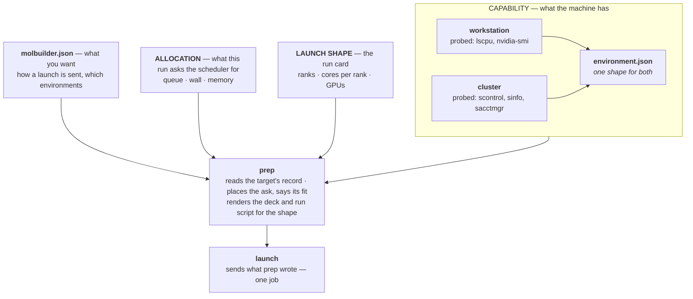

# Configuration — what is set, where it lives, and who writes it

**Role:** contract
**Domain:** configuration (tree-wide); the execution chapters read § 4 and § 5
**Owns:** which files are configuration and who writes each; where each is
looked for and which one answers; `molbuilder.json` and every key it may hold
(§ 4); the machine record `environment.json`, and capability against
allocation, M-1…M-6 (§ 5); how molbuilder writes its own files (§ 2.3); the
per-user directories (§ 3.1).
**Read with:** [`job-contracts.md`](?doc=execution/job-contracts.md) § 6.1
(every file's format and schema) ·
[`project-layout.md`](?doc=execution/project-layout.md) § 5 (every file in a
calculation folder, who writes it) ·
[`architecture.md`](?doc=execution/architecture.md) § 5.2 (a job's own values) ·
[`preparing-for-another-machine.md`](?doc=execution/preparing-for-another-machine.md)
(prep here, run there) · [`ops/installation.md`](?doc=ops/installation.md) § 2.1
(the first install)

---

## The short version

A file is either **set** — somebody or something configured it — or
**produced**, worked out by the program. This chapter is about the set ones.

- **`molbuilder.json`** is what you want from this installation: how a launch is
  sent, which environments to use, the server's own settings — and one fact of
  this machine, `env_init`, how a shell enters an environment here. It holds no
  value of a job and no other fact of a machine (§ 4). It lives in one place,
  the config directory (§ 2.1, § 2.1a).
- **`environment.json`** is what a machine *is* — its nodes, queues, scheduler,
  environments — probed on that machine by `jobset probe` and copied to where
  you prep. A calculation keeps a copy of the record of its first prep (§ 5).
- **Capability is the record's; allocation is the job's.** The record checks an
  ask and says its fit; it never supplies one (§ 5).

**Reading map.** Using molbuilder: § 4, § 5, § 2.1, § 2.2. The design and its
reasons: § 1, § 2.1a–§ 2.1e, M-1…M-6. For a developer: § 2.3, § 3.1, § 3.2, M-4.

---

## 0. What this chapter owns

| owns | does not own |
|---|---|
| which files are configuration, and the one name each is called by | the keys inside any of them, but `molbuilder.json`'s (§ 4) |
| who writes each — a person, a probe, a producing verb, or the engine's package | what the writer does inside |
| the mode and durability of each file (§ 2.1b, § 2.3) — `molbuilder/placement.py`'s table, one row per file | the bytes, the key order, the error text |
| where each file is looked for, and which one answers | how a reader parses it |
| the machine-facts rules (§ 5) — fact against preference | the record's fields, which are `scheduler/record.py`'s |
| what is refused where | the refusal's wording, which is the validator's |

> **R-C1 — this page states *who writes what, where*. It never restates a
> file's contents.** A key is named only when the rule is about its home.
> `molbuilder.json` is the one exception: *what belongs in this file* is a
> question about homes, so § 4 lists every key it may hold and what each is for,
> and leaves what a key may be set *to* to the contract it names.

> **R-C2 — where this page and a file's owning contract disagree about the
> file's insides, the owning contract wins. Where they disagree about *who
> writes it*, this page wins.**

---

## 1. Who writes it

Every configuration file has exactly one kind of writer.

| writer | means | files |
|---|---|---|
| **a person** | somebody decided it; nothing in the program overwrites it | `molbuilder.json` |
| **a probe** | a machine was asked, and answered | `environment.json` |
| **a producing verb** | `describe`, the hand-over or Task setup wrote down what a calculation *is* | `<label>.template.toml`, `task.json`, `job-request.json`, `task.1st.json` |
| **the engine's package** | it ships with the code, as data | `catalogue.template.toml`, `<engine>/warm-files.toml` |

Two rules follow, and the code holds both:

- **A probe never writes a person's file, and never writes a preference** (M-1).
  What queues a cluster has is a fact; which one you want is not.
- **A producing verb never writes a person's file.** `describe` records the
  calculation and does not touch `molbuilder.json`.

---

## 2. The scopes, and who wins

| # | scope | where | what lives here |
|---|---|---|---|
| 1 | **machine** | `molbuilder.json` — one file, in the config directory (§ 2.1c); a copy in the working directory is not read (§ 2.1a) | every section of it (§ 4) |
| 2 | **calculation** | the folder: `task.json`, `job-request.json`, `<label>.template.toml`, `environment.json`, an optional `warm-files.toml` | what this one calculation is |

### 2.1 Where each file is looked for

**Every lookup is first-found-wins, and no file is merged with another.**

| file | looked for, in order | combining rule |
|---|---|---|
| `molbuilder.json` | 1. `$MOLBUILDER_CONFIG_DIR/molbuilder.json`, when set (§ 2.1c)<br>2. `$XDG_CONFIG_HOME/molbuilder/molbuilder.json`, when set<br>3. `~/.config/molbuilder/molbuilder.json` | **one file**: the branches choose a directory, and the file is the one in it |
| `environment.json` | 1. `<calculation>/environment.json`<br>2. a named target, when one is asked for: `<config dir>/environments/<name>.json`<br>3. `<config dir>/environment.json` | **the whole record**, first found (M-3); when none answers, nothing — **no reader probes** (M-4) |
| `catalogue.template.toml` | `molbuilder/data/` in the package | one file |
| `<engine>/warm-files.toml` | 1. `<calculation>/warm-files.toml`<br>2. `molbuilder/<engine>/warm-files.toml` | first found: a calculation's tuned copy is the list in effect for it, its `scratch_dir` included (`warmfiles.warm_list`) |
| `<label>.template.toml`, `task.json`, `job-request.json` | the calculation folder, nowhere else | one calculation, one description |

**Whether a file is an engine's scratch is always asked of the shipped files,
every engine's** (`warmfiles.is_scratch`) — what no save stores, what a restore
removes and `jobset scratch` empties — because a calculation's copy is a file
somebody can edit between a save and a restore
([`checkpointing.md`](?doc=execution/checkpointing.md) S1, S1c).

**`environment.json` has no working-directory step, on purpose.** A
calculation folder is often the working directory, so such a step would make
the machine scope and the calculation scope the same file, and M-3 would
compare a record against itself.

### 2.1a One home for `molbuilder.json`; a copy in the working directory is warned about

> *"I had instances where information are saved in two places and I did not
> realize which one was the effective one … I prefer consistency rather than
> all based on implicit rules"* (user, 2026-08-31).

1. **The file belongs in the config directory** — the one named by
   `$MOLBUILDER_CONFIG_DIR`, else `$XDG_CONFIG_HOME/molbuilder/`, else
   `~/.config/molbuilder/` (§ 2.1c). `runtime_config.machine_config_path()`
   has one branch and no search.
2. **A `./molbuilder.json` is reported, not obeyed.** Ignored in silence, it
   would be a file you edited that does nothing; so
   `runtime_config.machine_config_shadow()` says it is not read and names the
   file that is, and every surface that resolves the machine scope shows that
   sentence.

### 2.1b The file is `0600` — checked, not just written

`molbuilder.json` names where the server's TLS key is (`tls.key`) and who may
sign in (`auth.providers`). A world-readable copy on a shared login node is an
exposure.

| | mode | why |
|---|---|---|
| `molbuilder.json` | **`0600`** | owner reads and writes; nobody else needs it |
| the config directory | **`0700`** | a listable directory names the file even when the file is shut |

**Written so:** `runtime_config.write_config_scope` writes through
`persist.write_bytes(mode=0o600)`, whose temp is `0600` before it has a name
(§ 2.3).

**Checked on the way in:** a file arrives loose in ways no writer controls —
copied from another machine, restored from a backup, made by an editor,
unpacked from an archive. So the mode of an existing file is checked, and a
loose one draws **a warning, never a refusal**: the fix is one command, named in
the message. One sentence, the `placement` table's `molbuilder.json` row: the
terminal prints it among the tree's findings
(`placement.machine_config_warnings()`), and the Task setup card shows that row
(`placement.machine_config_finding()`). Nothing is said when no bit beyond
`0600` is set.

### 2.1c The config directory — `MOLBUILDER_CONFIG_DIR`

`config_dir.config_dir()` resolves the per-user root:

1. `$MOLBUILDER_CONFIG_DIR`, when set — **used exactly as given**;
2. `$XDG_CONFIG_HOME/molbuilder`, when that is set;
3. `~/.config/molbuilder`.

- **No `molbuilder` is appended to the override.** `XDG_CONFIG_HOME` names a
  root shared by every application, so ours adds its name beneath it;
  `MOLBUILDER_CONFIG_DIR` names *our* directory. It is spelled like
  `MOLBUILDER_DATA_DIR` and `MOLBUILDER_PROJECTS`.
- **It is an override, not a search step.** Set, it is the root entire, and the
  other two places are not consulted — a fallback would recreate the shadowing
  § 2.1a warns about.
- **An empty value is not set**: `MOLBUILDER_CONFIG_DIR=` is how a shell clears
  a variable, and treating it as a root would put the config at `/`.

`tests/test_config_dir_has_one_home.py` sets the variables and asks every door
where its file went.

**The host environment is always `molbuilder`** — *"let's enforce one name"*
(user, 2026-10-02): the env molbuilder runs from, which
`scripts/install-env.sh` creates. `envs.host` is refused by name (§ 4), and
`MOLBUILDER_HOST_ENV` is not read.

**Who creates the directory: `molbuilder envs init-config`**, which `bootstrap`
runs at the end of a first install (§ 3.2;
[`ops/installation.md`](?doc=ops/installation.md) § 2.1). Every reader treats an
absent file as unset, so the directory need not exist; but the activation has
no default, and a machine with none is refused before any run script is written
(§ 4). The seeding never overwrites a file a person wrote — a file that is there
is reported and left — with two exceptions it says: molbuilder's own two
READMEs when their text is out of date, and a `molbuilder.json` with no
`env_init.activation`, which gains the one asked.

### 2.1d Operational state — `$XDG_STATE_HOME` and `$XDG_RUNTIME_DIR`

Logs, pidfiles and reports are not configuration, and do not live in the config
root:

| ours | variable | default |
|---|---|---|
| `logs/`, `reports/`, `jobs/`, `jupyter-lab/` | `XDG_STATE_HOME` | `~/.local/state/molbuilder/` |
| `run/` — pidfiles, the notebook's runtime file | `XDG_RUNTIME_DIR` | `<state>/run` when unset |

The XDG spec names logs first for `XDG_STATE_HOME`; `XDG_RUNTIME_DIR` is cleared
when the session ends, which suits a pidfile. When it is unset (cron, a detached
ssh, some containers) the fallback is the state directory, not a temp dir: a
supervisor whose pidfile vanished would leave a running server nothing can find.

**A variable naming a directory this machine does not have is refused.** On a
node reached through a scheduler, `XDG_RUNTIME_DIR` often names the login
node's session directory. `serve start` makes the pidfile directory before it
detaches, and refuses with the variable named and the way out: unset it, or set
it to a directory you own in every shell the `serve` verbs run from.

**The variables are the only way to move these directories.** `paths` holds
`projects` and nothing else; `paths.logs`, `paths.run` and `paths.reports` are
refused, naming the variable. The defaults answer before the config is read,
so a `molbuilder.json` that will not parse still has somewhere to say so; and
the `serve` supervisor (L1) could not read a config-derived answer (L2) anyway.
No module builds a per-user path itself.

### 2.1e The session key has one home

**The key is `<config dir>/secrets/secret_key`.** The server creates it on its
first start, at `0600`, and reads it from then on — one resolver,
`config_dir.session_key()`, and one creator, `web/auth._install_secret_key`, so
reader and writer cannot name different files. `molbuilder auth-setup` does not
touch it.

**`secret_key_file` is refused**, at the top level or inside `auth`, with its
own message:

```text
molbuilder.json: 'secret_key_file' is no longer configured.  The session key
has ONE home -- <config dir>/secrets/secret_key -- and is created
there on first run …
```

A setting read and silently dropped looks effective; the message is its own
because the generic *unknown key* reads as a typo. **There is no ephemeral
fallback**: with no configurable path there is no "no path configured", and a
fallback would degrade silently into sessions that die at every restart.

### 2.2 Which file took effect is displayed, never inferred

One file supplies `launch`, and three can supply a machine record (M-3), so
*"it read the wrong config"* is a real diagnosis. Three rules make it a
readable one:

- **Every refusal names the resolved path**, not the bare filename —
  `runtime_config.machine_config_path()` returns an absolute one.
- **A malformed file is refused by the command that reads it**, in the resolved
  path's words — `Error: <path>: invalid JSON (…)`, exit 2 — and a command that
  reads none runs: `molbuilder --help` does, while a `jobset` verb's `--help`
  is refused with the file, because every `jobset` verb opens by reading it
  (`jobset/_cli._echo_config_root`). The server reads the file at start and
  refuses to start ([`ops/deployment.md`](?doc=ops/deployment.md) § 5); a verb
  that makes a running process read it again — `serve restart`, the Reload
  button, `jupyter start` and `restart` — reads it first, so a broken file
  leaves the running process alone.
- **`config_provenance` lists every scope it consulted** — path, found or
  absent, how it was reached — the machine record's scopes in M-3's order, then
  which file supplied each effective value. A prep builds it once, with the
  record it reads, and `STAGE-PLAN.md`, the pipeline log, the ledger's
  *prepared* line and both prep doors carry that one table. It is safe for logs
  by construction: paths and presence always, values only for the sections
  flagged printable (§ 4).

Every `jobset` verb opens with two lines — where `molbuilder.json` and the
projects tree come from ([`worked-example.md`](?doc=execution/worked-example.md)
§ 6). A prep's `STAGE-PLAN.md` holds the whole table; as printed for a test
calculation on this machine:

```text
config:
  machine     /home/qqing/.config/molbuilder/molbuilder.json  (found)
  environment /home/qqing/molbuilder/projects/claude-s28-onestart/optimization/h2_siesta/environment.json  (found, via calculation)
  environment /home/qqing/.config/molbuilder/environment.json  (found, via machine)
  launch.mode = 'direct'   <- machine
  environment.domains: cpu, gpu
```

The `environment` rows are in precedence order, so the record that won is the
first marked found — here the calculation's copy. At a calculation's first prep
that copy is absent, said so beside *absent* (the prep writes it), and the
record named with `--target`, or this machine's, is the first found.

### 2.3 How molbuilder writes a file — atomically, and privately when it holds a credential

Two properties, and they are separate questions:

| property | means | what breaks without it |
|---|---|---|
| **atomic** | a reader never sees half a file; a failed write leaves the previous content | a crash, a full disk or a kill mid-write destroys what was there — for `notify_keys`, every key ever issued |
| **private** | `0600` from the moment the file exists | the bytes sit readable by every account for the length of the write |

> **THE RULE — privacy is a parameter of the one writer, never a second
> writer.** `persist.write_bytes(target, data, mode=…, exclusive=…)` replaces a
> whole file molbuilder means to keep. `mode=None`, the default, keeps a shared
> artifact's mode; `mode=0o600` writes a credential, and its temp is created
> `0600`, so there is no moment at any other mode and the target is never
> opened for writing. `exclusive=True` is *create if absent*: it links the name
> or fails, as atomically as the rename — what the session key needs, since
> replacing it signs everyone out. **A credential is not a reason to write
> one's own file**; the few shapes outside the one writer are named below with
> their reasons, and that list is the rule.

**A caller picks the door for the kind of file it has**, never a writing
strategy:

| to write | call | which is |
|---|---|---|
| a secret, whole | `auth_setup.write_secret_file(path, text)` | its directory at `0700`, then `write_bytes(…, mode=0o600)` |
| a secret that is never replaced once it exists — the session key | `write_bytes(…, mode=0o600, exclusive=True)`, catching `FileExistsError` | creates the name or fails; the caller then reads the existing secret and signs with that |
| `molbuilder.json` | `runtime_config.write_config_scope(patch)` | merge over what is there, validate the merge, then `write_bytes` at `0600` |
| anything else, whole | `persist.write_json` / `write_bytes` | the shared-artifact mode |
| a log, appended | `serve_daemon.open_private` | the mode on the descriptor at create time |

**The shapes outside the one writer:**

| shape | why |
|---|---|
| an appended log (`serve_daemon.open_private`) | a log is added to, not replaced: there is nothing to preserve, and temp-and-rename would drop the file at every line. Its mode is `0600` on the descriptor, in a `0700` directory — a provider's `client_secret` can reach the server log |
| the supervisor's pidfile | a few bytes rewritten at every start, holding an address; a truncated one is replaced at the next start |
| a README molbuilder seeds (`envs init-config`, a new project's skeleton) | written into a directory the same call made, molbuilder's own text, no credential |
| the monitor's two files on a compute node — `<stem>.util.csv`, `<stem>.monitor.log` | appended to as the run goes, with `pathlib`, because the monitor ships beside the job (below; [`run-reports.md`](?doc=execution/run-reports.md) § 2.5) |

**What ships beside a job: *stdlib-only AND travels*.** Some of molbuilder's
modules run on the compute node, by the job's own python, in an engine
environment where molbuilder is not installed. They travel as a bundle — one
file per bundle, built by one builder from its own table in `runwrap` — and the
rule for joining a bundle is that a module depends only on what that bundle's
environment carries, and travels. *Stdlib-only* means **depends only on the
standard library**, never *imports nothing of ours*: `persist.py` and
`config_dir.py` are pure standard library, so they travel (`config_dir.py`'s
own header says so, and `scheduler/record.py` imports `persist` on the strength
of it). Each member imports the next two ways — from the package, or from
beside the job — so the same file runs in both places.

| bundle | what it carries | its rule |
|---|---|---|
| `mb_monitor.pyz` (`runwrap.MONITOR_COMPANIONS`) | the monitor and the framework readers it reads the run through — `config_dir`, `persist`, `runfiles`, the engines' grammars, `runrecord`, `constants` and the rest ([`run-reports.md`](?doc=execution/run-reports.md) § 2.3) | **the standard library only** — it is the instrument that reports a broken environment, so it cannot need one |
| `mb_vibration.pyz` (`runwrap.VIBRATION_COMPANIONS`), beside every call of a SIESTA vibration | its plan and record steps and the analysis that turns force constants into a spectrum — reading the deck's order record through `deck_record` and `atom_permutation`, writing its files through `persist` and `ncdata` ([`engines/vibration.md`](?doc=engines/vibration.md) § 5.5, § 5.11) | the standard library, numpy and netCDF4, which the SIESTA job environments carry for it (`envs/recipes.py`) |
| `mb_pyscf.pyz` (`runwrap.PYSCF_COMPANIONS`), imported by a PySCF script | every molbuilder function the script runs — the thread and GPU set-up, the progress-log writer, the structure codec, the relaxation, a vibration's rules and writer ([`engines/pyscf.md`](?doc=engines/pyscf.md) § 3) | the standard library, numpy and netCDF4 at load; ASE in the functions the script calls; PySCF itself, with gpu4pyscf and cupy on the GPU — all carried by the PySCF environment |

Nothing of the vibration bundle's reaches the monitor's: each bundle is built
from its own table. The one member a PySCF script imports before numpy,
`runtime_info`, loads only the standard library — psutil, cupy and gpu4pyscf
are imported inside the functions that need them — because the thread caps must
be set before numpy loads.

**What a missing module costs** — which only an incomplete bundle can cause:

| missing | what happens |
|---|---|
| `config_dir` | imported only when the channels are read; `monitor.load_channels` catches the import error, logs *reports off*, and the monitor keeps monitoring |
| any reader the monitor imports at start | the monitor cannot start: the session log holds its `monitor: starting` line and the error, and no `started` ([`run-reports.md`](?doc=execution/run-reports.md) § 2.6); the ending cannot be read either — no failure hint ([`job-contracts.md`](?doc=execution/job-contracts.md) § 2.6) |
| the whole monitor bundle | the run script logs *monitor: not started*, and the ending cannot be read — no failure hint |
| a member of `mb_pyscf.pyz`, or the whole file | the PySCF script stops on its first lines, before PySCF computes anything: the import error, or the sentence saying the file is missing beside the script, is in the run's output, and the run reads failed |

**A path is asked for, never assembled**: the directory from `config_dir`
(§ 2.1c), the filename from the module that owns its format
([`architecture.md`](?doc=execution/architecture.md) A11). § 3.1 is the tree
with each resolver beside its entry. **There is no `retrieve_secret("name")`
door**: a name-keyed registry would re-spell filenames their owners spell.

**A consumer of a secret is handed the secret, never a path to it** — *"we
should avoid user access the file directly, the api should return the
KEY/SECRET"* (user, 2026-09-20). A path handed out reaches logs, tracebacks and
responses.

| credential | door | hands back |
|---|---|---|
| session key | `config_dir.read_session_key()` | bytes, or `None` when not yet made |
| an OAuth client secret | `runtime_config.provider_client_secret(entry)` | the string, from its kind's fixed home, `config_dir.client_secret(kind)` |
| notify channels | `monitor.load_channels()` | the channels, already judged |
| run-report signing keys | `monitor.read_notify_keys()` | `(route, {user: key})` |

The path resolvers — `config_dir.session_key()`, `config_dir.client_secret(kind)`,
`monitor.default_notify_path()`, `monitor.notify_keys_path()` — serve
management only: creating the file, auditing its mode, showing an operator
their own file. **TLS is the exception**: `runtime_config.get_tls` returns
paths, because the server library takes paths.

**Why temp-and-rename:** the previous secret survives a failed write; there is
no loose window at all, not a short one; a planted symlink is replaced, not
followed. **What it is not about:** two programs writing at once —
molbuilder is single-user software.

---

## 3. The map — every configuration file

Sorted by writer (§ 1). Schema strings and owning modules are
[`job-contracts.md`](?doc=execution/job-contracts.md) § 6.1's.

| file | writer | scope | what it answers |
|---|---|---|---|
| `molbuilder.json` | a person | machine | what you want from this installation, and `env_init` (§ 4) |
| `environment.json` | a probe | machine *and* calculation (M-3) | what the target machine is — cores, GPUs, scheduler, the queues you can reach, how a shell enters an environment there (§ 5) |
| `<label>.template.toml` | `describe`, the hand-over | calculation | every parameter of this calculation, with the value in force |
| `task.json` | `describe`, Task setup's Save | calculation | what changes — the stages, what varies, the structure reference |
| `job-request.json` | `describe`, Task setup's Save | calculation | how and where it runs ([`job-request.md`](?doc=execution/job-request.md)) |
| `task.1st.json` | the hand-over (**Send to Task setup**) | calculation | a description in flight; removed when Task setup saves the real one |
| `catalogue.template.toml` | shipped | the package | every parameter both engines know, with its metadata |
| `<engine>/warm-files.toml` | shipped | the engine's package | which files a warm start carries, and which are the engine's scratch; a calculation may carry a tuned copy (§ 2.1) |
| `secrets/README` | `envs init-config` | machine | how to treat the credentials there — the modes, the two kinds, the function each is reached through, example `notify` channels |
| `environments/README` | `envs init-config` | machine | that a record is probed on the target, not here — probe there, copy here, `jobset machines` to confirm |

### 3.1 The tree — where all of it sits

Beside every entry is the function that resolves it: molbuilder asks for a path
and is given one; nothing joins a directory to a filename but the module that
owns that filename.

```text
$MOLBUILDER_CONFIG_DIR, else $XDG_CONFIG_HOME/molbuilder, else ~/.config/molbuilder
│                                      0700   config_dir.config_dir()
├── molbuilder.json        what you want              0600   runtime_config.machine_config_path()
├── report-cards.json      the chat card's layout (optional)      report_cards.layout_path()
├── environment.json       what THIS machine is              scheduler/record.machine_scope_path()
├── environments/          one record per OTHER machine  0700   scheduler/record.environments_dir()
│   ├── README                  written by `envs init-config`
│   └── <name>.json             probed ON that machine, copied here   scheduler/record.named_environment_path()
└── secrets/               EVERY kept credential                0700   config_dir.secrets_dir()
    ├── README                  written by `envs init-config`
    ├── secret_key         the session key            0600   config_dir.session_key()
    ├── <kind>_client_secret  an OAuth provider's secret  0600   config_dir.client_secret(kind)
    ├── notify             run-report channels        0600   monitor.default_notify_path()
    ├── notify_keys        run-report signing keys    0600   monitor.notify_keys_path()
    └── …                       a TLS key/cert, if you keep it here —
                                your name, because your config names it

$XDG_STATE_HOME/molbuilder, else ~/.local/state/molbuilder
│                                             config_dir.state_dir()
├── logs/                  diagnostics — delete when fixed  0700   config_dir.logs_dir()
│   ├── serve-<port>.log        everything the server prints 0600   config_dir.serve_log()
│   ├── serve-<port>.stacks.log thread stacks on SIGUSR1     0600   config_dir.serve_stacks_log()
│   └── jupyter-<port>.log      the notebook server's own —   0600   config_dir.jupyter_log()
│                               it prints its URL with the token in it
├── jupyter-lab/           the framed Lab's own home        0700   config_dir.jupyter_lab_home()
│   ├── settings/               molbuilder's defaults, rewritten at every start
│   ├── user-settings/          what a person changes inside Lab — shared, never wiped
│   ├── workspaces/<port>/      which documents were open — per server, emptied at each start
│   └── jupyter_server_config.py  copied from data/
├── reports/               per-run measurements — kept              config_dir.reports_dir()
└── jobs/                  the jobs launched from here, an address each  0700  config_dir.jobs_dir()
    └── <address>.json          written at the launch, dropped once its end is said   joblist.write()

$XDG_RUNTIME_DIR/molbuilder, else <state dir>/run
│                                             config_dir.runtime_dir()
├── serve-<port>.pid       the address stop/restart act on          config_dir.serve_pidfile()
├── jupyter-<port>.pid     the shepherd's — jupyter stop's address  config_dir.jupyter_pidfile()
└── jupyter-<port>.json    where the notebook is AND ITS TOKEN 0600 config_dir.jupyter_runtime()
```

**The modes above are `molbuilder/placement.py`'s table**: one `Place` per
entry — the owner's resolver, the expected mode, why — with
`config_dir.ensure_private_dir` the one creator and `placement.findings()` the
audit that `envs doctor` prints and `machine_config_warnings` returns. The
table is the authority and this tree cites it. A row with no mode requirement
says so (`mode=None`, not policed).

A job's address file is named `<host>-<pid>.json` for a run here and
`<cluster>-<job id>.json` for a queue job — its job id alone where the cluster
could not be read (`joblist._file_of`;
[`job-contracts.md`](?doc=execution/job-contracts.md) § 6.1).

**Three roots, because each kind of file deserves its own.** Configuration is
edited and backed up; state grows and is deleted; a runtime directory is erased
when the session ends. Move them with `$XDG_STATE_HOME` and `$XDG_RUNTIME_DIR`,
never with a key (§ 2.1d).

**Every kept credential is in `secrets/`** — *"all secret key/sensitive files
should stay in secret directory, and only unified api can resolve them"* (user,
2026-09-20). The two kinds differ in who names the file:

| | named by | molbuilder's part | examples |
|---|---|---|---|
| **fixed home** | molbuilder, one function each; `molbuilder.json` cannot name them | creates those it writes, polices the mode of all | `secret_key`, `notify`, `notify_keys`, `<kind>_client_secret` |
| **operator-named** | you, by a path in `molbuilder.json` | reads the path and hands it on | the cert files only: `tls.cert`, `tls.key`, a CAS provider's `ca_certs` |

**No secret in `molbuilder.json` but the cert paths** (user, 2026-10-02): a
provider's secret lives at its kind's home, and `client_secret_file` is refused
by name (§ 4). **molbuilder is not a security manager** — *"we don't operate
any TLS files — we just expose this information for any call that needs them.
File mode or access control is the system's business"* (user, 2026-09-20). It
polices the mode of what it names — the config file, its logs, `secrets/` — and
says nothing about a file you name: a letsencrypt key at `0640 root:ssl-cert` is
that tool's correct mode. `secrets/` is offered for an operator-named file,
never enforced.

**The location rule is enforced.** A `Place` carries `credential_store=True`
when the file exists to *keep* a credential, and `placement.misplaced()` reports
any such file whose resolver points outside `secrets/` — a code defect, checked
whether or not the file exists. The notebook's runtime file holds a token but
is not kept: regenerated at every start, deleted at every clean stop, useless
without the live process. So it stays beside its pidfile, `credential_store`
false and `mode` still `0600`; the reason is data on its row (`Place.why`), not
a branch in the checker. A consumer gets its token from `jupyter.read_runtime()`,
never the path. `runtime_dir()` falls back inside the state root when
`$XDG_RUNTIME_DIR` is unset, so *erased at logout* is not guaranteed; a token to
a dead server authenticates nothing.

`tests/test_config_dir_has_one_home.py` fails when a door stops moving with
`MOLBUILDER_CONFIG_DIR`, or when `placement.misplaced()` finds a credential
outside `secrets/`. Text a person reads derives from the same table:
`config_dir.relative_home(resolver)` renders a location config-relative —
`secrets/notify` — so a printed recipe resolves on a cluster too.

### 3.2 What a first install seeds

`molbuilder envs init-config` writes it, and `envs bootstrap` runs that at the
end. It seeds the config directory at `0700`; `molbuilder.json` at `0600`, as a
template — every section that can be empty present and empty, each with a
`_`-prefixed comment saying who fills it; `secrets/` and `environments/` at
`0700`; and this machine's `environment.json` from the probe.

**Two values are asked, never detected**, because install time is the one
moment the answer is known: the **activation** (no default), written as
`env_init` beside the preamble found from the conda installation, and
`paths.projects` (its default is inside the checkout). `--yes` takes both
defaults and prints them.

**Seeding runs at the end of `bootstrap`, and its preconditions are checked at
the start**: a failure at the end must not throw away the built environments,
so it is reported and never fatal — but an unwritable config root, or no
terminal to ask in without `--yes`, is said ahead of the `Proceed?` prompt
(`initconfig.seeding_blockers()` answers the first; the CLI the second). **A
bootstrap that seeded nothing exits non-zero.**

### 3.3 One producer, two surfaces

`<label>.template.toml` is written by `describe.py` and by the web's build
blueprint through the same function, `template.template_with_values`, so *"the
web writes the same bytes as the CLI"* is checkable.

---

## 4. `molbuilder.json` — what you want

**This file holds your preferences about this installation, and how a shell
enters an environment on this machine** (user, 2026-10-01 and 2026-10-02). Two
kinds of value are refused in it:

- **A fact about a machine** — its cores, GPUs, scheduler and queues. That is
  the machine's record, `environment.json`, written on that machine by `jobset
  probe` (M-1). One fact in two files is two answers.
- **A value of a job** — its queue, wall, memory, ranks, cores per rank and GPU
  count. A job states each one itself, in its job request or on the command
  line, or prep refuses it and names where to state it
  ([`architecture.md`](?doc=execution/architecture.md) § 5.2). A machine-wide
  default would be a value nobody stated for the job it lands on.

**`env_init` is the one fact of a machine kept here.** molbuilder runs on this
machine and needs to enter environments before any record exists, so it is
declared here once, at install. `jobset probe --write` copies it into every
record it writes — this machine's `environment.json`, or a named `<name>.json`
written on the machine it names — and every prep reads it from the **target's**
record. **It is required** — *"this is required explicitly"* (user,
2026-10-03): `jobset probe --write` refuses on a machine whose `molbuilder.json`
states no `env_init.activation`, naming `molbuilder envs init-config`. **The
probe copies it as it stands and asks nothing** (user, 2026-10-24) and says when
the copy changed; to change it, change that machine's `molbuilder.json` and
probe again.

**Every key the file may hold.** A key not in this table is refused, never
ignored — inside a section as at the top level (`runtime_config._refuse_unknown`)
— and a key starting with `_` is a comment. The registry
`runtime_config._SECTIONS` holds every section and its provenance flag.

| key | what it is for | read by | printed in provenance | owner of its values |
|---|---|---|---|---|
| `launch.mode` | how `jobset launch` sends a job when no `--mode` is given: `direct` runs it here with bash, `submit` hands it to the scheduler | `runtime_config.get_launch_mode` ← `jobset launch` | yes | below |
| `envs.<category>` | which conda environment a category runs in, when not the default name: `siesta`, `siesta-gpu`, `pyscf`, `mdtools`, `jupyter` | `diagnostics.Capabilities.env_for_category` ← the run script at prep, the `envs` verbs | no | [`ops/installation.md`](?doc=ops/installation.md) |
| `envs.manager` | the absolute path of the conda-compatible command, when the one on PATH is not the one to use | `runtime_config.get_env_manager` ← the `envs` verbs | no | [`ops/installation.md`](?doc=ops/installation.md) |
| `env_init.activation` · `env_init.preamble` | how a shell on this machine enters a conda environment — `source activate` or `conda activate`, no default — and the shell run before it (`module load mamba`, sourcing conda's hook) | `runtime_config.get_env_init` ← `jobset probe` | no | M-1; [`running-a-job.md`](?doc=execution/running-a-job.md) § 5.2 |
| `paths.projects` | where the project tree is: a folder named `projects`, which this setting (and `$MOLBUILDER_PROJECTS`, which beats it) moves and never renames | `projects.projects_root` ← every surface | yes | [`job-contracts.md`](?doc=execution/job-contracts.md) § 2.5 |
| `tls.cert` · `tls.key` | the server's HTTPS certificate and key, by path | `serve` | no | [`ops/deployment.md`](?doc=ops/deployment.md) § 5 |
| `auth.providers` · `auth.trust_proxy` | who may sign in and how; whether a proxy's forwarded headers are honoured. `providers` is written by `molbuilder auth-setup` | `web/auth.py` | no | [`ops/deployment.md`](?doc=ops/deployment.md) · [`ops/access-control.md`](?doc=ops/access-control.md) |
| `admin.emails` | who may use the operator-only web actions | `runtime_config.get_admin_emails` ← `web/admin.py` | no | [`ops/access-control.md`](?doc=ops/access-control.md) § 5–6 |
| `rate_limit.*` — `enabled`, `window_404_s`, `threshold_404`, `window_total_s`, `threshold_total`, `cooldown_s`, `trust_proxy`, `max_tracked_ips`, `allowlist` | the web server's request limiter | `web/rate_limit.py` | no | [`ops/deployment.md`](?doc=ops/deployment.md) |
| `checkpoint.size_limit_bytes` · `checkpoint.engines.<engine>` | which store each saved file goes to — over the limit the archive, under it git; `engines.<engine>` names the families always large. Neither decides *whether* a file is saved | `runtime_config.get_checkpoint` ← `checkpoint.classification_for`, `molbuilder checkpoint config` | no | [`checkpointing.md`](?doc=execution/checkpointing.md) § 4 |

**What a run reads of it.** Three parts reach a calculation, each at its own
moment:

| part | read when | by |
|---|---|---|
| `envs.<category>` | at prep, as each run script is written: the environment the script enters, chosen by the job's GPU request ([`gpu.md`](?doc=execution/gpu.md)) | `runwrap` |
| `env_init` | never from this file at prep: the probe copies it into the record, and prep reads the target's record (M-1) | `jobset probe` |
| `launch.mode` | at launch, when no `--mode` is given | `jobset launch` |

**The launch mode is a flag, else `launch.mode`, else a refusal.** It is never
derived from the scheduler the machine was found to have: that would gate a
submission on detection. The refusal shows the launch as typed for each mode the
machine takes:

```text
Error: no --mode, and molbuilder.json sets no `launch.mode`.
  'direct' runs it here with bash; 'submit' hands it to the scheduler.  Set launch.mode once for this machine (running-a-job.md § 5.4), or say the mode on the line:
    …the launch as typed, once per mode
```

Which mode answered is recorded on every ledger line of the launch (`mode`,
`mode_source`: `--mode flag` or `launch.mode (config)`).

**Refused by name**, each with what to do instead — a file ported from an older
install is answered, not merely rejected:

| key | what to do instead |
|---|---|
| `scheduler` — every key in it: `kind`, `directives`, `defaults`, `placement_priority`, `routing`, `gpu` | a target's queues are its record's: `jobset probe --write` on that machine, the record copied here (§ 5); a job's queue, wall, memory and shape are the job's own |
| `script_generation` | renamed `env_init`, the same two keys |
| `execution` | renamed `launch`; `execution` is the run card in `job-request.json` |
| `notify_keys_file` · `notify_route` | the key file carries its own route ([`run-reports.md`](?doc=execution/run-reports.md) § 4.3) |
| `envs.host` | delete it: the host env is always `molbuilder` (§ 2.1c) |
| `secret_key_file`, at the top level or in `auth` | the session key has one home, `secrets/secret_key` (§ 2.1e) |
| `auth.providers[].client_secret` · `.client_secret_file` | write the secret to its kind's home, `secrets/<kind>_client_secret` (§ 3.1; `molbuilder auth-setup` writes Google's) |
| `auth.providers[].service_validate_url` | delete it: python-cas derives the endpoint from `login_url` |
| `rate_limit.admin_emails` | the top-level `admin` section ([`ops/access-control.md`](?doc=ops/access-control.md) § 5) |
| top-level `cert` · `key` | the `tls` section |
| `paths.logs` · `paths.run` · `paths.reports` | `XDG_STATE_HOME` / `XDG_RUNTIME_DIR` (§ 2.1d) |

**Why most rows say no to provenance.** `config_provenance` prints only the
sections flagged safe, and the names of the record's queues. A section holding
a secret, or a path to one, is never printed: the flag is a security boundary.

---

## 5. `environment.json` — the machine record

### Capability and allocation — two things called "resources"

One word covers two things that change at different times, live in different
files, and are decided by different people (user, 2026-08-10).

**Capability** is what a machine has: its nodes' cores and GPUs, its
scheduler and where its commands are, the queues you can reach and their
limits, how a shell enters an environment there, which environments exist.
It is a property of the machine, the same for every calculation run there,
and it lives in the machine's record, `environment.json`.

**Allocation** is what one run asks the scheduler for — its queue, wall and
memory — chosen from inside a capability: the job request's `allocation`, a
run card's `time` and `domain`, `prep`'s flags over them
([`job-request.md`](?doc=execution/job-request.md) § 3.1). **Ranks, cores per
rank and GPUs are not part of it**: they are the launch's shape, stated on the
run card (`execution`, § 3.2 there), and the two are separate rungs of
[`architecture.md`](?doc=execution/architecture.md) § 5.2 because a queue that
grants a wall clock grants no rank count. **The catalogue's `allocation =
true` flag is another set**: it marks the items a machine answers — `mpi_np`,
`omp_threads` (PySCF's `threads`), `gpu_count`, `max_memory_mb` — the launch
shape and the memory cap, never the `allocation` block.

**The machine record** is the whole probed answer — topology, scheduler, the
reachable queues, the travelling facts (M-2) — at two scopes: this machine's,
or a named target's, written by `jobset probe`, and the calculation's copy,
taken at its first prep (M-3). **The machine config**, `molbuilder.json`, holds
what you want (§ 4); it is not where detection is corrected — that is the
probe's `--set` (M-5).



**What follows from the split:**

- **Capability is read at prep, from the target's record** — never in the
  browser, which writes a folder that names no machine, and never probed by a
  reader (M-3, M-4).
- **The record checks an ask and supplies none.** `prep` checks that a run's
  queue is one the record lists and says the run's fit on it — never a veto
  ([`scheduler.md`](?doc=execution/scheduler.md) R6). A value the job states
  nowhere is refused, never read off the machine
  ([`architecture.md`](?doc=execution/architecture.md) § 5.2).
- **The ask is an input to prep, not a decision at launch.** The deck carries
  values tied to the rank count, and the run script is written for the deck, so
  the shape is known before either is rendered; the header is written from the
  ask by the same prep. **Launch decides nothing**: it sends what prep wrote,
  one job ([`job-system.md`](?doc=execution/job-system.md) § 6.0;
  [`architecture.md`](?doc=execution/architecture.md) A3). Asking for less of a
  machine is often the better choice — a smaller ask starts sooner — so nothing
  fills an allocation in from what the machine has
  ([`generator.md`](?doc=execution/generator.md) § 4.1).

### M-1 — the split is fact against preference

| | a **fact** about a machine | a **preference** of yours |
|---|---|---|
| answers | *what is this machine* | *what do I want from it* |
| file | `environment.json` | `molbuilder.json` |
| arrives by | **`jobset probe`, run on that machine** — measuring what it can, recording what you declare to it there (`--set`, `--scheduler`), and copying how a shell enters an environment there from that machine's `molbuilder.json` | always a person |
| examples | cores, GPUs, memory, the scheduler kind and its commands, the queues and QoS you can reach and their walls, how a shell enters an environment, which environments exist, whether the environment manager's `run` enters one (`manager_run`) | how a launch is sent (`launch.mode`), which environment to use (`envs`), where the project tree is, the server's settings — never a value of a job |

**A fact is recorded by the probe on its machine** — measured, or declared to
the probe there — and the record is copied to where you prep. A queue list typed
on another machine is refused (`scheduler` in `molbuilder.json`, § 4): it would
describe a machine its author was not on.

**Why "probed" is the wrong axis.** A fact can be one no probe can see: how a
shell enters an environment on ASU Sol (`module load mamba`) is how Sol works,
yet nothing on Sol reports it. So the probe both measures and records what you
declare to it on that machine; the record says per section where each fact came
from (`source`: `scontrol`, `lscpu`, `flag` for a declared one, `lscpu+flag` for
a section holding both), so the calculation's copy answers *probed or declared*.
The declared door is `resolve_environment(overrides=…, scheduler_override=…,
commands=…)`, fed by `jobset probe --set key=value` (typed by the `Topology`
schema, an unknown key refused by name), `--set scheduler.<command>=PATH` and
`--scheduler`.

**How a shell enters its environment travels on the record**, so a deck prepared
on a workstation for Sol enters Sol's environment the way Sol does — a laptop's
`source …/miniconda3/etc/profile.d/conda.sh` baked into a cluster job dies on a
path that does not exist there. There is **one rule for local and remote**: the
target's record states it, this machine's included, whose record carries the
copy of its own `molbuilder.json`. A record that states no activation is
refused at prep, saying where to declare it.

**Which environment is a preference; whether it exists is a fact.**
`envs.<category>` says which env you want; the record's `conda_envs` says which
envs that machine has — the probe lists them without entering any. When a
SIESTA GPU deck's environment is missing from the target's inventory, prep says
so as it writes the run script — a note, never a refusal; an empty inventory is
unknown and checks nothing.

**A probe never writes a preference.** Which queue a job uses is the job's own
statement (`allocation.domain`, `--domain`), never a default anywhere — not even
the cheapest queue the probe saw.

**A record can be stale.** Nothing expires it; it carries `detected_at`, so its
age is known, and re-probing is the answer when the machine changed. A
calculation already prepared keeps its copy (M-3).

### M-2 — one shape, cluster or workstation

A workstation records its capability in the same shape a cluster does — *"a
workstation records its capability in a config file too, in the same shape a
cluster uses"* (user, 2026-08-17): prep says each ask's fit on the target's
record, and with no record prep refuses, naming the probe that writes one
(M-3, M-4). One shape also means one probe, one reader and one fit, with no
workstation branch.

`environment.json` carries its `scheduler`: the kind (`slurm`, `workstation`)
and, for a kind with a queue, where its commands are on that machine
(`submit`, `query`, `cancel`, `cluster`) — each found on PATH by the name the
kind gives it, or declared (`--set scheduler.submit=PATH`, a site's own wrapper
among them). The kind's language — its commands' forms, its header, what it
tells a running job — is `scheduler/kinds.toml`'s, never a record's
([`scheduler.md`](?doc=execution/scheduler.md) § 6a). **A kind with a queue
names its submit command, and a kind with none names no command**: the probe
refuses either otherwise, saying the way out.

**A field that could not be detected is `null`**, kept and never omitted, so a
consumer can tell *absent* from *unknown* — **but for the four facts that
travel with the record**, `env_init`, `conda_envs`, `env_arch` and
`manager_run`, which are left out when empty or not measured (user,
2026-10-03); the probe's notes say which it left out and why. Left out reads as
unknown, and nothing is checked against an unknown inventory.

**`manager_run`** is `{"manager": <the binary the probe found>, "run_works":
true | false}`: whether that manager's `run` entered an environment when tried
(`envs.builds.measure_manager_run`,
[`ops/installation.md`](?doc=ops/installation.md) M4). *"Facts has only one
version"* (user, 2026-10-18): the door that meets the broken case writes it into
this machine's record there and then (`envs.builds.remember_manager_run`) — the
one case a record is written by something other than a probe, adding a fact the
probe would measure the same way, never creating a record. A record that says
`run` is broken for the manager in hand sends every command through the
activation hooks.

### M-3 — two scopes, precedence and not merge

1. **The calculation** — `<calculation>/environment.json`, copied by its first
   `prep` and never overwritten. It names the machine it was taken for
   (`machine`: that prep's `--target`, or `this`). A Task setup preview reads
   the record it would copy and writes nothing
   ([`web/task-setup.md`](?doc=web/task-setup.md) § 11.1).
2. **A named target** — `environments/<name>.json`: `jobset probe --write --name
   sol`, run on Sol, writes Sol's record, and copied to where you prep,
   `prep --target sol` asks for it by name. It is consulted after the
   calculation's copy — an answer the calculation already took is more specific
   — and before this machine's.
3. **The machine** — `environment.json` in the config directory, written by
   `jobset probe`, shared by every calculation here.

When none answers, nothing does: **no reader probes** (M-4). A machine is
measured only when a person asks — `jobset probe`, or `envs init-config` seeding
this machine's record through the same prober — and the refusal names the probe.

**The first record found is the whole answer.** There is no field-level merge:
two partial records blended at read time would describe a machine that exists in
no file, and two stages of one calculation could disagree about their target.
The order matches § 2's.

**A calculation is set to the machine of its first prep, and that does not
change** — *"when a machine is set for a job, it is set, no changing"* (user,
2026-10-02). A later prep's `--target` is checked against the name its copy
carries: the same name passes, whatever was re-probed since; any other, `this`
included, is refused. These are refused too, each naming its way out
(`record.machine_for`, `UnknownTarget`, `AmbiguousTarget`):

- a `--target` with no record of that name, or one that does not read;
- no `--target` while records of other machines are on file and the calculation
  has no copy yet — nobody said which machine;
- a calculation copy that does not read, or names no machine.

**Preparing a calculation for another machine — or for a re-probed record of its
own — is a new prep**, from a saved state before its first: `molbuilder
checkpoint restore` ([`checkpointing.md`](?doc=execution/checkpointing.md)
§ 7), then `prep` — *"we have persistency to roll back and start for a new prep
if we need to"* (user). Every refusal whose way out is another record says so.

### M-4 — one door, and the filename has one home

`scheduler/record.py` owns the schema, the dataclasses, the JSON round trip and
the file. **No consumer reads the file directly.**

| name | answers |
|---|---|
| `FILENAME` | `"environment.json"` |
| `read_environment(path)` · `write_environment(env, path)` | one record at one file, or `None` — malformed is `None`, not an exception |
| `machine_scope_path()` · `environments_dir()` · `named_environments()` | where the records live: this machine's, and the named ones |
| `record_scopes(bundle_dir, target)` | M-3's precedence as data — `[(label, path), …]`, in order |
| `machine_for(bundle_dir, *, target=)` | M-3's precedence entire — the one function a caller asks |
| `probe_command(name)` · `probe_line(name)` | the command that writes a machine's record — bare for this machine, `--name` for a named target, run on that machine; every refusal that asks for a record prints it |
| `UnknownTarget` · `AmbiguousTarget` | a target that does not exist or does not read, one other than the calculation's machine; several machines on file and none named |

**The reader takes a file, not a directory**, so the named targets need no
second reader. **No reader probes**: a read-only getter that shelled out to
`sinfo`, `scontrol`, `lscpu` and `nvidia-smi` whenever no record answered would
measure a machine nobody asked about, on a login node a round trip to the
scheduler. A record is read, or the caller refuses with `probe_command`.

### M-5 — this record stays JSON

A file a person reads and edits is TOML — the template, `warm-files.toml`. No
person edits `environment.json`: a probe writes it, and a person re-probes. A
machine-written, machine-read file stays JSON. TOML would also cost a writer:
`tomllib` reads TOML and does not write it, and the one TOML emitter in the tree
is `template.py`'s, which checks itself by reading its output back.

**A declared fact is given by flag, not by a file**: `jobset probe --set
gpus_per_node=4` is how you tell it a machine has four GPUs, and what persists
is the probe's record, its `source` saying `flag`. A standing declared file, if
one is ever added, would be edited by a person and therefore TOML — the
preference side of M-1, and a separate file.

### M-6 — the probe asks before it overwrites

`jobset probe --write` over an existing record shows each place the probe
disagrees with it and asks, **per difference**, which value survives. The
default is No — the record stays — so a weaker probe cannot erase a declared
fact: a login node that sees no GPUs probes `null`, and keeping the recorded `4`
is one keystroke. **EOF keeps everything** (a scripted probe without `--yes`
changes nothing), and `--yes` takes every probed value. The reachable queues are
one question, not one per row; so is the scheduler — its kind and where its
commands are; `conda_envs`, `env_arch` and `manager_run` are asked like any
difference. **`env_init` is not asked about**: it is copied from this machine's
`molbuilder.json` as it stands, and the change is said (§ 4).

`detected_at` and `source` follow the new probe — the kept values were confirmed
now — but **a declared fact kept stays declared** (user, 2026-10-03): its
section's `source` keeps `flag`.

Creating a record where none exists is one consent. **A file at the record's
path that does not read** — a newer schema, a hand edit gone wrong — is said to
be there, and is replaced only with that one consent (`--yes` gives it, and the
line is still said). These are rows of `tests/data/machine_record.toml`.

### The schema is `molbuilder/environment@3`

Its `scheduler` is the block M-2 names, and the reachable
`(name, partition, qos, max_time)` **domains** are the record's. A record an
older molbuilder wrote is refused by name — *an older molbuilder wrote it* —
with the probe that writes it again: this machine's here, a named target's on
that machine. A calculation's own copy, which no probe replaces (M-3), is
rewritten by `jobset migrate`: its scheduler word becomes the kind, each command
by the name the kind gives it; its `script_generation` is carried as `env_init`
with the same values — a copy holding both with different values is refused,
naming both; the old file is kept beside the new
([`job-request.md`](?doc=execution/job-request.md) § 8).

**A major version moves whenever a field changes what it means**, so an older
record says so instead of answering wrongly. **A field added moves nothing** —
`manager_run` reads as *not measured* in a record without it.

**`Site.qos` stays `None`, on purpose.** A single QoS is which one a job uses —
the job's own statement; the entitlement it stood for is the plural `domains`
list. The one fact it could hold, SLURM's per-association default QoS, needs a
`sacctmgr` parse no real output has verified yet, and an unverified parse is how
a probe starts reporting what is not there.

---

## 6. The calculation's own files

The four files that describe a calculation — its template, `task.json`,
`job-request.json` and the structure pair — and why each is a file of its own
are [`project-layout.md`](?doc=execution/project-layout.md) § 2.1. Every file a
calculation folder holds, with who writes it, is the generated manifest
(§ 5 there); each file's format and schema is
[`job-contracts.md`](?doc=execution/job-contracts.md) § 6.1. Of them, this
chapter owns one: **`environment.json`, the calculation's copy of its machine's
record** (M-3) — the one file in the folder that describes where it runs rather
than what was asked, and the reason the rest of the folder can name no machine.

---

## 7. What this chapter does not cover

**Produced files are not configuration**: `job-set.json`, the decks,
`bench-result.json`, `run.json`, `jobset-decisions.log`, a checkpoint's
manifest. Each is in
[`job-contracts.md`](?doc=execution/job-contracts.md) § 6.1.

The line: **if deleting it loses a decision somebody made, it is
configuration; if deleting it only costs the time to recompute, it is a
product.** `environment.json` is configuration by that test, though a probe
wrote it: deleting it loses which machine an answer described.

---

## 8. Known drift

**One fact, two keys — open.** *Is a proxy in front of this server?* is
answered twice:

- `auth.trust_proxy` installs werkzeug's `ProxyFix` for one hop, so sign-in
  builds the public URL, and every address the server reads — the limiter's
  included — becomes the one the proxy added;
- `rate_limit.trust_proxy` makes the limiter alone take the **first**
  `X-Forwarded-For` entry, the one a visitor can write when the proxy appends
  to the header.

With the first on, the second adds only that forgeable reading; and the first
cannot be set without sign-in (`auth` requires providers), so a server with no
sign-in behind a proxy has only the forgeable one. One key, read once by the
server, is the fix.
