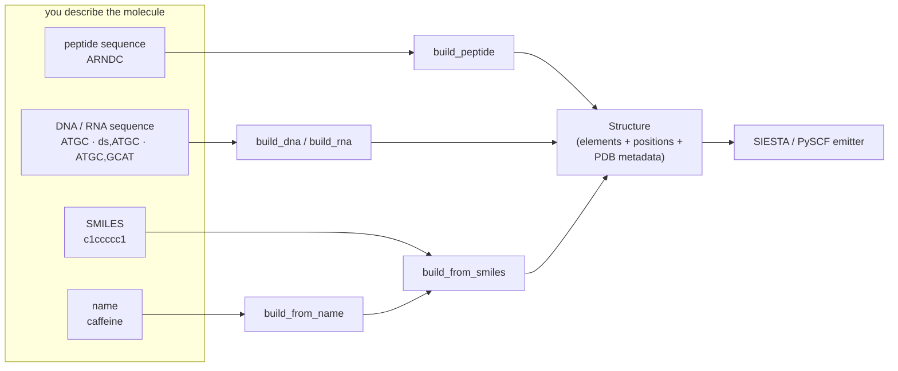
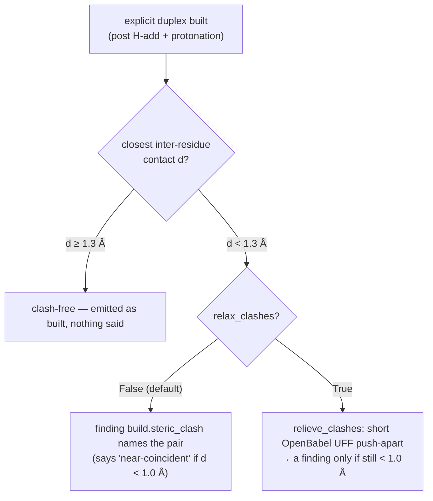
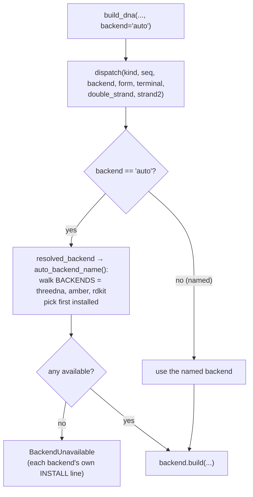
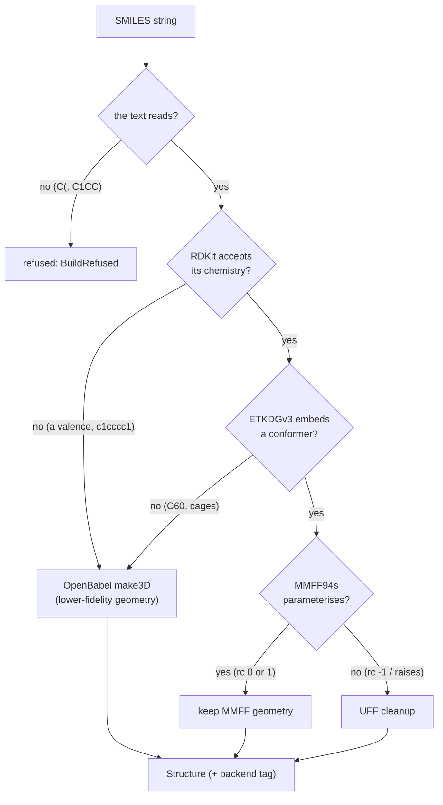

# Builders — sequence / SMILES / name → a 3-D `Structure`

**Role:** contract
**Domain:** engines
**Companions:** [`model/structure.md`](?doc=model/structure.md) (the `Structure`
every builder returns); [`model/chemistry.md`](?doc=model/chemistry.md) (the
hydrogen-placement + clash-relief helpers the builders call);
[`science/chemistry-correctness.md`](?doc=science/chemistry-correctness.md) (the
charge / spin science, and the amber methylene-H fix's chemistry);
[`engines/siesta.md`](?doc=engines/siesta.md) + [`engines/pyscf.md`](?doc=engines/pyscf.md)
(the emitters that consume a built structure — they need clean element strings).

A **builder** is any function that takes a human-friendly description — a peptide
sequence, a DNA/RNA sequence, a SMILES string, a compound name — and returns a
fully-formed 3-D [`Structure`](?doc=model/structure.md) ready to feed a SIESTA or
PySCF job. This is the **server-side synthesis contract**: what each builder
guarantees about its output, how the pluggable nucleic-acid backends are chosen,
and how molbuilder papers over each external tool's quirks so the API stays uniform.

> **The uniform output contract.** Every builder returns a `Structure` with
> `elements` + `positions` set, and `atom_names` / `residue_ids` / `residue_names`
> / `chain_ids` populated **wherever the source format provides them** (peptides and
> nucleic acids carry full PDB-style residue metadata; a SMILES molecule has
> per-atom names like `C1`, `O2` but no residues). Element strings are always
> whitespace-stripped — BioPython hands back space-padded elements like `" C"`, and
> the SIESTA/PySCF species detection downstream needs clean strings.

> **Vocabulary.** A **residue** is one monomer of a chain — an amino acid or a
> nucleotide. **PDB** metadata = the atom / residue / chain names from the Protein
> Data Bank file format. A **heavy atom** is any non-hydrogen atom. **SMILES** is a
> compact text notation for a molecule's atoms and bonds. A **conformer** is one 3-D
> shape a flexible molecule can adopt; a **force field** (MMFF94s, UFF) is a fast
> classical energy model used to tidy a conformer before the real quantum run. The
> builders make a *starting* geometry for a **DFT relaxation** (the quantum-chemistry
> geometry optimization molbuilder ultimately runs) — whose first **SCF**
> (self-consistent-field) step blows up if two atoms sit on top of each other. For
> nucleic acids: the two chemically distinct ends of a strand are **5′** and **3′**
> (sequences read 5′→3′); a **duplex** is two base-paired strands; **Watson-Crick**
> pairing is the standard A·T / G·C base pairs; **B / A / Z** are the three standard
> helix geometries (B = the common form, A = compact, Z = left-handed). (Charge /
> spin and the hydrogen-placement mechanism are in
> [`model/chemistry.md`](?doc=model/chemistry.md).)

---

## 1. The five builders

| Builder | Input | Module | Backends |
|---|---|---|---|
| `build_peptide(sequence, *, title=None, add_hydrogens=True)` | amino-acid sequence | `peptide.py` | PeptideBuilder (extended chain) |
| `build_dna(sequence, *, backend="auto", form=None, terminal=None, add_hydrogens="auto", protonate_phosphates=True, relax_clashes=False, title=None)` | DNA sequence / duplex notation | `nucleic.py` | threedna / amber / rdkit |
| `build_rna(sequence, *, backend="auto", form=None, terminal=None, add_hydrogens="auto", protonate_phosphates=True, title=None)` | RNA sequence (single strand) | `nucleic.py` | threedna / amber / rdkit |
| `build_from_smiles(smiles, *, title=None, optimize=True, seed=ETKDG_SEED, return_backend=False)` | SMILES string | `smiles.py` | RDKit (OpenBabel fallback) |
| `build_from_name(name, *, title=None, **smiles_kwargs)` | common / IUPAC name | `pubchem.py` | PubChem lookup → SMILES |



Everything a builder returns is a starting geometry, not a converged one — a
subsequent DFT relaxation is what produces the final structure. The builders' job is
to hand that relaxation something chemically correct and free of atomic near-overlaps.

**One build door** *(decided with the user, 2026-10-31, (b))*. Every surface —
the build route, the command line — builds through `builders.build(kind, text,
**asked)`: the builder its kind names (`builders.GENERATORS`, one row per kind:
the builder, what it takes beside its input, whether a nucleic-acid backend builds
it), `auto` resolved once before the build (`backends.resolved_backend`), and one
check after it (`validation.builders.check_built`,
[`science/validation.md`](?doc=science/validation.md) § 4.1 R5). The answer
(`builders.Build`) is the structure, the backend that built it, and the build's
**findings** — `Issue`s, never Python warnings: the structure's own, read off what
was built — a peptide's aldehyde end (`build.peptide_aldehyde`), a
nucleic acid's steric clash (`build.steric_clash`), a SMILES's or a name's
molecules overlapping (`build.molecules_overlap`, § 6) — and what the backend that
ran does not build of what was asked (`build.form`, `build.terminal`, § 5).
Each kind's row of `validation.builders._STRUCTURE_CHECKS` names its own
checks, so no check asks which kind it was given. The route answers them as notices;
the command line prints them as `validation.report` prints every finding.

**What a nucleic build may ask, one home** — the helical forms each kind is
built in, its default first (`backends.KIND_FORMS`: DNA `B`, `A`, `Z`; RNA `A`
alone, the one form any backend builds it in — *the user, 2026-11-18: "A only,
everywhere"*), each form's words (`backends.FORMS`), the backends
(`backends.BACKENDS`: `threedna`, `amber`, `rdkit`, in auto's order) with the
words a person picks each by, and the terminal states (`backends.TERMINALS`:
`OH`, `5P`, `3P`, `PP`), beside the defaults (`DEFAULT_FORM`, the first of each
kind's forms; `DEFAULT_TERMINAL`). `build_dna`
and `build_rna` refuse a form, terminal or backend outside them, naming them,
before any backend runs (`backends.check_ask`), as they refuse a hydrogen
mode they do not take (§ 7) and a true-or-false ask (`protonate_phosphates`,
`relax_clashes`) sent as anything but true or false. The build door refuses an
ask the kind does not take (`builders.GENERATORS`), and the route passes it
every field it was sent beside the kind and the text. Every surface's choices read them — the command
line's, and the Molbuilder tab's menus, which the server renders from them —
and each backend's own table covers them. What a backend builds of an ask is
its own to say (its module's `built` and `DUPLEX`, § 4): no rule, word or
page names one backend's abilities for it. **Every surface sends
what the person typed** — the panels check nothing of the builders' own rules
(a letter, a strand's notation, a form, a backend) and change nothing of the
text but its outer spaces: the grammar reads case and spaces (§ 2), and the
builder's refusal is the one said, under the panel.

**A refusal is one type.** What was asked that cannot be built — an empty
input (each builder's own: a sequence holding no residue, a SMILES holding no
atom, no name), a letter the grammar does not take,
a form no nucleic acid is built in, an ask the kind does not take, a duplex
asked of a backend that builds a single strand, a Z-form
sequence 3DNA does not build, a duplex 3DNA's `rebuild` does not take, a name
PubChem does not know, a SMILES holding a space or whose text does not read, or
that neither RDKit nor OpenBabel builds — is
`chemistry.BuildRefused` (a `ValueError`), in the builder's own words: the
build route answers it as a bad request (400), the command line as its
`Error:` message, never a traceback (`cli.main`'s door). Anything else a builder raises — an engine that fell
over, a fault of ours — is a server fault (500), and keeps its traceback on
the command line.

**A tool this install lacks** is `chemistry.BackendUnavailable`, its
`missing` naming it, whichever builder needs it. A Python package a builder
imports — PeptideBuilder for a peptide, RDKit for a SMILES, a name or an
RDKit nucleic acid, PubChemPy for a name, OpenBabel for a SMILES's fallback
or a duplex's clash relief — is imported through one door,
`chemistry.require(missing, needed_for=…)`, reading one table,
`chemistry.TOOLS`: each tool's name and the module that proves it is here.
How a tool is installed is its env's recipe's alone, and how a command is
spelled the env framework's
([`ops/env-framework.md`](?doc=ops/env-framework.md)): what is missing says
which env holds it — `env` on the answer, a backend's `ENV` (§ 4): the host
env's packages (`"host"`), AmberTools' own env (`"mdtools"`), none for 3DNA —
and one door, `builders.backends.install_command`, spells that env's command
from its recipe (the host env repaired with its optional packages,
PeptideBuilder and PubChemPy among them; another env installed). `chemistry`,
below the env framework, says the tool is one of the host env's packages
(`chemistry.INSTALL_TOOLS`) and the build door adds the command; a backend's
words carry it already (`backends.unavailable_words`) — no env name or
command is typed. A nucleic-acid backend's program is found by that backend's
own detection (§ 4); the hydrogen engines by `add_hydrogens`' chain (§ 7).
PubChem out of reach from here is said the same way (`missing="pubchem"`,
§ 6): somewhere else's, not this server's, no command. The route answers each
as advice, never as a fault (`web-api.md` § 1), and the command line as its
`Error:` message.

---

## 2. The sequence & notation contract

Peptide and nucleic-acid sequences share one tiny grammar (`residues._parse`):

- **Single letters**, case-insensitive — `ARND` (amino acids), `atgc` (DNA).
- **`[XXX]` brackets** open a 3- or 4-letter PDB code for a modified or non-standard
  residue: `AR[SEP]C` is Ala-Arg-phospho-Ser-Cys. A standard 3-letter code works in
  brackets too (`[ALA]`); the brackets just disambiguate.
- **Whitespace is ignored** anywhere (`A R N D` == `ARND`).
- Anything else — dashes, parentheses, `+` — **is refused**
  (`chemistry.BuildRefused`) with the position, so the syntax stays
  unambiguous; so is a sequence that holds no residue. Every strand of the DNA notation
  (§ 3) goes through this grammar whole — its end labels taken off first —
  so a DNA strand refuses what an RNA strand and a peptide refuse.

**Modified amino-acid residues** (`residues.MODIFIED_RESIDUES`) currently
cover seven codes, each as the PDB's Chemical Component Dictionary defines
it — each defined as heavy atoms added to a standard parent,
**placed in the parent's local frame**: each from three atoms already there
(the one it bonds to, and two before it), by its bond length, its bond
angle and its dihedral — PeptideBuilder's own placement
(`PeptideBuilder.calculateCoordinates`), the way the kit places every side
chain. The values are a starting geometry the DFT relaxation refines: the
bond lengths of the common phosphate, amine and amide groups, the angles of
each atom's hybridisation. No hydrogen is listed: the kit writes heavy
atoms only, and `chemistry.add_hydrogens` places every hydrogen, the
modified residue's with the rest:

| Code | Residue | Parent |
|---|---|---|
| `SEP` | phospho-serine | SER |
| `TPO` | phospho-threonine | THR |
| `PTR` | phospho-tyrosine | TYR |
| `MLZ` | N6-methyl-lysine | LYS |
| `MLY` | N6,N6-dimethyl-lysine | LYS |
| `M3L` | N6,N6,N6-trimethyl-lysine — a quaternary ammonium, +1, which a blank net charge does not count: warned, asking for the net charge ([`model/chemistry.md`](?doc=model/chemistry.md) § 1) | LYS |
| `ALY` | N6-acetyl-lysine | LYS |

**Lysine's side chain from the kit's own door, its amine corrected.**
PeptideBuilder's lysine geometry ends in a C=N (CE–NZ 1.33 Å, CD–CE–NZ
124.8°), so every lysine would be built two hydrogens short. The peptide
builder builds through the kit's geometry door (`make_structure_from_geos`),
lysine's three values set to an sp3 amine — CD–CE 1.525 Å, CE–NZ 1.470 Å,
CD–CE–NZ 109.5°, AmberTools' own LYS residue (`amino12.lib`) —
(`peptide._GEOMETRY_CORRECTED`): `AKA` is built with 24 hydrogens, NZ an
amine.

**5′/3′ directionality.** Bare letters follow the biology convention (5′ on the left).
Explicit end-labels are accepted, and `build_dna` and `build_rna` apply the **same
strict parser** (`residues._strip_directionality`; `build_dna` reaches it via
`nucleic._strip_direction`):

| Input | Interpretation | Result |
|---|---|---|
| `ATGC` / `5'-ATGC-3'` | 5′→3′ (implicit / explicit) | as written |
| `3'-CGTA-5'` | reverse-direction | reversed → 5′→3′ (== `ATGC`) |
| `5'-ATGC` / `ATGC-3'` | one-sided label | refused (`BuildRefused`) |
| `5'-ATGC-5'` / `3'-ATGC-3'` | self-contradictory | refused (`BuildRefused`) |

A validation check guards this from the other side: `_check_polymer_orientation`
(`validation/geometry.py`, one of the structure checks every loaded structure
gets, surfaced as a `polymer.orientation` issue) flags a chain whose
*structural* 5′ end (the nucleotide with no incoming O3′–P bridge) doesn't match
its lowest-numbered nucleotide, protecting against a future backend that lists
residues 3′→5′. It counts **nucleotides only** (`residues.nucleobase`, which
reads DNA's `DA`, RNA's `A`, an older file's `T`, and AmberTools' terminal
suffixes, `residues.AMBER_SUFFIX`): a phosphoserine's phosphorus is no
backbone. The bridge is one rule,
`chemistry.backbone_links` — residue *r*'s P within `O3P_BRIDGE_A` (1.80 Å) of
residue *r* − 1's O3′ in the same chain, each link answered with its
distance and whether it is bridged (`BackboneLink.bridged`), so no caller
compares — which 3DNA's and AmberTools' self-check after a build asks too
(`_common.verify_backbone_connectivity`; RDKit builds the bonds itself).

---

## 3. Nucleic acids — single strand, duplex, and mismatches

`build_dna` reads three notations from its `sequence` argument
(`nucleic.parse_dna_notation`):

1. **Single strand** — a bare sequence: `"ATGC"`.
2. **Canonical duplex** — prefix `ds,` (or `ds:`): `"ds,ATGC"` lays down the strand plus its
   auto-generated Watson-Crick complement (via X3DNA `fiber`).
3. **Explicit / arbitrary duplex** — two comma-separated strands: `"ATGC,GCAT"`.
   Both are 5′→3′ and paired **antiparallel** (base pair *i* couples `strand1[i]`
   with `strand2[N-1-i]`). A non-complementary pair (A·G, T·T, …) is a **mismatch**,
   placed at the standard base-pair frame as a B-form starting model. Built via X3DNA
   `rebuild` from an idealized Arnott B-DNA base-pair-step parameter file.

   > *Worked pairing.* For `"ATGC,GCAT"` (N = 4) the antiparallel pairs are A·T,
   > T·A, G·C, C·G — all Watson-Crick, a canonical duplex. For `"AAAA,TTTG"` the
   > first pair is **A·G**, a mismatch that lands at the standard frame as the
   > clash the next step says: guanine's N1 hydrogen 0.23 Å from adenine's N1
   > (measured 2026-11-18). Every base keeps its hydrogens all the same — 101,
   > as its two strands hold apart: a bond the hydrogen engine perceives
   > between two bases is no bond (§ 7).

**Gates**: a duplex is built on a backend that builds one (its module's
`DUPLEX`, `backends.duplex_backend` — today 3DNA's): asked of another while
one is installed, it is refused, naming it (`BuildRefused`); with none
installed, it is a tool this install lacks (`chemistry.BackendUnavailable`,
`missing` the first that builds one), which the build route answers as advice,
not a fault. The rest are refused (`BuildRefused`). Canonical duplexes support **B / A / Z** form
(Z needs an alternating poly-d(GC) sequence that starts with G, § 5); explicit two-strand duplexes are
**B-form only** and must be **equal length** (no overhangs/bulges yet) —
`rebuild`'s own rules, said where 3DNA is driven (`_threedna`). `build_rna`
is **single-strand only** (no duplex notation) and built in A-form, the one
form RNA is asked in.

### Steric clashes — said on every build, relieved on request for a mismatch

Atoms of two residues far too close make the first SCF step of a later DFT
relaxation explode. On **every DNA and RNA build** the closest inter-residue contact
is measured (`chemistry.steric_clash`, over `min_nonbonded_contact`) against two
thresholds, and the check after the build (`validation.builders`,
`build.steric_clash`) says a clash, the pair named — never repaired unasked
*(decided with the user, 2026-10-31, (b))*. Two ways one is built:

- **Between the two strands of a duplex**: a non-Watson-Crick pair placed at
  the standard frame *interpenetrates* (a canonical pair never does) — read off
  what was built, the clash's two atoms in two chains. `build_dna` relieves it
  in an explicit duplex when `relax_clashes` asks, and the check says what is
  left.
- **A strand as built**: tleap's `sequence` sets each link's ζ/α torsions to
  +60°/−41°, putting C3′ and the next residue's C5′ 2.66 Å apart; their
  hydrogens, as placed — tleap's own on RNA, the methylene repair's
  (`_fix_methylene_hydrogens`) on DNA — end with H3′ and the next H5′ 1.14 Å
  apart (measured 2026-10-31, every link of `ATGC` and `ACGU`). Said, with a
  force-field minimization before the optimization as the way on.

For the explicit duplex:



The finding a user sees (`relax_clashes=False`) names the clashing atoms and, when
they are near-coincident, the explosion risk:

```text
warn [build.steric_clash]: This duplex has a steric CLASH at A1:N1<->B8:H on N1
(0.23 A) -- a non-Watson-Crick (mismatched) base pair at the standard frame.
These atoms are NEAR-COINCIDENT -- relaxing as-is risks an explosive first SCF
step. Build it again with clash relief (Relieve clashes on the DNA panel) -- a
short force-field minimization that removes the near-coincidence, SIESTA
relaxing the rest -- or minimize externally before a geometry optimization.
```

A hydrogen OpenBabel placed is named by the atom it is bonded to (`H on N1`):
the engine names every one plain `H`.

`chemistry.CLASH_CONTACT_A = 1.3 Å` (a real steric overlap — below the tightest
legitimate canonical contact) and `chemistry.NEAR_COINCIDENT_A = 1.0 Å` (near-
coincident nuclei — the actual explosion risk). The relief
([`model/chemistry.md`](?doc=model/chemistry.md) owns the mechanism) first deletes
every mis-perceived inter-residue bond except the real O3′–P backbone link, then runs
steepest-descent + conjugate gradients so the overlapping atoms repel instead of
staying pinned. The goal is only to clear the near-coincidence — the DFT relaxation
does the rest.

---

## 4. The backend registry

The nucleic-acid builders don't build geometry themselves — they dispatch to a
pluggable backend (`builders/backends/__init__.py`):



- **`BACKENDS`** — each backend with the words a person picks it by, in
  order — is the single source of truth for auto-selection — **best geometry
  first**: canonical helix → extended chain → folded conformer — and for every
  surface's list of backends (§ 1).
- **`auto_backend_name()`** is a read-only resolver — it reports which backend
  `auto` *would* pick without running anything; **`resolved_backend(backend)`**
  asks it once, before the build, for every door that builds (`builders.build`),
  so the build runs and the check after it names the same backend.
- **`available_backends()`** maps each backend → runnable-here.
- **`KIND_FORMS`** (`{"dna": ("B", "A", "Z"), "rna": ("A",)}`), with
  **`DEFAULT_FORM`** its first of each, and **`DEFAULT_TERMINAL`** (`"OH"`):
  the forms each kind may ask and the form and terminal a build uses when
  none is asked; with **`TERMINALS`** and **`BACKENDS`**, refused otherwise by
  **`check_ask`** (§ 1) — every door reads them here.
- **`built(backend, kind, form, terminal)`** — what a backend builds of an ask
  (`Built`: the form, `None` where it shapes no helix, and the terminal, each with
  the words that say why — of itself only), answered by each backend's own
  module beside the table its build reads; the check after the build says what
  differs, in that backend's words (§ 5).
- **`duplex_backend(backend)`** — the backend a duplex is built on, asking each
  module's **`DUPLEX`** (§ 3); no rule names a backend.
- **`BackendUnavailable`** (defined in `chemistry`, the lowest layer that raises
  it) is raised when no installed backend can satisfy the request — each
  backend's own account (`backends.unavailable_words`: its module's
  `unavailable()`, else its words, its **`INSTALL`** line and its env's
  command) — and by
  `chemistry.add_hydrogens` when neither hydrogen engine (OpenBabel, RDKit) is
  installed, and by every other builder for a tool it lacks (§ 1). Its
  `missing` names what is absent: a backend's name (`BACKENDS`), a tool's
  (`chemistry.TOOLS`), `"hydrogens"`, or `"pubchem"` for PubChem out of
  reach — which the Build route reports as `backend`.
- **Adding a backend** is two steps: drop a `_<name>.py` defining `build()`,
  `is_available()`, `built()`, `DUPLEX`, `INSTALL` and `ENV` (and, where it can say
  more of why it is not installed, `unavailable()`), and name it in
  `BACKENDS` with its words. A backend checks nothing of its own absence:
  `dispatch` asks its `is_available()` before any build and answers a
  missing one as a tool this install lacks (`backends.unavailable_words`) —
  3DNA's says each place it looked and what it found there, the places one
  table its detection reads too (`_threedna._places`). Every road that needs
  a missing backend says it in these words: one named, a duplex asked
  (`backends.duplex_backend`, the backends that build one), none installed
  for `auto`.

| Backend | Helix shape | Install | Notes |
|---|---|---|---|
| **`threedna`** (X3DNA `fiber`/`rebuild`) | canonical B/A/Z (+ A-RNA); the duplexes | x3dna.org — **license-gated**, non-commercial; not pip/conda-installable | the only true-helix backend; molbuilder detects it (in-tree dir → `$X3DNA` → `fiber` on PATH) but never auto-downloads |
| **`amber`** (AmberTools `tleap`) | extended chain | its own env (`ENV = "mdtools"`, its command said, § 1) — never a `tleap` on the host's PATH ([`ops/installation.md`](?doc=ops/installation.md) M6) | clean OL15/OL3 force-field chemistry; a `timeout=120` guards a hung `tleap` |
| **`rdkit`** | folded conformer (not helical) | one of the host env's packages (`ENV = "host"`, its command said, § 1) | fine for short oligos a DFT run will fully optimize; poor for 10+ mers |

---

## 5. Backend quirks & how molbuilder compensates

Each tool gets something wrong; molbuilder repairs what it can so the
`build_dna`/`build_rna` contract is uniform across backends, and **says** what a
backend does not build — built all the same, as the backend makes it, with a
finding (`build.form`, `build.terminal`) from the backend's own `built()`,
in its words of itself only: which other backend builds the whole ask — a
duplex, a Z-form sequence, a terminal — is no single backend's to say, and the
Backend menu lists each with its own words.
What each produces raw:

| Backend | H atoms | terminal phosphate | residue names |
|---|---|---|---|
| `threedna` | **none** (heavy-only) | **always 5′-P** from `fiber`, one oxygen short: completed for `5P`/`PP`, stripped for `OH`/`3P`; no 3′-P | DA / DT / DG / DC |
| `amber` | included | **OH only** (a 5P/3P/PP asked is built OH, `build.terminal`) | DA5 / DT / DG / DC3 (5′/3′ suffixes); a single nucleotide DAN / AN, free at both ends; every link's H3′/H5′ 1.14 Å apart, said (`build.steric_clash`) |
| `rdkit` | included (`Chem.AddHs`) | **as asked**: OH, 5′-P, 3′-P or both (`MolFromSequence` flavors 6–9 for DNA, 2–5 for RNA); a 3′-phosphate is its own residue after the last nucleotide | per-residue DA/DT/DG/DC, each H in its anchor's residue (`AddHs(addResidueInfo=True)`) |

Of the helical forms: `amber` builds an extended chain and `rdkit` a folded
conformer — neither shapes a helix, so a form asked of them is said
(`build.form`, "was not built").

The X3DNA path needs the most repair (`builders/backends/_threedna.py`):

1. **Heavy-atom output → routed through `chemistry.add_hydrogens`** at the
   `build_dna`/`build_rna` layer (see § 7).
2. **A 5′-phosphate always written, and one oxygen short →
   `_five_prime_end`.** `fiber` and `rebuild` write the 5′ end's phosphate
   whatever is asked, as P, OP1 and OP2 — no OP3, a phosphate one oxygen
   short, an odd electron count (ATGC asked `5P`: 641 electrons, measured
   2026-11-18). For a 5′-OH end (`OH`, `3P`) it is removed (both modern `OPx`
   and legacy `OxP` names), the bridging O5′ kept; for a 5′-P (`5P`, `PP`) it
   is completed: its third oxygen at the phosphate's fourth tetrahedral site,
   at the template's own non-bridging P–O length, named in the template's own
   convention (`OP3`, or `O3P` beside the legacy `O1P`/`O2P`) — ATGC then
   holds the atoms RDKit's `5P` holds, 650 electrons — joined in its
   nucleotide's residue, after its last atom (`chemistry.with_atoms`, as the phosphate
   protonation's hydrogens are). A phosphate of another shape, its third
   oxygen among them already included, is the program's output changed,
   raised.
3. **3′-phosphate cannot be added → said.** `fiber`'s output is 5′-P / 3′-OH; a
   `3P` is built 5′-OH / 3′-OH and a `PP` 5′-P / 3′-OH, each said
   (`build.terminal`, "was built OH" / "was built 5P").
4. **Z-form is d(GC)*n* only** — fiber's Z model is the alternating repeat
   starting with G, laid by repeat count and never by sequence, so a Z-form
   sequence that is not `GCGC…` is refused, naming it: `CGCGCG` would come
   back as `GCGCGC`, and no strand of that duplex reads C first. (`-rna`
   builds A-form RNA only, the one form RNA is asked in, § 1.)

The **amber** backend post-processes `tleap`'s output with
`_fix_methylene_hydrogens` (`_amber.py`): `tleap`'s residue library copies H
positions verbatim, which is wrong at the C5′ methylene between O5′ and C4′, so this
recomputes *only* the -CH₂- hydrogen positions from tetrahedral sp3 geometry —
touching no heavy atoms and adding/removing none.

---

## 6. SMILES & name builders

`build_from_smiles` (`smiles.py`) tries **RDKit first** — an ETKDGv3 conformer +
an MMFF94s force-field cleanup — because that is RDKit's recommended path for typical
organics and preserves stereochemistry reliably. **OpenBabel is the fallback** for the
two things RDKit can't do:

- **chemistry RDKit refuses** though the text reads — a valence, or an aromatic
  ring it can't assign alternating single/double bonds to (`c1cccc1`), where
  `MolFromSmiles` returns `None` though the text reads without RDKit's chemistry
  checks (`sanitize=False`);
- **embed failures** — cages like C60, where ETKDG can't place a conformer.

**Text after a space that a SMILES reader takes as the SMILES's name** (`C C(=O)O`, read as methane) **is refused, and so is a text that does not read as SMILES** — an unbalanced bracket or
parenthesis, a ring left open, a symbol that is no element: what RDKit cannot read
even without its chemistry checks. It is never handed to OpenBabel, whose lenient
reader builds something else in its place (`C(` as methane, measured 2026-11-18). An extended-SMILES block after the space (`C |^1:0|`, a radical) is part of the
SMILES, and built.



The result records which engine produced the geometry (`return_backend=True` →
`(Structure, backend_str)`) so a caller can warn the user when they're on the
lower-fidelity OpenBabel path.

The optimizer (`smiles._rdkit_optimize`) keeps MMFF94s when it parameterises and falls
back to UFF only when MMFF returns `-1` (could not parameterise) or raises — a
max-iterations result (`1`) is still a valid MMFF geometry and is kept. The ETKDG
seed is pinned (`chemistry.ETKDG_SEED`, `0xF00D`) for reproducibility, and
the embedding is one recipe (`chemistry.embed_conformer`: ETKDGv3, then a
random-coordinates retry) and one conversion to a `Structure`
(`chemistry.molecules_to_structure`: RDKit's through `rdkit_to_structure`, which
the RDKit nucleic backend builds through too, and OpenBabel's), each molecule its
own residue by the engine's own split of its bonds (RDKit's `GetMolFrags`,
OpenBabel's `ContigFragList`). A SMILES that holds no atom — empty, or spaces —
is refused.

**Several molecules, said where they overlap.** A SMILES naming several molecules
(`O.O`, `[Na+].[Cl-]`, `CCCCCCCC.O`) is built as one structure where the embedder
puts them — RDKit's on top of each other (0.00 Å; a water's oxygen 0.77 Å from an
octane carbon; a chloride at a benzene ring's centre, 1.39 Å from each carbon;
measured 2026-11-18). The check after the build says two of them whose atoms sit
nearer than half the sum of the two atoms' van der Waals radii — the molecules
reaching halfway into each other (`chemistry.van_der_waals_radius`: ASE's table,
Bondi 1964 [`Bondi1964`] and Mantina et al. 2009 [`Mantina2009`]; for the 42
elements it holds no radius for — the transition metals, the lanthanides —
RDKit's, from the Blue Obelisk Data Repository, *the user, 2026-11-18: "RDKit's
radii for the gap"*) — naming the pair that overlaps
most (`build.molecules_overlap`, a warning), on the page and on the command line
alike *(the user, 2026-11-18: "we have an atom collision detection, that's the
warning we should have"; "Build by radii, rest 0.7 Å"; "Half the vdW sum")*. A
hydrogen bond, and an ion pair at its own bond length (Na⁺ 2.40 Å from Cl⁻ as
OpenBabel places them), sit farther: no overlap. Measured on 435 two-molecule
SMILES built both ways (2026-11-18), it says every contact under 1.3 Å — two
hydrogens 0.80 Å apart among them, which a bond-length rule never sees, since an
H–H bond is 0.74 Å — and two of the ion contacts OpenBabel places (Li⁺ 1.65 Å from
an oxygen); the halfway point is molbuilder's, chosen from those measurements.
With the gap filled, a metal ion inside a molecule is said too (Cr 1.40 Å from
benzene's carbons), and Fe²⁺ at a sensible contact (1.8–2.3 Å from O, F, Cl) is
not. A warning only: nothing here stops a build or a calculation. The molecules
are moved apart on the Molbuilder tab. Only a build knows its molecules: any other
structure has the general check, atoms closer than 0.7 Å
(`geometry.min_distance`), which also speaks below 0.7 Å.

`build_from_name` (`pubchem.py`) looks the name up in PubChem over the network
(`smiles_for_name`, a 30-second socket timeout), pulls the **absolute
SMILES** — stereochemistry and isotopes included (pubchempy's `smiles`) — and
defers to `build_from_smiles`. The connectivity-only SMILES is never used: it
would build "D-alanine" as whichever isomer the embedder lands on. Each
failure is said once, by whose it is: no name, a name PubChem knows nothing
by, a name it refuses, a record holding no SMILES — the request's,
`BuildRefused`; no network, the lookup out of time, PubChem busy or failing,
an answer that does not read (a proxy's or a network login's page in place of
PubChem's) — somewhere else's, `BackendUnavailable` (`missing="pubchem"`),
advice, each in words of its own.

---

## 7. Hydrogens & protonation

Two independent controls decide the H content of a built nucleic acid:

- **`add_hydrogens`** — tri-state (`"auto"` / `"on"` / `"off"`,
  `nucleic.normalise_h_mode`, which refuses any other value before a backend
  runs). `"auto"` is a size-aware
  heuristic: **skip if H/heavy ≥ 0.5** (amber ≈ 0.63, rdkit ≈ 0.72 arrive complete),
  otherwise add (X3DNA's fiber skeleton sits at ≈ 0.05, so it gets protonated). The
  0.5 cutoff is a convenience default, **not a correctness check** — for a structure
  in the gray zone (~0.3–0.6) pass `"on"`/`"off"` explicitly.
- **`protonate_phosphates`** (default `True`) — adds an H to each deprotonated
  non-bridging phosphate oxygen so the molecule is formally **neutral** (the easier
  DFT starting point — no `NetCharge` to set). Set `False` to keep the deprotonated
  state; the SIESTA/PySCF emitter then auto-sets the net charge. Only `amber`
  (tleap) leaves the phosphates deprotonated; `threedna` and `rdkit` build them
  neutral, where the flag has nothing to do (measured 2026-11-14: a four-base
  strand's H, 50 with and without it on those, 50 against 47 on `amber`).

The actual H placement lives in [`model/chemistry.md`](?doc=model/chemistry.md):
`add_hydrogens` tries **OpenBabel first** (geometric, no ghost-coordinate failure
mode; each base's bond orders given it from `residues.NUCLEOBASE_BONDS`, so every
base is its canonical tautomer, and a bond it perceives from a base's atom to
another residue deleted — two bases too close, a mismatched pair at the
standard frame, never a bond, which kept would take the place of the
hydrogens there), **RDKit as fallback** (which can leave "ghost" H at parent coordinates on
exocyclic -NH₂ sites — but only on the PDB-parse→`AddHs` path that the X3DNA
heavy-skeleton takes; SMILES-built molecules are unaffected), then a
`_drop_overlapping_hydrogens` pass strips any H that landed < 0.05 Å from another
atom. AmberTools' `reduce` isn't used even though it's already a transitive
dependency: keeping H-placement uniform and in-process across the peptide and nucleic
flows is worth more than its marginal, protein-only tautomer edge.

---

## 8. Surfaces — CLI and web

**CLI** (`molbuilder/cli.py`) — one command per builder, each writing `.xyz`
with its sidecar (`--out`) or a PySCF atom block (`--pyscf-atom-block`); a
`.pdb` is read, never written ([`model/structure.md`](?doc=model/structure.md)
§ 2.4):

```bash
molbuilder peptide "ARND[SEP]C" --out pep.xyz          # [SEP] = phospho-Ser
molbuilder dna "ATGC" --backend auto --out dna.xyz
molbuilder dna "ds,ATGC" --backend threedna --out duplex.xyz   # canonical duplex
molbuilder smiles "c1ccccc1" --out benzene.xyz
molbuilder name "caffeine" --out caffeine.xyz          # PubChem lookup
```

The nucleic commands add `--backend`, `--form`, `--terminal`, and
`--no-protonate-phosphates`; the duplex/mismatch notation flows through the
`sequence` argument; `--form`, `--terminal` and `--backend` offer the
registry's own words (§ 1). Every command builds through `builders.build` and prints the
build's findings on stderr (`warn [build.peptide_aldehyde]: …`), and the
structure's own findings (`validation.structure_findings`, what `molbuilder
validate` says with no engine named — atoms on top of each other among them),
every severity printed; a refusal or a missing tool is an `Error: …` answer,
never a traceback. The two controls
the CLI doesn't expose — `relax_clashes` and the `add_hydrogens` tri-state — are
reachable in Python through the same door, which answers the structure and what
the build found (a builder called directly returns the structure alone):

```python
from molbuilder.builders import build

# explicit mismatched duplex; relieve the steric clash for a clean DFT start
made = build("dna", "AAAA,TTTG", backend="threedna", relax_clashes=True)
made.structure, made.findings

# force full protonation regardless of what the backend produced
made = build("dna", "ATGC", add_hydrogens="on")
```

**Web** — the builder panels call `POST /api/build/molecule`, which builds through
the same door (`builders.build`) and answers the build's findings as notices, each
panel drawing them under its status; the DNA and RNA panels' Form and Backend
menus are the registry's, rendered by the server (§ 1); the result goes into the workspace via the
load door (`/api/build/load`). That client-side
flow is [`web/tabs.md`](?doc=web/tabs.md) § 2; this doc is the
synthesis contract behind it.

---

## 9. Regression pins

The protonation and directionality contracts are guarded by tests
(`tests/test_nucleic.py`, `tests/test_peptide.py`, `tests/test_residues.py`,
`tests/test_smiles_and_siesta.py`). Load-bearing ones:

- `test_dna_default_protonation_yields_simulation_ready_h_count` — H/heavy ≥ 0.55
  across all installed backends (catches the X3DNA path silently falling through to
  "no H added").
- `test_protonation_chemistry_matches_across_backends` — pins the canonical
  `5 O-H / 37 C-H / 8 N-H` breakdown (catches the RDKit-fallback regression that
  drops Watson-Crick H-bond donors), every base's canonical tautomer on DNA, RNA
  and a canonical duplex (catches cytosine read as its imino form), and each H in
  its anchor's residue.
- `test_threedna_strips_5prime_phosphate_for_terminal_oh` — pins P count = 0 for one
  nucleotide, 3 for ATGC (catches a strip-helper or fiber-format regression).
- `test_dna_add_hydrogens_false_returns_heavy_skeleton` — pins that `add_hydrogens`
  off is honored.

If any of these go red, the synthesis contract has drifted — re-derive what changed;
don't relax the thresholds.

---

## Tools & references

- **X3DNA** (`fiber` / `rebuild`, canonical B/A/Z helices + arbitrary duplexes) —
  x3dna.org (Lu & Olson, *Nucleic Acids Res.* 2003); non-commercial license,
  not auto-fetched.
- **Idealized B-DNA fiber geometry** (the `rebuild` base-pair-step frame the mismatch
  path starts from) — Arnott & Hukins, *Biochem. Biophys. Res. Commun.* **47**, 1504 (1972).
- **AmberTools** (`tleap`) — in the molbuilder-MDtools env (§ 4); the DNA/RNA
  force fields are OL15 (Zgarbová et al., *J. Chem. Theory Comput.*, 2015) / χOL3
  (Zgarbová et al., *JCTC*, 2011).
- **RDKit** conformer generation — ETKDG (Riniker & Landrum, *J. Chem. Inf. Model.*
  **55**, 2562, 2015); the **v3** variant adds small-ring / macrocycle torsion terms
  (Wang, Witek, Landrum & Riniker, 2020).
- **Force fields** used for the geometry cleanup — MMFF94 (Halgren, *J. Comput. Chem.*
  **17**, 490, 1996) and the **MMFF94s** static variant actually used (Halgren, *J.
  Comput. Chem.* **20**, 720, 1999); UFF (Rappé et al., *J. Am. Chem. Soc.* **114**, 10024, 1992).
- **OpenBabel** (`make3D`, MMFF94/UFF cleanup; the SMILES + H-placement fallback) —
  O'Boyle et al., *J. Cheminform.* **3**, 33 (2011).
- **PeptideBuilder** (extended-chain polypeptides) — Tien et al., *PeerJ* **1**, e80 (2013).
