# Transport (conductance) — the TranSIESTA / NEGF workflow

**Role:** contract
**Domain:** engines
**Companions:** [`execution/runs-of-points.md`](?doc=execution/runs-of-points.md) (a run of points: its words, data, operations and doors); [`engines/siesta.md`](?doc=engines/siesta.md) (the base `.fdf`
emitter transport extends); [`model/structure-annotations.md`](?doc=model/structure-annotations.md)
(the region-label *vocabulary* the derivation reads);
[`science/pseudopotentials.md`](?doc=science/pseudopotentials.md) (the Au pseudo
the leads need); [`engines/overview.md`](?doc=engines/overview.md) (the shared
engine contract).

> **Migration status — LANDED (2026-08-28/29).** Transport is a
> **different KIND of job** — one answer assembled from pieces
> ([`execution/architecture.md § 0`](?doc=execution/architecture.md),
> decided 2026-08-11) — and the composite is that kind given its own
> representation rather than bent into a ladder:
> [`archive/2026-09-01-transport-design.md`](?doc=archive/2026-09-01-transport-design.md), built
> P1–P6 and proven end-to-end on real binaries (the carbon-chain live
> walk). The pre-framework `transport bundle` driver this banner once
> guarded is deleted; § 8 records the closure.

> **The design is [§ 2a](#2a-the-parameter-map)** *(agreed 2026-09-16; what
> landed is measured in [§ 2a.14](#2a14-what-landed))*: what each stage decides,
> what it binds downstream, how strongly each consistency rule can be
> guaranteed, the directory structure, and the full parameter map. Read it
> before changing a parameter's home or adding one.

This is how molbuilder computes **electron transport** (conductance) through a
molecular junction — e.g. a single benzene-1,4-dithiol molecule bridging two gold
electrodes (Au–BDT–Au). It uses **TranSIESTA**, SIESTA's transport engine, which
solves the open-boundary problem with the **NEGF** method (non-equilibrium Green's
function).

> **Vocabulary.** A junction has a **scattering region** (the molecule + contact
> atoms) between two **electrodes** / **leads** (semi-infinite bulk metal). **NEGF**
> couples the leads into the device through energy-dependent **self-energies** Σ built
> from the *pristine bulk* lead. **$T(E, V)$** is the transmission — the probability
> an electron of energy $E$ crosses, when the junction is held at bias $V$. A
> calculation computes a **slice at one $V$**, so a single-bias run yields $T(E)$
> and a bias sweep yields the family (§ 2a.10). **$E_F$** is the **Fermi level** — the energy that
> separates filled from empty states, and the reference energy for conductance. A
> lead's **chemical potential $\mu$** is the energy its electron reservoir is filled up
> to (applying a bias offsets $\mu_L$ vs $\mu_R$). **$G_0 = 2e^2/h$** is the conductance quantum,
> and zero-bias conductance is $G = G_0 \cdot T(E_F)$. **`.TSHS`** is the file a lead run
> writes (its Hamiltonian H + overlap S). **TBtrans** is the post-processor that
> turns the device solution into `T(E)`. A **citation** is molbuilder's word for
> *the finished calculation a new one starts from* — here, the completed
> relaxation that produced the optimised junction. (DFT/SCF/k-points/pseudopotential
> are in the [`science/overview.md` glossary](?doc=science/overview.md).)

---

## 0. Orientation — what this calculation is, before any keyword

*(Written 2026-09-15 for a reader who has not done NEGF before, and because
§ 3.4's first attempt at explaining the k-point grids conflated two different axes
and read as self-contradictory. If you only read one section, read this one.)*

### 0.1 Why one run cannot do it

You want one number: how much current crosses the molecule. An ordinary DFT
run cannot give it, because an ordinary run needs a **closed** box — a finite
list of atoms with nothing outside. A junction is **open**: electrons arrive
from one gold wire and leave through the other, indefinitely.

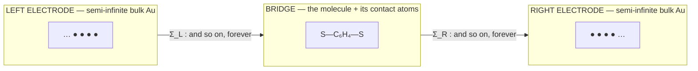

The trick is not to simulate infinite wire. You compute a small piece of
**pure bulk gold** once, and from it build a mathematical object — the
**self-energy** Σ — which says *"past this edge, more of the same, forever."*
The junction is then solved as a finite problem with two Σ attached.

That is why the workflow is five stages and not one.

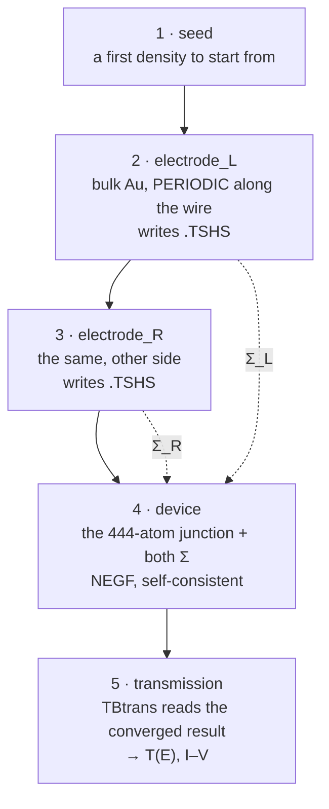

**You never build a lead by hand.** You label atoms `L-electrode` /
`R-electrode` on the Molbuilder tab; stages 2 and 3 are *derived* from those
labels (§ 4). This is the design decision the rest of the feature rests on.
Each lead's files are on its own stem, `<label>_L-electrode` /
`<label>_R-electrode` — its `SystemLabel`, which the device deck names and
SIESTA writes the `.TSHS` under — deck, output and the engine's files alike
(`job-contracts.md` § 2.1 rule 2; `kind_table.rung_label`, from the region
the kind table names each lead by).

### 0.2 The k-point grids — what each stage samples, and why *(rewritten 2026-10-13)*

*(The user, 2026-10-13: "a thorough investigation ... with literature/manual/document review"; "the transport document (.md) and the side panel ... thoroughly updated to include the kgrid discussion and citation to paper and source code". Every line number below is SIESTA 5.4.2's — `Src/` for TranSIESTA, `Util/TS/TBtrans/` for tbtrans — read on this machine on 2026-10-13; every paper is in `science/references.bib`, checked against Crossref.)*

**What a k-point is.** A crystal repeats one cell over and over, and the waves
of its electrons repeat with it: from one copy of the cell to the next, a wave
comes back the same apart from a phase shift. Each possible shift belongs to
one wavevector k, and a **k-point** is one such k. The k-points that give
different shifts fill the Brillouin zone, whose length along a direction is
inversely proportional to the cell's length along it ($2\pi/a$ for a cell of
length $a$): a short cell has a long zone, and a long cell a short one. A
calculation cannot treat every k, so it samples a regular **k-point grid** — a
count along each direction (Monkhorst–Pack), a 4 × 4 × 1 k-point grid for
example, placed by a **grid offset** (§ 0.3a) — and averages over it. More
points are more accurate, and slower. Along a direction in which the cell does
not repeat there is nothing to sample, and one point is exact. *(This document
says "k-point grid", never "mesh": in SIESTA the mesh is the real-space grid
set by `MeshCutoff`.)*

**The three directions.** **x and y** span the plane of the electrodes: the
electrodes are infinite metal surfaces, so the junction's cell repeats
sideways in that plane, one molecule in each copy, and every stage samples it
with a few k-points — *in the electrode plane (x, y)*. **z** is the transport
direction, the one the current flows along — *along z*. The device does not
repeat along z: it is the one piece between two semi-infinite leads. A lead on
its own is bulk metal, and along z it is a crystal like any other. Every
surface names a grid's direction this way — *in the electrode plane (x, y)* or
*along z* — and never says *across*, which in transport reads as "from one
lead to the other".

**The three k-point settings**, each set in one place:

1. **the shared k-point grid** (`kgrid`, on the shared panel) — in the
   electrode plane; one value, used by the seed, both leads and the device;
2. **the leads' k-points along z** (`electrode_kz`, on each lead's tab) — a
   count, not a grid: how many k-points each lead's run takes along z;
3. **the transmission k-point grid** (`tbt_k_grid`, on the transmission's
   tab) — in the electrode plane, used by tbtrans for T(E) alone.

Along z, every stage but the leads takes one k-point, which is fixed rather
than set (I8).

**What each stage samples:**

| stage | program | in the electrode plane (x, y) | along z | what those k-points decide | what the engine does with them |
|---|---|---|---|---|---|
| **seed** | SIESTA | the shared k-point grid, `kgrid` | **1** | a starting density for the device — never part of its answer | a plain periodic run: it samples the grid as written |
| **each lead** | SIESTA, `TS.HS.Save` | the shared k-point grid — it **must** be the device's | **`electrode_kz`**, 100 (warned below 50 and above 200, refused at 1) | the lead's density, Hamiltonian, overlap and Fermi level, saved in its `.TSHS` | TranSIESTA compares the lead's grid and offset with the device's and stops on a mismatch (`ts_electrode.F90:1188–1235`); it warns only when a lead has fewer than 20 k-points along z (`:1193–1199`) |
| **device** | TranSIESTA | the shared k-point grid | **1**, offset 0 | the junction's density and Hamiltonian, at each bias | sets z to one k-point with offset 0 whatever the deck says, without a message (`ts_kpoint_scf.F90:87–92`) |
| **transmission** | tbtrans | the transmission k-point grid, **`tbt_k_grid`** — its own; left blank, three times the shared grid | **1** | T(E) | rebuilds each lead's self-energy at its own k-points (`tbt_init.F90:208–210`), does not compare its grid with the shared one (`m_tbt_options.F90:694–695`), sets z to one k-point (`m_tbt_kpoint.F90:411–422`) |

**What each stage hands the next, and where each grid enters:**

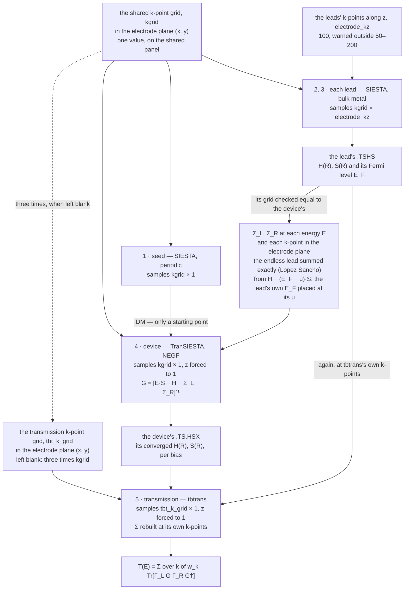

#### Why the seed, both leads and the device share one k-point grid in the electrode plane

The device treats each lead's Hamiltonian as the bulk metal of its own
electrode region. The **self-energy** — a correction that stands in for the
endless lead beyond the cell (§ 0.1) — says *"more of this lead, forever"*,
and it attaches the right metal only if the lead's run and the device's
electrode block describe the same metal. They come from two separate SCF runs,
and a run's density — and so its Hamiltonian — depends on which k-points it
sampled in the electrode plane. Sampled on the same grid, the lead's bulk
continues the device's electrode block seamlessly. Sampled on different
grids, the self-energy attaches a slightly different metal; the result is a
spurious step in the potential at the boundary, and no error message.
TranSIESTA does not leave this to chance: it reads each lead's grid and offset
from its `.TSHS` and compares them with the device's — the counts in the
electrode plane must be equal (times any Bloch expansion, which repeats a
smaller lead cell to fill the electrode block), and the offsets equal **on all
three axes, z included** — and it stops with *"found incompatible k-grids"*
(`ts_electrode.F90:1188–1235`; the `TS.Elec.<>.check-kgrid` option, on by
default). The manual: TranSIESTA "requires that the device and electrode k
samplings are commensurate", and "the scattering region forces the
electrodes to use equivalent k points" [`SiestaManual542`]; the developer:
"Yes, they should be the same" [`Papior2019`]. molbuilder never
Bloch-expands a lead — each lead is the device's electrode block atom for atom
(I10) — so *commensurate* means *equal*, and one value, `kgrid`, holds it for
all four runs by construction (I7).

#### Why each lead takes many k-points along z — what they decide, and what they do not

A lead's run is an ordinary periodic SCF of bulk metal, and along z it is a
crystal like any other. The device, by contrast, never samples z: it attaches
each lead through a self-energy, built at each energy and at each k-point in
the electrode plane (written $k_\parallel$ below) from two real-space blocks of the
lead — $H_{00}$, one lead cell, and $H_{01}$, its coupling to the next cell along z
(`ts_electrode.F90:1859–1903`) —

$$
\Sigma_L(E, k_\parallel) = (z \cdot S_{10} - H_{10}) \cdot g_L(E, k_\parallel) \cdot (z \cdot S_{01} - H_{01}), \qquad z = E + i\eta
$$

with the surface Green's function $g_L$ of the endless lead — how an electron at
the lead's surface spreads into the half-infinite metal behind it — summed
**exactly** by the Lopez Sancho iteration [`LopezSancho1985`] (TranSIESTA
prints its name as it starts, `m_ts_electrode.F90:945`), and the z component
of k set to zero (`ts_electrode.F90:1496–1507`; [`Brandbyge2002`]). **No
k-point along z enters Σ.** What does enter is the lead's Hamiltonian, and its
Fermi level: before the iteration TranSIESTA shifts each lead's blocks by that
lead's own Fermi level $E_F$ less the lead's chemical potential $\mu$
($H_{00} - (E_F - \mu) \cdot S_{00}$, `m_ts_electrode.F90:1462, 1503`), so the lead's $E_F$
sits at its $\mu = \pm V/2$ — at 0 V, $\mu = 0$ and the shift is $E_F$ itself.
Both come from the lead's own SCF, a bulk-metal calculation whose density,
bands and Fermi level converge only with many k-points along z. The reason is
the cell's length: a thin lead cell (three Au(111) layers are ≈ 7 Å) has a
long Brillouin zone along z, and a few points sample it coarsely — the
metal's bands are then seen at too few places, and the Fermi level that comes
out is off. So `electrode_kz` does not smooth the self-energy; **it decides
the Hamiltonian and the energy reference the self-energy is made of.** With
too few points, every Σ — and so every T(E) — is built on a slightly wrong
lead, shifted in energy, and nothing reports an error. (How smooth Σ is as a
function of energy is set by the broadening, `ts_elecs_eta_ev`, and by the
grid in the electrode plane — not by this count.)

The manual: "If in doubt, use 100 k-points along the semi-infinite direction"
(Electrodes), and "at least >50 should easily be reachable" (Convergence)
[`SiestaManual542`]; the developer: "much simpler to just use a very high
number (like 100)" [`Papior2019`]. TranSIESTA's own warning comes only below 20
(`ts_electrode.F90:1193–1199`). molbuilder starts at **100**, warns below
**50** — the manual's floor — and above **200**, and refuses 1
(`electrode_kz`'s `range`, `[50, 200]`, and `above`). The cost is small: only the two lead runs grow with this count, and
a lead is a small cell. **To check it**, run the leads again at a higher count
and compare each lead's Fermi level with the one before: settled, it stays
put. Nothing in molbuilder compares two counts for you. The Results tab shows
both leads' Fermi levels, each as its run computed it, and judges neither.

#### Why one k-point along z on the device — and on the seed

On the device, z is the open direction: the leads' self-energies stand in for
everything beyond the cell, so nothing periodic is left to sample along z,
and one k-point there is exact. TranSIESTA sets one point with zero offset
there whatever the deck says, without a message (`ts_kpoint_scf.F90:87–92` —
for two leads along one cell vector and the ramp Poisson solution, which is
molbuilder's shape); the manual asks the same of any TranSIESTA grid: "Always
take care to use only 1 k point along non-periodic lattice vectors"
[`SiestaManual542`]. molbuilder writes the 1 in the deck itself rather than
relying on the engine to force it, so the deck says what runs (I8).

The seed is a different kind of run: a plain periodic SIESTA calculation of
the whole junction, so along z it does repeat and could be sampled. It takes
one point for two reasons. Its cell is long along z — the molecule and several
gold layers on each side — and a long cell has a short Brillouin zone along
z, so few points are needed there. And its density is only the device's
starting point: the device's NEGF cycle converges to its own answer from it,
so a rougher start costs iterations, not accuracy. The developer: "Sometimes it
can work better to have k-points along the semi-infinite direction for the
device. Other times not so much. In any case 1 along the semi-infinite
direction in the device is fine" [`Papior2019`].

#### Why the transmission has its own, finer k-point grid in the electrode plane

T(E) is the average, over the k-points $k_\parallel$ in the electrode plane, of the
transmission at each one,

$$
T(E) = \sum_{k_\parallel} w_{k_\parallel} \cdot \mathrm{Tr}\left[ \Gamma_L(E,k_\parallel)\, G(E,k_\parallel)\, \Gamma_R(E,k_\parallel)\, G^\dagger(E,k_\parallel) \right]
$$

and it varies far more sharply from one k-point to the next than the density
does. The density adds up every filled state, which smooths it; T(E) at one
energy picks out the states at that energy alone, and the leads' band edges
(van Hove singularities, where the number of states per energy changes
abruptly) put sharp features into it. A coarse grid shows those features as
strong, unphysical peaks [`Thygesen2005`]. The manual: "Importantly(!) the
k-point sampling need typically be much higher in a tbtrans calculation to
achieve a converged transmission function" [`SiestaManual542`].

A different grid is allowed because tbtrans does not reuse the device's
self-energies: it rebuilds each lead's self-energy at its own k-points from
the lead's `.TSHS` (`tbt_init.F90:208–210`, the same Σ builder), and
evaluates the device's stored real-space H and S at those k-points too. It
checks no relation between its grid and the shared one — its lead check is
called without a k-point grid (`m_tbt_options.F90:694–695`), although the
tbtrans manual says it checks one. It sets one k-point along z
(`m_tbt_kpoint.F90:416`, *"We MUST kill all k-points in this direction"*). So
the transmission k-point grid is an item of its own, `tbt_k_grid`, and raising
it re-runs the transmission alone — no SCF stage runs again.

The deck writer follows two engine facts about how tbtrans reads its grid.
First, tbtrans reads `TBT.k` (a list `[N1 N2 1]` or a block) before
`TBT.kgrid.MonkhorstPack` and before the deck's `kgrid_Monkhorst_Pack`, and
never reads `TS.kgrid.*` (`m_tbt_kpoint.F90:776–812`) — so `TBT.k` is always
written, and it is the grid tbtrans uses. Second, a block row is read only
when it carries the offset column: a row of three counts is skipped without a
message, and T(E) is then computed at Γ alone — the single point $k = 0$
(`m_tbt_kpoint.F90:340–342`) — so the offset column is always written
(`kmesh.write`). *(The manual's Convergence item prints "$N_k^{\mathrm{TS}} \ge N_k^{\mathrm{tbtrans}}$"
right after "much denser"; the inequality contradicts the sentence it ends and
is read as a typo.)*

**A finer transmission k-point grid cannot rescue a shared k-point grid that is
too coarse.** The shared grid decides the device's Hamiltonian; if that
Hamiltonian is wrong, evaluating it at more k-points does not make it right.
Settle the shared grid first.

### 0.3 Setting them up — the order, and how each is checked *(2026-10-13)*

The manual's procedure: converge the leads first; use their parameters for the
device and converge those too — "an iterative process since the scattering
region forces the electrodes to use equivalent k points" — and then converge
tbtrans's k-points [`SiestaManual542`]. In molbuilder's terms, one value at a
time:

1. **The shared k-point grid** (`kgrid`, on the shared panel) starts as the
   cited relaxation's (§ 3.1). It is converged for the leads and the device
   together, because they must use the same one: raise each count in the
   electrode plane about 1.5×, run the leads and the device again, and it is
   settled when the leads' Fermi level and the device's T(E_F) stay put.
   Changing it re-runs every SCF stage, since all four use it.
2. **The leads' k-points along z** (`electrode_kz`): keep 100. Raising it must
   not move a lead's Fermi level; if it does, the lead was not converged.
3. **The transmission k-point grid** (`tbt_k_grid`): run the transmission at
   its starting grid — left blank, three times the shared grid — then again
   with each count about 1.5× larger (12 → 18), and lay the two T(E) curves
   over each other. It is settled when T(E_F) moves by less than about 1 % and
   no peak moves; a peak that moves or vanishes when the grid changes comes
   from the sampling, not from the junction. That is the developer's method —
   compare the k-averaged T(E) of several grids — and once settled, one grid
   serves every voltage, so the points of a bias sweep are compared on the
   same sampling [`Papior2019`]. Raising it re-runs the transmission alone.
   Once set, it is the person's and stays as set; it is warned if it falls
   below the shared grid (§ 0.3b).

**What it costs.** Each stage's run time grows with the number of k-points it
computes. Time reversal makes k and −k equivalent, so each such pair is
computed once (on by default in both programs; `TBT.Symmetry.TimeReversal`):
a Γ-centred $N \times N$ grid is $(N^2 + 4)/2$ points for an even $N$ and $(N^2 + 1)/2$ for
an odd one — 4 × 4 is 10, 12 × 12 is 74, 18 × 18 is 164, 30 × 30 is 452. A
lead's 100 k-points along z cost the lead runs alone; the device's cost is its
k-points in the electrode plane times its contour's energy points, every SCF
cycle and every bias; tbtrans's is its k-points in the electrode plane times
the energy window's points, once.

### 0.3a The grid offset — where the k-points sit *(user, 2026-09-29)*

`kgrid_displacement` shifts the k-point grid away from Γ (the point $k = 0$),
one value per axis, in units of one grid spacing: `0` is Γ-centred — Γ is one
of the points — and `0.5` is the classic Monkhorst–Pack shift, every point
moved half a spacing. In a transport calculation it acts in the electrode
plane only, and its value is one fact shared by every stage.

**Along z it does nothing.** On the device and the transmission the leads'
self-energies take the place of a sum over k-points along z, so both engines
use a single k-point there with zero offset, whatever the deck says —
TranSIESTA in `ts_kpoint_scf.F90` (`process_k_cell_displ`), tbtrans in
`m_tbt_kpoint.F90` (the transport direction's `displ` set to 0).

**In the electrode plane, the offset chooses where every stage's k-points sit
— and so where T(E) is sampled.** T(E) is the average of the transmission at
each k-point in the electrode plane (§ 0.2), and the offset only moves those
points. At `0` the grid contains Γ. At `0.5` every point moves half a spacing:
on an **even** count that avoids both Γ and the edge of the Brillouin zone —
the Monkhorst–Pack grid — and on an **odd** count it trades Γ for the zone's
edge. The even-or-odd rule is about the **number of k-points** along the axis,
never the number of atoms in the cell.

**Where the atom count does enter: a supercell folds k-points onto Γ.** A
supercell in the electrode plane made of $n \times n$ primitive cells folds k-points
of the primitive cell's Brillouin zone onto its own Γ — the 3 × 3 Au(111) cell
of the acceptance ladder (TD8) folds the primitive cell's K point there — so
the states at Γ include these folded copies, which are degenerate. That is not
a numerical hazard for NEGF: the Green's function at Γ is as well-defined as
anywhere, the broadening takes care of degeneracies, and the device region is
not filled level by level. It matters for a material with a special point
there — graphene's Dirac point lands on Γ in a $3n \times 3n$ cell, so whether a
coarse grid contains Γ changes T near E_F a great deal. Converge the grid in
the electrode plane until T(E) and the conductance G stop changing; for gold
it is benign.

**On a hexagonal cell, keep it Γ-centred.** An offset of `0.5` does not respect
a hexagonal lattice's six-fold symmetry, so the k-points fall unevenly. SIESTA
folds only k with −k (`find_kgrid.F`; no spatial symmetry is used), so nothing
is computed wrong — the sampling is less balanced and converges more slowly.
The usual choice for a hexagonal cell, an Au(111) junction among them, is `0`.

**One offset for every stage — and the engine checks it.** TranSIESTA compares
each lead's grid and offset, read from its `.TSHS`, with the device's — the
offset on all three axes, z included, which is why a lead's offset along z is
0 as the device's is — and stops on *"found incompatible k-grids"*
(`ts_electrode.F90:1188–1235`, the `TS.Elec.<>.check-kgrid` option, on by
default); the manual asks for the same parameters in the electrode and the
device calculations, except the lead's own count along its semi-infinite
direction [`SiestaManual542`]. tbtrans takes `TBT.k` as a list —
`TBT.k [3 3 1]`, counts only, no offset — or as a block, which carries one
(`m_tbt_kpoint.F90`, `read_kgrid`).

**What molbuilder does** *(ruled 2026-09-29, plan § 5w K17; built 2026-09-30
with `kmesh.py`, K3)*. The offset is a `citation` item: `molbuilder describe`
carries the cited run's offset into the template beside its grid — from the
cited deck's own block, or the recorded contract's `kgrid_displacement` — and
every stage writes it through the one writer
([`siesta.md`](?doc=engines/siesta.md) § 6.1), with the offset along z `0` as
both engines use it, and with the transmission's `TBT.k` always in its block
form, which carries it. *(Until then no transport deck honoured it: every stage
wrote `0.0` and the template took `[0, 0, 0]` whatever the relaxation ran. The
acceptance ladder relaxed at `0`, so it matched by coincidence.)*

### 0.3b How dense each grid starts, and the warnings — chosen with the literature *(user, 2026-10-09; revised 2026-10-13)*

*(User, 2026-10-09: "You should give me your recommendation of these
questions based on scientific justification ... do a literature background
search"; then "I agree with your choice of these parameters". Revised
2026-10-13 from the SIESTA 5.4.2 manual and source: the lead's floor raised to
the manual's, the transmission's start left to its rule, its coarser-than-SCF
warning added — the user: "yes to A, B and C".)*

| the setting | starts at | why | the literature and the engine |
|---|---|---|---|
| **the leads' k-points along z** — `electrode_kz`, on each lead's tab | **100**; warned below **50** and above **200**, the catalogue's recommended range; 1 refused | It decides the lead's Hamiltonian and Fermi level, which every self-energy is built from and aligned to (§ 0.2). What matters is the number of k-points times the lead cell's length along z: a three-layer Au(111) lead (≈ 7 Å) with 100 points is sampled as finely as one point on a cell ≈ 700 Å long, far beyond what bulk gold needs. That makes 100 a safe default, and only the lead runs pay for it | "If in doubt, use 100 k-points along the semi-infinite direction"; "at least >50 should easily be reachable" [`SiestaManual542`]; "much simpler to just use a very high number (like 100)" [`Papior2019`]; TranSIESTA's own warning is below 20 (`ts_electrode.F90:1193–1199`) |
| **the shared k-point grid in the electrode plane** — `kgrid`, on the shared panel | the cited run's (§ 3.1) | One grid for the seed, both leads and the device: the device uses each lead as the bulk metal of its own electrode region, so both must be sampled on the same k-points (§ 0.2) | the leads' and the device's grids "should be the same" [`Papior2019`]; TranSIESTA stops if they differ (`ts_electrode.F90:1235`); a 4 × 4 grid converged the benchmark junctions' conductance to a few per cent [`Strange2008`] |
| **the transmission k-point grid in the electrode plane** — `tbt_k_grid`, on the transmission's tab | **left blank: three times the shared grid's count along each direction it samples with more than one point**, worked out when the deck is written (`kmesh.transmission_start`, asked by `kmesh.mesh_for`; 4 4 1 → 12 12 1), so it follows the shared grid; a count of one stays one; z is 1 | T(E) has sharp structure from the leads' bands that the density does not have, so it needs more k-points — and a finer grid for it re-runs no SCF stage. **Three is molbuilder's starting point, not a converged answer**: no source gives a factor; three times a typical shared grid (3 × 3 to 5 × 5) lands at or above the grids published gold–benzenedithiol junctions converged at, for about a quarter to a thirtieth of the cost of the 30 × 30–50 × 50 sometimes quoted (by § 0.3's count of the k-points computed: 9 × 9 to 15 × 15 is 41 to 113, against 452 to 1252). The person converges it (§ 0.3) | "the k-point sampling need typically be much higher in a tbtrans calculation" [`SiestaManual542`]; sparse sampling in the electrode plane gives strong, unphysical features in T(E), from the leads' van Hove singularities [`Thygesen2005`]; benzenedithiol between Au(111) leads of a 3 × 3 cross-section: Γ alone "fluctuates very much compared to the converged result", 8 irreducible k-points used [`Thygesen2005b`]; 4 × 4 converged to a few per cent [`Strange2008`]; graphene, whose density of states vanishes at E_F, needs far more — the worst case [`Falkenberg2015`]; converge by comparing the k-averaged T(E) of several grids, and use one transmission grid for every bias [`Papior2019`] |

**Four warnings, never refusals.** The first three are the one k-point
check's (`kmesh.check`), said by prep's settings gate on every stage's deck,
and also when the Transport tab describes the calculation, on each stage's
grid as the description resolves it (`transport/deck.ladder_mesh_findings`):
a finding on the shared grid is shown once, beside the shared panel's
control, and a finding on the transmission grid on the transmission's tab.
The fourth is `electrode_kz`'s recommended range in the catalogue,
`[50, 200]`, warned as every item's range is: by the settings gate on each
lead's deck (`validation/metadata.py`) and by the description's own check on
a lead's value (`validation/task.py`, `_values_in_range`), both through
`metadata.outside_range`.

| warning | why | the literature |
|---|---|---|
| **one k-point along a direction the electrodes repeat in** — the shared grid, or a transmission grid the person set, at 1 along x or y while the structure repeats there. Never said for a direction that does not repeat (a chain or a wire in a box, where one point is exact), and one point is a legitimate quick first test | A single k-point in the electrode plane treats every sideways copy of the cell as in phase, so the metal's bands are seen at one place only. The warning's words name the remedy: the benchmark used 4 × 4 for a cell about 9 Å wide | with Γ alone, "a (unphysical) peak at the Fermi level" (an H₂ junction), and the conductance of benzenedithiol between gold raised from 0.24 to 0.37 G₀ [`Strange2008`]; the Γ-only error dominates the error from the cell's periodic images in a 3 × 3 supercell [`Thygesen2005`]; with TranSIESTA on an Au(111) junction the conductance was "more sensitive to the reciprocal-space sampling grid than the quality of the basis set", moving by up to a factor of five over the parameters tried [`Hoft2007`] |
| **a transmission grid the person set coarser than the shared grid** along x or y (2026-10-13) | T(E) needs at least the k-points the density was converged on, and usually many more; most likely the shared grid was raised and the transmission's was left behind. A transmission grid left blank is three times the shared grid and is never coarser | tbtrans's sampling "should generally be much denser" [`SiestaManual542`] |
| **a transmission grid the person set above the Γ point while the shared grid is Γ alone** (2026-10-17) | A device run at Γ alone writes its Hamiltonian with no supercell. tbtrans stops in its set-up — *"Transiesta calculation was a Gamma calculation while you request transmission k-points"* (`tbt_init.F90:166–171`; measured on the road's junction, 2026-10-16) — only when its grid's first k-point is not $k = 0$: its test reads that one point (`m_tbt_kpoint.F90`, `setup_kpoint_grid`). The grid starts at $k = 0$ whenever a count in the electrode plane is 1 or 2 (`find_kgrid.F`: the lowest index along an axis is $-\lfloor (n-1)/2 \rfloor$, and time reversal starts one axis at 0 — with no offset; with `kgrid_displacement` 0.5 no point is $k = 0$) — 2 × 2, 1 × N, N × 1, 2 × N, N × 2 — and then tbtrans runs on, every k-point given the $k = 0$ Hamiltonian, and its T(E) is invalid; it stops only when both counts are 3 or more. Warned, never refused — what to do is the person's *(user, 2026-10-17; 2026-10-20: "warn, worded truly")*: the words say both outcomes and name sampling the shared grid in the electrode plane (x, y) and running the device again, or the transmission at 1 1 1 | the engine's own check, on the grid's first point; tbtrans's message names SIESTA's `ForceAuxCell`, which molbuilder does not write |
| **the leads' k-points along z outside 50–200** | outside the item's recommended range. Below 50 is under the manual's floor — a floor, not a proof of convergence: only raising the count and seeing the lead's Fermi level stay put shows it has settled. Above 200 the two lead runs cost more | "at least >50 should easily be reachable" [`SiestaManual542`] |

**The Γ-device warning, by example.** Two settings meet here: `kgrid`, the
shared k-point grid of the seed, the leads and the device (the shared panel),
and `tbt_k_grid`, the transmission's (its tab; left blank, three times
`kgrid` along each direction `kgrid` samples with more than one point, a 1
staying 1). With `kgrid = 1 1 1` the device is computed at one k-point only,
and SIESTA saves its Hamiltonian in a compact form that is exact there and
works nowhere else; a `tbt_k_grid` above 1 asks tbtrans for T(E) at several
k-points, which that form cannot give. What tbtrans does then is decided by
its grid's first k-point alone: its test reads that one point
(`m_tbt_kpoint.F90`, `setup_kpoint_grid`) and stops the run only when it is
not $k = 0$ (`tbt_init.F90:166–171`). So tbtrans either stops as it starts,
before it computes anything, and only the transmission's launch fails — or,
on a grid whose first point is $k = 0$, runs on, giving every k-point the
$k = 0$ Hamiltonian, and writes a T(E) that is invalid:

| `kgrid` | `tbt_k_grid` | what happens |
|---|---|---|
| `4 4 1` | blank | runs; tbtrans uses `12 12 1` |
| `4 4 1` | `12 12 1` | runs |
| `1 1 1` | blank, or `1 1 1` | runs, at one k-point (the one-point warning) |
| `1 4 1` | `4 4 1` | runs: the device samples more than one k-point, so its Hamiltonian is saved whole |
| **`1 1 1`** | **above 1, both counts in the electrode plane 3 or more, e.g. `4 4 1`** | **prep warns; tbtrans stops as it starts** |
| **`1 1 1`** | **above 1, a count of 1 or 2 along x or y: `2 2 1`, `1 4 1`, `4 2 1`** | **prep warns; tbtrans runs on with the $k = 0$ Hamiltonian at every k-point, and its T(E) is invalid** |

So it is said only of a transmission grid set by hand above 1 on a
calculation whose shared grid is `1 1 1` — a quick test on a small junction,
or a grid copied from a larger calculation; a blank `tbt_k_grid` never meets
it. **The two ways on, the person's:** raise `kgrid` in the electrode plane
(x, y) — it re-runs the seed, both leads and the device, then the
transmission — or leave `tbt_k_grid` blank or `1 1 1`. *(tbtrans's own
message points at SIESTA's `ForceAuxCell`, which keeps the whole form even
at one k-point; molbuilder does not offer it — a device converged at one
k-point is a weak start for a transmission sampled on many, § 0.2, and
neither way needs it.)*

**Where each lives:** `electrode_kz`'s value and range in the catalogue; the
three-times rule in `kmesh.transmission_start`, applied by `kmesh.mesh_for`
to a blank `tbt_k_grid` and named in the deck's provenance block
(`resolve.BLANK_ANSWERED_BY`); the first three warnings in `kmesh.check`,
the fourth `electrode_kz`'s range, warned by `metadata.outside_range`. The references
are `science/references.bib`'s, each checked against its publisher's record
(Crossref) on 2026-10-09 or 2026-10-13; the method itself is
[`Papior2017`]'s, after [`Brandbyge2002`].

### 0.4 The four things that must agree, and where each is enforced

Every one of these, if wrong, gives a **plausible-looking wrong answer**
rather than a crash — which is why they are guards in code and not advice.

| # | must be true | enforced where | on the composite path? |
|---|---|---|---|
| 1 | device `kz = 1` | **fixed**: the rung's mesh writes 1 (`kmesh.mesh_for`), the form draws the component locked, and every door refuses another value (`kmesh.fixed` through `template.why_not`, [`siesta.md`](?doc=engines/siesta.md) § 6.1) *(an error in `validation.transport.validate_transport_kind`, the kind's validator, from 2026-09-16 until 2026-09-30, beside a warning about the same axis in the SIESTA validator)* | ✅ on every door. *(Named `TransiestaEngine.preflight` here until 2026-09-16; that one was keyed on `TransportConfig` in `_ENGINE_VALIDATORS` while every rung resolved a `SiestaConfig`, so it dispatched for nothing — deleted 2026-09-17, the class 2026-10-02. Its OTHER checks — region contiguity, the region partition — went silent with it: see § 3.6a. The open-shell question is the electronic state's, asked on every rung since 2026-09-28.)* |
| 2 | the leads' k-points along z are many (dense) | default **100**, a catalogue row (`electrode_kz`) that each lead's k-point grid reads for its count along z (§ 0.2) | ✅ **held** — the value reaches the deck (the lead's grid writes `0 0 100` as its row along z), it is editable in the template, and it is refused at 1 by its own limit (`above`) and warned below 50 and above 200 by its range, on every door ([`siesta.md`](?doc=engines/siesta.md) § 6.1; `validate_transport_kind` held both from 2026-09-17 until 2026-09-30). *This row said the warn "still lives only in the standalone `molbuilder transport preflight` verb, so a composite run never sees it" — true when written, and left standing for several hours after the re-homing that fixed it.*
| 3 | the k-point grid in the electrode plane (x, y) and its offset are identical in lead and device — so the lead is the bulk of the device's electrode region (§ 0.2) | one shared `kgrid` and `kgrid_displacement`, which every stage's k-point grid reads (`kmesh.mesh_for`) — and TranSIESTA itself stops on *"found incompatible k-grids"* (`ts_electrode.F90:1235`) | ✅ by construction |
| 3a | the junction is neutral | **error**, the electronic state's family (`validation/chemistry.py`, ES7) — and a cited run that carried a charge is refused at `molbuilder describe` — the boundaries are open, so the electron count is the electrodes' to set, and a lead must stay neutral or the Fermi level every stage is measured against moves | ✅ on every prep, since 2026-09-16 (§ 2a.7's deferral, declared on the row and enforced at the gate) |
| 4 | basis, XC and mesh identical | ONE value shared by every stage, so they cannot disagree. *(Until 2026-09-16 this read **sealed** — taken from the cited run and uneditable. Superseded by § 2a.7: the cited run DEFAULTS them and the person may change them, everywhere at once. The invariant is unchanged; only its enforcement moves from inherited to single.)* | ✅ |

> **Corrected 2026-09-15.** This table said all four were guards in code. Row 2
> is not, on the path that matters: the check exists and nothing on the
> describe / prep / launch path calls it. Stated here rather than quietly fixed
> because the difference between *"a guard exists"* and *"a guard fires on your
> run"* is the whole value of the column.

Number 4 is why the tab makes you **cite a finished relaxation** instead of
typing a basis: the numbers arrive from that run's deck, so they cannot
disagree with what the leads were computed with. The manual is blunt that
TranSIESTA expects a *metallic* electrode and that fixing the boundary is
"an intricate and important" matter.

### 0.5 Worked example — the Au–BDT–Au junction in this repo

`projects/claude-transport-walk/transport/au-dta-t` — the 2026-10-08 walk's
sweep, cited from a CONCLUDED relaxation of molbuilder's own (the numbers
below are the Au–BDT–Au design's, 2026-09; the walk's junction is smaller):

| | |
|---|---|
| structure | 444 atoms — 432 Au, one benzene-1,4-dithiol bridge |
| labels | `L-electrode` (low z) · `BRIDGE` · `R-electrode` (high z) |
| contract, from the citation | DZP · GGA-PBE · 300 Ry mesh |
| device k-points | `2 2 1` — 2×2 in the electrode plane, **one along z** |
| electrode k | `2 2 100` — the same 2×2, **dense along z** (`electrode_kz`'s default) |
| bias | `0.0` → equilibrium, so the non-equilibrium contour settings are inert |
| what prep writes | `01_seed` … `05_transmission`, **a deck each plus its `.validation.txt`** — every rung goes through `spec_for` → `DeckSpec` → `prepare_deck`, so the validate → render → read-back-check → report chain is the same one every other kind gets (§ 2a.14). *(This row said the opposite, describing a `write_text` arm deleted on 2026-09-16.)* |
| the deliverable | `<label>.transport.json` — T(E) per bias, G(E_F), the I–V table — and `<label>.transport.nc`, the same results as data on their grid, raw beside derived (§ 2a.12) |

## 1. The mental model — one citation → five derived stages

Conductance is **not one run**. It is several coupled SIESTA runs that must
agree numerically — a relaxed junction, a bulk-electrode run per lead that
emits a `.TSHS`, the NEGF device SCF, and the TBtrans transmission.
Correctness hinges on those runs sharing **one numerical contract** (XC,
basis, mesh, pseudopotentials) **and a geometric clone** of the electrode.

Since 2026-08-29 that agreement is not checked after the fact — it is
**impossible to break by construction**: transport is the COMPOSITE
calculation (`archive/2026-09-01-transport-design.md`). You relax the junction as an
ordinary task (outer metal layers labeled `L-electrode`/`R-electrode` and
frozen), then the transport calculation **cites that finished attempt** — or
the structure pair saved from it (§ 3.1) — and derives everything else — the
sorted copy, both electrode cells (extracted from the labeled blocks), and the
five stage decks, all rendered from the one template the citation defaulted
(§ 2a.7).

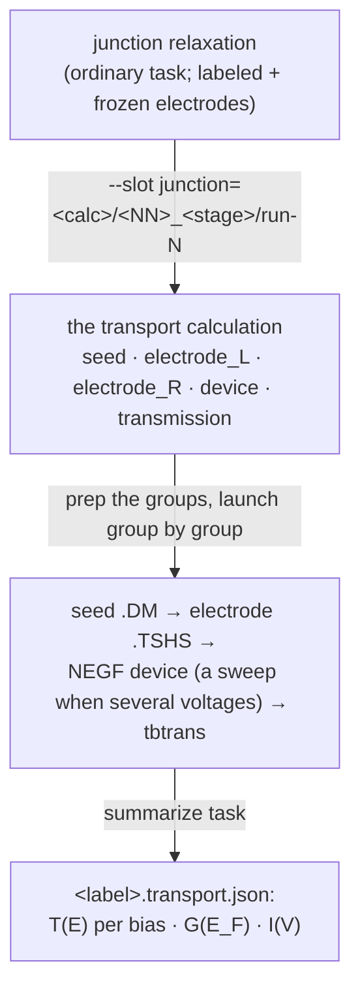

**The consistency contract is the whole game**, and the derivation is what
enforces it: electrode and device render from ONE template, defaulted from
the citation, so a mismatch is unrepresentable (§ 5 records what that
guarantees, and what holds each rule).

### 1.1 The procedure, end to end — from the relaxation to the current *(user, 2026-10-05)*

*The whole calculation in order, on one page: what each step computes, the
science that makes it necessary, the equation it solves, and what it hands to
the next. Each step names the sections that own its rules; this page restates
them, and where it could disagree with one, that section is the rule.*

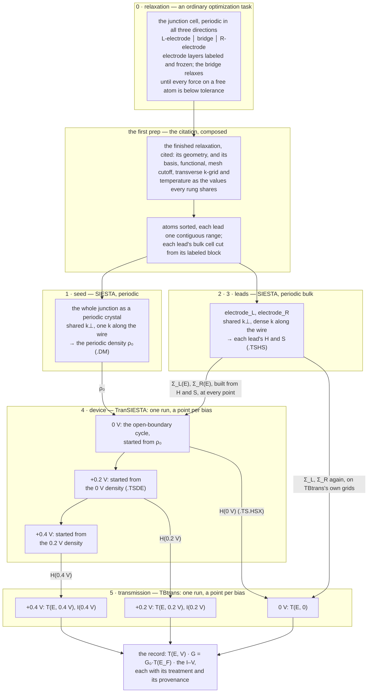

#### Step 0 — relax the junction *(an ordinary optimization task; § 3.1, § 2a.9, § 7.1)*

The junction is built and relaxed as any structure is. Its cell holds the two
electrode blocks — several layers of the metal, stacked as in the bulk crystal
(§ 7.1) — and the bridge between them: the molecule and its contact atoms. The
cell is periodic in all three directions: across the wire because the junction
repeats sideways, along it because the two electrode blocks continue into each
other through the cell's boundary, one bulk layer spacing apart (I12). The
electrode layers are labeled `L-electrode` and `R-electrode` and frozen; the
bridge relaxes, SIESTA moving the free atoms down the total energy until every
force

$$
F_i = -\frac{\partial E_{\mathrm{total}}}{\partial R_i}
$$

is below the tolerance. The electrode layers are frozen because they stand for
bulk metal: the lead calculations replace everything beyond them by the bulk
crystal, so they must be exactly that crystal (§ 2a.9, *the electrodes do not
move*).

**What transport asks of the held set** *(user, 2026-10-14)*: **every atom
carrying an electrode label is held** — the citation door reads the
structure's `frozen_atoms` label and refuses an electrode atom that is not
in it, naming it (`wizard._refuse_unless_frozen_bulk`) — and nothing more.
Holding more atoms is never refused: a junction that comes out of a
vibration, where everything but the molecule in the gap and a few surface
atoms was held for the spectrum ([`engines/vibration.md`](?doc=engines/vibration.md)
§ 2.3a), carries that larger set, and its frames move only atoms the mode
moves, so its electrode atoms stand still by construction. **The labels and
the record are two stores**: `frozen_atoms` sits in the structure's `regions`
with every other label — the electrode partition among them — and is what a
calculation holds; what the junction's relaxation held is its
`info.relaxation` record's `held_atom_keys`, history the person's labels do
not change ([`model/parse.md`](?doc=model/parse.md) § 5b.1). A transport
calculation runs no relaxation, so it holds nothing itself: the held set
matters to it only as the promise that the leads are the bulk they stand for
— which is a fact about the relaxation. So the check reads the label, and
then the relaxation: **an electrode atom its relaxation record did not hold
is refused**, naming it, whatever the label says now — the record's
`held_atom_keys`, read from the junction as cited when the record is about
those coordinates (`parse.contract.held_atoms_of`; *the user, 2026-10-17*);
and a cited run's electrodes are also measured unmoved against where its
relaxation started (`prior_positions`, 10⁻³ Å).

What this run decides for every rung after it: the geometry, and — as defaults
the person may change, one value for all five rungs — the basis, the
functional, the mesh cutoff, the transverse k-grid and the electronic
temperature (§ 2a.7, § 3.1). One value for all five is what makes the leads and
the device two pieces of one calculation rather than two calculations that
look alike (§ 0.4, § 5).

#### The first prep — the citation, composed *(§ 3.1, § 4, § 6.2)*

The transport calculation cites the finished relaxation, and its first prep
composes it: the atoms sorted so each lead is one contiguous range — how
TranSIESTA identifies an electrode (§ 2a.14) — and each lead's bulk cell cut
from its labeled block, its cross-section the junction's (I6) and its period
along the wire the span of its layers plus one layer spacing — the crystal's own
repeat only when the layer count is a whole stacking period, which the lead's
seam verdict says (§ 7.1). Nothing about a lead is typed
by a person: it is derived from the labels (§ 4). The composition is written as
a record beside `task.json`, and **every later prep reads that record** while
it is for the cited junction. **No usable record** is one of three: none yet
(before the first prep), one composed for another citation or with the leads
named the other way round (`swap_electrodes`), or an older one whose junction
composed again is another (below). A prep composes afresh — and writes the
record again — only when there is no usable one and no stage is launched
(`gather.composed_for_prep`); the gather reads the same record, by
the same one read (`transport_rung.junction_record`), and compares an older
one in memory, writing nothing.

**A junction whose sidecar states no order record** — written before the
field, `atom_order` absent — is known by what the file states, never by the
molbuilder that wrote it *(the user, 2026-10-15: "feature/format detection")*
([`model/overview.md`](?doc=model/overview.md) § 2.2a, I9; the codec's read,
`compose.recorded_junction`). Its record is usable when the junction composed
again from the same citation, in memory, is the recorded one *(decided with
the user 2026-10-15, plan UPG)* — compared in TranSIESTA's order: the same
number of atoms and frames; atom *i* the same element, at the same place
within 10⁻⁶ Å in every frame; the same cell vectors within 10⁻⁶ Å and the same
kind on each axis; every label the same set of atoms (the electrode blocks,
the bridge, a buffer, the held atoms) (`compose.junction_difference`). **The
same**: the prep writes the record again through the composition's one writer
(`compose.write_compose_record`) — `junction.xyz` the recorded junction, its
atoms, places, cell and labels as they were, its sidecar now stating the
order record, and `slot-provenance.json` at `@2`; no run folder is touched,
and the prep saves the folder's state first, as every prep does. **Not the
same**: no usable record, the first difference named — the atom and what
differs.

**With a group launched, the recorded junction is never replaced** *(the
user, 2026-10-15: "i don't want to invalidate the previous calculation
already launched"; one rule for every junction, decided the same day)*: its
runs ran on it. A prep that finds no usable record while a stage is launched
is refused and writes nothing, naming why and the state saved before the
launched group's first launch (`gather.no_usable_record`; R-P21);
while none is launched, it composes afresh and writes the record. The launched group's runs are taken by the next only when they ran
the same engine input (§ 6.1's gates).

**No group left to prepare**: `prep task` with no group named records the
order of a junction whose sidecar states none — the check above, the
folder's state saved first, nothing else written, and never a junction
composed afresh: an older junction that is not the same is refused (R-P21) —
so a calculation an older molbuilder ran to its end gets its data file and
its PDOS ([`job-system.md`](?doc=execution/job-system.md) § 5.0, R-P3).

#### Step 1 — the seed: the periodic density *(SIESTA; § 6.1, § 2a.15)*

An ordinary Kohn–Sham self-consistent cycle on the whole junction, treated as
a periodic crystal — the shared k-point grid in the electrode plane (x, y), one k-point along z:

$$
H[\rho]\, \psi_{nk} = \varepsilon_{nk}\, S\, \psi_{nk} \qquad \rho = \sum_k w_k \sum_n f(\varepsilon_{nk} - E_F)\, \lvert\psi_{nk}\rangle\langle\psi_{nk}\rvert
$$

solved until ρ stops changing; it writes the density matrix, `.DM`. That
density is not part of the answer: it is where the device's 0 V cycle starts —
the manual's own procedure, which starts the open-boundary cycle *"from a fully
periodic calculation"* and calls the 0 V point *"the only calculation where you
start from SIESTA"*. A good start is worth a run of its own, because the
open-boundary cycle is the expensive one.

#### Steps 2 and 3 — the leads: each one's H, S and self-energy *(SIESTA; § 0.2, § 5)*

Each lead's cell is bulk metal, periodic in all three directions. Here the
transport direction really is periodic — the lead is infinite along it — so
the lead takes many k-points along z (`electrode_kz`, 100 by default, I9), and
in the electrode plane (x, y) it uses the device's grid, the shared k-point
grid (I7); § 0.2 says why each. The cycle is an ordinary one; what the device
needs from it is not its density but its Hamiltonian H and overlap S, written
in real space (`.TSHS`, `TS.HS.Save`, I13). From them TranSIESTA builds each
lead's **self-energy** — a correction that stands in for the endless lead
beyond the cell: what the semi-infinite rest of the lead does to the electrode
block it is attached to (the manual: *"the electrode self-energy is calculated
from the bulk electrode calculation"*). It is built at each energy E and at
each k-point in the electrode plane, written $k_\parallel$:

$$
\Sigma_L(E, k_\parallel) = (z \cdot S_{10} - H_{10}) \cdot g_L(E, k_\parallel) \cdot (z \cdot S_{01} - H_{01}), \qquad z = E + i\eta
$$

where $H_{01}$ and $S_{01}$ couple one lead cell to the next along z, and $g_L$ is the
surface Green's function of the semi-infinite lead. Its anti-Hermitian part is
the lead's **broadening** — how fast an electron in the junction leaks into it:

$$
\Gamma_L(E) = i \left[ \Sigma_L(E) - \Sigma_L(E)^\dagger \right]
$$

Σ is one matrix for each energy and each k-point in the electrode plane,
built from the lead's real-space H and S at whatever k-point is asked for,
with the endless lead along z summed exactly (Lopez Sancho; no k-point along z
is involved) and the blocks shifted by the lead's own Fermi level less its
chemical potential, so its Fermi level sits at μ (§ 0.2). So
the lead's k-points along z matter through its own SCF — they decide the
Hamiltonian and Fermi level that Σ is made of — which is why there must be
many of them; and its grid in the electrode plane must be the device's because
the lead is the bulk of the device's electrode region, which TranSIESTA
checks. The lead must be at least a principal layer thick — Σ assumes a lead cell couples only to its
neighbours (I11), which TranSIESTA checks as the device starts, stopping with
*Electrode connectivity is not perfect*, said in the result with what it means
(§ 6.3) — and its cell is the device's electrode block atom for atom,
so Σ attaches where it belongs (I10).

#### Step 4 — the device: the open-boundary cycle, at each bias *(TranSIESTA; § 2, § 4, § 6.1c, § 2a.11)*

The device is the whole junction again, but open along the wire: the two leads
enter only through their self-energies, so there is one k-point along it (I8),
and its electrons are found from the Green's function instead of from
eigenstates — the manual's NEGF equation:

$$
G(z) = \left[ z \cdot S - H[\rho] - \Sigma_L(z) - \Sigma_R(z) \right]^{-1}
$$

**The bias** is the difference of the leads' chemical potentials: the left lead
is filled to $\mu_L = E_F + eV/2$, the right to $\mu_R = E_F - eV/2$ (§ 4, *bias
direction*; `TS.Voltage` is *"the actual potential drop between the
electrodes"*). The electrostatic potential carries the same drop: TranSIESTA
superimposes a linear ramp across the cell on the solution of the Poisson
equation (`TS.Poisson`, *ramp*, the default for two aligned leads), so the
Hartree potential in H[ρ] holds each lead at its own level.

**The density, from the Green's function.** With the leads filled to different
levels the density has two parts (Brandbyge 2002; Papior 2017), at each
k-point of the electrode plane, summed over the grid:

$$
\rho = \underbrace{-\frac{1}{\pi}\, \mathrm{Im} \int G(E)\, f(E - \mu_R)\, dE}_{\text{as if in equilibrium with R}} \;+\; \underbrace{\frac{1}{2\pi} \int G(E)\, \Gamma_L(E)\, G^\dagger(E) \left[ f(E - \mu_L) - f(E - \mu_R) \right] dE}_{\text{what the left lead adds, in the bias window only}}
$$

The first part is an equilibrium integral, and the Green's function is smooth
away from the real axis, so it is not taken along the axis. TranSIESTA's
general method takes it on a contour in the complex plane, its lower bound
*"well below the lowest eigenvalue"* (the manual); the decks molbuilder writes
take its continued-fraction branch instead — the Fermi function expanded in
Ozaki's poles above the real axis, at $\mu + i\,x_p\,kT$, and one point far up it
(the expansion's zeroth moment, $10^{10}$ eV), `m_ts_contour_eq.f90` — with no
contour and no lower bound; the pole energy and the count it gives are § 6.1c's. The second part is non-zero only
in the bias window, where $f_L \neq f_R$, and must be taken on the real axis, close
to the poles of G, with a fine grid and a small broadening η. TranSIESTA
computes ρ both ways round — referenced to R as written, and to L — and weighs
the two element by element, leaning on the one whose bias-window part is
smaller, since that part carries the larger error (`TS.Weight.Method`;
Brandbyge 2002). At 0 V the window is empty and only the contour part
remains.

**The cycle**, at one point:

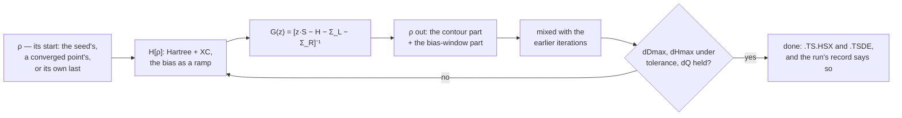

H is rebuilt from the new ρ, mixed with the earlier
iterations, and the cycle repeats until the density and the Hamiltonian stop
changing (`dDmax`, `dHmax` under their tolerances) and the charge in the cell is
held: the manual asks that `dQ`, the charge not accounted for, stay a very small
fraction of the total — under 0.1 % at 0 V — or the electrode layers are too
few to screen the junction ([`model/parse.md`](?doc=model/parse.md) § 5d.6
watches all three). A converged point leaves:

- `.TS.HSX` — its converged H(V) and S, which the transmission reads;
- `.TSDE` — its converged density and energy-density matrices, which the next
  bias point starts from.

Its total energy is not part of the answer: *"energies from TranSIESTA are not
to be trusted"*, the manual warns, the open boundaries complicating the energy,
so energies are not compared across biases or calculations. The deliverable is
T, G and I.

**The sweep** (§ 2a.11) is one run, its points walked in order from 0 V. The
0 V point starts from the seed's ρ₀; each later point from the converged
density of the closest bias before it — the manual's advice: *"copy the TSDE
from the closest, previously, calculated bias for restart and much faster
convergence"*. Small steps keep each start close to its answer and, on a
junction with more than one self-consistent solution, keep the sweep on the
one continuous with equilibrium. A point is done or not done; launched again,
the sweep's next run takes the done points over and runs the rest, or with
`--cold` runs every point (§ 2a.11).

#### Step 5 — the transmission and the current *(tbtrans; § 0.2, § 2a.10, § 2a.12, § 6.1b)*

tbtrans runs no self-consistent cycle. At each bias point it reads that point's
converged H(V) and S and both leads' H and S, and rebuilds Σ_L and Σ_R at its
own energies (the window, `TBT.Contour.window`) and at the k-points of its own
grid in the electrode plane (`TBT.k`, the transmission k-point grid, finer
than the shared one — § 0.2). At each of those k-points $k_\parallel$ it evaluates the
transmission, and averages them with weights $w_{k_\parallel}$:

$$
T(E, V) = \sum_{k_\parallel} w_{k_\parallel}\, \mathrm{Tr}\left[ \Gamma_L(E, k_\parallel)\, G(E, k_\parallel)\, \Gamma_R(E, k_\parallel)\, G^\dagger(E, k_\parallel) \right] \qquad \text{(the weights } w_{k_\parallel} \text{ sum to 1)}
$$

— the probability that an electron of energy E arriving from one lead crosses
into the other, summed over the channels. From it, the current at that bias
(Landauer–Büttiker):

$$
\begin{aligned}
I(V) &= \frac{2e}{h} \int T(E, V) \left[ f(E - \mu_L) - f(E - \mu_R) \right] dE && \text{spin-degenerate: both channels} \\
I(V) &= \frac{e}{h} \sum_\sigma \int T_\sigma(E, V) \left[ f(E - \mu_L) - f(E - \mu_R) \right] dE && \text{spin-polarized: each channel its own}
\end{aligned}
$$

Only energies in the bias window — between $\mu_R$ and $\mu_L$, widened by a few $k_BT$ —
contribute, so the transmission window must cover it for the current to be
whole. tbtrans prints one spin channel's current; the record's is the
junction's total (§ 2a.12). At zero bias the window closes, and the observable
is the **conductance**:

$$
G = G_0 \cdot T(E_F), \qquad G_0 = 2e^2/h \approx 77.5\ \mu\mathrm{S} \qquad \text{per channel when polarized: } (e^2/h) \cdot (T_\uparrow + T_\downarrow)
$$

**The two treatments** (§ 2a.10). With **`low_bias_approximation: true`** the
device and the transmission run once, at 0 V, and the record computes the I–V
from that one slice — the **low-bias approximation**: the transmission's
dependence on bias neglected, T(E, V) taken as T(E, 0) as the window opens:

$$
I(V) \approx \frac{2e}{h} \int T(E, 0) \left[ f(E - \mu_L) - f(E - \mu_R) \right] dE
$$

sound while $eV/2$ is small against the distance from $E_F$ to the nearest
resonance. With **`low_bias_approximation: false`**, every voltage gets its own
device SCF and its own T(E, V), and each I(V) is tbtrans's integral over its own
window, with no approximation beyond the method; the transmission takes the
device's sweep run whole, each point its own point's H (§ 2a.11).

#### The record — what is read back *(`summarize task`; § 2a.12)*

`summarize task` composes `<label>.transport.json` from the rungs' records: T(E,
V) per point and spin channel; T(E_F) and the conductance, the E_F reference
asserted (TBtrans's convention, below); the I–V, its treatment named and its current the junction's total; the
DOS and eigenchannels TBtrans was asked for; and the provenance — which
relaxation, which lead runs, which device run, and what each point started
from. And the caveat that goes with any DFT-NEGF conductance: plain GGA puts the
molecule's levels too close to E_F and overestimates a molecular junction's
conductance, often by one to two orders of magnitude (§ 2). Beside it,
`<label>.transport.nc`: the same composition as data on its grid — every point's
raw outputs beside what molbuilder derives from them, a frame set's rows beside
each frame's values — for analysis (§ 2a.12, *the data file*).

**What it holds today** *(2026-10-07)*: each rung's state and detail — the one
status door's, as `jobset status` and the ladder say it — with a rung's SCF as
it ran (every row of its last step, phase-tagged, the criteria each phase had to
reach), a seed's and a device's energy and SCF convergence, the device's NEGF
phase's own E_F, charge and cycles, and each lead's E_F; per bias point T(E),
T(E_F), the conductance and the current (total and as printed), the device
DOS, the leads' spectral and bulk DOS and the transmission eigenchannels —
TBtrans's k-averaged text files on the data file's energies — and the PDOS by
region from each point's kept reading of its data file (*A point's digest*,
below; [`model/parse.md`](?doc=model/parse.md) § 5e); the points without a transmission as `pending` or `failed` in
their run's words; for a frame set, each point's frame and that frame's
`customized` rows, the I–V per frame, the mode's average at each voltage
(§ 2a.12, built 2026-10-10) and the frame set it is taken over, cited whole —
its rows with their meanings, the vibration, the masses (`frame_set`, built
2.46.0); the treatment; the provenance slot and the chain — each
rung's `.gathered-from`; the DFT-NEGF caveat. The PDOS of any atoms, by orbital
type, is asked of `/api/transport/pdos`. The Results tab composes the record on
read (`/api/transport/record`); `summarize task` writes the same composition to
the file. **Asserted, not checked**: the E_F reference is TBtrans's convention and the record says so (`energies_relative_to_ef: true`); nothing measures it against the output, and nothing is asked to. The `.TBT.nc` reader was checked on a real run's file — the
carbon-chain walk, 2026-10-07 (`web/results.md` § 2.5).

### 1.2 What each result depends on — what a change re-runs, and what it reuses *(user, 2026-10-22)*

*(The user, 2026-10-22, reviewing the Au–BDT–Au transmissions: "sometimes we
need to look at the result and decide to expand, for example, the energy
range … from −2 to 2 electron volts … to between −3 and +3 … add a few more
bias sweeps … I believe then a lot of the intermediate result is shared";
"what are the intermediate result that will be used, reused, and how new
results when certain parameter changes … Which part are changed? Which part
are invariable?" Every engine fact below is SIESTA 5.4.2's source — `Src/`
for TranSIESTA, `Util/TS/TBtrans/` for tbtrans — read 2026-10-22, or the
manual [`SiestaManual542`]; the method is [`Brandbyge2002`] and
[`Papior2017`].)*

**The answer, in one paragraph.** The expensive results — the leads'
Hamiltonians and each bias point's converged device — depend on the
electronic method, the geometry, the k-points of the SCF runs and the bias;
they do **not** depend on the energies the transmission is sampled at. So
widening the energy window, refining it, or changing anything else of the
transmission's own re-runs **the transmission alone**, on the same device
Hamiltonians. A **new bias point** under the self-consistent treatment needs
**one new device SCF** — started from the closest converged point's density,
the leads' Hamiltonians reused — and one transmission point; every point
already converged stands. Under the **low-bias approximation** a new bias
point needs **no run at all** while the energy window reaches it: its current
is the zero-bias T(E) integrated over its bias window. Only a change to a
value every stage shares (the basis, the functional, the mesh, the electronic
temperature, the shared k-point grid) re-runs everything.

#### The quantities, and what each one depends on

| quantity | what it is | made by — kept in | depends on | does **not** depend on |
|---|---|---|---|---|
| **a lead's H and S, and its E_F** | the bulk metal's Hamiltonian and overlap in real space (one cell and its coupling to the next along z), and its Fermi level | each lead's SIESTA run — `<label>_L-electrode.TSHS`, `…_R-electrode.TSHS` | the lead's atoms; every shared value (basis, energy shift, functional, mesh, electronic temperature, spin); the shared k-point grid; `electrode_kz` (§ 0.2) | **the bias**: TranSIESTA shifts the lead's blocks to its chemical potential when it uses them, $H - (E_F - \mu) \cdot S$ (`m_ts_electrode.F90:1461–1462`), so one pair of lead runs serves every voltage; the energies; anything of the transmission |
| **the seed's density ρ₀** | a periodic density of the whole junction | the seed — `<label>.DM` | the junction and the shared values | — it is only where the 0 V device point starts; another start converges to the same device (§ 2a.6) |
| **a lead's self-energy $\Sigma(E, k_\parallel)$** and its broadening $\Gamma = i(\Sigma - \Sigma^\dagger)$ | what the endless lead does to the device, at one energy and one k-point in the electrode plane (§ 1.1, steps 2–3) | rebuilt by each program that needs it: TranSIESTA keeps the device's in its run's `tsgf/` (`<label>.v0.2.TSGFL`, § 2a.11); tbtrans keeps its own in memory | the lead's H, S and E_F; the lead's chemical potential **$\mu = \pm V/2$** — so the bias; the energies asked for; the k-points; the broadening η | — a device's `tsgf/` file holds **one bias, one contour, one k-point grid** (`m_ts_gf.F90` `check_Green`: μ at `:982`, every energy at `:1033–1070`) and is never reused at another voltage or by another calculation. The check does **not** compare the lead's Hamiltonian, so a stale file would be read without a word — which is why molbuilder never carries one (§ 2a.11) |
| **a device point's density ρ(V) and energy-density matrix** | the junction's converged electrons with both leads attached, at one bias | the device's NEGF cycle at that point — `.TSDE` | everything above, and the bias, the contour (§ 6.1c), the device's broadenings, the Poisson boundary | the energies the transmission samples; the transmission k-point grid |
| **a device point's H(V)** | the converged Hamiltonian at that bias, in real space | the same point — `.TS.HSX` | as its density | as its density |
| **T(E, V)** | the transmission at energy E — the probability an electron crosses | tbtrans, at one bias point — `.TBT.nc`, `.TBT.AVTRANS_L-R` | that point's H(V); both leads' H, S, E_F at $\mu = \pm V/2$; the transmission k-point grid (`tbt_k_grid`); the broadenings (`tbt_elecs_eta_ev`, `tbt_contours_eta_ev`) | **any other energy**: tbtrans builds H(k) and S(k) once per k-point, then each energy from its own self-energies alone (`m_tbt_trik.F90`, the energy loop inside the k-point loop) — so T at an energy is the same whatever window it is sampled in; **the electronic temperature**, which enters only the current's Fermi functions (`m_tbt_save.F90:2015–2035`) |
| the device DOS, the leads' spectral DOS, the eigenchannels | what tbtrans was asked for beside T (§ 6.1c) | the same `.TBT.nc` | as T(E, V) | as T(E, V) |
| **I(V)** | the current at one bias: T integrated over the bias window with both leads' Fermi functions (§ 1.1, step 5) | tbtrans's own integral at a self-consistent point — the record's by tbtrans's rule over the joined grid at a point that shares energies (§ 2a.16); the record's from T(E, 0) under the low-bias approximation (§ 2a.10) | T(E, V) inside the bias window and its Fermi tails, $\pm(\lvert V\rvert/2 + 5\,kT)$; the electronic temperature | energies beyond those tails: they add little — at low bias about 1.3 % of the current, $2f(5kT)$ (§ 2a.10, P2) |
| **$G = G_0 \cdot T(E_F)$** | the zero-bias conductance, its zero-temperature limit | the record, from T at $E - E_F = 0$ | T(E, 0) | — |

#### What a change re-runs

Read each row left to right: what stands, and what runs again.

| the change | the leads | the seed | the device | the transmission | the current |
|---|---|---|---|---|---|
| **the energy window widened** — −2…2 → −3…3 eV | stand | stand | **stand**: no NEGF cycle | **runs again** on the same device Hamiltonians. Every energy is independent, so T at the old energies comes out the same — and a new calculation reusing the finished one shares the energies it computed exactly (§ 2a.16) | the same at every listed voltage whose window $\pm(\lvert V\rvert/2 + 5\,kT)$ the old window already reached; a voltage it did not reach gets its current |
| the energy points refined, the transmission k-point grid, a broadening, the eigenchannels or DOS asked for | stand | stand | stand | **runs again** | follows the new T |
| **a bias point added — low-bias approximation** | stand | stand | stand: one run, at 0 V | **stands** while the window reaches $\pm(\lvert V\rvert/2 + 5\,kT)$ of the new voltage; else its window is widened and it runs again | **computed** for the new voltage from the one T(E, 0) (`record.low_bias_iv`) — no engine runs |
| **a bias point added — self-consistent** | stand: bias-independent | stands | the converged points **stand**; the new point runs **one NEGF cycle**, started from the closest converged point's `.TSDE` — the manual's *"copy the TSDE from the closest, previously, calculated bias"*, which the sweep already does (§ 2a.11) — and computes its own leads' Green's functions, which belong to its bias | the existing points stand; the new point runs | each existing point's current stands; the new point has its own |
| the device's own convergence settings (mixing, tolerances, its iteration budget) | stand | stand | **runs again**, every point | runs again on the new device | follows |
| `electrode_kz` | **run again** | stands | runs again — the leads' Fermi level moved | runs again | follows |
| a value every stage shares — basis, energy shift, functional, mesh cutoff, electronic temperature, spin, the shared k-point grid | **run again** | runs again | runs again | runs again | follows |

Two of those rows deserve their reason. **The electronic temperature** is a
shared value because the leads' and the device's densities are made with it,
even though T(E) itself does not depend on it: changing it changes every
density, so everything runs again. **A new bias point's leads' Green's
functions** are its own: the file holds the self-energies at that bias's
chemical potentials and on its contour — the equilibrium poles moved with
$\mu = \pm V/2$, and a line through the bias window that grows with $\lvert V\rvert$ (§ 2a.11) —
so a file is never shared between voltages, while the leads' Hamiltonians,
from which every one of them is built, are.

#### What each change costs — measured on the Au–BDT–Au junction

`AuBDTAu/transport/lowbias_local`, every rung run on one workstation
(qlabsrv) at 16 ranks × 1 thread, October 2026 — each run's engine wall time
and seconds per SCF iteration as its record states them (`model/parse.md`
§ 5c.1):

| rung | what it computes | engine wall time |
|---|---|---|
| seed | the periodic junction's SCF, the 5 × 5 shared k-point grid | 38,388 s ≈ 10.7 h — 833 s an iteration |
| electrode_L · electrode_R | each lead's bulk SCF, 5 × 5 × 100 k-points (`electrode_kz`, § 0.2) | 55,068 s and 55,589 s ≈ 15.3 h each — about 3,900 s an iteration |
| device, 0 V | 4 periodic iterations, then 32 NEGF iterations, its contour's 123 energies × 13 k-points each (§ 2a.11) | 47,549 s ≈ 13.2 h — 1,214 s an NEGF iteration |
| transmission, 0 V | −2…2 eV at 401 points × the 15 × 15 grid (113 k-points), once, no iteration | 527,441 s ≈ 6.1 days — 1,315 s ≈ 22 min an energy |

So on this junction **the transmission is the long step** — eleven times the
device's SCF at its one bias point — and each lead takes longer than the
device. What a change costs follows from the table: a window changed — wider,
or finer — is the transmission again at every point, about 22 minutes an
energy here; an extra self-consistent bias point is one device SCF — more
energies on its contour than at 0 V, started from the closest converged point
— and one transmission point; `electrode_kz` or a value every stage shares is
every rung, some nine days here at one bias point. One junction and one
machine: on a cluster at more ranks the times differ, and so may the ratios.

#### Within one calculation, and across two

Within a calculation, these are the rules of § 2a.11: a stage never launched
is changed and prepared again; a launched stage's decks are the calculation
its runs ran — a point added or taken away, or a transmission window changed,
is refused, its way back the state saved before its group's first launch. A
finished calculation is the record of what it computed, and stays so.
**Asking a finished calculation a wider question** — the same junction, the
same leads and device, a wider window or more voltages — is a new
calculation in a folder of its own, and what it may take from the finished
one is what the tables above say stands, a group at a time — copied in by
the rule of § 2a.16, which copies a group only when every member of it
stands: the seed, in the leads' group, runs again with them when
`electrode_kz` changes.

### 1.3 A junction by hand — every matrix, every file *(user, 2026-10-22)*

*(The user, 2026-10-22: "a small size sample where you can actually lay out
step by step how the matrix goes from one to another … which matrix saved in
what file … I would like to see an actual concrete matrix or data, and then
see the workflow … then I can correlate that to the theory.")*

**What this is, and what it is not.** A junction small enough to write every
matrix out, computed by the 94-line script at the end of this section — the
**same steps and the same equations** the five rungs run (§ 1.1), on a
**model Hamiltonian**. It is **not SIESTA**: it runs no SIESTA and reads no
SIESTA file. Where the two differ:

| | this example | SIESTA, TranSIESTA, tbtrans |
|---|---|---|
| the Hamiltonian | a tight-binding model: one orbital per site, its numbers chosen | Kohn–Sham DFT: kinetic energy, pseudopotentials, Hartree and exchange–correlation, on a real-space grid (`MeshCutoff`), in atomic orbitals (`PAO.BasisSize`) |
| how H follows the density | one term, U: a molecule site's level rises 1 eV per electron it gains — standing in for Hartree and exchange–correlation | H[ρ] rebuilt from ρ on the grid, every iteration |
| the overlap S | 1 (orthogonal orbitals) | atomic orbitals overlap: S is a matrix, and stands beside E in every inverse, $z \cdot S - H$ — nothing else changes |
| the equilibrium density integral | on the real axis, 24,000 energies | by Ozaki's continued-fraction expansion of the Fermi function — 123 poles above the real axis at 300 K and one point far up it (§ 6.1c): the same integral, far fewer points |
| the mixing | linear, half old and half new | Pulay (`SCF.Mixer.*`) |
| the lead's coupling | to the next cell along z only (one site a cell) | the same rule — a principal layer (I11) — on blocks hundreds of orbitals wide |

What carries over unchanged is **what each step computes, from what, and
which file hands it on** — the thing this section is for.

#### The model

```
 … lead ─ lead ─ [ site 0 ]─[ site 1 ]═[ site 2 ]─[ site 3 ] ─ lead ─ lead …
   endless L      L-electrode   the molecule      R-electrode    endless R
                   block                            block
```

| | value | the transport word |
|---|---|---|
| the lead (gold) | on-site 0 eV, hopping −2 eV between neighbours | its band runs from −4 to +4 eV |
| the molecule | two sites, bare level +1.0 eV each, −1.5 eV between them | two orbitals: bonding near −0.5 eV, antibonding near +2.5 eV |
| molecule ↔ electrode block | −1.0 eV | the contact |
| U | 1.0 eV per electron, on the molecule's sites | how its levels follow its charge |
| temperature, broadening | 300 K ($kT = 0.0259\ \mathrm{eV}$); $\eta = 1\ \mathrm{meV}$ | `ElectronicTemperature`; `TS.Elecs.Eta` / `TBT.Elecs.Eta` |

#### Steps 2–3 · a lead's run → its `.TSHS`

The lead is a periodic crystal along z: one site a cell, so its Hamiltonian
is two numbers — the cell's own, **H₀₀**, and its coupling to the next cell,
**H₀₁** — with the overlap beside each. Its band is $E(k) = 0 + 2 \cdot (-2) \cdot \cos k$, filled with one
electron a site, both spins: its Fermi level is the band's middle,
**$E_F = 0.0\ \mathrm{eV}$**. A lead's run finds it by sampling its `electrode_kz` k-points along
z (§ 0.2); this chain's is exact by symmetry, so the script states it.

```
the lead's .TSHS holds:   H00 = [ 0.0 ]   H01 = [ -2.0 ]   S00 = [ 1.0 ]   S01 = [ 0.0 ]   E_F = 0.0 eV
```

That is all a lead hands on. Its density stays in its own run; no self-energy
is in the file.

#### The self-energy, built from the `.TSHS` — Lopez Sancho

The device needs, at every energy E, what the endless lead behind its
electrode block does to it. The surface Green's function g_s of the
half-infinite lead is summed by Lopez Sancho's doubling [`LopezSancho1985`]
— each iteration folds twice as many cells in, until the coupling still to
fold is zero (`m_ts_electrode.F90`). At $E = 0$:

| iteration | 1 | 2 | 4 | 8 | 12 | 14 | 15 | 16 | 17 |
|---|---|---|---|---|---|---|---|---|---|
| coupling still to fold (eV) | 4.0 × 10³ | 2.0 × 10³ | 5.0 × 10² | 3.1 × 10¹ | 1.65 | 6.7 × 10⁻² | 1.1 × 10⁻³ | 3.1 × 10⁻⁷ | 2.4 × 10⁻¹⁴ — done |

$g_s(0) = \boldsymbol{-0.500\,i}\ \mathrm{eV}^{-1}$ — the chain's closed form, $g_s(z) = \bigl(z - \sqrt{z^2 - 4t^2}\bigr)/(2t^2)$, which at $z = 0$ is $-i/\lvert t\rvert$; at the script's $z = i\eta$, $\eta$ = 1 meV, it is $-0.499875\,i$, matched to $10^{-10}$.
The self-energy on the electrode block is $\Sigma(E) = H_{10} \cdot g_s(E) \cdot H_{01}$, and its
broadening $\Gamma = i(\Sigma - \Sigma^\dagger)$:

| E (eV) | −3.0 | −0.5 | 0.0 | +1.0 | +2.5 |
|---|---|---|---|---|---|
| Σ (eV) | −1.499 − 1.322 i | −0.250 − 1.984 i | 0.000 − 2.000 i | +0.500 − 1.936 i | +1.250 − 1.561 i |
| Γ (eV) | 2.645 | 3.968 | 3.999 | 3.872 | 3.122 |

**Under a bias** the lead's $E_F$ is placed at its chemical potential
$\mu = \pm V/2$ before the doubling ($H_{00} - (E_F - \mu) \cdot S_{00}$,
`m_ts_electrode.F90:1461–1462`): the same `.TSHS` gives the self-energy at
every voltage, shifted — $\Sigma(E; \mu) = \Sigma(E - \mu; 0)$. TranSIESTA computes Σ at
every energy of its contour, once a bias, and keeps them in
**`tsgf/<label>.v0.TSGFL`** and **`.TSGFR`** (§ 2a.11), read back at every
iteration — here, the 24,000 energies of the integral, computed once and
reused by every iteration below.

#### Step 1 · the seed → `.DM`

The seed treats the whole four-site cell as a periodic crystal along z
(site 3 couples to site 0 of the next cell) — an ordinary SCF, sampled at 200
k-points and filled to E_F. Its density matrix, ρ₀ — row and column the
sites 0 to 3, the diagonal each site's electrons (both spins), off the
diagonal the bond orders:

```
the seed's .DM:   [[ 1.0341  0.3374  0.0843 -0.0437]
                   [ 0.3374  0.9146  0.852   0.0843]
                   [ 0.0843  0.852   0.9146  0.3374]
                   [-0.0437  0.0843  0.3374  1.0341]]
```

It is only where the device starts: 0.9146 electrons on each molecule site.

#### Step 4 · the device at 0 V → `.TSDE` and `.TS.HSX`

The device is the same four sites, now **open**: the two leads attach to
sites 0 and 3 through their self-energies. One iteration of the
self-consistent cycle is four lines:

1. **$H[\rho]$** from the density: each molecule site's level is $1.0 + U \cdot (n - 1)$;
   the electrode blocks keep the lead's own (`TS.Elecs.Bulk true`).
2. **$G(E)$** $= \left[(E + i\eta) \cdot S - H - \Sigma_L(E) - \Sigma_R(E)\right]^{-1}$ at every energy — $\Sigma_L$
   added at the corner (0, 0), $\Sigma_R$ at (3, 3).
3. **$\rho$** $= (2 / 2\pi) \int \left[G\, \Gamma_L\, G^\dagger f(E - \mu_L) + G\, \Gamma_R\, G^\dagger f(E - \mu_R)\right] dE$ — the
   electrons each lead fills in, up to its own $\mu$; the 2 is the two spins.
4. **mix** the new density with the old, and stop when it no longer changes.

From the seed's 0.9146:

| iteration | 1 | 2 | 3 | 4 | 5 | 6 | 7 | 8 |
|---|---|---|---|---|---|---|---|---|
| molecule site, in | 0.9146 | 0.8753 | 0.8615 | 0.8566 | 0.8549 | 0.8542 | 0.8540 | 0.8539 |
| molecule site, out | 0.8360 | 0.8478 | 0.8517 | 0.8531 | 0.8536 | 0.8538 | 0.8538 | 0.8538 — converged |

The two matrices a converged point leaves:

```
H(0 V) -> .TS.HSX:  [[ 0.     -1.      0.      0.    ]      rho(0 V) -> .TSDE:  [[ 0.9951  0.4176  0.1347 -0.0887]
                     [-1.      0.8538 -1.5     0.    ]                          [ 0.4176  0.8538  0.7746  0.1347]
                     [ 0.     -1.5     0.8538 -1.    ]                          [ 0.1347  0.7746  0.8538  0.4176]
                     [ 0.      0.     -1.      0.    ]]                         [-0.0887  0.1347  0.4176  0.9951]]
```

The molecule gave up 0.29 electrons to the leads, so its levels sank by
$U \times 0.146 = 0.146\ \mathrm{eV}$ each: the bonding orbital from −0.50 to −0.65 eV, the
antibonding from +2.50 to +2.35 eV (the eigenvalues of H's molecule block).
That shift is what self-consistency is for.

#### Step 4 · a bias point, 0.4 V → its own `.TSDE` and `.TS.HSX`

At 0.4 V the left lead is filled to $\mu_L = +0.2\ \mathrm{eV}$ and the right to
$\mu_R = -0.2\ \mathrm{eV}$, and the electrons' potential energy falls across the device as a ramp,
+0.2 eV on site 0 to −0.2 eV on site 3. The leads' self-energies are computed again
at the shifted μ — the 0.4 V pair, `tsgf/<label>.v0.4.TSGFL` — and the cycle
starts **from the 0 V density**, the manual's *"copy the TSDE from the
closest, previously, calculated bias"*:

| iteration | 1 | 2 | 3 | 4 | 5 | 6 |
|---|---|---|---|---|---|---|
| site 1 · site 2, in | 0.8538 · 0.8538 | 0.8257 · 0.8733 | 0.8186 · 0.8780 | 0.8168 · 0.8790 | 0.8163 · 0.8793 | 0.8162 · 0.8793 |
| site 1 · site 2, out | 0.7976 · 0.8928 | 0.8115 · 0.8826 | 0.8150 · 0.8801 | 0.8158 · 0.8795 | 0.8161 · 0.8794 | 0.8161 · 0.8793 — converged |

**6 iterations; started from the seed instead, 8.** Here the saving is two
iterations; on a 400-atom junction each iteration is the expensive unit of
§ 1.2's table, and the start near the answer is also what keeps a bias sweep
on the solution continuous with equilibrium (§ 1.1). The point's two files:

```
H(0.4 V) -> v0.4/.TS.HSX:  [[ 0.2    -1.      0.      0.    ]   rho(0.4 V) -> v0.4/.TSDE:  [[ 0.9756  0.3978  0.1129 -0.0842]
                            [-1.      0.8828 -1.5     0.    ]                                [ 0.3978  0.8161  0.7673  0.1539]
                            [ 0.     -1.5     0.8127 -1.    ]                                [ 0.1129  0.7673  0.8793  0.4361]
                            [ 0.      0.     -1.     -0.2   ]]                               [-0.0842  0.1539  0.4361  1.0173]]
```

The field pushed electrons towards the side of lower electron energy — the
higher electric potential: site 1 now holds
0.816, site 2 0.879.

#### Step 5 · the transmission → `.TBT.nc`

tbtrans runs no cycle. It reads a point's H (`.TS.HSX`) and both leads'
`.TSHS`, builds the self-energies again at its own energies, and at each
energy computes **$T(E) = \mathrm{Tr}[\Gamma_L G \Gamma_R G^\dagger]$** — here one number, since each $\Gamma$
sits on one site: $\Gamma_L \Gamma_R \lvert G_{03}\rvert^2$.

| E (eV) | −3.0 | −2.0 | −1.0 | −0.5 | 0.0 | +0.5 | +1.0 | +2.0 | +2.5 | +3.0 |
|---|---|---|---|---|---|---|---|---|---|---|
| T(E, 0 V) | 0.0098 | 0.0703 | 0.6869 | 0.9470 | **0.5804** | 0.3970 | 0.3411 | 0.5139 | 0.9256 | 0.4949 |
| T(E, 0.4 V) | 0.0097 | 0.0708 | 0.6956 | 0.9422 | 0.5755 | 0.3949 | 0.3403 | 0.5162 | 0.9284 | 0.4774 |

Two resonances: **−0.643 eV** ($T = 0.995$, the bonding orbital) and
**+2.635 eV** ($T = 0.993$, the antibonding one, above its isolated level
because the leads push it) — found on a 0.1 meV grid; the 0.01 eV mid-rule
grid below samples them at −0.645 and +2.635. **A window of −2…2 eV never sees the second**; widened to −3…3 eV
it does — the case § 1.2 starts from. On the mid-rule grids at 0.01 eV
(`m_integrate.f90`) the −2…2 window is 400 energies and −3…3 is 600, the 400
among them; computed in both runs, those 400 agree to 2 × 10⁻¹³ — the same
device H, the same leads, the same energy: **the same number, computed
again**.

#### The conductance and the current — the record

- **$G = G_0 \cdot T(E_F) = 0.5804\, G_0 = 45.0\ \mu\mathrm{S}$** ($G_0 = 2e^2/h = 77.48\ \mu\mathrm{S}$).
- **I(0.4 V)**, the Landauer integral of T over the bias window with both
  leads' Fermi functions (§ 1.1, step 5):
  - **low-bias approximation** — T(E, 0) integrated, the record's own sum
    (`record.low_bias_iv`): **1.822 × 10⁻⁵ A**;
  - **self-consistent** — T(E, 0.4 V), tbtrans's own sum at that point:
    **1.807 × 10⁻⁵ A**.

  0.8 % apart at 0.4 V, because the nearest resonance is 0.64 eV from E_F
  and the window's half-width only 0.2 eV — the comparison § 2a.10 asks a
  person to make before trusting the approximation.

#### Every file, what it holds here, and who reads it

| file | made by | holds — here | read by |
|---|---|---|---|
| `<label>_L-electrode.TSHS`, `…_R-electrode.TSHS` | each lead's run | $H_{00} = [0]$, $H_{01} = [-2]$, $S_{00} = [1]$, $S_{01} = [0]$, $E_F = 0$ | the device, at every bias; the transmission, at every point |
| `<label>.DM` | the seed | ρ₀ above | the device's 0 V point, once, as its start |
| `tsgf/<label>.v0.TSGFL`, `.TSGFR` | the device's 0 V point, before its first iteration | Σ_L, Σ_R at every energy of the 0 V contour | that point's every iteration — and nothing else |
| `tsgf/<label>.v0.4.TSGFL`, `.TSGFR` | the 0.4 V point | $\Sigma$ at $\mu = \pm 0.2\ \mathrm{eV}$, on the 0.4 V contour | that point's every iteration |
| `<label>.TSDE` (0 V) | the device's 0 V point | ρ(0 V) above | the 0.4 V point, as its start |
| `<label>.TS.HSX` (0 V) | the same | H(0 V) above | the transmission's 0 V point |
| `v0.4/<label>.TSDE`, `.TS.HSX` | the 0.4 V point | ρ(0.4 V), H(0.4 V) above | a later voltage's start; the transmission's 0.4 V point |
| `<label>.TBT.nc`, `.TBT.AVTRANS_L-R` | the transmission, per point | T(E) above, and the DOS and eigenchannels asked for | the record |
| `<label>.transport.json`, `.transport.nc` | `summarize task` | $G = 0.5804\, G_0$; $I(V)$ | you |

Read against § 1.2's table: widening the window re-runs only the last two
rows' maker; a new voltage starts from the closest `.TSDE`, computes its own
`tsgf/` pair and its own transmission; and nothing above the leads' `.TSHS`
changes unless a value every stage shares does.

#### The same steps, run by SIESTA — a hydrogen chain *(run 2026-10-22)*

The model above is a picture; this is the program. The smallest junction the
real-engine test runs (`tests/test_transport_on_a_real_junction_e2e.py`): a
chain of 22 hydrogen atoms 1 Å apart — 9 the left electrode block, 4 the
bridge, 9 the right — in a minimal basis, **one s orbital per atom**, so
every matrix is one row per atom. A perfect chain is one open channel, so
the answer is known before it runs: **$T = 1$, $G = G_0$**. It was run here
through the ordinary road, on this machine, at one rank — an optimization
relaxing the middle two atoms, then the transport calculation citing it at
0 V and 0.2 V, self-consistent — and lives in the projects tree at
`claude-transport-by-hand/`: `opt/J` the relaxation, `transport/T` the
transport calculation (17 MB in all), open on the Results tab. Every number
below is read from its files with `sisl`, as the notebook's last cells do.

```
molbuilder describe --calculation optimization … --name J --psml-lib pseudopotential   # basis SZ, 150 Ry
molbuilder jobset prep task --group 1 --target this;  launch task --stage coarse      # 6 s, geometry converged
molbuilder describe --calculation transport --engine siesta \
                    --slot junction=claude-transport-by-hand/opt/J/01_coarse/run-0 \
                    --bias 0,0.2 --no-low-bias-approximation --bundle claude-transport-by-hand/transport/T
molbuilder jobset prep task --group 1; launch task --group 1      # seed, both leads: one job
molbuilder jobset prep task --group 2; launch task --stage device # the 0 V and 0.2 V points: one walk
molbuilder jobset prep task --group 3; launch task --stage transmission
molbuilder jobset summarize task                                   # -> T.transport.json, T.transport.nc
```

**Steps 2–3 · each lead → `02_electrode_L/run-0/T_L-electrode.TSHS`** (3 SCF
iterations). A lead cell is the 9-atom block, so H₀₀ and H₀₁ are 9 × 9 — and
the overlap is a real matrix, not the model's 1: SIESTA's orbitals are
atomic, and a hydrogen's reaches past four neighbours. The first rows:

| | to the atom 1 Å away | 2 Å | 3 Å | 4 Å | 5 Å |
|---|---|---|---|---|---|
| H₀₀, on the diagonal −4.999 eV | −5.726 | −2.595 | −0.722 | −0.096 | −0.003 |
| S₀₀, on the diagonal 1 | 0.623 | 0.203 | 0.033 | 0.002 | 0 |

H₀₁ couples the cell's last five atoms to the next cell's first five, the
same numbers down a corner of the matrix (its row of the cell's last atom,
engine index 8 — SIESTA's 9 — is −5.726, −2.595,
−0.722, −0.096, −0.003); S₀₁ likewise. **$E_F = -6.017\ \mathrm{eV}$**, in the lead's
periodic frame. *(In the model: $H_{00} = 0$, $H_{01} = -2$, $S = 1$ — one number each.)*

**Step 1 · the seed → `01_seed/run-0/T.DM`** (5 SCF iterations): a 22 × 22
density matrix, 0.684 on every diagonal element.

**Step 4 · the 0 V point → `04_device/run-0/v0/`.** What it took, its
`.gathered-from`: `T.DM <- 01_seed/run-0`, `T_L-electrode.TSHS <-
02_electrode_L/run-0`, `T_R-electrode.TSHS <- 03_electrode_R/run-0`. Before
its first iteration TranSIESTA built each lead's surface Green's function at
the 123 energies of the 0 V contour, its 123 poles, *"Estimated
file size: 160.523 kB"* a lead — $16\ \mathrm{B} \times 9^2\ \text{orbital pairs} \times (123 + 2)$, the energies and the lead's H and S, plus a small header, § 2a.11's
formula — and then cycled: **1 periodic iteration, then 8 NEGF iterations**.
What it left, `T.TS.HSX` and `T.TSDE`, 22 × 22 each; the bridge's rows
(engine indices 9–12, SIESTA's atoms 10–13), columns of engine indices
7–14:

```
H(0 V), eV                                                  the density matrix D(0 V)
 -2.591 -5.717 -4.985 -5.715 -2.591 -0.721 -0.095 -0.003     -0.224  0.334  0.690  0.335 -0.222 -0.258  0.090  0.186
 -0.721 -2.592 -5.715 -4.979 -5.713 -2.591 -0.721 -0.096     -0.257 -0.223  0.335  0.689  0.334 -0.222 -0.257  0.090
 -0.096 -0.721 -2.591 -5.713 -4.979 -5.715 -2.592 -0.721      0.090 -0.257 -0.222  0.334  0.689  0.335 -0.223 -0.257
 -0.003 -0.095 -0.721 -2.591 -5.715 -4.985 -5.717 -2.591      0.186  0.090 -0.258 -0.222  0.335  0.690  0.334 -0.224
```

Electrons on each atom — Mulliken's, $\sum_j D_{ij} S_{ji}$: 1.000 in the electrode
blocks, 0.996 to 0.999 on the bridge; 21.987 in all, the 0.013 short of 22
being the device's `dQ` (§ 1.1).

**Step 4 · the 0.2 V point → `04_device/run-0/v0.2/`.** Its
`.continued-from`: **`04_device/run-0/v0`** — it started from the 0 V
point's `.TSDE`, so it skipped the periodic start and went straight to the
NEGF cycle: **8 iterations**. Its own Green's functions were computed at its
contour's 292 energies — two sets of 123 poles, one per lead's $\mu = \pm 0.1\ \mathrm{eV}$,
and a line of 46 points through the bias window, −0.229 to +0.229 eV —
*"Estimated file size: 377.055 kB"* a lead. The bias in its Hamiltonian:
$H(0.2\ \mathrm{V}) - H(0\ \mathrm{V})$ on the diagonal is +0.07 to +0.09 eV on the left block,
−0.06 to −0.09 eV on the right, and falls through zero across the bridge
(+0.038, +0.008, −0.009, −0.039 eV) — the potential drop, solved
self-consistently rather than imposed. The walk emptied `tsgf/` as it ended,
as § 2a.11 says.

**Step 5 · the transmission → `05_transmission/run-0/v0/T.TBT.nc`**, and
`v0.2/`: what it took, `T.TS.HSX <- 04_device/run-0/v0` (and `v0.2`'s from
`v0.2`) and the two leads' `.TSHS`. 401 energies from −1.995 to +1.995 eV —
the catalogue's window then, −2…2 eV, 401 points, mid-rule — at one k-point (an
isolated chain has nothing to sample in the electrode plane): **T(E)
between 0.99990 and 0.99991 at every energy at 0 V**, and between 0.99986
and 0.99991 at 0.2 V.

**The record → `T.transport.json`, `T.transport.nc`**: $G = 0.9999\, G_0$ at both
voltages; **$I(0.2\ \mathrm{V}) = 1.549 \times 10^{-5}\ \mathrm{A}$**, which is $G_0 \times 0.2\ \mathrm{V}$ — one perfect
channel — twice the 7.747 × 10⁻⁶ A TBtrans printed, its one spin channel's
(§ 2a.12).

**Model and program, side by side:**

| step | the model | SIESTA on the hydrogen chain |
|---|---|---|
| a lead's `.TSHS` | $H_{00} = [0]$, $H_{01} = [-2]$, $S = 1$ | 9 × 9 blocks, nearest neighbour −5.73 eV, overlap 0.62; $E_F = -6.017\ \mathrm{eV}$ |
| the self-energy | Lopez Sancho, 17 iterations at $E = 0$ | the same doubling, at each of 123 (0 V) or 292 (0.2 V) contour energies, kept in `tsgf/` |
| the seed's `.DM` | 4 × 4 | 22 × 22, 5 iterations |
| the 0 V point | 8 iterations from the seed | 1 periodic + 8 NEGF iterations from the seed |
| the bias point | 6 from the 0 V density, 8 from the seed | 8, from the 0 V `.TSDE` (`.continued-from: v0`), no periodic start |
| T(E) | two resonances, −0.643 and +2.635 eV | one flat channel, $T = 0.9999$ |
| G, I(V) | 0.58 G₀; 1.82 × 10⁻⁵ A at 0.4 V | 0.9999 G₀; 1.549 × 10⁻⁵ A at 0.2 V |

#### The script, and the notebook

The same steps, one cell each with the words above between them, are the
notebook **`docs/engines/transport-junction-by-hand.ipynb`**, saved with its
outputs — the plot of the three T(E) curves among them. The Jupyter tab
opens files of the projects tree (its root, `web/jupyter.md` § 4.3), so a
copy sits at `notebooks/transport-junction-by-hand.ipynb` there; change any
number of the model's cell and run it again. Its last four cells read the
hydrogen chain's files above with `sisl` (in `molbuilder-jupyternb`), step
by step — point their `B` at any transport calculation of your own. The script below is the same
code in one piece — it runs as it is in `molbuilder-jupyternb` (numpy only),
in about a minute, and prints the SCF steps, the density matrices, G and the
currents above (the self-energy, broadening, Lopez Sancho and T(E) tables are
its functions' values, not printed):

```python
import numpy as np
np.set_printoptions(precision=4, suppress=True)

# THE MODEL -- energies in eV; one orbital per site; an orthogonal basis (S = 1)
eps_lead, t_lead = 0.0, -2.0         # the gold: on-site, hopping -> band -4 ... +4
eps_mol, t_mol, t_c = 1.0, -1.5, -1.0 # the molecule: on-site, internal, to each lead
U, n_ref = 1.0, 1.0                  # a site's level rises U per electron it gains
kT, eta = 0.025852, 1e-3             # 300 K; the broadening (TS/TBT.Elecs.Eta, 1 meV)
f = lambda E, mu: 1.0 / (1.0 + np.exp((E - mu) / kT))

# STEPS 2-3 -- the lead run: what its .TSHS holds (H00, H01, S00, S01, E_F)
H00, H01, S00, S01, E_F = eps_lead, t_lead, 1.0, 0.0, 0.0

def surface_g(E, mu):
    """Lopez Sancho: the endless lead summed by doubling (m_ts_electrode)."""
    z, h00 = E + 1j * eta, H00 - (E_F - mu) * S00   # the lead's E_F placed at mu
    a, b = H01 - z * S01, H01 - z * S01
    es = e = z * S00 - h00
    while abs(a) > 1e-12:
        g = 1.0 / e
        es, e = es - a * g * b, e - a * g * b - b * g * a
        a, b = a * g * a, b * g * b
    return 1.0 / es

def sigma(E, mu):            # the self-energy on the electrode site: H10 g H01
    return H01 * surface_g(E, mu) * H01

# STEP 4 -- the device: [L-electrode site][molecule, 2 sites][R-electrode site]
def H_of(n, V):
    ramp = np.array([V / 2, V / 6, -V / 6, -V / 2])        # the bias, as a ramp
    H = np.diag([eps_lead, eps_mol + U * (n[0] - n_ref),
                 eps_mol + U * (n[1] - n_ref), eps_lead] + ramp)
    for i, j, t in [(0, 1, t_c), (1, 2, t_mol), (2, 3, t_c)]:
        H[i, j] = H[j, i] = t
    return H

E = np.arange(-6.0, 6.0, 0.0005)

def lead_files(V):           # what tsgf/<label>.v<V>.TSGFL / .TSGFR hold
    return (np.array([sigma(e, +V / 2) for e in E]),
            np.array([sigma(e, -V / 2) for e in E]))

def G_of(H, SL, SR, z):
    A = np.zeros((len(z), 4, 4), complex); A[:] = -H
    A[:, range(4), range(4)] += z[:, None]
    A[:, 0, 0] -= SL; A[:, 3, 3] -= SR
    return np.linalg.inv(A)

def density(H, V, SL, SR):   # rho = (2/2pi) Int [G GL G+ f_L + G GR G+ f_R] dE
    G = G_of(H, SL, SR, E + 1j * eta)
    gL, gR = (1j * (SL - SL.conj())).real, (1j * (SR - SR.conj())).real
    cL, cR = G[:, :, 0], G[:, :, 3]
    rho = (np.einsum('ei,ej,e->ij', cL, cL.conj(), gL * f(E, V / 2))
           + np.einsum('ei,ej,e->ij', cR, cR.conj(), gR * f(E, -V / 2)))
    return (2 * rho * (E[1] - E[0]) / (2 * np.pi)).real

def scf(V, n, leads, mix=0.5, tol=1e-4):
    for it in range(1, 100):
        rho = density(H_of(n, V), V, *leads)
        n_out = np.diag(rho)[1:3]
        print(f"  iteration {it}: molecule in {n}  out {n_out}")
        if abs(n_out - n).max() < tol:
            return n_out, H_of(n_out, V), rho
        n = (1 - mix) * n + mix * n_out

def T(Es, H, V):             # T(E) = Tr[GL G GR G+], tbtrans's sum at each energy
    SL = np.array([sigma(e, +V / 2) for e in Es]); SR = np.array([sigma(e, -V / 2) for e in Es])
    G = G_of(H, SL, SR, Es + 1j * eta)
    gL, gR = (1j * (SL - SL.conj())).real, (1j * (SR - SR.conj())).real
    return gL * gR * np.abs(G[:, 0, 3]) ** 2

# STEP 1 -- the seed: the 4-site cell repeated along z, filled to E_F -> .DM
rho_seed = np.zeros((4, 4), complex)
for k in np.linspace(-np.pi, np.pi, 200, endpoint=False):
    Hk = H_of([n_ref, n_ref], 0.0).astype(complex)
    Hk[3, 0] += t_lead * np.exp(1j * k); Hk[0, 3] += t_lead * np.exp(-1j * k)
    w, v = np.linalg.eigh(Hk)
    rho_seed += (v * 2 * f(w, E_F)) @ v.conj().T / 200
print("seed .DM =\n", rho_seed.real)

print("device at 0 V, from the seed:")
n0, H0, rho0 = scf(0.0, np.diag(rho_seed.real)[1:3], lead_files(0.0))
print("H(0 V) -> .TS.HSX =\n", H0, "\nrho(0 V) -> .TSDE =\n", rho0)
print("device at 0.4 V, from the 0 V .TSDE:")
n4, H4, rho4 = scf(0.4, n0, lead_files(0.4))

mid = lambda lo, hi, d=0.01: lo + d * (np.arange(round((hi - lo) / d)) + 0.5)
A, B = mid(-2, 2), mid(-3, 3)                       # the two windows, mid-rule
TA, TB = T(A, H0, 0.0), T(B, H0, 0.0)
print("shared energies agree to", abs(TB[100:500] - TA).max())
G0 = 7.748091729e-5                                  # 2e^2/h, in siemens
I = lambda Es, Ts, V: G0 * np.sum(Ts * (f(Es, V / 2) - f(Es, -V / 2))) * (Es[1] - Es[0])
print("G =", T(np.array([0.0]), H0, 0.0)[0], "G0")
print("I(0.4 V): low-bias", I(A, TA, 0.4), "A; self-consistent", I(A, T(A, H4, 0.4), 0.4), "A")
```

---

## 2. The physics in one page

A junction is an **open-boundary** problem: a finite scattering region C between
two semi-infinite leads L, R extending to $\pm\infty$ along the transport axis (z). The
leads enter C only through **self-energies** $\Sigma_{L,R}(E)$, built from the *pristine
bulk* lead H/S — the device Green's function is
$G(E) = [E \cdot S_C - H_C - \Sigma_L - \Sigma_R]^{-1}$ and the transmission is
$T(E) = \mathrm{Tr}[\Gamma_L G \Gamma_R G^\dagger]$, where $\Gamma_{L,R} = i(\Sigma - \Sigma^\dagger)$ are the leads' **broadening
matrices** (how strongly each lead couples to the device). That gives
$G = G_0 \cdot T(E_F)$ [Brandbyge 2002; Papior 2017].

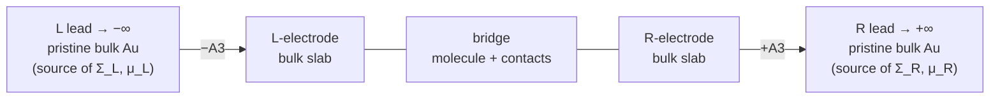

The three boxed regions in the middle — `L-electrode | bridge | R-electrode` (the
§ 4 partition) — are *one* SIESTA cell. The semi-infinite leads on either side are
**not** atoms in that cell; they enter only as the self-energies Σ, computed from a
*separate* bulk-lead run, and each carries a chemical potential μ. `±A3` marks the
direction the lead extends (the third lattice vector).

Three consequences drive **every** parameter choice:

1. **Σ comes from a separate, pristine bulk-lead run** — *not* from frozen atoms
   in the device (frozen is only a geometry constraint). Hence **three runs**.
2. **The transport direction is open** → the device's k-point grid has **one k-point along z**. Any
   `kz > 1` re-imposes Bloch periodicity along the wire and destroys the transport
   physics.
3. **Geometry fixes the physical model; the k-point grid only sets integration
   accuracy.** Adding lateral vacuum makes a *cluster* (a different Hamiltonian); a
   denser k-point grid of the *same* geometry just integrates it better.

> **Honest caveat (report it, don't hide it).** Plain LDA/GGA-DFT+NEGF
> **systematically overestimates** single-molecule conductance by ~1–2 orders of
> magnitude — the DFT **HOMO–LUMO gap** (the spacing between the molecule's highest
> filled and lowest empty orbital) comes out too small, so level alignment to $E_F$
> is off. For Au–BDT, experiment is ≈ **0.011 G₀** [Xiao2004] while GGA-NEGF
> commonly gives ~0.1–0.4 G₀. The contract here gives a *numerically correct*
> GGA-NEGF result; closing the gap to experiment needs beyond-DFT corrections
> (**scissors / DFT+Σ** — rigidly shifting the DFT levels, or adding a self-energy
> correction — or hybrid functionals). molbuilder's job is to surface this caveat
> honestly rather than imply DFT-NEGF == experiment; every transport record
> carries it (§ 1.1, *The record*).

---

## 2a. The parameter map

> **Status: agreed and largely BUILT** *(2026-09-16)*. Every ruling this section
> asks for has been made (§ 2a.7), and the parameter model it describes is now
> what the code does: transport has a template, every rung renders through the
> framework's seam, and the classes are declarations the catalogue carries
> rather than prose. § 2a.14 records what landed and what has not, measured.
>
> It is written here, beside the physics it follows from, because that is what
> it is derived from — not from what the code happens to do. Two items are
> deliberately deferred rather than decided: net charge and gating.

### 2a.1 Why the map is derived rather than assembled

§ 2 says what the calculation is; § 1 says it is five stages. What has never
been written down is **which stage owns which decision** — and the cost of that
omission is not abstract. A parameter surface assembled from whatever happened
to be configurable produces a form organised by subject matter, where a control
tells you *what it is* but not *which run it changes*, and where nothing says
whether a value you set in one place silently governs three other runs.

So the map is derived from the dependency graph, top down:

> **A parameter is decided at the earliest stage whose physics determines it,
> and is binding on every stage downstream of it.**

That is not a convention chosen for tidiness. It is forced: if stage N's result
is consumed by stage M, then anything that shaped N's result must be honoured by
M, or M is built on something it did not agree to.

### 2a.2 The three questions every parameter answers

The classes in § 2a.3 are shorthands for recurring combinations of these three.
The questions are the model; the classes are the vocabulary.

1. **Who decides it?** The *person* (a scientific or economic judgement), the
   *stage's role* (not a choice at all — changing it stops the stage being that
   stage), or the *machine* (the scheduler's answer).
2. **Where is it decided, and what does it bind?** Its deciding stage, and the
   set of stages downstream that must obey it.
3. **How strongly can consistency be guaranteed?** — § 2a.4.

### 2a.3 The classes

**Class A — Shared.** *Decided once for the calculation, binds every stage —
and, later, every frame.* Two families sit here, and they are shared for the
same reason:

* **the electronic method** — basis, energy shift, exchange-correlation, mesh
  cutoff, electronic temperature, spin treatment, the pseudopotentials, and the
  species ordering. The lead self-energy must attach to a device Hamiltonian
  built the same way;
* **the k-point grid in the electrode plane (x, y).** The leads and the device
  share one cell in that plane by construction — the lead *is* the junction's
  lead region extended periodically — and the device uses each lead's
  Hamiltonian as the bulk of its own electrode region, which is the same metal
  only when both were computed on the same k-points; TranSIESTA checks it and
  stops otherwise (§ 0.2).

The person owns every value here. What they cannot do is give one stage a
different answer from another.

> **There was a Class B, and dissolving it is a finding rather than tidying.**
> It was *"decided at the electrodes, binds the device and the transmission"* —
> and when the full map was written it had exactly **two** members, the
> shared k-point grid and its offset, both of which are better described as decided
> once for a cell the stages share. A class with two members that belong
> elsewhere is evidence the class does not exist. What genuinely flows from the
> leads to the device is not parameters at all — it is **results**: the lead's
> Hamiltonian, overlap and Fermi level. Those are named below.

**Class C — Stage-local.** *Decided at one stage.* How that particular run is
driven — its SCF schedule, its convergence criteria, its own integration
contours, its outputs. Two stages may legitimately differ, because a bulk lead's
SCF and an open-boundary NEGF SCF do not converge alike.

*Class C parameters bind nothing.* **The bias point**, which binds a
transmission to its own point's converged Hamiltonian and no other's, is
Class D since 2026-09-29 (§ 2a.10): the description's list fixes it, and each
rung writes the point it runs. Binding scope is a property of a parameter, not
of its class.

**Class D — Role-fixed.** *Nobody decides.* The facts that constitute the
stage: which solver it runs, that a lead samples its transport axis and a device
does not, that a lead writes the Hamiltonian the device will read, the bias
point each rung runs — one point of the description's list (§ 2a.10). These are
the identity of the stage, not settings on it, and exposing them as controls
would offer a choice that only has one correct answer. *(So are, on every SIESTA
run of every kind, the per-step forces and coordinates molbuilder reads back —
fixed by what reads them rather than by the rung's part, `template.md` § 6.4.)*

**Class E — Machine.** *Per stage.* Cores, memory, wall time, queue. These
*should* differ across stages — the leads are small cells, the device is the
expensive rung, the transmission is nearly free — and none of them changes the
answer.

**And a category that is not parameters at all: the results that propagate.**
The lead's Fermi level and Hamiltonian, the seed's density, the device's
converged Hamiltonian. They are drawn in § 6.1 and gated in § 2a.11, because a
reader asking *"what does the next stage need from this one"* is asking about
these, not about settings.

### 2a.4 Three tiers of guarantee, because "best effort" should be specific

Not every consistency rule can be enforced, and the map should say which
treatment each one gets rather than implying a uniform safety net.

| tier | what it means | the user sees |
|---|---|---|
| **1 — structural** | the inconsistent state cannot be expressed: there is one value and it propagates by construction | nothing; there is nothing to warn about |
| **2 — checkable** | an inconsistency is detectable before anything runs | a refusal naming what disagrees and what to do |
| **3 — advisory** | the right value is not knowable in advance; it needs a convergence study | a note stating what goes wrong if it is too low, and how you would check |

**Tier 3 is where the scientifically consequential decisions live**, and that is
the honest and uncomfortable part: level alignment, contact coupling and Fermi
level resolution are all tier 3. The software cannot verify them. That is
precisely why they must be prominent in the interface rather than tucked behind
an "advanced" fold — a note there must say what is at stake and must not imply
anything has been checked.

### 2a.5 The map in one picture

Where each class enters the ladder. **Class A enters everywhere** — that is what
"shared" means, and why changing one value rebuilds all five stages. **Class C
enters one stage** and stops there. **Class D is not entered at all**: it is
what the stage *is*.

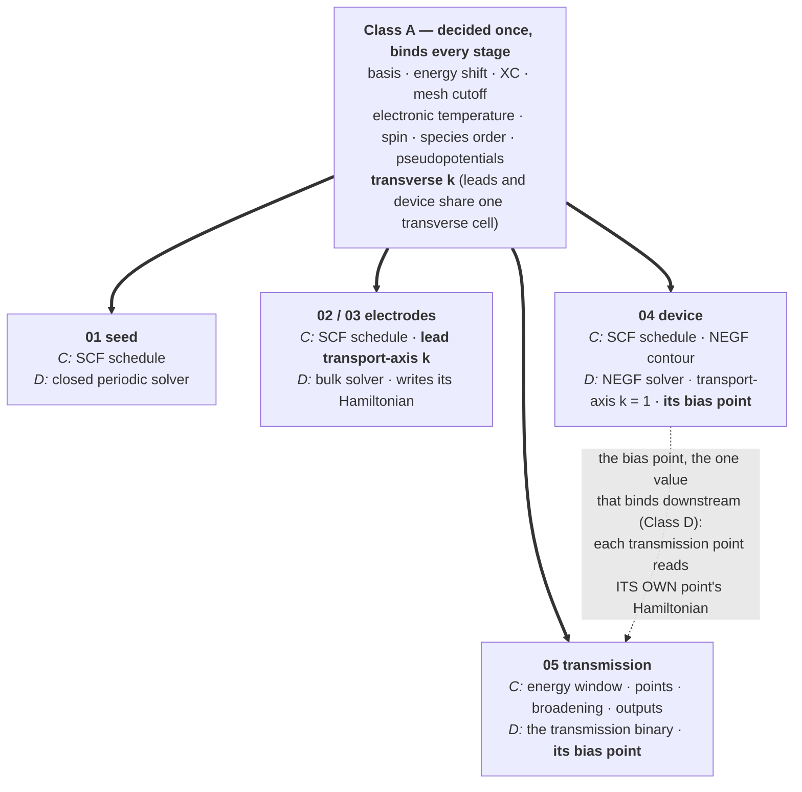

**Class E is deliberately absent from the picture.** Cores, memory and wall time
attach to every stage and change no answer, so drawing them would add lines that
carry no physics.

**What flows *between* the stages is results, not parameters** — the leads'
Hamiltonians, the seed's density, the device's converged Hamiltonian. That is a
different diagram, and it is § 6.1. Keeping the two apart is the point: a reader
asking *"what do I set, and where"* and a reader asking *"what does this stage
need from the last one"* are asking different questions.

### 2a.6 What follows — blast radius, the interface, and the rulings

**The blast radius of a change** is what a person needs to know before touching
anything, and the interface should say it at the point of edit. It follows from
one rule rather than from a table to memorise:

> **Changing any parameter of a stage invalidates that stage's result — and
> therefore everything that consumes it.**

| changing a… | invalidates |
|---|---|
| **Class A** value | **every stage.** It is shared, so the leads and the device must be rebuilt together or the self-energy attaches to a Hamiltonian built differently |
| **Class C** value on a stage whose result feeds another | that stage **and its consumers**. Changing a lead's transport-axis k moves the lead's Fermi level, so the device and the transmission must follow — even though the parameter itself binds nothing downstream |
| **Class C** value on the **transmission** | **the transmission alone.** It is terminal — nothing consumes its output — which is precisely why tuning an energy window is seconds and never re-runs an NEGF cycle |
| **Class D** | not a change; it is the stage's identity |
| **Class E** value | re-runs, same answer. Old and new results stay comparable |

**Two distinctions this rule needs, and both are already in § 2a.9.**

*Parametric binding is not the same as result propagation.* The bias point is
the one parameter that must be **obeyed** downstream — a transmission point must
read its own point's Hamiltonian, and the rung fixes both to that point (Class
D since 2026-09-29). The lead's transport-axis k binds
nothing in that sense; it simply changes a **result** the device consumes. Both
force a re-run; only one is a rule about values.

*Exact consumers must re-run; an approximate one re-runs by the gather's
rule.* The device reads the leads' Hamiltonians as **truth**, so a changed lead
invalidates it. It reads the seed's density only as a **starting guess**: a
device started from another density — a changed seed, or one converged on a
different k-point grid in the electrode plane — converges to the same answer
from a slightly different place, since a density matrix is expressed over
orbital pairs in real space, not over k-points. The gather asks one rule of
every run it takes from, the seed's included: that run ran the same engine
input as the deck its rung renders now (§ 6.1). So changing the shared
k-point grid re-runs the seed too — with both leads, in group 1 — then the
device and the transmission (§ 0.3).

That asymmetry is also the argument for the transmission being its own stage:
its parameters bind nothing, so it is run again against an unchanged device
with no NEGF cycle, and tuning an energy window should never re-run one — on a
large junction the transmission is itself the long step (§ 1.2).

**The interface follows the map, not the subject matter.** One panel for Class
A, edited once, carrying the all-stages warning. One panel per stage for its own
Class C and Class E, with a read-only echo of what it inherits and a plain
statement of the Class D facts its role fixes. **One editing surface, many
read-only echoes**: a Class A value does not appear as an editable control
inside a stage, because editing it there would imply the device could differ
from the leads, which is the one thing that must be impossible.

### 2a.7 The rulings

*All made 2026-09-16. Together they are what turns § 2a from an argument into
a contract.*  ⚠️ *This ended "none of them is implemented", which the banner
200 lines above already contradicted.  Corrected 2026-09-23: ruling 1 (the
relaxation DEFAULTS rather than seals) is built and is what
`citation_defaults.py` does; the T(E) window, the two lead stages and the
bias treatment are built; **Class C's per-stage defaults are superseded by
TD6**: one cited value starts every SCF stage (its row below, § 3.1).  The
default grouping is built (the row below).*

| | |
|---|---|
| **The relaxation DEFAULTS the Class A values; it does not seal them** | A transport calculation arrives pre-filled with the basis, functional and mesh cutoff of the relaxation it starts from, and the person **may change them** — a change applying to every stage at once. The worked case: relax with DZP because it is cheap and adequate for geometry, then move to TZP for transport because the longer orbital tails carry the metal–molecule coupling |
| **The T(E) window belongs to the transmission** | Exposed and tunable **there only**. Consequence: the device deck has no reason to carry the `TBT.*` settings at all, so the two decks legitimately differ and each carries what its own binary reads. What keeps them consistent was never byte-identity; it is the shared Class A values |
| **Class C starts from the citation, stage by stage** *(TD6, the user 2026-10-09)* | Each SCF stage — the seed, both leads, the device — carries its own mixer and convergence criteria, never one shared set, since a bulk lead's SCF and an open-boundary NEGF cycle do not converge alike; each starts from the one value the cited run converged with (`citation_defaults`, § 3.1) and is changed on its own tab (§ 2a.13). The leads' dense k-points along z are the catalogue's default, 100 (§ 0.2), not something a person should have to discover |
| **Always two lead stages** | Even when the leads are provably identical. Two runs keep the record auditable — at a lead run's cost, about 15 h each on the Au–BDT–Au junction (§ 1.2) |
| **Default grouping** | The job request's groups, 1 1 1 2 3: the preparatory block — seed and both leads — group 1, one submission, since none builds on another; the device group 2; the transmission group 3, each scan one job walking its points ([`execution/job-request.md`](?doc=execution/job-request.md) § 3.3; [`execution/project-layout.md`](?doc=execution/project-layout.md) § 1.6.6). `jobset prep task` prepares every group at once (`--group 1 --group 2 --group 3` without a terminal); `jobset launch task` sends group 1, and group 2 once the seed and leads have finished — its first launch gathering their files — then group 3 ([`execution/job-system.md`](?doc=execution/job-system.md), *The task*). The device and the transmission never share a job: the transmission builds on the device, which you look at first |
| **A device point is (frame, voltage)** | either axis may be one; frames independent, voltages chained within a frame — § 2a.9, *Both axes* (the user, 2026-10-09, replacing the one-bias ruling of 2026-09-16). Both axes are built (§ 2a.11): a frame set is cited (§ 3.1, Q17-c), its points run (Q17-d) and its record carries each frame's point and the mode's average (§ 2a.12, Q17-e); its Results are built (`web/results.md` § 2.5, Q17-f, 2026-10-10) |
| **The bias treatment is an exposed choice** | `low_bias_approximation`, true or false, named in the interface with its advisory attached, and the deliverable labelled by how it was computed — § 2a.10 |
| **Automatic resubmission is deferred, and load-bearing on nothing** | The stages, their decks, the parameter map and the directory structure are identical whether a person launches each rung or something launches it for them. It is a convenience at the launch layer, so nothing here waits on it. When built, the monitor is its home — it already watches a run to its end. Off by default. **To verify first:** whether compute nodes may submit jobs on the target cluster; if not, the trigger lives wherever the monitor runs rather than inside the job |
| **Net charge and gating are deferred** | Not designed now. In NEGF the charge is set by the leads' chemical potentials, so for a neutral junction it is moot; a gated or electrochemical junction is separate work. How a gate is applied in SIESTA 5.x — a charge-distribution block, a scripted hook, or neither — **has not been verified against the manual** and should be before anything depends on it |

> **⚠️ The first ruling reverses Q5**, which achieved consistency by removing the
> choice. The invariant Q5 protected — *"electrode and device must stay unable to
> disagree"* — is preserved exactly, because one value shared by every stage
> cannot disagree with itself. What is withdrawn is only the claim that the value
> must come from the cited run. **Restatements of Q5 elsewhere are superseded and
> marked at each site**: § 0.4 row 4, and § 3.6 item 8. Any surface showing these
> fields as locked-because-cited is showing a rule that no longer holds.


---

### 2a.8 A worked setup — Au–BDT–Au

The map as a person would meet it. A benzene-1,4-dithiol molecule bridging two
gold electrodes, starting from a finished relaxation that ran at DZP.

> **Checked against real decks, 2026-09-16** — this was written before any of
> it was built, so it was re-run afterwards rather than left as an
> illustration. Editing the shared panel's `basis_size` and `mesh_cutoff`, and
> the template's `max_scf_iter` — Class C, not on the shared panel: each SCF
> rung runs the template's value unless its own tab sets one (§ 2a.13) — and
> preparing the rungs again — never launched, each group is
> prepared again whole ([`execution/job-system.md`](?doc=execution/job-system.md),
> *The task*) — gives
> every rung the new values:
>
> | rung | `PAO.BasisSize` | `MeshCutoff` | `MaxSCFIterations` |
> |---|---|---|---|
> | `01_seed` | TZP | 300.0 | 200 |
> | `02_electrode_L` | TZP | 300.0 | 200 |
> | `04_device` | TZP | 300.0 | 200 |
>
> One template, three rungs — which is the first ruling of § 2a.7 working, and the
> DZP→TZP case is exactly the one it exists for.

**The shared panel — set once, governs all five stages.**

| | value | why this one |
|---|---|---|
| basis | **TZP** *(relaxation ran DZP)* | the relaxation only had to get the geometry right; transport needs the longer tails that carry the contact coupling. Permitted by the first ruling in § 2a.7 — this is exactly the case it exists for |
| energy shift | 0.02 Ry | the confinement radius; tighter would truncate those same tails |
| XC | GGA / PBE | and the caveat is real: GGA underestimates the gap, so the conductance will come out high. § 7 says by how much |
| mesh cutoff | 300 Ry | converged for Au–S; egg-box error below ~250 |
| electronic temperature | 300 K | metallic leads; also the leads' distribution function |
| shared k-point grid (x, y) | 4 × 4 | the junction supercell's k-point grid in the electrode plane — **the leads and the device both use it** |

**The stage panels — each stage's own.**

| stage | what you set | why it differs |
|---|---|---|
| **seed** | mixing 0.05, budget 200 | a closed periodic warm-up; it only has to produce a serviceable density, so it can mix boldly and stop early |
| **electrodes** | mixing 0.02, budget 300, **k-points along z = 100** (`electrode_kz`, the catalogue's default; recommended 50–200, warned outside) | a metallic bulk lead mixes cautiously — and 100 k-points along z decide the lead's Hamiltonian and Fermi level, the reference energy everything downstream is measured against (§ 0.2) |
| **device** | mixing 0.02, budget 400 | an NEGF cycle on an open boundary is the hardest to converge here. The bias is not set on this panel: it is Class D, each point's voltage the description's list, written by the rung (§ 2a.10) — at the one point 0 V it gives the zero-bias transmission and conductance |
| **transmission** | window −3…+3 eV, 601 points, broadening 1 meV, 4 eigenchannels | wide enough to contain the resonances that matter, fine enough that none falls between points |

**And then what a change costs — the whole reason for the classification:**

| you change | what re-runs |
|---|---|
| basis TZP → DZP | **all five stages.** It is Class A; the leads and the device must be rebuilt together or the self-energy attaches to a Hamiltonian built differently |
| lead k-points along z 100 → 150 | **the seed and the two lead stages** — group 1, one job, run again whole — then the device and the transmission that consume the leads, because the lead's Fermi level moved |
| device mixing 0.02 → 0.01 | **the device only.** The leads still stand; their Hamiltonians did not change |
| transmission window ±3 → ±5 eV | **the transmission only** — seconds on a test junction, about 22 minutes an energy on Au–BDT–Au (§ 1.2). The NEGF cycle is untouched — which is the entire argument for the transmission being its own stage |
| cores 64 → 128 | re-runs, same answer. The old and new results remain comparable |

---

### 2a.9 The structure input, and the frame axis — making room, not building

*Added 2026-09-16 at the user's direction. A frame set is cited (§ 3.1,
built 2026-10-09, plan § 5z Q17-c) and the frame is a level inside a run
(§ 2a.11, built 2026-10-10, Q17-d), and its record carries each frame's
point and the mode's average, the data file beside it (§ 2a.12, built
2026-10-10, Q17-e and Q17-e2), the frames' rows carried as written and their
weights read (`model/structure.md` § 2.2f, 2026-10-18); the Results
family is built and seen on the page (`web/results.md` § 2.5, Q17-f,
2026-10-10); the structure side is built (a `Structure` holds its frames and each frame's
`customized` rows, `model/structure.md` § 2.2d–2.2e). What is settled here is
what the contract must say so that adding the axis needs no rework — and,
since 2026-09-24, **what a frame set IS**: one multi-frame structure pair
(below).*

**Transport's input is a structure, and the contract should say so plainly.**
Today that structure is a relaxed junction. In future it will also be a **group
of static frames** — all derived from one optimised junction, each with some
subset of atoms displaced by a rule (a normal-mode displacement, most
obviously). Each frame is an ordinary static calculation in its own right;
nothing is dynamic, and no frame depends on another.

That is the standard route to phonon-modulated transport: displace along the
modes, compute T(E) per frame, and recover the thermal average of the
conductance, or the electron–phonon couplings from finite differences of the
Hamiltonian.

#### The electrodes do not move, and that is structural

The lead atoms are frozen bulk by construction (§ 4). A displacement rule acts
on the bridge — never on the leads — so **every frame has the same electrode
region**, and the two lead calculations are the same calculation for all of
them. Sharing them is therefore not an optimisation bolted on later; it is a
statement about what an electrode stage *depends on*.

#### The structure states its own cell, and transport derives none *(user, 2026-09-23)*

> **A structure may carry vacuum around an electrode — for an optimisation, for
> anything the structure model allows — and transport refuses a structure that
> states no cell.** There is no requirement that an electrode be periodic in
> the plane; there is a requirement that a transport calculation be given the
> box it runs in.

The two halves are one rule seen from two sides. The structure model owns
periodicity (`model/structure-periodicity.md`): an isolated axis, a vacuum
gap, a lead relaxed in a padded box are all legitimate structures, and
nothing here narrows what a person may build or relax. But the calculation
process cannot use one: the lead's transverse vectors must tile the device's
(I6), the transport period is the bulk repeat and is not recoverable from
atom extents (§ 7), and the leads must continue into their periodic image
(I12). So a transport calculation **derives no cell** — not a bounding box, not
a padded one, not a lateral pair from the atoms — and a structure that states
none is refused at the citation door (§ 6.2 hop 3; I14, § 5), as an `error` that names what is missing and where to commit it (the
Cell page). The 15 Å of transverse vacuum that an earlier reading fabricated
around an isolated lead survives only as advice: on a committed cell, the
gate may say the transverse gap looks like an isolated lead rather than a
bulk one, and leave the person to decide.

#### The axis rule, which the bias sweep already follows

> **A stage carries a sub-level for each axis it varies over, and none for an
> axis it does not.**

Stated this way — rather than as an arrangement peculiar to bias — the frame
axis needs no new machinery, and the sharing becomes **visible in the layout
itself**: the electrode stages simply have no frame level, and the directory
tree says so without anyone having to know it.

#### Two kinds of sharing, and they need different gates

| | what is shared | valid when | gate |
|---|---|---|---|
| **Exact** — the electrodes | the lead Hamiltonian, used as **truth** (it becomes the self-energy) | the frame's electrode region is geometrically **identical** to the one the lead was derived from | **a displacement rule must never move an electrode atom** — checkable (tier 2); every electrode atom is in the structure's held label, which may hold more (§ 1.1, Step 0, *what transport asks of the held set*) |
| **Exact** — the leads' surface Green's functions, at a voltage | each lead's self-energy on the device's contour, used as **truth**, written once per voltage by the first point that runs there and read by every other frame's point at that voltage (§ 2a.11, *What a run's points share*) | the same lead, cell, k-points, voltage and contour — which is every frame of a run at one voltage, since a displacement rule moves no electrode atom and the run's settings bind every frame (Class A) | **TranSIESTA's own check** (`m_ts_gf.F90` `check_Green`): a file that differs in any of them is refused, naming the difference; a frame's file is never a different frame's by name, because the name carries the voltage and the run holds one geometry per frame |
| **Approximate** — the seed | a converged density, used only as a **starting guess** | any nearby geometry: same species, same ordering, slightly moved. The SCF converges away from it, so being imperfect costs iterations, not correctness | the orbital set must match; the geometry need only be close |

The distinction matters because the two gates differ in **kind**, not in
strictness. Getting the first wrong is a wrong answer; getting the second wrong
is a slow one.

So the shape is: **electrodes once, seed once, device and transmission per
frame.**

#### Class A widens

Class A's binding scope becomes *identical across every stage **of every
frame***. Frames whose transmissions were computed with different basis sets or
functionals are not comparable to each other — and comparing them is the entire
reason for computing a group.

#### Both axes — a device point is (frame, voltage) *(user, 2026-10-09; `archive/2026-10-10-q17.md` § 5z.8 A–E)*

> *"This is the framework design period. I would rather to have this already
> built in and then later on we can tune it."*

The frame is the structure's — the citation's frames, never typed — and the
voltage is the calculation's — `task.json`'s list (§ 2a.10). A device point is
one of each, and either axis may be one. *(This replaces the ruling of
2026-09-16, "a frame group runs at one bias", which bounded the walk, not the
physics; the walk runs a voltage at every frame, then the next voltage —
§ 2a.11, *What a run's points share*.)*

- **Within a frame**, the voltages chain as a sweep does (§ 2a.11): the 0 V
  point from the seed's density, each further voltage from the converged
  point of the voltage closest to it among those before it **in the same
  frame** — the one point it waits on.
- **Across frames**, nothing chains: each frame is a geometry in its own right,
  so its 0 V point starts from the seed's density, never from another frame.
- **A voltage that does not finish ends the chain that starts from it**: the
  points of its frame that start from it, and theirs, are not run, and the
  walk goes on with every other point.
- **Under the low-bias approximation** each frame runs once, at 0 V, and its
  I–V is computed from its own T(E, 0) at the listed voltages.

The physics makes the last the cheap choice for a frame set: a thermal average
of frozen frames is an elastic transmission, read at or near zero bias, and
from a single converged device at one bias **tbtrans sweeps energy**, so each
frame yields a full T(E) curve. Inelastic tunnelling (IETS) is not among what a
frame set gives: its signal is a step in dI/dV at eV = ħω, where the electron
gives the vibration one quantum, and it needs the electron–vibration coupling
itself ([`engines/vibration.md`](?doc=engines/vibration.md) § 5.6, level two;
[Frederiksen2007]).

**The one confusion this must not create.** Sweeping **energy** in the T(E)
window and sweeping **bias** are different calculations, and the contract should
refuse to let them be reported as the same thing:

- **Energy sweep** — one converged device, tbtrans evaluates T(E) across the
  window. Cheap, and it is what each frame gives under the low-bias
  approximation.
- **Bias sweep** — the device NEGF SCF is **run at each voltage**, each point starting from the closest converged voltage before it (§ 2a.10, § 2a.11),
  because the potential drop reshapes the molecular levels. T is then a function
  of both, T(E, V).

A low-bias I–V *can* be obtained from a single zero-bias curve by integrating it
against the leads' Fermi functions — that is the **low-bias approximation**,
T(E, V) taken as T(E, 0); it is legitimate and standard, and it is **not** a
finite-bias NEGF result. Where a deliverable is computed that way it must say so, or a
reader will take an approximation for the real thing.

#### What makes a set citable — ONE PAIR, many frames *(user, 2026-09-24)*

> **A frame set is a multi-frame XYZ document with its one sidecar.**
> Frame 0 is the base — the optimised junction, which is what every reader
> takes when it asks for a structure — and frames 1…N are the
> displacements. The labels, the frozen set, the species, the cell and the
> recorded contract are the structure's and apply to every frame; a frame is
> its coordinates and its own `customized` rows, nothing else.

Nothing new is invented for it. A `Structure` holds its frames
([`model/structure.md`](?doc=model/structure.md) § 2.2e):
`StructureCodec.load(path, frames=True)` gives the set, `load(path)` its frame
0, `frame_at(i)` one frame with the set's one origin; a frame set is made
through the structure's own doors, by the frame generator or a person's
script. So every door that reads one structure reads a multi-frame pair as its
base, and a frame-aware door sees the set. That is what makes the axis
addable without rework. Citing a pair is § 3.1's second citation kind
(`compose.classify_citation`, built 2026-10-09).

| the condition, per frame, naming the frame | why | where it is checked |
|---|---|---|
| the same atom count, in the user order, as frame 0 | the sidecar's per-atom facts are indices | the structure's reader (`model/structure.md` § 2.3) — a document breaking it is no frame set |
| the same species, in the same order | the seed's density and the leads' Hamiltonians are indexed by orbital | the same |
| **the same cell as frame 0** | the leads must tile one cell for every frame (I6, § 2a.9 above) | the same — the cell is shared, a frame cannot state another |
| **no electrode atom moved**, within the tolerance the citation door's frozen-atom check uses (`wizard.FROZEN_TOL_ANG`, 10⁻³ Å) | the exact-sharing gate: the lead Hamiltonian is truth | the citation door, frame by frame, naming the frame and the atom (`compose.classify_citation`) |

**The frame token is the frame's index**: `f000` is the base — frame index 0,
the undisplaced reference every displaced curve is compared against, and it
runs too — and `f001`… follow in file order, so a folder and a message say the
same index (*frame index 1 (of 3)* is `f001`; `model/structure.md` § 2.2e: the
code's index everywhere, a folder name included, a number only on the UI's
display; `paths.frame_token`).

**One mode per frame set, and what each frame is, stated in the pair**
*(user, 2026-10-09: "i would rather let one multi-frame focus on one mode ...
each vibration mode will have a separate prep and run as different task"; plan
§ 5z D3)*. A set that samples a mode carries a
mode's frame set ([`model/structure.md`](?doc=model/structure.md) § 2.2f, its
maker's vocabulary): the mode as the vibration result numbers it, its
frequency, the zero-point amplitude, the temperature of the motion the frames
sample, the mean number of quanta, the spread, the outermost frames' largest
atom move, the sampling rule and its nodes and which masses measure the mode
on the structure's rows; each frame's plain displacement, its mass-weighted position
along the mode and that position in units of the spread, and its weight on its
own rows; each atom's mass on the `mass_amu` channel; where the mode came from
in `info.vibration`. **Transport reads one of them, each frame's `weight`**
*(the user, 2026-10-18: those rows have "nothing to do with fucking get
calculation done")* — `⅔, ⅙, ⅙` for three frames — and **computes with it
alone** (§ 2a.12's average), where every frame states one; weights that do not
sum to 1 are averaged as written, with a warning *(user, 2026-10-09: "all
weights should add up to 1 that's an explicit rule within error tolerance")*;
frames that do not each state one have no average, said. Every other row is
carried whole — name, value, unit and its meaning, the row's `note`
([`model/structure.md`](?doc=model/structure.md) § 2.2f: what the weights
average, the rule that placed the frames, the masses the coordinate is
measured with) — into its record and its data file and shown on the pages,
and so are the mode's own two beside the rows, in both: `info.vibration`
(the vibration run and its result's sha256) and the `mass_amu` channel;
another `info` key or channel stays the structure's and is not carried. The one check
made on the rows is a vocabulary name's unit —
a row of the mode's vocabulary written with another unit is refused by name
wherever the rows are read for a record, a data file or a page
(`frame_average.check_units`, [`model/structure.md`](?doc=model/structure.md)
§ 2.2f) — a page draws the refusal where the frames would be and still
opens, the Transport tab's citation saying it beside the junction as every
refusal there is (`frame_average.answer_said`) and the Results tab's report
in the average's place, every point still shown (`frame_average.average_said`);
the record `summarize` writes is refused by name. Transport never asks what made the frames,
nor how many there are — that is the maker's. Another mode is
another frame set and another transport calculation; how the modes' results
are weighed against each other is the person's *(user, 2026-10-09: "it is
cleaner and more focused to let user to post-process the results from
different vibrational mode and decide how they can be weighed")*. Frames
that do not each state a weight are a family with no average — each frame's
curve its own, and the record saying so; nothing is refused for that, since
what the displacement means is the person's.

#### The displacement rule may be the person's own script — and the promise it makes *(user, 2026-09-23)*

The rule that derives the frames is not molbuilder's to own. The first
built-in one will read a mode from a vibration run — `.spectra.json` already
carries each mode's `eigenvector_canonical`, so *cite that run, this mode,
this amplitude* is a complete rule. But the person may also supply **a script
of their own** that takes the base structure and writes the frames; then the
script is the rule, it is recorded beside the frames exactly as a built-in
rule would be, and the person takes over the responsibility a built-in rule
would have carried.

**What either one writes is the multi-frame pair above** — the base as frame
0, the displaced geometries after it, one sidecar shared — through the
structure's own doors (`with_frames`, `set_customized`) and the codec's writer
(`model/structure.md` § 2.2e): a file another tool writes carries no sidecar,
and its comment line is never metadata (§ 2.3). So the
frame set is the **interface between the vibration work and transport**: the
vibration side's generator (`plan.md` V1.25) writes it from a spectra file
for one mode at the zero-point amplitude and its thermal growth (`vibration.md`
§ 5.6; the per-mode `zero_point_displacement_ang` is in the result since
2026-09-24), a person's script writes the same file from anything, and
transport reads one shape and knows nothing about modes.

**What that responsibility is, stated as a contract, because every part of
it is checkable.** Every frame the rule produces, whoever wrote it:

| promise | why | checked how |
|---|---|---|
| the same atom count, in the **user order** — the script never sees the sorted copy; prep sorts the whole set once, every frame with it, under one order record for the whole group, which every frame's deck states (`model/overview.md` § 2.2a, I5) | the sidecar's labels are indices; the seed's density and the leads' Hamiltonians are indexed the same way | count and index, per frame, against the base |
| the same species, in the same species order | the orbital set is what makes the seed's density usable as a start (§ 2a.9's approximate gate) | species table per frame against the base |
| the same labels — regions, frozen set, identity columns | the partition is what the whole ladder is built on (§ 4); a frame is the base with atoms moved, never relabelled | the frame carries no labels of its own: it inherits the base's, which makes the promise structural rather than checked |
| **no electrode atom moves** | the exact-sharing gate above: the lead Hamiltonian is truth | electrode positions per frame against the base, within `wizard.FROZEN_TOL_ANG` (10⁻³ Å), at the citation door |
| one base structure, an optimised junction | a group is a *displacement of* something, and the result has to say of what | the pair is the group's citation, its `info.calculation` the optimisation frame 0 came from (§ 3.1) |

What is trusted rather than checked is only what cannot be: that the
displacement means something physically. Everything a wrong script could do
to the ladder's bookkeeping is refused at the citation door, frame by frame,
naming the frame and the promise it broke.

**The seed needs no promise.** Sharing it is valid for any nearby geometry
(the approximate row above), and a displacement large enough to make a poor
starting guess costs the device iterations, not correctness. So the seed is
shared across the group by default; the one guarantee the person actually
gives is the electrode one, and that one is checked.

**One job, one more axis.** `task.json` already names the axis a calculation
sweeps (its `bias` block). A frame group is that with a second
axis: the device and the transmission carry the frame level, the seed and the
leads do not, and § 2a.11's tree says so without a new mechanism. **The axis is
declared by the citation itself**: a pair holding one frame is a single
geometry, a pair holding more is a frame group, and every frame runs; the
frame count is the citation's, never typed. A device point is a frame and a
voltage (the axes above), so a rung's points carry a level for each axis that
varies — `f000/`, `v0.2/`, or `f000/v0.2/` (§ 2a.11).

#### What this changes about the deliverable

The result of a frame group is not one transmission curve but a **family** of
them, each beside what its frame is, and the mode's average at its stated
weights. § 2a.12 states that frame dimension of what the Results surface reads
and of the data file *(built 2026-10-10: the record, Q17-e; the data file,
`transport/datafile.py`, Q17-e2; the Results family Q17-f; the frames'
average and their rows' reading moved out of transport's execution into their
post-process, `frame_average.py`, 2026-10-18)*. What else is derived across the family — a
slope, a variance, a comparison with another mode's set — is the analysis's,
made on the data file, where every frame's values sit beside its rows.

*([`engines/vibration.md`](?doc=engines/vibration.md) § 5.10 ③, decided
2026-09-28, one mode per set 2026-10-09, the definition 2026-10-10: the
built-in mode rule writes a mode's rows —
[`model/structure.md`](?doc=model/structure.md) § 2.2f — so everything about
the mode travels in the pair's own rows, and transport knows nothing about
modes: it reads each frame's weight and carries the rest.)*


### 2a.10 The bias treatment — an explicit choice, and what the result may be called

*Ruled 2026-09-16: the treatment is exposed as a named choice with its advisory
attached, and the deliverable is labelled by how it was computed.*

**Transmission is a function of two variables, and the notation should say so.**
In general it is **T(E, V)**: an electron's transmission probability at energy
*E* when the junction is held at bias *V*. A calculation does not compute the
whole surface — it computes a **slice at one V**, and the choice being exposed
here is how many slices you pay for.

#### The two treatments — one switch, `low_bias_approximation`

| | what runs | what you get |
|---|---|---|
| **`low_bias_approximation: true`** | the device SCF converges **once, at 0 V**, and the transmission runs **once**, on it | **T(E, 0)** — one slice, a full energy curve; the I–V computed from it by the record for every listed voltage, **$I(V) = (2e/h) \int T(E,0)\, [f(E - \mu_L) - f(E - \mu_R)]\, dE$**, $\mu_{L,R} = E_F \pm eV/2$ with $V$ signed (`record.low_bias_iv`) — the **low-bias approximation**: the transmission's dependence on bias neglected. Nothing in it is linear in V — the integral takes in whatever T(E, 0) holds as the window opens, so a level inside the widest window bends the I–V *(the user, 2026-10-25: "low bias assumption talks about T(E) dependence on bias, nothing about linearity. this is not an ohmic device by default")*. A negative voltage carries a negative current, as TBtrans's own does, and $I(-V) = -I(V)$: the one slice serves both signs |
| **`low_bias_approximation: false`** | **every voltage gets its own device SCF** and its own transmission — a sweep (§ 2a.11) | **T(E, V)** — one slice per point; each point's current TBtrans's own integral over its window — a point that shares energies the record's, by TBtrans's rule over its joined grid (§ 2a.16) — with no approximation beyond the method itself; $I(-V)$ is its own point's, and differs from $-I(V)$ where $T(E, -V)$ differs from $T(E, V)$ inside the bias window — an asymmetric junction's rectification |

The mechanism is the same in both cases; the difference is how many device SCFs
are paid for, and therefore **what the result is entitled to be called**.

#### The advice attached to the choice (tier 3 — advisory)

**There is no universal threshold voltage, and the interface must not invent
one.** The criterion is a property of the junction:

> Compare **$eV/2$** — the half-width of the bias window — with **the energy gap
> from $E_F$ to the nearest transmission resonance.**

While the window is small compared with that gap, T(E, V) barely depends on V
and one slice serves. Once the window edge approaches a resonance, that
resonance both *enters* the window and *moves* under the field, and integrating
a zero-bias curve cannot reproduce either effect.

Rules of thumb, for junctions whose nearest resonance sits ~0.5–1.5 eV from
E_F — offered as orientation, never as a guarantee:

| bias | practice |
|---|---|
| **< 0.1 V** | one slice serves; this is the conductance regime, where the observable is essentially $G = G_0 \cdot T(E_F)$ |
| **0.1 – 0.5 V** | usually sound qualitatively, with quantitative error growing; worth checking rather than assuming |
| **> 0.5 – 1 V** | re-converge at each voltage — the window is now comparable to the level offset, resonances enter it, the molecule charges and levels pin |

Two situations bring finite-bias effects on **earlier** than that table suggests:
an **asymmetric junction**, where unequal coupling to the two leads produces an
asymmetric potential drop; and a **weakly coupled** molecule, which charges
readily, so level pinning appears at low bias.

**The dependable answer is empirical, and cheap.** Converge the device at $V = 0$
and at the largest $V$ of interest, and compare the two curves *inside the bias
window*. If they differ appreciably, the sweep is needed. Two device runs to
decide whether a whole ladder is necessary is a good trade, and it is what the
interface should recommend rather than quoting a threshold as though it were
settled.

*This is also why the low-bias approximation is the cheap choice for a frame
set (§ 2a.9, Both axes): a frame set's average is an elastic transmission at or
near zero bias. The same vibrations' inelastic steps sit at eV = ħω (0.124 meV
per cm⁻¹, so 80–4000 cm⁻¹ is 10–500 meV), and no frame set computes them
([`engines/vibration.md`](?doc=engines/vibration.md) § 5.6, level two).*

#### The labelling rule

> **A transmission result records how it was computed: whether the low-bias
> approximation was made, said as yes or no.**

Not a formality. An I–V under the low-bias approximation and a self-consistent
one are different claims about the same junction, they can differ substantially above a few tenths
of a volt, and on a plot they are indistinguishable. A curve that does not carry
its own provenance will eventually be read as the stronger claim.

So: the record names the treatment, the bias point or points, and the flag
itself — `low_bias_approximation`, `true` only when one 0 V slice served every
listed voltage, `false` otherwise, a single voltage included: its device and its
transmission ran at that voltage. The Results report and `summarize` say it
beside the curve — *low-bias approximation: yes, the 0 V transmission integrated
over each voltage's window* / *low-bias approximation: no, each voltage its own
device SCF* — and the data file carries it as an attribute. The conductance
column keeps its name at every voltage; what a row at a nonzero voltage means is
the person's to read, the flag beside it *(the user, 2026-10-25)*.

#### The choice, as stated and as run *(user, 2026-10-08: "low-bias should be low-bias-approximation, and when this is set to false, all bias will need a scf calculation")*

**A list of several voltages states the switch** in `task.json` —
`"bias": {"voltages_v": [0.0, 0.2, 0.4], "low_bias_approximation": true |
false}` (`molbuilder describe --bias … --low-bias-approximation / --no-low-bias-approximation`;
the transport tab asks, with nothing chosen, once its list holds a second
voltage) — and is refused without it: never inferred from the count. A list of
one voltage is the single bias, and states none — written so, `[0.0]`, by both roads (`molbuilder describe` with no `--bias`, the Transport tab's box); an empty list is written by neither and no reader fills one in (2026-10-18). The tab's list is typed, or
filled by its **start / stop / step** builder — 0 V first, then the walk — and
stays editable; one list either way. The device's and the transmission's tabs
show the list in their locked bias box with what it makes under the treatment
held, kept current as either changes: one voltage, *one run*; several,
*one run, at 0 V* under the low-bias approximation, else *one run, a point per
voltage* (the table below; § 2a.11). Beside the junction slot,
`"swap_electrodes": true` states the electrode rename this calculation makes
in its own copy of the cited junction (§ 4); false writes no key.

| `low_bias_approximation` | the device | the transmission | the I–V | what the record calls it |
|---|---|---|---|---|
| **`true`** | one run, at 0 V — `04_device/run-0/` | one run, at 0 V — `05_transmission/run-0/` | computed by the record from T(E, 0) for each listed voltage (above) | the low-bias approximation, said beside the curve |
| **`false`** | a sweep: one run, a point per voltage — `04_device/run-0/v0.2/` (§ 2a.11) | a sweep: a point per voltage, each reading its own device point's H | each point's TBtrans current | self-consistent at every voltage |

The record names the switch and computes the low-bias I–V itself: a sum over
the transmission TBtrans wrote, with the leads' Fermi functions — no TBtrans
run at a voltage the device did not converge at. **Every current the record
computes is by TBtrans's own rule**, one function (`record.landauer_current`)
for the low-bias I–V and for a point that shares energies (§ 2a.16): each
energy's transmission, times the spacing of the grid its deck states (the
mid-rule's weight, `energies.spacing`), times the two leads' Fermi functions'
difference, G₀ times the sum. `jobset migrate` writes the switch for a description that
states the older `bias.treatment` word.

#### Where bias sits in the map

| parameter | class | decided at | binds | tier |
|---|---|---|---|---|
| **`low_bias_approximation`** | shape | calculation | whether the device and the transmission sweep the bias, and what the result may be called | 3 |
| **the bias point(s)** | D | the description's list | without the approximation, the device and the transmission — each point's pair is written at that point, and each transmission point reads *its own* point's converged Hamiltonian, never another's; with it, the voltages the record's I–V is computed at | 3 |

The treatment is not really a third mechanism: **single bias is the degenerate
case of the bias axis — one point, at zero, where every list starts.** It earns a
name of its own because what changes is not the machinery but the standing of
the result. **The list is the bias's only home** *(ruled 2026-09-29, `plan.md`
§ 5w K1)* — its points distinct (two runs of one voltage would share one
folder, so a repeat is refused) and each warned when outside the bias item's
range, like any value (`template.md` § 5.3, 2026-09-30): each rung writes the point it runs — the device converges at it and
the transmission reads that same point — and `bias_voltage_v` is that point,
fixed by the rung (`role`), never a value the template or a stage override
states. A template value until then answered a single-bias calculation, a
second home beside the list (§ 2a.14).

**The transmission window reaches the bias window** *(P2, 2026-10-08)*. A
current is TBtrans's integral of T(E) over the energies the transmission deck
has it sample — `transmission_n_points` points on `transmission_emin_ev …
emax_ev` by the mid-rule (`method mid-rule`, `m_integrate.f90`), the first
and the last half a spacing inside each edge — weighted by both leads' Fermi
functions at $\mu = \pm V/2$, and TBtrans says nothing when those energies cut that
integral short. So the energies it samples must reach **$\pm(\lvert V\rvert/2 + 5\,kT)$** at
the deck's electronic temperature. One rule, `record.window_short_of`, on the
energies TBtrans samples: the transmission deck's settings gate and the
description's preflight ask it with `record.sampled_window` — the mid-rule's
first and last energy, worked out from the window and its point count — and
the record with the energies the run wrote. The gate refuses a point whose
own voltage they do not reach; the preflight refuses a bias list whose
largest voltage the resolved transmission rung's do not reach (under the
low-bias approximation every listed voltage is integrated over the one 0 V
slice); the record leaves a voltage it cannot integrate blank, naming the
reach (§ 2a.12). All three say it in the rule's one sentence, *the
transmission's sampled window [lo, hi] eV does not reach ±… eV for … V*. The
fix is always the same: widen the window.

### 2a.11 The directory structure — one place per run, and the axes visible in it

*The structure a person opens after a calculation finishes. If the folder does
not explain itself, nothing downstream can.*

#### The rule it is built from

> **One directory per run.** A stage owns a directory; each run of it owns a
> subdirectory; and a stage carries a **sub-level for every axis it varies
> over, and none for an axis it does not.** **A bias sweep is one run** — its
> points are the run's sub-levels, and what they share is the run's, once
> *(user, 2026-10-05)*.

Two properties follow without anything further being said. **Nothing can
overlap** — two runs never share a namespace, and two points of one run never
share a folder, so no output file of one can be mistaken for, or overwritten
by, another's. And **what is shared is visible**: a stage that does not vary
over an axis simply has no level for it, and what a sweep's points share sits
in the run above them, so the tree itself shows which results are computed once
and reused.

#### The bias sweep — one run, its points inside

> *"all the bias points are supposedly one single run. it's just different
> parameters in one sweep"* (user, 2026-10-05) · *"every point, if it is not
> finished, it has to be redone using the same condition as every other point.
> So it's either done or not done. That's it"* (user, 2026-10-08)

**When there is a sweep.** Only with `low_bias_approximation: false` and more
than one voltage (§ 2a.10): then the **device** and the **transmission** each
run at every voltage — the rungs the bias item's catalogue row names
(`stages`). Every other rung, and every rung of a single-bias or low-bias
calculation, is a single run with no bias level. One door answers which
voltages a rung runs at: `transport.stages.sweep_points(task, stage)`.

**A swept rung's run holds its points.** The run is the stage's ordinary
`run-<n>/` — one launch of the stage, as every run (`job-system.md` § *Words*)
— and inside it one folder per voltage:

```
04_device/
├── v0/ v0.2/ v0.4/         each point's prepared deck and run script — what
│                           every run of the stage copies, as a single stage's
│                           folder holds its one deck
└── run-0/                  one run: the whole sweep
    ├── .gathered-from      what the run took from the rungs upstream, once
    ├── <label>_L-electrode.TSHS, <label>_R-electrode.TSHS, <label>.DM
    │                       the gathered inputs, kept once as taken; every
    │                       point's own copy is taken from the run upstream,
    │                       as these are
    ├── tsgf/               the leads' surface Green's functions -- the one
    │                       pair of the voltage being worked on, written by
    │                       the round's first point, read by the rest, emptied
    │                       as each round begins and when the walk ends
    │                       (*What a run's points share*, below)
    ├── run.json            the run's one launch record
    ├── v0/                 a point: its deck, its run script, its own copies
    │                       of the inputs, its outputs (.TS.HSX, .TSDE, the
    │                       .out, its ending)
    ├── v0.2/
    └── v0.4/
05_transmission/
├── v0/ v0.2/ v0.4/         the prepared decks
└── run-0/                  one run: the leads' .TSHS kept once; each point
    ├── .gathered-from      holds its device point's .TS.HSX and its own copies
    └── v0/ v0.2/ v0.4/
```

A point folder holds everything its engine reads, as every run folder does
(`project-layout.md` § 1.0) — its own copies of the run's inputs; the run keeps
them once, clean, as their source — and, for a transmission point of a
calculation that reuses a finished one, the energies it shares with the
finished point, in its `shared/` (§ 2a.16) — but for the
leads' surface Green's functions, which the engine reads from the run's `tsgf/` above the point and
which are the run's on purpose (*What a run's points share*, below). The stage folder
holds no deck at the stage level: every deck is a point's.

**A point is done or not done** — read from the point's own files by one door
(`continuation.point_done`, the done door asked with the rung's declaration,
[`execution/runs-of-points.md`](?doc=execution/runs-of-points.md) § 4.2),
never from a second record: **done** when its run
finished, its SCF converged by the engine's own output (the device's), and it
holds what the rungs downstream take from it (the DAG, `stage_inputs`: the
device's `.TS.HSX`; the transmission's `.TBT.nc` — or, on a polarized
junction, its `.TBT_UP.nc` and `.TBT_DN.nc` both, the two files TBtrans
writes in its place — and, for a transmission point that shares energies
with a finished calculation, its `shared/` holding its `.copied-from`,
§ 2a.16) and what a later point of its run starts from (`hands_on`, the
`along` row of `warm-files.toml`'s `[transport]`: the device's `.TSDE`)
*(found 2026-10-18: the door asked for `.TBT.nc` alone, so a polarized sweep
read 0 of N done and was walked again)*. Its
record is
what its wrapper already writes as it ends — the conclusion marker and the
outputs. A point has no record of its own beyond that: *queued*, *running*,
*finished* and *failed* are the **run's**, read from the run's launch record,
its points' files — each point's run by the one status door — and the jobs
launched from this machine, by one rule (`continuation.points_state`, *One
door for each place* below; `job-system.md`, *What marks each state*). Every
reader asks it — `status`, the gather, `jobset scratch`, the run door (the
Results tab's ladder and a point's own folder), the record's points and the
data file's `device_state`: a point the ended walk never ran is failed,
never one still to come, its why the job's own — *it builds on <the point>,
which failed*, or *the walk ended before it reached this point*
(`runpoints.why_not_run`, asked by `continuation.never_reached`) — in
`status`'s count, the record and the run's own finish alike
(`run-reports.md` § 2.9).

**The walk.** `launch task` sends one job walking the run's points not done —
**voltage by voltage, every frame's point at a voltage before the next
voltage** (*What a run's points share*, below: the leads' files are the
round's). Each point starts as it would on the first walk — **every point not
done is redone from the same start**: the 0 V point from the seed's density
(its own copy, taken from the seed's run); a later point from the converged density (`.TSDE`) of
the voltage closest to it among the points before it in its frame's list —
taken over, or walked earlier in this walk; the later of two equally close —
the manual's *"copy the TSDE from the closest, previously, calculated bias"*. The
start of every point is decided when the launch is planned and written beside it,
so the record says what each point started from: a point that starts from
another point names it in its `.continued-from`; the 0 V point starts from what
its run gathered, which its own `.gathered-from` names (`status <stage>`: *from
what it gathered*) — the file catalogue's two words for the two starts
(`project-layout.md` § 5). A device
point waits on the point it starts from and on nothing else: a voltage that
does not finish ends the chain that starts from it — the points whose start
is it, and theirs — and the walk goes on with every other point; the
transmission walk goes on — its points are independent — and says which did
not. The walk's files are the stage's, in its `launch/` folder:
the header prep wrote for a queue, `<label>_<NN>_<stage>-sweep.sbatch` (the
device's `AuBDT_04_device-sweep.sbatch`) — one allocation for every point,
their walls summed (`group.envelope`), sent as it is at every launch of the
rung, warm or cold, the wall alone restated by `--time` — the walk script the
launch writes, `…-sweep.run.sh`, and its log, `…-sweep.log`
(`submit._points_walk`, the one walk of every run of points,
[`execution/runs-of-points.md`](?doc=execution/runs-of-points.md) § 3,
*Plan the walk*). Run here, each point is told its card's wall
(`MB_WALL_S`, `running-a-job.md` § 3.6) — inside a sequence's queue job, the
job's wall from the job's start (`job-system.md` § 6.0).

**The run reports as one run** *(R-e's transport half, the user,
2026-10-29; [`execution/run-reports.md`](?doc=execution/run-reports.md)
§ 2.4, § 2.9)*: one `start`, a milestone each time a voltage's round has
ended at every frame, done or not — **the round** — a failed point said at once, once per reason,
and one `finish`. Three pieces, every run of points'
([`execution/runs-of-points.md`](?doc=execution/runs-of-points.md) § 2, § 3,
§ 4.6) — the rung's record in the kind table, `[transport.on.siesta.points]`:
its declaration (`jobset/transport_points.py`), its unit *point*, finished
when every point *ran*, converged or not, its points' walls *each* the
card's (the job's their sum), its words, and no steps of its own between
its points:

- **The run's index**, `<label>_<NN>_<stage>-run0.points.json` at the
  run's root — every run of points' one index (`runpoints`, which travels
  with the monitor; [`execution/runs-of-points.md`](?doc=execution/runs-of-points.md)
  § 2.3). What the rung puts in it, by its declaration: each point's words,
  the rung its one phase and its voltage its round (`Point.round`, *0.2 V*),
  its facts — frame, the frame's words, the voltage — and the energy grid
  its deck describes; the point it needs (a device point's, the point it
  starts from, where this walk runs it); what makes it done (the stage's
  products, and a sharing point's `shared/`, `transport.stages.must_hold`);
  and the run's facts — what its points compute, the leads' pair and names,
  the spin, and the frames' weights where the cited set states them. Launch
  writes every point in the listing order, whether it was taken over and
  from where; each point's report steps stamp its start, its end, its
  engine's exit and its verdict as its ending reads it. **The
  index is what the job saw, never a second record of a point's state**:
  every reader on this side — `status`, the gather, the record — reads the
  points' own files, as above; the job's side, which has no molbuilder,
  judges each point by its entry, by the same pieces
  (`_run_ending.not_done_why`).
- **Each point's two report steps**, in its run script — every run of
  points' (`runwrap.PointOfRun`): `mb_monitor.pyz point started` before its
  engine and `point ended --exit <rc>` after it, on the failure path too —
  the run's `start` sent by the first, a `part_failed`, a round's
  `milestone` or the run's `finish` by the second (`run-reports.md` § 2.9).
  Its words are the rung's — the count, *k of N points done, m failed
  (F frames × V voltages)*, and a round's outcome, each frame's NEGF
  iterations or its G/G₀ at E_F and the frames' average — in
  `transport/run_words.py` (`count_words`, `round_outcome`, the kind table's
  `count` and `outcome`), which travels with the monitor. **A report step
  never fails its point**: what it cannot do is logged in the point's
  session log.
- **Each point's monitor is a member** of its run (`--member`, its run found
  by its folder's record): no `start` or `finish` of its own, its N-hour
  clock from the run's notification record, the wall warned of once for the
  run, its status line the run's count and its own point (`run-reports.md`
  § 2.8).

A walk stopped by the person, or killed, sends no `finish`; the run door
reads it failed. Nor does a walk one of whose points ended before its first
report step — its run script stopping before its engine (the engine not
found), or its start not copied: the run speaks through its points' report
steps, and a point that never reached one is one the index never saw end;
`status` reads the point from its own files, as always.

**Launched again — the run/stage contract's rule 3, read at the point**
(`job-system.md`, *What molbuilder does for you*, 3): every launch is a new run,
`run-<n+1>/`. **Warm**, it continues from the stage's own latest run: each point
**done** there is taken over — the done point's folder whole (its inputs, the
engine's results the readers and the next rungs use, the run's own account:
output, conclusion, logs) copied into the new run's point folder, **but not
an engine's scratch** (the one answer, `warmfiles.is_scratch`: TranSIESTA's
`.TSGFL` / `.TSGFR`, the leads' surface Green's functions — the round's pair
in the run's `tsgf/`, computed once per voltage by every run and emptied by
the walk, *What a run's points share* below), its `.continued-from` naming the run that
**computed** it (one hop: a point taken over from a point itself taken over
names the run that ran it) — so a point taken over keeps the inputs it was
computed from, and their `.gathered-from`, whatever the new run gathered —
and the walk runs the points not done. **Cold** (`--cold`), nothing is taken over and every point
runs. Launch shows which points it takes over and which it runs, and asks once.
A warm launch with every point done is **refused**, naming the `--cold` line —
no run is opened with nothing to run in it
([`execution/runs-of-points.md`](?doc=execution/runs-of-points.md) § 3,
operation 17). Every run is kept, and an I–V is
always one run whole — a transmission point that shares energies with a
finished calculation it reuses holds them in its own `shared/`, inside that
run (§ 2a.16).

**The transmission takes one device run whole**: its first launch gathers each point's
`.TS.HSX` from the device's **newest** run, every point of it done — the rule
every hand-over follows (`job-system.md`, *The task*, *What a stage takes, and
when*) — or is refused by that run's state, read by the one rule `status`
reads it by (`continuation.points_state`, *One door for each place* below),
with the way on: queued or running, the refusal counts its points done and
says to let it finish; never launched, it names the launch line; ended with
points not done — a walk that stopped among them included — it names those
points and says to launch it again, the next run taking the done points over
(`gather.transport_inputs`); never 0 V from one run and 0.4 V from another.

**What it costs to be wrong about a point.** A point that does not converge
within its iteration limit does not converge on the next walk either: the same
start, the same deck. To change it — the mixing, the iteration limit, a smaller
bias step — change the description and prepare it again, if it was never
launched; what a launched rung computes is not prepared again — its way back is
`job-system.md`'s *How the checkpoint supports you*.

A **single-bias** calculation, and a **low-bias** one, have no `v*` level at
all — the degenerate case of the axis rule, not a special case of the layout.
Launched again, such a device is one stage like any
([`job-system.md`](?doc=execution/job-system.md) § 5.4): warm from its own
last run's `.TSDE`, or `--cold` from the seed's `.DM` — the per-point rule
below (taken over whole, never run again) is a run of points'.

**One door for each place.** A rung's runs are `paths.attempts_in`'s, as every
stage's; a swept run's points are the ones it holds —
`transport.stages.points_in(run, task, stage)`'s: a point the description
gained after the run was opened is not the run's
([`job-system.md`](?doc=execution/job-system.md), *Changed since prepared*),
and a launch opens the points prep wrote; the prepared point decks
`transport.stages.point_folders(base, task, stage)`'s. Every reader asks them: prep, the gather, the walk, `status`, Task
setup's count, the record and the Results ladder. **A swept rung has one row in `status`**: the
run's state, by one rule the gather asks too (`continuation.points_state`) —
*running* while a point runs, or between two points while a job launched
from this machine that holds the run is going (`joblist.is_going`, the answer
`molbuilder jobs` gives) — never the job a reader runs inside, a sequence's,
which reads its own runs of points by their points (`job-system.md` § 6.0); *queued* while no point the run walks itself has
started (a point taken over is the earlier run's, or the finished calculation's
a reuse took it from — § 2a.16 — and a run copied in whole walks none) and its
job is not over —
one cancelled in the queue, or a process that died before its first point, is
a run that ended, its points' verdict *— its job ended before any point
started*, asked once of that job or else of the run door, which asks the
scheduler and writes its answer (`running-a-job.md` § 4.2); else its points' verdict
(`continuation.points_verdict`): *finished* when every point's run finished,
converged or not, which the converged column says (*SCF NO* when a point did
not converge), or *failed* when a point's run did not finish, naming the
first point not done. A walk that stopped among its points — some run,
the rest never reached — is a run that ended, failed, never one still queued;
where no job holding the run is on file, or this machine cannot tell, the
points' verdict is said. Beside the state, how many of its points are done,
and how many ended without being done, counted failed as a vibration's
calls are (`run-reports.md` § 2.9), with its axes (*3 of 5 points done
(1 frame × 5 voltages)*, *3 of 5 points done, 1 failed (1 frame × 5
voltages)* — `transport.run_words.count_words`, the kind table's `count`,
the job's own count too —
and *(between two points)* while the walk is between them);
`status <stage>` says what the run gathered and what it continued from, read
at the point (*0 V, 0.2 V taken over from run-1; the rest walked* — taken
over as the run's index records launch's decision, `taken_from`), then lists
the points — each run's state, done or not done and why, what each started
from, and what each alone took (a transmission point's device point). Every transport rung's
`status <stage>` shows its gather the same way.

#### The frame axis (§ 2a.9) — a level for each axis that varies

A point is `transport.stages.Point` — a frame and a voltage, each `None`
when its axis does not vary — and one door answers a rung's points,
`rung_points` (the frames the citation's, from the composed record,
`frames_of`; the voltages the description's), with `point_folders` and
`points_in` placing them; prep, the gather, the walk, `status` and the record
ask it. The record of a frame set — each frame's point and the mode's average
at each voltage — is § 2a.12's.

A device point is a frame and a voltage (§ 2a.9, *Both axes*), so a swept
rung's run carries a level for each axis that varies and none for one that
does not:

| frames | voltages (self-consistent) | a swept rung's run holds |
|---|---|---|
| 1 | 1, or the low-bias approximation | no level: `run-0/` itself |
| 1 | several | `run-0/v0/ v0.2/ …` |
| several | 1, or the low-bias approximation | `run-0/f000/ f001/ …` |
| several | several | `run-0/f000/v0/ f000/v0.2/ … f001/v0/ …` |

```
├── 01_seed/         run-0/      ← NO frame level: frame 0's density warms every frame
├── 02_electrode_L/  run-0/      ← NO level: the leads do not move
├── 03_electrode_R/  run-0/
├── 04_device/                   ← varies over frames and voltages
│   ├── f000/v0/ f000/v0.2/ f001/v0/ …   each point's prepared deck
│   └── run-0/                   one run: every point
│       ├── .gathered-from  <label>_L-electrode.TSHS  <label>_R-electrode.TSHS  <label>.DM
│       ├── tsgf/                                   ← the round's one pair, every frame's at that voltage
│       └── f000/v0/ f000/v0.2/ f001/v0/ …
└── 05_transmission/
    ├── f000/v0/ f000/v0.2/ f001/v0/ …
    └── run-0/   .gathered-from   f000/v0/ …   ← each holds its device point's .TS.HSX
```

The absence of a level *is* the statement that the result is shared. Nobody has
to be told; the tree says it. `f000` is the base itself — frame index 0, the
undisplaced reference curve — and the frame token is the frame's index in the
cited pair, three digits (§ 2a.9). **One door answers a rung's points** — the
(frame, voltage) pairs with their folders (`transport.stages`: `sweep_points`,
`point_folders`, `points_in`, grown from voltages to pairs); the gather, the
walk, the done-door, `status` and the record ask it, and none asks which axis
it is.

**Where a frame differs from a voltage, and why.** A voltage starts from the
closest converged voltage before it, because the potential drop reshapes the levels a
little at a time; frames are **independent** — each a geometry in its own
right — so **each frame's first point starts from the seed's density** (its
own copy, taken from the seed's run, its `.gathered-from`), never from
another frame, and a
voltage that does not finish ends **the chain that starts from it** while the
walk goes on with every other point. The seed is frame 0's geometry (the approximate gate,
§ 2a.9: a nearby geometry's density is a start, not a result). `status` counts
*k of N points done (F frames × V voltages)* — *, m failed* beside it where
points ended without being done; warm takes the done points over
and runs the rest — a point not done starting from the closest done voltage
before it in its frame, else the seed — and cold runs them all: rule 3 at the
point, unchanged. Run here, any of these is left running in the background
unless waited on (`execution/job-system.md` § 6.0).

#### What a run's points share — the leads' surface Green's functions *(user, 2026-10-19)*

> *"we shall reuse the tsgf files wherever possible for a clustered
> calculation of transport when electrodes are shared, the only thing that is
> changed is the bridging components … otherwise we are wasting a lot of space
> and time on things that are the same"* · *"having 100 points in bias means
> 40GB file would grow into 4TB, that's too much"* · *"a special dir that
> basically stores this particular file in one place … such that this is
> easily managed, checked and it becomes easy to make sure only one file
> exist when working on a single bias point … the next bias point will remove
> other data, and save a new one there"*

**What the file is.** Before its first SCF iteration TranSIESTA computes, for
each lead, the lead's **surface Green's function** — a matrix over the lead's
orbitals — once for every energy point of its contour and every k-point in
the electrode plane, writes them to a file it reads back at every iteration
(`TS.Elecs.Out-of-core`, true by default), and names the file in the lead's
`%block TS.Elec.<lead>`. The file depends on the **lead** (its atoms, orbitals
and cell), the device's **cell and k-points**, the **spin**, the lead's
**chemical potential** — the voltage — and the **contour** (§ 2a.9, *Two kinds
of sharing*). Nothing of the bridge is in it: every frame of a run at one
voltage needs the same two files, and two voltages never share one.

**What it costs.** The size is the count of those matrices times the size of
one, as the engine itself estimates it (`m_ts_electrode.F90`
`print_Elec_Green`; its "GB" is 1024-based, `byte_count.F90`, so GiB
throughout here):

$$
\text{size} \approx 16\ \text{bytes} \times (\text{lead orbitals})^2 \times \text{spins} \times \text{k-points} \times (\text{energy points} + 2)
$$

The Au–BDT–Au junction, from its own lead and device outputs:

| factor | value | where it comes from |
|---|---|---|
| lead orbitals | 1425 | the orbitals of the lead's `used-atoms`, which is the whole lead run (75 Au atoms, 19 orbitals each with this basis): the lead run's `initatomlists:` line |
| one matrix | $16 \times 1425^2\ \text{bytes} = 31.0\ \mathrm{MiB}$ | complex numbers |
| spins | 1 | a restricted junction; a polarized one doubles the file |
| k-points | 13 | the 5×5×1 grid in the electrode plane, k and −k counted once (time reversal, the only symmetry TranSIESTA's grid uses): 25 → 13 |
| energy points at 0 V | 123 | the equilibrium contour: a 10 eV pole energy at 300 K gives $\mathrm{int}(10 / (\pi\, kT)) = 123$ poles |
| per lead | $31.0\ \mathrm{MiB} \times 13 \times 125 = 49.2\ \mathrm{GiB}$ | what SIESTA printed: *Estimated file size: 49.170 GB* |

At a finite bias the contour holds a second set of poles (one per reservoir)
and a **line through the bias window**, from $-\lvert V\rvert/2 - \textit{cutoff} \cdot kT$ to
$\lvert V\rvert/2 + \textit{cutoff} \cdot kT$ at a spacing. On the test tree's small junction at 0.2 V
that is 123 + 123 + 46 energy points: 294 against 125 with the formula's
+2, 2.35 times the equilibrium file.

**Where it lives — one folder, one pair.** A device run keeps the files in
**`tsgf/`, a folder of its own inside the run**: `run-<n>/tsgf/`
([`job-contracts.md`](?doc=execution/job-contracts.md) *Directories*). The
folder's name is the vocabulary's — `warm-files.toml` `[transport]
scratch_dir`, the fourth fact a swept section states (§ 4.2a), read from the
calculation's own copy of it — and every writer and reader of it takes it from
there, the device's deck among them; a copy that states none has no folder,
and the deck names the files beside the run's. The files are named on the
engine's own name with the voltage in it, `<label>.<voltage>.TSGF<lead>`
(`transiesta.lead_gf_file`: `AuBDT.v0.2.TSGFL`), and live nowhere else: a
point's folder never holds one.

Whoever opens a device run opens its `tsgf/` with it, through the one opener
(`materialize`, [`project-layout.md`](?doc=execution/project-layout.md)
§ 1.6.2): prep for `run-0`, the launch for every run after. The folder is
Python's, as every folder of the tree is (invariant 6a), and it is stamped
with its `calcdir.json`, role **`scratch`** (§ 1.4a, invariant 6b): the run
door and the Results sidebar read the role and say *the engine's scratch of
the run above*, and the Results tab opens no file in it. **The checkpoint
saves the marker and never the files** — what a save and a restore do with an
engine's scratch is [`checkpointing.md`](?doc=execution/checkpointing.md)
S1's and I2a's. Between them the files stay where they lie until the walk
empties the folder (below), `jobset scratch --empty` removes them
(`job-system.md` § 5.3), or a launch empties a run never launched before it
fills it (`materialize.empty_run`). TranSIESTA opens the path as the deck
gives it and makes no folder (`m_ts_gf.F90`).

The device deck names each lead's file from the point's folder — `GF
../../tsgf/AuBDT.v0.2.TSGFL` from `f001/v0.2/`, `GF ./tsgf/…` from a run with
no level, which is the run itself (`stages.Point.to_run`) — and asks the
engine to reuse it: `GF.ReUse true`, the block's line, which outranks
`TS.Elecs.GF.ReUse` (`m_ts_options.F90`, `ts_electrode.F90`).

**A round is every frame's point at one voltage.** A run of points is walked
**round by round — voltage by voltage, every frame's point at a voltage
before the next voltage**: the bias loop outside, the frame loop inside.

```
round v0:    tsgf/ emptied, then
             f000/v0    writes tsgf/<label>.v0.TSGFL and .TSGFR
             f001/v0    finds them, checks them, reads them ("Using GF-file")
             f002/v0    the same
round v0.2:  tsgf/ emptied, then
             f000/v0.2  writes the v0.2 pair; its SCF starts from f000/v0's .TSDE
             f001/v0.2  reads it; starts from f001/v0's .TSDE
             …
walk's end:  tsgf/ emptied
```

- **One pair in `tsgf/`, the round's.** The walk script empties the folder as
  each round begins and once more when the walk ends. The emptying is a
  step of the walk script of its own (`submit._walk_script`): it stands
  before the first point of the round that this walk runs — a round whose
  every point was taken over has none — and after the last step of the
  walk, and it runs after a failed member too; a walk that is stopped —
  Ctrl-C, a lost terminal, a cancel, its wall — starts no further step
  (its trap), so it empties nothing more. It removes the files the one
  answer names an engine's scratch, in that folder and nothing else — its
  globs rendered from the vocabularies molbuilder ships
  (`warmfiles.scratch_families`, through `submit._empty_scratch_fn`):
  `*.TSGFL *.TSGFR` — and only a walk that empties a folder carries the
  step. It writes one
  line to the walk's log, its time first (`date '+%Y-%m-%dT%H:%M:%S'`):
  what it removed, the size in `du`'s words — `[group] <time> tsgf/
  emptied -- AuBDT.v0.TSGFL AuBDT.v0.TSGFR (99G)` — or `[group] <time> tsgf/ empty`
  when it found none, or `[group] <time> tsgf/ not there -- nothing
  emptied` when the run has no such folder. At every moment the folder holds
  the pair of the voltage being worked on, or nothing. A hundred voltages
  at 40 GiB a lead cost 80 GiB on disk, never 8 TiB, and a walk that reaches
  its end leaves nothing behind.
- **The pair's writer is the round's first point this walk runs** — when
  `f000/v0.2` was taken over from an earlier run, `f001/v0.2` writes.
- **The points are listed as before.** The one door that answers a rung's
  points (`stages.rung_points`: frames outer, each frame's voltages one
  chain) and everything that lists them — `status`'s rows, the record's
  `by_point`, the Results ladder — keep that order; the walk alone runs them
  round by round.
- **What a point starts from is unchanged**: a frame's first voltage from
  the seed's density, each later voltage from the same frame's previous
  voltage, which ran one round earlier; frames never start from one another
  (§ 2a.9, *Both axes*). A frame whose point fails is skipped at every later
  round — its chain ends there — and the walk goes on with the other frames.
  A round's pair is emptied whether its last point succeeded or not.
- **Frames only** (one voltage, or the low-bias approximation) is one round
  at 0 V, the pair named `<label>.v0.TSGF<lead>` (`Point.bias_v`), emptied at
  the walk's end: such a device keeps nothing. **A device that runs once** —
  one frame, one voltage, no walk — keeps its one pair in its run's `tsgf/`;
  nothing comes after it to empty the folder, and `jobset scratch --empty`
  removes it once you no longer want it (`job-system.md` § 5.3).
- **A walk that did not reach its end** — stopped by you, a kill, a wall, a
  node lost — leaves the round's pair, or one file of it when the stop fell
  between the two writes, in that run's `tsgf/`. The run is yours to recover
  (`job-system.md`, *runs are yours*): `status` names it on the device's
  row (each run's line under its name where the stage has several runs),
  `jobset scratch --empty` removes it once that
  run is no longer going (each run going keeps its own, `job-system.md`
  § 5.3), and a launch again opens the next run with an empty folder.
- **Launched again**, warm or cold, a run computes the pair of each voltage
  it walks once more; a point taken over never needed the file again. The
  files are an engine's scratch, which `warm-files.toml` `[transport]
  scratch` names and **one answer** says to every reader —
  `warmfiles.is_scratch`, over `warmfiles.scratch_families()`: the families
  every engine's vocabulary molbuilder ships names `scratch`, read once a
  process. No engine is asked, since no engine writes another's files, and
  a calculation's own `warm-files.toml` decides none of it. The checkpoint
  (`checkpointing.md` S1), `jobset scratch`, the take-over and the status
  line below ask it, and the walk's emptying is rendered from its families.
  The files are never
  gathered — no rung takes them (`stage_inputs`) — never carried, never
  taken over (a point taken over is copied without them), and never saved by
  a checkpoint.
- **The engine checks what it finds.** A later point at the voltage checks
  the file against its own deck before reading it (`check_Green`: spin, cell,
  atoms, coordinates, orbitals, Bloch expansion, the chemical potential, the
  k-points and their weights, every contour energy), says *Using GF-file* and
  reads it — or, failing the check, says so and stops the point with
  TranSIESTA's words (*Error in GFfile … Please move or delete*). The check
  reads the header: a point killed while writing the file leaves one the next
  frame's point accepts and then fails reading (*ERROR in reading GF file*),
  as does every later frame at that voltage in that run; the next round
  empties it, and a launch again computes it afresh. The walk runs points one
  after another, so no two write one file at once.
- **The transmission writes none**: tbtrans builds each lead's self-energy in
  core (`TBT.Elecs.Out-of-core`, false by default, `m_tbt_options.F90`), and
  its deck's electrode blocks say so in place of a `GF` line. The gather's
  agreement check renders the upstream deck **at the point** it compares
  (`gather.rung_deck_now`), so a device deck's `GF` path — the point's own
  words — agrees with the one that ran.

**Checked by the status verb, and said before the launch.** The device
stage's row — `jobset status` (after the row's detail, ` · ` between them,
and as its own `tsgf` row in `status device`), the Task setup tab's stage
row, the Results ladder — carries one line about the files, read by one door
(`transport/gf_files.py`, `status_line`) from the files on disk and never
from a re-resolved description. The stage's row reads the newest run's
`tsgf/`, and where the stage has older runs says each run's after it, newest
first. The lines, as the door prints them:

| the device | the line |
|---|---|
| prepared, its leads not yet run | `tsgf/: one pair at a time; the size is known once the leads have run` |
| prepared, its leads run | `tsgf/: one pair at a time, about 49.2 GiB a lead at 0 V and 115.6 GiB a lead at 0.2 V (1425 orbitals × 13 k-points × 123 and 292 energies, with the lead's H and S)`. The orbital count is read from each lead's newest run's output (the reading pass's `n_orbitals`). The rest is read from the device's prepared deck — any frame's at each voltage, the decks being the same across frames: the k-grid, counted as TranSIESTA counts it (k and −k once), the pole energy and the temperature, the cutoff and the spacing, the spin. A frames-only or low-bias device has the 0 V number alone. Two leads that differ are said each: `L 49.2 GiB, R 31.0 GiB a lead at 0 V` and `(L 1425, R 1100 orbitals × …)`. A lead's output that does not give its orbital count: `tsgf/: one pair at a time; the size cannot be said -- L: <its output's name> states no orbital count` (or `does not read: <why>`). With the file switched off: `tsgf/: none -- the self-energies are kept in memory` |
| launched, a run going or done | `tsgf/: the v0.2 pair, 2 files, 231.3 GiB` · one file: `tsgf/: one file, AuBDT.v0.2.TSGFL, 115.6 GiB -- the round's pair being written` while the run is queued or running, `tsgf/: one file, AuBDT.v0.2.TSGFL, 115.6 GiB -- a walk that did not reach its end; yours to remove` once it has ended — the newest run's by its state as `status` reads it (`gf_files.status_line`'s `going`), an older run's, which has ended, always the second · `tsgf/: 4 files, 478.3 GiB -- AuBDT.v0.2.TSGFL, AuBDT.v0.2.TSGFR, AuBDT.v0.4.TSGFL, AuBDT.v0.4.TSGFR; the walk leaves one pair at most, so these are an edit's` · `tsgf/: empty` · `tsgf/: none -- the self-energies are kept in memory` · `tsgf/: not there (a run made before 2.22.0, whose pair lies in the run's folder)`. A file counts when the one answer names it an engine's scratch (`warmfiles.is_scratch`: `*.TSGFL`, `*.TSGFR`). A stage with several runs says each run's, newest first, each after its run's name: `run-1: tsgf/: the v0.2 pair, 2 files, 231.3 GiB; run-0: tsgf/: empty` |

**The levers** — two on the device's tab, one on the device's run card
(Task setup, `task-setup.md` § 6.2b: a run setting, the catalogue's
`execution` category, which no rung's tab offers) and the k-grid on the shared
panel (§ 2a.13); every one written explicitly, never left to the engine:

| lever | item | what it moves | a 49.2 GiB lead, as an example |
|---|---|---|---|
| the k-points in the electrode plane | `kgrid` (the shared panel: one grid for every SCF rung) | the k-point count, linearly; it also converges the density and the transmission | 3×3×1 → 5 k-points: 18.9 GiB |
| the equilibrium contour's poles | `negf_eq_pole_ev` | the pole count, $\mathrm{int}(E / (\pi\, kT))$: 10 eV at 300 K is 123 poles; fewer poles integrate the equilibrium density less finely; TranSIESTA refuses fewer than 20 | 5 eV → 61 poles: 24.8 GiB |
| the bias window's spacing | `negf_neq_spacing_ev` — the `delta` of `%block TS.Contour.nEq.line`, 0.01 eV, TranSIESTA's own default | the line's point count, $(\lvert V\rvert + 2 \cdot \textit{cutoff} \cdot kT) / \textit{delta}$, rounded; coarser integrates the non-equilibrium density less finely | at 0.2 V, 0.02 eV → 23 line points in place of 46: 106.6 GiB in place of 115.6 |
| no file at all | `ts_elecs_out_of_core` (the device's run card) — `TS.Elecs.Out-of-core`, true by default | false keeps the self-energies in memory and recomputes them at every SCF iteration: the disk to nothing, the time per iteration up by the recursion's cost; `tsgf/` stays empty | — |

The spacing's block is written at every device point, with the window the
cutoff gives: `from − cutoff kT − |V|/2 to |V|/2 + cutoff kT`, rendered from
`negf_neq_fermi_cutoff_kt` and never typed a second time. TranSIESTA reads it
only under bias. Its range is 0.001–0.1 eV, and prep refuses a spacing that
leaves fewer than two points in the narrowest window the description sweeps
— the smallest voltage other than 0, since the block is unread at 0 V; a
description with no such voltage has no check. The floor of two is ours:
TranSIESTA itself stops only at none.

#### Runs, and what is never overwritten

**A run is never rewritten** ([`execution/project-layout.md`](?doc=execution/project-layout.md)
§ 1.5): launching a rung again opens its next `run-<n>` — a sweep's done
points taken over, *Launched again* above.

The consequence for the workflow: **a parameter of a rung never launched is
changed and its group prepared again**; what a launched rung computes is not prepared again
— its way back is
[`execution/job-system.md`](?doc=execution/job-system.md)'s *How the
checkpoint supports you* — and the previous result stays in the folder's
history, a state to restore and compare
([`execution/checkpointing.md`](?doc=execution/checkpointing.md) § 7.1).

#### How results move between stages

> **By copy, at the rung's first launch, with provenance recorded — never by
> reading another run's directory at run time.**

Before a stage runs, what it consumes is copied into its run's directory — the
rows of `stage_inputs`, as real files, never links (`materialize.hand_over`):
the device takes the seed's `<label>.DM` and each lead's
`<label>_L-electrode.TSHS` / `<label>_R-electrode.TSHS`; the transmission
takes the device's `<label>.TS.HSX` and the same two `.TSHS`. A run that has
points keeps once, in the run's own folder, what every point takes from one
run (`submit._gather_sweep`), and each point holds its own copies of
everything it takes — each transmission point its own device point's
`.TS.HSX` (the bias sweep above). The leads' surface Green's functions are
never among them: no rung takes them, and the transmission computes its own
in memory (*What a run's points share*). Three conditions gate every copy —
the upstream stage must have been prepared, its **newest** run must have
**finished** and run the same engine input as the deck that rung renders now
(§ 6.1), and that run must actually hold the file — and each refusal
names what to do first. A record of what was taken from where lands beside
the copies (`.gathered-from`), so a transmission can always say which lead
runs and which device run it rests on. A rung launched again takes the
inputs its newest launched run was given, copied again from the runs its
record names (`submit._carry_the_gather`); `--gather` takes them anew from
the newest runs upstream, under the same gates (`job-system.md` § 5.4).

Copying rather than referencing is what lets a run directory hold everything it
needs: it survives being moved to a cluster, archived, or handed to someone
else.

### 2a.12 What the Results surface reads

**A device run's row says where it is** while it runs
([`execution/running-a-job.md`](?doc=execution/running-a-job.md) § 4.2;
`model/parse.md` § 2b, `doing`): until its first SCF row, which lead's
surface Green's function TranSIESTA is computing and the file's estimated
size — the stretch Sol's device job 66108241 spent its hours in on
2026-10-19, its row saying only *running* — or, a later frame's point at the
same voltage, that the leads' functions are reused (§ 2a.11); then the rows
speak: a first point's periodic SCF (*periodic SCF iteration 3*), the charge
distribution at the switch where a point starting from a `.TSDE` goes at
once, then *negf SCF iteration N*. The monitor's status line says the same
words, from the same reading (`parse/engines/transiesta.py`).

**In the user order** ([`model/overview.md`](?doc=model/overview.md) § 2.2a,
I1): the report draws the composed junction put back in the user order — its load
asks the load route to restore it — while `junction.xyz` stays the engine's
record, since the device's regions and the leads are read from it in its
order; a projected-DOS selection is named in the user order, mapped into the
junction's through its order record and its `atoms` and `outside_device` back
(`Structure.map_from_user_index`, `Structure.map_to_user_index`). The data file's atom
axis is in the user order, the composed junction restored, and the record holds
no atom's row — its DOS is per region. A calculation whose junction's sidecar
states no order record (written before the field) records no order until a
prep finds it — `prep task`, with a group to prepare or none (*The first
prep*): its data file and a selection's PDOS are refused by name, each naming
that command, and the report says it beside the drawing, which lists the
atoms as TranSIESTA does (the record's `order_unstated`) — one check, one
fact, each door saying its own way on (`transport.compose.recorded_junction`;
I9).

The deliverable of a transport calculation is the **transmission** stage's
output. Everything else in the tree exists to make it trustworthy, and the
surface should present both.

**The curve, and what it is.** T(E) for a single-bias calculation, or the family
T(E, V) for a sweep — shown **with its treatment named** (§ 2a.10). An I–V
obtained by integrating the single zero-bias slice is labelled *low-bias
approximation: yes*, beside the curve **and beside the I–V table** — not in metadata: the two kinds
of I–V are different claims and look identical on a plot. Under the low-bias
approximation the I–V table is the record's own (`record.low_bias_iv`):
one current per listed voltage, signed as the voltage is — $I(-V) = -I(V)$,
the one slice serving both signs (§ 2a.10) — computed from T(E, 0) with the
Fermi tails at the deck's electronic temperature, and a voltage the energies
the run wrote do not reach is a blank with the reach it would need. A sweep's point not done is a gap in
the family and in the I–V, said as not done — never filled in (§ 2a.11).

**The Fermi levels, each in its run's own frame.** The seed's and the leads'
E_F are in their periodic cells, where the cell-average potential is zero;
TranSIESTA fixes the Hartree potential on the boundary plane instead and
reports the device's E_F in that frame — on the 2026-10-08 walk 5.17 eV beside
the leads' −1.92 eV, a convention and not a mismatch. The record says so in one
sentence (`record.fermi_frames`: the device's E_F; the `ts-Vha` TranSIESTA
printed in its **periodic start** — the device cell's SCF before the NEGF
cycles, which sets the shift between the two zeros; the device's E_F back in
the seed's frame; and its difference from the seed's own, a number and no
verdict), printed by `summarize` and shown under the rungs table, so no reader
compares the two numbers raw. The NEGF cycles print a `ts-Vha` too, and it is
not this shift (on the e2e chain it would put the two levels 31 meV apart; the
periodic start's puts them 1 µeV apart). **A run continued from a density file
has no periodic start** — TranSIESTA carries the E_F over in that file (a
0.2 V point that read the 0 V point's `.TSDE` kept E_F −6.151179 eV) — so its
shift is the one printed where the chain of runs began, and the sentence names
that run; when that run is no longer in the folder, the device's E_F is given
alone, in TranSIESTA's frame, saying why *(the user, 2026-10-25)*. None of this
enters T(E), G or the I–V: it places two numbers side by side. The lead
Hamiltonians are aligned to $\mu = E_F \pm eV/2$ inside TranSIESTA; T(E)'s energies
are measured from the device's E_F, which TBtrans subtracts (`m_tbt_hs.F90:417`) —
under bias the leads sit at $\pm eV/2$ from it.

**The device, side-on.** The transport axis is c = z; looked at down z a
junction is a square with the molecule hidden inside it, so the report's Device
view looks along x (the viewer's `lookAlong`), the leads at the two ends.

**The provenance chain.** Which device run, which lead runs, which relaxation
the junction came from. A transmission curve without its chain cannot be
interpreted, reproduced, or compared with another.

**The ladder's state.** Which stages are prepared, running, concluded or failed
— because a transmission that has not run yet is *pending*, never a failure of
the calculation, and a reader needs to see which of five rungs is the one still
outstanding — and, on a rung that sweeps the bias, which of its points are
done, read from each point's own files (§ 2a.11). **A transmission says how
far its loop is**: each point not finished whose run wrote its output — running,
or stopped — carries `progress`, `{said, estimated_at}`: TBtrans's account of
its k-point × energy loop in its one sentence, as its run record states it
(`model/parse.md` § 5d.1b, § 5d.5: each spin pass named, the one underway's
share done and TBtrans's estimate of its time left, each completed pass's
measured time, where it stopped), and `estimated_at` while that estimate
stands. The transmission rung carries its running point's, naming that point,
how many other points are still to come — every other point pending,
whatever order the walk runs them in (round by round, § 2a.11) — and the
last finished point in the ladder's order with its measured loop — the only
time a point still to come is judged by; nothing projects it.
The report draws it on the rung's row and the point's line (`web/results.md`
§ 2.5).

**A point's digest — the DOS by region, read once, on your word** *(the user,
2026-10-22: "we can let the result to generate the digest - when it is in the
transport directory it can show this progress/function so user can allow it
and/or refresh it"; "no need to modify further the script side"; "make this
part of the parser of siesta engine"; built 2.31.0 — plan § 1z)*. A transmission point's data file keeps its densities of states per
k-point, energy and orbital — 1.6 GB a point on Sol's AuBDTAu junction —
and reading it whole is what a report waited on: four minutes on Sol's
`/scratch` against 32 s of work (2026-10-22), the page showing nothing
meanwhile. TBtrans's files are read by the SIESTA family's parser
([`model/parse.md`](?doc=model/parse.md) § 5e), and the report takes what
each costs:

- **Opened, the report reads TBtrans's k-averaged text files** — T(E), the
  eigenchannels, the device's total DOS, the leads' spectral and bulk DOS —
  on the data file's own energies, at full precision (§ 2a.16): a few
  kilobytes a point, so it opens in seconds wherever the files lie.
- **The DOS by region, and a selection's PDOS, are a point's digest's** —
  the data file's reading, kept beside it by the parser (§ 5e there), its
  device DOS averaged over the k-points per orbital. A point whose digest is
  missing or out of date has no DOS by region until it is read.
- **Read on your word, never behind your back.** The report says, at the
  top of its DOS tab, each finished point's digest — kept, not read yet, out
  of date, or being read and by whom — with its data file's size, and offers
  **Read the DOS per orbital** for the points without one, a reading whose
  process is gone among them; while a reading runs — this tab's, another
  tab's, `summarize task`'s or another host's — each says how far it is
  (k-point *i* of *n*, since when) and the rest of the report stays in use;
  when it ends, the regions appear and a selection's PDOS is asked again.
  **Read again** reads every point's data file anew, kept or not; **Take
  over** takes a reading another host holds, whose process cannot be asked
  from here. One reading of a data file at a time, wherever it is asked
  ([`model/parse.md`](?doc=model/parse.md) § 5e). A running point's data
  file is not read: TBtrans is writing it. `summarize task` reads the ones
  missing or out of date, saying so, since the record and the data file it
  writes hold the DOS by region. The record states each point's readings
  (`digest`: each data file's, its own and its `shared/`'s — its path from
  the calculation, its state, size and claim).
- **A point that shares energies** (§ 2a.16) reads its own files and those in
  its `shared/`, each through the same parser — so a sharing point's
  `shared/` holds the finished point's text files and its digest with its
  data file.
- **Nothing on the job's side changes**: the run writes what TBtrans writes.

**The frame dimension** *(the record built 2026-10-10 — plan § 5z Q17-e,
the frames' average the post-process's, `frame_average.average_block`, read by
`record.collect_record`; the data file Q17-e2,
`transport/datafile.py`; the Results family Q17-f3, the PDOS of a selection
asked at a frame and a voltage (`record.selection_pdos`); the physics is
[`science/vibrational-averaging.md`](?doc=science/vibrational-averaging.md))*.
A frame group's deliverable is a **family** of curves, each beside what its
frame is. The record's points are (frame, voltage) pairs (§ 2a.9, *Both
axes*), each carrying its frame, its tokens, its frame's `customized` rows
whole, and what a bias point carries — T(E), the conductance, the current, the
DOS — and the I–V is per frame. At each voltage, from each frame's stated
weight alone:

- the mode's average $\langle T(E)\rangle = \sum_f W_f\, T_f(E)$ over every frame, and its change
  $\Delta T(E) = \langle T(E)\rangle - T_0(E)$ from the base frame's; at $E_F$ the averaged
  conductance $\langle G\rangle$ beside the base frame's, and $\langle \Delta G\rangle / G$ in per cent of it;

with § 7 of the science document's assumptions beside the numbers (a harmonic
mode, static frames, the equilibrium distribution at each voltage, each frame
its own ground state, the DFT alignment, the electrodes unmoved), and **the
frame set the average is taken over, cited whole** — the record's
`frame_set`: the structure's rows as written, each with its meaning
(`sampling_rule`, `sampling_nodes`, the spread, `mass_source` among them), the
vibration it came from (`info.vibration`: its run and its result's sha256),
every atom's mass (`mass_amu`), and the pair cited with its sha256
([`model/structure.md`](?doc=model/structure.md) § 2.2f) — so the average
says, in the record itself, which rule weighted it and which masses its
coordinate was measured with; `null` where the citation is no frame set,
one structure, as the average then says why it has none. **Nothing else is
derived across the frames** — no slope and no curvature: a level crossing E_F
within the vibration makes the transmission jump between frames, and a
difference of a few frames is then no derivative, so a number shaped like one
would mislead (science § 5.3; the user, 2026-10-10). What is derived across
them — a slope, a curvature where the response is smooth, a ranking against
another mode's set — is the analysis's, made on the data file below, where
every frame's values sit beside its rows; so is **an average over another
motion than the set's** — a bell curve at another temperature, or a swing
added by a push in step with the mode — re-weighted from each frame's
position along the mode (`molbuilder.postprocess.reaveraged`,
[`science/vibrational-averaging.md`](?doc=science/vibrational-averaging.md)
§ 5.4), never written into the record. **The weights are read as
written** (§ 2.2f): their sum and the tolerance are stated beside the average,
and a sum off 1 by more than `10⁻⁶` is warned of in the record (`warnings`),
never refused. Frames that do not each state a weight are a family with no
average, said so. **One set is one mode at one rule**: the same mode at
the other rule is another set, and comparing the two — whether the response is
smooth over the thermal range (`vibrational-averaging.md` § 5.3) — is the
person's, as weighing one mode against another is. A point not done is a gap in
the family and the average at that voltage waits for it — never computed from
the frames that happen to be there. Every frame is named by its index:
*frame index 1 (of 3)* is `f001` (`model/structure.md` § 2.2e).

**The data file, `<label>.transport.nc`** *(user, 2026-10-10: "doing a
derivative is trivial if the result are saved with these parameter and
calculation results consistently aligned and logically organized in the right
form"; "full data record with clear meaning/definition is crucial"; NetCDF
chosen the same day)*. `summarize task` writes it beside
`<label>.transport.json`, from the same composition (`record.collect_record`)
and first — a refusal (the record does not lay out on one grid) leaves the
pair the last `summarize` wrote:
the JSON is the report — what `summarize` writes for the command line, the
Results tab composing the same record on read — and the data file is the same
results on their grid, for analysis — every point's raw outputs beside
what molbuilder derives from them, each frame's rows beside its values, and
each variable saying what it is. NetCDF-4, written with
`netCDF4` (declared in the molbuilder env, 2026-10-10), read by any NetCDF
reader — xarray, netCDF4, sisl — and by molbuilder's own door
(`transport/datafile.py`). It is one of the data-file framework's files
([`model/datafiles.md`](?doc=model/datafiles.md)) — each variable stating
itself, the one writer, the one door, the tables — and this section lists its
variables; § 7 there follows a transport calculation's files end to end.
**One shape for every transport calculation**: one
structure at one voltage is a 1 × 1 grid, never a different layout.

| dimension | what it runs over |
|---|---|
| `frame` | the cited structure's frames — 1 for one structure |
| `bias_v` | the voltages the device and the transmission ran at — the description's list, in its order, or 0 V |
| `energy_ev` | the transmission's energy grid, $E - E_F$, at the full precision of each point's `.TBT.nc` — the `.TBT.AVTRANS` beside it prints the same points to five decimals of an eV (`f10.5`, `m_tbt_save.F90`), and a file that is not within half that decimal of it is refused as not one run's; a point that shares energies with a finished calculation's point, its joined grid (§ 2a.16) |
| `spin` | the spin channels TBtrans wrote, by the record's names — the one channel of a `non-polarized` run, or `up` and `down` |
| `iv_bias_v` | the I–V's voltages — the description's list, in its order (under the low-bias approximation, more than ran), or 0 V |
| `atom` · `xyz` | the junction's atoms **listed by user index** — the composed junction, the engine's record in TranSIESTA's order, restored through its own order record (`Structure.restored`; [`model/overview.md`](?doc=model/overview.md) § 2.2a, I1) — and the three Cartesian components; every per-atom variable (`element`, `mass_amu`, `positions_ang`) along it, and **its atom index map** (§ 2.2b): `user_atom_index`, `engine_atom_index` — the device run's, TranSIESTA's, from the junction's order record, so `sisl` is asked about a point's `.TBT.nc` with this file's own `engine_atom_index` — and the attributes `atoms_listed_by` `user_index`, `atom_index_base` `0` |
| `region` · `lead` · `eigenchannel` | the device's regions molbuilder owns (L-electrode, bridge, R-electrode); the two leads, as TBtrans names them (`L`, `R`; `transiesta.LEAD_NAMES`); the eigenchannels a point's files hold — those TBtrans was asked for (`TBT.T.Eig`), each spin channel's, none where no file is read |
| `rung` | the rungs that run once — `seed`, `electrode_L`, `electrode_R`, by their stage names |
| `scf_cycle` | an SCF row's index within its run, from 0 — every row of the run's last step, a device's periodic start and its NEGF loop alike; a run of fewer rows padded with the fill value |
| `charge_part` | TranSIESTA's charge columns, as its `ts-q:` header names them — `D` the bridge, `E1` `C1` … each electrode and its overlap population with the bridge (§ 2a.12, *The device's charges*) |

**Every dimension is a coordinate of its own name** (a NetCDF coordinate
variable): `frame` (0-based, MolView's index), `bias_v`, `energy_ev`, `spin`,
`iv_bias_v`, `atom`, `xyz`, `region`, `lead`, `eigenchannel` — so a reader
selects by value, `transmission.sel(bias_v=0.2)`. **The labels of a
dimension's points are coordinates beside it** (CF auxiliary coordinates,
named in each variable's `coordinates` attribute, which xarray and netCDF4
read): along `frame` its folder `frame_token` (`f000` …, empty for one
structure, which has no frame level), every per-frame row of a mode's frame
set's vocabulary (§ 2.2f) — each variable's `definition` the row's meaning
as the set states it (its `note`, said to be the set's), the vocabulary's
where it states none —
and `frame_rows`, every row the frame states as written, a JSON list of the
rows whole, meanings included; along `atom` each atom's `element`
and `mass_amu` — the fill value where the structure states none — and its
`user_atom_index` and `engine_atom_index`, the atom index map
([`model/overview.md`](?doc=model/overview.md) § 2.2b). The frames'
part — their rows, masses and average — is laid out by their post-process
(`frame_average.data_file_variables`, `fill_data_file`).

| variable | over | kind | what it is |
|---|---|---|---|
| `positions_ang` | frame, atom, xyz | given | every frame's coordinates, listed by user index — the composed junction restored |
| `transmission_by_spin` | frame, bias_v, spin, energy_ev | raw | T(E) as each point's `.TBT.AVTRANS` file states it, channel by channel |
| `dos_total_by_spin` | frame, bias_v, spin, energy_ev | raw | each spin channel's device DOS, as its `.TBT.AVDOS` states it — a non-polarized point's one channel |
| `current_by_spin_a` | frame, bias_v, spin | raw | the current TBtrans printed for each channel — a non-polarized point's one channel, half the junction's total; the fill value for a point whose energies two runs computed |
| `iv_kt_ev` · `iv_window_lowest_ev` · `iv_window_highest_ev` | — | given · derived | under the low-bias approximation, the leads' $k_B T$ in the integral — the device run's electronic temperature — and the 0 V transmission's lowest and highest energy it integrates over; NaN where the I–V is TBtrans's own |
| `weight_sum` · `weight_tolerance` | — | derived · given | where every frame states a weight, their sum and how far from 1 it may be; NaN otherwise |
| `mode_index_1based` · `frequency_cm1` · `temperature_k` · `mean_quanta` · `zero_point_amplitude_amu12_ang` · `max_displacement_ang` · `sigma_amu12_ang` · `sampling_nodes` | — | given · derived · measured | a mode's frame set's structure rows whose value is a number, each as the set writes it, with its meaning — the set's `note`, the vocabulary's where it writes none ([`model/structure.md`](?doc=model/structure.md) § 2.2f); NaN where it writes none, or writes no number |
| `iv_current_by_spin_a` | frame, iv_bias_v, spin | derived | each spin's I–V current, a polarized calculation's, as the record states it (`iv.current_up_a`, `current_down_a`); the fill value for a non-polarized one, whose spins carry half the total each |
| `tbt_k_points` · `tbt_k_method` · `loop_elapsed_s` | frame, bias_v | raw | the transverse k-points the point's TBtrans run used and how they were chosen, and its passes' loop time summed (`model/parse.md` § 5c.1, § 5d.5) |
| `copied_from` · `shared_from` · `shared_held` · `shared_computed` | frame, bias_v | state | a calculation that reuses a finished one (§ 2a.16): the run a point is a copy of; the finished point whose energies it shares, how many it holds and how many its own run computes — a point not done too |
| `dos_per_orbital_reading` | frame, bias_v | state | each point's data-file reading, the DOS by region's (`model/parse.md` § 5e): `kept`, or each data file's state in its words — `not read yet`, `out of date`, `being read by …`; a reading `summarize task` just tried that failed or that another reading holds, in that reading's words — `dos_region` the fill value where it is not kept |
| `point_why` · `point_progress` | frame, bias_v | state | a point not done: why, in its run's words — pending, or failed and what stopped it — and how far its TBtrans loop got, running or where it stopped (`model/parse.md` § 5d.1b) |
| `dos_why` | frame, bias_v | state | a done point with no DOS: why, in its reader's words — its DOS variables the fill value |
| `transmission` | frame, bias_v, energy_ev | derived | per spin channel — the one, or $(T_\uparrow + T_\downarrow)/2$ — what G is computed from |
| `conductance_g0` | frame, bias_v | derived | $G / G_0 = T$ at $E - E_F = 0$, linearly interpolated |
| `current_from` | frame, bias_v | state | which current `current_a` is: `tbtrans`, the junction's total from the printed figures (above), or `joined`, the record's integral by TBtrans's rule over a point whose energies two runs computed (§ 2a.16) |
| `current_a` | frame, bias_v | derived | the junction's total, as `current_from` says: `tbtrans` — twice the printed figure unpolarized, the channels' sum polarized (`current_by_spin_a`); `joined` — the record's over the point's joined grid, its printed figure the fill value (§ 2a.16) |
| `iv_current_a` | frame, iv_bias_v | derived | the I–V — each point's own total (`iv_computed` `tbtrans`), or the record's from that frame's 0 V slice under the low-bias approximation (`low-bias-approximation`): $I(V) = G_0 \int T(E, 0)\, [f(E - eV/2) - f(E + eV/2)]\, dE$ at `iv_kt_ev`, the fill value where the window does not reach (§ 2a.10) |
| `device_ef_ev` · `device_vha_ev` | frame, bias_v | raw | the device point's NEGF Fermi level and boundary Hartree potential, as TranSIESTA printed them — wherever the device point ran, its transmission done or not |
| `dos_total` · `dos_region` · `lead_spectral_dos` · `lead_bulk_dos` | frame, bias_v, (region · lead), energy_ev | raw | k-averaged, TBtrans's own text files on the data file's energies, and `dos_region` from each point's kept reading of its data file (`transport/tbtnc.py` through the SIESTA family's parser, [`model/parse.md`](?doc=model/parse.md) § 5e; `summarize task` reads what is not kept first; an export holds what is kept); a polarized point's two channels summed over spin (`tbtnc.point_dos`, 2026-10-11), each spin's own beside (`dos_total_by_spin`) |
| `eigenchannel_transmission` | frame, bias_v, spin, eigenchannel, energy_ev | raw | each spin channel's eigenchannels, k-averaged, from its `.TBT.AVTEIG_<L>-<R>` — a non-polarized point's one channel's |
| `done` | frame, bias_v | state | 1 when the point has its transmission; 0 otherwise, its transmission's values the fill value — a gap, never filled in |
| `point_folder` | frame, bias_v | state | the transmission point's folder, relative to the calculation's — where its raw values were read, and its `shared/` beside them for a point that shares energies (§ 2a.16); for a point not done, where its attempt is |
| `average_transmission` · `average_delta_transmission` | bias_v, energy_ev | derived | the mode's average at the stated weights, and its change from frame 0's |
| `average_conductance_g0` · `average_conductance_change_percent` | bias_v | derived | at E_F, and in per cent of frame 0's |
| `average_why` · `average_conductance_why` | bias_v | state | why the average is none — at every voltage the reason there is none (one structure, the weights not stated), or the frames this voltage's waits for — and why the averaged conductance or its change is none |
| `point_state` | frame, bias_v | state | the transmission point's run state, the run door's word (`finished`, `failed`, `pending` …) — beside `done` |
| `device_state` · `device_detail` · `device_scf_converged` | frame, bias_v | state | the device point's run state and the run door's sentence for it, and whether its SCF converged (1, 0) |
| `device_energy_ev` · `device_negf_cycles` · `device_dq` | frame, bias_v | raw | the NEGF phase's last energy — never compared across points or calculations (§ 1.1) — how many NEGF cycles ran, and the last one's `dQ` — the charge its open boundaries did not conserve, every column summed less the neutral count (*The device's charges*) |
| `device_charge` | frame, bias_v, charge_part | raw | the last NEGF cycle's Mulliken populations — electrons, positive, not a net charge — column by column, as TranSIESTA printed them |
| `device_d_change_from_0v` | frame, bias_v | derived | $D(V) - D(0\ \mathrm{V})$: the bridge's net Mulliken population at this voltage less the same frame's at 0 V, both the last NEGF cycle's; the fill value where the frame has no finished 0 V point, and at 0 V itself 0 (§ 2a.12, *The device's charges*) |
| `device_contour_poles` · `device_neq_emin_ev` · `device_neq_emax_ev` · `device_neq_points` | frame, bias_v | raw | the contour TranSIESTA echoed: its equilibrium contour's poles; under a bias, the non-equilibrium line's window and points |
| `device_scf_cycles` | frame, bias_v | state | how many rows the device point's SCF history holds — the cycles beyond it are the fill value; −1, its own fill, where none ran (0 is a count) |
| `device_scf_iscf` · `device_scf_energy_ev` · `device_scf_delta_e_ev` · `device_scf_ddmax` · `device_scf_dhmax_ev` · `device_scf_ef_ev` · `device_scf_dq` · `device_scf_vha_ev` · `device_scf_phase` | frame, bias_v, scf_cycle | raw | each SCF row of the device point's run, as SIESTA printed it: its own cycle number, the energy and its change, the density-matrix and Hamiltonian residuals, E_F, and on a NEGF row the charge change and the boundary potential; `phase` `periodic` or `negf` |
| `device_scf_charge` | frame, bias_v, scf_cycle, charge_part | raw | every NEGF row's Mulliken populations, column by column, as TranSIESTA printed them |
| `device_scf_phases` · `rung_scf_phases` | frame, bias_v · rung | state | each run's phases — periodic, negf — what each had to reach and how it ended (`scf_phases`, JSON) |
| `rung_copied_from` | rung | state | a calculation that reuses a finished one: the run a once-run rung's newest run is a copy of |
| `rung_state` · `rung_detail` · `rung_scf_converged` · `rung_energy_ev` · `rung_fermi_ev` · `rung_scf_cycles` | rung | state · raw | each once-run rung's state and the run door's sentence for it, convergence, energy, Fermi level — the device's the zero T(E)'s energies are measured from, the leads' at $\pm eV/2$ from it under bias — and its SCF history's length |
| `rung_scf_iscf` · `rung_scf_energy_ev` · `rung_scf_delta_e_ev` · `rung_scf_ddmax` · `rung_scf_dhmax_ev` · `rung_scf_ef_ev` | rung, scf_cycle | raw | each once-run rung's SCF rows, as the device's |

**Every variable says what it is**: `units` — one spelling a unit
([`model/datafiles.md`](?doc=model/datafiles.md) § 2c), the ångström
`angstrom` and the ampere `A`; a text none — `long_name`, `definition` — how
it is obtained, the formula for a derived one — and, for a raw one,
`source`, the file it was read from. The file says what it is
(`model/datafiles.md` § 2b): its `title`, `schema`
(`molbuilder/transport-data@8`), the molbuilder that wrote it, its `source`
— the calculation's runs, each named in `provenance_chain` and
`point_folder` — `Conventions` `CF-1.8` and `unit_meanings`; the label, the
treatment and what it means
(`treatment_note`), whether the low-bias approximation was made
(`low_bias_approximation`, 1 or 0), what each spin's current means (`current_means`, JSON),
the calculation's own records as they read when it was written —
`description` (its `task.json`), `template` (its `<label>.template.toml`)
and `job_request` (its `job-request.json`), each the file's text — the
provenance chain (`provenance_chain`, JSON: each rung's run and what it was
gathered from, a run of points' points), the citation and its
kind, `energies_relative_to_ef`, the DFT-NEGF caveat; how the I–V was computed
(`iv_computed`; under the low-bias approximation its `iv_notes`, JSON, each
note with the `frame` and the `bias_v` it is
about — the voltages the window does not reach, and a frame's own note (its
0 V transmission not run) with `bias_v` null); wherever the
structure states rows, the vocabulary's structure rows whose value is a
name — `sampling_rule`, `mass_source` — and `info.vibration` where it states them, every row as written with its meaning
(`structure_rows`, JSON) — the frames' average's variables each naming in
its `definition` the rule and weights it was taken with, *Σ_f weight_f
T_f(E) over the frame set's `sampling_rule` at its `sampling_nodes` frames*,
or the variable that does — what is
said of the weights (`frame_warnings`), and where every frame states a
weight — the frames stating a mode — what a mode's average assumes; the
Fermi levels each in its run's
frame (`fermi_frames`) and each run's SCF tolerances (`scf_criteria`), as
JSON. The large arrays are compressed (zlib), which a
reader undoes by itself.

**Reading it in a notebook, or a script** — the post-processing document,
[`engines/transport-postprocessing.md`](?doc=engines/transport-postprocessing.md):
every file a transport calculation holds and what each is for, and worked
examples — T(E), the I–V, the mode's average and the convergence from this
file with xarray; its CSV export with pandas; the points whose DOS per orbital
is not kept; a selection's PDOS from a point's kept reading, and from its
`.TBT.nc` with sisl — each saying which index its atoms are listed by and that
it counts from 0, through the one layer every reader of a file shares
(`from molbuilder.postprocess import parse, atom_index_map`;
[`model/overview.md`](?doc=model/overview.md) § 2.2b). Every example runs on a
real calculation before it is written there — a junction its sort reorders
and a frame set among them, so each example's indices mean what it says.
The Results tab links to it beside its Export and in the Device view's
line on which index its atoms carry ([`web/results.md`](?doc=web/results.md)
§ 2.5).

**Export — the data file, and the same as tables** *(the user, 2026-10-22:
"export data for all the results in the transport data including convergence
data, in format of csv and netcdf (whcih allows meta data and calclation
specifics)"; the choices answered the same day: from the report and the
command line both, composed fresh on request, CSV as long tables with a
description, and a ladder with no point done exporting what exists; the
2.32.0 review's answers, 2026-10-23: the data file holds every result, and
"the export should only contain information that is already processed" —
plan § 1y)*. Every
result a transport calculation holds — T(E) per point and spin, the
conductance, the currents and the I–V, the DOS and its parts, the
eigenchannels, the mode's average, every rung's facts and every SCF history —
leaves it in one of two forms, **composed from the calculation as it stands
when asked**, through the one composition the record and the data file read
(`record.collect_record`, as the Results tab reads a ladder in progress) and
the data file's own writer (`datafile.data_file_bytes`): a ladder in progress
exports too, each point not done at the fill value (`done` 0) — before any
point is done, the rungs' facts and every SCF history, the transmission's
tables empty. **An export reads no data file whole and writes nothing into
the calculation's folder**: it holds what is already there — TBtrans's
k-averaged text files and each point's kept reading
([`model/parse.md`](?doc=model/parse.md) § 5e), and, for a point whose
reading is not kept, the energy list alone of its `.TBT.nc` (§ 5e's small
read); what a status read of a run records of how it ended (`runs.concluded`,
§ 2a.16) is the run's, not the export's. A finished point whose DOS per
orbital is not kept exports without its DOS by region, `dos_per_orbital_reading`
saying why in its words, and the export **says how many points that is and
how to read them** — the DOS tab's *Read the DOS per orbital*, or `jobset
summarize task`. The data file `summarize task` writes stays its
deliverable.

- **NetCDF** — `<label>.transport.nc`, the data file above as `summarize
  task` composes it from what is kept now — without reading a point's data
  file first, so a point whose DOS per orbital is not kept is without its DOS
  by region, as said above: every variable with its units, definition and
  source, the calculation's specifics as its attributes.
- **CSV** — the same variables as tables, never a second reader of the
  calculation: **one long table per set of axes**, every variable over the
  same dimensions in one table, named by them (`frame_bias_v_energy_ev.csv`,
  `frame_bias_v.csv`, `rung_scf_cycle.csv`, …); one row per point of those
  axes, each axis a column of its coordinate's values (`frame`, `bias_v`,
  `energy_ev`, …), each variable a column named with its unit
  (`dos_total [1/eV]`, `current_a [A]`), the fill value an empty cell; an
  axis's labels (`frame_token`, a frame's rows, an atom's `element`) in the
  table of that one axis. Beside the tables, **`README.txt`**: the file's
  attributes — the calculation's specifics — and, table by table, each
  column's long name, units, kind, definition and source, every word the
  variable's own (`ncdata.as_tables`, over the variable record every data
  file molbuilder writes shares, so a vibration's data file lays out the same
  way).

**Asked two ways, one composition** (`transport.export`, through the one
composer every export shares, `ncdata.exported`), so both give the
same files: the transport report's **Export** (*CSV* · *NetCDF*), a download
(`GET /api/transport/export`, [`web/results.md`](?doc=web/results.md) § 2.5;
handed over by the file layer's export door, `projects.downloadExport`) — the tables as one zip,
`<label>.transport-csv.zip` — the points whose DOS by region is not in it
said beside the buttons; and **`molbuilder jobset export --bundle <calc>
--format csv|netcdf --to <folder>`**, written into the folder named — the
tables as a folder, `<label>.transport-csv/` — the same points said on its
line; refused, before anything is composed, where the name is there already,
and for a folder inside the calculation.
**Refused by name**: a form that is not one of the two; a calculation that
is not transport; one whose results do not lay out on one grid — the data
file's own refusal (`DataFileError`), in its words. The command's line says
what it wrote and its size; the calculation's ledger has no line of it, an
export changing nothing of the calculation.

**The report, rung by rung** ([`model/parse.md`](?doc=model/parse.md) § 5d).
Each rung has its run record — computation, setup with what the engine used,
the deck, the verdict — and the transport record composes the five rungs'
records and adds the science:

| rung | the science it reports | the symptoms it watches |
|---|---|---|
| seed | the converged energy and E_F of the periodic junction | as any SCF |
| electrode_L · electrode_R | each lead's E_F, shown as its run computed it — T(E)'s energies are measured from the device's | as any SCF |
| device | the **NEGF** phase's energy, E_F and iterations — never the periodic initialization's, and the energy never compared across biases or calculations (the manual: TranSIESTA's energies *"are not to be trusted"*, § 1.1); the charge distribution region by region (D · E1 · C1 · E2 · C2, below) and, at each voltage, the bridge's change against 0 V, $D(V) - D(0\ \mathrm{V})$; the contour and pole count TranSIESTA used | the device symptoms (`model/parse.md` § 5d.6) |
| transmission | T(E_F) and the conductance — $G = G_0 \cdot T(E_F)$, or $(e^2/h) \cdot (T_\uparrow + T_\downarrow)$ per spin channel when polarized — with energies relative to E_F by TBtrans's own convention (asserted by the record, `energies_relative_to_ef`; not measured against the output — § 1.1); T(E) per spin channel; the window, points and TBT k-grid; the eigenchannels and the DOS; the I–V with its treatment named (§ 2a.10), its current **the junction's total** — see below | the run's end, and the channels it wrote |

**The device's charges, region by region** *(user, 2026-10-24: "explain what
each region contains")*. TranSIESTA prints how the device run's electrons
divide among its regions — once as its NEGF loop begins, then a `ts-q:` row
every NEGF cycle (`ts_charge.F90`). Its regions are molbuilder's labels:
**the electrode blocks are exactly `L-electrode` and `R-electrode`** — each
`TS.Elec` block's `used-atoms` is its label's atom count, at the start and the
end of the cell — and **the device region is the `bridge`**: the molecule and
the metal atoms relaxed with it, everything between the two blocks.

*A Mulliken population* [`Mulliken1955`]: in a basis of atomic orbitals that
overlap, the electron count is $N = \sum_{\mu\nu} \rho_{\mu\nu} S_{\nu\mu}$ — the density matrix times
the overlap, summed over every pair of orbitals $\mu, \nu$. Each pair's term is the
electrons that pair holds. A pair on one region counts to that region (its
**net population**); a pair with one orbital on each side of a boundary is
**overlap population** — electrons in the bonds across it, which belong to
neither side alone (Mulliken's own convention gives each side half, the
**gross population**). The split depends on the basis: a population, not an
observable.

| column | the orbital pairs it sums | in words |
|---|---|---|
| `D` | both on the bridge | the bridge's net population — the molecule and its gold together |
| `E1` · `E2` | both on the left · right electrode block | each electrode's net population |
| `C1` · `C2` | one on an electrode block, one on the bridge | the overlap population across each electrode's boundary with the bridge — the Au–Au bonds between the last fixed layer and the first bridge layer |
| `O` | the rest — chiefly one electrode block with the other, which touch across the periodic boundary of the cell | other |
| `B` | both on buffer atoms — the `buffer` label's, padding outside the electrode blocks (§ 4); printed only where the junction has some | taken out of the NEGF region |
| `dQ` | the sum of all, less the neutral count (`target`) | the charge the open boundaries did not conserve |

**Measured on AuBDTAu at 0 V** (Sol, 312 atoms, 5740 valence electrons —
Au with 19; 75 gold atoms in each electrode block; the bridge 150 gold atoms
and the 12-atom BDT): at the switch D 2883.355, E1 1418.410, C1 6.659, E2
1418.411, C2 6.658, O 6.508; after 34 NEGF cycles D 2883.510, E1 and E2 the
same to the last printed digit, C1 6.567, C2 6.565, O the same, dQ −0.031.
The bridge's gross population, $\mathrm{D} + \tfrac{1}{2}(\mathrm{C1} + \mathrm{C2}) = 2890.0$, is its atoms'
neutral count ($150 \times 19 + 40$).

**What each number is for:**

- **At 0 V the change from the switch is a check of the calculation, not a
  process.** The electrode blocks are held at their starting density
  (`TS.Elecs.DM.Update`, `cross-terms` by default with bulk electrodes: only
  the bridge and the boundary terms are updated), so the only change is in
  D and C, and their sum is dQ — the number TranSIESTA's own convergence
  test reads (`ts_scf_dq_converge`), which the device row shows. The
  molecule–metal charge transfer is already in the periodic start, whose SCF
  binds the molecule to the gold; opening the boundaries should move little.
  A large change says the metal layers in the bridge screen too little, or
  the periodic Fermi level is a poor reference for the open system — the
  manual's two causes (`TS.dQ`). The +0.155 on D and −0.186 on C above are
  the population shifting across the gold–gold boundary.
- **At a voltage, $D(V) - D(0\ \mathrm{V})$ is a result**: the electrons the bias moves
  onto or off the bridge, the charging that shapes the potential drop — an
  asymmetric or weakly coupled junction charges this way. The report shows it
  beside each voltage's device facts, and the data file carries it
  (`device_d_change_from_0v`): each the last NEGF cycle's D, less the same
  frame's at 0 V. It is the bridge's net Mulliken population — the molecule
  and the bridge's gold together, in this basis.
- **Only a frame's first voltage starts from the periodic density**; each
  later one starts from the previous voltage's NEGF density (§ 1.3, the
  hydrogen chain's step 4), so its own starting charges are that voltage's — which is
  why every voltage is measured against the frame's 0 V point, never its own
  start.

**The current is the junction's total, and says so** *(user, 2026-10-03, Q5:
"make sure the result presentation, data record and the summary/comments
clearly explain what is what")*. TBtrans prints one spin channel's current —
its Landauer integral is $I = \frac{e}{h}\int T(E)\,[f_L(E) - f_R(E)]\,dE$, with no factor 2 for spin
(`m_tbt_save.F90`) — while the conductance beside it is in $G_0 = 2e^2/h$, both
channels. So the record's `current_a` is the total: **twice the printed figure
for a non-polarized calculation**, and the sum of the two channels for a
polarized one, each as TBtrans printed it (empty when it printed only one) —
but for a transmission point whose energies two runs computed, whose current
the record integrates by TBtrans's own rule over the joined grid, saying so
(`current_from`, § 2a.16).
The figure TBtrans printed stays beside it
(`current_a_printed`), the spin each point ran with is the one its own deck
states (`spin`), and the record says in words what each number is
(`current_means`) — and so do the table `summarize` prints and the Results
tab, under the I–V.

**Shown, not listed**: each rung's convergence is drawn by the SCF plots the
trajectory viewer uses, and T(E) per bias point and channel, the I–V, the
device DOS, each electrode's spectral and bulk DOS and the eigenchannels are
plots — the transmission deck asks TBtrans for all of them.

**Composed on read, so a ladder in progress has a report**: the transport
record is composed from whichever rungs' records exist, each time it is read.
The Results tab opens it at the calculation's root through its description,
`task.json` (`web/results.md` § 0.1) — there from `molbuilder describe` on;
`<label>.transport.json` is what `summarize task` writes for the command line.
**The provenance is what was gathered**, read from each rung's `.gathered-from`
— never the newest run by file time — and, for a sweep's points, what each
started from, read from each point's `.continued-from` (§ 2a.11). The device
facts shown beside a transmission are the device run its first point gathered
(`record.gathered_device_run`); a point taken over by a warm `--gather` launch
keeps the device run it was computed on, which its own `.gathered-from` names.
A run copied in from a finished calculation is read as any run, its
`.copied-from` naming the run that computed it (§ 2a.16).

### 2a.13 The full map

Every parameter a transport deck can carry, classified by § 2a.3 and tiered by
§ 2a.4. Grouped by class, because the class is what a reader needs first: it
says where the value is edited, what it binds, and what changing it costs.

#### Class A — Shared · decided once · binds every stage (and every frame)

Edited in one panel. Changing any of these rebuilds every stage that reads it — all five, but `electrodes_bulk`, which the device and the transmission read alone (TD11).

| parameter | keyword | the decision it is | tier |
|---|---|---|---|
| `xc_functional` · `xc_authors` | `XC.functional` · `XC.authors` | **Level alignment** — where the molecular resonances sit relative to E_F. The dominant factor in junction conductance; plain GGA's underestimated gaps give overestimated conductance, often by an order of magnitude | 3 |
| `basis_size` | `PAO.BasisSize` | Accuracy against cost, and **the coupling**: orbital tails carry the tunnelling across the contact | 3 |
| `pao_energy_shift` | `PAO.EnergyShift` | Orbital confinement radius. Aggressive confinement truncates exactly the tails that conduct — transport is more sensitive to this than a total-energy run | 3 |
| `mesh_cutoff` | `MeshCutoff` | Real-space grid: accuracy against cost, with egg-box error if too coarse | 3 |
| `electronic_temperature` | `ElectronicTemperature` | Fermi broadening — sets the leads' distribution functions; affects metallic SCF convergence and T(E) near E_F | 3 |
| `spin_treatment` · `unpaired_electrons` | `Spin` | Whether the physics is spin-resolved at all — restricted or unrestricted, TranSIESTA's two; the count floats, since TranSIESTA holds no fixed total spin (`Spin.Fix` is never written here, § 3.1's spin note) | 3 |
| *the pseudopotentials* | — | Must be the same set everywhere, and must match the functional: SIESTA runs the deck's functional and only prints an `xc_check` WARNING when the pseudo was generated with another | 2 |
| `species_order` | — | **Structural, and easy to overlook.** It fixes the orbital ordering inside `.DM` and `.TSHS`. Two stages that order species differently write files the next stage cannot read correctly. Held by one rule, `chemistry.species_order` (I15, § 5) | 2 |
| `kgrid` *(its counts in the electrode plane)* | `%block kgrid_Monkhorst_Pack` | **The shared k-point grid** in the electrode plane (x, y). The leads and the device share one cell in that plane, and the device uses each lead as the bulk of its own electrode region — so both must be sampled on the same k-points, and TranSIESTA stops if they are not (§ 0.2). *(Advisory as to whether the density is converged; checkable that they agree)* | 2 + 3 |
| `kgrid_displacement` | same block | **The grid offset** — the same argument: an offset that differs is a different set of k-points, and TranSIESTA itself refuses a lead whose offset differs from the device's, on all three axes (`ts_electrode.F90:1209`). It acts in the electrode plane only — along z every stage's offset is 0 (§ 0.3a); Γ-centred on a hexagonal cell. **Cited and written on every stage since 2026-09-30** (§ 0.3a; [`siesta.md`](?doc=engines/siesta.md) § 6.1) | 2 |
| `electrodes_bulk` | `TS.Elecs.Bulk` | Whether the lead region inside the device takes the lead's own bulk Hamiltonian. True is right whenever the region really is bulk — which is what the region labels assert. **Shared since 2026-09-29, and the device's alone before** (`elecs_bulk`, `stages = ["device"]`): TranSIESTA reads it for the device and `tbtrans` takes it as the default of its own setting, so the transmission must read the same value (§ 6.1b). **One value for those two rungs only** (`shared` with `stages = ["device", "transmission"]`, TD11, 2026-10-11): the seed's and the leads' decks never write it, and the shared panel says which rungs it is for ([`template.md`](?doc=engines/template.md) § 5) | 3 |
| *the lead layer count inside the device* | — | Not a transport parameter at all: **geometry**, settled when the junction was built and relaxed. Screening must be complete before the lead boundary, or the self-energy attaches to a region that is not bulk-like. Transport **inherits and verifies** it | 2 |

#### Class C — Stage-local · binds nothing

**Every SCF stage carries its own** (seed, both leads, device — four independent
answers), **each starting from the cited run's mixer and criteria** (§ 3.1,
TD6). A bulk lead and an open-boundary NEGF cycle do not converge alike, so
one set for all of them is a compromise none of them asked for. **Declared, not
assumed** *(2026-10-08, B8 U1)*: each of these items carries `stages = [seed,
electrode_L, electrode_R, device, relaxation, force_constants]` in the
catalogue — every rung that runs an SCF, in transport and in vibration, and
never the transmission, which runs none (§ 6.1b). So the transmission's tab
does not offer them, its deck does not write them, and a per-rung override
naming one there is refused where it is written (§ 3.8.9).

| parameter | keyword | the decision it is | tier |
|---|---|---|---|
| `mixing_weight` | `SCF.Mixer.Weight` | How aggressively this run mixes | 3 |
| `pulay_history` | `SCF.Mixer.History` | How many previous steps it mixes from | 3 |
| `dm_tolerance` | `DM.Tolerance` | What counts as converged here | 3 |
| `h_tolerance` | `SCF.H.Tolerance` | The Hamiltonian's criterion, beside the density's | 3 |
| `dm_energy_tolerance` | `DM.EnergyTolerance` | The free-energy criterion's value | 3 |
| `scf_energy_converge` | `SCF.FreeE.Converge` | The switch that arms it — the value alone does nothing | 3 |
| `scf_must_converge` | `SCF.MustConverge` | Whether failing to converge stops the run or lets it continue | 3 |
| `max_scf_iter` | `MaxSCFIterations` | A **budget, not a target**: it says when to stop trying. Reading it as a convergence setting is a common and costly misreading | 3 |

**The electrodes own:**

| parameter | keyword | the decision it is | tier |
|---|---|---|---|
| `electrode_kz` | `%block kgrid_Monkhorst_Pack` | **The leads' k-points along z, which decide the lead's Hamiltonian and Fermi level.** A lead is genuinely periodic along z; the device builds its self-energy from the lead's H and S, shifted by the lead's own E_F less its chemical potential (`m_ts_electrode.F90:1462`), so too few k-points put every transmission feature at the wrong energy (§ 0.2). 100 by default; recommended 50–200, warned outside, 1 refused [`SiestaManual542`]. **Per lead**, not shared: an asymmetric junction has different materials on the two sides | 3 |

**The device owns:**

| parameter | keyword | the decision it is | tier |
|---|---|---|---|
| `negf_eq_pole_ev` | `TS.Contours.Eq.Pole` | Where the equilibrium contour's poles sit on the imaginary axis | 3 |
| *the equilibrium contour* | `TS.Contours.Eq.Pole`; no `contour.eq` in `%block TS.ChemPot.<name>` | **Stated by its pole energy, never left to the engine**: the device's `TS.ChemPot` blocks write no `contour.eq`, so TranSIESTA takes its continued-fraction branch and counts the poles from `TS.Contours.Eq.Pole`, the row above (§ 6.1c). Unwritten, that energy is TranSIESTA's own $\pi \cdot 60 \cdot kT \cdot 0.7$ — about 42 poles (`m_ts_chem_pot.F90:313–319`), under the 50 the manual asks for; on a real device that lost 29 electrons on the first NEGF step, before any mixing, where 123 poles conserved the charge. The settings gate refuses an energy that gives fewer than 20 poles at the run's temperature (§ 6.1c) | 2 |
| `ts_elecs_eta_ev` | `TS.Elecs.Eta` | The leads' self-energy broadening in the device's NEGF loop. 1 meV, TranSIESTA's own default, written | 3 |
| `negf_neq_spacing_ev` | `delta` in `%block TS.Contour.nEq.line` | **The bias window's energy spacing**, 0.01 eV — TranSIESTA's own default, written at every device point with the window the cutoff gives (§ 2a.11, *What a run's points share*: a lever on the leads' files); the block is unread at zero bias | 3 |
| `ts_scf_dq_converge` · `ts_scf_dq_tolerance` | `TS.SCF.dQ.Converge` · `TS.SCF.dQ.Tolerance` | **The device's charge check.** On (TranSIESTA's default), the NEGF cycle counts as converged only when the device's electrons are off by less than the tolerance — blank is not set, TranSIESTA's thousandth of the electrons on the atoms that are not buffer atoms (`m_ts_options.F90`, `scfconvergence_test.F`). Off lets a run whose density has stopped changing finish with its charge off; SIESTA writes the Hamiltonian the transmission reads only on convergence (`final_H_f_stress.F`) *(2.3.0)* | 3 |
| `negf_neq_eta_ev` | `TS.Contours.nEq.Eta` | The non-equilibrium contour's broadening of the device. **Inert at zero bias** — there is no non-equilibrium window to integrate. **Blank is not set** — the line is not written and TranSIESTA takes a tenth of the smallest lead broadening; **0 is written as 0** — no broadening on the device, a value of its own (below) | 3 |
| `negf_neq_fermi_cutoff_kt` | `TS.Contours.nEq.Fermi.Cutoff` | How far past each lead's Fermi level the bias window reaches, in kT. 5, TranSIESTA's own default, written; **refused below 2.5**, where TranSIESTA stops the run (`at_least`, `m_ts_contour_neq.f90:141-144`) *(2.1.0)* | 3 |

**The transmission owns** — the panel tuned by running again: none of it
binds anything, so it runs again against an unchanged device with no NEGF
cycle — seconds on a test junction, days on Au–BDT–Au (§ 1.2).

| parameter | keyword | the decision it is | tier |
|---|---|---|---|
| `transmission_emin_ev` · `transmission_emax_ev` | `%block TBT.Contour.window` | The energy window T(E) is evaluated on. A feature outside it does not exist in the output | 3 |
| `transmission_n_points` | same block | Resolution. A resonance narrower than the spacing is invisible | 3 |
| `tbt_k_grid` | `TBT.k` | **The transmission k-point grid** in the electrode plane (x, y), for T(E). A grid converged for a total energy is routinely far too coarse for a transmission. **Left blank, the rule answers it**: three times the shared k-point grid, worked out when the deck is written, so it follows the shared grid; set, it is the person's, and it is warned if it is coarser than the shared grid (§ 0.2, § 0.3b) | 3 |
| `tbt_elecs_eta_ev` | `TBT.Elecs.Eta` | Lead self-energy broadening: too large smears real resonances flat, too small turns them into noise | 3 |
| `tbt_contours_eta_ev` | `TBT.Contours.Eta` | The device Green function's broadening. **Blank is not set** — not written, and tbtrans takes a tenth of the smallest lead broadening; **0 is written as 0** — none (below) | 3 |
| `tbt_spin` | `TBT.Spin` | **Fixed at 0 for transport** and written so: both spin channels of a polarized device, which a transmission point is done with and the record reads — each channel's T(E), their total, the junction's current. 1 or 2 has TBtrans compute one channel (`TBT_UP` or `TBT_DN` alone), which no point could be done with *(the user, 2026-10-25)* | — |
| `tbt_t_eig` | `TBT.T.Eig` | Eigenchannel decomposition — what turns one number into a picture of which orbital pathway carries the current | 3 |
| `tbt_t_bulk` · `tbt_t_all` | `TBT.T.Bulk` · `TBT.T.All` | The pristine-lead baseline; every electrode pair rather than the first | 3 |
| `tbt_verbosity` | `TBT.Verbosity` | How much tbtrans writes to its log — the log only, never the transmission. 5 is tbtrans's own default *(row since 2026-09-29)* | 3 |
| `tbt_progress` | `TBT.Progress` | How often tbtrans states its progress and its estimate of the time left — every so many per cent of each spin pass's k-point × energy loop; the log only, never the transmission. 5 is tbtrans's own default, written explicitly (`m_tbt_options.F90`); a long transmission is followed more closely at 1, and 0 states it at every step of the energy loop, one energy point per MPI rank (`m_tbt_trik.F90` 884) *(row since 2026-10-16)* | 3 |
| `tbt_dos_gf` · `tbt_dos_a` · `tbt_dos_elecs` | `TBT.DOS.*` | Where on the molecule a transmitting state sits; which lead it is fed from; the bulk leads' own DOS | 3 |

**Per-stage output preferences** — no effect on the answer, so each stage
answers for itself:

| parameter | keyword | note |
|---|---|---|
| `write_coor_xmol` | `WriteCoorXmol` | Single points, so one record each. *(`write_forces` and `write_coor_step` stood here until 2026-09-29; the rung fixes both now — § 2a.13's table)* |
| `write_hs` | `SaveHS` | Writes `.HSX`, a post-processing file. **Not** what the ladder consumes — the device reads the leads' `.TSHS`, written by a different keyword |
| `write_molwatch_log` · `verbose_comments` | — | Monitoring, deck commentary |

#### Class D — Role-fixed · nobody decides

Exposing these as controls would offer a choice with one correct answer.

| parameter | keyword | what the role fixes | tier |
|---|---|---|---|
| `solution_method` | `SolutionMethod` | The stage's identity: a closed periodic warm-up, a bulk lead, an NEGF device. It declares the SCF rungs too (`stages`, Class C's list): on transport the role answers it; on the vibration ladder, where it is a choice, the declaration is what keeps it off a rung that runs no SCF | 1 |
| *the k-points along z* | `%block kgrid_Monkhorst_Pack` · `TBT.k` | One k-point, offset 0, on the seed, the device and the transmission — the device and the transmission are open along z and both engines force one point there, and the seed's density is only their starting point (§ 0.2). It is the third component of `kgrid`, `tbt_k_grid` and `kgrid_displacement`, which no stage reads as a choice: drawn locked on the form, and another value refused on every door (`kmesh.fixed`, [`siesta.md`](?doc=engines/siesta.md) § 6.1) | 2 |
| *the leads write their Hamiltonian* | `TS.HS.Save` | A lead that omits it concludes having produced nothing the device can attach to | 1 |
| *each lead's label* | `SystemLabel` | Derived by `prep` from the calculation's one label (`system_label`, shared — Class A): the stem the device's `TS.Elec` reference is built from | 1 |
| `bias_voltage_v` | `TS.Voltage` | The bias point this rung's deck is for: the description's axis (`task.bias`) names it, and each point's device and transmission decks carry its own (§ 2a.10) | 1 |
| `write_forces` · `write_coor_step` | `WriteForces` · `WriteCoorStep` | Every step's forces and coordinates in the output, which molbuilder reads back — fixed on every SIESTA run that runs an SCF, not only here: the seed, the leads and the device; the transmission writes neither (§ 6.1b; `template.md` § 6.4). **The device's forces are not computed**: its continued-fraction equilibrium contour switches TranSIESTA's forces off whatever the deck asks, and it says so — *ALL FORCES AFTER TRANSIESTA HAS RUN ARE WRONG* — setting the energy-density matrix the stress is built from to zero too; so no surface shows a device's force or stress, each saying why instead (`model/parse.md` § 5d.5, § 5d.6; the user, 2026-10-17) | 1 |
| `tbt_solution_method` | `TBT.SolutionMethod` | `BTD`, on the transmission: the only method tbtrans has — any other word stops it (`m_tbt_options.F90:490`). Written, so the deck says what runs *(2.1.0)* | 1 |
| `ts_hartree_fix` | `TS.Hartree.Fix` | `C`, on the device: the plane where the Hartree potential is held, which follows from the transport axis — always the cell's third, along z. TranSIESTA's own default is that axis's letter; any other spelling, `-C` included, is a different request it warns about (`m_ts_hartree.F90:50-72`). Written, so the deck says what runs *(2.1.0)* | 1 |
| `tbt_spin` | `TBT.Spin` | `0`, on the transmission: every spin channel computed — both of a polarized device, the one of any other — since a transmission point is done, and read by the record, with both (§ 6.1). `1` or `2` would compute one channel alone *(the user, 2026-10-25; 2.41.0)* | 1 |

*(`wrap_into_cell` left this table on 2026-09-25, with the knob: no atom is
wrapped any more. Every rung's atoms are placed by the engine offset
(`model/structure-periodicity.md` § 6.0), a rigid translation that cannot
reorder a lead's range, so what this row protected is now structural.)*

**Blank and 0 are two answers** *(2.1.0, user 2026-10-11)*. On the two
device broadenings — `negf_neq_eta_ev`, `tbt_contours_eta_ev` — the engine's
own rule, when no line is written, is *a tenth of the smallest lead
broadening* (`m_ts_contour_neq.f90`, `m_tbt_contour.F90`), and an explicit 0
is a different calculation: no broadening on the device, which TranSIESTA and
tbtrans both take. So **blank means not set** — the item has no value, the
deck writes no line, and its not-set comment says which rule applies
(`script_emit.not_set_line`) — and **a number, 0 included, is written as that
number**. Before 2.1.0 molbuilder read a 0 there as *not set* and wrote
nothing; a calculation written then that holds one — in its template, or as
a rung's override in `task.json`, which the device or transmission tab
writes when a 0 is typed there — is refused, naming `molbuilder jobset
migrate`, which writes it blank — what it meant: the override taken out and
the template's item left blank, since each of the two is read by one rung
alone
([`template.md`](?doc=engines/template.md) § 3, `written_by`;
[`process/changelog.md`](?doc=process/changelog.md) 2.1.0).

#### Class E — Machine · per stage · changes no answer

The leads are small cells, the device is the expensive rung, the transmission is
nearly free — so these *should* differ across stages.

| parameter | note |
|---|---|
| `mpi_np` · `omp_threads` · `max_memory_mb` · `gpu_count` | the allocation |
| `block_size` · `parallel_over_k` · `diag_algorithm` · `use_gpu` | how the diagonaliser is decomposed across ranks |
| `ts_solution_method` | `TS.SolutionMethod`, the device's: how TranSIESTA inverts the device matrix — speed and memory, never the answer. `BTD` (TranSIESTA's default, which its manual recommends) or `full`; `MUMPS` exists only in a build with that library, which the packaged SIESTA is not, so it is not offered. Set on the device's run card, and written, so the deck says which ran (`m_ts_options.F90:180`) *(2.1.0)* |
| `ts_elecs_out_of_core` | `TS.Elecs.Out-of-core`, the device's: whether the leads' surface Green's functions are kept as files (true, TranSIESTA's own default) or recomputed in memory at every SCF iteration (false: no `tsgf/` file, more time per iteration) — § 2a.11, *What a run's points share* |
| `continue_retries` | how many times the wrapper retries — on a transport point, continuing the point's own cycle from its own last density (§ 2a.11) |
| ~~`psml_lib`~~ | *(Class A since the catalogue marked it `shared`: one set of pseudopotentials per calculation, every rung built on it — for transport the set travels with a cited run, and comes from the person's directory for a cited pair, § 3.1, `template.md` § 5)* |

#### Deferred

| parameter | why |
|---|---|
| `net_charge` | Held over with gating (§ 2a.7). In NEGF the charge is set by the leads' chemical potentials, so for a neutral junction it is moot; a gated or electrochemical junction is a separate design. **The deferral is declared and enforced since 2026-09-16** — the catalogue row carries `calculations = ["optimization", "vibration"]`, so no transport template offers it, and `validate_transport_kind` refuses a config that carries one anyway. Until then the ruling was written and the declaration was not: a transport template asked for the charge, the person could answer it, **no rung wrote it**, and the `.validation.txt` beside the deck asserted the charge was there. A charged junction ran neutral, which TranSIESTA does not complain about — the transmission curve is simply for a different molecule |

#### What this map says is missing

Classifying every parameter shows up four the map needs and the catalogue does
not have. Recorded here because a map that quietly omits them would be the same
failure it exists to prevent:

| needed | why |
|---|---|
| **`TS.HS.Save`** | Class D for the leads — their essential output, and the one the device actually reads. **Built**: `ts_hs_save`, a `role` item on the two electrode rungs and the device, `value = true`, nobody offered a switch (`catalogue.template.toml`; I13, § 5) |
| ~~**the equilibrium pole COUNT**~~ | ~~`TS.Contours.Eq.Pole` gives the pole *energy*; the *number* of poles is a separate keyword~~ — **withdrawn**: on our deck shape TranSIESTA derives the count from the energy and overwrites the count keyword (§ 6.1c, `plan.md` § 5p.3o); the deck states the count beside the energy since M5 step 2 |
| **the bias point** | `TS.Voltage` — Class D at the device and the transmission since 2026-09-29: the point of the description's list each rung runs (§ 2a.10) |
| **`TBT.Verbosity`** | *(added 2026-09-23; its row lands with M5 step 1, § 6.1b.)* Class C at the transmission, an output preference like `write_coor_xmol`. **Closed 2026-09-29** — the row `tbt_verbosity` (the transmission's table above). Until then both NEGF decks wrote it from `TransportConfig.log_level`, which no catalogue row declared and no description could set: not a wrong answer, since the value, 5, IS tbtrans's own default, but a keyword entering a deck from outside the catalogue — the last of them, of the 19 fields the lifted NEGF block read |


### 2a.14 What landed — the map, as built *(2026-09-16)*

*Measured, not asserted. Each row is something a reader can check.*

#### The declarations — the classes stopped being prose

| | landed as |
|---|---|
| **Class A · Shared** | the **template**, `<label>.template.toml`, written by `molbuilder describe` with its values **defaulted from the cited relaxation** and editable thereafter. A transport folder carried no template at all before this |
| **Class C · Stage-local** | `Stage.overrides`, with **`stages = [...]`** on the catalogue row saying which rungs may own each item |
| **Class D · Role-fixed** | **`role = [...]`** on the row — the third answerer after `allocation` (the scheduler) and `citation` (a cited run). A `role` item is not a form field, not a stage-table column, carries no value in a template of that kind, and no stage override, pin or sweep may set it. **Its answer is put into the rung's config by `resolve`** — the catalogue's `value`, or the rung's own in `role_values` (the device's `transiesta`), or the bias point it renders — so the section writes it like any other item *(since 2026-09-29, K1; until then the walk skipped it and the rung's block typed the line)* |
| **Class E · Machine** | `allocation` items, unchanged |
| the results that propagate | unchanged — the DAG in `stage_inputs`, taken at each rung's first launch by `transport_inputs` |

#### Every rung renders through the framework

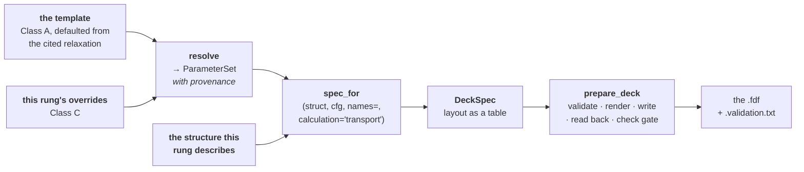

**And the structures are two, out of one file** — which is why the seam never
had to change:

| rung | the structure it describes | where it comes from |
|---|---|---|
| seed · device · transmission | the **junction** | the cited relaxation, sorted |
| electrode_L · electrode_R | the **lead** | *the same file*, `extract_electrode_model(dev, "L-electrode")` — a subset selected by region label, then `as_structure()` |

#### Measured, on the repository's own fixture

| rung | lines | validation report | solver | `%block TS.Elecs` | `MaxSCFIterations` |
|---|---|---|---|---|---|
| `01_seed` | 488 | ✅ | `diagon` | – | ✅ |
| `02_electrode_L` | 419 | ✅ | `diagon` | – | ✅ |
| `04_device` | 584 | ✅ | `transiesta` | ✅ | ✅ |
| `05_transmission` | 584 | ✅ | `transiesta` | ✅ | ✅ |

Against the 13 keywords and 4 blocks § 3.2 measured. `MaxSCFIterations` and
`DM.Tolerance` — the two that killed a real seed at 1000 iterations — now reach
every rung from the description, with provenance. *The `05_transmission`
column is the 2026-09-16 measurement; since 2026-10-08 the transmission deck
carries no SCF setting at all (§ 6.1b: tbtrans runs none), so its
`MaxSCFIterations` cell would read – today.*

#### The lead's k-point grid, which makes the physics visible

A lead's deck writes its k-point grid as three rows — one per axis, the count
on the diagonal and the offset last:

```
    4    0    0      0.0     ← in the electrode plane (x, y): the SHARED
    0    4    0      0.0        k-point grid, the device's too, because the
                                lead is the bulk of the device's electrode
                                region (TranSIESTA checks it)
    0    0  100      0.0     ← along z: MANY k-points, because a lead is a
                                periodic bulk crystal, and its Hamiltonian
                                and Fermi level are what every self-energy
                                is built from and aligned to (§ 0.2)
```

The device writes `1` in that third row. That is not a disagreement — it is
**the definition of an open boundary**: along z the device does not repeat,
the leads' self-energies stand in for everything beyond it, and that is the
reason the leads are computed in runs of their own at all.

#### What did NOT land, stated plainly

| | |
|---|---|
| ~~**the bias has two homes**~~ | `task.bias` (the description's axis, giving the `v*` directories) and `bias_voltage_v` (a template row with a range and help). The axis won: each point's deck was the resolved config with that voltage replaced, and with no axis the template's value answered. **Closed 2026-09-29 (K1)**: the axis is the one home — `bias_voltage_v` is the point a rung renders, fixed by the rung, and a template value or a stage override naming it is refused (§ 2a.10) |
| **the NEGF electrode block is lifted, not tabled** | `%block TS.Elecs` and the per-electrode blocks are still the pre-seam emitter's, wrapped in one `Block` *(with one small projection at the boundary until 2026-09-29, when the block's VALUES moved to the catalogue and the projection went — § 6.1b)*. Deliberate: TranSIESTA identifies each electrode by a **contiguous atom range**, so an off-by-one computes transmission through a region that is not the molecule *and converges while doing it*. That emitter has been measured against a live 5.4.2 binary; a rewrite would have to earn that again for no gain |
| ~~**`TransportConfig` survives**~~ | only to feed that lifted emitter. TR4 already deleted the general projection when the template made it unnecessary; this is the last one, and it goes when the block is tabled. *(It went 2026-09-29, § 6.1b; the class retired 2026-10-02, M5 step 3)* |
| **net charge and gating** | deferred by ruling (§ 2a.7) |

#### Two defects this work found in itself

Recorded because both were caught by guards rather than by review, and both
say something about where mistakes live:

**The check gate caught a duplicate keyword the day it was written.** The device
deck said `SolutionMethod diagon` from a section and `transiesta` from the NEGF
block — in that order, with libfdf silently taking the first. The cause is
general, not a slip: **a section resolves a value from the config**, and a role
item's answer was not there. `_render_sections` skipped them and each rung's
block wrote its own — until 2026-09-29, when the rung's answer moved INTO its
config (`resolve`, the role layer), so the section writes the right value and no
block types the line (`template.md` § 6.4).

**A test fixture was geometrically invalid and nothing had ever looked.** Its
buffer variant put 44.5 Å of atoms in a 40 Å cell, so atoms overlapped their own
periodic images along the transport axis. It survived because **the device deck
had no settings gate until it joined the seam** — the first time anything
validated that geometry was the moment this work put a gate in front of it.


---


### 2a.15 What `restart` means for a ladder *(defined 2026-09-16; the device's answer, user, 2026-10-05)*

`restart` is a property of an **iterative** calculation: *when this run starts,
does it pick up where a previous one left off, or begin from the atomic
densities?* The optimization ladder is where the question was designed, and
there it governs a relaxation that may take days.

A transport ladder is **four single points and one post-processing step**, so
the question does not mean the same thing on every rung, and on one of them it
means nothing at all.

| rung | does it iterate? | the state a restart would pick up | is "continue vs clean" worth asking? |
|---|---|---|---|
| `seed` | an ordinary SCF | its own last `<label>.DM` | barely — its whole output *is* a `.DM`; one not converged continues from its own (§ 2a.11) |
| `electrode_L` / `electrode_R` | an ordinary SCF on a bulk lead | none — a lead declares no restart file | **no** — launched again, a lead runs from its deck alone; a bulk lead is cheap to run again |
| `device` | **the NEGF SCF — the expensive one** | its own previous `<label>.TSDE`, **and** the seed's `.DM` as a starting density | **answered by the sweep** (§ 2a.11): a point starts from the seed's `.DM` (0 V) or the closest converged point's `.TSDE`, and one not done continues from its own last density |
| `transmission` | **no SCF at all** — `tbtrans` reads a converged Hamiltonian and integrates | nothing | **no. There is no state to continue** |

**So the question is answered per point** *(user, 2026-10-05; the run rule
2026-10-08, § 2a.11)*: a point starts from a hand-over — the seed's density at
0 V, the closest converged point's after it. Within one run the wrapper's own
retry (`continue_retries`) continues a point in place from its last density;
a point still not done when the run ends is run again in the NEXT run's fresh
point folder, from its hand-over start — never continued across runs. Once
done it is taken over whole into every later run and never run again, because
a converged point is a fixed point and running it again only repeats it. (A
device with no point level has no points to take over: launched again, it is
a stage like any, § 2a.11 above — the row above says so.) Launched again,
the seed continues from its own last `.DM`, a lead runs from its deck alone,
and the transmission has no iteration to resume.

**The two hand-overs, and how SIESTA reads each.**

* The seed's `.DM` reaches the device's first point through `DM.UseSaveDM`,
  which the device deck writes. That is a *hand-over between rungs*, not a
  restart — the arrow runs seed → device and never back.
* A later point starts from the `.TSDE` of the closest converged point, copied
  in as its own `<label>.TSDE`, and **TranSIESTA reads it under
  `DM.UseSaveDM`**, the same keyword as the `.DM` and true by default (5.4.2's
  `m_new_dm.F90` tries the `.TSDE` only when it is set): finding a `.TSDE` in the
  directory, TranSIESTA takes it as the starting density, and *"this is then
  considered a continuation run"*, skipping the periodic start (the manual's
  TranSIESTA *Description*). The binary's own words, measured
  2026-09-16: *"Attempting to read DM, EDM from TSDE file"*, and
  *"Forcefully requested initialization of the DM, however the DM/TSDE file
  does not exist!"* A point's own `.TSDE` is the engine's state at that point
  and the wrapper's retry within the run reads it; across runs it is never
  taken over for a point not done (§ 2a.11) — the next run's point starts
  from its hand-over, and the walk copies a hand-over only into a point it
  has not begun, so a point's own density is never overwritten by another's.

**Is `DM.UseSaveDM` honoured in a TranSIESTA run?** Measured against SIESTA
5.4.2's own binary: yes. The one path that overrides it is a geometry
relaxation — *"DM re-use not allowed. Resetting DM at every geometry step /
DM.UseSaveDM overridden!!"* — and a transport rung is never that: none of the
five decks carries an `MD` block, by design (the kind excludes the relaxation
driver, § 3.3).

**Why the missing keyword is not the hazard it looks like.** The electrode
rungs write no restart keyword at all, and SIESTA reads `<label>.DM` whenever
the file is there whatever the deck omits (`DM.UseSaveDM` is true by default,
the manual's *SCF loop*) — so in principle a lead could warm-start from stale
state without being asked. In practice every run folder is opened **empty**:
its first run is given the rung's own files and, at its first launch, its
kind's gather, and nothing else (a rung takes no `--from`,
[`job-system.md`](?doc=execution/job-system.md) § 5.4); a run launched again,
warm, is given copies of what its own newest run left of the restart files
the rung declares — the seed's `.DM`, the device's `.TSDE`; the leads declare
none — the state to continue from, not a stale one (§ 2a.11). Nothing stale
is there to pick up. The exposure is a hand-run wrapper inside an
already-used run, which is outside the ladder.

**Does the lead need `TS.DE.Save`? No — the manual says when a lead's density
is read** (TranSIESTA's electrode options, `TS.Elec.<>.DM-init` and
`TS.Elecs.DM.Init`). The device reads a lead's density only when told to
overwrite its electrode regions' starting density with the bulk one: the
option's default, `diagon`, never does; `bulk` does, and *"requires the DM
file for the electrode to be present"*; and *"only force-bulk will have effect
if $V \neq 0$"*. No rung's deck writes either option, so
every rung takes the default, `diagon`, and no lead's density is read: the
lead's `.TSHS` (`TS.HS.Save`, I13) is the whole of what the device needs from
it. A person who sets `bulk` (read at 0 V) or `force-bulk` (read at any bias)
needs the lead run to save its density, `TS.DE.Save` — the case worth knowing,
which a run of the default deck could never have revealed.

*(Settled first from SIESTA 5.4.2's source, 2026-09-16, whose reading had a
finite bias switch the option off whatever was asked; the manual says
`force-bulk` still acts there. The decks write neither value, so the answer
stands either way. It was also once attributed to `TS.Elec.<>.Bulk`, another
option entirely — whether the Hamiltonian of the electrode region in the
device is enforced bulk (the manual; true by default) — and once settled by
one junction's run, which is evidence about one configuration rather than a
rule.)*

### 2a.16 A calculation that reuses a finished one *(the user, 2026-10-22; built 2.30.0 — plan § 1x)*

*(The user, 2026-10-22: "a mechanism where we can cite a finished task … and
then say, hey, I want to expand this a bit, or I want to tune certain
parameters that would be able to use the existing, some of the heavy cost
calculation result"; "a separate directory that cites the original one or
copy things over if I need to, and then continue that transport calculation
… don't overcomplicate it"; "I don't mind to occupy a bit more space if it
saves time … As long as it's logically separated from the old run, we don't
intend to overwrite the old run"; "did you consider how to add UI support for
this additional feature?")*

A finished transport calculation answered one question: one window, one list
of voltages. **A wider question is a new calculation, in a folder of its own,
that reuses the finished one.** It starts as the finished calculation's
description; you change what the new question asks; its prep **copies in**
every group the finished calculation already computed, and the rest runs here
— a rung of points **taking over**, at its first launch, the points already
computed. What is reused is copied, and every record in the new calculation
names a run of its own, so it reads, launches and restores as any calculation
does. The finished calculation is never written by it. § 1.2 says what each
change re-runs; this section says how the new calculation reuses the rest.

> **The rule.** A group is **copied in** when, for each of its members, the
> finished calculation's newest run of it has ended and holds every result
> this calculation describes, each done — a rung of points: every point it
> describes, a run holding more leaving the rest behind; a rung this
> calculation runs once, where the finished one ran points: its point at the
> first frame and 0 V — ran **the same calculation** as the deck this
> calculation renders for it now, and every stage it takes inputs from is
> copied in too. A point of a rung
> prepared here is **taken over** from the finished calculation on the same
> terms, one point at a time. The question is the gather's own (§ 6.1: the
> newest run, finished or done; the same engine input as the deck rendered
> now, `deck_record.same_calculation`), and one door asks it of a run of
> either calculation — for the gather, for a group copied in, and for a point
> taken over.

**Every stage it takes inputs from** closes the rule over the ladder: the
device is copied in only with the seed and leads it was computed from, the
transmission only with its device and leads — so a change that re-runs a lead
(`electrode_kz`, § 1.2) re-runs everything computed from it, though the
device's and the transmission's decks do not change. Within the finished
calculation every run of a launched stage ran the same calculation
(`job-system.md` R-P5), so a stage that is the same calculation is the same in
every run of it.

#### The workflow, step by step *(the user, 2026-10-25: "show workflow"; "no jargon, no cryptic language")*

You have a transport calculation that finished — call it **O**. You want a
new one that asks more of the same junction: more voltages, a wider or finer
energy window, other device or transmission settings, or the junction at
several geometries along one vibration (a frame set). The new calculation
lives in a folder of its own and copies from O what O already computed. O is
only read, never changed.

```text
 O  finished: the seed, both leads, the device and the transmission all ran
 |  to their end
 |
 |  (optional) a frame set: the junction moved along one vibration, frame
 |  by frame, its first frame exactly O's junction
 v
 1  DESCRIBE the new calculation as an extension of O
      command line:  molbuilder describe --calculation transport --reuses O
                         [--slot junction=<the frame set's .xyz>]
                         [--bias ...] [--window LO,HI [--finer N]]
      Transport tab: "Choose junction..." and pick O's folder; change the
                     voltages, the window, the device's or the
                     transmission's settings; if you want, "a frame set of
                     it" and "Choose a frame set..."; press "Describe this
                     calculation"
      -> the plan: what will be copied from O, what will be computed new,
         and why
 |
 2  PREP the new calculation          (the folder's state is saved first)
      molbuilder jobset prep task --group 1 --group 2 --group 3 --target <machine>
      -> each stage O already computed as this calculation would is copied
         from O, and the plan names each: the seed and both leads; the
         device and the transmission too when you only removed voltages,
         took one geometry where O ran a frame set (O's first frame is
         used), or chose the low-bias approximation; with a new energy
         window the device is copied and the transmission is computed at
         the new energies
 |
 3  LAUNCH the stages that were not copied, in order (usually the device,
    then the transmission)            (each one's first launch saves the
                                       folder's state first)
      -> every result O already has -- the same voltage at the same frame,
         computed the same way from the same inputs -- is copied from O;
         every other one is computed, and the launch says why
 |
 4  SUMMARIZE -> one record with every voltage and every frame, each
                 saying whether it was copied from O or computed here
```

**Which of O's results can be used.** Only O's newest run of each stage,
and only a result — one voltage at one frame — that finished in it. A stage
is copied when every result you ask of it finished there, even if the run
failed on a result you no longer ask for; otherwise the results that did
finish are used one by one, and the rest are computed. **The plan warns of
every result of that run that did not finish** — asked or not — naming it
and how it ended: a voltage that does not converge can mean a problem in the
physics or in the parameter choices, which the results that did finish were
computed with too *(the user, 2026-10-25: "A, keep it as built, but with
warning of unfinished points because this could indicate problems in
physics or parameter choices")*. A stage is copied only from a run that
has ended. While O's newest run of a rung of points is still going, the
points it has finished are taken over at this rung's first launch and the
rest run here; when it already holds every point asked, the launch refuses
— prepare again once it has ended, and the stage is copied in. An older run never stands in for a
newer one that failed, is still running, or was never started: launch that
stage of O again first. The plan names, for every result, the run it comes from, or
why it is computed again: the run failed, is still running or was never
started; a setting differs, each named; or what it was computed from is not
the same.

**Without a frame set**, the extension uses O's junction as O ran it. **With
one**, the frame set's first frame must be O's junction — the same atoms in
the same order at the same places, the same cell, the same electrode, bridge
and buffer labels. Which atoms are held fixed may differ: a vibration
usually holds more. The first frame can then reuse O's results — when O
computed it the same way, which the plan says — and the other frames are
computed (*A frame set of the same junction*, below).

**What never happens.** O is never written. Describe and prep start no
calculation. A result is never reused because it looks close: only when it
is the same calculation.

#### Describing it

```bash
molbuilder describe --calculation transport \
    --reuses AuBDTAu/transport/lowbias_local \
    --bundle AuBDTAu/transport/lowbias_wide
```

writes the new calculation from the finished one's records as they read now:
its `task.json` — the junction citation, `swap_electrodes`, the bias list, the
stages, the run and so its **label** — its template, and its job request with
its run cards and groups; `reuses`, the finished calculation's folder,
tree-relative (`job-contracts.md` § 6.1); its **composed junction** —
`junction.xyz`, its sidecar, the cited deck and `slot-provenance.json`, read
by the composition's one reader and written by its one writer
(`compose.load_compose_record`, `compose.write_compose_record`) — so the
junction is the finished one's, atom for atom, and is not composed again; and
its **pseudopotentials**, `pseudos/`, which prep takes before any other
source, so every deck reads the files the finished runs read. A flag beside
`--reuses` sets what it sets on any describe — the voltages, the treatment,
the window; voltages typed with no treatment keep the finished calculation's,
as the Transport tab does — and one naming what the extension keeps is
refused by name:
`--name` (the label), `--psml-lib` (the pseudopotentials); `--slot
junction=` names a frame set of the same junction or is refused by name
(*A frame set of the same junction*, below). You then change what the new
question asks, on the Transport tab before Describe or on Task setup after,
as for any calculation. The describe copies no run.

- **The label is the finished calculation's**: SIESTA's `SystemLabel` names
  every file a deck reads and writes, and is engine input — decks under two
  labels are never the same calculation (§ 6.1).
- **A USER-CUSTOM zone is not carried**: the zone § 6.1's comparison merges is
  the one in the deck this calculation's prep wrote, so a keyword typed into
  the finished calculation's deck makes its rung run here, the keyword named
  as the difference.
- **The junction's citation is read as for any calculation** (§ 1.1, *The
  first prep*): the record travels, and a cited pair edited since is refused
  by name.

**A finished calculation whose record of its junction does not read** — its
`slot-provenance.json` or its composed junction missing or incomplete — is
described all the same, saying so: no junction and no pseudopotentials are
written, prep composes the junction again from its citation, and nothing the
finished calculation computed is then reused — every stage runs here. (Citing
a frame set needs that record: it is compared with it, and refused without
it.)

Refused, before anything is written: a folder `--reuses` names that is not a
transport calculation's — said in its description's own words; a new folder
inside the finished calculation (§ 3.1, *A calculation's folder is its own*;
`compose.refuse_inside_citation`); a new folder that holds a description, as
every describe refuses.

#### Extending it — what may change, and what is fixed *(the user, 2026-10-22, 2026-10-23; built 2.33.0 — plan § 1aa)*

*(The user, 2026-10-22: "why can't we just have the citation be limited to a
few parameters that we actually allow them to change or suggest they would
change? … what are the things that we could touch and what are the things
that we should not touch?"; the four answers the same day: the fixed values
read-only with a way out; voltages and treatment, the energy window and its
finer grid, the transmission's analysis and the device's convergence
offered; the same limits on Task setup; the command line saying what will be
reused, never refusing.)*

**An extension keeps what the finished calculation computed once for every
voltage, and changes only what is computed per voltage.** The ladder says
which is which (`stages.per_point_rungs`): the **seed** and the **leads** run
once, their results — the leads' Hamiltonians, the seed's density — the
bias-independent ground every point stands on (§ 1.2); the **device** and the
**transmission** run per point. So:

| what | in an extension | what a change re-runs (§ 1.2) |
|---|---|---|
| **the voltages** — added or removed | **yours** | each new voltage's device run (self-consistent), its transmission point; under the low-bias approximation nothing while the window reaches it; a voltage removed, nothing — the ones kept are copied (*A narrower question*) |
| **the treatment** — low-bias ↔ self-consistent | **yours** | to self-consistent: the device and the transmission at every voltage, the 0 V ones taken over; to the low-bias approximation: nothing — the device and the transmission run once, at 0 V, which is O's 0 V result on its first frame, copied in |
| **the energy window** and how many times finer | **yours** | the transmission at the new energies only — the finished ones shared exactly |
| **the transmission's tab** — its k-point grid, broadenings, eigenchannels, the DOS it writes | **yours** | the whole transmission, every point |
| **the device's tab** — its NEGF contour, its mixing, its tolerances, its iteration budget | **yours** | every device point, and the transmission on it |
| **the shared panel** — basis, functional, mesh, temperature, spin, the shared k-point grid | **fixed** | everything |
| **the seed's and the leads' tabs** — `electrode_kz` among them | **fixed** | everything |
| **the junction**, its rename, its label, its pseudopotentials | **fixed** — but a frame set whose frame 0 is that junction may be cited in its place (*A frame set of the same junction*, below) | — another junction is another calculation |

**Fixed is shown, read-only, with its way out**: every fixed value stays in
view as the finished calculation states it — the schema served with
`reuses` marks the shared panel's and the seed's and leads' fields
*locked*, each *the value <name> ran with* (`transport.reuse.Extension`,
the one rule, its value the one the finished calculation ran with), and
the page lists them, folded, under *Fixed by <name>* (*On the page*) — and
one action, *Start a new calculation from this junction with these
settings*, cites the junction again as a new calculation that
reuses nothing, its cards starting from the values chosen in the finished
one — each rung's own, and each shared value its template says is the
person's (the lock's `chosen`), among them what its citation asks of the
person, drawn as the citation's own panel draws it (a pair's
pseudopotential directory, `asked_of_the_person`); a value cited from the
junction is cited again, and a value nobody chose — a default, or a cited
value the person emptied — stays not chosen, blank (the lock's `blank`):
what an extension is not for is
never edited inside one. **The Transport tab's Describe holds the limits**:
the fixed rungs keep the finished calculation's own values, and a changed
fixed value, or its rename or its label changed is refused by name beside
the control it names, nothing written
(`transport.reuse.Extension.refusal`) — and so is Task setup's Save of one.
The junction is the finished one or a frame set whose first frame is it:
Describe refuses any other, nothing written (`transport.reuse.write_reusing`,
*A frame set of the same junction*, below), and Task setup's Save refuses any
change of junction, because a calculation's id is built from its name and
its junction. Each change is measured against the description it is made from —
the finished calculation's at Describe, the folder's own at Save — so an
extension the command line wrote is never refused for what it holds.
**Task setup keeps the same limits** ([`web/task-setup.md`](?doc=web/task-setup.md)
§ 3): the seed's and the leads' rows and the shared values read-only, *fixed
by* the finished calculation, and a group copied in saying in its tab where
each run came from, above its run card — what it is launched again with.
**Every change of yours says what it re-runs** — the row above, in the
sentence its control says (`transport.reuse.Extension.says`, drawn as it
is; the one door every surface draws the limits from and both describing
doors check them by).

**What the extension will reuse is one answer** (`reuse.decide`, the rule
above): said once it is described — on the Transport tab beside Describe's
answer, by `molbuilder describe --reuses`, on Task setup's Preview and by
`prep task` — every group copied in, every point taken over, every point's
energies shared, and what runs here, each in the manifest's words. The
command line limits no value: a fixed value typed into the template is the
person's, and the manifest names what it makes run again.

#### A frame set of the same junction *(the user, 2026-10-24: "yes to R6", "go ahead, contract first"; built 2.38.0; on the Transport tab 2026-10-25, built 2.39.0)*

A vibration's frame set is the junction moved a little along one vibration,
frame by frame (§ 2a.9). Its first frame is often exactly the junction a
finished calculation already ran — on AuBDTAu, the mode-56 set and
`AuBDTAu_singlebias_equilibrium`. The seed, both leads and the first frame's
device and transmission are then calculations the finished one already made,
hours each on a cluster. **So an extension may use a frame set in place of
the finished junction, when the set's first frame is that junction.**
Without a set, it uses the finished junction as it ran.

**"Is that junction" is checked when the extension is described**, against
the junction the finished calculation ran as its folder recorded it, by the
one comparison two junctions are compared by (`compose.junction_difference`),
both in the order the person listed the atoms. Anything else is refused,
naming the atom or label that differs, and nothing is written
(`transport.reuse.frame_set_refusal`). A finished calculation whose record
of its junction cannot be read is refused too, in that reader's words.

| must be the same | why |
|---|---|
| the atoms, the same count and elements, in the same order | every input file lists them in that order |
| each atom of the first frame within `structure.SAME_PLACE_ANG` (10⁻⁶ Å) of where the finished junction has it | the finished results were computed at those positions |
| the cell, and whether x and y are each periodic or isolated (z is the transport axis in both) (§ 6.1c) | the leads repeat along the cell (I6); the vacuum and the k-point grid of every stage follow these |
| the atoms labelled `L-electrode`, `R-electrode`, `bridge` and `buffer` (`sort.PARTITION_LABELS`) | they decide the leads, the device's regions and the order the engine reads the atoms in (§ 4) |

**What may differ: which atoms are held fixed, and any other label.** A
vibration usually holds much more of the junction than transport needs —
everything but the molecule in the gap and a few surface metal atoms
(`engines/vibration.md` § 2.3a). Transport asks one thing of the held atoms:
that every electrode atom is among them (§ 1.1, Step 0, *What transport
asks of the held set*). No transport input file states which atoms are
held — the stages solve the electrons with every atom where it is, with no
`Geometry.Constraints` — and the atom order the engine reads follows the four
labels above (`sort.deck_sort_key`), never the held atoms. So a larger held
set changes nothing the engine reads. *(Measured on AuBDTAu, 2026-10-24: the
finished junction held its 150 electrode atoms, the mode-56 set 292, the
electrodes and 142 more gold atoms; the seed's, both leads' and the first
frame's device input files built from the set are the same, as SIESTA reads
them, as the ones the finished runs ran, `engine_input_differences`.)* The
set's other labels — `VIB_CALC`, any of the person's — travel with it and
nothing here reads them.

**What the extension keeps, and what it takes from the set.** Like every
extension, it keeps the finished calculation's name (its label), its
parameter template, its run cards and its pseudopotentials. The junction is
the set's, every frame, recorded in the new folder when it is described
(`compose.write_compose_record`), so the device and the transmission run
once per frame and voltage (§ 2a.11).

**What is reused follows the rule above**, one input file at a time —
nothing new decides it. The seed and the leads are copied when their input
files, built from the set's first frame, are the same as the ones the
finished runs ran. A device or transmission result is reused for the first
frame where the finished calculation holds the same voltage, computed the
same way from the same inputs; a calculation of one geometry holds its
results at the first frame (`point_key`), so **only the first frame** can be
reused, and every other frame is computed. The other way round — a finished
calculation that ran a frame set, extended with one geometry — is a narrower
question: the first frame's device and transmission results are copied in,
and nothing runs (*A narrower question*, below). A transmission whose energies
differ is computed too, sharing only the energies that are exactly the same
(below). *(Measured on AuBDTAu, 2026-10-24, a scratch copy, nothing
launched: the seed and both leads copied, the first frame's device and
transmission reused — about 7 h, 6 h and 45 h on Sol — and frames 1 to 4
computed. Its device ran twice, the second run continuing the first, so the
second run's own record lists only the leads as its inputs; following the
continuation back to the first run adds the seed's density, and that is what
the new device's inputs are compared with — *At prep*, below.)*

**Where it is asked**, both through the writer every extension is described
by (`transport.reuse.write_reusing`), which checks the set
(`transport.reuse.frame_set_of`):

- **The command line**: `molbuilder describe --reuses <finished> --slot
  junction=<the set's .xyz>`. Its answer says the junction is the set's,
  how many frames it has, and that its first frame is the first frame the
  finished calculation ran.
- **The Transport tab**: the extension's junction is a choice of two —
  the one the finished calculation ran, with its number of frames, or *a
  frame set of it*, whose *Choose a frame set…* opens the picker. The picker checks
  each citation you select — a frame set's `.xyz`, or any other whose first
  frame is that junction, a relaxation run's folder among them — and shows
  the answer before you confirm (`describe_attempt` with `reuses`): one
  whose first frame is the finished junction reads *FRAME 0 IS THE JUNCTION
  <name> RAN*, followed by what it is; one whose first frame is another
  junction, or that does not compose, shows why it is refused, and the
  junction you had stays. Once a set is cited, the panel names it, says the
  device and the transmission run once per frame and that the plan
  Describe shows says which results are reused, and the viewer and the
  frame card show it; choosing <name>'s junction goes back, and choosing
  the frame set again brings back the one last cited; reloading the page
  keeps the set. *Start a new calculation from this junction with these
  settings* starts from the junction shown — the finished one, or the set
  cited. **Not citing a set is describing with the finished junction**, as
  the finished calculation ran it.

Once described, the set is the calculation's junction: its run id is made
from its name and this citation (`run-identity.md` § 2), so saving another
junction on Task setup is a different calculation and is refused.

#### At prep — a group copied in, or prepared here

Prep asks of each group it is to prepare, before it plans it, in the ladder's
order — so a group's upstream is answered first, in this prep or an earlier
one:

| each member's newest run in the finished calculation | the group |
|---|---|
| holds every result this calculation describes, each done — a rung of points: every point it describes, more being left behind; a rung run once here, from points there: its point at the first frame and 0 V — the same calculation as the deck rendered now; every stage it takes inputs from copied in | **copied in**, when every member's is |
| another calculation, a result it does not hold, an input from a stage this calculation does not copy in — each difference named; not finished, a result not done, not there — its state named | **prepared here**, as in any calculation |

The run asked is the **newest**, as every hand-over asks (`job-system.md`,
*The task*, D5). A folder `reuses` names that is not there answers every
group *prepared here*, saying so.

**A group copied in** has its stages' files prepared as any stage's — the
decks rendered now, which are the decks the finished runs ran — and **every
run of each member copied, under its own name**: `run-0` and `run-1` as they
were, so every record inside them — what each run continued from, what each
gathered, its launch record's — names a run that is here, the stages it
gathered from being copied in too. The runs are copied as they are, their
stamps among them, **but the engine's scratch** (`warmfiles.is_scratch`: the
leads' surface Green's functions) and with each launch record copied last, so
a copy cut short reads as a run never launched; beside each, **`.copied-from`**
names the run it is a copy of, tree-relative as `reuses` is — a run the
finished calculation copied in itself names the run its own `.copied-from`
names, one hop. A run of the stage prepared here and never launched is
removed first. The launch folder that sent the finished runs — its walk
scripts and their logs — stays in the finished calculation.

**When the newest run holds more results than this calculation describes**,
in the same folders — fewer voltages — every run is still copied whole, and
a result this calculation does not describe stays in its copy, unread: every
reader finds a run's results by the description. **When this calculation
keeps them in other folders** — one geometry where the finished calculation
ran a frame set, or a rung run once here where it ran points — only the
newest run's results this calculation describes are copied, as `run-0`, each
where this calculation keeps it (a point's folder, or the run's own folder
for a rung run once), its folder stamped as this calculation's — a run of
points a container, a result a run. Each carries its own `.copied-from`,
naming the result it is a copy of, and its records of what it was given and
what it continued from, **each folder they name moved to where this
calculation keeps it** — the seed's and the leads' runs, copied whole, keep
their names — so a launch again takes the inputs the result was computed
from, and a calculation that later reuses this one compares them; a result
it continued from that this calculation does not hold is not named. A run of
points brings its own files too — what its gather gave it — and its record
of them; its scratch folder (`tsgf/`) is made, empty, the engine's files
left behind; the results this calculation does not describe are left
behind, and the manifest names them. The newest run's launch record is
copied last. *(The
user, 2026-10-25: "when citing a multi frame calculation, first frame result
is used ... same checking for validate if this reuse is correct should still
be in place"; "One rule: reuse completes".)* The first frame of a vibration
mode's frame set is the undisplaced, equilibrium geometry (§ 2a.9).

**A run copied in is a launched run of this calculation**, its launch record
the one it was launched with: `status`, the gather, the ladder, the record and
the Results tab read it as any finished run, saying *copied from* the run its
`.copied-from` names. Its group is launched, and the next step is the first
group not finished (`job-system.md`, *The next step*) — with every group copied
in, `summarize task`. A group copied in is in no sequence of groups
(`--one-job`): no job launches it. Changing what a member computes is then
what it is for any launched stage (`job-system.md`, *How the checkpoint
supports you*); its way back is the state saved before the prep that copied it
in, whose note says so — `… · before prep task group 1 (seed, electrode_L,
electrode_R), copied in from lowbias_local`.

**A group prepared here** is prepared as in any calculation, and **a rung of
points in it takes points over from the finished calculation at its first
launch**, as a warm launch takes over its own done points (§ 2a.11): each
point the finished calculation's newest run of the rung holds done, that ran
the same calculation as this rung's deck at that point, and whose inputs this
calculation copied in or took over from the same finished point — a
transmission point's device point, taken over by this calculation's device
run from the point that point gathered — is copied into the point's folder.
A point's inputs are what its run carries: its own record and, for an input
a warm launch kept from the run before it, what that run gathered, one hop at
a time through `.continued-from` — the one answer a launch again takes its
inputs by (`runrecord.carried_gather`, `job-system.md` § 5.4) — so a device
launched twice, the second warm, carries the seed's density its first launch
gathered. What is copied:
the engine's files and the run's own account (its output, its ending, its
monitor's records), but never its records of runs (`.continued-from`,
`.gathered-from`), its folder's stamp or a launch record. Its records are this
run's — what the gather gave the point, as for a point walked — and
`.copied-from` names the point it is a copy of. The rest are walked, a new
voltage starting from the closest converged voltage before it in its frame, a
point taken over among them (§ 1.1, step 4). A point is a frame and a voltage,
matched as such; a rung the finished calculation ran once is its 0 V point on
its first frame — so a calculation that leaves the low-bias approximation takes over
the 0 V device and transmission points the finished one computed.

**A narrower question** — fewer voltages, or one geometry where the
finished calculation ran a frame set (its first frame is used) — is answered
from the finished results: every stage that holds them is copied in at
prep, and nothing of it runs. The manifest names what the copy holds that
this calculation does not ask — a voltage removed, copied with its run and
never read; a frame left behind. A stage copied in is computed here only
when you launch it again.

#### The manifest — what is copied, and what runs with the new request, before anything is written *(the user, 2026-10-22: "the user get a manifest of what will be copied over to continue as a new task with the new parameter request")*

**One answer, composed once by prep's question and shown wherever a prep is
asked about, before it writes**: for each group in the ladder's order, copied
in — each run, where it comes from, how it ended and its size, and what of it
is left behind — or prepared here, with what decided it: each difference of
the new request as it reaches that rung, in the words of § 6.1's comparison,
or the finished run's state — a change of shape, a rung run once against a
rung of points, said by what each calculation runs. A run copied in names
the results it holds that this calculation does not describe: copied and
unread, or left behind. **A result that is not done is warned of**: for each stage, when the
finished calculation's newest run of it has ended holding a result that is not
done — asked or not, copied in or prepared here — the manifest says, under the
group, `warning:` that run, each such result and how it ended in the done
door's words — *not finished*, *finished, not converged (SCF NO)* (possible only
where the run's `scf_must_converge` was false; SIESTA otherwise stops it), a
file missing — and that such a result can mean a problem in the physics or in
the parameter choices. It decides nothing: a stage run once is copied when its
run finished, as this calculation's own gather would take it
(`continuation.usable`), and the results that finished are reused all the
same *(the user, 2026-10-25)*. For a rung of points
prepared here, the points its first launch will take over, from which run,
and the points it will walk, and why each point the finished calculation
holds is walked: its newest run never launched, the point not done there —
in the done door's words — another calculation, or other inputs.
Then the totals: what is copied now, what the transmission's first launch
will copy into its points' `shared/`, and what the next save stores again.

```text
reuses AuBDTAu/transport/lowbias_local -- what this calculation copies, and what it runs
  group 1  seed, electrode_L, electrode_R  copied in
           01_seed/run-0         <-  lowbias_local/01_seed/run-0         finished  409.6 MiB
           02_electrode_L/run-0  <-  lowbias_local/02_electrode_L/run-0  finished  102.4 MiB
           03_electrode_R/run-0  <-  lowbias_local/03_electrode_R/run-0  finished  102.4 MiB
  group 2  device                          copied in
           04_device/run-0       <-  lowbias_local/04_device/run-0       finished  2.6 GiB  (tsgf/ left behind)
  group 3  transmission                    prepared here -- transmission: lowbias_local/05_transmission/run-0 ran another calculation -- block TBT.Contour.window, row 2: the run had from -2.0 eV to 2.0 eV, it renders from -2.997506234413965 eV to 2.997506234413965 eV now; block TBT.Contour.window, row 3: the run had points 401, it renders points 601 now
           its energies:
             0 V    shares 401 of 601 energies with lowbias_local/05_transmission/run-0 -- computes 200 here
  copied now: 3.2 GiB -- the transmission's first launch copies 819.2 MiB into its points' shared/ -- the next save stores it again: 4.0 GiB
```

- **On the terminal**, bare `prep task` lists it with the groups it offers, so
  picking a group is agreeing to its copy; a prep that names its groups
  (`--group N`) prints it with its answer.
- **On Task setup**, the Preview shows it before Prep is pressed, and Prep
  writes the plan the Preview showed (R-P14).
- **Kept**: in the plan the folder holds in reading order (`STAGE-PLAN.md`,
  under its table, where what each stage's first launch takes is said), and
  in the ledger (`jobset-decisions.log`), a line for each copy and for each
  point taken over.

The take-over is the first launch's, and its launch shows its points and
asks once, as every launch does (`job-system.md` § 6.0) — taken from the
newest run it finds, which it says.

#### A transmission point's energies — each computed once, shared only when exactly the same *(the user, 2026-10-22)*

*(The user, 2026-10-22: "we should not do tricks about saving points, rather,
it is an honest parameter reset - user could change window size, range, and
point density, the only thing that is shared is the energy/density of
states/device matrics (or anything else that could be shared)"; then, shown
what a transmission point costs: "can we offer the option of detecting which
points can be exactly shared and which ones must be recalculated?"; and "i
agree with your recommendation" — strict sameness, nothing approximated.)*

**The window is the person's, whole**: its range, its size and its point
density are the transmission's own parameters, set as for any calculation,
and a point's result is that grid — every energy of it. **What is shared is
what is the same**: the seed's density, the leads' Hamiltonians, the device's
converged density and energy-density matrices and its Hamiltonian, copied in
with their runs — and, within a transmission point, **every energy the
finished point computed exactly**. A transmission point costs its energies
times its k-points, each energy independent of every other (§ 1.2); an energy
computed once is not computed again where a point adds energies to it.
**A transmission that runs once** — under the low-bias approximation, or at a
single bias — is its one point, the run itself (§ 2a.11), and shares as any
point does, its `shared/` in its run's folder (the manifest's example above).

**When a point shares energies** — all of these, at prep:

- the finished calculation's newest transmission run holds the point — the
  same frame and voltage — done;
- this rung's deck at that point is the same calculation as the finished
  point's **but for its energies**: rendered with the finished point's
  contour in place of its own, it is the same engine input (§ 6.1's door,
  asked unchanged);
- its inputs are the finished point's: its device point copied in with the
  device's runs, or taken over by this calculation's device run from the
  point the finished point gathered; its leads copied in;
- **the two grids hold energies in common, and the new one adds at least
  one** — an energy in common is the same energy to floating-point precision,
  within 10⁻⁹ eV, the finished point's read through the one door that reads a
  point's energies (below), from its `.TBT.nc` files, which keep them at full
  precision, never the five decimals its `.TBT.AVTRANS` prints; never a nearby
  one. Every energy in common is shared and the rest are computed here — a
  window widened, shifted or cut finer. A grid whose every energy the finished
  point holds, and that holds fewer, asks a narrower question: it runs whole,
  and the manifest says how many energies it computes again — no run is made
  with nothing to compute.

**A point whose grid is the finished point's own** — every energy the
finished point holds, its own and those it shared, and no other — **is that
point**: it renders the finished point's contours, so it is the same
calculation, and it is copied in with its run or taken over, its `shared/`
with it. Only a finished point that is done holds its energies: one that did
not finish, or lacks its `shared/` and its record, is no point to be, and a
transmission that ran once is its one point, judged so
(`continuation.done`, `reuse.that_point`).

**Exactly the same, and nothing else**: an energy is shared when the finished
point computed that energy — never one a few 10⁻⁶ eV away: the transmission's
narrowest features are as wide as its broadening, 10⁻⁴ eV at the catalogue's
defaults (`tbt_elecs_eta_ev` 10⁻³ eV, the device's contour η a tenth of the
smallest electrode's, § 2a.13). Two mid-rule grids hold energies in
common when, for instance, one's spacing is the other's, or the other's over an
odd number, and its ends lie a whole number of its spacings from the other's —
the energies themselves are compared, so any grid that holds some is found — −2…2 eV at
401 points, extended by 100 spacings a side, is −2.997506234413965…
2.997506234413965 eV at 601; cut three to an interval, 1203. **Every
transmission deck writes its window's ends at full precision** — tbtrans
computes its energies from them, and an end rounded to five decimals is
another energy; § 6.1 reads a value as a number, so `-2.00000` and `-2.0` are
the same input. The energies of two runs agree to rounding (10⁻¹⁵ eV), and
the 10⁻⁹ eV holds while SIESTA and sisl convert Ry and eV by the same
CODATA factors; a build that does not shares nothing, which is safe.

**A wider window, fitted to the finished grid** *(the user, 2026-10-22:
"can't we use "old point gap" and target window to automatically generate
that list? … we are working on the "expanding" design")*. In a calculation
that reuses a finished one, **you state the window you want — its range, and,
to go finer, how many times finer, an odd number so every finished energy
stays a point — and molbuilder fits the grid to the finished point's**: its
spacing, over that factor, and its alignment, extended outward by whole
spacings until the range you asked is covered. Every finished energy is then
a point of the new grid and every new energy lies at the same spacing, so the
transmission computes the new energies alone. One door fits it
(`transport.window.fitted`: the finished grid, the range asked, the factor →
the window's ends and its point count), and what it answers is **the
transmission's own values** — where the page's *use these* writes them too,
so the window has one home on both roads — said where it is fitted, with the
range asked:

```text
transmission window: -3…3 eV asked, fitted to the finished grid -- -3.00748…3.00748 eV at 603 points, 0.00997506 eV apart, every one of its 401 energies kept
```

- **Where it is asked**: `molbuilder describe --reuses <finished> --window
  -3,3 [--finer 3]`; and on the Transport tab and Task setup, the
  transmission window of a calculation that reuses one offers the fit beside
  its fields — the range asked, the fitted ends and count, and *use these*,
  which writes them as the transmission's own values: into its tab on the
  Transport tab, on its row on Task setup. A window typed value by value
  stays as typed and shares what it shares; nothing is fitted unasked.
- **With the catalogue's default** — −2.005…2.005 eV at 401 points, the
  energies on the 0.01 eV lattice, E_F among them (the user, 2026-10-22: *"i
  would agree to your recommendation of default numbers for starting"*) — a
  window fitted to −3…3 eV is −3.005…3.005 eV at 601 points.
- **The finished grid is its point's window as its deck states it** — its
  ends and its count, the numbers tbtrans computed its energies from; a point
  that shared energies, the grid its record describes — at the finished
  calculation's newest transmission run's first point done
  (`jobset.reuse.finished_window`). A range whose ends the finished energies
  already reach — the first at or below it, the last at or above — fits that
  window end for end: the same deck, copied in.

**What the point's run computes**: the energies its grid holds that the
finished point does not — **written in its deck as line contours**, each a
run of those energies at one spacing (`part line`, `from … to …` at full
precision, `points`, `method mid-rule`), every one named in the deck's
`TBT.Contours` list: tbtrans computes them all, saying *Contours are not
connected* when they do not join (`m_tbt_contour.F90`). A window widened or
shifted adds at most two, one each side; a grid cut $n$ to an interval ($n$ odd),
$n - 1$ between the old energies. So § 6.1's door, which reads deck text, sees
every energy the point computes. A comment of the deck's — molbuilder's,
which the engine does not read — names the finished point the contours
complement and how many energies it holds. Prep writes it with the deck; a
launched point prepared again for its job request keeps its contours, read
back from the deck prep wrote for it, never decided again.

**One moment, one record**: prep decides — the manifest says it — and the
point's deck records it. The transmission's first launch copies the finished
point's energies into the run's point folder, from the point the deck
names. **Every launch that walks a
sharing point gives it its energies**: a launch again, warm or cold, copies
them from the rung's newest run that holds them whole — its `shared/`, with
its `.copied-from` — or, with none, from the point the deck names; a point
taken over carries its `shared/` with it.

**Where the shared energies lie**: a folder of the point's own, **`shared/`**,
its name the layout's (`paths`) and its stamp the role `shared`
([`project-layout.md`](?doc=execution/project-layout.md) § 1.4a) — a folder
because tbtrans refuses to start where its own `<label>.TBT.nc` lies
(`m_tbt_save.F90`) and overwrites its text outputs. It holds what the readers
read of the finished point — its `.TBT.nc`, the digest of it, and its
k-averaged text files (`.TBT.AVTRANS_<pair>`, `.AVTEIG_<pair>`, `.AVDOS`,
`.AVADOS_<lead>`, `.AVBDOS_<lead>`; `.TBT_UP.` and `.TBT_DN.` on a polarized
point; [`model/parse.md`](?doc=model/parse.md) § 5e), and its own `shared/`
when it shared energies itself — and **`.copied-from`, written last**, naming
the point it is a copy of: a folder without it is a copy cut short. A
point that shares energies is done when its own run is, and its `shared/`
holds that record (`continuation.done`, asked with what the point must hold,
`transport.stages.must_hold`).

**The point's result is its grid, joined** — by one door that reads a
point's energies and every value on them, from its own run and its `shared/`,
recursively, in the grid's order: T(E) and each spin's, the DOS and its
regions, the leads' DOS, the eigenchannels, a selection's PDOS — asked by the
record, the data file, `/api/transport/pdos` and the Results report alike, and
by the sharing test itself. Every point of the calculation therefore lies on
the grid described. **A joined point's current is the record's**, by tbtrans's
own rule — each energy's transmission, times its weight on the grid, times the
two leads' Fermi functions' difference (`m_tbt_save.F90`) — since tbtrans's
printed current covers its own run's energies alone; the record and the data
file say, point by point, which current each is (`current_from`: `tbtrans`, or
`joined`), and a joined point's printed current is not one (the data file's
fill value). Under the low-bias approximation the record integrates T(E, 0)
as it does for any point (§ 2a.10), over the joined curve. **What a run
computed is its own**: TBtrans's account of a point's loop counts the
energies its run computed — *200* — and the record says beside it what the
point shares, from its deck's record (`shared`: the finished point, the
energies it holds, those computed here — *401* and *200*), so the loop
measured is that run's.

**The manifest says it, point by point**:

```text
           its energies:
             0 V    shares 401 of 601 energies with lowbias_local/05_transmission/run-0 -- computes 200 here
```

and a grid typed value by value that keeps fewer than every finished energy
— none, or a few — is said so, with the window fitted to the range it asks
beside it, the person's to take or leave *(the user, 2026-10-22: the fit
offered beside any partial share)*:

```text
             0 V    shares none -- -3…3 eV at 600 points holds none of lowbias_local/05_transmission/run-0's 401; fitted to the finished grid: -3.00748…3.00748 eV at 603 points, holding all 401
```

A grid typed value by value that holds one energy in common — −3…3 eV at
601 points against −2…2 eV at 401, both holding $E = 0$ — shares that one, and
the manifest says it, the fit beside it and the size its first launch copies
in the totals:

```text
             0 V    shares 1 of 601 energies with lowbias_local/05_transmission/run-0 -- computes 600 here; fitted to the finished grid: -3.00748…3.00748 eV at 603 points, holding all 401
```

#### What is never copied

- **The leads' surface Green's functions** (`tsgf/`): one bias, one run
  (§ 2a.11) — a device point that runs here computes its own; the folder is
  made, empty.
- **A result that did not finish, or a run still going**: a stage is copied
  only when its newest run has ended and every result this calculation asks
  of it finished there; otherwise it is prepared here, and the results that
  did finish are taken over one by one (*At prep*) — to reuse the rest, let
  them finish in the finished calculation and prepare again. A stage copied
  in the same folders carries all its runs, the older ones too, because the
  newest continues from them (`.continued-from`); re-laid, the newest run's
  asked results alone.
- **The launch folder** that sent the finished runs: their walk scripts and
  logs stay where they ran.

#### What it gives, and what it costs

| the new question | copied in at prep | taken over at a first launch | runs here |
|---|---|---|---|
| the window changed — its range, its size, its point density | the seed, both leads, the device | — | at every transmission point, the energies the finished point did not compute; shared, those it did, exactly — when the two grids hold energies in common; a grid that holds none, or lies wholly inside the finished one, runs whole |
| another transmission k-point grid, broadening or output | the seed, both leads, the device | — | the transmission, every point, every energy |
| more voltages, self-consistent | the seed, both leads | the device's and the transmission's points already converged | each new voltage's device and transmission points |
| more voltages, the low-bias approximation — while the window reaches $\pm(\lvert V\rvert/2 + 5\,kT)$ of each (§ 1.2) | every rung: the bias list reaches no deck (§ 2a.10) | — | nothing: `summarize task` computes the new voltages' currents from T(E, 0) |
| the low-bias approximation left for the self-consistent treatment | the seed, both leads | the 0 V device and transmission points | every other voltage's device and transmission points |
| the self-consistent treatment left for the low-bias approximation | every rung: the device's and the transmission's 0 V results on the first frame, as the run that runs once here | — | nothing |
| fewer voltages, or one geometry where the finished calculation ran a frame set | every rung: the results asked | — | nothing |
| `electrode_kz`, or a value every stage shares | — | — | every rung |

**The new calculation is whole**: its saved states, its download and its
record hold everything it computed and copied, and the finished calculation
can be moved or removed once every rung prepared here that reads it has had
its first launch — a rung of points that takes points over, and a
transmission whose points share energies. **The copies are the price, and twice**: a device point's folder
holds its `.TSDE`, its `.TS.HSX` and its own copies of the leads' `.TSHS` and
the seed's density, a transmission point's its `.TBT.nc`, whose densities of
states are kept for each k-point — about 0.2–0.3 GB and 0.6–0.9 GB a point on
a junction of some 3000 orbitals, an estimate, not a measurement — and the next
save of the folder's state stores what was copied again, by content
(`checkpointing.md` § 9), so a reused GB is two in the new folder. Prep says
the size of what it copies.

#### On the page

- **The Transport tab** — the junction card's picker takes, beside a finished
  relaxation run and a structure pair, **a transport calculation's folder**.
  The describe door answers its meta line — *TRANSPORT CALCULATION ·
  lowbias_local · its junction, cited from …/run-2 · low-bias-approximation ·
  0.0, 0.2 V · −2…2 eV at 401 points · every group finished* — its window
  the one its transmission computed, the rung's own values over the
  template's — and the page draws an extension, with its limits
  (*Extending it*): the bias list and the treatment from its description,
  the device's and the transmission's tabs from its rungs' overrides, each
  saying what a change re-runs; the shared panel, the charge-and-spin card
  and the seed's and the leads' tabs not drawn, their values listed under
  *Fixed by <name>*; the rename is its own and is not offered. **Describe**
  writes what `molbuilder describe --reuses` writes, through the same
  writer ([`web/tabs.md`](?doc=web/tabs.md) § 4).
  **An extension has its own layout** *(the user, 2026-10-25: "when you
  decide to extend a calculation, a lot of the parameters should no longer
  be changed, only a handful of things can be further changed, this is not
  clear in the UI design"; "build the layout, live plan before describe")*.
  Picking a finished calculation's folder turns the page into five parts,
  in this order:

  1. **What you are doing** — *EXTENDING <name>*, with what it describes:
     its voltages, its frames, its energy window. One sentence says the
     rest: its finished results are copied where nothing changed — the
     plan below names each — only what you change is computed, and <name>
     is never modified. The card's prose about citing is not shown. The way out — *Start a new
     calculation from this junction with these settings* — sits on its own
     row, styled apart from the actions that stay, and names what it starts
     from: <name>'s junction, or the frame set cited.
  2. **The junction** — two choices: <name>'s junction as it ran, its frames
     counted, or a frame set of it (*A frame set of the same junction*); the
     choice held is the one Describe writes.
  3. **What you can change** — the voltages (add or remove), the treatment,
     the energy window and its finer grid, and the device's and the
     transmission's settings — those two stages' tabs alone — each saying
     what a change re-runs.
  4. **Fixed by <name>** — folded, view only: the shared values and the
     seed's and the leads' values, each as <name> ran it. Changing one is a
     new calculation: the way out above.
  5. **The plan, then Describe** — the plan of what is copied from <name>
     and what is computed, worked out again whenever anything above
     changes, before anything is written (`/api/transport/describe` with
     `plan: true`), and the sentence *nothing is copied until prep*; then
     Describe writes the description into the folder chosen in the
     sidebar.

  The cards are numbered as these five parts. A value you typed for <name>
  before, which the forms' note brings back, is said above the stages' tabs
  — *Restored values you typed for <name> before: device SCF mixing weight
  0.07* — with *Use <name>'s own values* beside it, which puts back each
  value as <name> ran it, a value it never set blank. A field left blank is
  no value typed, never said.
  Citing anything that is not a transport calculation's folder leaves the
  extension: the page reads *NEW CALCULATION from <citation>*, every card
  as for a new calculation, and the voltages back to 0.0 — so the junction
  card's picker, while extending, says so on its button: *Choose another
  junction — leaves the extension…* *(the user, 2026-10-25)*. The rail
  speaks of the extension too: what it keeps (the seed's and the leads'
  results, the shared k-point grid, their SCF settings), what is yours (the
  device's and the transmission's tabs), and that prep copies in the groups
  the plan names and prepares the others here; the rail's advice for setting
  up a new calculation is not shown.
- **Task setup** echoes `reuses` with the junction it shows, not editable
  here, and keeps the same limits ([`web/task-setup.md`](?doc=web/task-setup.md)
  § 3). Its **Preview** is
  prep's answer, whole: each group *copied in* with its runs and size, or
  *prepared here* and why, and for a rung of points the points its first
  launch takes over — so what is copied, and what it costs, is seen before
  anything is written ([`web/task-setup.md`](?doc=web/task-setup.md) § 11.1).
- **The Results tab** reads a run copied in as any run of the calculation,
  *copied from* beside its state on the ladder, and the report's provenance
  naming the run that computed each rung and point, and what each point
  shares ([`web/results.md`](?doc=web/results.md) § 2.4, § 2.5).

#### What stays yours

- **Whether a finished result is worth reusing** — as for any run you build on
  (`job-system.md`, *What stays yours*).
- **The finished calculation, while it is read** — at the prep that copies,
  and at the first launch of a rung of points that takes points over or of a
  transmission whose points share energies. Launched
  again or restored between the two, that launch takes from the newest run it
  finds, and says which. No verb of the new calculation writes in it; the one
  write any reader of a run may make — the run door's record of a run that
  ended unseen ([`running-a-job.md`](?doc=execution/running-a-job.md) § 4.2) —
  is the finished calculation's own.

#### Within one calculation, and what this adds

A calculation that reuses nothing is unchanged. Reusing a finished one adds
**two acts** — a group copied in at prep, every run of its members; and a
transmission point's shared energies copied into its `shared/`, the rest
computed and the two joined by one door — and **widens one**: a rung of
points' first launch takes points over from the finished calculation's newest
run, as a warm launch takes them over from its own. Each copies, and every
record they leave names a run of this calculation; `.copied-from` alone names
the finished one.

## 3. How to run it (the CLI)

The road is the composite, through the ordinary `jobset` verbs:

```bash
# 0. relax the junction as an ordinary task (electrode layers labeled
#    L-electrode / R-electrode and frozen), and let it CONCLUDE.

# 1. describe the transport calculation: one slot, the finished attempt
molbuilder describe --calculation transport --engine siesta \
    --bundle BDT-Au/transport/BDTTrans \
    --slot junction=BDT-Au/optimization/JunctionRelax/01_coarse/run-2 \
    --bias 0.0,0.2 --no-low-bias-approximation

# 2. prep the task -- every group at once: the seed and both leads (group 1),
#    the device (2), the transmission (3) -- then launch group by group:
#    group 1 as one job; the device once the seed and leads have finished,
#    its first launch gathering what it consumes from their newest runs;
#    then the transmission, from the device's.
molbuilder jobset prep task   --bundle BDT-Au/transport/BDTTrans
molbuilder jobset launch task --bundle BDT-Au/transport/BDTTrans --mode submit
#    ... and again for the device (a bias sweep launches as ONE walk
#    walking the points), and again for the transmission
#
#    OR THE WHOLE LADDER AS ONE JOB, each group launched when the one before
#    has finished (job-system.md § 6.0, *A sequence of groups*): one
#    allocation, the largest any group asks for, the walls summed -- a
#    transmission with GPU use off runs on its cores inside a GPU allocation.
molbuilder jobset prep task   --bundle BDT-Au/transport/BDTTrans \
    --group 1 --group 2 --group 3 --one-job
molbuilder jobset launch task --bundle BDT-Au/transport/BDTTrans \
    --group 1 --group 2 --group 3 --mode submit

# 3. read the deliverable back
molbuilder jobset summarize task        # -> <label>.transport.json + <label>.transport.nc + the I-V table
```

| Command | Does | Code |
|---|---|---|
| `molbuilder describe --calculation transport` | describe the composite: the junction citation, the bias list, the five fixed stages | `jobset/_cli.py::_init_transport` |
| `molbuilder describe --calculation transport --reuses <finished> [--slot junction=<set>] [--window LO,HI [--finer N]]` | describe a calculation that reuses a finished one, starting as its description and its composed junction, whole — `--bias` and `--low-bias-approximation` set what they set; `--slot junction=` cites a frame set whose frame 0 is the finished junction in its place (§ 2a.16, *A frame set of the same junction*); `--window` fits the transmission window to the finished grid, written as the transmission's own values (§ 2a.16) | `jobset/_cli.py::_init_reusing`, `transport/reuse.py`, `transport/window.py` |
| `jobset prep task [--group N ...]` | show the groups, offer every group not prepared as described and preparable — a changed one among them (`job-system.md`, *The task*, `prep task`, 2); compose (sort · gates · extract) on first contact — the frame count taken from that composition, for every rung planned in the same prep — then render each picked group's decks; no gather. With no group to offer and an older junction stating no order record, record that order alone (§ 1.1, *No group left to prepare*) | `jobset/prep.py::prep_task`, `prep_calculation`, the rung `transport_rung_of` |
| `jobset launch task [--group N] [--stage <stage>]` | send the next group whose upstream has finished — gathering each rung's inputs at its first launch (`--gather` takes them anew on a launch again); a group as one job; a bias sweep's device or transmission goes as one job walking its points; several `--group` as one job launching each in turn, each rung gathering from the runs the groups before it just finished (`job-system.md` § 6.0, *A sequence of groups*) | `jobset/_cli.py::_launch_unit`, `jobset/submit.py::_plan_member` (the run of points planned), `jobset/submit.py::_points_walk` (its walk) |
| `jobset summarize task` | parse TBtrans output → `<label>.transport.json` (the report) and `<label>.transport.nc` (the data file, § 2a.12), print the I–V table | `transport/record.py`, `transport/datafile.py` |
| `jobset scratch [--empty] [-y]` | list the leads' surface Green's function files (`*.TSGFL`, `*.TSGFR`) the calculation's runs hold — a device that ran once, a walk that stopped before its end, a run prepared before 2.22.0 — each with its stage, size and path; a run still going keeps its own — held by a job launched from this machine that is going or whose state this machine cannot tell, or read queued or running by the run door — each kept file said with why; `--empty` removes the rest after one question, `remove them? [y/N]` (`job-system.md` § 5.3) | `jobset/_cli.py::scratch_cmd`, `jobset/runstatus.py::scratch_answer`, `jobset/materialize.py::scratch_in` |
| ~~`transport electrode`~~ · ~~`transport preflight`~~ | **DELETED 2026-09-17** with the `transport` verb group — the hand-assembly pair. A lead is derived from the citation at prep, and § 5's invariants are held by construction or by the validation pass |

**Gotchas:** the citation names a run's folder or a pair's `.xyz`
explicitly (§ 3.1 below) — nothing is ever picked for you; a citation
re-pointed after a rung is prepared leaves the junction's record composed for
the old one, so a gather refuses until a prep composes it afresh (§ 1.1, *The
first prep*), and a rung prepared from the old record is refused at its launch
— the way on is to prepare every group again while none is launched, or, once
one is, its way back ([`job-system.md`](?doc=execution/job-system.md)'s *How
the checkpoint supports you*; *The first prep*); `--bias` must start at `0.0`
(a list starts from equilibrium).

### 3.1 What you can cite, and what it brings

*Rewritten 2026-10-08 (decision 7, plan § 5x.5). Until then this section listed
three things a citation could be — a finished run, a saved structure that
remembers its run, a saved structure — and the two structure rows went: a bare
structure brings no pseudopotentials, so citing one ended in the contract's own
"put the files in `pseudos/` yourself", a hand step on the road; and a
relaxation SIESTA was handed by hand brings no record of how it ended.*

A transport calculation starts by pointing at one of two things: **a
relaxation run of molbuilder's own that has finished** — a folder — or **a
structure pair that records the optimization its geometry came from** — its
`.xyz` — one frame, or a frame set (§ 2a.9). `task.json`'s `junction` names
it by its tree-relative path; the citation door classifies it by what the
path is (`compose.classify_citation`, its `CITATION_CONDITION`) *(the pair
built 2026-10-09, plan § 5z Q17-c)*.

| what you point at | it holds | you get | the settings come from |
|---|---|---|---|
| **a finished relaxation run** — its folder, `<calc>/<NN>_<stage>/run-<n>` | the run the folder is (`runs.run_of`), read as the Results tab reads a run: its result (`runs.openable`) parsed by the registry — every geometry step with its cell — its labels, held atoms and box (`runs.declared`), its record (`run_info`: `info.calculation`, `info.relaxation`), all through `runs.view_of`; its launch record and the wrapper's conclusion (`runrecord.ending`); its pseudopotentials | geometry · labels · **settings** · how it ended and what it converged | the deck that actually ran, its record through `parse.contract.contract_of` |
| **a structure pair** — `<name>.xyz` and its `<name>.molstruct.json` | the frames; the labels; `info.calculation`, the record of the optimization frame 0 came from — its engine, its deck and the deck's `contract` (basis, functional, mesh, k-grid, temperature, spin, charge, and how its SCF converged), written by `contract_of` when the pair was saved (the Results tab, `molbuilder xv2xyz --from-run`) | geometry (every frame) · labels · **settings** | the pair's `info.calculation.contract`; the pseudopotentials from the directory you give that holds them all |

**A cited run in an engine's order, and a run that is not a relaxation**
*(built 2026-10-14 — [`model/overview.md`](?doc=model/overview.md) § 2.2a,
plan § 5ab R3)*. **A run whose verdict is not a geometry relaxation is
refused**, as the condition above says — by name, as a run that *relaxed no
geometry* — through the verdict `_classify_run` reads (`run_state_of`): a vibration run, whose last
geometry is a displacement, and a transport rung, whose output reports a
self-consistent field alone. **A cited run's geometry crosses back first** —
its relaxed structure and its starting geometry (the leads' *unmoved* gate
compares the two), restored to the user order through the run's own
order record by the run door's one read of a run's geometry,
`runs.steps_of`, which `_run_geometry` asks — and the composer sorts it for
TranSIESTA from there (I3, I4); a run whose deck was written before the order
was recorded is refused by name (I9). The starting geometry stays in the
user order: the leads' *unmoved* gate compares each atom of the sorted junction
with itself there, and a refusal names atoms, through the junction's own
answer, `Structure.map_to_user_index` — no map by hand, and no translation into
the engine's order but the sort's (I3). The composer sorts by the key the
transport calculation's decks are written by, the one table
(`transport.sort.deck_sort_key`). A cited pair is in the user order, as
every pair molbuilder writes for a person is (I1); one saved before this rule
from a reordered run's view cannot be told apart (I9).

**One reader takes both kinds' settings** (`citation_defaults.citation_answers`):
a cited run's deck through `contract_of` when the transport is described, a
pair's record as `contract_of` wrote it when the pair was saved — one mapping
onto the catalogue's names (`model/parse.md` § 5b), so the two kinds cannot
default a template differently.

**The pair's condition** *(user, 2026-10-09, D2: "D2 should use the same
convention as in structure optimization: the user should provide the directory
that holds all pseudopotentials"; "the record of transport shows where the
files are copied from")*. The pair carries `info.calculation`; a pair with none
is refused by name, because a bare structure brings nothing to default the
settings from. The pseudopotentials come from the directory the person gives —
`molbuilder describe --psml-lib DIR`, written as the template's `psml_lib`, the
person's (on the Transport tab, the shared panel's field, shown exactly when
the citation is a pair, § 3.8.1) — required as it is for a structure
optimization, copied into the calculation by prep, and the transport
calculation's record shows where they were copied from: its template's
`psml_lib` row, and the seed deck's note naming that directory; `--psml-lib` is refused for a cited run, whose
pseudopotentials come with it, and required for a pair — one rule, asked by
both roads that describe (`citation_defaults.check_pseudopotentials`:
`molbuilder describe` and the Transport tab's describe door). **Once a calculation
cites a pair, leave the pair alone** *(the user, 2026-10-10: "effort should
be tell user what not to do")*: a new or changed frame set is a new file,
cited by a new transport calculation (`molbuilder describe`). The pair's two files
are pinned by their sha256 in `slot-provenance.json`, as a cited run's files
are, and a pair edited all the same is refused by name at the next prep,
saying so. A frame set's
per-frame promises (§ 2a.9) are checked at this door, frame by frame, naming
the frame, before anything runs; its rows are carried as written, a
vocabulary name's unit the one thing checked of them, where they are read for
a record, a data file or a page ([`model/structure.md`](?doc=model/structure.md) § 2.2f). The pair's axis kinds are its own across the transport axis, and z
is transport (§ 5 I8). The principal-layer condition is TranSIESTA's own
check, for a cited run and a cited pair alike (§ 6.3).

**A frame set runs its seed and both leads on frame 0** (§ 2a.9: electrodes
once, seed once); its device and transmission run per frame, a point each
frame and voltage (§ 2a.11).

**A calculation's folder is its own.** A calculation does not live inside its
own input: describing into the cited run's folder, or a folder below it, is
refused before anything is written (`compose.refuse_inside_citation`, asked by
the Transport tab's describe door and by `molbuilder describe`) — every later prep
would otherwise write into the finished run it cites. A pair is a file, so no folder is inside it.

**Settings** here means what every stage of the calculation must agree on: the
basis, the exchange–correlation functional and its authors, the mesh cutoff, the
orbital energy shift, the shared k-point grid, the electronic temperature and the
spin. § 2a.3 calls them shared, and § 5 is why they cannot differ between the
leads and the device.

**And how its SCF converged** *(TD6, the user 2026-10-09: "go with way 1")*:
the cited deck's mixer and criteria — `SCF.Mixer.Weight`,
`SCF.Mixer.History`, `DM.Tolerance`, `SCF.H.Tolerance`, `DM.EnergyTolerance`,
`SCF.FreeE.Converge` — start every SCF stage (the seed, both leads, the
device), each marked *from the junction you cited*. Unlike the settings above they
are not shared: each SCF stage carries its own and may change it on its tab
(§ 2a.13) — the device's, which converges unlike the periodic runs, most
often. The iteration cap and must-converge are how much compute, not how it
converged, and are not taken. Read through the one fdf reader
(`parse.fdf.parse_fdf_params`) into the recorded contract (`contract_of`,
its `SCF_RECORD_KEYS`), so a pair saved from a run carries them too.

> **The spin comes with the citation too** *(W34, built 2026-09-28)*: until then
> the spin was shared by every rung and *answered by nobody's run* (§ 3.8.6), so a
> polarized relaxation was cited into a non-polarized transport calculation
> without a word. The cited run's `spin_treatment` and `unpaired_electrons` are
> now the defaults — read from its deck, in any word SIESTA accepts — a cited
> run carrying a net charge is refused by name (§ 2a.7), and a spin left blank
> is decided ONCE, on the whole junction, and handed to every rung, whose deck
> says where it came from
> ([`science/chemistry-correctness.md`](?doc=science/chemistry-correctness.md)
> § 2a, ES1, ES7). Reading a spin-polarized junction's transmission in both
> TBtrans channels (§ 2a.4) is still open (plan § 5s, P5).
>
> **Two treatments, and the count floats** *(T-F20, 2026-09-30)*: TranSIESTA
> runs `restricted` and `unrestricted` only — it stops on more than two spin
> components (`m_transiesta.F90`) — and never a fixed total spin: the device
> dies on `Spin.Fix` (*"Fixing spin is not possible in TranSiesta"*,
> `m_ts_options.F90`), and a lead's fixed spin aligns its Fermi levels to
> spin-up. So a transport calculation offers the two treatments (`offered`,
> [`template.md`](?doc=engines/template.md) § 6.3a); under `unrestricted` a
> blank count floats by that rule, a cited run's fixed count is not defaulted
> into the template (it is left blank, and floats), and a stated count is
> refused by name.

**A run's condition is that it is a run of ours, read through the run door**
*(W56-2, 2026-10-09)*. The folder is a run's own, `<calc>/<NN>_<stage>/run-<n>`,
and the run door reads it (`runs.run_of`,
[`execution/architecture.md`](?doc=execution/architecture.md) § 3.2). What it left is read through
the run door as the Results tab reads a run (`runs.view_of`): the last
geometry step of its result, in its cell, with its deck's labels and its
record; the first step is where the relaxation started, for the lead gate's
*frozen means unmoved*. No file of the run is opened by its name.
Launched by `jobset launch`, so its launch record and the wrapper's
conclusion say how it ended (`runrecord.ending`): a folder no calculation
claims, or one where nothing was launched, holds no run of ours and is
refused, naming the road — relax the junction through `molbuilder describe` →
`prep task` → `launch task`, then cite that run. Its name and where it sits
in the tree never matter. Every deck molbuilder writes from a labelled
structure carries the labels' block.

**What is said about how it ended.** The citation carries the run's conclusion
line and what its output says it converged — *geometry yes* / *geometry NO*,
the status verb's own reading (`RunStatus.converged_words`) — into the
provenance (`slot-provenance.json`: `evidence`, `relaxation`) and onto the
Transport tab's meta line, so a geometry that did not converge is cited
knowingly: the geometry handed over is then the last step SIESTA wrote, not a
converged minimum.

**Classifying is not composing.** A relaxation still running has a launch
record and no conclusion; classification RECORDS that, because describing a
transport calculation ahead of a finishing relax is legal. Composing from it
refuses — you may plan against a run in flight, but you may not build a deck
from a geometry that is still moving. **A run that ended with an error (exit
code ≠ 0) is refused when the calculation is described**, before anything is
written *(the user, 2026-10-25)*: its last geometry is whatever the engine left
when it failed, and a folder citing it could never be prepared — nor pointed at
another run, one calculation being one structure. The refusal names the way
on: launch the relaxation again and cite the run that finishes, or cite another
relaxation. A run cited while still going that then fails is refused at prep
the same way, its way on a new folder citing the run that finishes.

> **The settings are DEFAULTED, never sealed** (§ 2a.7). The cited run's values
> land in this calculation's own template and you may change any of them
> afterwards — a change applying to all five stages at once, because there is
> one template. Relaxing with a cheap basis and then transporting with an
> accurate one is ordinary practice and is what that ruling exists for.

> **History.** The three-row table stood from 2026-09-23 (its middle row, a
> saved structure "that remembers its run", had been lost once and restored —
> `archive/2026-09-01-transport-design.md` § 4.1b). The two structure rows went
> on 2026-10-08 with decision 7. The pair row above (designed and built
> 2026-10-09, Q17-c) reads the `info.calculation` block the Results tab and
> `xv2xyz --from-run` write into a saved structure's sidecar: a pair that
> records its optimization brings the settings to default from, and the
> person's pseudopotential directory brings the rest.

---

### 3.2 Where transport sits in the seven floors — and it does not

**This section is first because everything below it is a consequence.** The
earlier draft of § 3.2 opened with *where transport's parameters live*, which
is a symptom; the cause is one floor of the architecture that transport never
joined.

[`execution/architecture.md`](?doc=execution/architecture.md) § 2 is the
project's own top-down: seven floors, and one rule — **a floor may call down
and return up; it may never reach across.** Floor 2 is the *description*
(`task.py`, and the template beside it). Floor 3 is *plan & render* — *"asked-for
+ machine → a list of jobs, **and the text of every file**"* — and its files are
named: `resolve` · `siesta/input` · `pyscf/input` · `runwrap`.

**`molbuilder/transport/` is in none of them.** The word *transport* appears
once in that whole document, in a table asserting the opposite of what the code
does: *"the five stages run INSIDE the job system (each an ordinary prep/launch
rung)"*.

Four rules, and each one costs something measurable:

| the rule | what transport does | what it cost |
|---|---|---|
| **floor 3 renders the text of every file**, from a `ParameterSet`, through `spec_for` → `DeckSpec` → `prepare_deck` | `transport/transiesta.py::render_script` concatenates literal f-strings. It is not floor 3's file, takes no `ParameterSet`, and never reaches `prepare_deck` | the keyword set was **fixed in code**: the seed deck `prep` rendered carried **13 keywords and 4 blocks** against a template offering **45 deck-reaching items**. ✅ **CLOSED 2026-09-16 — all five rungs render through `spec_for` → `DeckSpec` → `prepare_deck`** (§ 2a.14). The seed deck is 488 lines, a lead 419, the device 584, each with a validation report and the engine's check gate |
| **floor 2 holds what the person asked for** | transport had no template, so the parameters were *defined* in `TransportConfig` — which is no floor at all | 32 parameters of surface, none of them the ~40 a SIESTA run needs. `MaxSCFIterations` and `DM.Tolerance` cannot reach ANY transport deck: not from the citation, not from a form, not from `task.json`. ✅ **CLOSED** — transport has a template since TR1 (2026-09-16, § 3.6 item 5), and `TransportConfig` retired 2026-10-02 |
| **`prep` is the conductor, not a floor: it may call, but it may never decide** | `_prep_transport` is a second conductor that decides — it composes, gates, extracts and renders | no `resolve`, so no `ParameterSet` and no provenance; `--pipeline-log` is a documented no-op; no validation report; no read-back check. ✅ **CLOSED** — a rung resolves through `resolve` since 2026-09-16 (§ 3.6 item 4), the pipeline log prints every step (§ 3.6a), each deck has its validation report and check gate (the first row); and `_prep_transport` is gone since 2026-10-05: a transport rung is prepared by prep's one table of steps |
| **floor 2 must never name a machine** | `max_memory_mb` and `num_threads` are `TransportConfig` fields | two controls that reach the deck only as comment lines. ✅ **CLOSED 2026-10-02** — both went with the class (§ 3.6 item 12) |

#### Why it is this way, from the history rather than from a rationale

| | |
|---|---|
| **2026-06-10** | `transiesta.py::render_script` written — *"transport B.3 step 1: transiesta engine + zero-bias device .fdf"* |
| **2026-08-19** | the pipeline lands — *"refactor(prep): the seam carries the engine's FORM, and the layout is a table"* — creating `DeckSpec` **and** moving `siesta/input` onto `spec_for`, in one commit |

The transport emitter predates the framework by ten weeks. That commit migrated
siesta and pyscf and left transport where it was; the composite was then built
*outward* from the unmigrated emitter (P4, 2026-08-28 wired `stages.py` to call
`render_script`), so it inherited the old path and grew `_prep_transport` around
it rather than joining the new one.

**And the contract knew.** [`template.md`](?doc=engines/template.md) § 9.2
records it: *"ONE ARM IS STILL MISSING: `prep`'s TRANSPORT branch reaches
neither `prepare_deck` nor `write_script`, and `molbuilder/transport/` never
emits the zone at all."* It was filed as one lost feature — the USER-CUSTOM
block — rather than as *transport cannot render from a template*, which is what
it is.

#### Every known defect is downstream of this

Not a list of bugs; one omission with faces. Each was found separately and each
dissolves at the same place:

| symptom | the floor-3 fact behind it |
|---|---|
| the seed ran 1000 SCF iterations and died `SCF_NOT_CONV` | `MaxSCFIterations` is not in the hardcoded list, so the citation's `30` cannot travel |
| the device deck aborts: *"the continued fraction method requires at least 20 poles"* | **Diagnosed wrongly here until 2026-09-16, and the wrong fix shipped for a day.** `TS.Contours.Eq.Pole.N` *is* a real keyword (`Src/m_ts_chem_pot.F90:113`) — but on the deck shape this project emits it can never take effect. A deck declaring `%block TS.ChemPot.<name>` with no `contour.eq` inside it takes the continued-fraction branch (`:299`), where the count is set from the ENERGY at `:319`, `N = int(E / (pi * kT))`, and the branch's own default (`:316`, `E = pi*60*kT*0.7`) is non-zero, so the override always fires. Only the block-interior `contour.eq.pole.n` (`:263`) short-circuits it, and this emitter writes no such line. The abort was caused by this project's own shipped default, `negf_eq_pole_ev = 1.5` eV, which is **18 poles at 300 K**. 1.7 gives 20, 2.0 gives 24, 4.0 gives 49, and writing nothing gets the engine's 42. The row defaulted to 0 — *let the engine choose* — from 2026-09-17 to 2026-09-29, when a real device lost the charge on the engine's 42 and held it on 10 eV's 123: it now defaults to **10 eV, always written** (§ 6.1c), and `validate_transport_kind` refuses any stated energy too small for the run's own temperature, with the arithmetic. The refusal's rule is `:319` + `:324` verbatim, not a curve fitted to observations |
| `TBT.k` is emitted as a bare scalar the parser cannot read *(closed 2026-09-29 by the list form; always the block since 2026-09-30, which carries the offset — [`siesta.md`](?doc=engines/siesta.md) § 6.1)* | the list hand-formats values, so no emitter owns "how a list-valued keyword is written" |
| `tbt_k_grid`'s transport axis was unguarded *(guarded 2026-09-16 by the kind's validator; since 2026-09-30 a fixed component, [`siesta.md`](?doc=engines/siesta.md) § 6.1)* | there was no declaration to carry a bound |
| the electronic contract is two frozensets and a predicate spelled twice | floor 2's job done in code, because floor 2 held nothing |

**The lesson for the order of work.** This document's first draft put "render
through `prepare_deck`" at step 6 of 7, because it was written from the
parameters down. Read from the floors down, it is step 1: until floor 3 renders
transport from the description, a parameter surface has nowhere to arrive, and
every fix above it is a patch on an emitter that should not exist.

---

### 3.3 Transport is a calculation KIND — measured, not asserted

The question this section answers is the one that decides everything below it:
**does transport share enough with the calculations that already work to be
carried by the same template, or is it different enough to need its own?**

The framework's own protocol names transport by name
([`template.md`](?doc=engines/template.md) § 6.3, user ruling 2026-08-21):

> *"a new calculation kind — **transport is next** — means new rows in this one
> catalogue, never a second template file. The kind declares its own rows with
> `calculations = [...]` … A second catalogue per kind would be two-homes drift
> all over again, one axis over."*

And the design of record agrees, in its own ruling body
([`archive/2026-09-01-transport-design.md`](?doc=archive/2026-09-01-transport-design.md) § 2):

> *"What stays identical to every other task — deliberately: the portable-folder
> rule, the verbs, attempts, **the template/catalogue machinery for transport's
> own parameters**, and the sweep axis. **Only the input model is new: one slot,
> filled by an explicit citation.**"*

§ 4.2 of that document even calls the transmission knobs *"transport-template
fields"*. **There is no ruling anywhere that transport has no template.** The
phrase *"floor 2 is task.json alone"* occurs twice in the whole archive, both
times inside a build-note parenthetical about the **hand-over** seam — how many
files cross the web describe boundary — and it was restated into code comments,
`job-contracts.md`, the roadmap and two tests until it read as design.

#### What the measurement says

The vibration kind is the worked precedent: *"its template IS the optimization
template plus fourteen declared rows, because one of its steps **is** an
optimization"* (§ 6.3). Measured against the live catalogue:

| | vibration | transport |
|---|---|---|
| catalogue rows of its own | 15, all `PySCFConfig` fields | **0** when measured — 20 since 4b/4c (§ 3.6 item 9) |
| base it inherits | the 41 pyscf items | **49 siesta items** |
| of that base, what it must EXCLUDE | nothing | **9** — the relaxation driver (`md_*`, `relax_*`, `write_md_*`) |
| deck shapes | 1 | **4** |
| binaries | 1 | **2** (`siesta`, then `tbtrans` on stage 5) |

**The overlap is large, and that is the finding.** Every transport stage *is* a
SIESTA run — the seed is a plain SCF, each electrode is an SCF, the device is an
SCF with open boundaries — so all four need `DM.Tolerance`, `MaxSCFIterations`,
`MeshCutoff`, `PAO.BasisSize`, `XC.*`. Transport is **the siesta base minus the
relaxation driver plus the NEGF/TBtrans surface**: structurally the same
relationship vibration has to optimization, with a subtraction as well as an
addition.

> **A measurement that looked the other way, and why it was wrong.** Comparing
> `TransportConfig`'s 32 fields against the catalogue shows 21 of 22 *settable*
> fields disjoint, which reads as *"transport shares almost nothing"*. That
> measures the wrong object: `TransportConfig` was the artefact this section
> concludes should not exist *(retired 2026-10-02)*, and its "settable" surface is small precisely
> because the electronic half arrives from the citation instead of being typed.
> **Transport's DECK is mostly shared; only its FORM is mostly new.**

**Decision: rows in the one catalogue, tagged `calculations = ["transport"]`.**
No second catalogue (§ 6.3 forbids it) and no second authored file (the
measurement gives no cause). The per-calculation `<label>.template.toml` every
calculation already gets is where transport's narrowed set lands.

---

### 3.4 The template — its shape, and the reasoning for that shape

A template item answers *what is this parameter*. Transport needs two further
questions answered that no existing kind has had to ask, and the shape follows
from keeping each on the axis that already owns it.

#### 3.4.1 The first axis: WHO ANSWERS the item

Every other kind has essentially one answerer — the person, with the scheduler
answering the handful of allocation rows. Transport has **five**, and sorting
the parameters this way is what makes the rest of the design fall out.

| answerer | what | how the template says it |
|---|---|---|
| **the person** | the transmission window and grid, the TBtrans outputs, broadening, the NEGF contour, the leads | an ordinary item with a `value` |
| **the citation** | basis, energy shift, XC functional + authors, mesh cutoff, transverse k, electronic temperature — the **electronic contract** | ⚠️ **SUPERSEDED by § 3.8.0** — this says *declared, valueless, filled at `prep`*, which is the SEALED reading § 2a.7 reversed. The values are filled ONCE at `molbuilder describe` into this calculation's template, carry a value there, and the person may change them |
| **the description** | job label, the bias list | the label is an ordinary item; the bias is `task.json`'s own `bias` block, because it is the sweep axis (§ 2a.11) |
| **the machine** | memory ceiling, thread count, ranks | run settings — no template item; the job request's run cards, answered at `prep` (G1; [`template.md`](?doc=engines/template.md) § 2) |
| **the geometry** | which atoms are electrode / bridge / buffer, which are frozen | **not an item at all** — § 7's structure exclusion; it travels in the `.molstruct.json` sidecar and the deck's ATOM-METADATA block |

Two of those rows are corrections to what ships today:

* **The machine row.** `max_memory_mb` and `num_threads` are `TransportConfig`
  fields in a form section today, which G1 and § 7 forbid on floor 2 — and they
  reach the deck only as comment lines, so they are controls that move nothing.
  As `allocation` items they become what they are. *(Done 2026-10-02: the
  two fields went with the class; a rung's are `SiestaConfig`'s `max_memory_mb`
  and `omp_threads`, both `allocation` items.)*
* **The citation row** is the one that needs a name, and § 3.4.3 gives it.

#### 3.4.2 The second axis: WHICH STAGE'S DECK carries the item

This is **not** a new key on the item. `DeckSpec.layout` already exists for
exactly this and is declared as *"deck layout is engine knowledge and stays with
the engine — but as a table rather than as control flow"*, with `Section.items`
naming which items go in which part of the deck.

So transport supplies **four layout tables**, selected by the `stage_token` that
`spec_for` already receives:

| stage | deck shape | items in its layout |
|---|---|---|
| `seed` | an ordinary SCF | the electronic contract; no TS/TBT rows |
| `electrode_L`, `electrode_R` | a bulk lead | contract + `electrode_kz` (its k-points along the lead's periodic axis, z) |
| `device` | the NEGF SCF | contract + `TS.*` contour rows + the chemical potentials; the shared k-point grid in the electrode plane and one k-point along z ([`siesta.md`](?doc=engines/siesta.md) § 6.1) |
| `transmission` | **its own text since 2026-09-29** (the same text as `device` until then) | the `TS.*` junction description `tbtrans` reads plus the `TBT.*` rows; the binary is `Job.program = tbtrans` (§ 6.1b) |

An item absent from a stage's layout is simply not written into that stage's
deck. No control flow, no per-item stage key, and the whole mapping is readable
as a table. *Which is also why a tab can offer what its rung's layout leaves
out, and nothing at run time says so: each value a rung's tab offers is set
alone on that rung, its group prepared again, and the deck prep wrote asked
whether the engine reads another input — a row per value, from the tab's own
schema (`tests/test_transport_on_a_real_junction_e2e.py`, since 2026-10-16,
when `TBT.Progress` taken out of the transmission's section turned no test
red).* Verified: nothing downstream of `spec_for` is stage-aware — the
stage token only names the file — so four shapes need no framework change.

#### 3.4.3 The citation is a source, the way the scheduler is a source

§ 6.4 already carries the *state* transport's electronic contract needs:

| state | means | who acts |
|---|---|---|
| no `value` | declared, unresolved | a surface asks, or `prep` fills |
| `value` set | chosen | honoured verbatim |
| absent from the file | not a parameter of this calculation | the engine's own default |

That three-state encoding fixes a defect the current design cannot express. A
cited deck that omits `MeshCutoff` today silently yields the dataclass default
of 300 Ry, with **nothing recording that it was a default rather than the
citation's word** — every fill is a `if getattr(fdf, X, None)` guard over a
Python default. Under § 6.4 the unfilled state is a state.

What § 6.4 lacks is the *source marker*. `allocation` is the existing precedent
— *a source outside floor 2 answers this item, and writing a value here is
refused* — and the citation is structurally the same kind of source. **So the
one framework extension this design asks for is a sibling of `allocation` on the
same axis.**

It earns itself rather than being convenient: it replaced two Python frozensets
(`SEALED_ALWAYS`, `CONTRACT_FIELDS`) and a predicate then spelled twice in
two files with disagreeing formulations (the last of them deleted 2026-10-02), it puts *"who answers this"* on the
axis § 6.4 already owns, and any later kind whose values arrive from a cited
result inherits it. Both refusal doors then read one declaration.

#### 3.4.4 What a transport template contains, end to end

```
  the one catalogue                        <label>.template.toml
  ─────────────────                        ─────────────────────
  49 siesta items                          the 40 that survive the filter,
   − 9 relaxation-driver rows                values from the form or, for the
     (calculations = ["optimization"])       contract rows, VALUELESS
   + ~20 transport rows                    + transport's own rows, with values
     (calculations = ["transport"])        (no run setting: the job request's)
```

The narrowing is the framework's own: `template_with_values(cfg,
engine="siesta", calculation="transport")` runs `select(parsed,
engine="siesta")` and then keeps an item when `not it.calculations or
"transport" in it.calculations`. Tagging the 9 relaxation rows is what makes the
subtraction happen; every other shared item comes along because it genuinely
applies.

---

### 3.5 How it is implemented — the road, named

One direction, and every step is a function that already exists except where
marked **[new]**.

```
  catalogue.template.toml            the master — transport's rows live here
        │  select(engine="siesta") + calculations filter
        ▼
  template_with_values(...)          → <label>.template.toml        floor 2
        │                              task.json beside it (slots, bias, stages)
        ▼
  jobset prep task --group <N>       on the machine that will run it
        │
        ├─ composed_for_prep(...)    THE ONE NEW INPUT MODEL: the junction
        │                            record read (junction_record), or, with
        │                            none usable and nothing launched,
        │                            compose_junction: copy the citation, sort,
        │                            gate, derive both electrode cells
        │
        ├─ resolve(template_text, task, SiestaConfig, allocation=...)
        │       config_from_template → the contract rows filled from the
        │       composed citation [new arm], everything else from the template
        │       → ParameterSet, with provenance
        │
        ├─ spec_for(struct, cfg, names=…, calculation="transport")  [new arm]
        │       → DeckSpec(layout=<one of the four tables>)
        │
        ├─ prepare_deck(spec, struct, cfg, path)
        │       validate → render → write → READ BACK AND CHECK
        │       → the deck, its .validation.txt, the USER-CUSTOM zone
        │
        └─ the job's facts: the transmission's Job.program = tbtrans,
                the device's scratch_dir = tsgf; run-0 opened

  jobset launch task [--group N | --stage <stage>]
        ├─ a rung's first launch (or --gather): gather.gather_sources —
        │       the three gates, then the inputs copied into the run
        └─ sends what prep wrote — its header to the scheduler, or its
                run script here; a run of points goes as one walk, its
                walk script written by the launch (submit._points_walk)
```

The only genuinely transport-specific code in that chain is the **input model** —
`compose_junction` and the citation fill — which is exactly what the design of
record said would be new, and nothing else.

### 3.6 What "done" looks like — the checkable outcome, in floor order

This section exists so the work has an end that can be tested rather than
declared, and it is ordered by § 3.2's floors rather than by convenience.
**Items 1–3 are the architecture; everything after them is a consequence and
cannot be done first.** Each line is falsifiable.

**Floor 3 — render the text of every file.**

1. **Transport renders through `spec_for(struct, cfg, names=…,
   calculation="transport")` → `DeckSpec(layout=…)` → `prepare_deck`**, the
   path `siesta/input` has taken since 2026-08-19.
   **✅ DONE 2026-09-16 — all five rungs** (§ 2a.14). What survives of the
   pre-seam emitter is the lifted NEGF electrode block —
   `transiesta.emit_electrode_declarations` (`_emit_transiesta_block` until
   2026-09-29, when its values moved to the catalogue), wrapped in one
   `Block` — for the reason
   § 2a.14 gives: an off-by-one in a contiguous atom range computes
   transmission through the wrong region *and converges*. **`render_script`
   itself is deleted** (2026-09-17): it was a SECOND writer of a device deck,
   reached only by `/api/transport/render`, and it read `TransportConfig` while
   the live path reads `SiestaConfig` — so the pole-energy correction of
   2026-09-16 reached one and not the other, and a deck from it stopped SIESTA
   before the SCF loop for two days. *(This item said "`render_script` survives"
   until 2026-09-17.)*
2. **No keyword's value syntax is written by hand.** A `%block` is written by
   the block emitter, a list by the list emitter. `TBT.k` in a form the parser
   rejects becomes structurally unavailable rather than fixed — and so does
   the next one nobody has found.
   **✅ DONE 2026-09-29 — M5 step 1** (§ 6.1b). The eighteen `TS.*` /
   `TBT.*` values the lifted NEGF block wrote as f-strings are catalogue
   items with their notes: fourteen through the section walk, where the
   check gate sees each line — and `TS.Voltage` (a `role` item) there too
   since 2026-09-29 (K1) — and the T(E) window's three values through the
   rung's own block, each asked of the framework's door and written with its
   note, the k-point grid block's precedent. `TBT.k` was written as the bracketed list it has to be
   *(since 2026-09-30 always the block, which carries the offset — `kmesh.write`,
   [`siesta.md`](?doc=engines/siesta.md) § 6.1)*.
   `TBT.HS` stays a rung line derived from the label, with no row.
3. **Every stage deck has a `.validation.txt` and a USER-CUSTOM zone**, and a
   deck that fails its own read-back check refuses instead of running. A
   keyword typed in a rung's USER-CUSTOM zone is the same engine input in the
   run and in the deck the gather renders now: the gather's deck is the deck
   exactly as prep writes it, the zone of the deck prep wrote for that rung —
   its point's, for a rung with points — merged in
   (`gather.rung_deck_now`, `script_emit.merge_user_custom_from_target`; § 6.1).
   **✅ DONE 2026-09-16 — all five** (§ 2a.14). It has already earned itself
   twice: the check gate caught a duplicated `SolutionMethod` the day the
   device layout was written, and the settings gate caught a fixture whose
   atoms did not fit their own cell — invalid for as long as it existed,
   because nothing had ever validated a device geometry before.

**`prep` is the conductor, not a decider.**

4. **`_prep_transport` is gone as a parallel arm.** The citation compose stays
   — it is the one genuinely new input model — and hands to `resolve`, so a
   transport run has a `ParameterSet` with provenance and `--pipeline-log`
   stops being a no-op. **✅ DONE 2026-09-16** (§ 2a.14): it prints the resolve
   step and every value's source. **There is no arm since 2026-10-05**: the
   compose, the electronic state and the points are the transport rung's
   own steps in prep's one table, and the gather the entry's
   ([`script-preparation.md`](?doc=execution/script-preparation.md) § 3.0).

**Floor 2 — hold what the person asked for.**

5. **The deck carries what the description says**, which is now measurable.
   **✅ DONE 2026-09-16**: 13 keywords → 488/419/584 lines carrying the
   engine's full section set, and `MaxSCFIterations` / `DM.Tolerance` reach
   every rung *from the template*, with provenance. Note the correction to
   this item's own wording: they arrive from the **description**, not from the
   citation — the cited run only supplies the defaults (§ 2a.7, ruling 1).
6. `molbuilder/config/transport.py` **does not exist**; the shape is
   `SiestaConfig` plus the `citation` marker. **✅ DONE 2026-10-02 — M5 step
   3.** Every rung has resolved a `SiestaConfig` since 2026-09-16, when TR4
   deleted the general projection; the last projection, at the boundary of
   the lifted NEGF block (`deck._legacy_view`), went 2026-09-29 with the
   block's values (§ 6.1b); and the class retired with its module, whose
   region-label vocabulary moved to `transport/sort.py`, the module that owns
   the partition those labels make.
7. `dataclass_to_form_schema` **does not exist**; the transport form is
   generated from the catalogue. **✅ DONE 2026-10-02 — M5 step 3**: the form
   moved onto the catalogue on 2026-09-24 (§ 3.8.6), and the builder, its
   tests and the form keys nothing read once it was gone
   (`web/form-schema.md` § 1a) were deleted with the class.
   ⚠️ **Two corrections (2026-09-23).** *"and is deleted"* — it is not;
   it still has test callers, and § 3.7's row saying it is LIVE was true
   until the swap that removed its last production caller was reverted
   (§ 3.8.6). *"shown locked"* — withdrawn by § 2a.7, which unsealed those
   values; where they are edited is § 3.8.2.
8. `varies` on a transport description is **empty** — *superseded in part by
   § 2a.* Its premise was that the five stages share one config by ruling Q5.
   § 2a.3 rules that only Class A is shared; Class C is per stage by design, so
   stages DO differ and something must carry that difference. The § 6.6 preflight then passes with no transport branch.
9. Every transport parameter is a catalogue row, so
   `tests/test_catalogue_agreement.py` covers them like every other row.
   **✅ done — 4b/4c, 2026-09-15.**
10. `electrode_kz` is reachable from a description — invariant I9, previously a
    Python function default nothing passed. **✅ done — 4b/4c.**
11. Every parameter with a physical constraint has its guard where it is
    declared, in particular the transport axis of any k-point grid. **✅ done
    2026-09-30**: every stage's k-point grid is decided in one place (`kmesh.py`),
    and the transport axis of `kgrid` and `tbt_k_grid` is a component the kind
    fixes, refused on every door ([`siesta.md`](?doc=engines/siesta.md) § 6.1).
    *(Partly done 2026-09-16 by a transport KIND validator, keyed on the kind
    rather than a config class — the older `_validate_transport` was keyed on
    `TransportConfig` and stopped firing the moment a rung moved onto the
    seam.)*

**Floor 2 names no machine.**

12. `max_memory_mb` and `num_threads` are `allocation` items, answered at
    `prep`, not fields of a description. **✅ DONE 2026-10-02**: both
    `TransportConfig` fields went with the class; what a transport rung runs
    with is `SiestaConfig`'s `max_memory_mb` and `omp_threads`, `allocation`
    items whose values the job states (W53).

### 3.6a The seed rung, on the seam — what that changed and what it did not

*2026-09-15.  § 3.6 items 1–4, for one of the deck shapes (three then, four since 2026-09-29).*

**The shape of the fix, and why it is not a patch.**  `siesta/input.py::spec_for`
gained **one** dispatch line for `calculation == "transport"`, and the kind's own
module (`transport/deck.py`) owns its layout — the exact arrangement PySCF's
`vibration_deck` has, whose own note states the rule: *"the kind is a RENDER
ARGUMENT, like the stage's names: the seam stays ONE per engine."*  The seam was
already built for this; `spec_for` carries `names` and `calculation`, and the optimization path already passes `calculation=task.calculation`.
Transport had simply never arrived.

**Nothing was authored for the 21 keywords.**  They are in
`siesta/layout.py`'s existing sections — `SCF_SECTION`, `SCF_TAIL_SECTION`,
`FREE_ENERGY_SECTION`, `OUTPUT_SECTION`, `mpi_section`, `spin_section` — and
the transport seed layout **reuses those objects**.  That is § 3.3's
measurement made structural: transport is a calculation kind on this engine,
so its SCF settings are this engine's, not a second copy.  The same goes for
the syntax door (`layout.line`) and the check gate (`layout.check_rules`).

**The lift boundary, drawn by one question.**  A keyword with a value is a
**section item**, resolved from its catalogue declaration; structural text is a
**Block**, lifted whole.  So `_emit_geometry` was lifted and
`_emit_basis_and_xc` was **not** — its six keywords *are*
`BASIS_SECTION` + `XC_SECTION` + `electronic_temperature`, and lifting it
beside them would write each twice, which the check gate now catches.

**What the seed deck gained**, measured: 13 keywords → the engine's SCF,
convergence, iteration-limit, spin, parallel and output sections plus the
restart group, each value introduced by its own note; the one writer that
preserves a reader's USER-CUSTOM block; the read-back check; and the check gate
(no keyword written twice, the SystemLabel is the identity it was written for,
the atom count matches the coordinate block). Transport had none of those.

**The restart group is the one the review caught.** `siesta/input.py` records
the measured reason it is not optional: *"SIESTA reads `<SystemLabel>.DM` when
the file is there whatever the deck omits."*  A deck that says nothing
therefore warm-starts from whatever the directory holds — so the old seed's own
claim to *"start fresh"* was one the file could not keep. It is now written in
both states, from the same declaration `warm_declaration("seed", …)` promises
to carry.

**Two defects the migration itself introduced, both caught by review and
fixed.**

| | |
|---|---|
| the `atom-metadata` fence was emitted **twice** | The framework emits it into the record; lifting `_render_seed`'s own call reproduced it in the body, and the reader stops at the first END marker — so the poorer copy won and the framework's was dead text. Two on-disk sources of truth for the region partition. No engine module calls that emitter; transport's must not either |
| the DAG gate compared **bytes**, and a framework-rendered deck carries a timestamp | `transport_inputs` only carries a concluded rung's output forward if that rung ran *the deck this composition renders*, and it compared full text. Once the seed gained a record section, re-preparing a concluded seed — or merely committing between two preps, which moves the generator sha — made the device's gather refuse with *"the junction citation or its contract changed"*. False, and it pointed the reader at the science. the gather asks whether the run ran the same engine input (§ 6.1): comments — molbuilder's records and stamps among them — are not compared, nor the run settings' keywords; the run record and the report ask the same door (`deck_record.same_calculation`, [`execution/job-request.md`](?doc=execution/job-request.md) § 6) |

**What it did NOT do, stated so nobody reads more into it.**

| | |
|---|---|
| ~~the 21 are **present**, not yet **answerable**~~ | **Closed.** `config_for` validated a stage override against `TransportConfig`'s field names, so `max_scf_iter` as an override was refused. Since TR4 a rung's overrides resolve against the engine's vocabulary (`jobset/transport_rung.py::resolve_transport`), narrowed since 2026-09-30 to the items the rung reads (`template.unread_overrides`, the one door every road asks); `config_for` was deleted on 2026-10-02 |
| **and they arrive as the ENGINE's defaults, which is a real change to what runs** | `siesta_config_for` fills 26 of `SiestaConfig`'s 66 fields from the transport description; the other **40 take `SiestaConfig()`'s own values**. So the seed deck now carries `SCF.Mixer.Weight 0.02`, `SCF.Mixer.History 8`, `MaxSCFIterations 1000`, `DM.Tolerance 1.0e-05`, `DM.EnergyTolerance 1.0e-04 eV` where it previously carried **nothing** and SIESTA's own 5.x values governed. `config/siesta.py` states those defaults' provenance plainly: they follow best practice for *"a small / medium … system that's **about to be relaxed**"*. A metallic Au junction warm-up is not that system, and **nobody has made the scientific case that 0.02 / 8 is right for it** — a conservative mixing weight is the usual choice for a metal, which is a reason to expect it is *safe*, not evidence that it is *tuned*. Treat this as a deliberate change of governing defaults pending that case, not as a free win |
| ~~four rungs are still off the seam~~ | **Closed 2026-09-16.** The seam question — *what does a composite kind hand its renderer?* — is answered, and the answer is *a structure*, like every other kind: `prep` picks WHICH structure the rung describes (`composed.sorted.structure`, or `model.as_structure()` for a lead taken out by its region label) and `spec_for` is unchanged. Nothing reaches for the `ComposedJunction` from inside the renderer |
| ~~`--pipeline-log` is still a no-op here~~ | **Closed.** `_prep_transport` opened a `PipelineLog` and carried it through resolve, the deck render and — since 2026-09-16 — `prep_jobset`, so STEP 4 (wrappers) and STEP 5 (run directories) reach the file too; it had lost those two by not passing `log=`. *(The arm went 2026-10-05, § 3.6 item 4: prep's one entry opens the log for every kind.)* |
| ~~two settings-gate warnings are now visible and both are **wrong for transport**~~ | (a) `psml_lib`: `molbuilder describe` refuses `--psml-lib` here because the pseudopotentials travel with the citation, yet the deck warned SIESTA "will refuse to start" — **FIXED 2026-09-25**: `prep` hands the gate the calculation folder, and the gate reads the files the run will open, the folder first, by the one rule `prep` fetches by (`pseudos.psml_sources`, `job-contracts.md` § 2.5a). The deck still states the pseudopotential provenance itself. (b) `structure.regions`: **FIXED 2026-09-23.** It said the region labels *"do NOT consume / do not shape this calculation"* on every transport deck, about the partition the whole ladder is built from. The claim that the checks "cannot see the kind" was wrong: `validation/__init__` has set `engine_kw["calculation"]` for every validator all along, and `check_unconsumed_region_labels` simply never asked. No check names an unconsumed label: a label outside the partition (`sort.PARTITION_LABELS`) is the person's, never refused, warned about or read (§ 4; [`science/validation.md`](?doc=science/validation.md) § 5) |
| ~~`calculation="transport"` composes no kind science~~ | **Closed, and one check had to be re-homed.** The kind's `validator` (`validation/transport.py`) fires on every rung. `TransiestaEngine.preflight` was keyed on `TransportConfig` in `_ENGINE_VALIDATORS`, so it dispatched for no rung (the engine was deleted 2026-09-17, the class 2026-10-02) — of what it carried, the region partition and the atom order are `sort`'s own refusals and structural on the ladder path, and the open-shell question is the electronic state's one family, asked by `validate()` for every rung against the junction's resolved spin instead of preflight's hardcoded closed shell. The remainder was the **high-bias advisory**, which is now in the kind validator *(the kz≠1 refusal it stood beside left it 2026-09-30: a component the kind fixes, `kmesh.fixed` — [`siesta.md`](?doc=engines/siesta.md) § 6.1)* |
| ~~`validate_subject` is unanswered, so the gate judges a frame the deck does not express~~ — **answered** (`transport/deck.py`: the structure as it arrived with its meshes and the rung; `wizard.as_structure` always states a cell — read 2026-10-18) | Narrowed 2026-09-25: `_emit_geometry` writes the frame `cell.to_engine` places, and the gate's `cell.resolve` places the box at the same `−engine_offset` of the design, so containment is judged in the deck's frame. Still open for a lead that states no cell, whose deck box is transport's own vacuum box and not the one the gate resolves. The optimization spec sets that slot precisely because *"judging the input would judge something nobody runs"* |
| ~~the transport arm of `spec_for` silently drops `cell=`~~ | **Closed 2026-10-02 (M5 step 3).** The dispatch forwards only `(struct, config)` and the stage token (`names.stage`), so it now refuses by name every render argument it does not read — `cell`, `vibration`, `relaxed_by`, `trial` — instead of dropping it: a transport deck's cell is the composed junction's own (§ 2a.9) |
| ~~the projection narrows one range~~ | **One range since 2026-10-02.** `TransportConfig.energy_shift_ry` allowed `(0.0001, 0.1)` against `pao_energy_shift`'s `(0.001, 0.05)`; the class is gone, and a citation whose deck says `PAO.EnergyShift 0.0005 Ry` draws `pao_energy_shift`'s warn — warn-only, so it cannot refuse a prep |

**The two configs, and the one fill.**  Floor 3 resolves a row by
`getattr(config, name)`, so a deck rendered from a config with different field
names omits those rows *silently* — which is why the seed must render from
`SiestaConfig`.  But filling one independently from the citation would create a
second answer to *what is this junction's electronic contract*, and § 5 exists
to stop those two disagreeing.  So `config_for` remains the single fill and
`siesta_config_for` re-expresses its answer; the mapping is six names, four of
them physics.  It retires with `TransportConfig`.  *(Closed: the fill from the
citation is `transport/citation_defaults.py`'s since `764addd3`, into the
template — one answer; `siesta_config_for` went with TR4, and `config_for`,
left as residue, was deleted with `TransportConfig` on 2026-10-02.)*

---

### 3.7 What this replaces

Rectification, not accretion. **This is a PLAN, in the present tense, and the
"deleted" column is what each row is FOR — not a record that it happened.**
Measured 2026-09-23: four of the six rows are still live, and reading the table
as a record is what made three of them look like settled decisions during the
X1 audit. The state column says where each one actually stands — **all six
done by 2026-10-02** (M5 step 3).

| to stop existing | why | state |
|---|---|---|
| `TransportConfig` (32 fields) | a second vocabulary for one shape, exactly as `SpectraConfig` was before it was retired | **DONE 2026-10-02** (M5 step 3, TD4): `config/transport.py` deleted; the region labels moved to `transport/sort.py` |
| `SEALED_ALWAYS`, `CONTRACT_FIELDS`, and the twice-spelled sealed predicate | one declaration on the item replaces them | **DONE 2026-10-02** — deleted with `config_for`, their last reader, which had no production caller |
| `_form_section_order`, `_form_section_descriptions` | `category` and the catalogue's own prose | **DONE 2026-10-02** — deleted with the class and the form builder that read them, `SiestaConfig`'s and `PySCFConfig`'s order tuples too |
| the private `_emit_header` and the hand-written keyword lines | the shared reserved-block writers and one emitter per value shape | **DONE** — `_emit_header` deleted 2026-09-17 |
| `dataclass_to_form_schema` | its last caller goes with the form route | **DONE 2026-10-02** — the route moved to the catalogue on 2026-09-24; the builder was deleted with its tests |
| `DEFAULT_ELECTRODE_KZ` as a function default | a catalogue row | **DONE** — the row exists and reaches the deck (§ 2a.14 measured `0 0 40`); the unread module constant was deleted 2026-10-02 |

---

### 3.8 The parameter surface — ONE statement, and what it supersedes

*Consolidated 2026-09-23 at the user's direction. The rules for this surface
were written in six places that disagreed on three questions, and a seventh
was added before the other six had been read. **This section is now the
single statement. Where an older paragraph disagrees with it, that paragraph
is superseded and says so at its own site.***

What it supersedes, and each is marked there: § 3.4.1 and § 3.4.3's *"filled
at `prep`"*, § 3.5's chain diagram putting the fill inside `prep`, § 3.6
item 7's *"shown locked"*, § 8's *"sealed at both doors"*, and the whole of
`web/form-schema.md`'s description of where a form comes from.

---

#### 3.8.0 The three questions the documents disagreed on, answered once

| question | the answer, and it is the code's |
|---|---|
| **When do the cited run's values arrive, and may the person change them?** | **Once, at `molbuilder describe`**, into this calculation's own template, by `transport/citation_defaults.py` — *"the whole of the filling"* (`template.md` § 6.4). After that the template is the answer and `prep` reads the file, never the citation. The person **may change any of them**; a change applies to all five rungs at once because there is one template (§ 2a.7 ruling 1). The older reading — declared valueless, filled at prep, sealed — is withdrawn |
| **Where are the shared values edited?** | In **one panel that writes the template** (§ 3.8.2). **Never edited** on the per-rung form, because that form's payload is a rung's override bag and a shared value given to one rung is refused at `prep`. On the transport tab they are **shown by that panel**, directly above the per-rung form, so the form carries no second copy; every other surface that presents the calculation presents them as **read-only echoes naming their source** (`template.md` § 6.6 obligation 3 — § 3.8.9 says which surface does so today). They are not hidden; they are elsewhere |
| **What generates the form?** | The **catalogue**, narrowed by kind — never a dataclass's field list. Not yet true of the code: the swap that did it was reverted (§ 3.8.6), and the reason is the open decision below |

---

#### 3.8.1 Choosing — name the run, and what it brought

The picker takes either kind of § 3.1 — a run's folder or a structure pair's
`.xyz` (the shared tree-picker's `any` mode) — and the describe door
classifies each selection before you confirm. A finished relaxation run of
molbuilder's own: the meta line says how it ended and what it converged, then
what its deck answered; a pair: its frames and the deck its record names, then
what that record states:

```
CONCLUDED (rc=0 at …) · geometry yes · SZP · 150 Ry · GGA/PBE · k 1x1x1 · 52 atoms
CONCLUDED (rc=0 at …) · geometry NO -- its last geometry is the last one SIESTA wrote, not a converged minimum · …
NOT CONCLUDED -- still running, or force-stopped (the two look identical on disk)
ENDED WITH EXIT CODE 1 (…) -- not citable until the relaxation runs to its end
STRUCTURE PAIR · 3 frames · optimized with J_01_coarse.fdf · SZ · 150 Ry · … · 22 atoms
```

**A frame set says what each frame is** *(Q17-f2)* — under the meta line,
the frame-set card, one renderer for every page that shows a citation's
frames (this card, Task setup's echo — `web/task-setup.md` § 3): for a mode's
set, its mode line — the structure's rows of
[`model/structure.md`](?doc=model/structure.md) § 2.2f in plain words, each
with its value and unit (*Mode 6 · Frequency 2548.37 cm⁻¹ · Zero-point
amplitude 0.0813 amu½·Å · …*) — and a table, a row per frame, numbered as the frame bar numbers
them (1 … F), each frame's rows a column under its words and unit
(*Displacement (Å)*, *Weight*); the name the file stores each under, its
kind and its meaning as the set states it (the row's `note`, § 2.2f of the
structure model), on hover *(the user, 2026-10-10: plain words on the page,
the stored name one hover away)*. The words and the page's unit are the vocabulary's own
(`frame_average.ROWS`), beside each name; a row the vocabulary does not know is
said by its name and unit as written; what is said of the weights stands
beneath. For frames stating no rows, *N frames — a family: each frame's curve
its own, no average*; for one structure, nothing. The data is the describe
door's `frame_set` — `{n_frames, definition}`, the definition
`frame_average.answer`, so the card keeps no list
(asked by the describe door and Task setup's folder answer alike).

**The pseudopotential directory is asked for a pair**, on the shared panel:
the `setup` items a citation asks of the person
(`citation_defaults.asked_of_the_person` — `psml_lib` for a pair, which
brings none; nothing for a run, whose pseudopotentials travel with it) join
the panel, and the describe door's check (`check_pseudopotentials`) asks the
same function — so the field shows exactly when the check requires it.

A path that is neither kind — a folder holding a relaxation SIESTA was
handed by hand, a pair with no `info.calculation` — answers the refusal
instead, naming the whole condition and the road to a citable run (§ 3.1).

#### 3.8.2 The surface is TWO surfaces, and that is the whole design

This is the distinction every contradiction above came from. A person meets
two panels and they are not the same kind of thing:

| | **the shared panel** | **the per-rung form** |
|---|---|---|
| what it edits | the **template** | a rung's **override bag** |
| what belongs on it | every value binding all five rungs — Class A (§ 2a.3) | Class C, the values a rung owns alone |
| how many | **one**, for the calculation | one per rung — a tab each, on one card (§ 3.8.2a) |
| the warning it carries | *changing this rebuilds all five stages* | none needed |
| what it must never offer as a control | a rung-local value | **a shared value** — offering one is a control `prep` refuses. On this tab the shared panel directly above it is where every shared value is shown, so the form carries no second copy (§ 3.8.9) |

§ 2a.6 stated this as *"one editing surface, many read-only echoes"* and it
is the rule that was lost: every attempt to build ONE form has produced
either a form that hides the shared values with nowhere to put them, or a
form that offers them and is refused downstream.

**Both surfaces are generated from the catalogue**, narrowed by kind, by the
same call the Build tab makes. Which fields land on which is answered by the
markers the catalogue carries, never by a list a blueprint keeps:

| marker | means | shared panel | per-rung form |
|---|---|---|---|
| `calculations` | not a parameter of this kind | — | — |
| `allocation` | the scheduler answers at prep | no | no |
| `role` | the rung's own identity; a choice with one correct answer | no | never a control: **echoed read-only** at the rung's answer, with why (`locked`, `form-schema.md` § 1.1; K7, 2026-09-30) |
| `shared` *(§ 3.8.6, decided 2026-09-24)* | binds every rung | **yes** — except the `setup` group, whose two members the description (the identity) and the citation (the pseudopotentials: a cited run's travel with it) answer themselves, save what the citation asks of the person — a pair's pseudopotential directory (§ 3.8.1, `citation_defaults.asked_of_the_person`); the same group rule that keeps `staging` off every form (`form-schema.md` § 1.3) | **no** |
| `citation` | a cited run DEFAULTS it at `molbuilder describe` | yes, showing its provenance | no |
| `stages` | only these rungs may own it | — | routed to those rungs |

**`citation` is not the same as `shared`, and treating it as one was the
defect of 2026-09-23.** `citation` says *who supplies the default*; `shared`
says *who it binds*. Every `citation` row is shared, and Class A contains
more: `species_order` and the pseudopotentials are shared and answered by
nobody's run. *(The k-point grid's offset was too, until the citation began
answering it on 2026-09-30.)* *(The spin was too, until the citation
began answering it on 2026-09-28: `spin_treatment` and `unpaired_electrons` are
`citation` rows now.)*
Both surfaces are served by `/api/transport/schema?surface=rung|shared`
from `catalogue_to_form_schema(surface=)`, and given the citation **both are
drawn from the template this tab's describe will write** — the one text the
describe door writes (`blueprints/transport.py::_panel_template`, through
`citation_defaults.transport_template_text`), so the tab cannot show one
calculation and describe another *(plan § 5w K7, 2026-09-30)*. Each field
carries the template's value and its source (`form-schema.md` § 1.1): the
shared panel **holds** them, the citation's answers named as such; a rung's
tab holds the rung's own values, and shows the template's as what a blank
field runs. A rung's tab is drawn from what the shared panel holds too, and
again whenever it changes. The transmission k-point grid is left blank by
Describe, and a blank one is three times the shared grid, worked out when the
transmission's deck is written (`kmesh.mesh_for`, § 0.3b) — so it follows the
shared grid, cited or set, whenever that changes. The two panels sit one above the
other on the tab (cards 2 and 4), so the per-rung form carries no second echo
of the shared values on this page.

The organisation of each panel is `web/form-schema.md` § 1.3's two axes and
is not chosen here: `group` is the outer card, `category` the legend inside.

#### 3.8.2a The per-rung form is a TAB PER RUNG, and its cards fold *(user, 2026-09-24)*

**A rung tab's control ids carry the rung** (`t-<rung>-<item>`; the schema
route's `id_prefix`), so no two tabs share an id and a finding's `where` lands
on one control ([`science/validation.md`](?doc=science/validation.md) § 4.1
R2) *(2026-10-08, B8 U5 / S3)*.

*(User: "use foldable cards, tabs etc to logically separate and organize the
items"; "use clear titles and notes and index numbers to let the user see the
flow and logical between those sections to understand how to setup in the
correct order".)*

| | why |
|---|---|
| **One tab per rung**, in ladder order, numbered `1 · seed` … `5 · transmission`. The strip is `lib/tab-strip.js`'s, the switcher the engine strips already use | the person answers *which rung* by choosing the tab. A value typed there is that rung's own override bag; nothing routes |
| **Each tab opens with one line** on what the rung computes and what it hands on — `transport/stages.py::rung_notes()`, its numbers read from the catalogue and `kmesh`, served by the schema route | the flow § 6.1 draws, read at the point of setting |
| **A tab offers** the items the rung owns (`stages` names it) and the items any rung may set (no `stages`) | never another rung's item — that is on its own tab — and never a shared one — that is card 2 |
| **Inside a tab the group cards fold** (`renderForm`'s `foldable` option, `form-schema.md` § 1.3): a card holding an item the rung OWNS opens; a card holding only any-rung items starts folded, its summary naming the count. **Every card is named with the rung** (*seed · Convergence targets*) and one sentence above them says the values are the rung's own over the template's — the schema's `card_prefix` and `stage_words` *(user, 2026-10-09: "make sure the title and text in each panel for these stages are clear ... so the user is not confused by the repetition")* | the rung's own physics is what the eye lands on; the seed, both leads and the device each carry the same SCF settings with their own values, and each tab says whose they are |
| **The describe door takes per-rung bags** — `stages: {rung: {item: value}}`, the shape `task.stages` carries — and refuses a bag naming an item the rung does not own, through the one door `prep` refuses from (`template.unread_overrides`, the description's check — `validation/task.py`) | the flat `overrides` mapping, and the router that parked an unowned item on the device (the holding position TR8 left, TR7's surface was to replace), are gone |
| **The ladder is its five rungs, in order** — a transport description's `stages` are `seed`, `electrode_L`, `electrode_R`, `device`, `transmission`, every one — the seed among them, since the device starts from its density (user, 2026-10-12, withdrawing ruling Q4's skip) — its stages the kind's roles (`execution/architecture.md` § 3.3); the description's reader refuses any other ladder, naming the five rungs, and Task setup offers no control that would change it (`web/task-setup.md` § 5.3) *(user, 2026-10-11)* | a rung removed, added, renamed or moved is a ladder no prep can walk; the reader took all three until 2026-10-11, and Task setup's stage table offered them |
| **Describe is one act, and the server writes it** — `POST /api/transport/describe` names the folder (`dest`); the door refuses one above a calculation's place — the projects root, a project, a bare topic (`job-contracts.md` § 2.5, in the words of the file layer's one depth door, `files.calculation_folder_refusal`, which Build's hand-over asks too) — one that already holds a `task.json` (one calculation per folder), and one inside the citation (§ 3.1) — the checks `molbuilder describe` asks, through the same two functions (`describe.refuse_described`, `compose.refuse_inside_citation`) — and writes the template, `task.json` and `job-request.json`, every file or none, through the writer every describe takes (`describe.write_description`); the browser writes neither (`web/handover-procedure.md` § 4) *(user, 2026-10-11)*. Once written, the description is Task setup's to edit, as every kind's is: each rung's own values in its Stages card (`web/task-setup.md` § 5.3), the run's settings on each rung's run card. The citation, the electrode rename and the bias are what the calculation is (§ 3.8.1, § 4), and Task setup's cards show them and change none. The citation names the calculation — its run id is derived from it — so a different junction is a new description in a new folder; the rename and the bias are corrected in `task.json` itself, in Task setup's editor, as `molbuilder describe`'s refusal says of a described folder (user, 2026-10-01); a shared value is the template's, changed in that file | the refusal belongs to the door that writes; until 2026-10-11 the browser wrote the server's text through the content-blind layer and the one-folder refusal lived in the page alone |

The numbered cards and the tab strip read as one order: **1 cite the junction
→ 2 the shared description, once → 3 check the chemistry → 4 each rung, on
its tab → 5 describe.**

---

#### 3.8.3 A value nobody chose is shown as not chosen

`template.md` § 6.4 already has the state — *no `value`* means *declared,
unresolved; a surface asks for it* — and a valueless item still carries its
`choices`, `range`, `unit` and `help`.

This bites when the cited run's deck cannot be read (a unit this build does
not convert): it then answers none of the shared values, and writing
catalogue defaults into those slots would claim a run said something no run
said — after which no surface could tell the person's 300 Ry from nobody's.

```
400 Ry   from the junction you cited
400 Ry   you set this
(empty)  not chosen — the documented default is written into every deck and marked as nobody's choice
```

*(Three states since decision 7, 2026-10-08, when the recorded-contract lane
— "from the record saved with your structure" — went with the structure pair;
the pair came back as a citation with Q17-c, under the one `cited` state, and
its words name the junction — a run or a pair — since 2026-10-10.)*

**The three states are the file's** *(K7, 2026-09-30)*: each template item
records its `source` — `cited` · `person` · `default`
(`engines/template.md` § 6.6) — written by the one door both roads write the
template through, and the panel draws them from it. A value the panel holds
as the citation answered it stays the citation's; a field the person empties
is not chosen, so a `citation` row goes valueless. **On a rung's tab** a
blank field is the rung setting nothing: it runs the template's value, shown
as its hint with whose it is.

**What the fourth state writes into the deck is not SIESTA's silence.**
`template.md` § 6.6 obligation 4 *(user, 2026-09-23)*: a value nobody chose is
written as the documented default **and marked as such**, and no value
reaches the engine by omission. The line above said *"SIESTA's own default
applies"* until 2026-09-24 — the reading from before § 6.6, left standing by
the consolidation that wrote this section the same day.

**A citation that answers no settings is the citer's to fill** *(user,
2026-09-24: "when user choose a file that does not contain any reasonable
values, it's user's responsibility to understand that transport calculation
will be useless. contract is clear, workflow is clear")*. The unfilled rows
take the documented default, marked, as above; no surface designs around a
person who leaves the shared panel empty.

---

#### 3.8.4 Checking — the decks that will actually run

A transport calculation writes several decks: one per rung, and one per bias
point on the two rungs that vary over bias. *"What did my settings actually
do"* is not answerable from a form.

| the viewer shows | |
|---|---|
| which decks exist | by rung, and by run and bias point where those levels exist — § 2a.11's tree |
| the deck | verbatim, as written |
| its report | the `.validation.txt` written beside it at the same moment |

It **reads and never writes**: a deck is generated by `prep` from the
description, and an editable one would be a second source of truth for what
ran. **Built 2026-10-11, for every calculation** (`web/results.md` § 2.4):
the Results ladder's *input* and *check report* on each run, frame and
voltage open the file read-only in the sidebar's file viewer — whose *Edit*
is the sidebar's, for any file a person owns, not this view's.

**Where it lives: the Results tab**, the one surface that READS a
calculation (`plan.md` § 5c.3 (c)–(d): the calculation root's answer gains
its stages, and a ladder view draws them). Task setup renders no deck
(`web/task-setup.md` § 10), and this tab describes a calculation and does
not read one. The Results sidebar's text presenter already opens a deck and
the `.validation.txt` beside it (`web/presenters.md`); what the viewer adds
is the **tree** — which decks exist, by rung, run and bias point, each
with its state.

> **It consumes the calculation-root reader that exists and writes no
> second one.** That reader is the run door's `runs.place_of`, which reads
> the description through `task.of` (`calcdirs.container_or_run` from
> 2026-09-19 until 2026-10-04, plan B14); `plan.md` § 5c.3's proposed owner, `checkpoint._is_bundle_root`,
> is superseded and still private with one caller. § 5c.3's warning that a
> second copy *"would be instance 14"* of a known duplication stands, and an
> earlier draft of this section designed exactly that parallel enumerator.

---

#### 3.8.5 What is true of the code today

Stated so a reader can tell the contract from the state, which is what the
six scattered versions could not do.

| | state |
|---|---|
| the citation fills the template at `molbuilder describe` — a finished relaxation run's deck, or a pair's `info.calculation`, through one reader of the recorded contract (§ 3.1) | ✅ **done** (the pair 2026-10-09) |
| the per-rung form is generated from the catalogue | ✅ **done 2026-09-24** — `?surface=rung`, the `shared`, `allocation` and staging items kept off it by their markers, and the `role` items never a control (echoed read-only since K7) |
| the shared panel exists | ✅ **done 2026-09-24** — card 2 of the tab, `?surface=shared`, its values the citation's answers, its source named; the describe door lays the panel's values over the citation's into the template and refuses a per-rung override of any shared item, as `prep` does |
| a value nobody chose is shown as not chosen | ✅ **done** — the panel shows an unanswered `citation` row blank, and `molbuilder describe` and the describe door both write it VALUELESS into the template through one door, `citation_defaults.transport_template_text` (2026-09-24); **the file records each value's source** and both surfaces draw it (K7, 2026-09-30). `prep` fills a valueless row with the documented default, which is what `template.md` § 6.6 obligation 4 asks — but the deck does not yet MARK it (the row below) |
| the deck viewer | ✅ **done 2026-10-11**, for every calculation, not transport's alone — the Results ladder's *input* and *check report* on each run, each frame and each voltage, in the sidebar's file viewer ([`web/results.md`](?doc=web/results.md) § 2.4) |
| `role` items never a control on any form | ✅ **done** 2026-09-23, in `catalogue_to_form_schema`, per kind — and shown read-only at the rung's answer since K7 (`locked`, `form-schema.md` § 1.1) |
| the Task setup stage table offers no shared value as a column | ✅ **done 2026-09-24** — `/api/task-setup/columns` reads `shared` per kind (measured that morning: thirteen offered, `mesh_cutoff` and `basis_size` among them) |
| an override on a rung the `stages` marker excludes is refused at `prep` | ✅ **done 2026-09-24** — beside the shared refusal, at the one `resolve` that `transport_rung.resolve_transport` asks; the describe door routed by the declaration since TR8, the other roads reached `resolve`, which knows no ownership |
| a foreign rung's cell on the stage table is disabled, naming the owners | ✅ **done 2026-09-24** — the column payload carries `stages`; the cell is shown and not editable |
| the shared values echoed read-only, with their source, on Task setup | ✅ **done 2026-10-11** — the *What came over* card's *Shared by every stage*, every value the kind shares with its source, from the folder answer's `template.shared` (`web/task-setup.md` § 3; `template.md` § 6.6 obligation 3) |
| a value nobody chose is MARKED as such in the deck | ✅ **done 2026-10-11** — each deck's PROVENANCE block says who set each value it is rendered from, a value nobody chose *the template · not chosen*, and a setting left to the engine says so where its line would be, in its own `not_set` (`template.md` § 6.6 obligations 4 and 5; `job-contracts.md` § 3.2). *(The file's half — each value's source, obligation 2 — is built, K7.)* |
| the device deck carries only what `siesta` reads | ✅ **done 2026-09-29** (M5 step 1) — the device deck carries no `TBT.*` line (`deck.py::_device_layout`): `siesta` reads none (its binary holds none); the transmission deck keeps the `TS.*` declarations `tbtrans` reads (§ 6.1b) |
| one panel per engine (§ 3.8.8) | ✅ **done 2026-10-11** — card 4's engine strip, one tab per engine molbuilder knows (`transport.stages.engine_tabs`, from the engine table and the transport calculation's parts in the kind table, `execution/architecture.md` § 3.3): TranSIESTA live — its part's own name for the kind — and PySCF disabled with its reason; the schema route, the describe door and `molbuilder describe` refuse an engine that runs no transport with one sentence (`why_no_transport`) |
| the per-rung form is a tab per rung, its group cards foldable, each tab opening with the rung's note (§ 3.8.2a) | ✅ **done 2026-09-24** |

---

#### 3.8.6 The decision — a marker for SHARED *(decided 2026-09-24: option 1)*

**This was the keystone, and nothing above it could be built until it was
settled.** The user chose the sibling marker — `shared = ["transport"]`
beside `citation`, "don't over design" — and the form door, the describe
door and `prep` read that one declaration (`template.md` § 6.4).

On 2026-09-23 the per-rung form was swapped to the catalogue and **reverted
the same day**. The swap filtered shared values using the `citation` marker,
which does not cover Class A — so the form offered `system_label`,
`species_order`, `spin_treatment` and `spin_total` as per-rung overrides,
all routed to the device rung. Measured consequences: a `system_label`
override survives into three rungs' decks and breaks the `.TS.HSX` handover
while being silently inert on the other two; a `species_order` override
gives the device one orbital ordering and the leads another, which
`model/chemistry.md` § 3a exists to make impossible.

**`prep` has the same hole**, and it predates the swap: its shared-value
refusal also gates on `citation=True`, so a stage override of
`species_order` has never been refused. The swap did not create the hole; it
made it reachable from the UI.

So one declaration has to answer *"binds every rung"*, and it fixes both
doors at once. Two shapes, and the choice is the user's:

| | |
|---|---|
| **a sibling marker**, `shared = ["transport"]`, beside `citation` | keeps `citation` meaning exactly *who supplies the default*, which is what it is for. Costs one new axis in the catalogue |
| **widen `citation`** to mean *shared, and here is who defaults it* | no new axis; but then a row shared with no default source has to carry a marker named after citations, which is the confusion that caused this |

Either way the rule is the same and belongs in one place: **the catalogue
declares what binds every rung; the form, the describe door and `prep` all
read that one declaration.** *(Built 2026-09-24 with the first shape.)*

---

#### 3.8.7 The discipline this surface serves

[`template.md`](?doc=engines/template.md) § 6.6 *(user, 2026-09-23)*: every
parameter is explicit at every step — declared once with its source and its
scope, recorded with its source, shown on every surface and edited in one
place, written into every deck with the value that applies, and traceable
from the deck line back to the decision. For transport that reads: five
rungs, five decks, each stating every item of its layout, none relying on a
SIESTA default it did not write; every surface that presents the calculation
presenting every shared value — the shared panel's controls on the transport
tab, read-only echoes naming the source on every other surface (§ 6.6
obligation 3); and § 3.8.3's three
provenance lines being states of the template file, which records each
value's origin since K7. The § 3.8.2 row above means *never as a control*.

---

#### 3.8.8 One panel per ENGINE *(user ruling 2026-09-15; restored here 2026-09-24)*

*(User, 2026-09-15: "let's separate transiesta and pySCF engine completely
because the setting etc may be completely different. so why don't we use tab
of different engine to separate them rather than marking each parameters".)*
The 2026-09-23 consolidation replaced the § 3.2 that held this rule with the
seven-floors section; until today the plan's W24 row was its only copy.

**The rule: an engine is a PANEL, and a panel's fields are that engine's
alone** — the pattern the Structure-optimization tab already uses: one card,
a sub-tab strip, one panel per engine, one schema answer per engine, and
**one config dataclass per engine**. `SiestaConfig` and `PySCFConfig` share
no field name; that is what actually separates them, and the strip is how a
person sees it.

| | |
|---|---|
| **the card** | the parameters card gains a `.tabs` strip, one `.tab-btn` per KNOWN engine and one `.tab-panel` each — `index.html`'s pattern, reused rather than reinvented |
| **the panel IS the engine** | the active panel is the value of the sealed `engine` field nothing renders; the panel decides which renderer runs, as on the optimization tab |
| **the schema** | `/api/transport/schema` answers per engine beside `surface=` (§ 3.8.2's two surfaces, each per engine); an unknown engine is a clean refusal, never a defaulted answer |
| **one config per engine** | TranSIESTA's is `SiestaConfig` — every rung resolves one, and `TransportConfig` retired (TD4, 2026-10-02), so its panel draws the catalogue's TranSIESTA items; a PySCF-NEGF config is authored WITH that backend, not before — a config nothing renders from is the residue this rule exists to prevent. *(This said `TransportConfig` keeps its name and loses its two `pyscf_*` fields; TD4 superseded it.)* |
| **the override gate follows** | its vocabulary is the SELECTED engine's field names, so a PySCF name is **refused** for a TranSIESTA run rather than accepted and ignored |
| **a known engine with no backend is a DISABLED tab** | *(the user's choice, against hiding it and against live fields)* — drawn from the known engines, disabled, its title saying what would make it live: *no PySCF transport backend is built yet; transport ships on TranSIESTA* — the tab named by the engine's part's own name for the kind where it has a part, else by the engine's. A disabled button cannot be chosen, so nothing can be described on it and no field of its can travel; what it buys is that the separation is visible on the page, and the tab goes live the day a backend registers |
| **what does not change** | the citation, the region labels, the five derived stages, the bias and the shared panel are the **composite's**, not an engine's (§§ 3.1, 4, 5). Only the per-rung form is per-engine, because that is the only part of the surface whose vocabulary an engine owns |

Status: ✅ **built 2026-10-11** (W30 ⑤, the plan's § 5u.1 step 8, now [`archive/2026-10-28-plan-consolidation.md`](?doc=archive/2026-10-28-plan-consolidation.md)). The strip is
drawn by the page from `transport.stages.engine_tabs()` — one tab per engine
molbuilder knows (the engine table), live where the engine runs a
transport calculation (a part of the kind's in the kind table,
[`execution/architecture.md`](?doc=execution/architecture.md) § 3.3), else
disabled with `why_no_transport`'s sentence as its title and its panel's one
line. The active tab is the engine: core.js sends it on both schema surfaces
(`&engine=`) and in the describe body, and `task.json` records it. A missing
engine, an unknown one and one with no backend are each refused by name, at
the schema route and at the describe door alike — and `molbuilder describe` refuses
an engine with the same sentence.

---

#### 3.8.9 The markers, and every door that reads them *(2026-09-24)*

One declaration per question (§ 3.8.2, `template.md` § 6.4), and **a door
that does not read the declaration its question needs is a gap** — this
table is how such a gap is seen. ✅ reads it · ❌ does not · — not this
door's question.

| door | `shared` — binds every rung | `stages` — which rungs own it | `role` — the rung decides | `citation` — who defaults it | `allocation` — the scheduler |
|---|---|---|---|---|---|
| the per-rung form (`catalogue_to_form_schema(surface="rung", rung=…)`) | ✅ kept off | ✅ a rung's tab is that rung's bag (§ 3.8.2a) | ✅ echoed read-only at the rung's answer, never a control *(K7)* | ✅ the template's value, from the citation, as a blank field's hint *(K7)* | ✅ kept off |
| the shared panel (`surface="shared"`) | ✅ is the panel, minus the `setup` group save what the citation asks (§ 3.8.1) | — | — | ✅ the citation's answers, each field's source named *(K7)* | ✅ kept off |
| the describe door (`/api/transport/describe`) | ✅ refuses a per-rung override | ✅ refuses a bag naming an item the rung does not own (`template.unread_overrides`, the door `prep` asks too) | ✅ refuses | ✅ fills the template through `transport_template_text` | — |
| `molbuilder describe` | — | — | ✅ valueless in the template | ✅ fills, through the same door | ✅ no item — a run setting is the job request's |
| `prep` (`transport_rung.resolve_transport`) | ✅ refuses | ✅ refuses a foreign rung's override *(2026-09-24)* | ✅ refuses a stage override, pin, sweep axis or template value naming one, and puts the rung's answer into its config (`template.role_answers`, *2026-09-29*) | — (reads the template, never the citation) | ✅ fills from the machine |
| Task setup — the column picker (`/api/task-setup/columns`) | ✅ not a column *(2026-09-24)* | ✅ the payload names the owners, and the picker names the calculation's own rungs that read each item, on every kind whose rungs have roles (`web/task-setup.md` § 5, *2026-10-11*) | ✅ not a column | — | ✅ not a column |
| Task setup — the stage table's cells | — | ✅ a foreign rung's cell is disabled, naming the owners *(2026-09-24)*; on a transport folder the rows are the ladder's five rungs, fixed, the seed included (its part in the kind table), and each rung's own values are edited here once the description is written (`web/task-setup.md` § 5.3, *2026-10-11*) | — | — | — |
| Task setup — a read-only echo of every shared value, with its source (§ 6.6 obligation 3) | ✅ *Shared by every stage*, on *What came over* *(2026-10-11)* | — | — | ✅ the file records the source, and the hover names it *(K7)* | — |
| Task setup — "What came over": the description's own parameters (the junction it cites, its bias list, its treatment — `single-bias` / `low-bias-approximation` / `self-consistent`, the folder answer's `treatment` from `Task.treatment` — the electrode rename, `swap_electrodes`, § 4; a frame set's card, § 3.8.1, from the folder answer's `frame_set`) *(built 2026-10-08, B8 U7 / T1; the frame set 2026-10-10, Q17-f4)* | — | — | — | ✅ the citation, named | — |
| the deck (`prep` → `prepare_deck`) | ✅ one value, every rung | ✅ each rung its own | ✅ the rung's answer, laid on its config by `resolve` | ✅ who set each value, in its PROVENANCE block — a value nobody chose *not chosen* (obligation 4, 2026-10-11) | ✅ |

---

#### 3.8.10 The rail, and the k-point grids as a person meets them *(user, 2026-10-09)*

*(User: "include the k-grid details in documents of transport setup/design,
and include in the UI in simple language (no jargon) and clear readability
with examples so that these settings are connected logically as the user walk
through them"; "a side panel in the transport tab (just like the one in the
task setup tab), where some detailed explanation and info can be organized in
a visually logical way".)*

**Beside the five steps, a rail** — the shared two-column page
(`form-components.css` `.page-cols` / `.page-aside`, Task setup's rail) with
four cards about the whole calculation: **the five stages, in order** (the
rung list the schema route answers, each rung's note — the same notes its tab
opens with, `rung_notes()`); **k-points: what each stage samples, and why**; **SCF
settings: each stage has its own**; **after you describe** (prepare, launch,
read back). The rail stays on screen while the steps are worked through.

**The k-point grids, as the page says them** *(revised 2026-10-13; the user:
"the side panel information on the transport calculation in steps should
clarify the correct understanding of k-grid settings in each step"; "organize
in sections rather than in table")* — the physics is § 0.2, the order to set
them § 0.3, the starting values and the warnings with their literature
§ 0.3b. The page says it in three places, each from one home, and all three
use the same words: *k-point*, *k-point grid*, *in the electrode plane (x, y)*,
*along z*, and the three settings' names — the shared k-point grid, the leads'
k-points along z, the transmission k-point grid.

* **The side panel's k-points card** (`transport_calculation.html`,
  `#transport-kpoints-card`): first what a k-point is and which directions
  repeat, and the three settings with where each is set; then one short
  section per stage — *Seed*, *Each lead*, *Device*, *Transmission* — each
  saying what that stage samples in the electrode plane and along z, and why;
  then *Setting them up, in order* (§ 0.3's three steps), the gold example,
  the one-point warning, and the sources. Sections, not a table: the rail is
  narrow (`--page-aside-w`), and a rail card's sections share one small
  heading style (`form-components.css`, `.page-aside .card h3`).
* **Each stage's note** (`transport/stages.py` `rung_notes()`) — the stages card
  lists them, each headed by the stage's own number as its tab is
  (*1 · seed*), and each stage's tab opens with its own — says which
  k-points that stage samples and why, in a sentence or two.
* **Each item's help** (the catalogue, the one home of what it means): the
  why at length, with the manual's words and the engine's lines.

| where you set it | the item, as the form labels it | what it samples | why it is set there |
|---|---|---|---|
| step 2, the shared panel | **k-point grid** (`kgrid`) — the shared k-point grid | in the electrode plane (x, y) — the electrodes are infinite surfaces, so the cell repeats sideways — for the seed, both leads and the device; along z, 1 | the device uses each lead as the bulk of its own electrode region, so the leads and the device must be sampled on the same k-points — TranSIESTA stops otherwise (§ 0.2). One value, never a single stage's |
| each lead's tab | **Lead k-points along z** (`electrode_kz`) | along z, for the leads alone | a lead is bulk metal, endless along z, and a short cell along z; its Hamiltonian and Fermi level — what every self-energy is built from and aligned to — need many k-points there (100 by default, warned below 50 and above 200, 1 refused; § 0.2, § 0.3b). The seed, the device and the transmission take 1 along z |
| the transmission's tab | **Transmission k-point grid (x, y)** (`tbt_k_grid`) | in the electrode plane (x, y), for T(E) alone; along z, 1 | T(E) changes much faster from one k-point to the next than the density does, so it needs more k-points than the SCF stages; left blank it is three times the shared grid and follows it; set, it is the person's, warned if it is coarser than the shared grid (§ 0.3b); raising it re-runs the transmission alone |

**The example on the page:** a gold junction three gold atoms wide (about
8.7 Å side to side) — a 4 × 4 × 1 shared k-point grid, 100 k-points along z on
each lead, and a 12 × 12 × 1 transmission k-point grid. **One k-point along a
direction the electrodes repeat in** is warned beside the shared panel's or
the transmission's control when the calculation is described (§ 0.3b).

## 4. Region labels drive everything

The five rungs are all derived from **per-atom region labels** on the input
device. The convention (the *vocabulary* is owned by
[`model/structure-annotations.md`](?doc=model/structure-annotations.md) § 5):

- **`L-electrode` / `R-electrode`** — the slices of bulk lead metal SIESTA
  replicates as semi-infinite leads (use only the BULK portion; surface caps go in
  `bridge`).
- **`bridge`** — the scattering region: the molecule + any lead-side atoms that
  break periodicity. **Not** a TranSIESTA block — no `%block` is emitted for it.
  **But it must be assigned, not omitted** *(corrected 2026-09-15, F15 of
  the 2026-09-15 junction walkthrough, whose findings are recorded here)*:
  this bullet read *"it's implicit (the atoms in no electrode region)"*, so a
  junction labelled with only the two electrodes looks complete — and the
  composer refuses it, *after* the relaxation has run: *"5 atom(s) carry no
  partition label … Every atom must be exactly one of L-electrode,
  R-electrode, bridge, buffer … an unlabeled atom has no place in TranSIESTA's
  atom order and would be misassigned silently."* Implicit in the DECK,
  explicit in the LABELLING.
- **`interface`** (optional) — a sub-label flagging the contact atoms (the two S
  anchors in Au-BDT-Au) for projected-DOS analysis; doesn't change the partition.
- **`buffer`** (optional) — atoms excluded from the NEGF region entirely
  (`TS.Atoms.Buffer`): padding beyond the electrode blocks at the OUTER ends of
  the device. Most 2-terminal junctions need none. Named 2026-08-28 with the
  composite design ([`archive/2026-09-01-transport-design.md`](?doc=archive/2026-09-01-transport-design.md)
  § 4.1a — the categorical sort places buffer atoms outermost).
- **The leads are two exact names**, `L-electrode` and `R-electrode`
  (`transport.sort.ELECTRODE_LABELS`; user, 2026-10-02: *"these are just two
  matching names"*). **A transport run is 2-terminal**: the ladder builds two
  leads (`electrode_L`, `electrode_R`), and the sort places only
  `L-electrode`, `R-electrode`, `bridge` and `buffer` — an atom that carries
  none of the four is refused. Any other label, `tip-electrode` included,
  rides along, the person's (below). TranSIESTA's own electrode names are
  free strings in `%block TS.Elecs`; the emitter writes `L` and `R`.
  *(Until 2026-10-02 any label ending `-electrode`/`_electrode`/bare
  `electrode` was read as a lead, so a third one on atoms that also carried a
  partition label passed the sort and the device deck declared a lead whose
  `.TSHS` no rung writes — plan D4. Before that day this bullet said a
  `tip-electrode` worked "without code changes".)*

**Any other label is the user's.** TranSIESTA reads the canonical 2-terminal
set plus `buffer`; a structure carrying any other region label still runs,
that label rides along untouched, and nothing refuses it, warns about it or
reads a meaning into its name ([`science/validation.md`](?doc=science/validation.md)
§ 5; user, 2026-10-02).

**Emitter behavior** (`transiesta.py::emit_electrode_declarations`,
`_find_electrode_regions`): the two leads are found by name, **sorted by
z-centroid** (lowest first), and the modern SIESTA 4.1+/5.x syntax is emitted — one
`%block TS.Elec.<name>` per lead (`L-electrode` → `L`, `R-electrode` →
`R`), a `%block TS.ChemPots` + per-name
`%block TS.ChemPot.<name>`, and `SolutionMethod transiesta`. **`%block TS.Elecs`
lists the leads by label, `L` first**: tbtrans writes the transmission of each
pair of leads in the order this block lists them (`m_tbt_save.F90`), and the
record reads the pair `L-R` (`transiesta.LEAD_PAIR`), so the file it reads is
`…AVTRANS_L-R` on a junction labelled either way round. The list places no
lead: each lead's place is its own block's `elec-pos`, always written — the
manual lists it among the four lines a lead's block must carry — so
TranSIESTA's default placement (the first electrode the first atoms, the last
the last) is never relied on, with buffer atoms or without. **Placement and
bias have different owners**: the LOWER electrode gets `semi-inf-direction -A3` and
`elec-pos begin` at its first atom, the upper one `+A3` and `elec-pos end`
at its last (decided by z — it is where the lead physically continues),
while the `Left`/`Right` chempot binding follows the region's own NAME
(`L-electrode` → `Left` → $\mu = +V/2$). On a junction labeled the reverse of the
usual convention these name different blocks, and the deck says so in a
comment above the chempot blocks. Atoms labelled `buffer` emit
`%block TS.Atoms.Buffer`. The legacy flat
`TS.HSFileLeft/Right` keys still parse but lock a closed 2-terminal topology; the
`TS.Elec` syntax unlocks multi-terminal, Bloch expansion, per-chempot contours.

```fdf
SolutionMethod  transiesta
%block TS.Elecs
  L
  R
%endblock TS.Elecs
%block TS.Elec.L
  HS                 junc_L-electrode.TSHS
  chem-pot           Left
  used-atoms         <N>        # atom count of the L-electrode region
  elec-pos begin     1          # SIESTA's number (from 1) of its first atom
  bloch              1 1 1
  semi-inf-direction -A3
%endblock TS.Elec.L
```

(`used-atoms` is the literal integer count of atoms in that electrode region;
`elec-pos` places those atoms — `begin` and SIESTA's number (from 1) of the
lower lead's first atom, `end` and the upper lead's last counted back from
the end (`-1` the last atom; `engine_atom_index.siesta_numbering_from_end`); `bloch 1 1 1` is the transverse tiling — the lead cell is used
as-is, no Bloch expansion in the shipped 2-terminal scope.)

> **Atom-ordering is load-bearing — and it follows GEOMETRY, not the label.**
> TranSIESTA identifies electrode atoms by their **position** in the coordinates
> block — a lead is `used-atoms` contiguous atoms from its `elec-pos` — *not* by
> region label. The lead extending to `-A3` is the **lower** one, so its range
> must be the lower block's atoms; a range that held the bridge's would aim its
> self-energy into the bridge. An out-of-order structure produces silently
> wrong physics with no run-time error.
>
> **It is held by CONSTRUCTION, and that is the whole answer.**
> `sort.sort_by(…, "transport")` orders the atoms `[lower][bridge][upper]` before any
> deck is rendered, and the extracted lead inherits exactly that order — which
> is what makes the device-block ↔ electrode-calculation correspondence hold.
> `sort._partition_of` refuses an unlabeled or double-labeled atom, and
> the transport sort refuses a missing region or two electrode blocks that
> interleave along z.
>
> *(This said the ordering was ALSO gated by `TransiestaEngine.preflight`,
> *"as defense in depth"*. It was not: that checker was registered under
> `TransportConfig` and every rung resolves a `SiestaConfig`, so it dispatched
> for nothing — a gate that never runs is not depth. The class, along with
> `render_stage_deck`, `/api/transport/render` and the cross-run
> `transport preflight`, is deleted as of 2026-09-17.)*

> **The label convention is checked and WARNED about, never enforced**
> *(user ruling, 2026-08-29)*. The usual convention is `L-electrode` low z,
> `R-electrode` high z — TranSIESTA's own, as in the author's reference inputs
> ([`ts-tbt-sisl-tutorial/TS_02`](https://github.com/zerothi/ts-tbt-sisl-tutorial/blob/main/TS_02/RUN.fdf):
> `Left` = `electrode-position 1` + `-a1` + `mu V/2`). A junction labeled the other
> way round is **not an error** — it biases the other end, which only its author
> can judge — so the sort notes it, the preflight warns, and the Transport tab
> offers a one-click rename.  *(How that was settled: [`archive/2026-09-01-transport-design.md`](?doc=archive/2026-09-01-transport-design.md) § 4.1a.)*
>
> **The rename is the transport calculation's own, and a cited run is never
> written** *(user, 2026-10-04, plan Q6; built 2026-10-08)*. Accepting it
> states the swap in the calculation's description — `swap_electrodes: true`,
> beside the junction slot (§ 2a.14) — and compose applies it to the
> calculation's own copy of the junction (`junction.molstruct.json`; recorded
> in `slot-provenance.json`, whose record serves only a description with the
> same choice); the Transport tab describes the citation with the choice, so
> the viewer and the meta line show the junction as it will be composed; the
> cited relaxation's deck and sidecar are read, never changed
> ([`execution/project-layout.md`](?doc=execution/project-layout.md) § 1.5: an
> attempt is never modified). Another calculation citing the same run makes its
> own choice. *(Until then the rename rewrote the label block in the cited run's
> own deck, or the sidecar beside it, inside its finished attempt, and left a
> `<sidecar>.lock` there — "fixed at the source, so every later citation of that
> directory is right too".)*

> **The junction enters the calculation centred in its cell** *(user,
> 2026-10-11: "the engine doesn't really care about what is users coordinate
> origin ... when the engine receives it then we would like to normalize
> it")*. A cited run's coordinates are the engine's own frame, and the engine's
> origin is not carried into a new calculation
> ([`model/structure-periodicity.md`](?doc=model/structure-periodicity.md)
> § 6.0, *Entering a new calculation*): compose takes the junction stating no
> offset (`cell.entering`), so the one rule centres it for every rung — a
> rigid shift of every atom, along every lattice vector as the rule always
> does; along x and y, which repeat, it changes nothing. A cited pair is taken
> the same way when its stated origin is the engine's, and keeps an origin a
> person assigned. The cited run is read, never written. *(Measured
> 2026-10-11: `AuBDTAu/optimization/min_force_relax/01_fine/run-0` left one
> gold layer at z = −0.0005 Å — its input was saved from a run made before
> the rule — and the junction cited from it was refused; centred, it sits
> 1.199 Å from each face. 2.5.0 offered the centring as a choice,
> `centre_junction`, retired in 2.6.0.)*
>
> **An atom outside the cell along z is refused when the junction is
> composed** — only a person's assigned origin can leave one there:
> `cell.atoms_outside`, the hand-off's own check
> (`model/structure-periodicity.md` § 6.0, check 3), asked at compose so the
> refusal names the way out — the origin on the pair's Cell page, or
> *Automatic* — or, centred, that the atoms span more than the cell along z: the leads' end layers meet through the periodic image, I12's collision, said by its own check with the `c` that closes the boundary to one layer spacing (§ 6.1c).

> **Bias direction.** The bias $V$ is the leads' difference in electron energy,
> $eV = \mu_L - \mu_R$; the emitter binds `L-electrode` → `chem-pot Left` →
> $\mu = +V/2$ **by name** (`m_ts_chem_pot.F90:177`), and the deck states which
> physical lead that turned out to be. **Positive** bias raises $\mu_L$ above
> $\mu_R$: the left electrode is at the **lower electric potential** — the
> negative terminal, the electron source. Electrons flow from high to low
> chemical potential (L→R for positive V), so conventional current flows R→L.
> Put the `L-electrode` label on whichever lead is the negative terminal in your
> forward-bias measurement. `TS.Voltage` is one value per deck — the
> point's bias, a `role` item the rung fixes (§ 6.1b); a bias sweep is a deck
> per point, and its points are one run (§ 2a.11).

---

## 5. The consistency contract — the invariant set

One numerical contract + one geometry must appear **intact across all five rungs**.
Break any row and the transmission is *silently* wrong — so every row names
**what holds it today**, and that is the last column.

Three kinds of holder appear there. **construction** means the rung cannot be
built any other way: one template resolves every rung, and the lead's atoms ARE
the device's, extracted by region label. **A live gate** means a check runs on
every prep — `validate_transport_kind` (keyed on the calculation KIND, so it
fires whether or not anyone remembers to ask), `compose`, or an item's own
declaration that every door reads (a limit, a component the kind fixes —
`engines/template.md` § 5.3). Nothing here is held by a command a person must
run.

> *This paragraph said the gates were encoded in `transport/preflight.py`, with
> a `Gate` column of check-ids and a ✓ meaning "guaranteed by the electrode
> wizard's clone-by-construction". **The table's rows were re-derived on
> 2026-09-17 and this sentence above them was not** — both the cross-deck
> preflight and the electrode wizard are deleted, and the column is now "Held
> by". § 6a is the general finding this is one instance of.*

| # | Invariant | Across | Why (physics) | **Held by** *(re-derived 2026-09-17)* |
|---|---|---|---|---|
| I1 | XC functional + authors | relax = electrode = device | one Hamiltonian footing; mixing shifts E_F | **construction** — one template, every rung |
| I2 | Pseudopotentials (per species) | all three | different core = different atom | **construction** — the lead's atoms ARE the device's (`extract_electrode_model`) |
| I3 | MeshCutoff | electrode = device | real-space grids must align for the NEGF coupling | **construction** — one template |
| I4 | PAO.EnergyShift | all three | sets orbital range = basis radius | **construction** — one template |
| I5 | Basis tier, per species | frozen-electrode-Au = device-Au | a basis step = spurious back-scattering (§ 7) | **construction** — one template |
| I6 | Lateral cell (a, b) | electrode = device | the lead tiles the device cross-section | **construction** — the extraction takes the device's `lat_a`/`lat_b` verbatim |
| I7 | The k-point grid in the electrode plane (its x and y counts, kx and ky) and its offset | electrode **identical to** device | the lead is the bulk of the device's electrode region, so both SCF runs must sample the electrode plane on the same k-points (§ 0.2); TranSIESTA stops on *"found incompatible k-grids"* (`ts_electrode.F90:1235`) | **construction** — one shared `kgrid` and `kgrid_displacement`, which every stage's k-point grid reads (`kmesh.mesh_for`) *("commensurate — the two grids share a common factor" stood here until 2026-09-30; the engine requires them equal)* |
| I8 | One k-point along z (kz = 1) | seed, device, transmission | the device and the transmission are open along z — the leads' self-energies stand in for everything beyond the cell — and both engines force one k-point there; the seed's density is only their starting point (§ 0.2) | **fixed** — the stage's k-point grid writes 1; `kmesh.fixed` through `template.why_not` refuses another value on every door |
| I9 | The leads' k-points along z: many (converged) | electrode | a lead is a *periodic bulk* run along z, and a thin lead cell has a long Brillouin zone (BZ) along z, which few k-points sample coarsely; the lead's H and E_F are what every self-energy is built from (§ 0.2) | **`electrode_kz`'s own limit and range** — refused at 1 (`above`), warned below 50 (`range`, the manual's floor) and above 200, on every door *(the kind's validator held both from 2026-09-17 until 2026-09-30)* |
| I10 | Electrode geom = device frozen layers | electrode ⇆ device | Σ must map atom-for-atom onto the device | **construction** — the extraction clones them |
| I11 | Electrode thickness ≥ principal layer | electrode | Σ assumes only nearest layers couple (§ 7) | **TranSIESTA's own check**, as the device starts (`ts_electrode.F90` `check_connectivity`): it stops with *Electrode connectivity is not perfect*, which the result says with what it means (§ 6.3); molbuilder does not judge it *(user, 2026-10-20: "don't do the job of the engine")* |
| I12 | no vacuum where the crystal continues — the room at the transport boundary is one layer spacing of the lead; a transverse axis declared periodic is reached across by the lead | every rung | a gap along transport = a severed lead, not a junction; vacuum on a periodic axis contradicts the declaration | **`cell.transport_vacuum`**, **`cell.transverse_vacuum`** — `validate_transport_kind`, **error**, measured from the lead (§ 6.1c; re-homed 2026-09-17, measured from the lead since M5 step 2) |
| P2 | the transmission window reaches the bias window — the energies TBtrans samples on `transmission_emin_ev … emax_ev` reach $\pm(\lvert V\rvert/2 + 5\,kT)$, both leads' Fermi tails at $\mu = \pm V/2$ | the transmission; the description | TBtrans integrates the current over the energies it samples and says nothing when they cut it short | **`config.transmission_emax_ev`** — one rule, `record.window_short_of`, on the energies TBtrans samples: the transmission deck's gate (**error**, its own V) and the description's preflight (**error**, the largest listed V, the resolved transmission rung's window, point count and temperature) ask it with `record.sampled_window` — the mid-rule's first and last energy, half a spacing inside each edge — and the record with the energies the run wrote (a voltage it does not integrate is blank with the reach named) (§ 2a.10; 2026-10-08) |
| I13 | Electrode writes its HS | electrode | the device run needs `electrode.TSHS` to exist | **construction** — `TS.HS.Save` is a `role` item on the electrode rung |
| I14 | The structure states its cell | citation | transport derives no box — the lateral pair is I6's, the period is the bulk repeat (§ 7), and a box from atom extents is neither (§ 2a.9) | `compose.py::_unusable_cell` — **refuses** at the citation door, which every rung's junction is composed through (ruled 2026-09-23) |
| I15 | One species order | every rung | the order fixes each species' index in `ChemicalSpeciesLabel`, and that index the orbital ordering inside `.DM` and `.TSHS` (§ 2a.13) | **one rule** — `chemistry.species_order`, which every emitter asks; `species_order` is a `shared` item (`catalogue.template.toml`, `shared = ["optimization", "vibration", "transport"]`), so one value binds every rung; an override that omits a species the structure holds is refused (`transiesta._emit_geometry`). One rule, not one index: a lead ({Au}) and the device ({C, H, S, Au}) number their species differently, each by the same rule |

**ELEVEN OF THE FIRST THIRTEEN NEED NO GATE UNDER THE COMPOSITE** *(measured
2026-09-17, `plan.md` § 5p.3p.7)*. Seven hold by construction — every rung
resolves from ONE template, so I1/I3/I4/I5 cannot differ; the lead's atoms ARE
the device's, extracted by `compose`, so I2/I10 hold; and the lead takes the
device's lateral vectors verbatim (I6). I7 is one shared `kgrid` every rung's
mesh reads. I13 is a `role` item on the electrode rung. I8 is the mesh's fixed
component, refused on every door ([`siesta.md`](?doc=engines/siesta.md) § 6.1),
and I11 is TranSIESTA's own check, its stop said with what it means (§ 6.3).

I9 and I12 were the two held only by the verb, and were re-homed to
`validate_transport_kind` on 2026-09-17 — the one validator keyed on the
calculation KIND, which is what makes them fire on every prep rather than on a
command somebody remembers to run. *(I9 moved again on 2026-09-30, to
`electrode_kz`'s own limit and range, which every door reads.)*

*The verb `transport preflight` is DELETED (2026-09-17).* It reported these as
an error/warn/ok checklist over two finished `.fdf` files, and this paragraph
called it "the single biggest correctness lever" — true of the hand-assembly
workflow it was written for on 2026-06-27, where a person wrote both decks and
nothing else compared them. Under the composite there is no second deck to
disagree with: both are derived from one citation and resolved from one
template. The reader it was built on, `parse_fdf_params`, survives and has four
production callers.

(Messages abbreviated for illustration. `format_report`, which printed that
checklist, went with the verb — a KIND gate raises `Issue`s and the form and the
`.validation.txt` render them, so there is nothing left for a second formatter
to format.)

**Each gate traces to a physical requirement and a reference** (so the design is
auditable, not asserted): the open boundary (I8) and the basis continuity
(I5) to Brandbyge 2002; the bulk lead's sampling (I9), the lateral cell and the
shared k-point grid in the electrode plane (I6/I7),
and the principal layer (I11, TranSIESTA's own check) to Papior 2017; the
numerical contract `contract.{xc,meshcutoff,energyshift}` (I1/I3/I4) to Soler 2002;
and the Au semicore `MeshCutoff` to van Setten 2018 (§ 9).

---

## 6. The pieces & data flow

**This table names each module and the ROLE it holds — not its function
list.** That is deliberate, and the reason is recorded in § 6a: the version of
this table that enumerated functions named six deleted symbols for three weeks,
because a function list must be hand-swept on every deletion and a role need not
be.

| Layer | Module | Role |
|---|---|---|
| Composition | `transport/compose.py` | citation — a run read through the run door (`runs.view_of`), or a pair's frames — → categorical sort → electrode extraction, which IS the lead gate (frozen, unmoved, evenly spaced — `wizard.extract_electrode_model`, consolidated there 2026-09-20); the travelling record (`junction.xyz` + sidecars, and a cited run's `junction.cited.fdf`) |
| Electrode extraction | `transport/wizard.py` (`ElectrodeModel`, `extract_electrode_model`) | **derives** a bulk lead from the labeled device — it ASKS `transiesta._find_electrode_regions` for the partition and `cell.detect_layers` / `cell.bulk_z_period` for the z-period (§ 7.1) rather than re-deriving either. `as_structure()` hands `prep` a `Structure`, so the lead renders through the same seam as every other rung |
| Stages | `transport/stages.py` | the five-rung ladder, its DAG (`stage_inputs` — which stage consumes which concluded stage before it, § 1), the per-rung bags (`stages_for_transport`), the bias points and the containers each rung runs in; it renders no deck (`transport/deck.py` tables the shapes) |
| Deck | `transport/deck.py` | the NEGF arm of `spec_for` — **the one writer of all five rung texts**, reached as `siesta.input.spec_for(struct, cfg, calculation="transport")` → `DeckSpec` → `prepare_deck`. It reuses `transiesta._emit_geometry` and `emit_electrode_declarations` as its emission library (`_emit_basis_and_xc` was deleted 2026-09-18; `_emit_transiesta_block` became `emit_electrode_declarations` on 2026-09-29, its values moving to the catalogue) |
| Kind gate | `validation/transport.py` (`validate_transport_kind`, the kind table's `validator`) | the invariants that must fire on **every** transport prep, keyed on `task.calculation`: I12 (no vacuum where the crystal continues, measured from the lead — § 6.1c); on the device, which reads them, the pole energy's 20-pole floor and the temperature's 10 K floor (§ 6.1c); on the transmission, its window against the bias window (P2, § 2a.10). § 5 names which holder holds which; the k-point sampling (I7–I9) is the mesh's, [`siesta.md`](?doc=engines/siesta.md) § 6.1 |
| k-point mesh | `kmesh.py` | every rung's sampling — the shared transverse pair, the open axis's one point, a lead's `electrode_kz`, the transmission's `tbt_k_grid`, the offset on every rung — decided once and read by the writer, the settings gate and the record ([`siesta.md`](?doc=engines/siesta.md) § 6.1) |
| Record | `transport/record.py` | TBtrans output → `<label>.transport.json` (`summarize task`); a point whose transmission has not run reads as **pending**, never as a failure |
| The frames' post-process | `molbuilder/frame_average.py` | outside transport's execution: the frames' average at their stated weights, its summary lines, the data file's frame part, what a page is answered of the frames, and a mode's vocabulary and assumptions (§ 2a.12, § 3.8.1) — called by the record, the data file and the describe door |
| Data file | `transport/datafile.py` | the record's composition as `<label>.transport.nc` — every point's raw outputs beside what is derived from them, on one grid, each variable defined (§ 2a.12) — and its reader |
| The frames' rows | `molbuilder/frameset.py` | the rows as written and each frame's weight (`model/structure.md` § 2.2f), read by the frames' post-process |

**Retired 2026-09-17, and not replaced** — the June 2026 hand-assembly era
(§ 6a): `transport/engine_base.py` (a `Protocol` registry), `transport/results.py`
(`TransportResults`), `transport/_cli.py` (`molbuilder transport`),
`wizard.electrode_wizard` / `render_electrode_fdf`,
`transiesta.render_script` / `parse_output`, `preflight.preflight_files` /
`format_report`, and `POST /api/transport/render`. What survives in
the reader, `parse_fdf_params` (`parse/fdf.py`; `transport/preflight.py` is
gone) — **reading** an fdf, which the citation doors still do; only
**comparing two of them** lost its subject.

**Data flow** — the single numerical contract (§ 5) is baked *identically* into
every rung's deck; only the geometry and the open-vs-bulk boundary (`kz`,
`SolutionMethod`) differ:

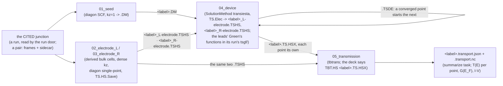

> **A bias sweep is one submission, and the two walks over its points fail
> in opposite directions** (`jobset/submit.py::_points_walk`, the run of points
> `submit._plan_member` planned; the walk of a sweep that is one run, § 2a.11).
> Both are launcher layers — each `cd`s into the point's own folder and runs
> that point's own `.run.sh`. What differs is whether the points
> depend on each other:
>
> - the **device** walk hands the previous point's `.TSDE` (the NEGF
>   density) forward, so $V_{i+1}$ converges from $V_i$ instead of from
>   scratch — and therefore **ends the chain that starts from a failed
>   point**: a point that would start from it would converge from a state
>   the failure poisoned; every other point walks on, and every frame starts
>   from the seed;
> - the **transmission** walk hands nothing forward — each point re-reads
>   the device's saved H — so a bad point says nothing about the next: the
>   walk **continues**, and the exit code reports any failure.
>
> The rule follows the data, not the verb.
> Reading is asynchronous either way: `summarize task` is a READER, so a
> point whose transmission has not run yet reads as **pending**, never as
> a failure of the set (`transport/record.py`).

(`diagon single-point` = the electrodes have **no** MD block — single bulk
SCFs on cells DERIVED from the junction's labeled blocks.  The device H
lands in `<label>.TS.HSX` — SIESTA 5.x; tbtrans must be told with an
explicit `TBT.HS` line, measured live 2026-08-29 — while the electrode runs
still write `.TSHS` via `TS.HS.Save`.  `summarize task` writes the record —
§ 8.)

---

### 6a Why this table names roles and not functions *(2026-09-17)*

The version of § 6 above it enumerated each module **and its function list**.
On 2026-09-17, six of its nine rows named code that had been deleted that same
week — `electrode_wizard`, `render_script`, `parse_output`, the `TransportEngine`
Protocol, `TransportResults`, `transport/_cli.py`. A reader asking *"where is an
electrode derived?"* was sent to a symbol that does not exist.

**The same failure, the same week, in three other documents** — and this is the
point, because it means the cause is not transport:

| the list | declared | measured | what was missed |
|---|---|---|---|
| `process/conventions.md` § 3 | 13 commands | 19 | seven never added; `serve` had become a group |
| `web/presenters.md` § 1 | 5 viewers, 3 results | **6 and 4** | `bench-summary` — a whole presenter with its own category |
| `engines/overview.md` § 5 | *"engines self-register with `@register_engine`"* | no registry exists | the mechanism was deleted under the instruction |
| `engines/transport.md` § 6 | 9 modules | 3 of 9 rows true | the June era, listed as current |

**An enumeration must be hand-swept on every deletion; a rule need not be.**
Each of those four is a list maintained by hand, and each was missed by the very
sweep that correctly updated the *rules* around it — § 5's invariant table was
corrected on 2026-09-17 while § 6, twenty lines below it, was not.

**So the rule this section adds:** a contract enumerates only where **the list
itself is the guarantee**. § 5's thirteen invariants are a list because the SET
is what is promised — drop one and the promise changes. The catalogue's rows are
a list because a missing row is a missing keyword. A *pieces* table is not that:
it is a map for a reader, and a map stays true longer when it names **where a
role lives** than when it names **which functions implement it**, because roles
outlive refactors and function lists do not.

**And what to DO about it, which is two things, not a principle.**

**One: reduce the lists.** § 6 above names roles, not function lists — three
fewer things to keep true per module. That is the part that needed no mechanism.

**Two: ask the running product for the lists that must remain, by
MEMBERSHIP.** Some enumerations genuinely are the contract and cannot be
dissolved — the presenters, the routes, the commands. Each is asked of the
product, never of a document: every route of the app's own map has its row in
the path fence's table (`tests/test_the_path_fence.py`), every presenter's
answer a row of `tests/data/presenters.toml` asked of the live page, every
command a group's help names is run (`test_cli`). A document's copy of such a
list is review's (`process/testing.md` § 3a). *(Until 2026-09-27
`tests/test_doc_claims.py::test_the_documented_L1_index_is_the_enforced_one`
compared `architecture.md`'s L1 index against `test_layering.py`'s set; both
were retired — the second list was a source scan's copy, and the layer rule is
review's, `process/code-audit.md` § 1c (e).)*

> **Membership, never a count — the count hides an even number of errors.**
> `web-api.md` § 3's heading says *"all 97 routes"* and a test asserts that
> number against Flask's URL map. On 2026-09-17 it **passed** while the index
> listed a route deleted that week *and* omitted a live one: the extra and the
> missing cancelled. The same shape appeared in `test_aggregator.py`, which
> asserted the validator registry with `<=` — a subset check, under which a dead
> row can sit forever. Both are now equality over the SET.

**What is NOT the answer**, measured so nobody re-proposes it: a general lint
resolving every backticked symbol in every document produced **6,318 candidate
findings** on its first run here, almost all English words in backticks and
frozen archive text. Doc-citation hygiene at that scale is not work. The three
named tables are, because each one is a contract a reader acts on.

---

### 6.1 Five stages, four deck texts, two binaries — and what integrates them

The diagram above follows the *files*.  This one follows the *scripts*,
because "one calculation" here is **separate executions of an engine binary —
one per rung, and one per bias point on a rung that sweeps it — each `cd`-ed
into its own directory, each reading its own `.fdf`** — and that is the fact
every other question about transport hangs off.

Two things are easy to get wrong and both are visible here:

* **Five stages do not mean five deck texts.**  There are **four** since
  2026-09-29 — the device and the transmission are separate texts, because
  two programs read them (§ 6.1b).  *(Three until then: the device and the
  transmission deck were the same text, only the binary pointed at them
  differing (the job's program), on the claim that "`TBT.*` keywords are
  inert to `siesta` and `TS.*` to `tbtrans`, so one text can serve both".
  Measured 2026-09-29, the first half holds and the second does not —
  `tbtrans` reads the `TS.*` electrode and chemical-potential declarations
  and takes several `TS.*` values as its defaults.)*
  > **Resolved 2026-09-16 (§ 2a.14), and superseded 2026-09-29 (§ 6.1b)** —
  > the two rungs have a layout each since, because two programs read them.
  > As it stood: both rungs render from ONE layout but
  > each resolves its OWN config, so the two decks share their *shape* — the
  > same junction, the same electrode declarations, the same electronic
  > description — and differ in exactly those values a person tuned for the
  > transmission. That is what § 2a.7's ruling asked for, reached without
  > anyone having to decide which keywords `tbtrans` requires. What keeps the
  > two runs from drifting apart about what the junction IS was never
  > byte-identity; it is the **shared Class A values** (§ 2a.3).
* **Nothing is "integrated" at the end.**  Integration happens *between*
  stages, as files, at launch — a rung's first launch copies a finished
  upstream stage's output into its run directory before that stage
  ever runs.  There is no post-processing step that merges five results;
  the merge is that stage N+1's SCF starts from stage N's matrices.

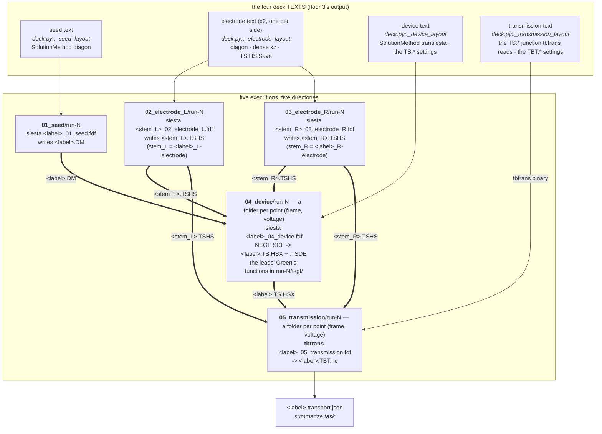

**The bold arrows are the integration, and they are not free.**  Each one is
a row in `stages.py::stage_inputs` — the DAG as data, not as control flow —
and a rung's first launch walks it, with what every stage continues from
([`job-system.md`](?doc=execution/job-system.md) § 6.0), in
`jobset/gather.py::transport_inputs`, which takes an upstream file only if
**three gates** all pass — then copies it into the run it sends:

| gate | what it refuses |
|---|---|
| the upstream stage is prepared | citing a stage that was never set up |
| its **newest** attempt FINISHED, **and it ran the same engine input as the deck that rung renders NOW** — the deck exactly as prep writes it: from the current template, junction and run card, and the person's USER-CUSTOM zone of the deck prep wrote for that rung — its point's folder's, for a rung with points — merged in as prep keeps it (`gather.rung_deck_now`, `script_emit.merge_user_custom_from_target`), so a keyword typed there is the same engine input in the run and now (*the same engine input*, below); never the stage folder's last render, which a change since leaves as it was (plan § 5w K11); for a swept transmission, the device's sweep run whose points are all done, each point its own, its state read by the one rule `status` reads it by (`continuation.points_state`, § 2a.11) | integrating a result produced by a *different* calculation — the silent-wrong-answer case. A mismatch is a mistake, refused by name |
| that attempt actually holds the named file | a run that concluded without writing what it promised |

The newest attempt is the one asked: one that fails a gate is refused by
name, never passed over for an older one (`job-system.md`, *The task*, D5) —
and the copy records its provenance in `.gathered-from`.  One gather reads
the junction record once (`transport_rung.junction_record`, the one read
prep asks too) and renders each upstream rung's deck once for each point it
is compared at — once for a rung that runs once, whichever point asks
(`gather.rung_deck_now`, `gather.ReadOnce`); a record or a composition that
does not read is the gather's refusal, said in its reader's words
(`transport_rung.compose_refusals`).  The engine-input
gate is the load-bearing one: it is what makes "the device's H and the
electrodes' H were built on the same basis, XC, mesh and electronic
temperature" a *checked* fact rather than a hope (§ 5).

**The same engine input** *(decided with the user 2026-10-15, plan UPG: "if
all that is changed is the comments …")*. The gather takes a run's file when
the run computed what the deck this rung renders now would compute — the
question is what the engine reads, never what molbuilder wrote around it.
Both decks are read as SIESTA reads them, by the one fdf reader
(`parse.fdf.read_fdf`, `parse.fdf.parse_fdf_params`), and compared through the
one door of *the same calculation* (`deck_record.same_calculation`,
[`job-request.md`](?doc=execution/job-request.md) § 6), by the SIESTA engine's own reading
(`siesta.engine_input`):

- **comments are not input** — molbuilder's blocks among them, which record
  what molbuilder knows (the labels, the order record, the provenance, the
  stamps) and never what the engine computes;
- **a keyword is named as fdf names it** — case, `.`, `-` and `_` aside
  (`parse.fdf.fdf_key`) — and **a value compared as a value**: a number as a
  number (`1.0e-03` is `0.001`), a logical as fdf reads it (`T` is `true`,
  `parse.fdf.fdf_true`), a unit as written, a block row by row;
- **every number exactly, but the geometry's**: the atoms' places and the
  lattice vectors, read in Å as SIESTA places them — the coordinates' format,
  `LatticeConstant` and the units folded in by the reader (`coords_ang`,
  `cell_ang`) — each atom and each vector within 10⁻⁶ Å of the other deck's,
  and each atom the same species: the one rule two geometries are compared by
  (`structure.SAME_PLACE_ANG`, `structure.farthest_apart`; the composed
  junction's check in § 1.1 asks it too), far below any physics and above the
  rounding of the junction's text — six decimals of an Å, at most
  $\sqrt{3} \cdot 5 \cdot 10^{-7} \approx 8.7 \cdot 10^{-7}\ \text{Å}$ per atom (7.5·10⁻⁷ Å measured on a real junction,
  2026-10-15);
- **a keyword one deck states and the other leaves out** is the same input only
  when the stated value is the engine's own default, which the catalogue states
  on the item (`engine_default`, [`engines/template.md`](?doc=engines/template.md)
  § 5) — a deck that writes SIESTA's default `SCF.H.Tolerance 1.0e-03 eV`
  computes what one that leaves it to SIESTA does; an item whose engine value
  follows something else — another keyword, the build, the run — states what
  it follows, and such a keyword stated by one deck alone is a difference;
- **a run setting is not the calculation**: the keywords the catalogue's run
  settings write — `Diag.Algorithm`, `BlockSize`, `Diag.ParallelOverK`,
  `Diag.ELPA.GPU`, `TS.SolutionMethod`, `TS.Elecs.Out-of-core` (their `anchor`
  or `expands`) — say how fast and where a run computes, never what: a run
  made at other ranks, another solver or on a GPU computed what this rung's
  deck computes ([`execution/job-request.md`](?doc=execution/job-request.md)
  § 2, § 6, the one door every reader of *the same calculation* asks);
- **the engine's scratch is not input**: where TranSIESTA keeps an electrode's
  surface Green's function file and whether it reads an existing one back —
  the electrode block's `GF`, `GF-file`, `GF.ReUse` and `out-of-core` rows
  (`ts_electrode.F90`:606-644), the keywords `TS.Elecs.GF.ReUse` and
  `TS.Elecs.Out-of-core` (`m_ts_options.F90`:472, 476). A file read back is
  checked against the electrode it is for — cell, k-points, weights, energy
  points, atoms — and the run stopped on a mismatch (`m_ts_gf.F90`:139-162,
  `check_Green`), never against the electrode's Hamiltonian; so where it lies
  changes no number, and a file read back is the same input only as one its
  run wrote — a molbuilder run writes its own, fresh for each run and each
  voltage (§ 2a.11);
- **what the engine reads only under bias counts only under bias**: the
  non-equilibrium contours — every `TS.Contours.nEq…` keyword and block, every
  `TS.Contour.nEq.…` block — are read when |`TS.Voltage`| exceeds 10⁻⁵ eV and
  never otherwise (`m_ts_options.F90`:267, `m_ts_contour.f90`:74-76);
- **a block the engine builds itself** is what a deck that leaves it out gives
  it: under bias, with no `TS.Contours.nEq` block, TranSIESTA builds one line
  from `- c kT - |V|/2` to `|V|/2 + c kT` at `delta 0.01 eV`, `method
  mid-rule`, `c` the deck's `TS.Contours.nEq.Fermi.Cutoff` or its default 5
  (`m_ts_contour_neq.f90`:150-187) — the block molbuilder writes at its
  defaults.

Each of these is a fact of SIESTA's source, held with its line in the SIESTA
engine's own door (`siesta.engine_input`). Anything else that differs is
another calculation, refused by name, naming every difference — the keyword,
the block row or the atom, as the run had it and as it renders now — never
which molbuilder wrote the deck. So a calculation carries across an upgrade of
molbuilder that changed only how molbuilder writes its decks. **What is compared is the run's deck against the
deck its stage renders now — nothing else**: prep alone checks that a stage's
prepared files are still what it writes, comparing every file, its stamps
masked (`prep.prepared_differs`), because preparing a stage again costs
nothing (`prep task --group N`); a launch sends what prep wrote and compares
none of it (`job-system.md` § 6.0).

**Why each stage needs a different text, in one line each** — this is the
per-stage axis that § 3.2's floor-3 migration has to serve, and it is the
reason a *single* set of parameter values cannot describe the ladder:

| | `SolutionMethod` | k along transport | writes | why it differs |
|---|---|---|---|---|
| seed | `diagon` | 1 | `.DM` | an ordinary closed periodic SCF, only to give the NEGF cycle a starting density |
| electrode | `diagon` | **dense** (`electrode_kz`) | `.TSHS` | a genuinely periodic *bulk* run — its Fermi level must be well converged, so this axis must be sampled |
| device | `transiesta` | 1 | `.TS.HSX`, `.TSDE` | an **open** boundary: there is no periodicity along transport to sample |
| transmission | none written — `tbtrans` runs no SCF | `TBT.k` | `.TBT.nc` | reads the device's saved H; samples its own k-point grid in the electrode plane (x, y) for T(E) |

Two rows of that table are the same keyword — `SolutionMethod` — carrying
**two different values within one calculation**.  That is not expressible as
"one config filled from one template row", and it is why the migration's unit
of resolution has to be the **stage**, not the task.

#### 6.1a Why there is no per-stage parameter here

*Investigated and rejected 2026-09-15.  Recorded because it looks like an
obvious gap and is not one — the shape of the table above invites exactly this
mistake, and it was made.*

The table above shows `SolutionMethod` carrying **two different values within
one calculation** — `diagon` on the seed and the leads, `transiesta` on the
device — so it reads like a parameter whose unit of resolution should be the
**stage**: a transport twin of
[`SIESTA_STAGE_PRESETS`](?doc=engines/stages.md), stated once per rung and
sealed against the person.  That was built, and it was wrong.

**These values are not parameters anyone answers.  They are the identity of
the rungs.**  The dispatch is *total and exclusive* over the five rungs —
`SHAPE_OF_RUNG` is the table, and every rung renders through
`transport/deck.py`:

| rung | shape | the layout that renders it | and therefore |
|---|---|---|---|
| seed | `seed` | `deck.py::_seed_layout` | `SolutionMethod diagon` is what makes it *the seed deck* |
| electrode_L / electrode_R | `electrode` | `deck.py::_electrode_layout` | `diagon` + `TS.HS.Save true` is what makes it *an electrode deck* |
| device | `device` | `deck.py::_device_layout` | `SolutionMethod transiesta` is what makes it *an NEGF deck* |
| transmission | `transmission` | `deck.py::_transmission_layout` | `TBT.HS` naming the device's Hamiltonian, and no `SolutionMethod`, is what makes it *a tbtrans deck* (since 2026-09-29, § 6.1b; the device and the transmission shared `_negf_layout` until then) |

> **Corrected 2026-09-16.** This table named `stages.py::_render_seed` (deleted),
> `wizard.py::render_electrode_fdf` and `transiesta.py::render_script`, dispatched
> from `stages.render_stage_deck` — which has **no production caller**. A reader
> fixing a keyword here would have edited code that renders nothing on this path.
> The two functions that were reachable only from their own standalone doors
> (`molbuilder transport electrode` and `/api/transport/render`) are **deleted
> with those doors**, 2026-09-17.
>
> The identity is now enforced by the `role` marker rather than by which function
> runs: `solution_method` carries `role = ["transport"]` and
> `role_values = { device = "transiesta" }`, so no transport template answers it,
> `resolve` puts each rung's answer into that rung's config, and the SCF section
> writes it *(since 2026-09-29; the rung's own emitter typed it until then)*.
> Measured — seed and lead render
> `diagon`, device renders `transiesta`.

There is no valid device deck that says `diagon` — that would be an ordinary
closed-boundary single-point which converges and means nothing (§ 2).  So the
rung → value mapping is **declared once, on the item** (`role_values`), and
laid on each rung's config by `resolve`, the one door every prep goes through;
no template, stage override, pin or sweep may set it
([`template.md`](?doc=engines/template.md) § 6.4).  Wrong when a deck is
rendered without `resolve`: a bare config holds the class default, `diagon`,
so such a caller lays the rung's answers through `template.role_answers`
first, as the live-path test does.  *(Until 2026-09-29 the value was a literal
in each rung's block, and the settings gate and the record read the config's
`diagon` for a deck that said `transiesta`.)*

> **The two callers that proved it are both gone, and the rule outlived them.**
> The measured symptom in 2026-08 was a rendered device script that solved with
> `diagon`, from two callers which built a config without setting the field:
> the Transport tab's render endpoint and `engine_base`'s own documented usage.
> `POST /api/transport/render` and `transport/engine_base.py` were **deleted
> 2026-09-17**, so neither can reproduce it — *and that is exactly why the rule
> is stated here rather than left to the callers.* A fact about the RUNG is not
> a default a caller may forget; it is `role = ["transport"]` with the device's
> own answer declared on the item, and `resolve` hands every rung its answer.

**The tests that hold it.**
`test_template_role_and_stages.py` holds the declarations — a role item
carries no value and is never offered, and each transport item is routed to
the rung that owns it.
`test_transport_au_bdt_au_validation.py::test_the_device_deck_states_its_identity_and_method`
reads the device deck the live path renders for the NEGF solver, and for the
absence of `TS.SolutionMethod`.  *(It was named
`…::test_render_script_emits_correct_atom_counts` and drove the deleted
renderer until 2026-09-17.  `test_transport_prep.py::TestTheRungFixesItsOwn`,
which prepped the ladder and read each rung's fixed line, was retired with the
tests that lay a run that never happened, `cdec94da`, 2026-10-03.)*

**The general rule this is an instance of.**  Before offering a keyword as a
parameter, ask who can answer it.  If only the rung can — the value is what
makes the deck the deck it is — it is not the person's to answer: it is `role`,
its answer declared on the item, and no door but the rung's sets it.  A
parameter the person answers is for a question the *person* can answer
differently without the deck stopping being the deck it is.  Under that test the three candidates fail and the genuinely
per-stage-looking fourth — the k-axis — fails differently: the device is
sampled 1 along transport and the lead densely (`electrode_kz`), but those are
two different **cells**, so it is the k-point grid's composition of one
person-answered grid in the electrode plane (`kmesh.mesh_for`,
[`siesta.md`](?doc=engines/siesta.md) § 6.1), not one parameter with two values.

**What transport actually lacks is nothing to do with stages.**  The 21 SIESTA
keywords in § 3.2 that cannot reach any transport deck — `MaxSCFIterations` and
`DM.Tolerance` among them, the reason a seed ran 1000 iterations and died
`SCF_NOT_CONV` — are person-answered and **transport-wide**, identical on every
rung.  They need floor 3's `spec_for` arm (§ 3.6 items 1–4).  No per-stage
mechanism would have delivered one of them.

*(**Stale — corrected 2026-09-23.** This said `electrode_kz` "remains a separate
open defect ... a control that does nothing", citing `render_stage_deck`, which
was deleted 2026-09-17. § 2a.14 measured the lead deck rendering `0 0 40` and
§ 5 I9 named `validate_transport_kind` as its holder — `electrode_kz`'s own
limit and range since 2026-09-30. The row reaches the deck.
The unread module constant `wizard.DEFAULT_ELECTRODE_KZ` — § 3.7's last row,
and X1 ② — was deleted 2026-10-02.)*

---

### 6.1b The two programs, and what each one reads — measured *(2026-09-29)*

**Two programs run a transport calculation, and they read the same kind of
file.** The keyword prefix says which program a line is for:

| prefix | the program | the rung | what it does |
|---|---|---|---|
| `TS.*` | **TranSIESTA** — `siesta` itself, switched into NEGF mode by `SolutionMethod transiesta` | the **device** | solves the junction self-consistently with the two leads attached as semi-infinite reservoirs, at one bias; writes the converged Hamiltonian, `<label>.TS.HSX` |
| `TBT.*` | **TBtrans** — the separate `tbtrans` program | the **transmission** | no self-consistency: reads the device's converged Hamiltonian and the leads' `.TSHS`, and computes T(E) on an energy grid — plus, when asked, densities of states and eigenchannels. No SCF, so it is run again against an unchanged device with no NEGF cycle |

The electrode rungs also carry one `TS.*` keyword, `TS.HS.Save`, which makes a
lead's ordinary SIESTA run write the `.TSHS` the device attaches.

#### What each program reads — the evidence, and where it came from

Read in the engine's own source at the tag this project installs — SIESTA
5.4.2, `Util/TS/TBtrans/` and the `libfdf` it pins (commit `206a3d6c`) — and
cross-checked against the installed binaries (2026-09-29):

| what | the engine's own rule | where |
|---|---|---|
| **`siesta` reads no `TBT.*` keyword** | the `siesta` binary holds no `TBT.` label, and the last device run's report of its settings lists none | the 5.4.2 binary; `claude-w33` device run-1, 2026-09-26 |
| **`tbtrans` reads the `TS.*` junction description** | the electrodes are `TBT.Elecs` / `TBT.Elec.<name>`, and when none is given, `TS.Elecs` / `TS.Elec.<name>`; the same for the chemical potentials (`TBT.ChemPots` → `TS.ChemPots`) and the buffer atoms | `m_tbt_options.F90` 116–118, 156–195, 261–337 |
| **and several `TS.*` values as the defaults of its own — and a plain SIESTA one** | `TBT.Voltage` defaults to `TS.Voltage`; `TBT.Elecs.Bulk` to `TS.Elecs.Bulk` (itself true by default); `TBT.Elecs.Eta` to `TS.Elecs.Eta` (itself 1 meV); the temperature is SIESTA's own `ElectronicTemperature`, then `TS.ElectronicTemperature`, then `TBT.ElectronicTemperature` | `m_tbt_hs.F90` 109–110; `m_tbt_options.F90` 151–153, 285–289 |
| **`TBT.k` is a list or a block — nothing else** | `TBT.k [2 2 1]` or `%block TBT.k` is read; any other form falls through to `%block TBT.kgrid.MonkhorstPack`, then to the SCF's own `kgrid.MonkhorstPack` — which is `kgrid_Monkhorst_Pack`, since fdf drops `_ . -` and case when it compares labels. **A list is only a list in brackets** | `m_tbt_kpoint.F90` 800–810 (`setup_kpoint_grid`), 103–127; `libfdf` `parse.F90` 1726 (*"if the token starts with [ and ends with ], it will be a list"*), `utils.F90` 113–162 (`labeleq`) |
| **the device Hamiltonian is found by name** | `TBT.HS` when given; otherwise the first of `<label>.TS.HSX`, `.TSHS`, `.HSX` that exists | `m_tbt_hs.F90` 210–220 |
| **a lead's surface Green's function is a file the block names, reused when it exists and matches** | `GF <file>` and `GF.ReUse <bool>` inside `%block TS.Elec.<name>`, read after the global `TS.Elecs.GF.ReUse` (default true) and so outranking it; the default name is `<SystemLabel>.TSGF<name>`; an existing file is checked field by field (`check_Green`) and read, or the point dies naming the difference; tbtrans reads the same block but writes no file unless `TBT.Elecs.Out-of-core` is set (false by default) | `ts_electrode.F90` 328, 373–377, 606–613; `m_ts_options.F90` 472–491; `m_ts_gf.F90` 96–171 (`do_Green`), 803–1060 (`check_Green`); `m_tbt_options.F90` 303–308 |
| **`TBT.Verbosity` defaults to 5** | `init_verbosity('TBT.Verbosity', 5)` | `tbt_reinit_m.F90` 206 |
| **`TBT.Progress` defaults to 5 per cent** | `fdf_get('TBT.Progress', 5.)`, below 0 taken as 0, divided by 100; a progress line — `tbt: Calculated N %, ETA in S s` — each time that share more of a spin pass's k-point × energy loop is done — the loop runs once per spin channel (`m_tbtrans.F90` 243–334) — after `tbt: Initial ETA in S s` once the pass's first is | `m_tbt_options.F90` 486–487; `m_tbt_trik.F90` 883–900, 1554 |

**A defect this found, in the deck as it was written until 2026-09-29:** the
transmission rung wrote `TBT.k                  2 2 1` — three integers,
neither a list nor a block — so `tbtrans` skipped it and samples the SCF's grid from the same deck. It
changed no answer then: `molbuilder describe` set `tbt_k_grid` to the cited
run's k-point grid in the electrode plane, which was the SCF's. But a person who raised it for the
convergence study § 0.3 describes was ignored in silence. *(`molbuilder describe`
leaves `tbt_k_grid` blank: left blank, it is three times the shared grid,
`kmesh.transmission_start`, § 0.3b.)* Written
`TBT.k [2 2 1]`, it is read. *(Nothing ever caught it: no transmission rung has
run since `TBT.k` joined the deck on 2026-09-15. Since 2026-09-30 it is written
as the block, which carries the offset.)*

**And a reason this document gave that the source does not support:** the
device-deck comment says `tbtrans` "looks for `<SystemLabel>.HSX` unless told",
citing the 2026-08-29 failure *"Could not read CT.HSX"*. The source looks for
`.TS.HSX` first, so that failure means `CT.TS.HSX` was not in the directory. The
explicit `TBT.HS` line stays — it names the file rather than leaving the choice
to which files happen to exist — and its comment gives the source's rule.

*(This section replaces a claim § 6.1 made — "`TBT.*` keywords are inert to
`siesta` and `TS.*` to `tbtrans`, so one text can serve both" — and that the
device deck's own header repeated. The first half holds; the second does not.)*

#### What the device run actually used — traced, 2026-09-26

The device rung of `claude-w33/transport/au333bdt-t` (run-1, SIESTA 5.4.2),
its deck set beside TranSIESTA's own report of what it used:

| what it decides | the deck molbuilder wrote | what TranSIESTA reported using | came from |
|---|---|---|---|
| which atoms each lead is, and its bulk file | `%block TS.Elec.L` / `.R`: the `.TSHS`, 27 atoms from the first / to the last, `bloch 1 1 1`, semi-infinite −A3 / +A3 | 27 / 27 atoms at 1–27 and 94–120, Bloch 1×1×1, negative / positive along E3 | the deck — derived from the region labels |
| the two reservoirs and the bias between them | `TS.ChemPot.Left` / `.Right` at $\mu = \pm V/2$, `TS.Voltage 0.0000 eV` | voltage 0, chemical shift 0 | the deck |
| the lead region inside the device takes the lead's bulk Hamiltonian | `TS.Elecs.Bulk true` | "Bulk H, S in electrode region = T" | the deck |
| how the equilibrium density integral is taken | `TS.Contours.Eq.Pole 10.0000 eV` | a continued fraction with 123 poles | the engine's rule, on the deck's value |
| the leads' self-energy broadening | — not written | 1 meV | TranSIESTA's default |
| the solver; the electrostatic boundary | — not written | the BTD solver; the Hartree potential fixed at the cell boundary (`-C`) | TranSIESTA's defaults |
| the 300 K smearing | `ElectronicTemperature` (a shared value) | 300 K, on both leads too | the deck |

The same deck also carried the whole `TBT.*` set, and the run's report shows
none of it: it was text `siesta` never read.

#### The rulings that follow *(M5 step 1; user, 2026-09-29)*

* **Each deck carries what its own program reads** — § 2a.7's second ruling,
  now measured. The **device** deck carries no `TBT.*` line: `siesta` ignores
  them, and a reader of the deck would take them for settings of the run. The
  **transmission** deck carries its `TBT.*` settings AND the `TS.*`
  declarations `tbtrans` reads — the electrodes, the chemical potentials, the
  voltage, the leads' bulk treatment. Of the SIESTA settings the rungs share
  it keeps **what it reads** — the audit of its source, completed 2026-10-08
  (B8 U1): `SystemLabel`, `SystemName`, `ElectronicTemperature` (its Fermi
  functions start from it, `m_tbt_options.F90`), `Spin`, the basis and
  functional lines that name the Hamiltonian it was built with. **It runs no
  SCF**, so the SCF settings — the solver (`SolutionMethod`; its own is
  `TBT.SolutionMethod`), the mixer, the tolerances, the iteration budget —
  the MPI diagonaliser lines (`Diag.ParallelOverK`, `BlockSize`, the ELPA
  pair; `bands.F`, which nothing under `Util/TS/TBtrans` references) and
  the output group (`WriteForces` … `SaveHS`) are not written: `tbtrans`
  compiles none of the files that read them (`read_options.F90`,
  `write_subs.F`, `outcoor.f`) and its own options read none
  (`m_tbt_options.F90`). The catalogue says the same with `stages`: the eight
  SCF items declare the four SCF rungs (and vibration's two roles) — the set
  `stages = "scf"` names once (the roles that compute an SCF, `kind_table.role_set`, `template.md` § 6.4) — so the
  transmission's tab never offers them and `prep` refuses one there by name
  (§ 2a.13 Class C, § 3.8.9) — and so, since 2026-10-11, do the diagonaliser
  items (`block_size`, `parallel_over_k`, `diag_algorithm`, `use_gpu`) and
  the output switches a person sets (`write_coor_xmol`, `write_hs`), and
  since 2026-10-12 `gpu_count` — the count of the GPUs only `use_gpu` asks
  for (`execution/gpu.md` G5), so the transmission's run card states none;
  and since 2026-10-13 the two the rung fixes, `write_forces` and
  `write_coor_step`: `tbtrans` writes neither, so the transmission's tab no
  longer echoes them as fixed on (the plan's § 5u.1 row 13 ②, now [`archive/2026-10-28-plan-consolidation.md`](?doc=archive/2026-10-28-plan-consolidation.md)), and the seed, the
  leads and the device keep their one answer (`template.fixed_answers`,
  `template.md` § 6.4).
* **The leads' bulk treatment is ONE value for the device and the
  transmission** — `electrodes_bulk`, a shared value. TranSIESTA reads it for
  the device's self-consistent run, and `tbtrans` takes `TS.Elecs.Bulk` as the
  default of its own `TBT.Elecs.Bulk` (`m_tbt_options.F90` 285–286); were it
  the device's alone (as `elecs_bulk` was, `stages = ["device"]`), a change
  there would leave the transmission deck on the template's value, and
  `tbtrans` would treat the leads differently from the device it reads. *(Named `elecs_bulk` until 2026-09-29. The name is
  molbuilder's, so it is written out — user: "electrodes_bulk would be my
  recommendation"; the keyword `TS.Elecs.Bulk` is TranSIESTA's own word and
  unchanged.)*
* **Every `TS.*` and `TBT.*` value that is a setting reaches the deck
  through the catalogue** (§ 3.6 item 2), with its note above it saying what
  it decides and which program reads it; each section's heading says whose
  run it belongs to, since the deck is that rung's. Most are written by the
  section walk, where the check gate sees each line — `TS.Voltage` (a `role`
  item, the rung's bias point) among them since 2026-09-29 — and the T(E)
  window's three values are written by the rung's own block, each asked of
  the framework's door and written with its note. `TBT.HS` is a rung line derived from the label, not
  a setting, and has no row. An item left blank -- not set -- writes no
  value, and says so where its line would be, in its own `not_set`
  (`template.md` § 6.6 obligation 4); a 0 is written as 0 (§ 2a.13, 2.1.0). The electrode
  declarations stay a block: they are derived from the region labels, and no
  parameter models them.
* **`TBT.k` is written as a list, `TBT.k [2 2 1]`** — the only line form
  `tbtrans` reads (§ 3.6 item 2's list emitter); the bare triple it carried
  until 2026-09-29 was skipped. *(Superseded 2026-09-30: always the block,
  which carries the cited offset — `kmesh.write`,
  [`siesta.md`](?doc=engines/siesta.md) § 6.1.)*
* **`TBT.Verbosity` gets its catalogue row** (§ 2a.13, *what this map says is
  missing*), at `tbtrans`'s own default, 5 (`tbt_reinit_m.F90` 206).

### 6.1c Before any device runs — the contour stated, vacuum by axis, TBtrans's outputs on *(M5 step 2; user, 2026-09-29: the plan's § 5u.2 TD1, TD3, now [`archive/2026-10-28-plan-consolidation.md`](?doc=archive/2026-10-28-plan-consolidation.md); W35 decision 7)*

#### The equilibrium contour: an energy, always written, with the count it gives

**What the number is.** TranSIESTA builds the device's density from its
Green function, integrated over energy. The equilibrium part of that
integral is not taken along the real axis, where the Green function is
sharp: on the continued-fraction branch our deck shape takes, TranSIESTA
expands the Fermi function in **Ozaki's poles**, at $\mu + i\,x_p\,kT$ above
the real axis, plus one point far up it, and sums the Green function there.
`TS.Contours.Eq.Pole` is an **energy**, not a count, and it sets only the
number of poles — the continued fraction places them. TranSIESTA turns it into
a count by its own rule, on that branch
(SIESTA 5.4.2 `Src/m_ts_chem_pot.F90`: the branch at `:299`, the rule at
`:319`):

$$
N = \mathrm{int}\left( \frac{E_{\mathrm{pole}}}{\pi \cdot k_B \cdot T} \right) \qquad \text{and the run stops when } N < 20 \quad \text{(:324)}
$$

So the count depends on the electronic temperature — the same energy gives
fewer poles hotter — and the deck says the count beside the energy, at the
run's own temperature: `TS.Contours.Eq.Pole    10.0000 eV   # 123 poles at
300 K`. (`TS.Contours.Eq.Pole.N` is also read, `:113`, but this branch
overwrites it from the energy, so it cannot act here — `plan.md` § 5p.3o.)

**Measured, at 300 K** ($\pi k_B T = 81.2\ \mathrm{meV}$):

| the deck states | poles | what happened |
|---|---|---|
| 1.5 eV (this project's default until 2026-09-17) | 18 | TranSIESTA refused it, after the queue wait |
| nothing (TranSIESTA's own choice, $E = 0.7 \cdot 60 \cdot \pi k_B T$, `:316`) | 42 | `claude-w33`'s device lost the charge: 584 electrons off after 1000 iterations |
| 4 eV | 49 | — (the manual asks for at least 50) |
| 10 eV | 123 | the same device, the decks differing in this one line, held the charge to 0.024 by step 4 |

**The ruling.** `negf_eq_pole_ev` defaults to **10 eV** and is **always
written**, the count beside it; a stated energy that gives fewer than 20
poles at the run's temperature is refused before the queue wait, and the
refusal names the least energy that is accepted. 0 no longer means *let
TranSIESTA choose* (§ 5p.3o's reading, superseded: TranSIESTA's own choice is
the 42 that lost the charge), and it is not an energy TranSIESTA takes — the
branch reads the energy only when it is positive (`:318`), so the count stays
at `TS.Contours.Eq.Pole.N`'s default of 8 and the run stops at the floor.
**The temperature has a floor of its own**: TranSIESTA stops below 10 K before
it counts a pole — *"TranSiesta electronic temperature \*must\* be larger than
10 kT"* (`m_ts_options.F90`:258–262, and per chemical potential :284–288) — so
that is refused too. The range the form offers is 1–40 eV: 10 eV gives fewer
than 20 poles above 1847 K, and the electronic temperature runs to 5000 K,
where 27.1 eV is needed. It is
the device's alone (`stages = ["device"]`): `tbtrans` integrates no density —
and the two floors are judged on the device's deck alone (`template.reads`),
so a template value the device's own tab sets right refuses no other rung.
**The 10 eV is interim** — M3 P4's stated contour (`contour.eq` inside the
chemical potential's block, W35 decision 2) replaces it, and the first
device run may say sooner.

**One home for the rule.** `transiesta.pole_count` is TranSIESTA's rule
written once — with its inverse, `pole_energy_for`, the least energy that
gives a count (rounded up, since the count truncates), and the two floors,
`MIN_EQ_POLES` and `MIN_TS_TEMPERATURE_K`; the settings gate asks them for
the refusal, and the deck's context asks for the count the line states.

#### Vacuum, by axis — measured from the lead

A transport structure may state vacuum anywhere (`model/structure-periodicity.md`
owns periodicity), but a transport calculation cannot use vacuum where its
declaration says the crystal continues:

| axis | declared | the settings gate | why |
|---|---|---|---|
| transport (`c`) | any | **refuses** a room at the boundary above 1.5 of the lead's interlayer spacings (vacuum), or below 1/1.5 of one (a collision: the two leads' end layers meet through the image) | the leads continue through the boundary into the periodic image, so the room there is exactly one layer spacing of the lead (2.40 Å on the Au–BDT–Au junction), not zero; more is a gap, and a gap makes the lead a surface (I12) |
| transverse (`a`, `b`) | `periodic` | **refuses** a lead that does not reach across the boundary: its closest approach there above 1.5 of its own nearest-neighbour distance — **each lead on its own**, and named | periodic says the crystal continues across the boundary, and vacuum contradicts the declaration |
| transverse | `isolated` | **allows** it | a wire or chain lead is vacuum-surrounded across the transport axis — the standard TranSIESTA setup — and the vacuum is the one the structure states |

**How each is measured.** *The lead* is the electrode-labelled atoms — the
whole structure on an electrode rung, which has no labels. *The room* along
transport is vertical, as `cell.classify_seam` measures a seam's: the lowest
atom's image one cell up, less the highest atom. *The spacing* is the median
step between the lead's atomic layers (`cell.detect_layers`). *The reach*
across a transverse boundary is the shortest distance from a lead atom to the
image of a lead atom one lattice vector along that axis; *the bond* is the
lead's shortest interatomic distance inside the cell. **Both use the seam
rule's factor, `cell.SEAM_VACUUM_FACTOR` = 1.5**, for the seam rule's reason: a
boundary is a seam only when the faces across it are close enough to be
bonded, and 1.5 sits above any real relaxation and far below the room even a
thin vacuum layer opens. A lead too small to measure — one layer, one atom —
is said, never passed in silence. **Each lead is measured on its own** —
pooled, a lead that tiles hides one that does not on the junction's rungs,
while the electrode rung that sees the second alone refuses the same
calculation, and two one-atom leads measure the distance between the leads
as a bond.

**What the transverse check does not catch — by design.** It checks the
structure against its own declaration: vacuum where the axis is declared
periodic. Whether the lead's cell tiles the crystal is the person's to judge,
not molbuilder's (TD14 retired, the user 2026-10-11: *"our check should
really be the most obvious, and consistency check. we are creating tools, not
to invent or limit scientific exploration"*). So a cell one atom column too
long passes on a multi-layer fcc(111) lead, which is still bonded across the
boundary through its next layer (the reach 4.08 Å against a 2.88 Å bond,
1.41); a single-layer one is caught as vacuum (1.73). A correctly tiled
fcc(111), (100) or (110) lead measures 1.000.

**The declaration reaches the junction.** `compose` takes the transverse
kinds the citation recorded — a cited run's deck in its ENGINE-OFFSET block,
which carries the structure's `axis_kind`, a cited pair in its own sidecar —
and states transport along z (`compose.junction_axis_kind`); it stated every
junction periodic across until 2026-09-29, which made a wire's vacuum a
contradiction. The lead cut from the junction keeps the pair
(`ElectrodeModel.transverse_kind`). A deck written before that record states
no kinds, and its junction is read periodic across; a record that states
anything but `periodic` or `isolated` across is refused, never read as the
old default. **Correcting a cited run's kinds means a new relaxation** (a
pair states its own, set where it is made): the kinds come from the cited
attempt's deck, a launched attempt is never rewritten,
and a calculation composed before keeps the kinds it was composed with
(`load_compose_record` reloads the junction it wrote) — so the structure is
declared isolated on the Cell page, relaxed, and that relaxation cited — or
the run is saved as a pair (the Results tab's Export), its cell declared on
the Cell page and the pair cited: the edit marks the pair's record outdated
and keeps it (`model/structure.md` § 2.2a), and the citation reads its
settings (§ 3.1). No transport-side declaration overrides what was cited
*(the user, 2026-10-11, retiring the plan's § 5u.2 TD13, now [`archive/2026-10-28-plan-consolidation.md`](?doc=archive/2026-10-28-plan-consolidation.md))*.

This replaces I12's fixed 3.0 Å warning
(§ 5), which only warned, and whose one number was wrong both ways: a lead
spaced wider than 3 Å (a graphite-like stack, 3.35 Å) is warned at its perfect
seam, and one spaced 1.44 Å (Au(110)) passes a missing layer.

#### TBtrans's outputs, on

For a two-electrode junction `tbtrans` writes T(E) and nothing else unless
asked: `TBT.T.Eig`, `TBT.DOS.Gf`, `TBT.DOS.A`, `TBT.DOS.Elecs` and `TBT.T.Bulk`
all default off when there are two electrodes (`m_tbt_options.F90` 535–565).
W35 decision 7 asks for all of it, so the catalogue defaults them **on**: the
device DOS (`TBT.DOS.Gf`), the spectral DOS from the electrodes (`TBT.DOS.A`
— `tbtrans` computes it for every electrode but the last unless
`TBT.DOS.A.All` is set, `m_tbt_trik.F90`, so with two leads the left one's), the
leads' bulk DOS and bulk transmission (`TBT.DOS.Elecs`, and `TBT.T.Bulk`,
which writes the bulk transmission and implies the bulk DOS, 547–553), and
**four eigenchannels** (`TBT.T.Eig 4`, the shipped value in § 2a's transmission
panel). `TBT.T.All` stays at `tbtrans`'s own default. **The cost is stated,
not hidden**: the eigenchannels and the two device DOS switch off the path
`tbtrans` takes when only T(E) is asked (`only_T_Gf`, 525–565), so the
transmission rung computes more per energy point — accepted, so that the
first ladder writes what M3 P3 draws.

---

### 6.2 What happens to the STRUCTURE — citation to deck, hop by hop

*Written 2026-09-23. § 6's diagram follows the files and § 6.1 follows the
scripts; neither follows the **structure**, and that gap has now produced two
separate reviews reaching opposite wrong conclusions about the same twenty
lines. This section is the third view.*

**The one sentence.** A transport calculation never builds a structure — it
takes one that already exists, states the three facts SIESTA could not record,
reorders it, and hands two views of it to the renderer.

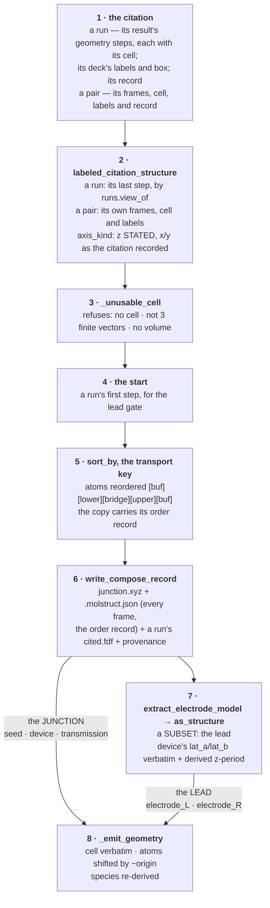

*(Step 5's record is the junction's own order record, carried in its sidecar and stated by every deck, no file of its own; a cited run's geometry is restored before step 5 — `model/overview.md` § 2.2a, 2026-10-14. A junction whose sidecar states no order record is given it as § 1.1 says, *The first prep*.)*

**Hops 1–6 happen once**, at the first prep; hop 6 writes the record and every
later prep re-enters at hop 6 by reading it back. **Hops 7–8 happen per rung**,
and hop 7 only for the two electrode rungs.

#### What each hop does to the BOX

| hop | the cell | why |
|---|---|---|
| 1 | a cited run's: SIESTA wrote it with every geometry step of its output; a cited pair's: its sidecar states it | a fixed-cell relaxation ends in the box it started in |
| 2 | a cited run's: its last step's, read by the run door (`runs.view_of`), **never from the atoms**; a cited pair's: the one its sidecar states | § 7: the box is not recoverable from atom extents |
| 3 | **refused** if absent, non-finite or flat | the citation is the one place user input enters, so it is the one place that checks — and transport derives no cell of its own, by ruling (§ 2a.9; I14) |
| 4–5 | untouched (hop 4 reads a cited run's first step's coordinates, not its box); the sort carries it through `take()` | a reorder states the per-atom fields and nothing else, so the box rides along untouched |
| 6 | written to the sidecar, read back verbatim | |
| 7 | **lateral taken verbatim, transport DERIVED** | the two halves differ on purpose — see below |
| 8 | emitted verbatim | |

#### Hop 7 is the one that confuses people

The lead's box is built from two different kinds of number, and calling both of
them "derived" is what has gone wrong twice:

| | where it comes from | may it be computed? |
|---|---|---|
| **lateral `a`, `b`** | the device's own lattice vectors, **copied** | **no.** This is invariant I6. A computed transverse box severs the crystal — a rectangle cannot tile a 60° hexagonal Au(111) lattice, so the lead would be a different metal from the device it came out of |
| **transport `c`** | $z_{\mathrm{span}} + d_{\mathrm{interlayer}}$, **computed** (`cell.bulk_z_period`) | **yes, and it must be.** A finite slab does not state its own bulk repeat. § 7.1: this is the one number the person is asked to verify, and the lead's card reports whether the resulting seam `CONTINUES`, is `ECLIPSED` or is a `TWIN` |

So *"derived"* is not the thing to be suspicious of. **"Fabricated from atom
extents"** is.

#### A worked example

An illustrative Au(111) junction — six lead layers a side, a molecule between:

```
the junction, from the citation
    cell   a = (17.30, 0.00, 0)      <- 60 degrees, hexagonal
           b = ( 8.65, 14.98, 0)
           c = ( 0,     0,    46.2)  <- the device length
    axis_kind  periodic, periodic, transport

the lead, extracted from the L-electrode region
    cell   a = (17.30, 0.00, 0)      <- COPIED, character and all
           b = ( 8.65, 14.98, 0)     <- COPIED
           c = ( 0,     0,    14.4)  <- COMPUTED: 12.0 span + 2.40 spacing
    axis_kind  periodic, periodic, periodic   <- bulk along transport; the
                                                 transverse pair is the device's own
```

The lead's `b` keeps its `14.98` y-component. That single number is what I6
buys: drop it and you have a rectangle, and the gold no longer joins up
sideways.

#### What each hop does to the rest of the METADATA

| | carried | notes |
|---|---|---|
| regions, annotations, `info`, identity | hops 2→6 | `replace()` names the per-atom fields and carries everything else, so the label store, the recorded contract and the identity columns all survive the sort |
| regions, annotations, `info`, identity | **hop 7 — NOT carried** | `as_structure()` states elements, positions, title, cell and `axis_kind`, and nothing else. A lead therefore renders with no region partition (correct — it has no partition to state), and also with no recorded contract and no identity columns |
| `axis_kind` | **z stated at hop 2; x and y as the citation recorded them** *(since M5 step 2)* | along z it is a fact of *being a transport calculation*: I8 settles it, z is open. Across z it is the person's declaration: a cited run's deck recorded it — its ENGINE-OFFSET block carries the structure's kinds (since 2026-09-25) — and a cited pair's sidecar states it: a slab junction is periodic across, a wire or chain junction isolated (§ 6.1c). A deck from before that record states none, and its junction is read periodic across. SIESTA's own output carries no kinds; it has no such concept |
| `engine_offset` | **a cited run's: the engine's `0` read at hop 2 (`Declared.frame`), dropped entering the calculation — none, so the rule centres it; a cited pair's: the one its sidecar states, dropped likewise when it is the engine's (`cell.entering`, 2.6.0)** | a run's output is SIESTA's own frame, the cell at the origin, and the Results tab's view of the run draws it there; the engine's origin is not carried into a new calculation (`structure-periodicity.md` § 6.0, *Entering a new calculation*). A person's assigned origin on a cited pair is kept. An authoring sidecar's offset belonged to *different* coordinates and is never carried |

#### Where the box and the atoms come from

`_emit_geometry` writes the frame `transiesta.engine_frame_for` returns — ONE
box decision and ONE placement. The **cell** is read raw (the `cell` passed,
else the structure's own), because on this path it is always stated: hop 3
refuses a citation without one, and hop 7 always states one. There is nothing
for `resolve_cell()` to derive, and if it ever did derive one the answer would
be a padded box, which is the thing § 7 forbids. The **atoms** are placed by
`cell.to_engine` (`structure-periodicity.md` § 6.0): the junction enters the
calculation stating no offset (§ 4), so the rule centres it in its cell — or,
cited as a pair with a person's assigned origin, places it there; a lead taken
out at hop 7 states none, so the rule centres it in its own cell. Until 2026-09-25 this block subtracted
`resolve_cell_origin()` by hand.

---

### 6.3 When an engine stops — what its message may mean *(user, 2026-10-20: "don't do the job of the engine"; "just leave hint and information … to note user what error message could mean"; "this could be in result?")*

An engine's own checks are the engine's: prep does not repeat them. When a
run stops, the result says why in the engine's words — a SIESTA or TBtrans
`die` prints its reason, then *Stopping Program from Node*, and the reading
pass keeps the reason ([`model/parse.md`](?doc=model/parse.md) § 2b) — and,
where molbuilder knows the message, what it may mean: `status`, the Results
tab and the transport record's failed points say it, from one table
(`siesta_grammar.STOP_MEANINGS`):

| the engine says | what it may mean |
|---|---|
| *Electrode connectivity is not perfect* — TranSIESTA, as the device starts (`ts_electrode.F90` `check_connectivity`) | a lead's Hamiltonian reaches past its neighbouring cell: the lead block is thinner than the reach of its orbitals and projectors (I11), and TranSIESTA builds a lead's self-energy from neighbouring cells only. The lines above it in the output name the atoms that reach across. Label more electrode layers on the junction (a whole stacking period more), relax it again and cite that run (§ 7.1) |
| *Transiesta calculation was a Gamma calculation while you request transmission k-points* — TBtrans, as it starts (`tbt_init.F90`) | the device ran at the Γ point alone, so its Hamiltonian was saved for that one k-point: leave `tbt_k_grid` blank or 1 1 1, or raise `kgrid` in the electrode plane and run the seed, the leads and the device again (§ 0.3b) |

## 7. The scientific baseline

A defensible starting point (**all values to be convergence-tested**, per § 5's
"converge it, don't trust a number"):

| Quantity | Baseline | Note |
|---|---|---|
| XC | GGA-PBE | identical across every rung (I1) |
| Pseudos | PseudoDojo PBE (Au/C/S/H), validated | `molbuilder pseudo check` gate ([vanSetten2018]) |
| Basis | **DZP everywhere** | DZP = double-ζ + polarization (SIESTA PAO tier); drop to the smaller SZP for bulk-Au only after a $T(E)$ check |
| `MeshCutoff` | 400 Ry (converge 300→500) | Au is **semicore** (5s5p5d valence — a shallow d shell) → needs a fine grid. The config default is **300** (`SiestaConfig.mesh_cutoff`), and a transport rung takes the cited relaxation's own value (`transport/citation_defaults.py`); 400 is set in the calculation's template, where it applies to every rung (§ 2a.7) |
| `PAO.EnergyShift` | 0.01 Ry | sets orbital range → electrode thickness |
| Shared k-point grid (x, y) | converge 2×2 → 4×4 → 6×6 | identical in device and electrode (I7) |
| Device `kz` | **1** | open boundary (I8) |
| Electrode `kz` | converge (default **100**; warned below 50 and above 200, refused at 1) | dense bulk z-sampling (I9, § 0.2) |
| Electrode thickness | **~6 Au(111) layers** | the *electronic* principal layer, not the 3-layer geometric repeat |
| z-vacuum | **0** | slab-junction model; nonzero ⇒ cluster model |

> **Which of these are knobs today: all of them.** Every value in the table above
> is a catalogue row in the calculation's own template, defaulted from the cited
> run at `molbuilder describe` (§ 2a.7) and editable there — including the basis, the
> EnergyShift and the XC pair, which the three layouts render through
> `BASIS_SECTION` and `XC_SECTION` like any other section item. Measured on a
> rendered device deck: `PAO.BasisSize DZP`, `PAO.EnergyShift 0.01 Ry`,
> `XC.functional GGA`, `XC.authors PBE`, each with its own provenance note.
>
> *(This paragraph said the basis/XC block was hardcoded in `_emit_basis_and_xc`
> "with no cfg hook", and told the reader to converge it by editing the emitted
> `.fdf` — advice the read-back gate would now refuse. `_emit_basis_and_xc` is
> deliberately NOT part of any transport layout: writing it beside those sections
> would emit each keyword twice, which `layout.check_rules` catches.)*

Three corrections that catch real mistakes:

- **Electrode thickness.** TranSIESTA's **principal layer** — the slab thickness
  beyond which a lead layer couples only to its immediate neighbour — is
  checked by TranSIESTA itself, and is the measure: on AuBDTAu the geometric
  repeat, 3 Au(111) layers ($c$ = 7.193 Å), passed it (*"L principal cell is
  perfect!"*) even with the diffuse `PAO.EnergyShift 0.005 Ry`, whose Au 6s
  radius is 6.64 Bohr (3.5 Å) against the 2.36 Å interlayer spacing
  [Papior 2017; Soler 2002 for the EnergyShift↔range link]. Read that line in
  the device's output rather than assume it. Separately, the
  electrostatic potential must reach its **bulk value at the lead boundary** (else Σ
  is applied where the molecule still perturbs the metal): TranSIESTA prints the
  boundary potential — **verify it is flat**, and add Au layers if not. Six
  layers/side is *marginal*.
- **A basis step scatters.** For *transport* the observable *is* the transmission,
  so an SZP→DZP discontinuity inside the metal acts as a spurious scatterer — a
  basis-set change looks like a real potential step to the electron [Brandbyge 2002].
  Default to DZP everywhere (I5).
- **The cell is hexagonal, and you may relax at a coarser k than transport.**
  Au(111) tiles the transverse plane (lateral vectors ≈ 17.3 Å at 60°) — the box is
  **not** recoverable from atom extents (padding fabricates an orthorhombic box that
  severs the periodic gold), so the real lattice is carried through rather than
  recomputed — the run's output states it and the extraction copies it (§ 6.2).
  *(This said `--cell-fdf` preserves it. There is no such flag and there never
  was one in this codebase — zero occurrences in `molbuilder/`. Corrected
  2026-09-23.)* Forces are
  k-robust while the sharp $T(E_F)$ Fermi-surface integral is not, so it is sound to
  **relax at a coarser k-point grid in the electrode plane (e.g. 2×2×1) and run transport denser (e.g.
  4×4×1)** [Soler 2002; Papior 2017]. The composite DEFAULTS the shared k-point grid
  from the cited relaxation's own grid (§ 2a.7) and the device's transport axis
  is 1 by rule ([`siesta.md`](?doc=engines/siesta.md) § 6.1) — so relax at the
  coarse mesh, cite that attempt, and raise the transport's `kgrid` in its
  template: the change applies to every SCF rung at once. The transmission's
  `TBT.k` is its own item, `tbt_k_grid`, which left blank is three times the
  shared grid (`kmesh.transmission_start`, § 0.3b) and is set on the
  transmission's tab. *(This said the cited
  grid could not be changed, "fdf-is-truth"; § 2a.7 has made it a default the
  person may change since 2026-09-16.)* Γ-only (1×1×1) is wrong for periodic
  metallic leads: even with the lead atoms frozen it gives a poorly defined $E_F$.

### 7.1 The metal crystal — stacking, layer counts, and the two boundaries

Everything above sizes the electrode *electronically* (orbital range, principal
layer). This sizes it **crystallographically**, which is a separate constraint
and the one that decides whether a lead is bulk metal or a defect. The full
derivation, with the measurements behind it, is
[`science/junction-cell.md`](?doc=science/junction-cell.md); this is what a
transport run needs from it.

**Every metal molbuilder builds electrodes from is fcc** — Au, Ag, Cu, Ni, Pt,
Pd (`data/fcc_lattice.json`). So the stacking is set by which face the molecule
sees:

| surface | stacking | period | interlayer $d$ | Au, $a = 4.157\ \text{Å}$ (PBE) |
|---|---|---|---|---|
| (111) | ABCABC | **3 layers** | $a/\sqrt{3}$ | 2.4000 Å |
| (100) | ABAB | **2 layers** | $a/2$ | 2.0785 Å |
| (110) | ABAB | **2 layers** | $a/(2\sqrt{2})$ | 1.4697 Å |

$a$ is not a constant to assume: `fcc_lattice.json` carries
`a_experimental` and `a_pbe` per metal (and the Modify tab can measure a third
off your own relaxed bulk run), and **the lead must
use the same one the device was built with** — a 1–2 % lead/device lattice
mismatch is exactly what I10 exists to prevent. For a PBE run that means
`a_pbe`, not the room-temperature experimental value.

**There are two z-boundaries in a transport calculation, and they are judged
differently.**

*The bulk electrode cell (I9 — a genuinely periodic run).* Its z-period must be
a real lattice repeat, so the wizard derives $z_{\mathrm{period}} = z_{\mathrm{span}} + d$
(`cell.bulk_z_period`) rather than the atoms' extent, and warns that the layer
count must be a whole stacking period. **This is the boundary that matters**,
because Σ is built from how this cell tiles. On (111), an electrode region whose
layer count is not a multiple of 3 tiles into a **twin** (4 or 7 layers give
something worse — an eclipsed, head-on contact), so Σ then describes a faulted
crystal rather than bulk gold. Six layers in the electrode region satisfies it;
four does not. **This is measured and reported, never enforced** (the rule the
electrode orientation follows): one rule classifies the lead's periodic seam
and words it (`wizard.seam_finding`) — `CONTINUES` as information; `ECLIPSED`,
`TWIN`, or undetermined (a block thinner than one period) as a warning, naming
the layer count as the cause — said on the Transport card and by the lead rung's
settings gate at every prep, printed and written into the lead deck's
`.validation.txt`. A faulted seam composes — you may mean it — but it is
a faulted bulk Hamiltonian, because this lead is what becomes the self-energy.
(`--z-period` used to be advertised here as the override; that flag went with
`molbuilder transport electrode` on 2026-09-17.)

*The device cell boundary (I8 — open).* The device runs at `kz = 1`; beyond the
outermost lead layers sit the semi-infinite leads, entering only as Σ. What lies
across the device cell's periodic boundary is **replaced**, so its registry is
not part of the transport physics. What I12 does require is that the padding
there be one interlayer spacing and not vacuum — z-vacuum $\approx 0$ at the leads,
because a real gap severs the lead instead of continuing it.

**A caution about mirrored junctions.** `add_symmetric_electrodes` built one by
placing the `-z` slab as a **mirror** of the `+z` one. That function is gone
(the pair op went with the Junction panel, 2026-08-31), and the caution is why:
mirroring makes both electrodes present the same face to the molecule — the
point of a symmetric junction — but also makes the two outermost layers carry
the same in-plane registry, so they meet head-on across the device boundary.
Two `add_slab` builds at stated `start_z` do not mirror, so a junction built
the current way has this only if you ask for it. No layer count changes this, and neither does any other point-group
operation (measured: mirror, C₂ and inversion give identical eclipsed seams),
because each close-packed layer is itself a centrosymmetric 2-D lattice. Under
I8 this costs the transport calculation nothing. It does contaminate the
boundary-layer density in any **periodic** run of that same cell — a plain
single-point, or a relaxation if those layers are not frozen.

---

## 8. Shipped vs coming

> ### The one thing this section used to warn about is CLOSED
> ### *(named 2026-08-11; closed 2026-08-28/29 by the composite)*
>
> The warning that stood here: `transport bundle` emitted
> `run-transport.sh`, a **third orchestration lifecycle** that chained
> three engines outside the job system — no `prep`, no attempts, no
> `run.json`, no `--mode`, no status roll-up, no scheduler header.
>
> The composite closed it the way the analysis here always said it
> should be closed: **not by adding edges to `JobSet`** (it still has
> none), but by giving the multi-component kind its own representation.
> The five stages are ordinary rungs — each prepared, launched and
> concluded through the same verbs and wrappers as everything else; the
> electrode `.TSHS` and seed `.DM` hand-offs are the first launch's GATHER
> (three refusals per input); and the one genuinely sequenced thing — a bias
> sweep's points — rides ONE submission, the one walk script, because the
> `.TSDE` hand-forward is an efficiency inside one launch, not a
> scheduling judgement between results a person should read.
>
- **Shipped:** the transport COMPOSITE (`--calculation transport`: citation →
  sort → gates → five derived stages → the bias sweep → `summarize task` →
  `<label>.transport.json`) and the region-label-driven derivation.  The
  finite-bias sweep ships with it (the `.TSDE`-chained walker).
  *(This bullet also listed "the electrode wizard" and "the
  `electrode`/`preflight` helper CLI" until 2026-09-17.  Both were the June
  2026 hand-assembly era and are **deleted** — a lead is DERIVED from the
  citation at prep by `extract_electrode_model`, and § 5's invariants are held
  by construction or by `validate_transport_kind`.  § 6a records why a list
  like this one goes stale.)*
- **Web tab (rewired 2026-08-29, P7b + same-day review):** the tab is the
  composite's WHOLE describe surface — cite the junction through the
  shared tree-picker (a run's folder or a pair's `.xyz` — what qualifies it is § 3.1's condition, and the meta line classifies each selection through
  `/api/transport/describe_attempt`, which reads a run or a pair (the
  picker takes a run's folder or a pair's `.xyz`, § 3.8.1), and the
  VIEWER follows the citation: MolView loads the cited calculation's
  labeled structure and the chemistry analysis runs on it), state the
  bias, and **Describe writes the finished `task.json` and its
  `job-request.json`** into the selected folder (`POST
  /api/transport/describe` — the web spelling of `molbuilder describe
  --calculation transport`; no hand-over, because nothing is
  awaiting; written by the server since 2026-10-11, § 3.8.2a).  Transport-only knobs changed in the form ride as
  device-stage overrides; the electronic-contract fields are sealed at
  both doors (the citation's to say).  ⚠️ **SUPERSEDED by § 2a.7 and
  § 3.8.2**: the cited run DEFAULTS them and the person may change them.
  What is still true is that they are never a PER-RUNG override.  **The parameters card is one panel
  per ENGINE** since 2026-09-15 — § 3.8.8, and the follow-up below is where
  its second panel comes from.  Task setup reads the saved
  description as the run surface (machine, queue, prep).  **The tab's live
  routes are three** — `/describe`, `/describe_attempt` (with its
  `swap_electrodes` flag, § 4) and `/schema` (`web-api.md` § 3).  *(This said "the render endpoint
  (`/api/transport/render`) remains as the engine's validation surface" until
  2026-09-17.  That route is deleted: no browser had called it since
  2026-08-29, and the "engine" whose validation surface it was is not a
  registry — see the next bullet.)*
- **Follow-up** (`plans/plan.md` § 2, **S13**): a **convergence sweep** mode (auto-vary
  transverse-k / `MeshCutoff` / electrode thickness and report where $T(E_F)$ stops
  moving); and a **PySCF-NEGF** backend —
  which arrives as **a `spec_for` arm and a set of catalogue rows**, its OWN
  config dataclass and the panel that renders it (§ 3.8.8), all in one commit.
  Until then its sub-tab is drawn and disabled, and no config carries its
  fields.  *(This said the backend "arrives as a registered
  engine".  There is no engine registry: `transport/engine_base.py` was deleted
  2026-09-17 and spectra's went at its migration's P3 —
  [`overview.md`](?doc=engines/overview.md) § 5 is the live statement of how an
  engine joins.)*
  *(This bullet said the backend "adds its engine choice back to
  `TransportConfig`" — true of the selector, and it was read as licence to
  keep two PySCF PARAMETERS in that dataclass, which is what § 3.2 was
  written to settle.)*

---

## 9. References

- **TranSIESTA / NEGF** — Brandbyge, Mozos, Ordejón, Taylor, Stokbro, *Phys. Rev.
  B* **65**, 165401 (2002). §II defines the L/R/scattering partition; §III.B the
  equilibrium contour. doi:[10.1103/PhysRevB.65.165401](https://doi.org/10.1103/PhysRevB.65.165401)
  · arXiv:[cond-mat/0110650](https://arxiv.org/abs/cond-mat/0110650)
- **Modern TranSIESTA** (electrode / principal-layer requirements, multi-electrode
  chemical potentials) — Papior, Lorente, Frederiksen, García, Brandbyge, *Comput.
  Phys. Commun.* **212**, 8 (2017).
  doi:[10.1016/j.cpc.2016.09.022](https://doi.org/10.1016/j.cpc.2016.09.022)
  · arXiv:[1607.04464](https://arxiv.org/abs/1607.04464)
- **SIESTA method** (PAO basis, EnergyShift, MeshCutoff) — Soler et al., *J. Phys.:
  Condens. Matter* **14**, 2745 (2002).
  doi:[10.1088/0953-8984/14/11/302](https://doi.org/10.1088/0953-8984/14/11/302)
  · arXiv:[cond-mat/0111138](https://arxiv.org/abs/cond-mat/0111138)
- **PseudoDojo** (the validated Au/C/S/H pseudos) — van Setten et al., *Comput.
  Phys. Commun.* **226**, 39 (2018).
  doi:[10.1016/j.cpc.2018.01.012](https://doi.org/10.1016/j.cpc.2018.01.012)
  · arXiv:[1710.10138](https://arxiv.org/abs/1710.10138)
- **Au–BDT ≈ 0.011 G₀** (the DFT-NEGF overestimation benchmark, § 2 caveat) — Xiao,
  Xu, Tao, *Nano Lett.* **4**, 267 (2004).
  doi:[10.1021/nl035000m](https://doi.org/10.1021/nl035000m)
- **Au-BDT-Au geometry + the Au-electrode mesh requirement (≥ 250–300 Ry)** — Stokbro et al., *Comp. Mat. Sci.*
  **27**, 151 (2003).
  doi:[10.1016/S0927-0256(02)00439-1](https://doi.org/10.1016/S0927-0256%2802%2900439-1)
