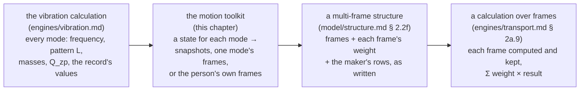
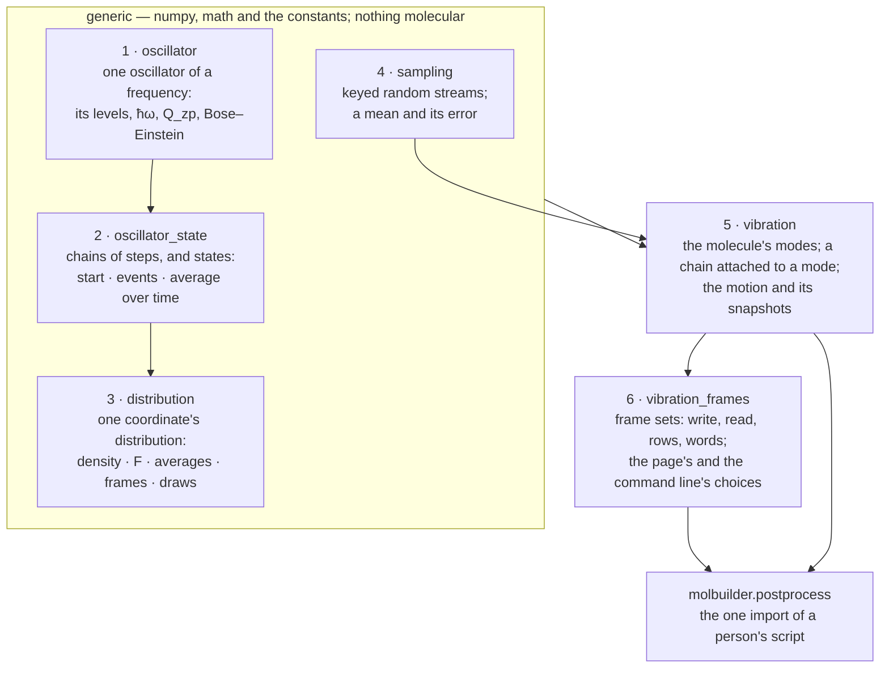
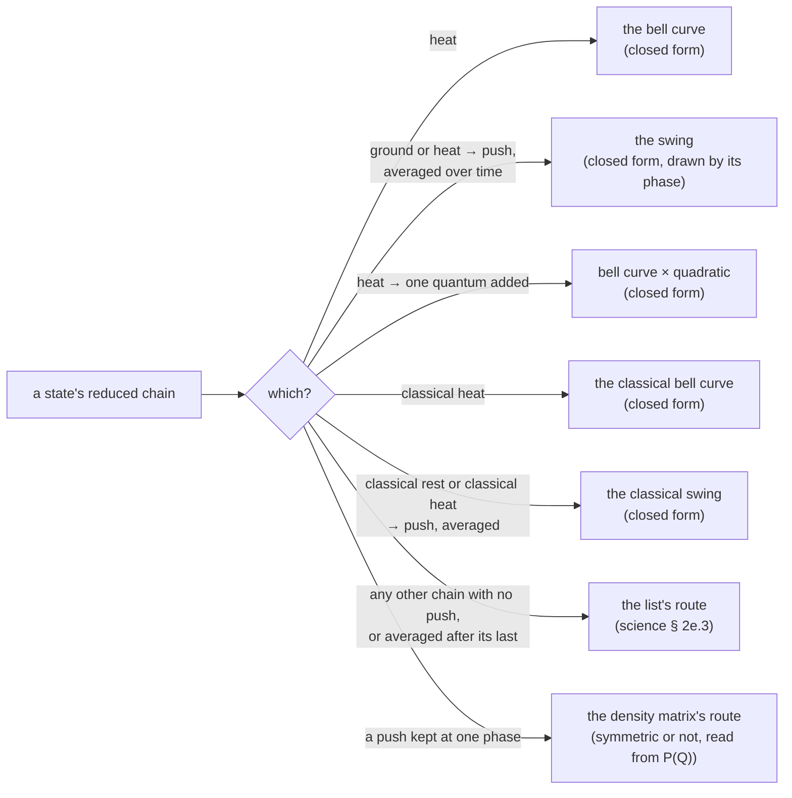

# Frames from the modes — the motion toolkit

**Role:** contract — the API and framework that turn a vibration's modes into
frames: how the molecule moves, its snapshots, a mode's own frames, the frame
set they are written as
**Domain:** vibration → frames
**Companions:** [`engines/vibration.md`](?doc=engines/vibration.md) (the
foundation: the vibration calculation and every mode's data, § 6.3, § 6.11);
[`science/vibrational-averaging.md`](?doc=science/vibrational-averaging.md)
(the theory: every state, the whole molecule, why each recipe is right, with
worked numbers); [`model/structure.md`](?doc=model/structure.md) § 2.2f (the
multi-frame structure, the container); [`engines/transport.md`](?doc=engines/transport.md)
§ 2a.9, § 2a.12 (a calculation over frames);
[`engines/vibration-postprocessing.md`](?doc=engines/vibration-postprocessing.md)
§ 2a, § 2b (the calls, worked).

*(The user, 2026-11-23: "this is entirely user's research and i created
molbuilder to support this which does not mean molbuilder does a fully
packaged rigid result generator"; "molbuilder should expose the correct api
to choose the mode, and provide a random number/weight calculator/generator";
"transport calculation should not overreach to design what the multiframe
is. we need to cleanly separate the logic and design"; "vibration
calculation is the foundation that exposes the fundamental data of all
modes".)*

**To build.** What this chapter marks *(to build)* is the plan's R3d2b2c
([`plans/plan.md`](?doc=plans/plan.md) § 2) — the probe's use of the nodes
(§ 6) is R3d2c's; § 9, decided 2026-11-25, is the plan's R3d2b2b4, before
it; what each release built is its row in
[`process/changelog.md`](?doc=process/changelog.md).

---

## 0. Where it sits — three parts, one direction



| part | owns | does not |
|---|---|---|
| **the vibration calculation** | computing the modes and recording every mode's data in the result ([`engines/vibration.md`](?doc=engines/vibration.md) § 6) | decide how the molecule moves |
| **the motion toolkit** | describing how the molecule moves — a state for each mode — and turning it into frames with weights, by the person's choice of modes, states, recipe and count; writing them as a frame set with rows that say what was done | run a calculation, average one, or choose the model for the person |
| **the frame set** | the frames, each frame's `weight`, and every other row its maker wrote, carried as written ([`model/structure.md`](?doc=model/structure.md) § 2.2f) | mean anything to the calculation but the weights |
| **a calculation over frames** | computing each frame as an ordinary static calculation, keeping every frame's result, and stating $\sum_f w_f\,X_f$ ([`engines/transport.md`](?doc=engines/transport.md) § 2a.9, § 2a.12) | know where the frames came from, or design, interpret or re-weight them |

**The dependency runs one way.** The toolkit reads the vibration's result
and writes a frame set; a calculation reads the frame set. Transport — its
record, its data file, its composition — imports nothing of the toolkit.
**Of a structure it cites, transport reads what it reads of every structure**
— its atoms, labels and box, frame 0's `info.calculation` (the settings it
takes its own from, required) and a relaxation record of its geometry
(`info.relaxation`) ([`engines/transport.md`](?doc=engines/transport.md)
§ 3.1) — and **none of the maker's own rows or `info` keys**: not
`vibration_run`, not `info.sampling`, not an older set's `info.vibration`,
nothing of § 5.1 but each frame's `weight`. The one check of the frames that
needs transport's own knowledge — that no electrode atom moves beyond the
leads' tolerance — stays transport's, asked when a calculation cites the set
([`engines/transport.md`](?doc=engines/transport.md) § 2a.9); the toolkit's
writer checks what it owns (§ 5). The pages, which sit above both, ask the
toolkit for a row's plain words and a cited set's provenance (§ 6).

**The model is the person's.** Which modes move, in which state, with which
recipe and how many frames, is a research decision; the toolkit gives each
piece correctly and lets them be combined, states every choice in the frames
it writes, and never decides one. Transport is the same calculation whatever
the frames are.

---

## 1. Where each piece lives, and what it reads

| module | layer | holds |
|---|---|---|
| `vibration` | L2, **travels** beside a job in both vibration bundles — numpy and the constants alone | the mechanics of every mode, and the molecule's motion built from them: `state`, `State` (`pdf`, `cdf`, `moment`, `draw`, `frames`, `weights_at`), `Frames`, `Mode`, `ModeState` (each of `State`'s calls handed on, `draw` and `weights_at` among them, and its fields — `swing_quanta`, `quanta`, `bath_quanta`, `zero_point_amplitude_amu12_ang`, `classical_spread_amu12_ang`), `Vibration` — its `displaced({...})`, the one rule $\mathbf R^0 + \sum_k Q_k\mathbf L_k$ ([`engines/vibration.md`](?doc=engines/vibration.md) § 6.11 § 2), and its `motion()` — the molecule's motion and its snapshots (`Motion`, `Snapshots`, `pooled`), the analyses of a snapshot set's results (§ 7), `temperature_of_quanta` |
| `vibration_frames` | L2, the **host's** — it imports `vibration`, the structure, `frameset`, the result's reader and the run door, never transport; it imports with `molbuilder-jupyternb`'s packages, numpy beside molbuilder's own modules, so the example notebook runs it there ([`web/jupyter.md`](?doc=web/jupyter.md) § 7) | built: the rows' vocabulary (`ROWS`, § 5.1), a mode's own set's `assumptions` row (`assumptions_of_a_mode`, its thermal state in `thermal_state_words`) and a set's own assumptions as its maker states them, an older set's said for it (`assumptions_of_set`, § 6), the pages' words and provenance from it (`said_of`, § 6), the weights for a set's rows at a state (`weights_for_set`, § 7), **a run's folder read as a `Vibration`** (`vibration_of_run`, below), the one frame-set writer and its reader (`write_frame_set` → `Written`, `read_frame_set` → `Frames`, `Snapshots` or `FrameSet`, § 5), a mode's state's outermost move for any state (`outermost_move`, its rule `vibration.outermost_move_ang`) — asked by the web layer, `postprocess` and the command line; the doors' set — the command line's and the page's: a mode's own set in any state asked every time (`frameset_from_mode` → `ModeFrames`, `doors_state` and the page's ask `read_state_ask` — `STATE_ASK_KEYS`, refusals `StateRefused` — the frame counts they offer `OFFERED_NODES`) and what a state means for a mode before its set is written (`readout`, the load door's `frameset` block), its quanta said beyond `HARMONIC_LIMIT_EV`, § 6 |

**No call of `vibration` reaches `vibration_frames`**: the foundation's
module never depends on the module built on it. The writer and the reader are
functions of `vibration_frames`, which `molbuilder.postprocess` hands on — the
one import of a person's script ([`model/parse.md`](?doc=model/parse.md) § 3):
`from molbuilder.postprocess import vibration, write_frame_set,
read_frame_set, pooled` — beside `frame_rows`, `weights_for_set`,
`reaveraged` and `outermost_move`. `postprocess.reaveraged` joins two calls — the
toolkit's weights for a set's rows and transport's own averaging door — and
adds no rule of its own (§ 7).

**What `v` knows.** `v = vibration(path)` takes the result file — its JSON
or its `.nc`, one answer — or the vibration run's folder, read
through the run door as `read_steps` takes one
([`engines/vibration-postprocessing.md`](?doc=engines/vibration-postprocessing.md)
§ 7). It carries what every frame set needs, each under its own name; the
`Vibration` holds every field below. The result's reader fills the file's
— the modes, the shared fields, `v.structure` (the structure the result
states) and `v.read_path`; the run's — `v.run`, `v.relaxation_calculation` —
are filled where a run's folder is read, by `vibration_of_run` (`None`
else), and `v.result_sha256` at the read door, whichever file:

| attribute | what | from |
|---|---|---|
| `v.modes`, `v.mode(n)` | each mode — its number (`index_1based`), frequency, whether it is imaginary, its canonical eigenvector over the free atoms ($\sum_A m_A\lvert\mathbf L_A\rvert^2 = 1$), and the record's stored values ([`engines/vibration.md`](?doc=engines/vibration.md) § 6.11 § 6) | the result's modes ([`engines/vibration.md`](?doc=engines/vibration.md) § 6.3) — a result before schema 7, which states no masses, read with the table's, as its reader reads it |
| `v.free_atom_idxs`, `v.masses_amu`, `v.element_symbols`, `v.positions_ang`, `v.species_labels`, `v.regions`, `v.mode_temperatures_k` | what every mode shares — the free atoms, every atom's mass, element (its species label's name) and position at the geometry the modes were taken at, the labels and regions as written, and the modes' temperatures the file states its spreads at; a mode reaches each through its vibration (`m.masses_amu`, …) | the result's `equilibrium.masses_amu`, its structure, its `modes_thermal` |
| `v.structure` | the geometry the modes were taken at, in the user order, its labels, held atoms and box — frame 0, and every frame's atoms | the result's `structure` ([`engines/vibration.md`](?doc=engines/vibration.md) § 6.10.1) |
| `v.record_temperature_k` | the vibration record's temperature — the one a mode's thermal or classical state given none takes, said so (§ 2) | `thermo.temperature_K` |
| `v.read_path` | the path read, as given | the read |
| `v.run`, `v.result_sha256` | the run's folder and **the JSON's sha256** — the `.nc` states it as `json_sha256`, so it is the same whichever file was read: the set's provenance rows (§ 5) | the run door; the file |
| `v.relaxation_calculation`, `v.relaxation_said` | frame 0's `info.calculation`, the settings a transport citation takes its own from ([`engines/transport.md`](?doc=engines/transport.md) § 3.1, § 2a.7) — **the record of the relaxation frame 0's geometry came from** *(the user, 2026-10-24, on the recommendation)*: where the vibration's own run relaxed it — its `relax` call ([`engines/vibration.md`](?doc=engines/vibration.md) § 5.11 § 1) — that run's settings, through the run door's view (`runs.view_of`, `parse.contract.contract_of`); where the structure was stated already relaxed, the record that structure states — its `info.calculation`, written when it was saved from its optimization *(measured on AuBDTAu, 2026-10-24: its vibration ran at a 1×1×1 k-grid and 300 Ry, its relaxation at 5×5×1 and 400 Ry; a transport citing a set stamped with the vibration's settings defaulted to the cheaper ones)*; where there is none, `v.relaxation_said` says why, in words a set written of it says | the run door's view |

**A run's folder → its `Vibration`, one door**:
`vibration_frames.vibration_of_run(run_folder)` reads the run's result through
its reader and gives the run, the JSON's sha256, the structure and frame 0's
relaxation record, refusing by name what is no run of ours and a run with no
result (`FrameSetError`, naming the run's folder, the one form it reads) and
what the result's reader refuses — a result before schema 7 is read as that
reader reads it, with the table's masses. `molbuilder frameset from-mode` and
*Write frame set…* ask it, and `read_frame_set` reopens a set's vibration
through it (§ 5). **Either form → its `Vibration`, one door**:
`vibration_frames.vibration_of(path)`, which `postprocess.vibration` hands on,
tells a run's folder (to the run door) from a result file (either of its two,
to the result's reader, the JSON's sha256 with it) and refuses a path that is
neither naming both (`TWO_FORMS`): not there (`SpectraJsonNotFoundError`, a
`FileNotFoundError`), a file of another name (`SpectraJsonError`), a folder
that holds no run's result (`FrameSetError`). `vibration` never asks the run
door. A vibration not read from its run's folder — its result file, an export, a copy — writes a set with no
`vibration_run` and no `info.calculation`, said with the way on (read the run's folder); a PySCF deck's, which
records no relaxation, and a stated-relaxed structure that states none, write
one with its `vibration_run` and no `info.calculation`, said so.
Such a set is no transport citation until its relaxation is recorded — said,
never refused.

**Each object knows where it came from**: a `Mode` carries its result
(`m.vibration`, left out of the mode's repr and comparison, so `Vibration` →
`Mode` → `Vibration` never recurses), and `Frames` the state it was made for
(`f.state`, a `ModeState`), so the writer (§ 5),
`write_frame_set(path, f)`, reaches the run, the structure and the state's
rows; a `Frames` made from a bare `State`, of no mode, has no geometries and
is refused by name by the writer.

**Modes are named by their number**, `index_1based`, the number
the result, the spectrum tab and a frame set's `mode_index_1based` use,
wherever a call takes one: `v.mode(7)`, `with_mode(7, …)`, `with_drive({7:
…})`, `modes=[7, 8]`, `displaced({7: q})`. `v.modes` stays the list in the
result's order, so `v.modes[6]` is mode 7 — the one place a Python index
appears.

**Every frequency scaled at once**: `v.with_frequency_scale(0.96)` — each
mode at 0.96 × its frequency, its pattern kept, the result's own frequency
kept beside it (`m.result_frequency_cm1`), the factor for the harmonic
picture's overestimate
([`science/vibrational-averaging.md`](?doc=science/vibrational-averaging.md)
§ 2b.1); the scaled vibration states the factor (`v.frequency_scale`), and
every set made from it (`frequency_scale`, § 5.1); scales compound, and a
total of 1 is the result's own modes, as read. One mode's own,
`m.with_frequency(...)`.

---

## 2. One mode's state — the building block

A state says where one mode's coordinate $Q$ is, as a probability density
$P(Q)$ ([`science/vibrational-averaging.md`](?doc=science/vibrational-averaging.md)
§ 2b.3, which also says which state fits which experiment). Each is asked of
a mode, `m.state(...)`, by one of these sets of arguments — one table in the
module (`vibration.STATES`, its check `vibration.checked_state`); any other set is refused, naming them:

| the state | arguments | where the molecule is | science |
|---|---|---|---|
| **thermal** — equilibrium at a temperature, or quanta added at random moments | `temperature_k`, or `mean_quanta` — the state's total mean quanta, what an anti-Stokes/Stokes ratio measures | a bell curve of spread $Q_{\mathrm{zp}}\sqrt{2n+1}$, zero-point motion included | § 2, § 2a.1 |
| **driven** — a push in step with the mode, from its ground state | `swing_quanta`, $n_s$ — *the user, 2026-11-23: "quantum mechanically, the 'driven mode' should only have one possible state"* | the **coherent state**: a bell curve of the zero-point width $Q_{\mathrm{zp}}$ whose centre swings, $Q_0\cos\varphi$, $Q_0 = 2Q_{\mathrm{zp}}\sqrt{n_s}$ | § 2a.2 |
| **driven, warm** — the same push on a mode in contact with a warm environment | `swing_quanta` with `temperature_k`, the environment's | the thermal bell curve of that temperature carried by the swing | § 2a.2 |
| **n quanta exactly** | `quanta` | the oscillator's $n$-th standing wave, $\lvert\psi_n\rvert^2$ | § 2b.3 |
| **classical**, for comparison | `classical=True` with `temperature_k` (the classical bell curve), with `swing_quanta` (the bare classical swing, $1/\pi\sqrt{Q_0^2-Q^2}$), or with both (the classical swing carrying the classical bell curve of that temperature — a warm driven mode's classical form) | | § 2b.3 |

`mean_quanta` has one meaning as an argument — a thermal state's total — and
a state's `.mean_quanta` is its total always (its warmth and its swing
together); a classical state counts none (`None`). A driven state's swing
$Q_0$ and the spread it carries are `s.swing_amplitude_amu12_ang` and
`s.carried_spread_amu12_ang` ($Q_{\mathrm{zp}}$, or the warm mode's
$\sigma_T$, the spread at that temperature — the record's
`thermal_spread_amu12_ang` row where the file states that temperature).

**A temperature not given** — the user's rule
([`engines/vibration.md`](?doc=engines/vibration.md) § 6.11 § 9 item 6), and
the user's narrowing of it for a driven mode (above); this is the rule's one
table. A state says where its temperature came from, `s.temperature_from`,
in one of three words — `"given"`, `"the record's"`, `"the motion's"`
(`vibration.GIVEN`, `THE_RECORDS`, `THE_MOTIONS`; the weights for a set's
rows say `"the set's"`, `THE_SETS`), one function
(`vibration._temperature_of`) answering every call below, its refusal naming
what states none (*name a temperature: the record states none*, *… the set
states none*):

| call | a temperature not given |
|---|---|
| `m.state(...)`, `v.motion(...)`, `postprocess.outermost_move(...)` for a thermal state, or a classical one at a temperature | **the vibration record's** (`v.record_temperature_k`), said (`s.temperature_from`, `motion.temperature_from`: `"the record's"` — and each of a motion's states says it too; `outermost_move` answers a number, its state's as `m.state` takes it); a record stating none asks for one |
| `motion.with_mode(k, ...)` for a thermal state, or a classical one at a temperature | **the motion's** (`motion.temperature_k`), said (`s.temperature_from`: `"the motion's"`, and in `motion.set_apart_modes`) |
| `m.state(...)` for a driven state, $n$ quanta, mean quanta, the bare classical swing | none is needed |
| the weights for a set's rows at a state (`vibration_frames.weights_for_set`, which `postprocess.reaveraged` asks, § 7), for a thermal or classical state | **the frame set's own `temperature_k` row**, as the data file carries it in its structure, said as the weights' first words, the state named (*the thermal state at the set's temperature, 300 K (its temperature_k row)*); a set stating none — of $n$ quanta, of mean quanta, a cold driven set, a person's set — is refused by name, naming the temperature to give |
| `molbuilder frameset from-mode`, *Write frame set…* | asked every time — the page offers the vibration record's in its box, the person's to change |

**What a state answers**, each by the same module:

| call | answers |
|---|---|
| `s.pdf(q)`, `s.cdf(q)` | the density and the chance of $Q \le q$ — arrays in, arrays out |
| `s.moment(k)`, `s.spread_amu12_ang`, `s.mean_quanta` | $\langle Q^k\rangle$ exactly; its r.m.s.; its total quanta |
| `s.atom_rms_ang` | each atom's r.m.s. move in the state |
| `s.draw(size, *, seed, start=0, phase=None, mode=0)` — a mode's state, `ModeState.draw`, passes its own number | `size` coordinates drawn from $P(Q)$ — snapshots `start` … `start + size − 1` of the seed's sequence — from the mode's own three streams of the seed: `numpy.random.default_rng([seed, mode, 0])` its normal numbers, `[seed, mode, 1]` its phases, `[seed, mode, 2]` its uniforms (kept for a state that needs them; none does today), `mode` the mode's number (0 for a bare `State` of no mode); each stream drawn in one block. `phase` is this mode's own phases, as the motion computes them for a drive group — the group's phase less this mode's lag (§ 3.1) — its own phase stream when unsaid. Every state turns one standard normal number per draw: a bell curve, its spread times it; a driven state, $Q = Q_0\cos\varphi + \sigma_0 z$, $\sigma_0$ its carried spread; $n$ quanta, the $Q$ where `cdf` reaches $\Phi(z)$, $\Phi$ the standard normal's distribution — so a mirror $-z$ is the mirror $-Q$ and a shared seed couples every state alike ([`science/vibrational-averaging.md`](?doc=science/vibrational-averaging.md) § 5.5). The motion draws every mode through it (§ 3.3) |
| `s.frames(nodes)` | the mode's own deterministic frames (§ 4) |
| `s.weights_at(q_amu12_ang, *, written=None)` | the weights for this state of frames at `q_amu12_ang`, `written` the weights the frames were written with — a `Weights(weights, beyond, exact_to_degree, said)`: the degree they reproduce the state's averages to, and what is said of frames placed for another motion (§ 7) |

---

## 3. The molecule's motion, and its snapshots

### 3.1 A state for every mode

In the harmonic picture the modes move **independently** — the probability of
one set of coordinates $(Q_1, \dots, Q_N)$ is the product of each mode's own
— **except the modes of one drive group, which share a phase** (below;
[`science/vibrational-averaging.md`](?doc=science/vibrational-averaging.md)
§ 2c.1, § 2c.2). So the molecule's motion is a state for each mode, with any
drive groups:

```python
from molbuilder.postprocess import vibration, structure_dir
v = vibration(structure_dir("P", "spectrum", "V") / "01_freq/run-0")   # the run's folder (§ 1)
motion = v.motion(temperature_k=300.0)                  # every real mode thermal at 300 K
motion = motion.with_mode(7, swing_quanta=4)            # mode 7 driven: its coherent state
motion = motion.with_drive({9: 2.0, 11: 1.0},           # one laser on modes 9 and 11:
                           lags_rad={9: 1.57, 11: 0.12})  # one phase, each its own lag
motion = v.motion(temperature_k=300.0, modes=range(7, 31))   # only modes 7 to 30 move
motion.states                                           # {mode number: its state}
motion.drives                                           # the drive groups, their modes and lags
motion.said                                             # what the motion says (below)
```

| choice | how | said where |
|---|---|---|
| which modes move | `modes=` — mode numbers; every real mode when unsaid. An imaginary mode among them is left out, said; `modes=` empty, or only imaginary ones, is refused by name — nothing to move | the set's `modes` row |
| each mode's state | thermal at `temperature_k` (the record's when none, said), quantum — zero-point included; `classical=True` for the classical bell curves | `temperature_k`, `quantum` rows |
| a mode set apart | `with_mode(k, ...)`: any state of § 2 by its arguments, or a `ModeState` of mode $k$ — never both, a state and a state's arguments together refused by name; a mode at a scaled frequency (`m.with_frequency(...)`) reaches the motion so; a `ModeState` of another mode, or of another vibration (two vibrations one by content, § 3.3), is refused by name; a thermal or classical state given no temperature takes the motion's, said (§ 2) — **replacing** that mode's thermal state: the driven mode is in **one** state, its own; a mode outside `modes=` is added. In a classical motion, `with_mode(k, temperature_k=600)` alone makes that mode classical at 600 K; every included mode set apart is a motion too | `set_apart_modes` (§ 5.1) |
| driven modes | **each draws its own phase**: modes driven independently — several lasers, or a mode the person treats alone | `set_apart_modes` |
| a drive group | `with_drive({k: swing_quanta, …}, lags_rad={k: lag, …}[, temperature_k=…])`: **one laser, one frequency — one phase per snapshot shared by the group, each mode's lag the person's, stated for every mode, never defaulted**: a mode's eigenvector sign is a convention, so a lag of 0 between two modes is no physics. The lag is § 2a.2's angle at the laser's frequency, written as an `atan2` between 0 and π, plus π where the mode's dipole change along the field — as `infrared_view` gives it, in the result's eigenvector sign, on both engines — is negative; comparable swings need the laser within about one linewidth of each mode ([`science/vibrational-averaging.md`](?doc=science/vibrational-averaging.md) § 2c.2). A group's phase is drawn from `[seed, 0, *modes]`, the modes it was made with (`Drive.key`, § 3.3; a group made with one mode, `[seed, 0, k]`) — unique among the groups a motion holds, and kept when a member is set apart again, the group's other modes drawing as before. **A mode belongs to one group at most**: a mode named in two groups is refused by name; a mode set apart by `with_mode` and then by `with_drive`, or the reverse, takes the later call's state and leaves the group it was in, both said. `classical=True` makes the group's swings classical | `set_apart_modes`, with each group and its lags |
| a classical motion with a driven mode | the driven mode keeps its own state (§ 2) — quantum unless `classical=True` is given with it: the classical swing, carrying the classical bell curve where warm; the others are classical | `quantum` (the background's), each set-apart mode's own in `info.sampling` |

`with_mode` and `with_drive` return a new motion, as `Mode.with_frequency`
returns a new mode. A held atom never moves: the modes are over the free atoms
([`engines/vibration.md`](?doc=engines/vibration.md) § 6.3), and the
electrodes' own vibrations are not among them.

**`motion.said`**, shown in its repr, summary sentences:

- the modes left out as imaginary — those still out of the motion, so a mode
  added later at a measured frequency (`with_mode(k, state=...)`) is no longer
  said left out;
- the temperature taken from the record;
- a mode that left its drive group, the group's others keeping its phases;
  a mode set apart again, the later call's state replacing the earlier;
- **a cold driven mode in a warm motion, with its thermal quanta and its two
  baselines.** A driven mode is the pure coherent state unless its warmth is
  given (§ 2). Inside a motion at a temperature, the motion says the mode's
  thermal quanta at that temperature,
  $n_{\mathrm{th}} = \tfrac12(\sigma_T^2/Q_{\mathrm{zp}}^2 - 1)$, beside
  $\sigma_T/Q_{\mathrm{zp}}$ (1.008 for a 1000 cm⁻¹ mode at 300 K, 2.9 for a
  50 cm⁻¹ one): a cold driven mode against a warm baseline measures the drive
  less those quanta, and its exact baseline is that one mode at 0 K beside the
  others, `with_mode(k, temperature_k=0.0)` — in a classical motion
  `with_mode(k, temperature_k=0.0, classical=False)`, the quantum ground
  state, not a classical mode at rest
  ([`science/vibrational-averaging.md`](?doc=science/vibrational-averaging.md)
  § 6, the derivation and the numbers); the warm driven mode is
  `with_mode(k, swing_quanta=…, temperature_k=T)`, or for a member of a drive
  group the same drive made with `temperature_k=T` (`with_drive` on the motion
  before it — a mode in a group is refused a second one);
- **a bare classical swing in a warm motion**: the swing carrying the classical
  bell curve of the motion's temperature is `with_mode(k, swing_quanta=…,
  temperature_k=T, classical=True)`, or `with_drive(..., temperature_k=T,
  classical=True)` for a group member.

Information, never a decision: the warm driven mode, or the cold one, is the
person's choice.

### 3.2 A snapshot, and a geometry from several modes

One snapshot is one possible geometry of the molecule. Each mode's coordinate
is drawn from its own state — the modes of a drive group with one shared
phase — and every atom moves by all of them at once:

$$
Q_k \sim P_k(Q) \ \text{for every mode } k, \qquad
\mathbf R_A = \mathbf R_A^0 + \sum_k Q_k\,\mathbf L_{k,A} .
$$

The motion composes each mode's draw from the state's own (`s.draw`, § 2)
with the numbers § 3.3's streams give it
([`science/vibrational-averaging.md`](?doc=science/vibrational-averaging.md)
§ 2c.3, the steps worked through to the average).

**The geometry for coordinates the person gives** is the same
rule, one call of the mechanics module: `v.displaced({7: 0.12, 9: -0.05})` —
every atom at $\mathbf R^0 + \sum_k Q_k\mathbf L_k$, the modes by number, $Q$
in amu^½·Å. It is what every recipe is built on, and what a person's own
model uses (§ 3.4).

### 3.3 Many snapshots — the frames, each weighted equally

```python
from molbuilder.postprocess import write_frame_set, topic_dir
snaps = motion.sample(64, seed=20261123, antithetic=True)
snaps.mode_index_1based          # (n_modes,): the columns' modes, in the result's order
snaps.q_amu12_ang                # (65, n_modes): frame 0 (all zero), then each snapshot's coordinates
snaps.atom_moves_ang             # (65, n_atoms, 3): each atom's move — the displacement map
snaps.positions_ang              # (65, n_atoms, 3): each frame's geometry, frame 0 the relaxed one
snaps.max_atom_displacement_ang  # (65,): each frame's largest single-atom move
snaps.max_atom_mode_index_1based # (65,): the mode moving that atom most (0 for frame 0)
snaps.weights                    # (65,): 0 for frame 0, then 1/64 each
snaps.said                       # summary sentences (below)
written = write_frame_set(topic_dir("P", "structure") / "bdt-300K-64.xyz", snaps)  # § 5
```

`atom_moves_ang[i]` is every mode's `Mode.displacement` at frame $i$'s
coordinate, summed — $\sum_k Q_k\mathbf L_k$ — and `positions_ang[i]` that
added to frame 0.

| choice | rule | why ([`science/vibrational-averaging.md`](?doc=science/vibrational-averaging.md)) |
|---|---|---|
| how many, `n` | the person's; with pairs, even — an odd `n` with `antithetic=True` is refused by name, the two settings conflicting; `sample(2, antithetic=True)` is one pair, whose error has nothing to be taken from, said | the average's error falls as $1/\sqrt N$; the spread of the results says how many are needed, and a small effect needs many (§ 5.5) |
| `seed` | **required**, a whole number, 0 or more, written with the frames. **Three streams per mode, keyed by the mode's number**, never its place among those included: `numpy.random.default_rng([seed, mode, 0])` its normal numbers, `[seed, mode, 1]` its own phases, `[seed, mode, 2]` kept unused; a drive group's shared phase from `[seed, 0, *modes]`, the modes it was made with (`Drive.key`) — a new group's modes are in no group the motion holds, so the key is unique among its groups whatever order they were added in (no mode is numbered 0), and a member set apart again leaves the key, and the others' draws, as they were. **Each stream is drawn in one block** — all of a mode's normal numbers, then, from its own stream, all its phases | a `modes=` subset, a mode set apart or a drive leaves every other mode's draws as they were, and a driven mode's normal numbers are its thermal baseline's own — so a driven set and its baseline, one seed, differ by that mode's draw alone (§ 2c.4, § 5.5); the same seed gives the same frames **on the same numpy** (numpy keeps its bit streams across versions, not every distribution's algorithm), so the set states the generator and numpy's version (`rng`) |
| `antithetic` | **the person's explicit choice, no default**: on, each snapshot is followed by its mirror, every normal number $z \to -z$ and every phase $\varphi \to \varphi + \pi$, so every $Q_k \to -Q_k$ | within each pair the odd part of a response cancels exactly; whether that helps the set depends on which part dominates, which a paired set's own results say (§ 5.5) |
| `start` | snapshots `start` … `start + n − 1` of the seed's sequence, 0 when unsaid — even with pairs | **more frames later**: the streams are drawn in blocks, so `sample(2N)` begins with `sample(N)`'s frames for every kind of mode, pairs included, and `sample(N, seed=s, start=N)` draws the next $N$, written as their own set |

Each snapshot's weight is $1/N$: the probabilities are in how the
snapshots were drawn, not in the weights. **One indexing rule**: a
`Snapshots`, like a `Frames`, stands for the set as written — in memory as
read back, item $i$ is frame $i$, frame 0 the relaxed geometry at weight 0
(§ 5) included. The snapshot drawn $j$-th (from 0) is frame $j + 1$; with
pairs, frames $2j-1$ and $2j$ are a pair ($j = 1 \dots N/2$). Every analysis
of § 7 takes **one value per frame, frame 0 first** — a calculation's data
file's values whole — and leaves out the reference itself, which the object
knows by its weight 0; the person never slices.

**Pooling sets** — `pooled(*sets)`: sets of one motion — the
same vibration, states, drive groups and `antithetic` — joined into one
`Snapshots`, in the order given: either one seed drawn in sequence (`start`
0, then $N$, …) or distinct seeds. Two vibrations are one by their content —
the modes, the masses, the geometry, the free atoms and the frequency scale
— so sets drawn from the same result read twice pool. Pairs pool only with
pairs; sets of two motions, or two ranges of one seed that overlap, are
refused by name. Its analyses take the values either way: one array for the
set as written — one frame 0, then every set's snapshots in order — or each
set's values whole, one array per set, each its own frame 0 first,
`p.standard_error(g1, g2)`; every frame 0 left out as every analysis leaves
it; its error from all the pairs or frames (§ 7). A pooled set given to
`pooled` again is one piece of the new one (`Snapshots.pieces`): its values
one array as written, one frame 0. Sets of two motions are refused naming
what differs — the vibration, the modes' states, the drive groups. A pooled
set written as one set has one frame 0, writes `pooled` 1 and each part's
seed, start and samples in `info.sampling`, and no `seed` row (§ 5.1). One set
pooled is that set itself; none is refused, nothing to pool.

**What is said with them, never refused** (`snaps.said`, shown in its repr):
summary sentences — the largest single-atom move over the set, its snapshot
and the mode moving it, beside each mode's spread; a soft mode at a high
temperature can push an atom further than the harmonic picture holds
([`science/vibrational-averaging.md`](?doc=science/vibrational-averaging.md)
§ 7), which the person reads against a bond length — the arrays above give
every snapshot's.

### 3.4 A person's own model

The recipes are two of many. A two-mode grid to see a cross term, a driven
mode's own frames on top of snapshots of the rest, frames from a model of the
person's own — each is built from the two calls every recipe uses: the
geometry (`v.displaced`, § 3.2) and the writer (§ 5). A
two-mode set by the product of the two modes' own Gauss rules, exact to
degree 5 in each mode, its centre first:

```python
from molbuilder.postprocess import write_frame_set, topic_dir
f7 = v.mode(7).state(temperature_k=300.0).frames(3)
f9 = v.mode(9).state(temperature_k=300.0).frames(3)
pairs = [(a, b) for a in f7.q_amu12_ang[:, 0] for b in f9.q_amu12_ang[:, 0]]
grid = [v.displaced({7: a, 9: b}) for a, b in pairs]          # (0, 0) first
w = [wa * wb for wa in f7.weights for wb in f9.weights]       # (0, 0) at 4/9
write_frame_set(topic_dir("P", "structure") / "bdt-m7xm9.xyz", grid, w, vibration=v,
                rows=[{"name": "sampling_rule", "value": "gauss-hermite x gauss-hermite",
                       "note": "modes 7 and 9 thermal at 300 K, each its own 3-point rule"}],
                frame_rows=[[{"name": "q7_amu12_ang", "value": a,
                              "note": "position along mode 7"},
                             {"name": "q9_amu12_ang", "value": b,
                              "note": "position along mode 9"}] for a, b in pairs])
```

The writer adds what every set needs (§ 5) whatever made the frames: the
provenance, the masses, frame 0's `info.calculation`, each frame's measured
rows. Its first frame is the relaxed geometry here, so no frame 0 is added.

---

## 4. One mode's frames — a deterministic set

For one mode on its own — how much exciting this mode changes the result — a
few deterministic frames do far better than snapshots: the **Gauss rule of
the state's own distribution**, $m$ frames that reproduce the state's
averages $\langle Q^k\rangle$ for every $k \le 2m-1$
([`science/vibrational-averaging.md`](?doc=science/vibrational-averaging.md)
§ 2a.3, the steps and the three- and five-frame formulas worked; § 2b.4) —
every state's, in the order below; the writer is § 5's:

```python
f = v.mode(7).state(temperature_k=300.0).frames(nodes=3)
f.q_amu12_ang, f.weights          # (3, 1): (0, +q1, -q1); (2/3, 1/6, 1/6) for a bell curve
f.positions_ang                   # (3, n_atoms, 3): each frame's geometry, R + Q L
f.max_atom_displacement_ang, f.said, f.exact_to_degree
written = write_frame_set(topic_dir("P", "structure") / "bdt-m7-300K.xyz", f)  # § 5
```

| state | the rule |
|---|---|
| thermal | Gauss–Hermite: three frames at $0, \pm\sqrt3\,\sigma$, weights $\tfrac23, \tfrac16, \tfrac16$ |
| driven | the Gauss rule of the swing's own distribution — for the bare classical swing, Chebyshev's: frames at $Q_0\cos\big((2j-1)\pi/2m\big)$, each of weight $1/m$ |
| $n$ quanta | the Gauss rule of $\lvert\psi_n\rvert^2$ — a weight the frame's share of the average, not the chance of finding the molecule there (science § 2b.4) |

**One mode a set** (D6, [`engines/vibration.md`](?doc=engines/vibration.md)
§ 5.10's decisions): another mode is another set, cited by its own
calculation, and how the modes' results are weighed against each other is the
person's; many modes at once are snapshots (§ 3), or a model of the person's
own (§ 3.4). **A thermal set is stated by its temperature**
([`science/vibrational-averaging.md`](?doc=science/vibrational-averaging.md)
§ 5, with the user's ruling of 2026-10-28) — the junction's, or for a mode
pumped at random moments its effective one, `vibration.temperature_of_quanta(
frequency_cm1, mean_quanta)` turning a measured number of quanta
into it. **What the frames move is said**: each frame's largest single-atom
move, and the outermost frames' on the set's rows — the check a person reads
against a bond length; `postprocess.outermost_move(path, *, mode,
nodes=None, temperature_k=None, quanta=None, swing_quanta=None,
mean_quanta=None, classical=False)` gives it for any state before a set is
written — § 2's arguments, `nodes` any whole number (3 when unsaid), asking
the toolkit's `vibration_frames.outermost_move_of(v, mode, *, nodes=None,
**state)` (a mode named by its whole number; an imaginary mode's `None`; a
refusal `FrameSetError`), of a state `vibration_frames.outermost_move(s,
nodes=None)`, their one rule `vibration.outermost_move_ang`
($\lvert q_{\mathrm{out}}\rvert\max_A\lvert\mathbf L_A\rvert$, the outermost
node of the state's own rule), the set's `max_displacement_ang` row the
same number.

**The order and the symmetry**: the node at $Q = 0$ first,
then each pair nearest first, its positive side first — $(0, +q_1, -q_1,
+q_2, -q_2, \dots)$ — one order for every set. Every state the toolkit offers
has an even $P(Q)$, so each rule is made exactly symmetric: an odd rule's
middle node is 0 exactly and each pair $\pm q$ exactly, whatever the
eigensolver returns — $q = (x_+ - x_-)/2$ from the pair's two nodes, the
pair's two weights averaged — and frame 0 of an odd set is the relaxed
geometry bit for bit. An even rule's `Frames` stands for its set as written
(§ 3.3's rule): the relaxed geometry as frame 0 at weight 0, then the rule's
nodes (§ 5).

**The excitation's own effect** is a difference of two states at one
temperature ([`science/vibrational-averaging.md`](?doc=science/vibrational-averaging.md)
§ 6, with the numbers): best from two sets, each by its own rule; one set's
results re-weighted to the other state (`weights_at`, § 7) are exact only to
degree $m - 1$ — $m$ for an odd number of symmetric frames and a symmetric
state — so that route needs five frames at least.

---

## 5. The frame set it writes

**One writer**, a function of `vibration_frames` handed on by
`postprocess`, in two forms:

- `write_frame_set(path, frames)` for the recipes — `frames` a `Frames` or a
  `Snapshots`, which bring their vibration, their state and their rows;
- `write_frame_set(path, positions_ang, weights, *, vibration, rows=(),
  frame_rows=(), frame0_rows=None)` for a person's own frames — `rows` a
  list of `{name, value, unit, note}`, the structure model's row,
  `frame_rows` one such list per frame given
  ([`model/structure.md`](?doc=model/structure.md) § 2.2d–2.2f:
  `set_customized`, `with_frames`), and `frame0_rows` the person's rows for
  a frame 0 the writer prepends; each row's unit in one place
  ([`model/structure.md`](?doc=model/structure.md) § 2.2d: blank where its
  name carries it, any spelling for a number whose name carries none — `"1"`
  for a count — none for a text). A person's
  frame row — in `frame_rows` or `frame0_rows` — named like one of the
  writer's own — `weight`,
  `displacement_ang`, `max_atom_displacement_ang` — or a person's structure
  row named like its provenance rows — `vibration_run`,
  `vibration_result_sha256`, `mass_source`, `frequency_scale` — is refused
  by name. So, by name (`FrameSetError`), are a pair already at the path
  (asked before anything is read), frames of a bare state, a set read back
  without its vibration (given its vibration, it is written again), a
  person's set read back (a `FrameSet`: written again as a person's frames,
  its positions and weights, leaving out the writer's own rows), a
  person's frames given without their vibration or their weights, or with
  weights or frame rows not one per frame, a row that is no mapping
  `{name, value, unit?, note?}` (in `rows`, `frame_rows` or `frame0_rows`),
  a set of one frame (a frame set holds two frames or more,
  [`model/structure.md`](?doc=model/structure.md) § 2.2f: one frame is the
  relaxed geometry alone, the structure itself), and a recipe's frames given
  the weights, vibration or rows it brings. A vibration read from its result
  file rather than its run's folder writes a set with no `vibration_run`,
  said with the way on — read the run's folder, `vibration(run_folder)`.

Both go through the structure's one writer. `path` is a path as Python takes
one — from the projects tree's doors (`topic_dir`, `structure_dir`), so the
set lands in the structure topic a transport citation reads and a mistyped
topic is refused by name; the command line and the page read theirs from the
projects tree (§ 6). It returns `Written(path, n_frames, said)`: the pair
written, its frame count — a prepended frame 0 among them — and what it said.
A recipe's object already stands for the set as written (§ 3.3), so its
items are the file's frames one for one; a person's frames given without the
relaxed geometry first are the file's frames 1 … after the prepended one.

| it writes | how |
|---|---|
| **frame 0, the set's reference** ([`model/structure.md`](?doc=model/structure.md) § 2.2f) | the relaxed geometry — this rule's one home: a mode's own set with an odd rule has its node there, at the rule's weight; an even rule's set and a snapshot set get it prepended at weight 0; a person's frames keep their first frame as frame 0 where it **is** the relaxed geometry as a pair holds positions — within the structure's one rule of two places (`structure.SAME_PLACE_ANG`, $10^{-6}$ Å: a pair's six decimals, so a set read back and written again is the set it was; the user, 2026-11-24) — the relaxed geometry written there exactly, as `v.displaced({})` or a node at $Q = 0$ gives it (§ 4: every rule's middle node is 0 exactly); a first frame farther off is no frame 0 and gets it prepended at weight 0. Exact in memory; the file holds every position to $10^{-6}$ Å, as every pair does |
| **a prepended frame 0's rows** | for a recipe, every frame row its other frames state, at its value there: `q_amu12_ang` 0 (each mode's, for snapshots), `node_sigma` 0, `displacement_ang` 0, `max_atom_displacement_ang` 0, `weight` 0; for a person's frames, the writer's own measured rows computed there, `weight` 0, and the person's `frame0_rows` — a person's frame row absent at frame 0 said |
| **each frame's `weight`**, the one row a calculation reads | as given; weights not summing to 1 within the container's tolerance written as given and said ([`model/structure.md`](?doc=model/structure.md) § 2.2f) |
| **each frame's measured rows**, for every set | `displacement_ang`, `max_atom_displacement_ang` — computed from the coordinates alone |
| the provenance, as rows | `vibration_run`, `vibration_result_sha256` (the JSON's, § 1), `mass_source`, `frequency_scale` where one was applied |
| **the maker's assumptions**, one row | `assumptions`: the harmonic modes, each mode's state, independence or the drive groups, for snapshots the statistics of a finite set, and for a set with a driven mode that the field's own action on the electrons and its forced motion of the other infrared-active modes are left out — science § 7's items 1, 7, 8 and 9, the sentences it asks to be stated beside the numbers, carried as written by any calculation like every row; a person's set carries the person's own `assumptions` row, or none, said |
| the masses | the pair's `mass_amu` channel, every atom's |
| what made the frames, as rows with their meanings | § 5.1's; for a set the person built, the rows and frame rows the person gives |
| per-frame coordinates along every mode | `info.sampling`, from the snapshot recipe only — everything that made its frames: `modes` (included), `temperature_k`, `temperature_from` and `classical` (the background), `frequency_scale`, `states` (each mode's state by `vibration.State`'s fields, with its `temperature_k`, `temperature_from` and `frequency_cm1`), `set_apart`, `drives` (each group's `modes`, `lags_rad` and `key`), `left_out`, `notes`, `antithetic`, `drawings`, `pieces`, and `q_amu12_ang`, each frame's coordinate along each mode, indexed as the set is written (frame 0's all zero); read back by `read_frame_set`, its motion rebuilt whole |
| frame 0's `info.calculation` | `v.relaxation_calculation` (§ 1) |

The pair's `info` and channels travel with it wherever a structure travels —
into a composed junction, and with the junction's structure into a transport
calculation's sidecar and data file (`structure_json`), cited whole as the
structure ([`model/structure.md`](?doc=model/structure.md) § 2.2f).
Transport reads of it what § 0 says, and of the maker's nothing.

**What it checks is what it owns**: the same atoms, order, labels and box in
every frame, and every held atom where frame 0 has it — true by
construction for the recipes, every $\mathbf L$ zero on every held atom; a
person's frames moving a held atom are written and said, never refused.
Which atoms are the leads is transport's to know: a calculation citing the
set says which electrode atoms its frames move beyond the leads' tolerance
([`engines/transport.md`](?doc=engines/transport.md) § 2a.9), running as set
— the writer never says it.

**A mode at a scaled frequency** (`m.with_frequency(...)`,
`v.with_frequency_scale(...)`) writes the frequency and $Q_{\mathrm{zp}}$ its
frames were placed for, and the result's own frequency beside them
(`result_frequency_cm1`, § 5.1).

One pair, `.xyz` and `.molstruct.json`; **a pair already at the path is
refused**, never written over: a calculation citing it is pinned to it.

**Reading a set back** — `read_frame_set(path, *, vibration=None)` — returns the set **as written, every frame, frame 0 included**: a
`Frames` (a mode's own set; its `state` rebuilt from its rows and its
vibration — the one given, or the run its `vibration_run` names reopened
through `vibration_of_run` (§ 1); `None` where that run does not read, said),
a `Snapshots` (a sampled set, from `info.sampling`), or a `FrameSet` (a set a
person built: its positions, weights and rows as written). Read back as in
memory, item $i$ is frame $i$ (§ 3.3). **One shape for all three**: `q_amu12_ang` an
array (frames × modes — one column for a mode's own set),
`mode_index_1based` (modes,), `positions_ang` (frames, atoms, 3), `weights`,
`max_atom_displacement_ang`, `max_atom_mode_index_1based` (frames,), `said`;
`exact_to_degree` on `Frames`, `seed`, `antithetic` on `Snapshots`. A set
is a `Snapshots` only where it holds `info.sampling`, a `Frames` only where
it states the toolkit's own rule (§ 4) — `sampling_rule` `gauss-hermite` or
`gauss` and `sampling_nodes`, its degree $2m - 1$ — its mode's number,
frequency and zero-point amplitude read, and every frame states its
coordinate; any other — a person's set written in the vocabulary's names —
a `FrameSet`, said. A toolkit set whose rows name a state the table of § 2
refuses is read without its state, said. A vibration given that is no
vibration, or not the set's — its result's sha256 not the set's
`vibration_result_sha256`, or an older set's `info.vibration` — is refused by
name, whichever kind the set is, as a motion refuses another vibration's
state (§ 3.1); a vibration given at another frequency scale than the set's
is brought to the set's (its `frequency_scale` row); a run reopened whose
result is not the set's reads the set without it, said with the way on —
give the vibration it was written from. A mode's own set read back takes the
temperature from its own row (`s.temperature_from`, `"the set's"`). Read
without its vibration — none given, and the run its `vibration_run` names
not read, or none named — a set still gives its geometries, weights, moves
and analyses, its words saying why it has no vibration (first in `said`);
such a `Snapshots` pools once its vibration is given. A set that states no
frame set's rows, or a pair that does not read, is refused by name
(`FrameSetError`).

### 5.1 The vocabulary, row by row

The vocabulary is the toolkit's — one table in `vibration_frames` (the names,
kinds, units, meanings and page words) — and a person's script may write the same
names. Every row the toolkit writes carries its meaning as its `note`, the
meaning for the kind of set it is. A row's unit is said in one place
([`model/structure.md`](?doc=model/structure.md) § 2.2d): a name that carries
its unit (`frequency_cm1`, `temperature_k`, `displacement_ang`,
`zero_point_amplitude_amu12_ang`) leaves `unit` blank, and a number whose name
carries none states `1` in it (—); each row's unit in the table is its
name's (`Row.unit`, `units.unit_of_name`), as a page shows it
([`model/datafiles.md`](?doc=model/datafiles.md) § 2c's last column,
`Row.page_unit`). A set an earlier molbuilder wrote
is read as written — its counts stating no unit, a unit-named row's unit
written again (not kept) — and read the same. A page says a row in
the vocabulary's words where its unit is the vocabulary's **or it states
none** — the name itself is a claim about the unit — and otherwise by its
name and unit as written; the calculation checks nothing of it, and a row the vocabulary
names, written without a meaning, is said so by the toolkit when it reads its
own sets. Two rows are prose — the maker's `assumptions` and a snapshot set's
`set_apart_modes` — marked so in the table (`Row.prose`), and a page draws
each on a line of its own ([`engines/transport.md`](?doc=engines/transport.md)
§ 3.8.1).

| where | name | kind | meaning | unit | on a page |
|---|---|---|---|---|---|
| the `.xyz` | every frame's coordinates | given | frame 0 the relaxed geometry the modes were taken at, the set's reference; frames 1… displaced along the modes | Å | — |
| the `mass_amu` channel | each atom's mass | given | the masses the modes' coordinates are weighted by — the vibration result's own, `equilibrium.masses_amu`, which the vibration's deck stated and its analysis weighted the Hessian by; every atom, a positive finite number | amu | — |
| the structure's rows | `vibration_run` | given | the vibration run the modes were read from — its folder in the projects tree; absent for a vibration not read from its run's folder, said | — | Vibration run |
| | `vibration_result_sha256` | given | the sha256 of that run's result JSON | — | Result sha256 |
| | `mass_source` | given | which masses the `mass_amu` channel holds, by name, and so which $Q$ is measured with; `standard atomic weights`, a molbuilder vibration's: the isotope-averaged standard atomic weights (`chemistry.atomic_mass`) the vibration's deck stated, as its result states them; every $\mathbf L$ is normalised with them, $\sum_A m_A \lvert\mathbf L_A\rvert^2 = 1$ | — | Masses |
| | `frequency_scale` | given | the factor every mode's frequency was scaled by (`v.with_frequency_scale`), each pattern kept; absent when none | — | Frequency scale |
| | `assumptions` | given | the maker's assumptions, in words — what the weights' average holds under: harmonic modes, each mode's state, the modes' independence or the drive groups, for snapshots every mode not included at the relaxed geometry (an imaginary one named: no harmonic state) and a finite set's statistical error, and for a set with a driven mode the field's own action on the electrons and its forced motion of the other infrared-active modes left out ([`science/vibrational-averaging.md`](?doc=science/vibrational-averaging.md) § 7, items 1, 7, 8, 9); a person's set, the person's own | — | Assumptions |
| | `sampling_rule` | given | the recipe, by name, that placed the frames and gave their weights: `gauss-hermite` — a bell curve's Gauss rule, a thermal or classical state's; `gauss` — another state's own Gauss rule (driven, $n$ quanta), its state in the rows below; `monte-carlo` — snapshots of every included mode drawn from its state, each frame of weight $1/N$; a set the person built, the person's words | — | Sampling rule |
| | `sampling_nodes` | given | a mode's own set: $m$, the rule's number of nodes, one frame at each (for example 3: a thermal set's $q = 0, \pm\sqrt3\,\sigma$, weights $\tfrac23, \tfrac16, \tfrac16$) | — | Nodes |
| | `samples` | given | a snapshot set: $N$, the snapshots drawn — the frames after frame 0 | — | Snapshots |
| | `seed` | given | a snapshot set: the seed, a whole number 0 or more, each mode's streams are keyed by (with the mode's number); absent for a pooled set | — | Seed |
| | `start` | given | a snapshot set: the first snapshot of the seed's sequence drawn — 0, or where a set continues another (`sample(..., start=)`), its snapshots `start` … `start + samples − 1` | — | First snapshot |
| | `pooled` | given | a pooled set: 1; each part's seed, start and samples in `info.sampling`; absent for a set drawn at once | — | Pooled |
| | `rng` | given | a snapshot set: the generator, `numpy PCG64, SeedSequence([seed, mode, stream])`, and numpy's version — the same seed gives the same frames on the same numpy | — | Random generator |
| | `antithetic` | given | a snapshot set: 1 when each snapshot is followed by its mirror (frames $2j-1$ and $2j$ a pair), 0 when every snapshot is drawn alone | — | Mirrored pairs |
| | `modes` | given | a snapshot set: the modes included, by number ("every real mode" when all) | — | Modes |
| | `set_apart_modes` | given | a snapshot set: each mode given a state of its own, in words — its state, its frequency where it is not the result's, and each drive group with its modes and lags, as `Motion.set_apart_modes` says them, e.g. "mode 7: driven, 4 swing quanta, the zero-point width, its own phase; mode 7 at 672 cm-1, the result's 700; modes 9 and 11: one drive, 2 and 1 swing quanta, lags 1.57 and 0.12 rad, the zero-point width; mode 13: one drive, 1 swing quantum, lag 0.3 rad, a classical swing carrying the classical bell curve at 300 K; mode 15: thermal at 77 K (the motion's)"; absent when none | — | Modes set apart |
| | `quantum` | given | 1 when the set's motion is quantum — zero-point motion included — 0 when classical: a mode's own set its state's; a snapshot set its background's, where a mode not set apart keeps it (absent where every mode is set apart), each set-apart mode's own in `info.sampling` | — | Quantum |
| | `mode_index_1based` | given | a mode's own set: which mode, counted as the vibration result counts it (`index_1based`) | — | Mode |
| | `frequency_cm1` | given | a mode's own set: the wavenumber its frames were placed for — the result's own, or a scaled one, the result's then in `result_frequency_cm1` | cm⁻¹ | Frequency (cm⁻¹) |
| | `result_frequency_cm1` | given | a mode's own set at a scaled frequency: the mode's wavenumber as the result states it; absent when `frequency_cm1` is the result's | cm⁻¹ | Result's frequency (cm⁻¹) |
| | `zero_point_amplitude_amu12_ang` | given | a mode's own set: the zero-point amplitude $Q_{\mathrm{zp}} = \sqrt{\hbar/2\omega}$ at `frequency_cm1` | amu½·Å | Zero-point amplitude (amu½·Å) |
| | `temperature_k` | given | the temperature of the motion the frames sample: a thermal state's — for a mode pumped at random moments, its effective temperature, the one whose thermal state holds the same mean number of quanta ([`science/vibrational-averaging.md`](?doc=science/vibrational-averaging.md) § 2a.1; `vibration.temperature_of_quanta`); a warm driven mode's, the temperature of the environment whose thermal width the swing carries — the swing's own quanta are `swing_quanta`, never folded into it; a snapshot set's background, where a mode not set apart keeps it. Absent for a set named by its mean quanta, of $n$ quanta, or a cold driven set | K | Temperature (K) |
| | `quanta` | given | a mode's own set of $n$ quanta exactly: $n$ | — | Quanta n |
| | `swing_quanta` | given | a driven mode's set: the quanta the push adds, $n_s$; its swing $Q_0 = 2Q_{\mathrm{zp}}\sqrt{n_s}$ | — | Swing quanta |
| | `mean_quanta` | derived | a mode's own set: the state's total mean number of quanta — at a temperature $n = 1/(e^{\hbar\omega/k_BT} - 1)$; a driven state's adds its swing quanta; given, for a set named by it; absent for a classical state, which counts none | — | Mean quanta n |
| | `spread_amu12_ang` | derived | a mode's own set: the r.m.s. of the state the frames sample, $\sigma = Q_{\mathrm{zp}}\sqrt{2n+1}$ for a quantum state ([`science/vibrational-averaging.md`](?doc=science/vibrational-averaging.md) § 2a); a set written before 2.81.0 names it `sigma_amu12_ang`, read the same | amu½·Å | Spread σ (amu½·Å) |
| | `max_displacement_ang` | measured | a mode's own set: the outermost move — $\max_A\lvert\Delta\mathbf R_A\rvert$ at the outermost frames, $= \lvert q_{\mathrm{out}}\rvert\max_A\lvert\mathbf L_A\rvert$ for any state — the check against a bond length | Å | Outermost move (Å) |
| each frame's rows | `displacement_ang` | measured | the frame's plain displacement from frame 0, one number per frame, $\sqrt{\sum_A\lvert\Delta\mathbf R_A\rvert^2}$ over every atom — no masses; the atoms' move vectors themselves are the toolkit's `atom_moves_ang` | Å | Displacement (Å) |
| | `max_atom_displacement_ang` | measured | its largest single atom's, $\max_A\lvert\Delta\mathbf R_A\rvert$ | Å | Largest atom move (Å) |
| | `q_amu12_ang` | derived | a mode's own set: the frame's position along the mode, the mass-weighted normal coordinate — one number for the whole mode, every atom displaced by $q\,\mathbf L_A$: its size $\sqrt{\sum_A m_A\lvert\Delta\mathbf R_A\rvert^2}$, its sign the side of frame 0 it sits on; a node of the rule, or 0 for a prepended frame 0. A snapshot set's per-mode coordinates are its `info.sampling`'s | amu½·Å | Position along the mode, q (amu½·Å) |
| | `node_sigma` | derived | a mode's own set: the same position in units of the state's spread, $q/\sigma$ | — | q in units of σ |
| | `weight` | given | the frame's share of the average: `Σ_f weight_f X_f` is the recipe's estimate of the average of `X` over the motion the set samples — a Gauss rule's weight at its node, $1/N$ for a snapshot, 0 for a prepended frame 0. A share of the average, not the chance of finding the molecule at the frame ([`science/vibrational-averaging.md`](?doc=science/vibrational-averaging.md) § 2b.4) | — | Weight |

*On a page* is how a page says the row: the plain words, the stored name on
hover ([`engines/transport.md`](?doc=engines/transport.md) § 3.8.1). *Given*
is stated by the vibration result, the person or the recipe; *measured* is
computed from the coordinates alone; *derived* is computed from the others by
the formula shown. A set written before 2.81.0 states `info.vibration`
(`run`, `result_sha256`) where a new one writes the two provenance rows, and
names its spread `sigma_amu12_ang`; the toolkit reads either, and those are
the marks it tells such a set by (§ 6).

---

## 6. Who calls it

| caller | what it asks |
|---|---|
| a person's script or notebook | any of it, through `molbuilder.postprocess` |
| `molbuilder frameset from-mode RUN --mode M (--temperature T \| --mean-quanta N \| --quanta N \| --swing-quanta NS [--temperature T]) [--nodes 3\|5\|7] --out PAIR.xyz` — `RUN` the vibration run's folder, read by `vibration_of_run` (§ 1), and `PAIR.xyz` the pair, each read from the projects tree as `--bundle` is; it prints the mode's state in the set's words, its mean quanta and $\sigma/Q_{\mathrm{zp}}$, each frame — named from 1 — its $q/\sigma$, largest atom move and weight, and where the pair is | a mode's own set in any state of § 2, asked every time — the user's decision ([`engines/vibration.md`](?doc=engines/vibration.md) § 6.11 § 9 item 2) — through the doors' set, `vibration_frames.frameset_from_mode`: the frame count one of `OFFERED_NODES` (three, five or seven), the state named — one set of the state table's, never a classical one, each value by the table's rule (`doors_state`, `vibration.checked_state`), never the record's temperature assumed — the pair's name, each refused by name before the run is read, a state refused a usage error (exit 2); many quanta — beyond 1 eV in the mode (`HARMONIC_LIMIT_EV`, the user's choice of 2026-11-24) — said in a note, the set written as asked |
| the spectrum viewer's *Write frame set…* on the selected mode: its state, the number of frames, and the readout under them ([`web/spectra.md`](?doc=web/spectra.md) § 4.3, the page's own design) | a mode's own set in any state (§ 4) through the doors' set, `frameset_from_mode`, its run read by `vibration_of_run`; its readout, the load door's, `readout` for that state (asked as `frameset_state`, read by `read_state_ask`); many quanta — beyond 1 eV in the mode, ⟨n⟩ h c ν̃ (`HARMONIC_LIMIT_EV`, the user's choice of 2026-11-24) — said in its note and asked to confirm before writing, never refused |
| the web layer — the Transport tab's frame-set card and a calculation's record, through the transport blueprint; Task setup's card, through the build blueprint's folder answer; the Results tab's frame-set card, through the record's answer — each through the blueprints' one helper (`_shared.frame_set_said`) ([`engines/transport.md`](?doc=engines/transport.md) § 3.8.1; [`web/results.md`](?doc=web/results.md) § 2.5) | `vibration_frames.said_of(pair_path, recorded_files=None, *, structure=None)`: of `structure`, the frames the page draws — a calculation's composed junction on the Results tab and in the reuse answer, the citation as read at the describe door — else of the pair at `pair_path` read now (Task setup): each row's plain words, where its unit is the vocabulary's or it states none, and the set's provenance — its `vibration_run` and `vibration_result_sha256` rows, or an older set's `info.vibration`; given the `files` mapping a calculation's record states — the `.xyz`'s and the `.molstruct.json`'s sha256 — the pair at `pair_path` is read only for whether its files are as pinned: either not (changed since, gone, or never pinned: `workingcopy_structure.pair_files_changed`, the one comparison, which a transport calculation's composition refuses on) is said with its way on — *the cited pair has changed since this calculation cited it — set.xyz is not as its record pinned: the frames shown are the ones the calculation ran; cite the pair as it is now in a new calculation, or put it back* — so a pair moved or deleted after the run takes nothing from the card's words; what the set is (*frames of one mode*, *frames, the relaxed geometry and its snapshots*), by the one rule `weights_for_set` asks too — a snapshot set by its `samples` row or its `monte-carlo` rule, a mode's own by its mode's number, or its frequency and zero-point amplitude; for a mode's own set written before 2.81.0 — told by its own marks, `sigma_amu12_ang` or `info.vibration` (§ 5.1), every one a thermal set — which states no `assumptions` row, its harmonic assumptions in the words a set states them now, at its temperature (`assumptions_of_set`, the one function `postprocess.reaveraged` asks too; science § 7: never dropped), and nothing for a person's set that states none, its state not known; a pair that is not there or does not read, where it is read, said with its way on (*the cited pair set.xyz is not there now: its rows are shown without their words or where they came from -- put it back, or cite the pair as it is now in a new calculation*); a vocabulary row written without its meaning, said once, in its page words (*the set states no meaning for Displacement: it is shown with the vibration frame sets' own*). This row is the one home of what is said of an older set and of a changed pair; the other chapters point here. Answered `{structure, frames, what, provenance, assumptions, said}` — `structure` and `frames` each row's `{words, page_unit, kind, means, prose}` by name, only the rows the vocabulary speaks for, `means` the set's note else the vocabulary's, `prose` a row whose value is sentences (§ 5.1); `provenance` `{run, result_sha256, stated_as, rows}`, `rows` the rows it was read from, so a page says them once, on its provenance line; `assumptions` `{words, value}` — the vocabulary's words for the row (*Assumptions*) and the older set's — else null. The answers carry it as `frame_set_said` beside their `frame_set` (`/api/transport/describe_attempt`, `/api/transport/record`, `/api/task-setup/folder`) |
| the probe at the frame rule's nodes ([`engines/vibration.md`](?doc=engines/vibration.md) § 6.11 § 4) *(R3d2c)* | a mode's own nodes (§ 4) |
| the example notebook (§ 6.1) | every piece |

### 6.1 The example notebook

`docs/engines/vibration-frames.ipynb` *(to build)*, saved with its outputs,
with a copy at `notebooks/vibration-frames.ipynb` in the projects tree for the
Jupyter tab, as transport's notebook is
([`engines/transport.md`](?doc=engines/transport.md), *The script, and the
notebook*). Its kernel is `molbuilder-jupyternb`, molbuilder's source on its
path as [`web/jupyter.md`](?doc=web/jupyter.md) § 7 states — frame sets are
made there through the toolkit — and the *(to build)*
`tests/test_vibration_frames_notebook_e2e.py` runs it on that env's Python,
named by its path (`nbclient` is that env's), so it is a check as well as a
demonstration *(the user, 2026-11-23: "an example jupyternotebook that can
open a calculation result folder and generate some mixing/plots as the
demonstration/example/tests to validate these calls")*:

- **its input — a vibration run's folder**: a PySCF methanol — twelve modes,
  among them a soft methyl torsion that is warm at 300 K — made down molbuilder's
  road by a test helper (`support.real_runs`), its run folder (description,
  `01_freq/run-0` with the result pair) carried beside the notebook and
  copied into the notebook's temporary projects tree; the first cell opens it
  with `vibration(run_folder)` and shows its provenance (`v.run`,
  `v.result_sha256`, `v.relaxation_calculation`), where the person names a run
  of their own;
- **its output**: every frame set into that temporary tree, so *Run All* runs
  twice;
- **its numbers computed, never typed**: each mode's $\sigma_T/Q_{\mathrm{zp}}$
  and thermal quanta at 300 K printed from the run — the torsion's warm width
  shows a temperature where the stiff modes sit at their zero-point motion;
- **a model response, said as a model**: $X(Q) = e^{\sum_k a_kQ_k}$ with
  chosen $a_k$, standing for a property computed at each frame — a curved,
  lopsided response like the contact bond of
  [`science/vibrational-averaging.md`](?doc=science/vibrational-averaging.md)
  § 4.3, whose average over every state has a closed form;
- **asserts as well as plots**, each against the science (§ 2b.5's rows),
  each tolerance from the science — for the model response
  $X(Q)\,X(-Q) = 1$, so a paired set's pair-mean variance is
  $\tfrac12(\langle X^2\rangle + 1) - \langle X\rangle^2$, its error known
  before the draw — and each plot named:
  - *each mode's draws against its state's density* — thermal, driven,
    $n$ quanta;
  - *the three kinds of quanta side by side* at the same mean —
    `quanta=1`, `mean_quanta=1`, `swing_quanta=1`: three distributions, three
    Gauss rules;
  - *one snapshot's displacement map*, and the snapshots' displacement of
    each atom against § 2b.5's covariance;
  - *the average against its closed form as $N$ grows* — a motion with the
    torsion driven, each mode's own factor, the merge the user asked for
    checked end to end, with its error from the pair means;
  - *a drive group of two modes*, their coordinates' covariance and the
    average against the group's closed form;
  - *an antithetic pair's cancellation*, and `parts` on an odd and an even
    response;
  - *a driven set against its baseline at one temperature*, one seed: every
    other mode's column identical, and the difference's error;
  - *more frames later*: the same seed drawn further (`start=`), the two sets
    pooled, their pooled error;
  - *a set written and read back*: `read_frame_set`, its frames and weights as
    written, the results paired with its frames by the file, item $i$ frame
    $i$;
  - *a mode's own set*: the two baselines of science § 6, two sets against one
    re-weighted, and `weights_at` against frames placed for the state.

---

## 7. What it does not do — and the analyses of a set's results

It runs no calculation and averages none: the result of a calculation over
the frames, and its average at the frames' weights, are that calculation's
([`engines/transport.md`](?doc=engines/transport.md) § 2a.12). These
analyses of those results are the toolkit's:

**The weights for another motion — a mode's own set.** The same frames'
results averaged at another temperature, with a swing, with $n$ quanta: the
weights from each frame's coordinate and the state asked
([`science/vibrational-averaging.md`](?doc=science/vibrational-averaging.md)
§ 5.4):

```python
w = v.mode(7).state(temperature_k=77.0, swing_quanta=2).weights_at(q_amu12_ang)
                   # a Weights(weights, beyond, exact_to_degree, said);
                   # written=the frames' own weights, where they have them
w.weights          # each frame's weight for that state, summing to 1
w.beyond           # the share of the state's motion beyond the outermost frames, both sides
w.exact_to_degree  # the degree the weights reproduce the state's averages to:
                   # m - 1 at least, one more for an odd number of symmetric frames
                   # and a symmetric state, 2m - 1 for the state's own Gauss rule
w.said             # frames placed for another motion: the share beyond, three frames
                   # blind to the shape; any frames: a weight below zero
```

`exact_to_degree` is the degree to which the weights reproduce the state's
averages of $1, Q, Q^2, \dots$, each checked: at least $m - 1$ — the $m$
averages the weights are solved for — one more for an odd number of
symmetric frames and a symmetric state (the odd average $m$ vanishes on
both), and $2m - 1$ where the $m$ frames are the state's own Gauss rule
(§ 4; science § 5.1) — an average counted reproduced within $10^{-9}$ of
it: a state's own rule reproduces its averages to about $10^{-14}$, and the
first average frames do not reproduce is off by $4\times10^{-5}$ or more,
worked in exact arithmetic over every state kind and one to nine frames.
**Frames placed for the state asked** are not said to
reach short or to be blind (science § 5.4, items 1 and 2): the $m$ frames
its own Gauss rule, or — given the
weights the frames were written with, `weights_at(q, written=…)`, which
`weights_for_set` passes from a set's rows — frames whose weights for this
state are those, an even rule's set with its prepended frame 0 at weight 0
among them: a set re-weighted to its own state is the rule it was written
with. **For frames placed for another motion** — counted on every frame,
so frames whose weights happen to fall on a shorter rule of this state, a
node at weight 0, still are — the share beyond the frames and, for three
frames, which carry only the curvature, that the re-averaged number is
blind to the state's shape
([`science/vibrational-averaging.md`](?doc=science/vibrational-averaging.md)
§ 5.4, items 1 and 2; one or two frames are said to be exact only to
their degree) are said with the weights, never refused; a weight below zero is
said for any frames, past rounding (a weight within $10^{-12}$ of zero, as
an even rule's prepended frame 0 comes out, is no weight below zero), the
frame named from 1, as every message names one (*frame 1 of 7's weight is
−1.005*; `model/structure.md` § 2.2e). Two frames at one position are
refused by name — no weights separate them.

**The weights for a set's rows at a state** —
`vibration_frames.weights_for_set(rows, *, temperature_k=None,
swing_quanta=None, quanta=None, mean_quanta=None, classical=False)`,
handed on by `postprocess` as `postprocess.weights_for_set`: the frame
set's rows (a `frameset.FrameRows`), as `postprocess.frame_rows` reads them
from a calculation's data file ([`engines/transport-postprocessing.md`](?doc=engines/transport-postprocessing.md)
§ 3.2); the state named as § 2's table names it; each frame's coordinate
and the mode read from the rows, frame 0's included; the weights by
`weights_at`, a `Weights`. **Said first**, where the set decides it: a state
that takes a temperature, given none, takes the set's own `temperature_k`
row, the state named — *the thermal state at the set's temperature, 300 K
(its temperature_k row)*, the classical one likewise; a swing named by its
quanta alone on a set that states a temperature above 0 K is the cold
coherent state (the classical swing alone, with `classical=True`), and the
weights say the set's temperature is not used and that `temperature_k`
names the environment whose thermal width the swing carries (science § 6,
the cold and the warm told apart; at 0 K the two are one state, and
nothing is said); each row the weights read is taken in the unit its name
carries ([`model/structure.md`](?doc=model/structure.md) § 2.2d: a row is
made so), a set written before 2.81.1 whose row states another read the
same, unsaid. **Refused by name**:
what is no frame set's rows (a path, say — naming what it was given by its
type, and `postprocess.frame_rows` and `frameset.read`); no rows — one
structure, or frames that state none (a family); a snapshot set, its frames
having no single mode's coordinate and its weights equal; a set stating no
mode's frequency and zero-point amplitude, or a frame stating no
coordinate; a state that takes a temperature, given none, of a set that
states none, naming the temperature to give. What a set is — a snapshot
set, a mode's own — is one rule, asked here and by `said_of` (§ 6). **`postprocess.reaveraged(path, *,
temperature_k=None, swing_quanta=None, quanta=None, mean_quanta=None,
classical=False)` joins two calls and adds nothing**: those weights, and
transport's own door that averages a data file's frames at weights given,
`frame_average.averaged_at(data_file, weights)`
([`engines/transport.md`](?doc=engines/transport.md) § 2a.12), each voltage
by its own rule — answered with averaged_at's keys, `weights` the `Weights`,
`said` the weights' words then the average's, and `assumptions` transport's
own, then the set's, named for the motion it was made for, not the one
asked — its own row, *the set's own, for the state it was written for: …*,
or, for an older set that states none, molbuilder's words for it
(`assumptions_of_set`, § 6), *molbuilder's for the set, which states none,
for the state it was written for: …* (science § 7, never dropped).

**A snapshot set is not re-weighted** for another motion: the weights for
another distribution of independent draws are likelihood ratios, and the
frames needed grow by their mean square — for one mode driven with $n_s$
swing quanta over its zero-point width, $I_0(2n_s)^2$, about 5 times at one
quantum and $2\times10^5$ at four, and more with every mode whose state
changes ([`science/vibrational-averaging.md`](?doc=science/vibrational-averaging.md)
§ 5.5, the derivation). Another motion is another set.

**The error of a snapshot set's average**, by the rule of
[`science/vibrational-averaging.md`](?doc=science/vibrational-averaging.md)
§ 5.5, from values one per frame, frame 0 first — a calculation's data
file's values whole (§ 3.3's rule) — any trailing axes, a T(E) per frame
giving its error per energy:

- `snaps.standard_error(values)` → `Estimate(value, error, n)`: the average
  over the snapshots, its error and the snapshots counted — for independent
  frames from the frames, for pairs from the pair means, frame 0 left out. A
  value missing (NaN, a frame whose calculation did not finish) drops that
  frame — with pairs, its pair — and says it (`Estimate.said`); none left,
  or one, is said, its error NaN;
- `snaps.parts(values)` → `Parts(even, odd, said)`: a paired set's even and
  odd shares of the spread, from the pair means and the pair
  half-differences — whether pairs helped; a pair with a value missing
  dropped and said; a set drawn without pairs refused by name;
- `pooled(*sets)` (§ 3.3) — sets joined; its analyses take one array for the
  set as written, or each set's values whole, one array per set given (a
  pooled set given one piece), in the order of the sets, their error from all
  their pairs or frames;
- `read_frame_set(path)` (§ 5) gives the `Snapshots` of a set
  written before, so a calculation's results pair with it by the file.

---

## 8. How it is validated

The science's expectations — every closed form a test takes, the
displacement covariance, a drive group's, and each state's average of
$e^{aQ}$ among them — are
[`science/vibrational-averaging.md`](?doc=science/vibrational-averaging.md)
§ 2b.5's, never molbuilder's own output. The tests that hold the toolkit to
them: `tests/test_vibration_mechanics.py` (each state's draw, `weights_at`,
`temperature_of_quanta`, the motion and its snapshots, beside the states' own
rows), `tests/test_vibration_frames.py` (the vocabulary's words and its unit
rule, `said_of`'s provenance and a changed pair, the words of the frames
drawn whatever became of the pair
(`test_the_words_are_of_the_frames_drawn_whatever_became_of_the_pair`),
what a set is, an older mode set's assumptions, `weights_for_set` — a set's
own state its own rule, an even rule's set at its own state saying nothing
of another (`test_an_even_rules_set_at_its_own_state_says_nothing_of_another`),
the state named, a swing on a warm set; a row's unit in one place,
`tests/test_row_units.py`; the writer and the reader — each recipe's kind of
set — a mode's own set in each state, a scaled one, snapshots driven,
classical, scaled, of some modes, a drive left, pooled — written with its rows
and read back as written, a snapshot set's motion whole (its words, the
modes set apart, its drive groups' keys, pooled with the seed drawn further,
written again the same), a mode set's derived rows against § 2b.3's closed
forms, a person's frames and a person's set in the vocabulary's names, the
refusals and what is said, the outermost move the written row's and its
door by a mode's number; the doors' readout for each state against the
closed forms and the doors' state rule), `tests/spectra/test_what_a_temperature_means.py`
(the readout at a temperature, the science's § 5 table), `tests/spectra/test_blueprint.py`
(the doors' refusals before a run is read), `tests/test_vibration_mechanics_e2e.py`
(a real run's folder read as its vibration, the read door's sha256 from either
file, a set's provenance and relaxation record, the set reopening its run; the
command line in each state and its refusals),
`tests/test_spectrum_results_e2e.py` (the load door's readout for each state
against the script's door; *Write frame set…* in the browser), and the example
notebook's run (§ 6.1):

| what | the test |
|---|---|
| each state's drawing | its sample moments and distribution against the state's closed form — a two-sided Kolmogorov test against `cdf`; one normal number per draw for every state |
| the motion's draws | § 2b.5's covariance of the snapshots' coordinates and atom moves; a drive group's cross covariance and closed form, its lags as given |
| antithetic pairs | each pair's coordinates sum to zero; a response odd in $Q$ averages to zero exactly; the pair-mean error against the true error of an even and an odd response; `parts` splitting them |
| the seed | the same seed, the same frames; `sample(2N)` beginning with `sample(N)`; `start=`; a driven mode leaves every other mode's column unchanged; a drive group's phase keyed by the modes it was made with, kept when a member leaves, two groups made apart drawing apart phases (`test_a_drive_group_keeps_its_phases_when_a_member_is_set_apart_again`, `test_two_drives_made_apart_keep_apart_phases`); a mode in two groups refused; `pooled` and its refusals |
| re-weighting | science § 5.4's table to its printed digits, the share beyond, the degree $m$ for an odd number of symmetric frames, the frame named from 1; a state's own frames weighted for it its own rule — the rule's weights, exact to degree $2m - 1$, nothing said of an odd rule's, no zero weight said below zero (`test_a_states_own_frames_weighted_for_it_are_its_own_rule`); an even rule's set, its written weights given, saying nothing of another motion |
| a mode's own frames | each rule exact to its stated degree; the bell curve's three at $0, \pm\sqrt3\sigma$; the order; each rule symmetric bit for bit — an odd rule's middle node exactly 0 and its middle frame bit for bit $\mathbf R^0$, $q_- = -q_+$ for every pair, on the thermal, $n$-quanta and driven rules; an even rule's set with the relaxed geometry as frame 0; `outermost_move` for each state |
| the indexing | every analysis on one value per frame, frame 0 first, the same in memory and read back; `standard_error`, `parts` and `pooled` leaving frame 0 out |
| the frame set | written and read back through the structure's door: frames, weights, every row with its meaning, a prepended frame 0's rows at 0; a person's frames whose first is the relaxed geometry written without a second copy |

---

## 9. The toolkit as steps *(decided 2026-11-25; not yet built)*

*(The user, 2026-11-25: "i'd like the api to be more close to generic
question/math/quantum related calculation, but the solution to the question
we are interested in presented in a template/example jupyter notebook such
that user can easily tune/re-design it for other general problems".)* Today
a mode's state is one of five fixed kinds — thermal, $n$ quanta, driven
(cold or warm), classical, and the classical swing (§ 2) — each with its own
density, distribution, averages, frames and draw written for it, chosen by
keyword switches (`temperature_k=`, `quanta=`, `swing_quanta=`,
`mean_quanta=`, `classical=`). A case outside the five — one photon on a warm
mode ([`science/vibrational-averaging.md`](?doc=science/vibrational-averaging.md)
§ 2d.4) — has no state, and adding it would mean a sixth kind. This section
makes the toolkit **generic tools** — the quantum mechanics of one
oscillator, the statistics of one coordinate, random sampling — and makes
**every case a chain of steps** written in the example notebook (§ 6.1),
which a person copies and changes. The theory, with figures and worked
numbers, is
[`science/vibrational-averaging.md`](?doc=science/vibrational-averaging.md)
§ 2e. **Nothing here is built yet — the plan's R3d2b2b4; on 2026-11-25
the user accepted the recommended answers to § 9.4's four questions.** Once built, this section's
rules move into § 1–§ 8 in their places, and the section goes.



Modules 1–5 **travel** with a job in the vibration bundles (§ 1) — numpy,
`math` and the constants alone — and module 6 is the host's. **Each module
imports only the ones above it** in the drawing: 1–4 know nothing of
molecules or frame sets, `vibration` builds on them, `vibration_frames` on
it. A person reaches every tool through `molbuilder.postprocess`
([`model/parse.md`](?doc=model/parse.md) § 3), which hands on `Oscillator`,
the state module as `states`, the distribution module as `dist`, and the
vibration's reading and writing functions.

### 9.1 The modules

**1 · `oscillator` — one harmonic oscillator of a frequency.**
`Oscillator(frequency_cm1)`, in its own unit $x = Q/Q_{\mathrm{zp}}$:

- its quantum $\hbar\omega$ and $Q_{\mathrm{zp}}$ (amu½·Å);
  `thermal_quanta(temperature_k)` (Bose–Einstein) and its inverse,
  `temperature_of_quanta(mean_quanta)`;
  `classical_spread(temperature_k)`, the classical bell curve's width in
  $x$;
- the levels' wavefunctions $\psi_n$, their densities and distribution
  functions; $\hat b$, $\hat b^\dagger$ and $\hat x$ on a window of levels,
  and $\langle n\rvert\hat x^k\lvert n\rangle$.

From today's `vibration`: `zero_point_amplitude_amu12_ang`, `mean_quanta`,
`temperature_of_quanta`, `classical_spread_amu12_ang`, `_eigenfunction`,
`_NumberDistribution`, `_position_operator`, `_number_state_rule`. Today's
code writes them in $\xi = Q/(\sqrt2\,Q_{\mathrm{zp}})$; moved to $x$, each
formula gains or loses that $\sqrt2$. `vibration` hands `mean_quanta` and
`zero_point_amplitude_amu12_ang` on under their names, for the record's
writers that import them there (`spectra/derived.py`,
`spectra/normal_modes.py`).

**2 · `oscillator_state` — chains of steps, and states.** A **chain** is a
start and the steps after it, written without a frequency; a **state** is a
chain placed on an oscillator, `chain.on(oscillator)`, and has numbers. A
chain whose steps need no temperature — `states.heat(mean_quanta=1.0).add_quantum()`,
`states.number(3)` — has its numbers at once.

- **Starts**: `ground()`; `number(n)`; `heat(temperature_k=T)` or
  `heat(mean_quanta=n)` or `heat()` — **a temperature left open**, taken where
  the chain is attached to a mode (module 5); and, for comparison, the
  classical ones, `classical_heat(temperature_k=T)` or `classical_heat()`
  (open) — the classical bell curve, no zero-point motion — and
  `classical_rest()`, the coordinate at rest at 0, a point: the classical
  baseline. A classical start takes a push and the time average; adding or
  removing a quantum on it is refused by name — a classical state counts no
  quanta.
- **Steps**, each a method returning a new chain: `.add_quantum()`,
  `.remove_quantum()`, `.push(swing_quanta, phase=0.0)`,
  `.time_averaged()`. A push's phase is read in the frame turning with the
  mode (science § 2e.2): 0 leaves the state at $+Q_0$, at rest; $\pi/2$ is
  a sudden blow, at $Q = 0$ moving; of two identical kicks $\Delta t$ apart
  the second has phase $\phi_0 + \omega\Delta t$. A push on a classical
  start is the classical swing.
- **Asked of a state**: `populations` (its list, where it has no push, or
  is averaged over time after its last), `density_matrix` (a push kept at
  one phase), `mean_quanta`,
  `is_list`, `is_classical`, `words` — each step saying itself (*thermal at
  300 K (0.62 mean quanta); one quantum added*) — and `steps`.
- **When two states are one**: where their *reduced* chains are, on the same
  oscillator. Reducing a chain: two pushes with no event between them become
  one ($\hat D(\beta)\hat D(\alpha) = e^{i\,\mathrm{Im}(\beta\alpha^*)}\hat D(\alpha+\beta)$);
  a time average of a list is dropped; `ground()`, `heat(temperature_k=0)`
  and `heat(mean_quanta=0)` are one start; `ground()` with $n$ quanta added
  is `number(n)`. So `number(1)` and `ground().add_quantum()` are one state,
  and sets made from them pool.

**3 · `distribution` — one coordinate's distribution**, in units of
$Q_{\mathrm{zp}}$ until it is attached to a mode.

- **Made by** `of_state(state)` — which takes one of the routes drawn
  below, from the reduced chain — or a person's own: `gaussian(sigma)`; `sinusoid(amplitude, spread)`, a
  swing of that amplitude at a uniform phase carrying a bell curve (the
  swing's U-shaped density of § 2a.2 where the spread is 0).
- **Answers** `pdf(x)`; `cdf(x)`; `moment(k)`; `quantile(p)`, the $x$ with
  $F(x) = p$; `is_symmetric`; `gauss_rule(m)`, $m$ positions and weights as
  found; `draw(z)`, the $x$ with $F(x) = \Phi(z)$ (science § 2d.5), and, for
  the families drawn by a phase (a swing, a sinusoid),
  `draw_at_phase(z, phi)`; `weights_at(points)` — the weights, the degree they
  reproduce, the share of the distribution beyond the points, the weights
  below zero: numbers, no words.

From today's `vibration`: `State`'s `pdf`, `cdf`, `moment`, `_rule`, `_at`,
`weights_at` and `_degree_reproduced`; `_gauss_rule_of`, `_jacobi_rule`,
`_gauss_hermite`, `_swing_phases`.



**4 · `sampling` — random streams and the statistics of arrays.** The seed's
keyed streams, `normal_stream(key, size, start)` and
`uniform_stream(key, size, start)` (`numpy.random.default_rng([seed, …])`,
§ 3.3 — the keys unchanged), the seed's check; a mean and its error,
independent or in pairs; a paired set's even and odd parts; whether two
drawn ranges overlap. From today's `_stream`, `_phases_of`,
`_checked_seed` and the arithmetic of `Snapshots.standard_error` and
`parts`.

**5 · `vibration` — the molecule**, narrowed: `Vibration`, `Mode` — its
oscillator `m.oscillator`, its rows, `displaced`, `coordinate` — and:

- **`m.bind(chain_or_distribution)`** → a `ModeDistribution`, the chain or
  distribution **attached to mode `m`**. Attaching gives it the mode's
  frequency (a temperature becomes a list), its $Q_{\mathrm{zp}}$ (every
  argument and answer from then on in amu½·Å), an open temperature — the
  record's, the motion's or the set's, by § 2's rule, said in
  `temperature_from` — and the mode's own random streams. A distribution
  made for another mode's scale is refused by name. It answers `pdf(q)`,
  `cdf(q)`, `moment(k)` (amu^{k/2}·Å^k), `spread_amu12_ang`,
  `atom_rms_ang`, `mean_quanta`, `quantile(p)`, `words`,
  `draw(size, *, seed, start=0)`, `frames(nodes)` — where its $P(Q)$ is
  symmetric, read from $P(Q)$: today's rule in the set's order, frame 0 at
  0; where not: the rule as found, frame 0 prepended at weight 0 (§ 5) —
  `outermost_move(nodes)`, and `weights_at(q, written=None)` with § 7's
  words.
- **The motion**: `v.motion(chain)` — the chain attached to every real mode,
  or a function of a mode giving its chain or distribution; `modes=` as
  today. **The motion's temperature** is its chain's heat's — quantum or
  classical — where it has one; where it has none (a function, mean quanta,
  the ground state), an open heat set apart later takes the record's, said.
  `with_mode(k, chain_or_distribution)`; `with_drive({k: chain_k, …},
  lags_rad={k: lag, …})` — **a member is a start and a push, not averaged**:
  `ground().push(n_s)` (the cold drive, today's default), `heat(…).push(n_s)`
  (warm), or `classical_rest()` / `classical_heat(…)` then `.push(n_s)`
  (classical) — drawn by the group's one phase, each member's lag the
  group's: a member's push given a phase of its own is refused by name, the
  two conflicting; any other chain refused by name, its draw at a given
  phase not built; `sample(n, *, seed, antithetic, start=0)` — mirrored
  pairs refused by name where a mode's $P(Q)$ is not symmetric, the mirror
  being no draw of it.
- `Snapshots`, `pooled` (two motions one where every mode's reduced chain
  and attachment are), the frame-0 rule, the analyses over module 4, and
  `Motion.said`, whose sentences give the way on in the new calls.

**6 · `vibration_frames` — frame sets**, on attached distributions (§ 9.3):
the writer, the reader, the vocabulary, the words a page says, and the
spectrum page's *Write frame set…* dialog and `molbuilder frameset
from-mode`.

**When to end a chain with `.time_averaged()`**: whenever it holds a push and
the measurement is not timed to one moment of the swing — every steady
conductance. A chain without a push is a list already, and the average
changes nothing. A drive group's members are the exception: they are given
before the average, because the group averages them over its one shared
phase (science § 2e.5).

### 9.2 The cases, as chains

```python
from molbuilder.postprocess import vibration, states, dist

v = vibration(run_folder)
m = v.mode(7)

warm = states.heat(temperature_k=300.0)                 # the mode at 300 K
photon = m.bind(warm.add_quantum())                     # one photon on the warm mode
photon.frames(5)                                        # its own 5-frame rule
photon.moment(4)                                        # <Q^4>, amu^2·Å^4
photon.pdf(0.05), photon.draw(64, seed=1)               # the density at Q = 0.05 amu½·Å; 64 draws

drive = m.bind(warm.push(4).time_averaged())            # a steady drive, warm
motion = v.motion(states.heat(temperature_k=300.0)).with_mode(7, warm.add_quantum())
snaps = motion.sample(64, seed=20261125, antithetic=True)
```

The chains below are `states.` calls, written without it:

| case | chain | a number to check (cold mode where not said) |
|---|---|---|
| thermal at $T$ | `heat(temperature_k=T)` | 200 cm⁻¹ at 300 K: mean 0.62 |
| thermal at the record's temperature | `heat()`, attached — `temperature_from` *the record's* | |
| an effective temperature, mean $n$ | `heat(mean_quanta=n)` | |
| $n$ quanta exactly | `number(n)` | |
| one photon on a cold mode | `ground().add_quantum()` — the same state as `number(1)` | mean 1 |
| one photon on a warm mode | `heat(temperature_k=T).add_quantum()` | $\bar n = 1$: mean 3 |
| two photons on a warm mode | `heat(temperature_k=T).add_quantum().add_quantum()` | $\bar n = 1$: mean 5 |
| a detected anti-Stokes event | `heat(temperature_k=T).remove_quantum()` | $\bar n = 1$: mean 2 |
| a steady drive, cold — the coherent state | `ground().push(n_s).time_averaged()` | mean $n_s$ |
| a steady drive, warm | `heat(temperature_k=T).push(n_s).time_averaged()` | $\bar n = 1$, $n_s = 2$: $p_0 = p_1 = 0.184$ |
| a pulse, then a photon | `ground().push(1).add_quantum().time_averaged()` | mean 2.5 |
| a photon, then a pulse | `ground().add_quantum().push(1).time_averaged()` | mean 2.0, $p_1 = 0$ |
| a pulse, a photon, then a second pulse of the same laser $\Delta t$ later | `ground().push(1, phase=pi/2).add_quantum().push(1, phase=pi/2 + w*dt).time_averaged()` — kept as a density matrix until its last push (science § 2e.2) | its mean depends on $\omega\Delta t$ |
| the molecule at the swing's turning point | `heat(temperature_k=T).push(n_s, phase=0.0)` — kept at one phase, not symmetric | $\langle Q\rangle = 2Q_{\mathrm{zp}}\sqrt{n_s}$ |
| the classical bell curve | `classical_heat(temperature_k=T)` or `classical_heat()` (the record's) | |
| the classical swing, bare or warm | `classical_rest().push(n_s).time_averaged()`; `classical_heat(temperature_k=T).push(n_s).time_averaged()` | |
| every mode thermal, one set apart | `v.motion(heat(temperature_k=T)).with_mode(7, chain)` | |
| a classical motion | `v.motion(classical_heat(temperature_k=T))` | |
| a drive group, cold | `motion.with_drive({9: ground().push(2.0), 11: ground().push(1.0)}, lags_rad={9: 1.57, 11: 0.12})` | |
| a drive group, warm | the same with `heat().push(…)` — the motion's temperature | |
| a driven mode's cold baseline | `motion.with_mode(7, ground())` | |

Each step can be swapped: a colder mode is another `temperature_k`, a third
photon one more `.add_quantum()`.

**From today's calls to the steps:**

| today (§ 2, § 3.1, § 7) | after |
|---|---|
| `m.state(temperature_k=T)` | `m.bind(states.heat(temperature_k=T))` |
| `m.state(mean_quanta=n)` | `m.bind(states.heat(mean_quanta=n))` |
| `m.state(quanta=n)` | `m.bind(states.number(n))` |
| `m.state(swing_quanta=ns)` | `m.bind(states.ground().push(ns).time_averaged())` |
| `m.state(swing_quanta=ns, temperature_k=T)` | `m.bind(states.heat(temperature_k=T).push(ns).time_averaged())` |
| `m.state(temperature_k=T, classical=True)` | `m.bind(states.classical_heat(temperature_k=T))` |
| `m.state(swing_quanta=ns, classical=True)` | `m.bind(states.classical_rest().push(ns).time_averaged())` |
| `m.state(swing_quanta=ns, temperature_k=T, classical=True)` | `m.bind(states.classical_heat(temperature_k=T).push(ns).time_averaged())` |
| `v.motion(temperature_k=T)` | `v.motion(states.heat(temperature_k=T))` |
| `motion.with_mode(k, quanta=1)` | `motion.with_mode(k, states.number(1))` |
| `motion.with_drive({9: 2.0}, lags_rad=…, temperature_k=T)` | `motion.with_drive({9: states.heat(temperature_k=T).push(2.0)}, lags_rad=…)` |
| `postprocess.reaveraged(path, temperature_k=77)` | `postprocess.reaveraged(path, states.heat(temperature_k=77))` |
| `postprocess.reaveraged(path, classical=True)` | `postprocess.reaveraged(path, states.classical_heat())` — the set's temperature |

### 9.3 What it changes

- **Retired** (§ 9.4, question 4): `State`, its five kinds, `STATES`,
  `checked_state`, `state()`, `Mode.state`, `ModeState`, and the keyword
  forms of `with_mode`, `with_drive`, `v.motion`,
  `postprocess.outermost_move`, `postprocess.weights_for_set` and
  `postprocess.reaveraged` — the last three take a chain:
  `outermost_move(path, *, mode, chain, nodes=None)`,
  `weights_for_set(rows, chain)` and `reaveraged(path, chain)`, a heat left
  open taking the set's own `temperature_k` row, said (*the set's*), as
  today.
- **What a set records.** A mode's own set records its chain's steps —
  `info.state`, the steps in order, each `{step, values}` — and a snapshot
  set each mode's, in `info.sampling`'s `states`. The rows follow from them:
  `temperature_k` the temperature of the chain's start — a heat's, a
  classical heat's, a steady drive's environment's — the steps after it in
  `info.state` and the words, § 5.1's row rewritten so (today it reads *the
  temperature of the motion the frames sample*, untrue of a set whose
  temperature was followed by a photon); `quanta` from `number`;
  `swing_quanta` from the reduced chain's one push — a chain with an event
  between two pushes writes none, each push in `info.state`; `mean_quanta`
  derived; `quantum` 1 for a quantum chain, 0 for a classical
  one, and none for a person's own distribution, said as theirs;
  `sampling_rule` `gauss-hermite` for a bell curve, `gauss` for another
  state's own rule; `assumptions` in the steps' words; a snapshot set's
  `set_apart_modes` each set-apart mode's words. *Example*, one photon on a
  200 cm⁻¹ mode at 300 K, `heat(temperature_k=300).add_quantum()`:
  `info.state` =
  `[{"step": "heat", "values": {"temperature_k": 300.0}}, {"step": "add_quantum", "values": {}}]`;
  the rows `temperature_k` 300, `mean_quanta` 2.24, `quantum` 1,
  `sampling_rule` `gauss`, no `quanta` row, and `assumptions` beginning
  *thermal at 300 K (0.62 mean quanta); one quantum added*. A thermal set
  at 300 K also writes `temperature_k` 300; the two are told apart by
  `info.state`, `sampling_rule` and the words a page shows. **A set written
  before the move is read as written**: its kind's rows and
  `info.sampling`'s `State` fields are read as the chain they name — a
  thermal row a heat, a quanta row `number`, swing quanta a steady drive, a
  classical row the classical start — the same set as before.
- **`vibration_frames`, rebuilt on the steps**: the page's and the command
  line's state (`doors_state`, `read_state_ask`, `STATE_ASK_KEYS`) building
  their chains from the person's choices; `readout`; `frameset_from_mode`;
  `outermost_move`, `outermost_move_of` and `vibration.outermost_move_ang`,
  on an attached distribution; `state_words` and `thermal_state_words`
  becoming the steps' words, and with them `said_of`'s words for a set
  written before 2.81.0; the writer's rows and records (above); `_sampling_of`
  and `_motion_of`; the reader rebuilding a mode set's state (`_mode_set_of`,
  `THE_SETS`); `weights_for_set`. **Unchanged**: the streams' keys, the
  vocabulary's names, and transport's reading of a set (§ 0).
- **Other callers**: `scripts/science_figures.py` (Figure 2d-4 draws through
  `state()`); `spectra/derived.py` and `spectra/normal_modes.py` (module 1's
  two names, handed on by `vibration`); `Motion.said`'s way-on sentences.
- **The architecture**: `docs/architecture.md`'s rows for the four new L2
  modules, the `vibration` and `vibration_frames` rows rewritten (their
  retired names out), `vibration`'s `TRAVELS_WITH` naming the four, each
  importing the others both inside the package and beside a job
  (`runwrap.bundle_members`); `model/parse.md` § 3's rows for what
  `postprocess` hands on.
- **The documents**: this chapter's § 1–§ 8 (§ 9's rules moved into them)
  and the notebook's list (§ 6.1), which gains the new cases — one photon
  on a warm mode, a detected anti-Stokes event, a pulse, the order of two
  events; the science chapter's § 2a.3, § 2c.4, § 2d.3–§ 2d.8 and Figure
  2d-4, where *the toolkit offers no such state* becomes false;
  [`web/spectra.md`](?doc=web/spectra.md) § 4.3 (the dialog's note, in the
  steps' words); [`engines/vibration.md`](?doc=engines/vibration.md)
  § 6.11 § 6 and the sections naming `m.state`;
  [`engines/vibration-postprocessing.md`](?doc=engines/vibration-postprocessing.md)
  § 1 (its `outermost_move` row) and § 2a–§ 2b; the file map of
  [`engines/vibration.md`](?doc=engines/vibration.md) § 8.1;
  [`engines/transport-postprocessing.md`](?doc=engines/transport-postprocessing.md)
  § 3.2; the plan's R3d2b2c bullets.
- **The tests**: retired first — every call of the retired forms in
  `tests/test_vibration_mechanics.py`, `tests/test_vibration_frames.py`,
  `tests/test_vibration_mechanics_e2e.py`,
  `tests/spectra/test_what_a_temperature_means.py`,
  `tests/test_spectrum_results_e2e.py` and
  `tests/test_transport_on_a_real_junction_e2e.py` — then each step, each
  chain and each route held to the science's closed forms (science § 2b.5,
  § 2e.1's lists and their $P(Q)$, § 2e.2's events and their order, § 2e.3's
  worked chain), never to molbuilder's own output; the closed form and the
  list each other's check. `compare_head.py` against today's toolkit is the
  move's evidence, once, not a test: today's five kinds and their chains the
  same distributions — their frames to the digits the list's cut leaves
  (science § 2e.4) — and the same draws for the kinds whose drawing rule
  stays (a bell curve, a swing, a number state).

### 9.4 The user's decisions *(2026-11-25: "go with your recommendations on all four")*

1. **How a state is held.**
   - (a) **The list alone** (science § 2e.1): one route for every state. Its
     cost grows with the levels — 154 for a 50 cm⁻¹ mode at 300 K, 7 682 for
     a 10 cm⁻¹ mode at 3000 K (science § 2e.4) — and a driven mode is drawn
     through its distribution function, so a drive group's shared phase
     (§ 3.1) needs a route of its own beside it.
   - (b) **The list, and the closed forms where a family has one** — the bell
     curve (heat), the swing (a steady drive, cold or warm, drawn by its
     phase as today, so a drive group shares it), the bell curve times a
     quadratic (one photon on a warm mode), the classical forms — recognised
     from the reduced chain, the list for everything else; the same
     distribution by both, each the other's test.
   - **Decided: (b).** It keeps today's exact, fast thermal and driven states
     and the drive groups' shared phase as they are, and adds the list for
     the states that have no closed form.
2. **A quantum two modes share** (science § 2d.4, § 2e.5) — two modes of
   nearby frequencies, or a degenerate pair under circularly polarised light:
   a density matrix over two modes' levels, the same steps on it — now, or
   when a case needs it. **Decided: when a case needs it**; the notebook
   states the theory. A degenerate pair under linearly polarised light needs
   no joint density matrix, only the pair's mode turned to the field's axes
   — built, too, when a case needs it.
3. **The spectrum page's *Write frame set…* dialog and `molbuilder frameset
   from-mode`** (§ 6): keep their named choices — thermal (by a
   temperature, or the command line's mean quanta), $n$ quanta, driven (cold
   or warm) — built from chains underneath, or offer thermal alone and send
   every other state to the notebook. **Decided: keep them**, no new one
   until a person asks; their sets, their `assumptions` row and the page's
   note say the state in the steps' words.
4. **A person's script**: retire the keyword forms (`m.state(temperature_k=…)`,
   `with_mode(k, quanta=1)`, and the `postprocess` functions taking them) for
   the chains, or keep them beside the chains. No person's script calls them
   yet — the notebook is not written (§ 6.1); molbuilder's own callers are
   the page's and the command line's state and the re-weighting, which build
   chains. **Decided: retire them**, as the user's rule says (*"we are not
   exposing api for special case direct results"*), the named choices of
   question 3 living in the page and the command line alone.
