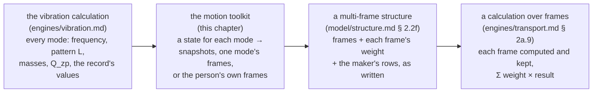

# Frames from the modes — the motion toolkit

**Role:** contract — the API and framework that turn a vibration's modes into
frames: how the molecule moves, its snapshots, a mode's own frames, the frame
set they are written as
**Domain:** vibration → frames
**Companions:** [`engines/vibration.md`](?doc=engines/vibration.md) (the
foundation: the vibration calculation and every mode's data, § 6.3, § 6.11);
[`science/vibrational-averaging.md`](?doc=science/vibrational-averaging.md)
(the theory: every state, the whole molecule, why each recipe is right, with
worked numbers); [`model/structure.md`](?doc=model/structure.md) § 2.2f (the
multi-frame structure, the container); [`engines/transport.md`](?doc=engines/transport.md)
§ 2a.9, § 2a.12 (a calculation over frames);
[`engines/vibration-postprocessing.md`](?doc=engines/vibration-postprocessing.md)
§ 2a, § 2b (the calls, worked).

*(The user, 2026-11-23: "this is entirely user's research and i created
molbuilder to support this which does not mean molbuilder does a fully
packaged rigid result generator"; "molbuilder should expose the correct api
to choose the mode, and provide a random number/weight calculator/generator";
"transport calculation should not overreach to design what the multiframe
is. we need to cleanly separate the logic and design"; "vibration
calculation is the foundation that exposes the fundamental data of all
modes".)*

**Built and to build.** One mode's states, their densities, moments and Gauss
frames, and the reading of a result as modes are built (2.78.0); everything
this chapter marks *(to build)* is the plan's R3d2b2
([`plans/plan.md`](?doc=plans/plan.md) § 2) — the probe's use of the nodes
(§ 6) is R3d2c's — and § 9 lists both, with every visible change.

---

## 0. Where it sits — three parts, one direction



| part | owns | does not |
|---|---|---|
| **the vibration calculation** | computing the modes and recording every mode's data in the result ([`engines/vibration.md`](?doc=engines/vibration.md) § 6) | decide how the molecule moves |
| **the motion toolkit** | describing how the molecule moves — a state for each mode — and turning it into frames with weights, by the person's choice of modes, states, recipe and count; writing them as a frame set with rows that say what was done | run a calculation, average one, or choose the model for the person |
| **the frame set** | the frames, each frame's `weight`, and every other row its maker wrote, carried as written ([`model/structure.md`](?doc=model/structure.md) § 2.2f) | mean anything to the calculation but the weights |
| **a calculation over frames** | computing each frame as an ordinary static calculation, keeping every frame's result, and stating $\sum_f w_f\,X_f$ ([`engines/transport.md`](?doc=engines/transport.md) § 2a.9, § 2a.12) | know where the frames came from, or design, interpret or re-weight them |

**The dependency runs one way.** The toolkit reads the vibration's result
and writes a frame set; a calculation reads the frame set. Transport — its
record, its data file, its composition — imports nothing of the toolkit.
**Of a structure it cites, transport reads what it reads of every structure**
— its atoms, labels and box, frame 0's `info.calculation` (the settings it
takes its own from, required) and a relaxation record of its geometry
(`info.relaxation`) ([`engines/transport.md`](?doc=engines/transport.md)
§ 3.1) — and **none of the maker's own rows or `info` keys**: not
`vibration_run`, not `info.sampling`, not an older set's `info.vibration`,
nothing of § 5.1 but each frame's `weight`. The one check of the frames that
needs transport's own knowledge — that no electrode atom moves beyond the
leads' tolerance — stays transport's, asked when a calculation cites the set
([`engines/transport.md`](?doc=engines/transport.md) § 2a.9); the toolkit's
writer checks what it owns (§ 5). The pages, which sit above both, ask the
toolkit for a row's plain words and a cited set's provenance (§ 6).

**The model is the person's.** Which modes move, in which state, with which
recipe and how many frames, is a research decision; the toolkit gives each
piece correctly and lets them be combined, states every choice in the frames
it writes, and never decides one. Transport is the same calculation whatever
the frames are.

---

## 1. Where each piece lives, and what it reads

| module | layer | holds |
|---|---|---|
| `vibration` | L2, **travels** beside a job in both vibration bundles — numpy and the constants alone | the mechanics of every mode, and the molecule's motion built from them: `state`, `State` (`pdf`, `cdf`, `moment`, `draw`, `frames`, `weights_at`), `Frames`, `Mode`, `ModeState` (each of `State`'s handed on, `draw` and `weights_at` among them), `Vibration` — its `displaced({...})`, the one rule $\mathbf R^0 + \sum_k Q_k\mathbf L_k$ ([`engines/vibration.md`](?doc=engines/vibration.md) § 6.11 § 2), and its `motion()` — the molecule's motion and its snapshots (`Motion`, `Snapshots`, `pooled`), the analyses of a snapshot set's results (§ 7), `temperature_of_quanta` — *to build (§ 9): `draw`, `weights_at`, `displaced`, the motion and all it holds, `temperature_of_quanta`; the rest built in 2.78.0* |
| `vibration_frames` *(to build)* | L2, the **host's** — it imports `vibration`, the structure, `frameset`, the result's reader and the run door, never transport; it imports with `molbuilder-jupyternb`'s packages, numpy beside molbuilder's own modules, so the example notebook runs it there ([`web/jupyter.md`](?doc=web/jupyter.md) § 7) | **a run's folder read as a `Vibration`** (`vibration_of_run`, below), the one frame-set writer and its reader (`write_frame_set`, `read_frame_set`), the rows' vocabulary (§ 5.1) and the pages' words and provenance from it (`said_of`), the weights for a set's rows at a state (`weights_for_set`, § 7), a mode's own set's outermost move and numbers for any state (`outermost_move`, `at_temperature` its thermal case, folded from `spectra/mode_frames.py`) |

**No call of `vibration` reaches `vibration_frames`**: the foundation's
module never depends on the module built on it. The writer and the reader are
functions of `vibration_frames`, which `molbuilder.postprocess` hands on — the
one import of a person's script ([`model/parse.md`](?doc=model/parse.md) § 3):
`from molbuilder.postprocess import vibration, write_frame_set,
read_frame_set, pooled`. `postprocess.reaveraged` joins two calls — the
toolkit's weights for a set's rows and transport's own averaging door — and
adds no rule of its own (§ 7).

**What `v` knows** *(to build: today `v` keeps the file's name alone, as
`v.source`)*. `v = vibration(path)` takes the result file — its JSON or its
`.nc`, one answer — or the vibration run's folder, read through the run door
as `read_steps` takes one
([`engines/vibration-postprocessing.md`](?doc=engines/vibration-postprocessing.md)
§ 7). It carries what every frame set needs, each under its own name:

| attribute | what | from |
|---|---|---|
| `v.modes`, `v.mode(n)` | each mode — its number (`index_1based`), frequency, whether it is imaginary, its canonical eigenvector over the free atoms ($\sum_A m_A\lvert\mathbf L_A\rvert^2 = 1$), every atom's mass, and the record's stored values ([`engines/vibration.md`](?doc=engines/vibration.md) § 6.11 § 6) | the result's modes and `equilibrium.masses_amu` — a result of schema 7 or later ([`engines/vibration.md`](?doc=engines/vibration.md) § 6.3) |
| `v.structure` | the geometry the modes were taken at, in the user order, its labels, held atoms and box — frame 0, and every frame's atoms | the result's `structure` ([`engines/vibration.md`](?doc=engines/vibration.md) § 6.10.1) |
| `v.record_temperature_k` | the vibration record's temperature — the one a mode's thermal or classical state given none takes, said so (§ 2) | `thermo.temperature_K` |
| `v.run`, `v.read_path`, `v.result_sha256` | the run's folder, the file read, and **the JSON's sha256** — the `.nc` states it as `json_sha256`, so it is the same whichever file was read: the set's provenance rows (§ 5) | the run door; the file |
| `v.relaxation_calculation` | frame 0's `info.calculation`, the settings a transport citation takes its own from ([`engines/transport.md`](?doc=engines/transport.md) § 3.1, § 2a.7) — **the record of the relaxation frame 0's geometry came from** *(the user, 2026-10-24, on the recommendation)*: where the vibration's own run relaxed it — its `relax` call ([`engines/vibration.md`](?doc=engines/vibration.md) § 5.11 § 1) — that run's settings, through the run door's view (`runs.view_of`, `parse.contract.contract_of`); where the structure was stated already relaxed, the record that structure states — its `info.calculation`, written when it was saved from its optimization *(measured on AuBDTAu, 2026-10-24: its vibration ran at a 1×1×1 k-grid and 300 Ry, its relaxation at 5×5×1 and 400 Ry; a transport citing a set stamped with the vibration's settings defaulted to the cheaper ones)* | the run door's view |

**A run's folder → its `Vibration`, one door** *(to build)*:
`vibration_frames.vibration_of_run(run_folder)` reads the run's result through
its reader and gives the run, the JSON's sha256, the structure and frame 0's
relaxation record — today's frame generator's rule
(`spectra/mode_frames.py`), moved here. `postprocess.vibration`,
`molbuilder frameset from-mode` and *Write frame set…* each ask it, and
`read_frame_set` reopens a set's vibration through it (§ 5); `vibration`
never asks the run door. A result read from outside a run's folder — an export, a copy — writes a set with no
`vibration_run` and no `info.calculation`, said so; so does a PySCF deck's,
which records no relaxation, and a stated-relaxed structure that states none.
Such a set is no transport citation until its relaxation is recorded — said,
never refused.

**Each object knows where it came from** *(to build)*: a `Mode` carries its
result (`m.vibration`, left out of the mode's repr and comparison, so
`Vibration` → `Mode` → `Vibration` never recurses), and `Frames` the state it
was made for (`f.state`, a `ModeState`), so `write_frame_set(path, f)`
reaches the run, the structure and the state's rows; a `Frames` made from a
bare `State`, of no mode, has no geometries and is refused by name by the
writer.

**Modes are named by their number** *(to build)*, `index_1based`, the number
the result, the spectrum tab and a frame set's `mode_index_1based` use,
wherever a call takes one: `v.mode(7)`, `with_mode(7, …)`, `with_drive({7:
…})`, `modes=[7, 8]`, `displaced({7: q})`. `v.modes` stays the list in the
result's order, so `v.modes[6]` is mode 7 — the one place a Python index
appears.

**Every frequency scaled at once** *(to build)*: `v.with_frequency_scale(0.96)`
— each mode at 0.96 × its frequency, its pattern kept, the factor for the
harmonic picture's overestimate
([`science/vibrational-averaging.md`](?doc=science/vibrational-averaging.md)
§ 2b.1); every motion, state and set made from it states the factor
(`frequency_scale`, § 5.1). One mode's own, `m.with_frequency(...)`, as built.

---

## 2. One mode's state — the building block

A state says where one mode's coordinate $Q$ is, as a probability density
$P(Q)$ ([`science/vibrational-averaging.md`](?doc=science/vibrational-averaging.md)
§ 2b.3, which also says which state fits which experiment). Each is asked of
a mode, `m.state(...)`, by one of these sets of arguments — one table in the
module (`vibration._STATES`); any other set is refused, naming them:

| the state | arguments | where the molecule is | science |
|---|---|---|---|
| **thermal** — equilibrium at a temperature, or quanta added at random moments | `temperature_k`, or `mean_quanta` — the state's total mean quanta, what an anti-Stokes/Stokes ratio measures | a bell curve of spread $Q_{\mathrm{zp}}\sqrt{2n+1}$, zero-point motion included | § 2, § 2a.1 |
| **driven** — a push in step with the mode, from its ground state | `swing_quanta`, $n_s$ *(to build — § 9)* — *the user, 2026-11-23: "quantum mechanically, the 'driven mode' should only have one possible state"* | the **coherent state**: a bell curve of the zero-point width $Q_{\mathrm{zp}}$ whose centre swings, $Q_0\cos\varphi$, $Q_0 = 2Q_{\mathrm{zp}}\sqrt{n_s}$ | § 2a.2 |
| **driven, warm** — the same push on a mode in contact with a warm environment | `swing_quanta` with `temperature_k`, the environment's | the thermal bell curve of that temperature carried by the swing | § 2a.2 |
| **n quanta exactly** | `quanta` | the oscillator's $n$-th standing wave, $\lvert\psi_n\rvert^2$ | § 2b.3 |
| **classical**, for comparison | `classical=True` with `temperature_k` (the classical bell curve), with `swing_quanta` (the bare classical swing, $1/\pi\sqrt{Q_0^2-Q^2}$), or with both (the classical swing carrying the classical bell curve of that temperature — a warm driven mode's classical form) | | § 2b.3 |

`mean_quanta` has one meaning as an argument — a thermal state's total — and
a state's `.mean_quanta` is its total always (its warmth and its swing
together); a classical state counts none (`None`). A driven state's swing
$Q_0$ and the spread it carries are `s.swing_amplitude_amu12_ang` and
`s.carried_spread_amu12_ang` ($Q_{\mathrm{zp}}$, or the warm mode's
$\sigma_T$, the record's `thermal_spread_amu12_ang` at that temperature)
*(to build)*.

**A temperature not given** — the user's rule
([`engines/vibration.md`](?doc=engines/vibration.md) § 6.11 § 9 item 6), and
the user's narrowing of it for a driven mode (above); this is the rule's one
table:

| call | a temperature not given |
|---|---|
| `m.state(...)`, `v.motion(...)`, `postprocess.outermost_move(...)` for a thermal state, or a classical one at a temperature | **the vibration record's** (`v.record_temperature_k`), said (`s.temperature_from`, `motion.temperature_from`: `"the record's"`); a record stating none asks for one |
| `m.state(...)` for a driven state, $n$ quanta, mean quanta, the bare classical swing | none is needed |
| the weights for a set's rows at a state (`vibration_frames.weights_for_set`, which `postprocess.reaveraged` asks, § 7), for a thermal or classical state | **the frame set's own `temperature_k` row**, as the data file carries it in its structure; a set stating none — of $n$ quanta, of mean quanta, a cold driven set, a person's set — is refused by name, naming the temperature to give |
| `molbuilder frameset from-mode`, *Write frame set…* | asked every time — the page offers the vibration record's in its box, the person's to change |

**What a state answers**, each by the same module:

| call | answers |
|---|---|
| `s.pdf(q)`, `s.cdf(q)` | the density and the chance of $Q \le q$ — arrays in, arrays out *(to build for `cdf`, which takes one number today)* |
| `s.moment(k)`, `s.spread_amu12_ang`, `s.mean_quanta` | $\langle Q^k\rangle$ exactly; its r.m.s.; its total quanta |
| `s.atom_rms_ang` | each atom's r.m.s. move in the state |
| `s.draw(size, *, seed, start=0, phase=None)` *(to build)* | `size` coordinates drawn from $P(Q)$ — snapshots `start` … `start + size − 1` of the seed's sequence — from the mode's own three streams of the seed: `numpy.random.default_rng([seed, mode, 0])` its normal numbers, `[seed, mode, 1]` its phases, `[seed, mode, 2]` its uniforms (kept for a state that needs them; none does today), `mode` the mode's number (0 for a bare `State` of no mode); each stream drawn in one block. `phase` is this mode's own phases, as the motion computes them for a drive group — the group's phase less this mode's lag (§ 3.1) — its own phase stream when unsaid. Every state turns one standard normal number per draw: a bell curve, its spread times it; a driven state, $Q = Q_0\cos\varphi + \sigma_0 z$, $\sigma_0$ its carried spread; $n$ quanta, the $Q$ where `cdf` reaches $\Phi(z)$, $\Phi$ the standard normal's distribution — so a mirror $-z$ is the mirror $-Q$ and a shared seed couples every state alike ([`science/vibrational-averaging.md`](?doc=science/vibrational-averaging.md) § 5.5). The motion draws every mode through it (§ 3.3) |
| `s.frames(nodes)` | the mode's own deterministic frames (§ 4) |
| `s.weights_at(q_amu12_ang)` *(to build)* | the weights for this state of frames placed elsewhere — a `Weights(weights, beyond, exact_to_degree, said)` (§ 7) |

---

## 3. The molecule's motion, and its snapshots

### 3.1 A state for every mode

In the harmonic picture the modes move **independently** — the probability of
one set of coordinates $(Q_1, \dots, Q_N)$ is the product of each mode's own
— **except the modes of one drive group, which share a phase** (below;
[`science/vibrational-averaging.md`](?doc=science/vibrational-averaging.md)
§ 2c.1, § 2c.2). So the molecule's motion is a state for each mode, with any
drive groups *(to build)*:

```python
from molbuilder.postprocess import vibration, structure_dir
v = vibration(structure_dir("P", "spectrum", "V") / "01_freq/run-0")   # the run's folder
motion = v.motion(temperature_k=300.0)                  # every real mode thermal at 300 K
motion = motion.with_mode(7, swing_quanta=4)            # mode 7 driven: its coherent state
motion = motion.with_drive({9: 2.0, 11: 1.0},           # one laser on modes 9 and 11:
                           lags_rad={9: 1.57, 11: 0.12})  # one phase, each its own lag
motion = v.motion(temperature_k=300.0, modes=range(7, 31))   # only modes 7 to 30 move
motion.states                                           # {mode number: its state}
motion.drives                                           # the drive groups, their modes and lags
motion.said                                             # what the motion says (below)
```

| choice | how | said where |
|---|---|---|
| which modes move | `modes=` — mode numbers; every real mode when unsaid. An imaginary mode among them is left out, said; `modes=` empty, or only imaginary ones, is refused by name — nothing to move | the set's `modes` row |
| each mode's state | thermal at `temperature_k` (the record's when none, said), quantum — zero-point included; `classical=True` for the classical bell curves | `temperature_k`, `quantum` rows |
| a mode set apart | `with_mode(k, ...)`: any state of § 2 by its arguments, or a `ModeState` of mode $k$ — a mode at a scaled frequency (`m.with_frequency(...)`) reaches the motion so; a `ModeState` of another mode, or of another vibration, is refused by name — **replacing** that mode's thermal state: the driven mode is in **one** state, its own; a mode outside `modes=` is added. In a classical motion, `with_mode(k, temperature_k=600)` alone makes that mode classical at 600 K; every included mode set apart is a motion too | `set_apart_modes` (§ 5.1) |
| driven modes | **each draws its own phase**: modes driven independently — several lasers, or a mode the person treats alone | `set_apart_modes` |
| a drive group | `with_drive({k: swing_quanta, …}, lags_rad={k: lag, …}[, temperature_k=…])`: **one laser, one frequency — one phase per snapshot shared by the group, each mode's lag the person's, stated for every mode, never defaulted**: a mode's eigenvector sign is a convention, so a lag of 0 between two modes is no physics. The lag is § 2a.2's angle at the laser's frequency, written as an `atan2` between 0 and π, plus π where the mode's dipole change along the field — as `infrared_view` gives it, in the result's eigenvector sign, on both engines — is negative; comparable swings need the laser within about one linewidth of each mode ([`science/vibrational-averaging.md`](?doc=science/vibrational-averaging.md) § 2c.2). A group's phase is drawn from `[seed, 0, k_min]`, $k_{\min}$ its smallest mode number (§ 3.3). **A mode belongs to one group at most**: a mode named in two groups is refused by name; a mode set apart by `with_mode` and then by `with_drive`, or the reverse, takes the later call's state, said. `classical=True` makes the group's swings classical | `set_apart_modes`, with each group and its lags |
| a classical motion with a driven mode | the driven mode keeps its own state (§ 2) — quantum unless `classical=True` is given with it: the classical swing, carrying the classical bell curve where warm; the others are classical | `quantum` (the background's), each set-apart mode's own in `info.sampling` |

`with_mode` and `with_drive` return a new motion, as `Mode.with_frequency`
returns a new mode. A held atom never moves: the modes are over the free atoms
([`engines/vibration.md`](?doc=engines/vibration.md) § 6.3), and the
electrodes' own vibrations are not among them.

**`motion.said`**, shown in its repr, summary sentences: the modes left out as
imaginary; the temperature taken from the record; and **a cold driven mode in
a warm motion, with its thermal quanta**. A driven mode is the pure coherent
state unless its warmth is given (§ 2). Inside a motion at a temperature, the
motion says the mode's thermal quanta at that temperature,
$n_{\mathrm{th}} = \tfrac12(\sigma_T^2/Q_{\mathrm{zp}}^2 - 1)$, beside
$\sigma_T/Q_{\mathrm{zp}}$ (1.008 for a 1000 cm⁻¹ mode at 300 K, 2.9 for a
50 cm⁻¹ one): a cold driven mode against a warm baseline measures the drive
less those quanta, and its exact baseline is that one mode at 0 K beside the
warm others, `with_mode(k, temperature_k=0.0)`
([`science/vibrational-averaging.md`](?doc=science/vibrational-averaging.md)
§ 6, the derivation and the numbers). Information, never a decision:
`with_mode(k, swing_quanta=4, temperature_k=300)` is the warm driven mode, the
person's choice.

### 3.2 A snapshot, and a geometry from several modes

One snapshot is one possible geometry of the molecule. Each mode's coordinate
is drawn from its own state — the modes of a drive group with one shared
phase — and every atom moves by all of them at once:

$$
Q_k \sim P_k(Q) \ \text{for every mode } k, \qquad
\mathbf R_A = \mathbf R_A^0 + \sum_k Q_k\,\mathbf L_{k,A} .
$$

The motion composes each mode's draw from the state's own (`s.draw`, § 2)
with the numbers § 3.3's streams give it
([`science/vibrational-averaging.md`](?doc=science/vibrational-averaging.md)
§ 2c.3, the steps worked through to the average).

**The geometry for coordinates the person gives** *(to build)* is the same
rule, one call of the mechanics module: `v.displaced({7: 0.12, 9: -0.05})` —
every atom at $\mathbf R^0 + \sum_k Q_k\mathbf L_k$, the modes by number, $Q$
in amu^½·Å. It is what every recipe is built on, and what a person's own
model uses (§ 3.4).

### 3.3 Many snapshots — the frames, each weighted equally

```python
from molbuilder.postprocess import write_frame_set, topic_dir
snaps = motion.sample(64, seed=20261123, antithetic=True)      # (to build)
snaps.mode_index_1based          # (n_modes,): the columns' modes, in order
snaps.q_amu12_ang                # (65, n_modes): frame 0 (all zero), then each snapshot's coordinates
snaps.atom_moves_ang             # (65, n_atoms, 3): each atom's move — the displacement map
snaps.positions_ang              # (65, n_atoms, 3): each frame's geometry, frame 0 the relaxed one
snaps.max_atom_displacement_ang  # (65,): each frame's largest single-atom move
snaps.max_atom_mode_index_1based # (65,): the mode moving that atom most (0 for frame 0)
snaps.weights                    # (65,): 0 for frame 0, then 1/64 each
snaps.said                       # summary sentences (below)
written = write_frame_set(topic_dir("P", "structure") / "bdt-300K-64.xyz", snaps)
```

`atom_moves_ang[i]` is every mode's `Mode.displacement` at frame $i$'s
coordinate, summed — $\sum_k Q_k\mathbf L_k$ — and `positions_ang[i]` that
added to frame 0.

| choice | rule | why ([`science/vibrational-averaging.md`](?doc=science/vibrational-averaging.md)) |
|---|---|---|
| how many, `n` | the person's; with pairs, even — an odd `n` with `antithetic=True` is refused by name, the two settings conflicting; `sample(2, antithetic=True)` is one pair, whose error has nothing to be taken from, said | the average's error falls as $1/\sqrt N$; the spread of the results says how many are needed, and a small effect needs many (§ 5.5) |
| `seed` | **required**, a whole number, 0 or more, written with the frames. **Three streams per mode, keyed by the mode's number**, never its place among those included: `numpy.random.default_rng([seed, mode, 0])` its normal numbers, `[seed, mode, 1]` its own phases, `[seed, mode, 2]` kept unused; a drive group's shared phase from `[seed, 0, k_min]`, $k_{\min}$ the smallest mode number in the group — a mode belongs to one group at most, so the key is unique whatever order the groups were added in (no mode is numbered 0). **Each stream is drawn in one block** — all of a mode's normal numbers, then, from its own stream, all its phases | a `modes=` subset, a mode set apart or a drive leaves every other mode's draws as they were, and a driven mode's normal numbers are its thermal baseline's own — so a driven set and its baseline, one seed, differ by that mode's draw alone (§ 2c.4, § 5.5); the same seed gives the same frames **on the same numpy** (numpy keeps its bit streams across versions, not every distribution's algorithm), so the set states the generator and numpy's version (`rng`) |
| `antithetic` | **the person's explicit choice, no default**: on, each snapshot is followed by its mirror, every normal number $z \to -z$ and every phase $\varphi \to \varphi + \pi$, so every $Q_k \to -Q_k$ | within each pair the odd part of a response cancels exactly; whether that helps the set depends on which part dominates, which a paired set's own results say (§ 5.5) |
| `start` | snapshots `start` … `start + n − 1` of the seed's sequence, 0 when unsaid — even with pairs | **more frames later**: the streams are drawn in blocks, so `sample(2N)` begins with `sample(N)`'s frames for every kind of mode, pairs included, and `sample(N, seed=s, start=N)` draws the next $N$, written as their own set |

Each snapshot's weight is $1/N$: the probabilities are in how the
snapshots were drawn, not in the weights. **One indexing rule**: a
`Snapshots`, like a `Frames`, stands for the set as written — in memory as
read back, item $i$ is frame $i$, frame 0 the relaxed geometry at weight 0
(§ 5) included. The snapshot drawn $j$-th (from 0) is frame $j + 1$; with
pairs, frames $2j-1$ and $2j$ are a pair ($j = 1 \dots N/2$). Every analysis
of § 7 takes **one value per frame, frame 0 first** — a calculation's data
file's values whole — and leaves out the reference itself, which the object
knows by its weight 0; the person never slices.

**Pooling sets** — `pooled(*sets)` *(to build)*: sets of one motion — the
same states, drive groups and `antithetic` — joined into one `Snapshots`, in
the order given: either one seed drawn in sequence (`start` 0, then $N$, …)
or distinct seeds. Pairs pool only with pairs; sets of two motions, or two
ranges of one seed that overlap, are refused by name. Its analyses take each
set's values whole, one per frame of that set, in the order of the sets —
`p.standard_error(g1, g2)` — each set's frame 0 left out as every analysis
leaves it; its error from all the pairs or frames (§ 7). Written as one set,
it has one frame 0, writes `pooled` 1 and each part's seed, start and
samples in `info.sampling`, and no `seed` row (§ 5.1).

**What is said with them, never refused** (`snaps.said`, shown in its repr):
summary sentences — the largest single-atom move over the set, its snapshot
and the mode moving it, beside each mode's spread; a soft mode at a high
temperature can push an atom further than the harmonic picture holds
([`science/vibrational-averaging.md`](?doc=science/vibrational-averaging.md)
§ 7), which the person reads against a bond length — the arrays above give
every snapshot's.

### 3.4 A person's own model

The recipes are two of many. A two-mode grid to see a cross term, a driven
mode's own frames on top of snapshots of the rest, frames from a model of the
person's own — each is built from the two calls every recipe uses
*(to build)*: the geometry (`v.displaced`, § 3.2) and the writer (§ 5). A
two-mode set by the product of the two modes' own Gauss rules, exact to
degree 5 in each mode, its centre first:

```python
from molbuilder.postprocess import write_frame_set, topic_dir
f7 = v.mode(7).state(temperature_k=300.0).frames(3)
f9 = v.mode(9).state(temperature_k=300.0).frames(3)
pairs = [(a, b) for a in f7.q_amu12_ang[:, 0] for b in f9.q_amu12_ang[:, 0]]
grid = [v.displaced({7: a, 9: b}) for a, b in pairs]          # (0, 0) first
w = [wa * wb for wa in f7.weights for wb in f9.weights]       # (0, 0) at 4/9
write_frame_set(topic_dir("P", "structure") / "bdt-m7xm9.xyz", grid, w, vibration=v,
                rows=[{"name": "sampling_rule", "value": "gauss-hermite x gauss-hermite",
                       "unit": "1", "note": "modes 7 and 9 thermal at 300 K, each its own 3-point rule"}],
                frame_rows=[[{"name": "q7_amu12_ang", "value": a, "unit": "amu^1/2 angstrom",
                              "note": "position along mode 7"},
                             {"name": "q9_amu12_ang", "value": b, "unit": "amu^1/2 angstrom",
                              "note": "position along mode 9"}] for a, b in pairs])
```

The writer adds what every set needs (§ 5) whatever made the frames: the
provenance, the masses, frame 0's `info.calculation`, each frame's measured
rows. Its first frame is the relaxed geometry here, so no frame 0 is added.

---

## 4. One mode's frames — a deterministic set

For one mode on its own — how much exciting this mode changes the result — a
few deterministic frames do far better than snapshots: the **Gauss rule of
the state's own distribution**, $m$ frames that reproduce the state's
averages $\langle Q^k\rangle$ for every $k \le 2m-1$
([`science/vibrational-averaging.md`](?doc=science/vibrational-averaging.md)
§ 2a.3, the steps and the three- and five-frame formulas worked; § 2b.4). The
thermal and $n$-quanta rules are built; the driven state's, the order below
and the calls marked are *(to build)*:

```python
f = v.mode(7).state(temperature_k=300.0).frames(nodes=3)
f.q_amu12_ang, f.weights          # (3, 1): (0, +q1, -q1); (2/3, 1/6, 1/6) for a bell curve
f.positions_ang                   # (3, n_atoms, 3): each frame's geometry, R + Q L
f.max_atom_displacement_ang, f.said, f.exact_to_degree
written = write_frame_set(topic_dir("P", "structure") / "bdt-m7-300K.xyz", f)
```

| state | the rule |
|---|---|
| thermal | Gauss–Hermite: three frames at $0, \pm\sqrt3\,\sigma$, weights $\tfrac23, \tfrac16, \tfrac16$ |
| driven | the Gauss rule of the swing's own distribution *(to build: built 2.78.0 folds equal phases)* |
| $n$ quanta | the Gauss rule of $\lvert\psi_n\rvert^2$ — a weight the frame's share of the average, not the chance of finding the molecule there (science § 2b.4) |

**One mode a set** (D6, [`engines/vibration.md`](?doc=engines/vibration.md)
§ 5.10's decisions): another mode is another set, cited by its own
calculation, and how the modes' results are weighed against each other is the
person's; many modes at once are snapshots (§ 3), or a model of the person's
own (§ 3.4). **A thermal set is stated by its temperature**
([`science/vibrational-averaging.md`](?doc=science/vibrational-averaging.md)
§ 5, with the user's ruling of 2026-10-28) — the junction's, or for a mode
pumped at random moments its effective one, `vibration.temperature_of_quanta(
frequency_cm1, mean_quanta)` *(to build)* turning a measured number of quanta
into it. **What the frames move is said**: each frame's largest single-atom
move, and the outermost frames' on the set's rows — the check a person reads
against a bond length; `postprocess.outermost_move(path, *, mode,
nodes=None, temperature_k=None, quanta=None, swing_quanta=None,
mean_quanta=None, classical=False)` gives it for any state before a set is
written — § 2's arguments, its rule `vibration_frames.outermost_move` *(to
build: in 2.78.0 a thermal state's alone, § 9)*.

**The order and the symmetry** *(to build: today `frames` returns the nodes
ascending, and the $n$-quanta and swing rules' middle node is the
eigensolver's, within $3\times10^{-16}$ of 0)*: the node at $Q = 0$ first,
then each pair nearest first, its positive side first — $(0, +q_1, -q_1,
+q_2, -q_2, \dots)$ — one order for every set. Every state the toolkit offers
has an even $P(Q)$, so each rule is made exactly symmetric: an odd rule's
middle node is 0 exactly and each pair $\pm q$ exactly, whatever the
eigensolver returns — $q = (x_+ - x_-)/2$ from the pair's two nodes, the
pair's two weights averaged — and frame 0 of an odd set is the relaxed
geometry bit for bit. An even rule's `Frames` stands for its set as written
(§ 3.3's rule): the relaxed geometry as frame 0 at weight 0, then the rule's
nodes (§ 5).

**The excitation's own effect** is a difference of two states at one
temperature ([`science/vibrational-averaging.md`](?doc=science/vibrational-averaging.md)
§ 6, with the numbers): best from two sets, each by its own rule; one set's
results re-weighted to the other state (`weights_at`, § 7) are exact only to
degree $m - 1$, so that route needs five frames at least.

---

## 5. The frame set it writes

**One writer** *(to build)*, a function of `vibration_frames` handed on by
`postprocess`, in two forms:

- `write_frame_set(path, frames)` for the recipes — `frames` a `Frames` or a
  `Snapshots`, which bring their vibration, their state and their rows;
- `write_frame_set(path, positions_ang, weights, *, vibration, rows=(),
  frame_rows=(), frame0_rows=None)` for a person's own frames — `rows` a
  list of `{name, value, unit, note}`, the structure model's row,
  `frame_rows` one such list per frame given
  ([`model/structure.md`](?doc=model/structure.md) § 2.2d–2.2f:
  `set_customized`, `with_frames`), and `frame0_rows` the person's rows for
  a frame 0 the writer prepends; a row with no unit says `"1"`. A person's
  frame row named like one of the writer's own — `weight`,
  `displacement_ang`, `max_atom_displacement_ang` — is refused by name.

Both go through the structure's one writer. `path` is a path as Python takes
one — from the projects tree's doors (`topic_dir`, `structure_dir`), so the
set lands in the structure topic a transport citation reads and a mistyped
topic is refused by name; the command line and the page read theirs from the
projects tree (§ 6). It returns `Written(path, n_frames, said)`: the pair
written, its frame count — a prepended frame 0 among them — and what it said.
A recipe's object already stands for the set as written (§ 3.3), so its
items are the file's frames one for one; a person's frames given without the
relaxed geometry first are the file's frames 1 … after the prepended one.

| it writes | how |
|---|---|
| **frame 0, the set's reference** ([`model/structure.md`](?doc=model/structure.md) § 2.2f) | the relaxed geometry — this rule's one home: a mode's own set with an odd rule has its node there, at the rule's weight; an even rule's set and a snapshot set get it prepended at weight 0; a person's frames keep their first frame as frame 0 where it **is** the relaxed geometry — the same numbers, as `v.displaced({})` or a node at $Q = 0$ gives it (§ 4: every rule's middle node is 0 exactly), never a near-copy — and otherwise get it prepended at weight 0. Exact in memory; the file holds every position to $10^{-6}$ Å, as every pair does |
| **a prepended frame 0's rows** | for a recipe, every frame row its other frames state, at its value there: `q_amu12_ang` 0 (each mode's, for snapshots), `node_sigma` 0, `displacement_ang` 0, `max_atom_displacement_ang` 0, `weight` 0; for a person's frames, the writer's own measured rows computed there, `weight` 0, and the person's `frame0_rows` — a person's frame row absent at frame 0 said |
| **each frame's `weight`**, the one row a calculation reads | as given; weights not summing to 1 within the container's tolerance written as given and said ([`model/structure.md`](?doc=model/structure.md) § 2.2f) |
| **each frame's measured rows**, for every set | `displacement_ang`, `max_atom_displacement_ang` — computed from the coordinates alone |
| the provenance, as rows | `vibration_run`, `vibration_result_sha256` (the JSON's, § 1), `mass_source`, `frequency_scale` where one was applied |
| **the maker's assumptions**, one row | `assumptions`: the harmonic modes, each mode's state, independence or the drive groups, for snapshots the statistics of a finite set, and for a set with a driven mode that the field's own action on the electrons and its forced motion of the other infrared-active modes are left out — science § 7's items 1, 7, 8 and 9, the sentences it asks to be stated beside the numbers, carried as written by any calculation like every row; a person's set carries the person's own `assumptions` row, or none, said |
| the masses | the pair's `mass_amu` channel, every atom's |
| what made the frames, as rows with their meanings | § 5.1's; for a set the person built, the rows and frame rows the person gives |
| per-frame coordinates along every mode | `info.sampling`, from the snapshot recipe only — the modes included, each set-apart mode's state and each drive group, each frame's coordinate along each mode, indexed as the set is written (frame 0's all zero); read back by `read_frame_set` |
| frame 0's `info.calculation` | `v.relaxation_calculation` (§ 1) |

The pair's `info` and channels travel with it wherever a structure travels —
into a composed junction, and with the junction's structure into a transport
calculation's sidecar and data file (`structure_json`), cited whole as the
structure ([`model/structure.md`](?doc=model/structure.md) § 2.2f).
Transport reads of it what § 0 says, and of the maker's nothing.

**What it checks is what it owns**: the same atoms, order, labels and box in
every frame, and every held atom where frame 0 has it — true by
construction for the recipes, every $\mathbf L$ zero on every held atom; a
person's frames moving a held atom are written and said, never refused.
Which atoms are the leads is transport's to know: a calculation citing the
set says which electrode atoms its frames move beyond the leads' tolerance
([`engines/transport.md`](?doc=engines/transport.md) § 2a.9), running as set
— the writer no longer says it *(from R3d2b2, § 9)*.

**A mode at a scaled frequency** (`m.with_frequency(...)`,
`v.with_frequency_scale(...)`) writes the frequency and $Q_{\mathrm{zp}}$ its
frames were placed for, and the result's own frequency beside them
(`result_frequency_cm1`, § 5.1).

One pair, `.xyz` and `.molstruct.json`; **a pair already at the path is
refused**, never written over: a calculation citing it is pinned to it.

**Reading a set back** — `read_frame_set(path, *, vibration=None)` *(to
build)* — returns the set **as written, every frame, frame 0 included**: a
`Frames` (a mode's own set; its `state` rebuilt from its rows and its
vibration — the one given, or the run its `vibration_run` names reopened
through `vibration_of_run` (§ 1); `None` where that run does not read, said),
a `Snapshots` (a sampled set, from `info.sampling`), or a `FrameSet` (a set a
person built: its positions, weights and rows as written). Read back as in
memory, item $i$ is frame $i$ (§ 3.3). **One shape for all three**: `q_amu12_ang` an
array (frames × modes — one column for a mode's own set),
`mode_index_1based` (modes,), `positions_ang` (frames, atoms, 3), `weights`,
`max_atom_displacement_ang`, `max_atom_mode_index_1based` (frames,), `said`;
`exact_to_degree` on `Frames`, `seed`, `antithetic` on `Snapshots`.

### 5.1 The vocabulary, row by row

The vocabulary is the toolkit's — one table in `vibration_frames` (the names,
kinds, units, meanings and page words), moved there from the transport side's
`frame_average.ROWS` in R3d2b2 — and a person's script may write the same
names. Every row the toolkit writes carries its meaning as its `note`, the
meaning for the kind of set it is. The names carry their units; a row's
`unit` field spells the same unit in ASCII — `cm-1`, `K`, `angstrom`,
`amu^1/2 angstrom`, and `1` for a name with none (—). A page says a row in
the vocabulary's words where its unit is the vocabulary's **or it states
none** — the name itself is a claim about the unit, and every set written
before R3d2b2 states no unit for a name without one — and otherwise by its
name and unit as written; the calculation checks nothing of it, and a row the vocabulary
names, written without a meaning, is said so by the toolkit when it reads its
own sets.

| where | name | kind | meaning | unit | on a page |
|---|---|---|---|---|---|
| the `.xyz` | every frame's coordinates | given | frame 0 the relaxed geometry the modes were taken at, the set's reference; frames 1… displaced along the modes | Å | — |
| the `mass_amu` channel | each atom's mass | given | the masses the modes' coordinates are weighted by — the vibration result's own, `equilibrium.masses_amu`, which the vibration's deck stated and its analysis weighted the Hessian by; every atom, a positive finite number | amu | — |
| the structure's rows | `vibration_run` | given | the vibration run the modes were read from — its folder in the projects tree; absent for a result read from outside a run, said | — | Vibration run |
| | `vibration_result_sha256` | given | the sha256 of that run's result JSON | — | Result sha256 |
| | `mass_source` | given | which masses the `mass_amu` channel holds, by name, and so which $Q$ is measured with; `standard atomic weights`, a molbuilder vibration's: the isotope-averaged standard atomic weights (`chemistry.atomic_mass`) the vibration's deck stated, as its result states them; every $\mathbf L$ is normalised with them, $\sum_A m_A \lvert\mathbf L_A\rvert^2 = 1$ | — | Masses |
| | `frequency_scale` | given | the factor every mode's frequency was scaled by (`v.with_frequency_scale`), each pattern kept; absent when none | — | Frequency scale |
| | `assumptions` | given | the maker's assumptions, in words — what the weights' average holds under: harmonic modes, each mode's state, the modes' independence or the drive groups, for snapshots a finite set's statistical error, and for a set with a driven mode the field's own action on the electrons and its forced motion of the other infrared-active modes left out ([`science/vibrational-averaging.md`](?doc=science/vibrational-averaging.md) § 7, items 1, 7, 8, 9); a person's set, the person's own | — | Assumptions |
| | `sampling_rule` | given | the recipe, by name, that placed the frames and gave their weights: `gauss-hermite` — a thermal state's Gauss rule; `gauss` — another state's own Gauss rule (driven, $n$ quanta), its state in the rows below; `monte-carlo` — snapshots of every included mode drawn from its state, each frame of weight $1/N$; a set the person built, the person's words | — | Sampling rule |
| | `sampling_nodes` | given | a mode's own set: $m$, the rule's number of nodes, one frame at each (for example 3: a thermal set's $q = 0, \pm\sqrt3\,\sigma$, weights $\tfrac23, \tfrac16, \tfrac16$) | — | Nodes |
| | `samples` | given | a snapshot set: $N$, the snapshots drawn — the frames after frame 0 | — | Snapshots |
| | `seed` | given | a snapshot set: the seed, a whole number 0 or more, each mode's streams are keyed by (with the mode's number); absent for a pooled set | — | Seed |
| | `start` | given | a snapshot set: the first snapshot of the seed's sequence drawn — 0, or where a set continues another (`sample(..., start=)`), its snapshots `start` … `start + samples − 1` | — | First snapshot |
| | `pooled` | given | a pooled set: 1; each part's seed, start and samples in `info.sampling`; absent for a set drawn at once | — | Pooled |
| | `rng` | given | a snapshot set: the generator, `numpy PCG64, SeedSequence([seed, mode, stream])`, and numpy's version — the same seed gives the same frames on the same numpy | — | Random generator |
| | `antithetic` | given | a snapshot set: 1 when each snapshot is followed by its mirror (frames $2j-1$ and $2j$ a pair), 0 when every snapshot is drawn alone | — | Mirrored pairs |
| | `modes` | given | a snapshot set: the modes included, by number ("every real mode" when all) | — | Modes |
| | `set_apart_modes` | given | a snapshot set: each mode given a state of its own, in words — its state, its frequency where it is not the result's, and each drive group with its modes and lags, e.g. "mode 7: driven, 4 swing quanta, the zero-point width, its own phase; modes 9 and 11: one drive, 2 and 1 swing quanta, lags 1.57 and 0.12 rad"; absent when none | — | Modes set apart |
| | `quantum` | given | 1 when the set's thermal background is quantum (zero-point motion included), 0 when classical; each set-apart mode's own in `info.sampling` | — | Quantum |
| | `mode_index_1based` | given | a mode's own set: which mode, counted as the vibration result counts it (`index_1based`) | — | Mode |
| | `frequency_cm1` | given | a mode's own set: the wavenumber its frames were placed for — the result's own, or a scaled one, the result's then in `result_frequency_cm1` | cm⁻¹ | Frequency (cm⁻¹) |
| | `result_frequency_cm1` | given | a mode's own set at a scaled frequency: the mode's wavenumber as the result states it; absent when `frequency_cm1` is the result's | cm⁻¹ | Result's frequency (cm⁻¹) |
| | `zero_point_amplitude_amu12_ang` | given | a mode's own set: the zero-point amplitude $Q_{\mathrm{zp}} = \sqrt{\hbar/2\omega}$ at `frequency_cm1` | amu^½·Å | Zero-point amplitude (amu½·Å) |
| | `temperature_k` | given | the temperature of the motion the frames sample: a thermal state's — for a mode pumped at random moments, its effective temperature, the one whose thermal state holds the same mean number of quanta ([`science/vibrational-averaging.md`](?doc=science/vibrational-averaging.md) § 2a.1; `vibration.temperature_of_quanta`); a warm driven mode's, the temperature of the environment whose thermal width the swing carries — the swing's own quanta are `swing_quanta`, never folded into it; a snapshot set's thermal modes'. Absent for a set named by its mean quanta, of $n$ quanta, or a cold driven set | K | Temperature (K) |
| | `quanta` | given | a mode's own set of $n$ quanta exactly: $n$ | — | Quanta n |
| | `swing_quanta` | given | a driven mode's set: the quanta the push adds, $n_s$; its swing $Q_0 = 2Q_{\mathrm{zp}}\sqrt{n_s}$ | — | Swing quanta |
| | `mean_quanta` | derived | a mode's own set: the state's total mean number of quanta — at a temperature $n = 1/(e^{\hbar\omega/k_BT} - 1)$; a driven state's adds its swing quanta; given, for a set named by it; absent for a classical state, which counts none | — | Mean quanta n |
| | `spread_amu12_ang` | derived | a mode's own set: the r.m.s. of the state the frames sample, $\sigma = Q_{\mathrm{zp}}\sqrt{2n+1}$ for a quantum state ([`science/vibrational-averaging.md`](?doc=science/vibrational-averaging.md) § 2a); a set written before R3d2b2 names it `sigma_amu12_ang`, read the same | amu^½·Å | Spread σ (amu½·Å) |
| | `max_displacement_ang` | measured | a mode's own set: the outermost move — $\max_A\lvert\Delta\mathbf R_A\rvert$ at the outermost frames, $= \lvert q_{\mathrm{out}}\rvert\max_A\lvert\mathbf L_A\rvert$ for any state — the check against a bond length | Å | Outermost move (Å) |
| each frame's rows | `displacement_ang` | measured | the frame's plain displacement from frame 0, one number per frame, $\sqrt{\sum_A\lvert\Delta\mathbf R_A\rvert^2}$ over every atom — no masses; the atoms' move vectors themselves are the toolkit's `atom_moves_ang` | Å | Displacement (Å) |
| | `max_atom_displacement_ang` | measured | its largest single atom's, $\max_A\lvert\Delta\mathbf R_A\rvert$ | Å | Largest atom move (Å) |
| | `q_amu12_ang` | derived | a mode's own set: the frame's position along the mode, the mass-weighted normal coordinate — one number for the whole mode, every atom displaced by $q\,\mathbf L_A$: its size $\sqrt{\sum_A m_A\lvert\Delta\mathbf R_A\rvert^2}$, its sign the side of frame 0 it sits on; a node of the rule, or 0 for a prepended frame 0. A snapshot set's per-mode coordinates are its `info.sampling`'s | amu^½·Å | Position along the mode, q (amu½·Å) |
| | `node_sigma` | derived | a mode's own set: the same position in units of the state's spread, $q/\sigma$ | — | q in units of σ |
| | `weight` | given | the frame's share of the average: `Σ_f weight_f X_f` is the recipe's estimate of the average of `X` over the motion the set samples — a Gauss rule's weight at its node, $1/N$ for a snapshot, 0 for a prepended frame 0. A share of the average, not the chance of finding the molecule at the frame ([`science/vibrational-averaging.md`](?doc=science/vibrational-averaging.md) § 2b.4) | — | Weight |

*On a page* is how a page says the row: the plain words, the stored name on
hover ([`engines/transport.md`](?doc=engines/transport.md) § 3.8.1). *Given*
is stated by the vibration result, the person or the recipe; *measured* is
computed from the coordinates alone; *derived* is computed from the others by
the formula shown. A set written before R3d2b2 states `info.vibration`
(`run`, `result_sha256`) where a new one writes the two provenance rows; the
toolkit reads either.

---

## 6. Who calls it

| caller | what it asks |
|---|---|
| a person's script or notebook | any of it, through `molbuilder.postprocess` |
| `molbuilder frameset from-mode RUN --mode M (--temperature T \| --mean-quanta N \| --quanta N \| --swing-quanta NS [--temperature T]) [--nodes K] --out PAIR.xyz` — `RUN` the vibration run's folder, read by `vibration_of_run` (§ 1), and `PAIR.xyz` the pair, each read from the projects tree as `--bundle` is; it prints the mode's state, $\sigma/Q_{\mathrm{zp}}$, each frame's $q/\sigma$, largest atom move and weight, and where the pair is *(to build: today `--temperature` alone)* | a mode's own set in any state of § 2 — the user's decision ([`engines/vibration.md`](?doc=engines/vibration.md) § 6.11 § 9 item 2) |
| the spectrum viewer's *Write frame set…* on the selected mode: its state, the number of frames, and the readout under them ([`web/spectra.md`](?doc=web/spectra.md) § 4.3, the page's own design) *(to build: today a temperature alone)* | a mode's own set in any state (§ 4), its run read by `vibration_of_run`; its readout `outermost_move` for that state |
| the web layer *(to build)* — the Transport tab's frame-set card and a calculation's record, through the transport blueprint; Task setup's card, through the build blueprint's folder answer; the Results tab's frame-set section, through the record's answer ([`engines/transport.md`](?doc=engines/transport.md) § 3.8.1; [`web/results.md`](?doc=web/results.md) § 2.5) | `vibration_frames.said_of(pair_path, recorded_files=None)`: each row's plain words, where its unit is the vocabulary's or it states none, and the pair's provenance — its `vibration_run` and `vibration_result_sha256` rows, or an older set's `info.vibration` — read from the pair at that path; given the `files` mapping a calculation's record states — the `.xyz`'s and the `.molstruct.json`'s sha256 — a pair either of whose files no longer matches is said so, its provenance shown as the pair now states it. The answers carry it as `frame_set_said` (`/api/transport/record`, `/api/task-setup/folder`) |
| the probe at the frame rule's nodes ([`engines/vibration.md`](?doc=engines/vibration.md) § 6.11 § 4) *(R3d2c)* | a mode's own nodes (§ 4) |
| the example notebook (§ 6.1) | every piece |

### 6.1 The example notebook

`docs/engines/vibration-frames.ipynb` *(to build)*, saved with its outputs,
with a copy at `notebooks/vibration-frames.ipynb` in the projects tree for the
Jupyter tab, as transport's notebook is
([`engines/transport.md`](?doc=engines/transport.md), *The script, and the
notebook*). Its kernel is `molbuilder-jupyternb`, molbuilder's source on its
path as [`web/jupyter.md`](?doc=web/jupyter.md) § 7 states — frame sets are
made there through the toolkit — and the *(to build)*
`tests/test_vibration_frames_notebook_e2e.py` runs it on that env's Python,
named by its path (`nbclient` is that env's), so it is a check as well as a
demonstration *(the user, 2026-11-23: "an example jupyternotebook that can
open a calculation result folder and generate some mixing/plots as the
demonstration/example/tests to validate these calls")*:

- **its input — a vibration run's folder**: a PySCF methanol — twelve modes,
  among them a soft methyl torsion that is warm at 300 K — made down molbuilder's
  road by a test helper (`support.real_runs`), its run folder (description,
  `01_freq/run-0` with the result pair) carried beside the notebook and
  copied into the notebook's temporary projects tree; the first cell opens it
  with `vibration(run_folder)` and shows its provenance (`v.run`,
  `v.result_sha256`, `v.relaxation_calculation`), where the person names a run
  of their own;
- **its output**: every frame set into that temporary tree, so *Run All* runs
  twice;
- **its numbers computed, never typed**: each mode's $\sigma_T/Q_{\mathrm{zp}}$
  and thermal quanta at 300 K printed from the run — the torsion's warm width
  shows a temperature where the stiff modes sit at their zero-point motion;
- **a model response, said as a model**: $X(Q) = e^{\sum_k a_kQ_k}$ with
  chosen $a_k$, standing for a property computed at each frame — a curved,
  lopsided response like the contact bond of
  [`science/vibrational-averaging.md`](?doc=science/vibrational-averaging.md)
  § 4.3, whose average over every state has a closed form;
- **asserts as well as plots**, each against the science (§ 2b.5's rows),
  each tolerance from the science — for the model response
  $X(Q)\,X(-Q) = 1$, so a paired set's pair-mean variance is
  $\tfrac12(\langle X^2\rangle + 1) - \langle X\rangle^2$, its error known
  before the draw — and each plot named:
  - *each mode's draws against its state's density* — thermal, driven,
    $n$ quanta;
  - *the three kinds of quanta side by side* at the same mean —
    `quanta=1`, `mean_quanta=1`, `swing_quanta=1`: three distributions, three
    Gauss rules;
  - *one snapshot's displacement map*, and the snapshots' displacement of
    each atom against § 2b.5's covariance;
  - *the average against its closed form as $N$ grows* — a motion with the
    torsion driven, each mode's own factor, the merge the user asked for
    checked end to end, with its error from the pair means;
  - *a drive group of two modes*, their coordinates' covariance and the
    average against the group's closed form;
  - *an antithetic pair's cancellation*, and `parts` on an odd and an even
    response;
  - *a driven set against its baseline at one temperature*, one seed: every
    other mode's column identical, and the difference's error;
  - *more frames later*: the same seed drawn further (`start=`), the two sets
    pooled, their pooled error;
  - *a set written and read back*: `read_frame_set`, its frames and weights as
    written, the results paired with its frames by the file, item $i$ frame
    $i$;
  - *a mode's own set*: the two baselines of science § 6, two sets against one
    re-weighted, and `weights_at` against frames placed for the state.

---

## 7. What it does not do — and the analyses of a set's results

It runs no calculation and averages none: the result of a calculation over
the frames, and its average at the frames' weights, are that calculation's
([`engines/transport.md`](?doc=engines/transport.md) § 2a.12). These
analyses of those results are the toolkit's *(to build)*:

**The weights for another motion — a mode's own set.** The same frames'
results averaged at another temperature, with a swing, with $n$ quanta: the
weights from each frame's coordinate and the state asked
([`science/vibrational-averaging.md`](?doc=science/vibrational-averaging.md)
§ 5.4):

```python
w = v.mode(7).state(temperature_k=77.0, swing_quanta=2).weights_at(q_amu12_ang)
                   # a Weights(weights, beyond, exact_to_degree, said)
w.weights          # each frame's weight for that state, summing to 1
w.beyond           # the share of the state's motion beyond the outermost frames, both sides
w.exact_to_degree  # m - 1: the frames were placed for another motion
w.said             # the share beyond, a weight below zero
```

The share beyond the frames, and a weight below zero, are said with the
weights, never refused; two frames at one position are refused by name — no
weights separate them.

**The weights for a set's rows at a state** —
`vibration_frames.weights_for_set(rows, *, temperature_k=None,
swing_quanta=None, quanta=None, mean_quanta=None, classical=False)` *(to
build)*: the frame set's rows, as `postprocess.frame_rows` reads them from a
calculation's data file ([`engines/transport-postprocessing.md`](?doc=engines/transport-postprocessing.md)
§ 3.2); the state named as § 2's table names it — a temperature not given
the set's own `temperature_k` row, a set stating none refused by name,
naming the temperature to give; a snapshot set refused by name, its frames
having no single mode's coordinate and its weights equal; each frame's
coordinate and the mode read from the rows, frame 0's included; the weights
by `weights_at`, a `Weights`. **`postprocess.reaveraged(path, *,
temperature_k=None, swing_quanta=None, quanta=None, mean_quanta=None,
classical=False)` joins two calls and adds nothing**: those weights, and
transport's own door that averages a data file's frames at weights given,
`frame_average.averaged_at(data_file, weights)`
([`engines/transport.md`](?doc=engines/transport.md) § 2a.12), each voltage
by its own rule.

**A snapshot set is not re-weighted** for another motion: the weights for
another distribution of independent draws are likelihood ratios, and the
frames needed grow by their mean square — for one mode driven with $n_s$
swing quanta over its zero-point width, $I_0(2n_s)^2$, about 5 times at one
quantum and $2\times10^5$ at four, and more with every mode whose state
changes ([`science/vibrational-averaging.md`](?doc=science/vibrational-averaging.md)
§ 5.5, the derivation). Another motion is another set.

**The error of a snapshot set's average**, by the rule of
[`science/vibrational-averaging.md`](?doc=science/vibrational-averaging.md)
§ 5.5, from values one per frame, frame 0 first — a calculation's data
file's values whole (§ 3.3's rule) — any trailing axes, a T(E) per frame
giving its error per energy:

- `snaps.standard_error(values)` → `Estimate(value, error, n)`: the average
  over the snapshots, its error and the snapshots counted — for independent
  frames from the frames, for pairs from the pair means, frame 0 left out. A
  value missing (NaN, a frame whose calculation did not finish) drops that
  frame — with pairs, its pair — and says it;
- `snaps.parts(values)` → `Parts(even, odd)`: a paired set's even and odd
  shares of the spread, from the pair means and the pair half-differences —
  whether pairs helped;
- `pooled(*sets)` (§ 3.3) — sets joined; its analyses take each set's values
  whole, in the order of the sets, their error from all their pairs or
  frames;
- `read_frame_set(path)` (§ 5) gives the `Snapshots` of a set written
  before, so a calculation's results pair with it by the file.

---

## 8. How it is validated

The science's expectations — every closed form a test takes, the
displacement covariance, a drive group's, and each state's average of
$e^{aQ}$ among them — are
[`science/vibrational-averaging.md`](?doc=science/vibrational-averaging.md)
§ 2b.5's, never molbuilder's own output. The tests that hold the toolkit to
them *(to build)*: `tests/test_vibration_mechanics.py` (each state's draw,
`weights_at`, `temperature_of_quanta`, the motion and its snapshots, beside
the states' own rows), `tests/test_vibration_frames.py` (the writer, the
reader, the vocabulary, `said_of`), and the example notebook's run (§ 6.1):

| what | the test |
|---|---|
| each state's drawing | its sample moments and distribution against the state's closed form — a two-sided Kolmogorov test against `cdf`; one normal number per draw for every state |
| the motion's draws | § 2b.5's covariance of the snapshots' coordinates and atom moves; a drive group's cross covariance and closed form, its lags as given |
| antithetic pairs | each pair's coordinates sum to zero; a response odd in $Q$ averages to zero exactly; the pair-mean error against the true error of an even and an odd response; `parts` splitting them |
| the seed | the same seed, the same frames; `sample(2N)` beginning with `sample(N)`; `start=`; a driven mode leaves every other mode's column unchanged; a drive group's phase keyed by its smallest mode, whatever order the groups were added in; a mode in two groups refused; `pooled` and its refusals |
| a mode's own frames | each rule exact to its stated degree; the bell curve's three at $0, \pm\sqrt3\sigma$; the order; each rule symmetric bit for bit — an odd rule's middle node exactly 0 and its middle frame bit for bit $\mathbf R^0$, $q_- = -q_+$ for every pair, on the thermal, $n$-quanta and driven rules; an even rule's set with the relaxed geometry as frame 0; `outermost_move` for each state |
| the indexing | every analysis on one value per frame, frame 0 first, the same in memory and read back; `standard_error`, `parts` and `pooled` leaving frame 0 out |
| the frame set | written and read back through the structure's door: frames, weights, every row with its meaning, a prepended frame 0's rows at 0; a person's frames whose first is the relaxed geometry written without a second copy |

---

## 9. Built, and to build

**Built** (2.78.0, [`engines/vibration.md`](?doc=engines/vibration.md)
§ 6.11): one mode's states — thermal, $n$ quanta, a swing over a bath,
classical — their densities, moments and spreads; the Gauss frames of a
Gaussian state and of $n$ quanta, in ascending order; a swing's frames by
folded equal phases; `Mode`, `ModeState`, `Vibration` and
`postprocess.vibration(path)` of a result file.

**To build**, R3d2b2 ([`plans/plan.md`](?doc=plans/plan.md) § 2), each a
visible change where it changes a built call or a written set — this list is
the one home of each of the toolkit's changes; transport's own — the data
file's @14 layout and its CSV columns, the record's keys and schema step,
the describe answer, `summarize`'s rows — are
[`engines/transport.md`](?doc=engines/transport.md) § 2a.12's and the
plan's:

- **a driven mode named by `swing_quanta` alone is the coherent state** (in
  2.78.0 it takes the record's temperature for a bath); `mean_quanta` beside
  `swing_quanta` leaves the table (a warm driven mode by `temperature_k`);
- every state's frames its own Gauss rule — the swing's included — in the
  order $(0, +q_1, -q_1, \dots)$, each rule exactly symmetric;
  `Frames.q_amu12_ang` (frames × modes; in 2.78.0 `nodes_amu12_ang`, one
  row), `Frames.state`; an even rule's `Frames` with the relaxed geometry as
  frame 0;
- `s.draw`, `s.weights_at` (`Weights`), `s.swing_amplitude_amu12_ang`,
  `s.carried_spread_amu12_ang`, `cdf` on arrays, the classical swing
  carrying the classical bell curve, `vibration.temperature_of_quanta`;
- `v` from a run's folder (`vibration_frames.vibration_of_run`), carrying
  `v.run`, `v.read_path` (in 2.78.0 `v.source`, the file's name),
  `v.result_sha256`, `v.structure`, `v.relaxation_calculation`;
  `Mode.vibration`; `v.mode(n)`, `v.displaced({...})`,
  `v.with_frequency_scale(...)`; `v.motion()`, `Motion` with `with_mode` and
  `with_drive`, `Snapshots` (`standard_error` → `Estimate`, `parts` →
  `Parts`), `pooled`;
- `vibration_frames`: `vibration_of_run`, `write_frame_set` (→ `Written`),
  `read_frame_set`, the vocabulary and `said_of`, `weights_for_set`,
  `outermost_move` for any state and `at_temperature`; and `postprocess`
  handing them on, with `postprocess.frame_rows`;
- **`postprocess.outermost_move` for any state** (§ 4) — in 2.78.0
  `outermost_move(path, *, mode, temperature_k, nodes=None)`, a thermal
  state's alone, its temperature required;
- **the sets the doors write**: the spread row `spread_amu12_ang` (in 2.78.0
  `sigma_amu12_ang`), the provenance as the rows `vibration_run` and
  `vibration_result_sha256` (in 2.78.0 `info.vibration`), the `assumptions`
  row, a snapshot set's `seed`, `start` and `samples` rows (a pooled one's
  `pooled`), an even rule's frame 0 prepended — each read the same by the
  toolkit from an older set;
- **the frame-set doors no longer say which electrode atoms the frames move**
  — `frameset from-mode` and *Write frame set…* said it in 2.78.0; from
  R3d2b2 a transport calculation citing the set says it, as it already does;
- `molbuilder frameset from-mode` and *Write frame set…* for any state; the
  load door's `frameset` block per state, its keys `spread_amu12_ang` and
  `spread_over_zero_point` (in 2.78.0 `sigma_amu12_ang` and
  `sigma_over_zero_point`; [`web/spectra.md`](?doc=web/spectra.md) § 4.3);
- `postprocess.reaveraged` for any state (§ 7): a thermal state given no
  temperature takes the set's own `temperature_k` row, a set stating none
  refused by name; the share of the motion beyond the outermost frames said,
  never refused (in 2.78.0 a swing reaching beyond the outermost frame is
  refused);
- the example notebook and its test.
