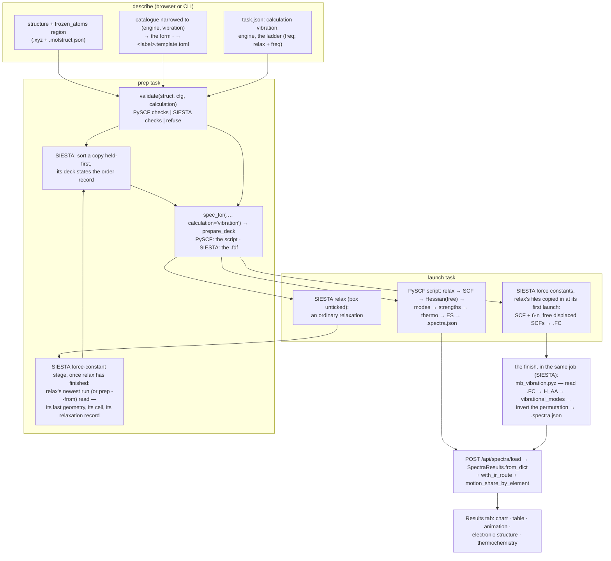

# Vibration — the calculation, on PySCF and on SIESTA

**Role:** contract — **the master document for the `vibration` calculation
kind.** What the calculation is, how each engine computes it, what the script
and the deck contain, what the result file holds, and which rules the code is
checked against. Where this document and the code disagree, the code is wrong
or this document is out of date — and the second is fixed first.
**Domain:** engines — with its science half in
[`science/normal-modes.md`](?doc=science/normal-modes.md) and its web half in
[`web/spectra.md`](?doc=web/spectra.md).
**Companions:** [`science/normal-modes.md`](?doc=science/normal-modes.md) (the
derivations, the rules R1–R8, the acceptance test);
[`web/spectra.md`](?doc=web/spectra.md) (the Spectrum tab and the Results-tab
viewer), [`web/spectrumchart.md`](?doc=web/spectrumchart.md) and
[`web/vibrationview.md`](?doc=web/vibrationview.md) (the chart and the
animation); [`engines/pyscf.md`](?doc=engines/pyscf.md) and
[`engines/siesta.md`](?doc=engines/siesta.md) (the two emitters this kind
rides); [`engines/stages.md`](?doc=engines/stages.md) (the description on
disk); [`engines/template.md`](?doc=engines/template.md) § 6.3 (how the
catalogue is narrowed to a kind);
[`execution/job-contracts.md`](?doc=execution/job-contracts.md) § 4.2a and § 6.1
(warm files, the artifact registry);
[`model/overview.md`](?doc=model/overview.md) § 2.2 (what a reorder may do);
[`science/validation.md`](?doc=science/validation.md) (the gate the kind's
checks run in). **Open items:** row **V1** of
[`plans/plan.md`](?doc=plans/plan.md), the one list; § 10 says what stands
and points there.

> **Consolidated 2026-09-24** from the design of 2026-09-21, the follow-up
> audit of 2026-09-22, the UI walk of 2026-09-23 and the implementation
> sections that had accumulated in the science and web contracts. The design
> and the audit are archived (`archive/2026-09-24-normal-mode-unification-design.md`,
> `archive/2026-09-24-vibration-audit.md`) as the record of how the decisions
> were reached; every decision, measurement and open item they held is here
> or in the plan. Nothing decided there is re-decided here. The spectrum rows
> of the 2026-09-23 UI walk are registered under V1 in `plans/plan.md`. One
> ordering rule
> of the design was knowingly broken: its step 4 (the API shape) was to land
> before the SIESTA arm, and part of it landed after — the cost is the second
> pass V1.0 and V1.6 name.

---

## 0. How to read this document

Three documents share this subject, and each owns one kind of statement:

| document | owns | read it when you want to know |
|---|---|---|
| [`science/normal-modes.md`](?doc=science/normal-modes.md) | **why** — the derivations, the rank rule for the motions that are not vibrations, stationarity, masses, the rules R1–R8 and the acceptance test | why a held-atom run reports fewer modes than `3·N_free`, and why that number is a rank and not a table; and, in its § 4b, both engines' workflows step by step against the discussion this work started from — what the tool does at each step, where it differs, and what is owed |
| **this document** | **what and how** — what the calculation computes on each engine, what the script and the deck contain, what the result file holds, what the code must keep true, what is built and what is owed | how a run works end to end, where a number in the file comes from, what to check the code against |
| [`web/spectra.md`](?doc=web/spectra.md) | **the tab** — the Spectrum tab, the hand-over to Task setup, the viewer, the chart, the animation, and how an absent number is drawn | what a person sees and clicks |

**A student** reads § 1 (the calculation in one page, with the eight rules
in one line each), § 2 (the road), § 4 and § 5 (the two routes, with
pseudocode and pictures), then § 11 (worked examples), with § 12 (the
glossary) open beside them, and takes the science document for the
derivations. **A developer** reads § 2, § 3 (the parameters), § 6 (the result
file), § 7 (the invariants), § 8 (the pieces), § 9 (validation and tests) and
§ 10 (shipped and owed), and checks the code against § 7. Words used before
they are defined — *kind*, *description*, *the pair*, *deck*, *phase*,
*rung*, *route* — are § 12's.

---

## 1. The calculation in one page

### 1.1 What a vibration calculation is

Near a geometry `R₀`, write every atom's displacement as one long vector `u`
(three numbers per atom). The energy is a quadratic bowl and the force is minus
its gradient — the many-coordinate form of Hooke's law:

```text
    E(u)  ≈  E₀  +  ½ uᵀ H u ,     H_{Iα,Jβ} = ∂²E / ∂R_{Iα} ∂R_{Jβ}      (the Hessian)
    F  =  −∇E  =  −H u             moving one atom pushes on the others: that
                                   coupling IS the off-diagonal Hessian
```

Divide each entry by the square roots of the two atoms' masses and diagonalise:
each eigenvector is a **normal mode** — a pattern of atoms moving together at
one frequency `ω = √λ` — and the spectrum is the list of them. Six of the
eigenvectors of a free molecule are not vibrations (three slides, three turns;
five for a straight molecule), so they are removed before the diagonalisation.
Two more quantities ride on the modes: how strongly each absorbs or scatters
light (the **infrared** and **Raman** strengths, from how the dipole and the
polarizability change along the mode), and the harmonic **thermochemistry**
(zero-point energy, entropy, free energy) summed over them.

### 1.2 What holding atoms means

Hold some atoms — an anchor, a metal slab — and split the coordinates into free
`A` and held `F`. Impose `u_F = 0`:

```text
    ┌ F_A ┐       ┌ H_AA  H_AF ┐ ┌ u_A ┐           F_A = −H_AA u_A
    │     │  = −  │            │ │     │     ⇒
    └ F_F ┘       └ H_FA  H_FF ┘ └  0  ┘           F_F = −H_FA u_A   ≠ 0
```

Four consequences, each a rule in the science document:

1. **What is diagonalised is `H_AA`** — the free–free block of the Hessian of
   the *whole* system, with every held atom present in the energy. A held atom's
   displacement is zero; its interaction is not. This is the partial Hessian
   (PHVA) of Head, Li & Jensen and Besley [Head1997, LiJensen2002, Besley2008].
2. **Some eigenvectors of `H_AA` are still not vibrations.** The free atoms can
   turn about one held atom, or about the line through two, at no cost. How
   many such motions survive is a **rank** computed from the geometry
   ([`science/normal-modes.md`](?doc=science/normal-modes.md) § 3.1 — six, five,
   three, one or zero, with two traps a table gets wrong), and they are
   removed **before** diagonalising (R3). With three held atoms not on one line,
   or any held atom in a periodic cell, nothing survives and nothing is removed.
3. **Stationarity is asked of the free atoms only** (R5): `∇_A E = 0`. The
   held atoms carry the constraint force `−H_FA u_A` by definition.
4. **One mass convention on every route** (§ 3.2 there): isotope-averaged
   masses (H = 1.008, not 1 — whole mass numbers move a stretch by 15 cm⁻¹),
   modes normalised `Σ_k m_k |L_k|² = 1` in amu. Crossing the normalisations
   once put every infrared intensity out by 1823×.

**The eight rules of the science contract, one line each** — cited by number
throughout this document; the full statements and their reasons are
[`science/normal-modes.md`](?doc=science/normal-modes.md) § 6:

| rule | in one line |
|---|---|
| **R1** | the count of surviving whole-body motions is computed in one place, by a rank — never tabulated or branched on |
| **R2** | one formula for the mode count, `3·N_free − n_rigid`, for every system; `3N − 6` is the empty-held-set case |
| **R3** | project the surviving motions out, then diagonalise — on both engines, at the Γ point only |
| **R4** | what is reported is what is left: every mode in the file is a vibration, and no reader needs a filter |
| **R5** | stationarity is judged on the free atoms; held atoms carry the constraint force by definition |
| **R6** | a prediction that cannot match the run is not written: a stated count is R2's or the run's own list |
| **R7** | the person is told how many motions survive the hold and what they are, before paying for the run |
| **R8** | a cost claim is read from the code, and what the code cannot skip is stated beside it |

### 1.3 The two engines, and the one path after them

| | **PySCF** | **SIESTA** |
|---|---|---|
| suits | isolated molecules, small clusters | periodic slabs, surfaces, junctions |
| basis | Gaussian functions | numerical atomic orbitals |
| how it gets `H_AA` | **analytic** second derivatives, for the free atoms (§ 4.4) | **central differences** of its analytic forces: nudge each free atom, read every force (§ 5) |
| frequencies + mode shapes | yes | yes |
| infrared / Raman strengths | yes (§ 4.6) | infrared from the run's charges, for the atoms the person names (§ 5.10 ②); Raman designed, not built (§ 5.11) |
| thermochemistry | full RRHO (rigid-rotor harmonic-oscillator) for a free molecule; vibrational sums with atoms held | vibrational sums |
| per-mode electronic structure | yes (§ 4.8) | no |
| a gold electrode | must be faked as a finite cluster | its natural home — and the same pseudopotentials, orbitals and k-points as the transport step (§ 5.6) |
| where a typical run lands | `spectrum/` | `frequency/` — a storage vocabulary, not an engine rule (§ 2.4) |

Only *how the block is obtained* differs. Everything after it is one function,
`spectra/normal_modes.py::vibrational_modes`, which both engines hand the same
things — the block, the masses, the geometry with its held set, and which
axes repeat (`axis_kind`, with the cell when one does) — and which returns the
modes with the surviving whole-body motions removed. The
PySCF deck imports it from `mb_pyscf.pyz`; the
SIESTA job's finish calls it beside the run (§ 5.5). There is no second path (R1–R4).

### 1.4 The smallest example, with real numbers

H₂ measured on a two-atom SIESTA force-constant run (2026-09-23): the bond's
force constant read from the `.FC` file is `k = 41.713 eV/Ų`, `m = 1.008 amu`.

| | diagonalised | motions removed | modes | ω |
|---|---|---|---|---|
| both atoms free | the 6×6 block | 5 (three slides, two turns; the turn about the bond moves nothing) | 1 | `√(2k/m)` = **4744 cm⁻¹** |
| one atom held | the free atom's 3×3 block, `[k]` along the bond | 2 (the free atom swinging about the held one) | 1 | `√(k/m)` = **3355 cm⁻¹** |

*(The 2026-09-23 run of § 5.5, on the same unrelaxed bond, reported 3358 cm⁻¹:
the same mode from its own SCF and its own force constant, the fixture's from
a hand-set deck — one quantity, two SCF settings. On the relaxed bond the road
reports 3022, § 9.)* Holding one end lowers the stretch by exactly `√2`, because
the partner no longer recoils: the reduced mass is `m` instead of `m/2`. Both numbers are
right for the question each asks — a constrained Hessian is a different
question, not a worse answer. The two swings of the free atom are the
surviving motions of point 2 above; without R3 they would be reported as two
modes near zero. [`science/normal-modes.md`](?doc=science/normal-modes.md)
§ 4b works the same example from the eigenvectors up.

---

## 2. The road — from a description to a result file

### 2.1 The whole road

```mermaid
flowchart LR
  M["Molbuilder tab<br/>build the structure,<br/>hold atoms in the viewer,<br/>Save to project (the pair)"] --> S["Spectrum tab<br/>load the structure, pick the engine on the strip<br/>(a periodic structure defaults to SIESTA),<br/>set parameters (the catalogue's form per engine),<br/>read the live checks"]
  S -->|"Send to Task setup<br/>= the hand-over"| T["Task setup<br/>shape, machine, the kind's ladder;<br/>Save writes task.json and job-request.json;<br/>the stage's tab prints the commands<br/>(--target when the CLI would refuse to guess)"]
  T -->|"prep task"| P["the deck<br/>PySCF: &lt;label&gt;_01_freq.py<br/>SIESTA, from a sorted copy: &lt;label&gt;_01_freq.fdf (box ticked),<br/>or &lt;label&gt;_01_relax.fdf, then &lt;label&gt;_02_freq.fdf<br/>prepared once relax has finished"]
  P -->|"launch task"| R["the run — the job writes the result itself<br/>PySCF: the script writes it<br/>SIESTA: the force-constant run leaves &lt;label&gt;.FC,<br/>then the finish (mb_vibration.pyz) derives the modes"]
  R --> A["&lt;label&gt;.spectra.json<br/>the one artifact, schema 11,<br/>its data file .spectra.nc beside it"]
  A --> V["Results tab<br/>chart · modes table · animation ·<br/>electronic structure · thermochemistry"]
```



The CLI walks the same road without the browser:

```bash
molbuilder describe --structure P/structure/x.xyz --bundle P/frequency/F \
    --engine pyscf|siesta --calculation vibration --name X --shape hierarchical
# SIESTA: its ranks and the cores per rank
molbuilder jobset prep task --bundle P/frequency/F --target this \
    --np 2 --cpus-per-task 1
# PySCF: its threads alone -- a rank count (--np) is refused
molbuilder jobset prep task --bundle P/frequency/F --target this \
    --cpus-per-task 2
molbuilder jobset launch task --bundle P/frequency/F --mode direct --yes
```

`prep` states the launch shape — SIESTA's ranks and cores per rank, PySCF's
threads — on its line or in the job request's run card, or it refuses
(`placement.launch_refusal`, which also refuses a rank count for PySCF, an
engine that runs one process). On SIESTA with the box unticked the ladder is
two groups, `relax` then `freq`, and `freq` is prepared once `relax` has
finished (§ 5.2a): the prep and launch lines run once for `relax`, then again
for `freq`.
The measuring run — PySCF's one, SIESTA's `freq` — ends with
`<label>.spectra.json` in its attempt (§ 5.5 for SIESTA) — the launch, started in the background,
returns at once, and `jobset status` follows it; there is no step after it.

`molbuilder describe` refuses `--stage-strategy` for this kind (a *ladder* is a
description's list of stages, each a *rung* with its own parameter set; a
*tier* ladder — coarse, medium, tight — grades an optimisation's convergence,
and a vibration's ladder is its measurement, with the relaxation before it on
SIESTA when the box is unticked and, for a displacement sweep, more
force-constant stages, § 5.9) and any engine but the two named.

### 2.2 The description: the relaxation is the person's explicit choice

A vibration is an ordinary described job: `task.json` carries
`calculation: "vibration"`, the engine, and its ladder
(`pyscf/stages.py::vibration_stages`; [`engines/stages.md`](?doc=engines/stages.md)).
The parameters travel in `<label>.template.toml`, the catalogue narrowed to
the kind (§ 3) — **including the relaxation's convergence settings on both
engines**, shown and editable exactly as on the Structure-optimization tab,
with the kind's own recommended values, which are tight (§ 3.1).

**A harmonic analysis is only valid at a stationary point**, so the
relaxation is the measurement's precondition, and **whether it runs is the
person's explicit say** *(user rulings 2026-08-20, refined 2026-09-24: "this
is totally user's control and it is explicit")*, made with one box on both
engines, `already_relaxed`:

| the box | what the tool does, on either engine |
|---|---|
| **unticked** (the default) | the calculation **relaxes first**, at the template's convergence settings — recommended tight, a largest remaining force of about 0.01 eV/Å — and then takes the second derivatives at the relaxed geometry. On PySCF that is Phase 0 of the one script (§ 4.2); on SIESTA it is a **`relax` stage before the `freq` stage** (§ 5.2a), the relaxed geometry carried into the force-constant deck as coordinates |
| **ticked** | the person states the structure is already relaxed **at this level of theory**. Nothing is relaxed; the tool measures the forces at the starting geometry and, above the template's force tolerance, **warns in plain words that the frequencies will be off** — never refuses, because the statement is the person's to make. The hint beside the box says the same before the run is paid for. **And the structure keeps the engine's frame** when it was read back from a run: it is used as the force minimum on the grid it was found on, so it enters this calculation unmoved, where every other new calculation is centred ([`model/structure-periodicity.md`](?doc=model/structure-periodicity.md) § 6.0, *Entering a new calculation*; user, 2026-10-11) |

Why the warning is plain and the default is to relax *(measured 2026-09-24,
§ 9)*: the H₂ fixture at the experimental bond length, sent through the
SIESTA road unrelaxed, reported 3358 cm⁻¹ where the relaxed bond gives 3022 —
a tenth of the frequency — and the two relaxation tolerances 0.02 and
0.001 eV/Å differ by two wavenumbers. An unrelaxed structure is the one error
that looks like a result.

**How the tool answers the ticked box with numbers**: PySCF's deck checks
the gradient at the input geometry (§ 4.3); SIESTA's finish reads the
forces SIESTA evaluated at its FC step 0 (§ 5.5). Both judge the largest
absolute force component over the **free** atoms (R5) against the template's
own force tolerance — `geom_gmax` on PySCF, `relax_force_tol` on SIESTA — the
one the person set or left at the kind's recommendation; both write the
number and the verdict into the result, and the viewer shows them; above the
tolerance, the remedy is one text on both engines (§ 5.5).

**The structure can carry its own evidence** *(user direction 2026-09-24:
"if the info meta data is present, we should display it and check against
tolerance of calculation; if not present … we will just accept that but with
a warning/hint")*. A pair exported from the Results tab of a finished
relaxation carries `info.relaxation` — the run's engine, its force tolerance,
the largest force left on the atoms it moved, the atoms it held, and a
fingerprint of the geometry it describes
([`model/parse.md` § 5b.1](?doc=model/parse.md)) — beside `info.calculation`,
the level of theory the deck stated (SIESTA today). Both kinds' gates read
them (`validation/sidecar.py::check_relaxation_record`), and every finding
lands on the box's own card, so the record is displayed where the choice is
made; the Metadata pane shows the raw store.

| the box | the record | the finding |
|---|---|---|
| ticked | absent | the plain warning of the table above, and an info line that no record travels with this structure — the statement stands on its own and the finish measures it |
| ticked | present, for a different geometry (another frame of that run, or edited since — the fingerprint differs) | **warning**: the record does not vouch for these coordinates |
| any | edited by hand (`edited_by_hand`, a person's change on MolView's Metadata page — [`web/molview.md`](?doc=web/molview.md) § 8.4a) | an info line first: the record's values are the person's word, not the run's — then the findings below, read from those values |
| ticked | present, for these coordinates | the engine, the tolerance, the steps and the largest remaining force are shown; a different engine, a different level of theory (`info.calculation` against this form's basis, functional, mesh cutoff, electronic temperature, the k-point grid its deck will write, and the charge and spin it will carry, resolved), a largest force above **this calculation's** tolerance, or an atom the relaxation held left free here (§ 2.3a) is each a **warning** naming the number, the field or the atoms; within tolerance at the same level is an info line, and so is holding more atoms than the relaxation held (§ 2.3a) |
| unticked | present, for these coordinates, within this calculation's tolerance at the same level, holding every atom the relaxation held | an info line: the record already meets this calculation's criterion, so the box may be ticked and the relaxation skipped |
| unticked | anything else | the same facts as information; the calculation relaxes first regardless — the SIESTA ladder's `relax` stage, the PySCF deck's own Phase 0 |

Never a refusal: the record informs the person's explicit choice; it does not
make it. The PySCF deck's own `_optimized.xyz` pair records neither: the
relaxation record is the one reader's, written by the Results tab's export
(V1.31, closed 2026-09-29), and a PySCF run's level of theory has no reader yet
([`pyscf.md`](?doc=engines/pyscf.md) § 2; plan § 5w K18).

### 2.3 Held atoms travel with the structure, never as a form field

Which atoms are held is a fact about the **structure**: the `frozen_atoms`
region in its `.molstruct.json` half of the codec pair
([`model/structure-annotations.md`](?doc=model/structure-annotations.md)). Set
it in the viewer or load a structure that carries it; the Send button exports
the model in one read, so what is drawn held is what the calculation holds.
**Frozen means frozen through every phase** *(user, 2026-08-21)*: the PySCF
relaxation holds the same set (geomeTRIC's `$freeze` file, the optimisation
deck's own mechanism) and the Hessian is taken over the free atoms only; the
SIESTA deck writes the set into `Geometry.Constraints` and nudges the free
range only. The old form field (`frozen_indices`, pre-filled from the sidecar)
was retired at phase P2 of the spectra migration of 2026-08-20
([`archive/2026-08-20-spectra-migration-plan.md`](?doc=archive/2026-08-20-spectra-migration-plan.md))
because a form copy of a structure fact could be edited into disagreement
with the structure it described. The
set is never second-guessed: nothing warns you off a choice you made on
purpose — the one finding about it is a fact the structure's own relaxation
record shows against it, an atom the relaxation held that this calculation
frees (§ 2.3a). What the run **says** about the choice is the point — the regime, the
motions removed, the Methods sentence (§ 4.10, § 6).

### 2.3a Holding more for the spectrum than for the relaxation — the label, and the record *(user, 2026-10-14)*

**The common road.** A junction is relaxed with its electrode blocks held and
every atom between them free; its relaxed geometry is exported from the
Results tab; and before the spectrum the person holds **more** — everything but
the molecule in the gap and a few surface metal atoms — and describes the
vibration with the box ticked. The Hessian is then taken over the smaller
region, with the rest fixed: a partial Hessian
([`science/normal-modes.md`](?doc=science/normal-modes.md) § 1). Holding more
is a choice with a cost the person weighs: the clamped neighbours stiffen the
contact modes ([`science/normal-modes.md`](?doc=science/normal-modes.md)
§ 4c.8).

**Two stores, and neither is the other.**

| | where | written by | changed by |
|---|---|---|---|
| **`frozen_atoms`** — the atoms **this calculation** holds | the structure's `regions`, the one label store ([`model/structure-annotations.md`](?doc=model/structure-annotations.md)); every label lives there, and nowhere else | the person, in the viewer | the person, any time — it is what each calculation reads |
| **`held_atom_keys`** — the atoms **the relaxation** held | the structure's `info.relaxation` record ([`model/parse.md`](?doc=model/parse.md) § 5b.1), beside the relaxation's steps, forces and verdict | the relaxation run, read back from its output when the structure is exported from it | nobody — a person may edit the record on MolView's Metadata page, which stamps it `edited_by_hand`, and the check then says whose word it is |

The record is history, not a label: nothing is held because of it. It names
the atoms by element and position (`Structure.geometry_lines`), never by an
index, so a reordering does not break it; changing the labels does not change
it; and its geometry fingerprint says whether the coordinates are still the
ones it describes (§ 2.2).

**The comparison** — at every vibration's gate (`check_relaxation_record`),
and at a force-constant stage against its ladder's `relax` stage (§ 5.2a):

| the held sets | the finding |
|---|---|
| the same atoms | none |
| every atom the relaxation held is held here, and more | **information**: every atom this calculation moves was free, and balanced, in the relaxation — the partial Hessian over fewer atoms |
| an atom the relaxation held is **free** here | a **warning** when the box is ticked, naming the atoms — their forces were never balanced, so the geometry is not stationary for them; information when unticked, since the ladder relaxes this set first |

The last row is not on the common road. It is an atom the relaxation held let
go for the spectrum — the electrode's top layer, say, the gold the sulfur
binds to — or a structure relaxed elsewhere with a larger held set. Holding
more never asks for it: **the force judgment stays valid**, because the
record's largest force over the relaxation's free atoms bounds the largest
over this calculation's fewer free atoms. A structure with no relaxation
record has nothing to compare, and nothing is said.

**The result states what this calculation held** (§ 6.10.1): its
structure's `frozen_atoms` is the set the Hessian held. The record of what
the earlier relaxation held stays with the structure it came in on — the
result's `info` keeps none of the input's run records — so the comparison is
said at the gate, above, and only there. A SIESTA ladder's own `relax` stage
rides the result whole (`relaxation.record`, § 6.2), and it held this
calculation's set (below). A transport calculation built from the result
needs only every electrode atom among the held ([`engines/transport.md`](?doc=engines/transport.md)
§ 1.1, Step 0, *what transport asks of the held set*).

**Within one calculation the held set is one.** Every stage of a ladder is
prepared from the calculation's one structure, which its description pins
(its fingerprint, [`engines/stages.md`](?doc=engines/stages.md) § 6.3): a
structure edited after it was described is refused at prep, so `relax` and
`freq` hold the same atoms, their decks list them in one order, and `relax`'s
density is always in `freq`'s order (*user, 2026-10-14*).

### 2.4 Where results land — `frequency/` and `spectrum/`

`frequency/` and `spectrum/` are two of the nine folder topics a person picks
from ([`execution/job-contracts.md`](?doc=execution/job-contracts.md) § 2.5),
split by *what is computed* — frequencies and thermochemistry against
intensities — and nothing derives a topic from an engine: a PySCF run with both
intensity flags off belongs in `frequency/` by that description. The table in
§ 1.3 says where a typical run of each engine lands, not where a mechanism
puts it. There is no `frequency` calculation kind; the kinds are
`optimization`, `vibration` and `transport`.

---

## 3. The parameters

### 3.1 One catalogue, narrowed to the kind

Every parameter of every calculation lives in the one catalogue
(`molbuilder/data/catalogue.template.toml`;
[`engines/template.md`](?doc=engines/template.md)). An item declares which
engines it applies to (`engines`, absent = all) and which calculation kinds
select it (`calculations`, absent = every kind — § 6.3 there). The vibration
template, the Spectrum tab's form (`GET /api/build/schema/<engine>?calculation=vibration`)
and the deck's own item lines are all the same narrowing of the same file, so
a parameter is defined once and rendered the same everywhere.

**Three kinds of item, and how each is shown** *(user, 2026-09-28: "there are
parameters that are only available for pyscf, and parameters that are engine
neutral. so you need to make this correct"; "we know that there are limits of
all engines, and the options and presentation just need to be clear about
that")*:

| kind | the items | on the forms | in the result |
|---|---|---|---|
| **one meaning on both engines** | `already_relaxed`, `net_charge`, `spin_treatment`, `unpaired_electrons`, `temperature_K` | both forms, one name; both routes honour it (I10) | `thermo.temperature_K` and `relaxation.already_relaxed` in both results; the charge and spin as resolved in PySCF's `electronic_state` block — a SIESTA result does not record its deck's state |
| **one idea, each engine's own setting** | the relaxation's criteria (`geom_*` on PySCF, `relax_*` on SIESTA — two optimisers), the SCF machinery, the basis, the functional | each form shows its own | each engine's own record |
| **a capability one route has** | PySCF's strengths and its probe — `compute_ir`, `compute_raman`, `es_mode_selection`, `es_explicit_indices`, `freq_min_cm1`, `freq_max_cm1`, `es_n_homo_below`, `es_n_lumo_above`, `displacement_amplitude_ang` — and the gas-phase pressure `pressure_atm`; SIESTA's `fc_displacement` | only that engine's form | the other route's file has no switch for it in its `config`, so the viewer reads the absence **by role** and says *not computed on this route* — it never asks a person to set an item that route does not have ([`web/spectra.md`](?doc=web/spectra.md) § 9b.3) |

**The vibration-only items** *(the catalogue as of 2026-09-28)*:

| item | engine | what it reaches | default | note |
|---|---|---|---|---|
| `already_relaxed` | both | the person's explicit say (§ 2.2). Unticked: PySCF runs Phase 0, SIESTA runs a `relax` stage first. Ticked: nothing is relaxed; the forces at the starting geometry are measured against the template's force tolerance and a plain warning says the frequencies will be off when they fail | `false` | never refused; the hint beside the box carries the same warning |
| `compute_raman` | pyscf | `COMPUTE_RAMAN` — the polarizability sweep (§ 4.6) | `true` | the expensive optional: about `6·N_free` extra SCFs, each with a response calculation |
| `compute_ir` | pyscf | `COMPUTE_IR` — dipole derivatives (§ 4.6) | `false` | nearly free when it is the only strength asked for and no atom is held; otherwise rides the Raman sweep or its own dipole sweep |
| `temperature_K` | both | the thermochemistry's temperature (§ 4.7): `THERMO_T_K` in the PySCF deck; on SIESTA the deck's `vibration` block, which the finish sums at (§ 5.3, § 5.5) | 298.15 K | on SIESTA since 2026-09-28 (V1.7); greater than 0 by rule, on both engines — PySCF's thermochemistry divides by kT, and what 0 K would leave on the harmonic sums, the zero-point energy, every record carries at any temperature (`template.md` § 5.3) |
| `pressure_atm` | pyscf | `THERMO_P_ATM` — the pressure of the gas-phase translational term, which only the full RRHO regime has (PySCF, nothing held; § 4.7) | 1 atm | not on SIESTA's form: no SIESTA result has a translational term for it to enter. With atoms held it enters nothing either, and a value other than the default is **warned about** — kept on the form, so the form's shape does not follow the structure *(user, 2026-09-28)*; greater than 0 by rule — its entropy takes a logarithm of kT/P (`template.md` § 5.3) |
| `displacement_amplitude_ang` | pyscf | `DISPLACEMENT_AMPLITUDE_ANG` — the ± push along a mode for the electronic-structure probe (§ 4.8) | 0.02 Å | window 0.02–0.20 Å: smaller drowns in SCF noise, larger leaves the harmonic region |
| `es_mode_selection` | pyscf | `ES_MODE_SELECTION` — which modes get the probe (§ 4.8) | `skip` | three choices — `skip` · `all` · `explicit`; `top_n` and `threshold` were retired by decision (2026-09-23) and removed (2026-09-28, V1.6) |
| `es_explicit_indices` | pyscf | the list for `explicit` | `""` | 1-based, `"3, 7, 12"` or `"3-7, 12"`; one format, read by one reader, `PySCFConfig.explicit_modes` — the atom index list's grammar (`selection.parse_index_list`), sorted, each mode once — for the deck's constant, the Methods count and the selector; text it cannot read (`"0, 2"`, `"3,,4"`) is refused at `prep`, before a deck is written |
| `freq_min_cm1` · `freq_max_cm1` | pyscf | the window `all` filters by | unset | `skip` selects nothing; ignored by `explicit` — naming a mode is saying *that one* — so the form **locks** the window outside `all`, as it locks the explicit list outside `explicit` *(user, 2026-09-28)* |
| `es_n_homo_below` · `es_n_lumo_above` | pyscf | the orbital window recorded per displaced geometry | 5 · 5 | record size, not cost |
| `net_charge` | both | `NetCharge` / `gto.M(charge=)` | auto | shared with every kind; resolved once by the electronic state (a stated value wins, 0 included; else the charge of the run the structure came out of; else the phosphate rule — one negative charge per nucleic-acid backbone phosphate, [`model/chemistry.md`](?doc=model/chemistry.md); [`science/chemistry-correctness.md`](?doc=science/chemistry-correctness.md) § 2a) |
| `fc_displacement` | siesta | `FC.Displacement` — the nudge of the force-constant run (§ 5.3) | 0.04 Bohr | range 0.005–0.2 Bohr; smaller pushes the force difference toward the SCF noise floor, larger picks up anharmonic terms; greater than 0 by rule — SIESTA divides each force difference by it (`ofc.f90`, `template.md` § 5.3) |
| `relax_type` · `relax_steps` · `relax_force_tol` · `relax_max_displ` | siesta | the `relax` stage's driver, step cap, force tolerance and largest step (§ 5.2a) — the same items the optimization kind shows; the driver offers the three relaxers only, CG · Broyden · FIRE (`offered`, [`template.md`](?doc=engines/template.md) § 6.3a): `none` relaxes nothing | the kind's **recommended** values are the tight tier: Broyden, 100 steps, **0.01 eV/Å**, 0.02 Å (`recommended = { vibration = … }` in the catalogue, [`engines/template.md`](?doc=engines/template.md) § 6.3a) | editable like every other item; the tolerance is also the yardstick the finish judges the reference geometry by (§ 5.5) |
| `geom_gmax` · `geom_grms` · `geom_dmax` · `geom_drms` · `geom_etol` · `geom_max_steps` | pyscf | Phase 0's geomeTRIC criteria (§ 4.2) — the optimization kind's own items | the kind's **recommended** values are the tight tier: `geom_gmax` **2·10⁻⁴ Eh/Bohr** (0.010 eV/Å), `geom_grms` 1·10⁻⁴, `geom_dmax` 1·10⁻³ Å, `geom_drms` 5·10⁻⁴ Å, `geom_etol` 1·10⁻⁶ Eh, 100 steps | the general default stays the medium tier for an optimization; the vibration kind recommends tight because a frequency deserves a real stationary point |

**Where each item sits on the form** — the card is the item's `group`, the legend
inside it the first `category` ([`engines/template.md`](?doc=engines/template.md)
§ 6.2 and the key table there), and the vocabulary decides: what the run
*computes* is `profile` (`already_relaxed`, `compute_raman`, `compute_ir`,
`temperature_K`, `pressure_atm`, and the probe's selectors
`es_mode_selection` · `es_explicit_indices` · `freq_min_cm1` · `freq_max_cm1`);
a numerical step size is `stage` under *accuracy*
(`displacement_amplitude_ang`, `fc_displacement`), the set a staged sequence
may tighten; a record size is `output` (`es_n_homo_below`, `es_n_lumo_above`).
The selectors are not convergence targets and nothing steps them per stage —
they sat on the `stage` card until 2026-09-24, where Task setup also offered
them as *vary per stage*.

**The engine is not an item.** Which program runs a described job is the
description's `engine` (`task.json`), chosen on the Spectrum tab's engine
strip the way the Structure-optimization tab has always chosen it, carried by
the hand-over, refused by `molbuilder describe` for anything but the two engines. A
one-choice `engine` form item stood in for the strip until 2026-09-24 and
retired with it: a parameter of the deck it never was.

> **The electronic state is inherited, and a PySCF vibration is restricted**
> *(W34, decided 2026-09-25; unrestricted 2026-09-29, plan § 5w K17)*: a
> vibration built from a relaxed structure defaults to that relaxation's charge
> and spin, and a difference is warned; a PySCF vibration offers `restricted`
> alone — restricted-open has no analytic ROHF/ROKS Hessian to take, and
> unrestricted waits for the spectrum record's two spin channels (PS-C2: the
> orbital block is written one channel wide)
> ([`science/chemistry-correctness.md`](?doc=science/chemistry-correctness.md) §§ 2a.2 ES7,
> 2a.3).

**The shared items** — method, functional, basis, the spin treatment and count, dispersion, density
fitting, the implicit solvent (`solvent`, PCM — on the frequencies-only
route, § 4.6), the SCF machinery, the
geometry-convergence criteria (`geom_gmax` family, whose values for this
kind are the tight tier through the catalogue's `recommended` key — the row
above; V1.20 closed 2026-09-24), the relaxation's workflow knobs
(`on_nonconvergence`, `geom_max_steps`, `geom_continue_retries`,
`write_trajectory`, `write_molwatch_log`, `save_initial_xyz`,
`save_optimized_xyz` — § 4.2 says what each does here), the execution category
(threads, memory, GPU, `mpi_np`) — are the engines' own rows, selected into the
vibration template with the kind's defaults.

**Why Raman is on by default and infrared off** *(user, 2026-08-20: one
calculation, two independent toggles)*: the tab began as a Raman tool, and with
Raman on the infrared derivative rides its sweep for free (§ 4.6), so the
analytic infrared route only matters to a person who switches Raman off. A
frequencies-only run turns both off. Their meaning is
[`engines/pyscf.md`](?doc=engines/pyscf.md) and
[`engines/siesta.md`](?doc=engines/siesta.md); the SCF knobs reach every mean
field the PySCF deck builds through one generated dresser (§ 4.3).

**Items the kind does NOT show, and why:** `restart` on a force-constant rung
(its start state is the kind's own, § 5.3; the relaxation rung reads it, § 5.3a,
and offers it; the PySCF deck carries no deck-level restart state);
`frozen_indices` (retired, § 2.3); `SpectraConfig` (a 33-field class
nothing constructed, retired 2026-08-22 — the kind's science is the kind's);
and **no "how many layers should move" question** (withdrawn 2026-09-21: the
structure already carries the answer, and comparing two freeze depths is two
structures and two runs, which works today — § 11). The tool computes what it
is given and asks nothing new.

### 3.2 The honesty gate

A form that shows a knob the calculation ignores is a lie *(user, 2026-08-21)*.
`tests/test_vibration_form_honesty.py` renders the deck once per offered
parameter with a non-default value and requires the deck text to change; a
parameter still awaiting its integration sits on an explicit list in that test,
each row naming its plan item, and the list only shrinks. The kind validator
refuses by name what the render cannot honour (`validation/spectra.py`).

### 3.3 What the person is told before paying for the run

The live checks on the Spectrum tab and the settings gate at `prep` run the same
function, `validation.validate(struct, cfg, calculation="vibration")`, which
dispatches on the config class — `spectra_render_checks` for PySCF,
`siesta_vibration_checks` for SIESTA — and **refuses any other class by name**
rather than returning an empty verdict (an empty list reads as *checked,
nothing found* on every surface — the silent skip that finding **F4** of
[`science/validation.md`](?doc=science/validation.md) forbids: derived facts
are derived server-side, inside the one gate). Both say, from the one rank
rule: how many atoms are held, how many whole-body motions survive and will
be removed, and how many modes will be reported (R7) — counted on the axes the
engine computes with (`cell.engine_axis_kinds`,
[`model/structure-periodicity.md`](?doc=model/structure-periodicity.md) § 2.1),
which on PySCF are a cluster's whatever the structure's: the count the deck
removes, the one its Methods paragraph states. PySCF's adds the
finite-difference and amplitude checks and the cost of what was ticked (the
parity of the electron count is the electronic state's, asked for every engine), stated from what the code does (R8); SIESTA's
checks are § 5.8. **A structure with a repeating axis is computed as an
isolated cluster, and the check says so** — PySCF builds a molecule in free
space, so the periodicity is not respected (`cell.periodic_in_gas_phase`, the
engine's one note for every PySCF calculation). A note, not a refusal *(user,
2026-09-29: "just note that periodicity will not be respected in pySCF"; it was
refused here until then)*: the script's harmonic analysis removes the motions
of the free cluster it computes, so the result agrees with itself, and whether
a cluster is what the person means is theirs to judge.

---

## 4. The PySCF route — the generated script, phase by phase

The deck is a Python script generated by `pyscf/vibration_deck.py` (the
composer) from blocks in `pyscf/vibration_emitters.py`, through the same seam
every deck uses — `pyscf.input.spec_for(struct, cfg, calculation="vibration")`
→ `script_emit.prepare_deck` ([`execution/script-preparation.md`](?doc=execution/script-preparation.md)
§ 4). It runs in the `molbuilder-pySCF` env, where molbuilder is not installed,
and no molbuilder function is copied into it: the relaxation, the HOMO rule and
its orbital window, the Hessian rule, the harmonic path and the steps after it
(the wavenumbers, the display form, the thermochemistry and its grid), the
hash, the result's writer and its scrub, the mode selector (§ 4.8), the
progress-log writer and the structure codec it imports from `mb_pyscf.pyz`
beside it ([`engines/pyscf.md`](?doc=engines/pyscf.md) § 3 lists what stays
written as text). It writes `<label>.spectra.json` beside itself after every
phase.

### 4.1 The script, top to bottom

```text
# constants from the description: JOB, ATOMS, ELEMENTS, N_ATOMS, FROZEN_INDICES_USER
# (the held set as the structure gave it) → FROZEN_ATOM_IDXS / FREE_ATOM_IDXS,
# AXIS_KIND (the axes gto.M computes on: a cluster's, cell.engine_axis_kinds),
# ALREADY_RELAXED, GEOM_* criteria, THERMO_T_K, THERMO_P_ATM, COMPUTE_IR,
# COMPUTE_RAMAN, RAMAN_FD_STEP_ANG, DISPLACEMENT_AMPLITUDE_ANG,
# ES_MODE_SELECTION, ...
# from mb_pyscf.pyz, imported as _mb_<name>: relax, homo_index, mo_window,
# dipole_derivatives, as_numpy, vibrational_modes, signed_omega, frequencies_cm1,
# display_form, thermo_temperatures, vibrational_thermo, vibrational_thermo_grid,
# structure_hash_text, write_spectra_payload, finite_or_none, select_modes,
# MolwatchEmitter, StructureCodec, and the constants module — each from its one
# home

mol = gto.M(atoms = EVERY atom, held ones included; basis, charge, spin, ...)
_mb_configure_scf / _mb_configure_theory   # the generated dressers (§ 4.3)
state = {schema_version: 10, engine: 'pyscf', phases: empty, ...}; write the artifact

# Phase 0 — relaxation (§ 4.2)
if not ALREADY_RELAXED:
    mol = geomeTRIC(build_mf(mol), freeze = FROZEN_ATOM_IDXS).run()   # the free atoms relax
COORDS_EQ_ANG = mol.atom_coords(unit='Angstrom')                     # the Hessian's geometry

# Phase 1 — the equilibrium SCF (§ 4.3)
mf = build_mf(COORDS_EQ_ANG).run();  E_eq, MO_ENERGIES_EQ, HOMO_IDX
check  max|F_a| over a ∈ FREE  <  GEOM_GMAX        # R5 — warns with the numbers, never refuses

# Phase 2 — the Hessian and the one harmonic path (§ 4.4, § 4.5)
HESS, DMU_DR, IR_ROUTE = dipole_derivatives(mf_for_hess, FREE_ATOM_IDXS, want_analytic_ir)
λ, L, patterns = vibrational_modes(HESS, MASSES_AMU, COORDS_EQ_ANG, FROZEN_ATOM_IDXS, axis_kind)
                                   # cell= is optional and omitted: an isolated molecule
FREQ_CM1 = sign(λ)·√|λ|·5140.487 ;  state['modes'], state['removed_motions']

# thermochemistry (§ 4.7)
state['thermo'] = RRHO (nothing held) | vibrational sums above E_eq (atoms held), headline + grid

# Phase 3 — intensities (§ 4.6)
Raman: for each free Cartesian coordinate, ±RAMAN_FD_STEP_ANG: SCF + analytic polarizability
       (and the dipole, read for free) → dα/dR, dμ/dR → per-mode activities and intensities
IR alone: analytic dμ/dR from the Hessian's own response (no atom held), else the dipole sweep

# Phase 4 — per-mode electronic structure (§ 4.8)
for each selected mode: SCF at q ± A·L_display → the orbital window around HOMO/LUMO

write the artifact; print the summary
```

*(Every name above is explained in § 4.2–§ 4.10; a first reading can skip the
listing and return to it.)* Every construction site of a mean field calls the same generated
`_mb_configure_scf(mf)` and `_mb_configure_theory(mf)` —
[`engines/pyscf.md`](?doc=engines/pyscf.md) § 7a: the framework never spells an
SCF knob twice, and a deck that builds many mean fields (equilibrium,
displaced points, relaxation) inherits one definition with N call sites.

### 4.2 Phase 0 — the relaxation, the measurement's precondition

`geomeTRIC` runs in-process before the equilibrium SCF, on the free atoms,
with the held set written to its `$freeze` constraints file exactly as the
optimisation deck does. It is a **tracked phase**: `phase_relaxation` goes
`empty → running → complete`, and every step writes the artifact with the step
count and the current largest force, so the viewer's chip shows convergence
ticking down *(user, 2026-08-20: a silent gap while geomeTRIC works, likely the
longest part of the run, would betray "the viewer tracks all the steps")*.
When it ends, the phase records `relaxation.converged` — the judged force at
the geometry it reached (the free atoms' largest component, R5) against
`geom_gmax`, the one meaning that key has on every route (§ 4.3, § 5.5) —
while geomeTRIC's own verdict, all of its criteria, is what decides the
policy below.

What the phase honours from the description: the convergence criteria
(`geom_gmax`, `geom_grms`, `geom_dmax`, `geom_drms`, `geom_etol`,
`geom_max_steps` — the tight tier at the kind's recommendation, § 3.1), `on_nonconvergence`
(**this** is the phase that policy governs, through the one relaxation function
the optimisation deck relaxes with — [`pyscf.md` § 3](?doc=engines/pyscf.md),
which asks geomeTRIC whether it converged rather than assuming it: `halt` stops
the run before the Hessian; `continue` re-enters from the geometry reached, up to
the retry budget; `proceed` takes that geometry, with a warning that geomeTRIC's
criteria were not met beside `converged`, the judged force's verdict above),
`write_trajectory` (geomeTRIC's streaming XYZ), `write_molwatch_log` (the same
live-watch hooks the optimisation deck emits), `save_initial_xyz` /
`save_optimized_xyz` (`<job>_initial.xyz`, `<job>_optimized.xyz`, written as
**pairs**, geometry plus `.molstruct.json`, through the codec — a bare `.xyz`
carries no labels, no cell and no identity; fixed 2026-09-22 and proven by a
held set `frozen_atoms: [6, 7]` surviving into the output and reading back
through molbuilder's own codec). The optimizer is geomeTRIC, the engine's one
([`pyscf.md` § 3](?doc=engines/pyscf.md) says why `berny`, and with it the
`optimizer` item, was retired).

`already_relaxed = true` skips the optimiser and marks the phase
**complete by assertion**; the gradient check of § 4.3 then carries the number
the assertion is judged by. The rule for what to freeze: the set held for the
spectrum should be a subset of the set held for the relaxation that produced
the geometry — holding *more* for the spectrum is always safe, holding *less*
puts the free atoms off a stationary point in the very subspace that is
diagonalised.

**The geometry in the file is the geometry the Hessian is taken at** —
`COORDS_EQ_ANG`, rebound by this phase — so the eigenvectors and the
coordinates in `equilibrium.positions_ang` belong to the same geometry. *(Until
2026-09-24 the file carried the input coordinates: measured 0.0488 Å off on a
0.96 Å bond after a relaxation. Status in § 10.)*

### 4.3 Phase 1 — the equilibrium SCF, and the check on the geometry

One whole-system SCF at `COORDS_EQ_ANG`, the held atoms present, on the mean
field the dresser configured (chkfile written, GPU promotion when the probe of
§ 4.4 allows it, `newton()` when `scf_soscf` is on). It **halts unconditionally**
on non-convergence: this density feeds the Hessian, every intensity and the
thermochemistry, so no policy makes it optional.

It records the **equilibrium block**: `scf_energy_eh` (the SCF's return value,
stored as is), `mo_energies_eh` (a non-finite entry written as null by
`sidecars.spectra.finite_or_none`) and `homo_idx` (derived by `homo_index`: sum the
two spin channels of a 2-D `mo_occ`, take the highest index with occupancy
above 0.5 — a rule with a branch whose failure would be silent and would
affect only open-shell work, which is why it was lifted out of inline script
text on 2026-09-09 so one implementation runs and is tested), plus `elements`
and `positions_ang`.

**The stationarity check (R5)** takes the SCF's nuclear gradient and judges
the largest absolute force component **over the free atoms** against the
template's own `geom_gmax` — 2·10⁻⁴ Eh/Bohr at the kind's recommendation —
the one rule both routes judge by (§ 2.2; SIESTA's finish judges the same
quantity against `relax_force_tol`, § 5.5) *(ten times it until 2026-09-24)*,
recording it as `relaxation.max_force_eh_bohr` and the all-atom figure beside
it as `max_force_all_atoms_eh_bohr`, and the verdict as `relaxation.converged`
— the key the relaxation phase sets from the force at the geometry it reached
(§ 4.2) and SIESTA's finish from its reference step (§ 5.5), so it means one
thing on every route: the judged force within this calculation's criterion — the keys say their unit *(they said
`_a` until 2026-09-24 while the viewer printed "Eh/Å"; the number was always
Eh/Bohr)*. Measured
2026-09-22, why the free-atom rule matters: water with O and one H held,
relaxed to the deck's own criterion, reads 3.35·10⁻² over all atoms against
7.01·10⁻⁵ on the free ones; CO₂ with both O held 7.2·10⁻² against
3.9·10⁻¹⁴. Judging every atom (the old `np.abs(_g0).max()`) warned on four of
five correct constrained minima, and the warning reached the web UI.

**The structure the result states** (`structure`, § 6.10.1) is built at the
equilibrium write: the geometry the Hessian is taken at with the run's own
sidecar payload applied whole (`_MB_SIDECAR`, through
`molstruct.apply_to_structure` — `spectra.pyscf_vibration.equilibrium_structure`,
imported from `mb_pyscf.pyz`). A schema-8 file carried a hash of a structure
kept elsewhere instead (`structure_hash`); it is read from such a file and
never written.

### 4.4 Phase 2 — the Hessian over the free atoms

**The rule** (R8): with atoms held, second derivatives are computed **for the
free atoms only**, and the run says so (`hessian_scope = 'free'`,
`n_atoms_in_hessian`). *(The audit of 2026-09-22 had ruled this an opt-in
with analytic infrared as the default; that ruling was **superseded on
2026-09-23 when the route was built**: no option was added, holding atoms is
what asks for the reduced calculation, and the run states which way it went.
The archived design records both.)* The function named `dipole_derivatives`
is the one place this is decided — the name is historical (it first produced
dμ/dR beside the Hessian), and it is the sole producer of the Hessian in the
deck. With nothing held the
Hessian is the whole molecule's and `hessian_scope = 'all'`.
`spectra/pyscf_vibration.dipole_derivatives(mf, free_atom_idxs, want_ir)`,
which the deck imports, is the one place this is decided:

```text
if some atom is held:
    mf_h  = rebuild(COORDS_EQ_ANG, density_fit = False)      # PySCF's density-fitted Hessian
                                                              # class takes no atom list
    hobj  = mf_h.Hessian()
    H_AA  = hobj.hess_elec(atmlst = FREE) + hobj.hess_nuc(mol, atmlst = FREE)
            + hobj.get_dispersion()[FREE, FREE]               # kernel(atmlst=) adds this term FULL-SIZE
    H = zeros(N, N, 3, 3);  H[FREE, FREE] = H_AA              # the block is numbered by POSITION in the
                                                              # list passed, not by the atom's index, so it
                                                              # is placed back by index; held rows stay
                                                              # zero and are never read
    route = 'finite-difference' if IR is wanted else 'none'   # the analytic dμ/dR route takes no atom list
else:
    IR alone wanted → pyscf.prop.infrared: Hessian + dμ/dR from ONE response solve (§ 4.6)
    otherwise       → mf.Hessian().kernel()
```

Two corrections found by measurement and kept: PySCF 2.14's density-fitted
Hessian class fails on a partial list (`pyscf/df/hessian/rhf.py:216`, a shape
mismatch), so the reduced route rebuilds a plain mean field and records
`hessian_density_fit = false`; and `kernel(atmlst=)` cannot be used because its
dispersion term is full-size, so the three pieces are summed by hand. The
block agrees with compute-everything-and-slice to **1·10⁻⁸ Hartree/Bohr² for
Hartree–Fock** and **7.5·10⁻⁶ for DFT at grid level 4** (1.5·10⁻⁵ at level 3) —
the difference entirely in the coupled-perturbed response part (the static
part agrees to 6·10⁻¹⁴, and the figure is unchanged by the solver's cycle
cap), whose tolerance PySCF scales with the number of atoms in a batch
(`pyscf/hessian/rhf.py:330`), so the full calculation converges its response
more loosely than the partial one; about 0.03 cm⁻¹ on a stretch. Pinned by `tests/test_vibration_e2e.py` with and
without a dispersion correction.

**GPU.** A run-time probe (`_emit_gpu_coverage_probe`) asks whether gpu4pyscf
covers the Hessian for this SCF type; if not, the mean field is rebuilt on the
CPU for this phase — one extra SCF, and the only path when the coverage is
absent. The reduced route with a GPU mean field is untested (§ 10).

**What the reduced calculation skips, read from PySCF's own code**
(`pyscf/hessian/rhf.py`, `rks.py`, version 2.14), not from a timing:

| piece of the analytic Hessian | runs over | 300 atoms, 50 free |
|---|---|---|
| the SCF, and one rebuild without density fitting when atoms are held | every atom, once each | a 300-atom SCF, twice |
| `_partial_hess_ejk`: the `int2e_ipip1` diagonal contraction | every atom, once | unchanged |
| `_partial_hess_ejk`: the `int2e_ip1ip2` / `int2e_ipvip1` contractions, one per atom with `shls_slice` on that atom's shells | **the free atoms** | 50 of 300 — about a sixth |
| `make_h1`: the `int2e_ip1` contraction, one per atom | **the free atoms** | about a sixth |
| `solve_mo1`: the coupled-perturbed equations, `3·len(atmlst)` perturbations in memory-sized batches | **the free atoms** | 150 perturbations instead of 900 |
| `hess_elec`: the final pair loop | free × free | a thirty-sixth |
| `hess_nuc` | every pair, then sliced | trivial |
| **DFT only** — `_get_vxc_diag`; `_get_vxc_deriv2` with `vmat = zeros((natm, 3, 3, nao, nao))` and `for ia in range(mol.natm)`; `_get_vxc_deriv1` with `(natm, 3, nao, nao)` | **every atom** | unchanged — and it is memory: `300 × 9 × nao²` doubles, about 200 GB at 3 000 basis functions |

So the pieces that dominate *time* — the response equations and the
two-electron derivative contractions — scale with the free atoms, and a
300-atom system with 250 held costs those pieces about what a 50-atom system
would. The exchange-correlation derivative matrices do not shrink: PySCF builds
them for every atom whatever list it is given, and at a few hundred atoms their
size is what stops the run. **Consequence:** the PySCF analytic route is for
molecules of tens of atoms, and for anything without a functional
(Hartree–Fock has no such term); a junction of hundreds of atoms goes to the
SIESTA route (§ 5.7). *(The frozen-atom cost claim — `engines/overview.md`'s *"cuts the cost
sharply"* and the pre-run advisory's *"the cost saving is typically large"* —
was false until 2026-09-23: the full Hessian was computed and sliced, measured
10.6 s free against 10.1 s with 2 of 14 held. R8 now requires a cost statement
to be read from the code.)*

### 4.5 The one harmonic path

`spectra/normal_modes.py::vibrational_modes(hessian, masses, positions, held, axis_kind, cell)`
— imported by the PySCF deck from `mb_pyscf.pyz`, called beside the run by the SIESTA finish (§ 5.5) —
is the only place modes are made. In order: take the free–free block; divide
by `√(m_i m_j)` per 3×3; build the surviving whole-body motions with
`rigid_motions` (three slides, the turns the lattice permits, then only the
combinations that leave every held atom in place, then only those that move a
free atom — the rank of [`science/normal-modes.md`](?doc=science/normal-modes.md)
§ 3.1, tolerance 10⁻³ Å per unit motion); diagonalise in the **complement** of
those motions in the mass-weighted metric; return `3·N_free − n_rigid`
eigenvalues (ascending; negative = imaginary), the modes in the canonical
normalisation `Σ m_k |L_k|² = 1` (amu), and the removed patterns.

Conventions that must not fork: isotope-averaged masses, stated once
(`chemistry.atomic_mass` at prep, written into the deck and the result — I3,
§ 6.2; the table PySCF's `thermo` uses holds the same numbers, and the deck
checks it does); the wavenumber conversion
`√λ × 5140.487…` for a Hessian in Hartree/Bohr² weighted in amu
(`constants.CM1_PER_SQRT_HARTREE_BOHR2_AMU`, derived from the two constants it
is made of); the display form `eigenvector_display` = the canonical vector
rescaled per mode so `max|L_k| = 1`, for the animation only (§ 6.3). Both
conventions were measured on 2026-09-22: the wavenumber constant agrees with
PySCF's own derivation to 1·10⁻⁹ relative, and `Σ m|L|²` comes out
1.00000000 on the free path and on every held system. The
artifact records what was removed (`removed_motions.count`, `patterns`), so a
reader can see the difference between `3·N_free` and `len(modes)` (R7).

The gate this rests on: the rank rule reproduces PySCF's own
`harmonic_analysis` on free molecules — water, CO₂, HF, methane at
RHF/STO-3G: eigenvalues to 1·10⁻⁸ relative, wavenumbers to 1·10⁻⁴ cm⁻¹,
water's and HF's vectors to 1·10⁻⁶ in the mass metric (methane's degenerate
sets compared by frequency only) — before the old two-branch analysis was
deleted (2026-09-23).

### 4.6 Phase 3 — infrared and Raman strengths

> **PCM reaches one route** *(ruled 2026-09-29, plan § 5w K17; refused since
> 2026-09-30, K2)*. PySCF's PCM Hessian solves under equilibrium solvation and
> adds the solvent's own second derivative (`with_solvent.hess`); the deck's
> other routes are built without it — the held-atom Hessian
> (`hess_elec(atmlst=)` + `hess_nuc`), the analytic IR block, and Raman's
> polarizability loop. So with a solvent set, a PySCF vibration runs the
> frequencies of a structure with no atoms held, with IR and Raman off; any
> of the three is refused by name at `prep`, until those routes carry the
> solvent and are measured.

**What an intensity is.** An infrared band is strong when the vibration moves
charge: the quantity is the dipole's rate of change along the mode,

```text
    I  =  42.2561 × |dμ/dQ|²     km/mol,   μ in Debye, Q in Å·√amu,
    dμ/dQ_n = Σ_{k,α} (dμ/dR_{k,α}) · L_canonical_{k,α,n}
```

and a Raman band scatters when the mode changes the polarizability: `dα/dQ`,
combined by Placzek's formula `S = 45 a² + 7 γ²` into an activity in Å⁴/amu.
The `42.2561` prefactor is derived for modes normalised in **amu** — the
convention of § 4.5 — which is where the 1823× defect lived.

**Three ways to obtain dμ/dR, and what each costs** (measured NH₃/PBE0/6-31G,
2026-09-11; the two tensors agree to 0.02 %, so the choice is cost, not
accuracy):

| route | how | cost | availability |
|---|---|---|---|
| **analytic** | the same coupled-perturbed response the Hessian solves, contracted with dipole integrals — one solve for both | **+14 %** over the Hessian alone | `pyscf.prop.infrared`, master branch only, never released to PyPI |
| **finite-difference dipoles** | nudge each free coordinate ±0.005 Å, read the converged dipole, difference | **+486 %** — `6·N_free` extra SCFs | always |
| **rides with Raman** | the Raman sweep already runs those SCFs; the dipole at each point is a one-line read on a converged wavefunction | free | whenever Raman is on |

**The rule for which runs:** analytic **only when infrared is the only strength
asked for and no atom is held** — Raman's sweep would make it buy nothing, and
the analytic module takes no atom list. The choice is made **at run time**,
because `pyscf.prop.infrared` is a property of the environment the deck lands
in, not of the machine that wrote it: the deck tries the analytic route, falls
back loudly (the reason printed into the job log), and records which ran as
`ir_route` (`analytic` · `finite-difference` · `none`) with the step as
`ir_fd_step_ang` when a difference ran. **Asking for intensities must not move
the frequencies**, so the analytic route carries two corrections, both
measured: it is handed the SCF's own `mf.Hessian()` (upstream's class is
hardcoded non-DF, a 7.2·10⁻⁵ Hartree/Bohr² mismatch on a density-fitted SCF,
0.11 cm⁻¹) and the dispersion Hessian is added back (upstream drops it:
7.2·10⁻⁴ Hartree/Bohr², **3.7 cm⁻¹ on every frequency** of a B3LYP-D3BJ run).
With them the Hessian matches the no-infrared path to 3.6·10⁻¹² (density
fitting) and 5.7·10⁻¹² (dispersion) — `max|H(analytic route) − H(plain)| =
6.7·10⁻¹⁶` on the corrected deck — **and the corrected route is faster**
(14.8 s against 14.4 s for the Hessian alone: still one solve). The tensor
layout is measured too: against the finite-difference tensor the emitted
dμ/dR differs by 8.4·10⁻⁵, its transpose by 5.2·10⁻¹.

**Raman** has one route: the static polarizability is analytic
(`pyscf.prop.polarizability`, coupled-perturbed; the polarizability points run
**without density fitting** because the module has no DF implementation) at
each displaced geometry, and its **derivative** is a central difference over
the free Cartesian coordinates at ±`RAMAN_FD_STEP_ANG` = 0.005 Å (the step
Gaussian and ORCA use for static polarizability derivatives). PySCF reports the
polarizability in atomic units (Bohr³), so one global factor `(Bohr/Å)⁶ ≈
0.02197` is applied on the final scalar, and the stored value is genuine Å⁴/amu,
comparable to Gaussian's and ORCA's activity columns — without it the
spectrum's shape is right and every absolute activity is about 50× too small. The run records the
route as `raman_route = 'finite-difference'` with `raman_fd_step_ang` (§ 10 for
status), and the Methods text states the method one way: analytic
polarizability, finite-difference derivative.

**Where the numbers are not well defined.** A charged molecule's dipole depends
on the origin, so its infrared intensities carry a bookkeeping term; they are
computed, said so, and treated with suspicion. With atoms held the formulas
consume the free-atom vectors and derivatives, both of which exist, but a held
atom contributes no dipole derivative: for a molecule anchored at one or two
atoms a small correction, for a molecule on a metal that screens and carries
the charge transfer, not small. The number is computed; how much it means is
the reader's judgement.

**What the file keeps, and how it is used — held or free** *(2.37.0; the
user, 2026-10-24: "if no fix atoms are listed, that means gas phase, and you
can keep conventional average, but when we have fixed atoms that means we
have rigidity and surface effects, so it is correct to see specific peak
respond better in certain EM and the result is real"; "would need document
to be updated explaining how pyscf calculates, and how saved values are
used, justified by scientific arguments")*.

1. **What PySCF computes.** Whichever route above ran, the deck holds
   `DMU_DR`: the derivative of the whole system's dipole with respect to
   every free atom's Cartesian coordinates, in D/Å — each free atom moved,
   every electron answering, the held atoms' electrons among them, their
   nuclei fixed (§ 4.4). It projects that on each mode's canonical pattern,
   normalised in amu (§ 4.5):

   ```text
       dμ/dQ_n  =  Σ_{k free, α}  (dμ/dR_{k,α}) · L_canonical_{k,α,n}      a 3-vector, D/(Å·√amu)
   ```

   This vector is the mode's **transition dipole** up to a constant: in the
   harmonic picture the fundamental's transition dipole is
   `(dμ/dQ_n)·√(ħ/2ω_n)` [Wilson1955], and light whose field points along
   the unit vector ê is absorbed at a rate proportional to the square of its
   projection, `(ê · dμ/dQ_n)²`.

2. **What the file keeps.** For every mode, two things computed from the
   one vector:
   - `ir_intensity_km_mol` — `42.2561 × |dμ/dQ_n|²`, the **orientation
     average**: a molecule tumbling at random meets the field at every angle
     θ, and `⟨cos²θ⟩ = 1/3`, so the average of `(ê·v)²` is `|v|²/3`. It is
     the number Gaussian, ORCA and the literature report, comparable with
     them as it always was;
   - `dipole_derivative_d_per_ang_amu12` — **the vector itself**, its three
     components x, y, z (schema 12, § 6.2): what every direction is computed
     from. A file written before it states none.

3. **How the page uses them — by whether the result holds atoms**
   (`spectra.infrared.orientation_of`, the same rule as SIESTA's,
   [`science/vibrational-optical-response.md`](?doc=science/vibrational-optical-response.md)
   § 2.3):
   - **nothing held — a free molecule**, the gas phase: it tumbles, and the
     infrared column shows the file's `ir_intensity_km_mol`, the orientation
     average, unchanged;
   - **atoms held — a molecule anchored to a cluster standing for a surface
     or a junction**: it is rigid, its orientation to the light fixed, and
     the column shows the strength along the light's direction the person
     picks (x, y, z or any vector, z by default):

     ```text
         A_n(ê)  =  3 × 42.2561 × (ê · dμ/dQ_n)²     km/mol
     ```

     A mode whose dipole change lies along ê reads three times its average,
     one across it reads zero; the mean over x, y and z gives the average
     back, `[A(x̂) + A(ŷ) + A(ẑ)]/3 = 42.2561 × |dμ/dQ_n|²` — the two columns
     are one vector read two ways, so nothing is lost and nothing is made up.

4. **Why the held molecule is not averaged.** Averaging over orientations
   assumes the molecule takes every orientation with equal chance; one
   anchored to a surface does not, so its peaks answer one polarization more
   than another, and that is a measurement, not an artefact: at a metal
   surface only the field's component normal to the surface survives, so an
   adsorbed molecule's infrared shows the dipole changes along the normal
   and loses those in the plane [Greenler1966]. The held atoms are the
   model's statement that the molecule is anchored, which is why they decide
   the rule. What the anchoring does to the electrons — the charge moved
   across the contact, the cluster's own response — is in `dμ/dR` already,
   with the caveat above for what a held atom's fixed nucleus leaves out.

5. **A file written before 2.37.0** states no vector: a held result then
   shows its orientation average, as before, and the page says the direction
   cannot be applied to it.

**What is validated** (§ 9): band-level — water at B3LYP/def2-SVP in the
literature windows with the right ordering; CO₂ reproducing the mutual
exclusion of a centrosymmetric molecule. **Not done**: a mode-by-mode
cross-check against an external code.

### 4.7 Thermochemistry

The harmonic sums run over the reported modes — every one a vibration (R4) —
minus the imaginary ones, which have no partition function and whose count is
**stated** (`thermo.n_imag_excluded`), never dropped in silence; the motions
removed before diagonalising are counted beside them (`n_rigid_removed`).
Two regimes, said out loud in `thermo.regime` and `thermo.note`:

| regime | when | what is summed |
|---|---|---|
| `rrho` | nothing held | PySCF's own `thermo.thermo`: electronic + translational + rotational + vibrational, at the headline (T, P) and at every point of the grid |
| `vibrational-only` | any atom held | the vibrational sums above the electronic energy, `vibrational_thermo` / `vibrational_thermo_grid` from the one home — there is no gas-phase translational or rotational partition function to add, and no `kT` (the ideal gas's `pV`) either |

**One quantity under one label**: the headline numbers and the curves the
viewer draws are the same sum, and the headline temperature is a point of the
grid (`THERMO_GRID_K` = 50–1500 K in 30 points, a documented presentation
default, plus the headline T). *(Until 2026-09-24 the headline was full RRHO and
the grid vibrational-only under one note — measured on free water at a
temperature exactly on the grid: headline G = −74.95926467 Eh against the
grid's −74.94057624 at 300 K, ΔG = +11.73 kcal/mol, ΔS = −45.28 cal/mol/K.
Status in § 10.)* On SIESTA no total energy is reported, so `h_eh` and `g_eh`
there are the vibrational contributions alone, above an electronic minimum
taken as zero; the file's `note` says so. The deck computes, the viewer draws;
the viewer derives nothing — its electronic reference is the file's own
equilibrium energy, and zero where the route carries none
([`web/spectra.md`](?doc=web/spectra.md) § 3, which labels each regime).

**What the vibrational-only numbers are good for, and where they stop** *(user,
2026-09-28: "if thermochemistry is not really useful/correctly done in siesta,
then say so. the science must be correct and consistent")*. They are the
harmonic vibrational contributions of the free atoms at the stated
temperature — the zero-point energy, the thermal vibrational energy `U_vib`,
the vibrational entropy `S_vib`, and `F_vib = ZPE + U_vib − T·S_vib` — computed
correctly for what they are, and they are the standard harmonic limit for an
adsorbate or a junction: the zero-point and vibrational free-energy
correction of one structure against another computed the same way (two
adsorption sites; a molecule before and after binding, with the same held
set). They are **not** an enthalpy or a free energy of the system: SIESTA's
route carries no electronic energy (the reference is zero), and a free
molecule's translation and rotation are not added — for a gas-phase free
energy, PySCF's full RRHO with nothing held is the route. Modes below about
100 cm⁻¹ — an adsorbate's frustrated translations and rotations, torsions —
are anharmonic in practice and carry most of `S_vib`, so the entropy is the
least reliable number here, and the partial Hessian's clamped atoms stiffen
the lowest contact modes besides (§ 1.2). **No pressure enters** any of them
— only the gas-phase translational term takes one — so a vibrational-only
result records `pressure_atm: null`, on both engines. The file's `note` says
this beside the numbers, on both engines and in both regimes: what they are
good for and where they stop, and, for a vibrational-only answer, why it is
one — atoms held, or a free molecule whose full RRHO PySCF could not give.
**Near 0 K** every sum is the zero-point energy: the thermal energy and the
entropy go to zero and the ZPE does not, which is what `vibrational_thermo`
returns at `T ≤ 0`; the item itself starts at 1 K, because the free
molecule's translational entropy has no value at 0 K.

### 4.8 Phase 4 — the electronic structure along a mode

For each selected mode the deck pushes the geometry to `q ± A·L_display` —
`A = displacement_amplitude_ang` along the **display** form of the eigenvector
(its largest absolute Cartesian component = `A`) — runs an SCF at each, and records the orbital
window `[HOMO − es_n_homo_below, LUMO + es_n_lumo_above]` and the SCF energy at
both, beside the equilibrium ones: **two SCFs per selected mode**. The viewer
draws the three level stacks joined orbital by orbital, the gap's shift, and
the coupling `ΔE/(2A)` — the electron–vibration coupling that decides how a
mode modulates a junction's transmission [Galperin2007, Frederiksen2007].
**Which coordinate.** `A` is the largest absolute Cartesian component of
the motion along the display eigenvector (not the largest per-atom length —
an atom moving off-axis swings up to `√3·A`), so `ΔE/(2A)` is a slope per Å
of that component. The slope per unit
normal coordinate, `∂ε/∂Q_ν = ΔE/(2A) · max|L_canonical|` (the largest absolute component), and the
coupling per zero-point amplitude, `g_ν = (∂ε/∂Q_ν) · √(ħ/2ω)` — the number
the inelastic-transport literature quotes — follow from the file, since both
eigenvector forms are in it ([`science/normal-modes.md`](?doc=science/normal-modes.md)
§ 4b.5 F), and neither is written today. Two points give the slope and not
its linearity over `A`; the five-point sample, `g_ν`, and a molecule-projected
window for a cluster whose HOMO and LUMO are metal states are V1.27 (§ 10).

Which modes get it is `es_mode_selection` with the frequency window
(`spectra/selection.py::select_modes`, which the deck imports from
`mb_pyscf.pyz`): `skip` (none), `all` (every mode inside the window), `explicit`
(the listed modes, `PySCFConfig.explicit_modes`, written into the deck as
numbers; the window is ignored — naming a mode is saying *that one*). A
window set outside `all` enters nothing and `prep` says so; the form locks it
there, but a locked field keeps its value and the hand-over carries it. `top_n` and `threshold` ranked modes by Raman activity; they were
**retired by decision** (2026-09-23) and removed (2026-09-28, V1.6): the probe measures `∂ε/∂Q`, which
follows its own selection rule — in a centrosymmetric molecule the
Raman-bright modes are exactly the infrared-dark ones, so the filter kept one
symmetry class and dropped the other every time, and for an engine that
computes no strengths they were undefined rather than empty. The window is the
cost control, and `all` is cheap where it matters (8 SCFs for CO₂). A template
written before the removal that still answers `es_top_n` or `es_threshold` is
refused at `prep` with the two named as retired (`template.RETIRED_ITEMS`) —
delete them: no value of theirs runs as before, so `molbuilder jobset migrate`
refuses one too, and takes out only a blank one, which asks nothing; one that
still selects `top_n` or `threshold` is refused as a
choice the item does not have. A run probes every mode its selection
names: it starts its `.spectra.json` afresh and takes nothing from an earlier
run's file *(a resume that skipped the modes already probed was written here
until 2026-10-05; nothing ever did it -- the selector's `prior` argument,
removed that day, had no caller)*. A listed number that names no mode is
dropped from the selection and said in the run's output.

### 4.9 The live artifact

The script writes `<label>.spectra.json` at the end of every phase, after
every relaxation step, and after every per-mode SCF, always by **atomic
replace** (a temporary file, then `os.replace`), so a reader polling every two
seconds never sees a torn file. Five phases, five flags — the Hessian and the
harmonic analysis (Phase 2) close `phase_frequencies`, which Phase 1 opened, and
the infrared intensities carry a flag of their own, closed by whichever sweep
computes them — are the reader's clock:

```text
phase_relaxation   empty → running (step count, max force ticking) → complete   (complete by assertion under already_relaxed;
                                                                                 on SIESTA `complete` when the ladder's `relax` stage ran — its
                                                                                 record gives `n_steps` — and `not requested` when the box was
                                                                                 ticked: the force-constant run itself relaxes nothing)
phase_frequencies  empty → running → complete
phase_raman        empty → running → complete      (`not requested` from the first write when the description
                                                    asked for no Raman sweep, and on SIESTA, whose route has none)
phase_ir           empty → running → complete      (running with the Raman sweep, which carries the dipole, or through
                                                    the dipole sweep alone; `not requested` when no infrared was asked for,
                                                    and on SIESTA; `""` in a file written before 2026-09-28 -- no record,
                                                    which a reader must not take for a phase still to come)
phase_es           empty → running → complete      (per-mode entries fill in one at a time; `not requested` under
                                                    `es_mode_selection = skip`, and on SIESTA)
```

**`not requested` is a fourth, terminal state** *(built 2026-09-24, V1.5)*: a
phase the description never asked for is `not requested` from the first write
and never changes, so a reader cannot mistake *nothing was asked* for *nothing
has happened yet* (`empty`) or for *done with nothing behind it* (`complete`,
which both writers used to write). The viewer counts it as finished when it
decides whether the run is done, draws its chip as such, and prints it as the
phase's status. Only a phase that was asked for is ever `running`.

**Why infrared has a flag of its own** *(2026-09-28, the review of M2b‴)*: the
dipole sweep writes nothing until it ends, so without one a run asking for
infrared alone showed its frequencies complete, no intensity and no phase
running — and the viewer called the run finished, stopped watching it, and
said it had recorded none.

The Results-tab viewer polls the file while any phase is running and redraws as
modes arrive ([`web/spectra.md`](?doc=web/spectra.md) § 7).

### 4.10 The Methods paragraph

`spectra/methods.py::render_methods_md` composes one Markdown paragraph from
the config — level of theory, basis, dispersion, the atom clause (how many
free, how many held, how many modes by R2), the selector and window, the
amplitude convention — takes the engine's own fragment as an argument
(`pyscf_methods_fragment`: the free-atom Hessian sentence citing
[Head1997, LiJensen2002, Besley2008], the density-fitting note, the Raman
sentence with its step), and extracts the bibliography keys back out of the
prose it rendered, so what is cited is what was said. It ships in the script's
header and beside the result. **Before the run it is route-neutral** for
infrared — which dμ/dR route runs is settled inside the job — and the load path
adds the route sentence from `ir_route` and `ir_fd_step_ang`
(`with_ir_route`, § 6). The count it states is R2 from the one derivation
(R6), equal to the run's by construction. **The level of theory is the one
answer `PySCFConfig.is_dft`** — asked by the deck's SCF construction, its
header, its constants and line spellings, the grid advisory and this
paragraph alike: under Hartree–Fock (RHF, UHF) the paragraph names the method
and the basis, never a functional, and a functional changed from its default
under Hartree–Fock is warned about, since it enters nothing (§ 3.1). **The
dispersion correction is not a DFT question**: Hartree–Fock has no electron
correlation, so it misses London dispersion entirely; D3 and D4 carry damping
parameters fitted for it; and PySCF carries `mf.disp` on an HF object through
the energy, the gradient and the Hessian, reading the method as `hf`
([`engines/pyscf.md`](?doc=engines/pyscf.md) § 7a). So the item is applied
as written on either method — RHF with `d3bj` is HF-D3(BJ) — and the
paragraph names it with its own papers: D3(BJ) [Grimme2010, Grimme2011],
D3(0) [Grimme2010], D4 [Caldeweyher2019]. *(Until 2026-09-28 every place
that asked "is this DFT" decided it by hand, and the paragraph read
`cfg.functional` whatever the method, so a Hartree–Fock run's write-up named
B3LYP while its next sentence named `pyscf.hessian.rhf`, and the grid
advisory warned about B3LYP's grid on a run with no grid; both decks dropped
the dispersion correction under Hartree–Fock — silently at its default — as if
the method could not take one, while the result recorded the value as run; and
every dispersion version cited the BJ-damping paper alone. A `results=` arm that would have re-composed the
paragraph after the run, which nothing in production called, was deleted —
V1.8, V1.18.)*

---

## 5. The SIESTA route — force constants, a sorted copy, and the job's own finish

### 5.1 What SIESTA does

SIESTA takes no second derivative. A **force-constant run** nudges each atom of
one contiguous range by a fixed displacement along x, y and z, both ways, runs
an SCF at each displaced geometry, and writes the forces on every atom to
`<SystemLabel>.FC`. The keywords, with the spellings SIESTA 5.4.2 honours
(matched the way fdf matches, `parse/fdf.py::fdf_key` — never against `strings`
on the binary, whose concatenated keyword table matches any prefix; `FC.Displ`
"matched" four times and is not a keyword):

| what | keyword | note |
|---|---|---|
| ask for a force-constant run | `MD.TypeOfRun FC` | `PHONON` is retired |
| first / last atom to nudge | `FC.First` / `FC.Last` | 1-based, **one contiguous range**; `MD.FCFirst` / `MD.FCLast` are deprecated aliases |
| how far to nudge | `FC.Displacement` | Bohr; SIESTA's default 0.04; `MD.FCDispl` deprecated |
| the result | `<SystemLabel>.FC` (and `.FCC`) | § 5.4 |
| the derivatives of H and S | `FC.Save.dHS` | the manual's option for writing ∂H/∂R and ∂S/∂R, the ingredient of the electron–vibration coupling (§ 5.6); not used, and its presence in the shipped binary is unverified |

SIESTA has no unrecognised-keyword diagnostic, so a misspelled keyword runs at
the engine's own default without a word. Every keyword this deck writes is a
catalogue anchor or a line of `siesta/vibration_deck.py`.

**`vibra` is not used.** SIESTA ships a utility that turns `.FC` into modes
(installed in the `molbuilder-siesta` env), and it was tried on the
measurement of 2026-09-23. It has its own, older fdf reader (`recoor`), not
SIESTA's: it requires `SystemLabel`, `NumberOfAtoms`, `LatticeConstant`,
`LatticeVectors` (or `LatticeParameters`), `SuperCell_1/2/3`, `BandLines` +
`BandLinesScale` and `Eigenvectors`, and its coordinate reader accepts exactly
four formats — `NotScaledCartesianBohr`, `NotScaledCartesianAng`,
`ScaledCartesian`, `ScaledByLatticeVectors` — none of them the
`AtomicCoordinatesFormat Ang` molbuilder writes; it refused the deck twice
(*"not enough values in Coords line"* after the format was changed to one it
names). So the *one deck, two binaries* trick that serves `tbtrans` is not
available: tbtrans shares SIESTA's reader, `vibra` does not. Nothing it
computes lies outside the one harmonic path, so the job reads the file itself
through that path (§ 5.5) and the deck carries none of `vibra`'s inputs.

**A standing obligation:** the keyword set above is re-verified against the
manual-derived table on **any SIESTA upgrade** — spellings have moved between
versions, and a stale one runs silently at the engine's default.

### 5.2 The contiguity constraint, and the sorted copy

`FC.First`..`FC.Last` nudges atoms *A through B*; it cannot take a scattered
list. The held set is whatever the person ticked in the viewer, so in general
the free atoms are not one run of atom numbers. Three ways out were weighed
(refuse and tell the person to reorder; nudge the smallest covering range and
discard the extra, which wastes exactly the compute the feature saves; reorder
invisibly with the permutation made a first-class fact) and **reorder was
decided** (2026-09-23), under the contract of
[`model/overview.md`](?doc=model/overview.md) § 2.2:

- `prep` sorts a **copy** with the `held-first` key — held atoms first, free
  atoms last, each in the user order among themselves — through the one sort
  machinery (`transport/sort.py`: `sort_by(struct, "held-first")` hands its
  order to the shared `apply_order`, which remaps every per-atom field, checks
  the bijection and records both directions; a second key over the same
  machine, never a second machine; the categorical `transport` key is the
  other);
- the copy carries its order record in itself — `atom_order`, the key that
  made it and both directions, set by `sort_by` ([`model/overview.md`](?doc=model/overview.md)
  § 2.2a) — none when the sort moved nothing (I2);
- the deck is rendered from the copy and **states its order record** in its
  ATOM-METADATA block (I5); the free range is the tail,
  `FC.First = n_held + 1`, `FC.Last = N`;
- the finish (§ 5.5) reads the order record from its own deck beside the job
  (`deck_record.order_record_of`) and puts every per-atom row back in the
  user order through `Permutation.map_rows_to_user_order` and `map_to_user_index` —
  the only way any reader may: **the user order never reaches the engine and
  the sorted order never reaches a person.** A deck stating none is in the
  user order (I2).

The deck writer checks the shape and refuses by name a copy whose free atoms
are not one trailing run (`vibration_deck.fc_facts`): a deck rendered from the
user order would nudge the wrong atoms and converge without complaint.
TranSIESTA's `elec-pos` demands consecutive atoms for the same reason, which
is why the machinery already existed. Two sorts are never composed: `sort_by`
refuses a structure already remapped, and a door restores before it sorts
again ([`model/overview.md`](?doc=model/overview.md) § 2.2a, I4). The sorted
order never reaches a person: a door that shows a reordered run marks it, and
a door that writes for a person restores it (I1).

```text
the user order:                    sorted copy (the engine's):
  user index 0  H  free              engine index 0  H  held   ← Geometry.Constraints: SIESTA's atom 1
  user index 1  H  held              engine index 1  H  free   ← FC.First = 2, FC.Last = 2 (SIESTA's atom 2)
                                     the deck's ATOM-METADATA block:
                                     "atom_order": {"key": "held-first",
                                       "sorted_to_original": [1, 0], "original_to_sorted": [1, 0]}
```

### 5.2a The `relax` stage — the relaxation the kind runs when the box is unticked

SIESTA cannot relax and take force constants in one run (`MD.TypeOfRun` is
one thing per run), so the vibration ladder on SIESTA is **two stages when
the box is unticked** — `relax`, then `freq` — and one, `freq`, when it is
ticked (`pyscf/stages.py::vibration_stages(engine, already_relaxed=…)`,
read from the template's own value at `molbuilder describe` and at the hand-over's proposal).

**The `relax` stage is an ordinary SIESTA relaxation deck** rendered from the
same template and the same **sorted copy** (§ 5.2): `MD.TypeOfRun` from
`relax_type`, `MD.MaxForceTol` from `relax_force_tol`, the held atoms in
`Geometry.Constraints`. Nothing is invented for it; `spec_for` renders the
optimization deck for a stage named `relax` inside the vibration kind.

**Each stage's settings are its role's** *(plan § 5w K4)*. The `relax` stage
is the vibration's `relaxation` rung and every other stage a `force_constants`
rung (`template.stage_role`, [`template.md`](?doc=engines/template.md) § 6.4):
the relaxation's driver, step cap, force tolerance and largest step are read by
the relaxation rung alone (`stages = ["relaxation"]`), and `fc_displacement` by
the force-constant rungs alone — so the stage table offers each only on its own
row, a preset fills only the rungs that read each value, and a value on the
other rung is refused by name. *(Until 2026-09-30 both rows were offered all of
them, and a preset that relaxed at 0.05 eV/Å left 0.01 on `freq` — M11 SS-C6.)*
On PySCF the one `freq` rung relaxes inside its deck, so its `geom_*` settings
are read there.

**The relaxed geometry travels as coordinates; the hand-over carries the rest.**
A force-constant stage — `freq`, or any other stage after `relax` in a
displacement sweep (§ 5.9); which stages those are is asked of
`vibration_render_kind`, never of a name — **builds on the ladder's `relax`
stage, and that is a hand-over like any other**
([`execution/job-system.md`](?doc=execution/job-system.md) § 5.4, W38 F9;
user, 2026-10-05: *"copy like any hand-over"*): one `Continuation`, decided at
prep's checkpoint 4a — by default `relax`'s **newest attempt, which must have
finished** — exit code 0, and nothing in its output saying the engine stopped
(a `relax` re-launched to tighten is the
geometry the person means, so an older attempt never stands in for one still
running), or the `relax` run named with `--from`, taken as said — and recorded
as the attempt's `.continued-from`, so the run says which relaxation it was
measured at. From that run prep reads the **last geometry step of the
stage's own output and the cell that run used** through the run door
(`runs.steps_of`: the stage's own output at its run's index, so a flat bundle
answers with this stage's file), restored to the user order through
`relax`'s order record ([`model/overview.md`](?doc=model/overview.md)
§ 2.2a), takes them onto the calculation's structure, and sorts it as every
prep does (`jobset/prep.py::_vibration_stage_geometry`); the `--from` row
below refuses a run that is not this calculation's atoms, compared in the
user order, and a `relax` run whose deck was written before the order was
recorded is refused by name (I9). The output rather than
`<label>.XV`, because on the flat shape both stages share one `.XV` and the
force-constant run overwrites it with its last displacement, while the output
carries the stage's token in its name; the cell rather than a re-derived
vacuum box, and the offset stated `0` with it (`model/structure-periodicity.md`
§ 6.0: coordinates from an engine state its origin), because otherwise the
deck re-centres the atoms in their new span, and a relaxed geometry moved
against the real-space grid is not stationary on that grid any more.

**It is the one stage of every kind whose deck is written from another stage's
result** *(2026-10-11, `execution/job-system.md`, *The task*)*: every other
hand-over is files the next run reads when it starts, taken at that stage's
first launch, so its deck is prepared any time; this deck holds `relax`'s
coordinates and cell, so **it is prepared once `relax` has finished**, its
source decided at its prep. It cannot be a file: a force-constant run writes
its last displacement into `.XV`, so a deck reading one would take a nudged
geometry as the stationary point on a re-run (§ 5.3).

**And the hand-over carries that run's restart files, as every hand-over
does — copied at the stage's first launch, from the run its prep took**: its
density, which the force-constant deck reads (`DM.UseSaveDM
.true.`, § 5.3), so the reference step's SCF starts from the relaxed density —
fewer iterations, the same answer — and its records, which the run appends to,
as on the flat layout, where the two stages share a folder and the files are
simply there. The `.XV` is copied and never read: the FC deck's start state
stays the kind's (§ 5.3: `MD.UseSaveXV .false.`), because honouring a found
`.XV` is exactly what would take a displaced geometry as the stationary point
on a re-run. *(Until 2026-10-05 the stage read `relax`'s newest attempt on its
own and recorded nothing; by default it copied nothing, and a `--from` naming a
`relax` run copied that run's files while the geometry still came from the
newest attempt.)*

**Every situation, and what prep does** — the force-constant stage of a SIESTA
vibration. `--from` is prep's (`prep task --from NN_relax/run-N`); `--cold`
is the launch's. Its prep records the `relax` run it took on the stage's job
(`Job.written_at`), and its first launch copies that run's files — never
another's: `--cold` there is refused as the rows say, and `--from` is refused
naming the `prep task … --from` line that takes another `relax` run (a stage
never launched is prepared again); launched again, `--from` is refused with
the way back, since what a launched stage computes is not prepared again
(`ready.first_launch_takes`, `submit._launch_again`):

| the ladder | asked | the geometry | the files | recorded |
|---|---|---|---|---|
| a `relax` in the ladder — whatever the box says (§ 2.2) | nothing: the default | `relax`'s newest attempt, which must have finished — refused while it has not (not launched, queued, running, stopped without its marker, failed), naming the command, and the newest earlier run of `relax` that did when there is one | that run's, by the hand-over's rule, copied at the first launch | the run on the stage's job (prep); `.continued-from`, the ledger's `continues`, `run.json` at launch |
| | `--from <a run of relax>` | that run, taken as said — prep states what it is (failed, not concluded, not converged: *expect imaginary frequencies*), and refuses only what cannot be done: a run holding none of the files the hand-over carries, an output that holds no geometry, or one whose atoms are not this calculation's in this order | that run's | the same |
| | `--from` a run of another stage | refused: the stage builds on `relax` | — | — |
| | `--cold` | refused: the stage measures at the geometry `relax` reached; to measure the structure as given, remove `relax` and state the structure relaxed | — | — |
| | `--from` naming a run, at `relax` itself | refused: `relax` is the kind's first rung and builds on the structure — a run of another stage (a `freq` run's displaced `.XV`) is not its input | — | — |
| no `relax`, the structure stated relaxed (`already_relaxed`) | nothing, or `--cold` | the structure as given; its relaxation record is shown and checked against this calculation (§ 2.2) | none | none |
| | `--from` | refused: nothing in this ladder relaxes — the stage measures the structure as given | — | — |
| no `relax`, the structure not stated relaxed | anything | refused where every hand-over is decided (`continuation.continuation_answer`, so `status` says it before the prep), naming the two ways out — add `relax` before the stage and run it first, or state the structure relaxed: the box says *relax first* and the ladder holds nothing that would, so the description contradicts itself, and it is refused rather than measured at a geometry nobody chose | — | — |
| the flat layout | nothing (`--from` and `--cold` name attempts, which flat keeps none of) | `relax`'s latest run in the folder, which must have finished | nothing copied: they lie in the folder | the run's `<basename>-run<N>.continued-from` |
| a benchmark of the stage | — | `relax`'s newest attempt, as a run's default — every trial's deck at that geometry (§ 5.8) | none: a trial measures from its deck | the ledger's `continues`, and both doors say which run |

A displacement sweep's stages each take the same rows; a launched stage is not
prepared again ([`job-system.md`](?doc=execution/job-system.md) § 5.0), so the
`relax` run a stage was measured at is the one its record names.

**The relaxed geometry leaves the input's relaxation record behind.** The
record a structure arrives with (`info.relaxation`, § 2.2) is about the
input's coordinates, and these are the `relax` stage's, so the force-constant
deck's structure carries no `relaxation`: that stage's own record rides the
deck's `vibration` block to the finish (§ 5.3), which judges the relaxed
geometry at FC step 0 (§ 5.5). Its calculation record (`info.calculation`)
stays, because every stage reads the same electronic state from it
([`science/chemistry-correctness.md`](?doc=science/chemistry-correctness.md)
§ 2a). **What the stage is told about that geometry is the `relax` stage's
outcome** (§ 5.8, V1.36): `prep` hands that stage's record to every deck
written at its geometry — `spec_for`'s `relaxed_by`, a bench trial's deck too,
which carries no block — and the spec hands it to the stage's checks as
`validate`'s `prior`, and the checks judge it — the largest remaining force on the moved atoms against this
calculation's tolerance, and the held set — rather than the box's
describe-time advice, which was written for the input. *(Until 2026-09-29 the input's record went along, and every such prep
said the structure's record was "for a different geometry -- another frame of
that run, or edited since": measured on the Au–BDT–Au spectrum, whose input
was the final frame of its own relaxation.)*

**The ladder is the order; the box decides what is proposed and what is
recorded.** `molbuilder describe` and the hand-over read the box to propose the ladder
(§ 2.2). Once described, a ladder that holds a `relax` stage runs
it whatever the box says, and `freq` takes its geometry — a person who ticks
the box after describing removes the stage, and the Task setup
tab is where that is done. The box's other job is the record: the artifact
carries `already_relaxed` as stated, and the finish's verdict is what
answers it.

**And the finish reads the geometry the force constants belong to**: the
first frame of the force-constant run's output (its FC step 0, through the
one SIESTA output parser) is the geometry the projection and the artifact's
`equilibrium.positions_ang` use (§ 5.5) — the relaxed one, or the input one
when the box was ticked. The file's geometry is the Hessian's, on this route
as on PySCF's (§ 4.2).

### 5.3 The deck

`siesta/input.py::spec_for(struct, cfg, calculation="vibration")` renders the
optimisation deck's sections ([`engines/siesta.md`](?doc=engines/siesta.md)
§ 3) **without the geometry-optimisation section** (row 14 there: nothing
relaxes) and with two additions from `siesta/vibration_deck.py`, the kind's
own module: the catalogue section *Force constants* (the one item,
`fc_displacement`, with its unit and note) and the structural block the kind
derives from the structure:

```text
%block Geometry.Constraints
position 1 … n_held               # the held atoms, first in this numbering
%endblock Geometry.Constraints
FC.Displacement   0.04 Bohr       # the catalogue item, through the syntax door
MD.TypeOfRun      FC              # the force-constant run: nothing relaxes here
FC.First          n_held + 1      # the free range is the tail
FC.Last           N
Charge.Hirshfeld  geometry        # every atom's partial charge at every step (below)
Charge.Voronoi    geometry
DM.UseSaveDM      .true.          # the start state is the KIND's (below)
MD.UseSaveXV      .false.
```

**Every atom's partial charge at every step, by both partitions** — the
output switch § 5.10 ② decided (D3; the user, 2026-10-24: "both on"). With
`Charge.Hirshfeld geometry` and `Charge.Voronoi geometry`, SIESTA computes
every atom's Hirshfeld and Voronoi charge at the end of every geometry step —
the reference step and every displacement — and prints both to its output,
to 10⁻⁶ e, positive where electrons left the atom (SIESTA 5.4.2 `grdsam.F`,
`partial_charges.F90`). Fixed by the kind, like the run type: a grid
integration each per step, no extra SCF. What reads them is § 5.10 ②, and
what they give, [`science/vibrational-optical-response.md`](?doc=science/vibrational-optical-response.md)
§ 2.

The stage header line names the range, the counts and the displacement
(`siesta/vibration_deck.py::stage_science`); the record blocks that every deck
carries follow, and one more that only this kind's deck carries — the
**`vibration` block**, what the finish (§ 5.5) needs and no SIESTA keyword
states:

```text
# === molbuilder vibration BEGIN ===
# format: molbuilder-vibration/v3
# {
#   "stage":"freq",                   # the stage's name -> the result's config.stage
#   "force_criterion_ev_ang":0.01,    # the tolerance the relaxation ran to (§ 5.5)
#   "force_criterion_from":"...",     # where that tolerance came from: the relax stage's
#                                     #   record, the relaxation rung's relax_force_tol, or the
#                                     #   template's for a structure stated relaxed -- said, not read
#   "already_relaxed":false,          # the person's statement, as made
#   "relaxation":{...},               # the relax stage's relaxation record, or null
#   "relaxation_stage":"relax",       # the stage that record is of, or null
#   "temperature_K":298.15,           # the thermochemistry's temperature (§ 4.7)
#   "masses_amu":[1.008, 1.008],      # every atom's mass, the deck's order (I3)
#   "title":"...",                    # the structure's title -> the result's structure (§ 6.10.1)
#   "identity":{...},                 # the identity columns, the deck's order -- restored with the rest -> the result's structure
#   "molbuilder_version":"1.1.0"      # the molbuilder that prepared it -> the result
# }
# === molbuilder vibration END ===
```

`relaxation` is the relaxation record (`parse/contract.relaxation_of`) of
the `relax` stage's output the coordinates were read from — read with them,
in the one read `prep` makes of that run (`runs.steps_of`, the output's
`info.relaxation`; § 5.2a), so the finish never re-picks an attempt — and `null` when
the ladder holds no `relax` stage; `relaxation_stage` names the stage that
record is of, the one `prep` read it from — by the kind's name for it,
`relax`, which every verb resolves in any case ([`stages.md`](?doc=engines/stages.md)
§ 2) — so the finish can name it in the remedy (§ 5.5) without knowing the
ladder's vocabulary. The block is written by `script_emit.emit_vibration_record`, assembled by
the framework from `DeckSpec.vibration` — the engine places the values `prep`
built (`spectra.siesta_vibration.vibration_record`), as it does the bench
marks' — and read by `deck_record.extract_vibration_record`, beside the
`engine-offset` reader; the spec also names the finish, `DeckSpec.finish`,
which `prep` copies onto the stage's job (`Job.finish`).

**The start state is stated where it is read.** The catalogue offers
`restart` to optimisations and, since 2026-10-19, to **a vibration's
relaxation rung** (`[item.restart]`, `stages = ["relaxation"]`): that rung is
the ordinary relaxation deck (§ 5.2a), which writes the restart group from
the field, so the field stands on the rung's cell and in its deck's
provenance like any other — its default `continue` (a relaxation launched
again picks up where its latest attempt stopped), `clean` if chosen. Until
then the kind fixed it silently: the deck wrote the group from a value no
card and no provenance block showed *(plan § 5w K10, the M11 review's
SS-C14; the review of 2026-10-18, O6)*. **A force-constant run**
has no optimiser history to
resume. The density is read when present — the reference step's
SCF starts from it — and SIESTA saves the reference step's converged density and
reloads it before **every** displacement, so each displacement's SCF starts from
the undisplaced density, not the previous displacement's (SIESTA 5.4.2
`save_density_matrix.F90`, `m_new_dm.F90`; the K6 review). The geometry is
**never** read back: an FC run leaves its *last displacement* in `<label>.XV` —
measured on the two-atom run, the last free atom sits `FC.Displacement` off the
input along z afterwards — so a deck that honoured that file would take a nudged
geometry as the stationary point and converge. SIESTA reads a density it finds
unless told `.false.` (`DM.UseSaveDM` defaults true) and a geometry only when
told `.true.` (`MD.UseSaveXV` defaults false), so both answers are written, not
left out (`start_state_lines`, from the restart group's own
declaration). `siesta/warm-files.toml` carries the `[vibration]` section under
the growth rule of [`execution/job-contracts.md`](?doc=execution/job-contracts.md)
§ 4.2a (a new calculation type is a new section, never a branch) — `.FC` and `.FCC`, inventory-only, since a rerun restarts
at `FC.First`, which the section states as its one section-level fact,
`resumes = false`, so the stage's wrapper says a retry repeats the run rather
than calling it a resume — and says why the base `.XV` row means something else
under this kind. A vibration's `relax` rung reads `[optimization]`, its own
kind's section, and carries its `.CG` (§ 4.2a).

### 5.4 The run, and what it leaves

```text
SCF at R₀ (every atom present, the held ones too)
for a in FC.First .. FC.Last:
    for α in (x, y, z):
        for s in (−, +):
            R = R₀;  R[a, α] += s · δ
            SCF at R, started from the reference density  →  forces F_b on EVERY atom b
            one row per atom b  →  <SystemLabel>.FC
```

`1 + 6·n_free` force evaluations (§ 5.7 counts what they cost). What is left:

| file | what it is | measured on a two-atom run (2026-09-23) |
|---|---|---|
| `<label>.FC` | one header (`n_atoms`, `δ` in Å), then `6·n_free·N` rows of three numbers in **eV/Ų**, in the order displaced atom → direction → side (−, +) → atom | the file's two sides average to 41.713 for the H₂ bond; two single points displaced by hand give −ΔF/2δ = 41.713 |
| `<label>.FCC` | the same with the held atoms' force rows zeroed (SIESTA's "constrained" variant) | the free block is identical, so the reader takes `.FC` and slices |
| `<label>.XV` | the **last displaced** geometry, not the input | the last free atom `FC.Displacement` off along z |
| `<label>.DM`, the usual outputs | the reference (undisplaced) step's density (`save_density_matrix.F90` writes it at the first step only), the `.out` with the version line and, after every step's SCF, every atom's Hirshfeld and Voronoi charges (§ 5.3) | |
| `<label>.spectra.json` | **the result**, written by the finish (§ 5.5) after SIESTA exits cleanly | |

The run script `prep` writes (the wrapper, `runwrap.py`) treats the run like
any SIESTA run: it activates the env, runs SIESTA on the ranks and cores per
rank `prep` stated — the launch starts it with them, `-np` / `-omp` from the
job (`submit._run_sh_args`), and computes none — and logs. **Then it finishes the calculation** — the job's
own python runs `mb_vibration.pyz` beside the deck (§ 5.5) — and marks the
attempt concluded with the finish's exit status: 0 only when the spectrum is
written.

### 5.5 The finish — the job derives its own modes

**A vibration calculation ends with its result, on both engines** *(user,
2026-09-28: "if the task is designed for vibration calculation why ... do we
need another step manually to get this information"; "summarize is something
that summarizes results, not another step to get the result")*. PySCF's deck
writes `<label>.spectra.json` itself. A SIESTA force-constant stage's job runs
**two steps in one wrapper**: SIESTA's force-constant run, and — when SIESTA
exits cleanly — **the finish**, `python mb_vibration.pyz <deck> <output>` in
the attempt directory with the job's own python. The finish reads what the run
left and the deck that ran it, derives the modes through the harmonic path
the PySCF deck carries (§ 4.5), and writes `<label>.spectra.json` beside the
`.FC`. **Its failure is the job's**: the wrapper records the finish's exit
status in `-runN.concluded`, naming the failed finish, and exits with it; the
session log holds its error; and `run_status` reads the job as **failed**
although SIESTA's output ended (`execution/project-layout.md` § 1.6.3) — a
force-constant run without its spectrum has not finished. While the finish
works, and if the job is stopped inside it, the attempt says so too: an ended
output with no marker yet, beside the session log's `finish started:` line,
reads **running**, and **failed** once the monitor saw the process go
(`execution/running-a-job.md` § 4.2). **And it is asked before the run is
paid for**: once the run index is known and before SIESTA starts, the wrapper
asks the bundle whether it loads on the job's python (`$_mb_py mb_vibration.pyz
loads`, which imports the finish with numpy and netCDF4 (§ 6.10.6);
`runwrap._finish_check_block`); a job env that cannot
run it stops there, with a marker saying so (`rc=1 at …; finish cannot load
(mb_vibration.pyz)`), and the attempt reads failed with no run lost. A dry run
has exited before the question. `jobset summarize` derives no run's result
for a vibration: it only summarizes results that exist — here, the
force-constant stages of a displacement sweep (§ 5.9).

**Every input is a record the attempt already holds, read by the reader that
owns it** — nothing is re-derived, and nothing molbuilder resolves on the host
is guessed at on the node:

| input | read from | through |
|---|---|---|
| `SystemLabel`; the species (atomic number per label); the atoms in the deck's order (held first, § 5.2); `FC.First` / `FC.Last` — the atoms the run nudged, read through the one door for engine numbering (`engine_atom_index`); the held atoms are the rest, which in the held-first copy is exactly the set `Geometry.Constraints` names (I6), and a range that is not the trailing run is refused | the deck | the fdf reader, `parse/fdf.py` |
| the axis kinds — which whole-body turns survive (R3) — and the box the run had, its cell | the deck's `engine-offset` block | the block's one reader, `deck_record.extract_engine_offset` — the grammar of every molbuilder block and its one JSON reader, below `script_emit`, which writes them; the box through `deck_record.box_of_run`, the one rule the structure the result states is built with |
| the stationarity criterion (the tolerance the reference geometry was relaxed to, § 5.5), the person's statement (`already_relaxed`), the ladder's relaxation — the `relax` stage's relaxation record (`parse/contract.relaxation_of`), read by `prep` with the coordinates, from the output they came from (`runs.steps_of`), and that stage's name — the thermochemistry's temperature (`temperature_K`), the stage's name, and the molbuilder that prepared the deck | the deck's `vibration` block, written by `prep` | its reader beside that one, `deck_record.extract_vibration_record` |
| the force constants | `<label>.FC` | `parse/engines/siesta_fc.py` |
| the reference geometry and its forces (FC step 0); SIESTA's version | the run's output | SIESTA's one reading pass, `siesta_reader` |
| the order back to the user order | the deck's ATOM-METADATA block, its `atom_order` (none for a deck in the user order — [`model/overview.md`](?doc=model/overview.md) § 2.2a, I2, I5) | the block's reader and the order record's, `deck_record.extract_atom_metadata` and `order_record_of` |
| the masses | every atom's, as `prep` stated them — `chemistry.atomic_mass`, the isotope-averaged standard weights (I3) | the deck's `vibration` block, its reader `deck_record.extract_vibration_record`; written into the result as `equilibrium.masses_amu` (§ 6.2) |

**When the finish fails**, the session log names the reason and the
attempt reads failed. Fix the cause — most often the job env, which needs
numpy. The finish can be run by hand in the failed attempt, with the
job's env active — `python mb_vibration.pyz <deck> <output>` — which writes
the spectrum in seconds; the attempt still reads failed, because its launch
did. To run the force constants again, launch the stage again: a
force-constant stage takes nothing from a run of its own, so it runs again
from its deck alone, from `FC.First`
([`job-system.md`](?doc=execution/job-system.md) § 5.4, *A stage launched
again*); to change it first, go back to the state saved before its group's
first launch and prep it anew. An attempt prepared before 2026-09-28 carries
neither the bundle nor the deck's `vibration` block: prepare the stage again
(never launched), or from the state saved before its group's first launch ([`execution/job-system.md`](?doc=execution/job-system.md)
§ 5.0), and launch it. **A benchmark
trial of a force-constant stage is not finished**: it measures how long a
setting takes under capped SCFs, and modes derived from those would be a
spectrum of nothing, so its job carries no finish and its deck no `vibration`
block.

**What travels, and the env it needs.** The finish runs where molbuilder is
not installed, so its modules travel beside the job as ONE file,
`mb_vibration.pyz` (`runwrap.VIBRATION_BUNDLE`, built from
`runwrap.VIBRATION_COMPANIONS` by the builder the monitor's bundle uses): each
module's own file, imported two ways — from the package, or from the bundle —
like the monitor's readers ([`execution/run-reports.md`](?doc=execution/run-reports.md)
§ 2.3). Its imports are the standard library and **numpy** — which the
SIESTA job envs carry for it (`envs/recipes.py`) — and the other members; the
masses it weights by are the deck's own statement (§ 5.3), so it reads no
mass table *(it read ASE's until 2026-10-10)*.
`prep` writes the bundle beside a force-constant deck and marks the stage's
job with it (`Job.finish`, from the deck's own spec); the wrapper runs it;
`materialize` brings it into every attempt.

**The API, in layers** — each lower one knows nothing of the one above it:

| layer | module | what it answers |
|---|---|---|
| the math | `spectra/normal_modes.py` | the harmonic path and the steps after it -- the wavenumbers, the display form, the thermo sums and their grid (§ 4.5, § 4.7) -- which both routes call: the PySCF deck imports them from `mb_pyscf.pyz` |
| the analysis, engine-neutral | `spectra/vibrational_analysis.py` | a second-derivative block over the free atoms, the masses, the geometry with its held set and frame → the result (`SpectraResults`): frequencies, both eigenvector forms, the removed motions, the vibrational thermochemistry, the stationarity verdict, and every per-atom row back in the user order through the recorded permutation. Any route that has a block calls it |
| the PySCF route | `spectra/pyscf_vibration.py` | the rules the PySCF script calls inside its run, imported from `mb_pyscf.pyz`: the HOMO and its orbital window, the Hessian with dμ/dR (`dipole_derivatives`), the GPU array bridge |
| the SIESTA route | `spectra/siesta_vibration.py` | `read_force_constant_run(deck, output)` gathers the inputs above from the attempt the deck sits in; `finish(deck, output)` runs the analysis and writes the file; `main` is the bundle's entry |
| the prose | `spectra/methods.py` | the route's Methods paragraph (`siesta_methods_text`), beside every other Methods sentence |

```text
fdf      = the deck, through parse/fdf.py; its molbuilder blocks through deck_record
perm     = order_record_of(extract_atom_metadata(deck))            # held-first, stated by the deck
fc       = read_fc(<label>.FC)                                     # (n_free, 3, ±, N, 3), eV/Ų
ref      = the first step of the output with forces (FC step 0)    # sorted order, as the deck
H_AA     = mean over ± of fc[a, α, ·, b, β], a, b ∈ FREE           # the central difference
H_AA     = ½ (H_AA + H_AAᵀ);  × Bohr²/Hartree_eV                   # symmetrise; → Hartree/Bohr²
λ, L, patterns = vibrational_modes(H, masses_amu, R_ref, held, axis_kind, cell)
rows → user order through Permutation.map_rows_to_user_order          # the deck's order record, inverted once
write <label>.spectra.json beside the run:  engine 'siesta', the SIESTA version from the output,
    intensities null, the MO block null, thermo = the vibrational sums (§ 4.7's second regime),
    hessian_scope 'free'|'all', removed_motions, relaxation (the verdict below and the ladder's record),
    engine_metadata {fc_file, fc_displacement_ang, fc_range_engine_1based, fc_asymmetry_max_ev_ang2,
    reference_force_criterion_ev_ang}, config {engine, calculation, stage}
```

The finish refuses — as the job's failure, with the reason in the session log —
a `.FC` whose row count is not `6·N·n_free`, a range whose length disagrees
with the free set, an order record that cannot be read (its two directions
not inverse bijections, its key not a sort's), a deck whose free atoms are not one trailing run, a `vibration`
block that states no `temperature_K` (format v1, prepared before 2026-09-28 —
prepare the stage anew from the state saved before its group's first launch) or no
`masses_amu` (format v2, prepared before 2026-10-10 — the same) or a mass count other than its atoms', and an output whose reference step describes other
atoms. The modes are at **Γ** (R3) — the
centre of the Brillouin zone, `q = 0`, where every cell moves in phase: a
force-constant run over the cell as given is the Γ matrix; a phonon
dispersion over `q ≠ 0` is a different feature and is not this one. The
thermochemistry is summed at the template's `temperature_K`, carried in the
deck's `vibration` block (§ 5.3), and records no pressure it did not use: a
SIESTA result has no translational term (§ 4.7). Measured end to end through jobset on this
workstation (`tests/test_siesta_vibration_e2e.py`, SIESTA 5.4.2): CO₂ listed
O O C with the carbon held, so the held-first deck is a 3-cycle of the input →
four modes — a degenerate bend pair moving the oxygens in the (x, y) plane, two
stretches along z — two motions removed (the turns about the carbon, about x
and about y), the oxygens reported as atom indices 0 and 1 and the carbon as atom index 2, the user order — the
spectrum written by the launch itself.

**What the finish judges (built 2026-09-24; in the job since 2026-09-28).** Stationarity: SIESTA
evaluates the undisplaced geometry as its FC step 0 before the first nudge,
and its forces are the first `siesta: Atomic forces` block of the run's
output — printed because every SIESTA deck writes `WriteForces` and
`WriteCoorStep` true, which no form or stage may turn off (`role`,
[`template.md`](?doc=engines/template.md) § 6.4; SIESTA prints neither by
default, and a finish without them failed after the whole force-constant run). The finish reads them (SIESTA's one reading pass, `siesta_reader`, one pass over the run's output for the version, the geometry and the forces)
and writes `relaxation.max_force_eh_bohr` — the largest over the **free**
atoms (R5) — beside `max_force_all_atoms_eh_bohr`, and `converged` judged
against **the force the reference geometry was relaxed to**: the `relax`
stage's own tolerance, as its relaxation record states it
(`relaxation_of`'s `force_tolerance_ev_ang`, the record `prep` reads with the
coordinates) — that rung's `relax_force_tol` where its record states none,
and the template's when the structure is stated relaxed — resolved by `prep`
and recorded in the deck's `vibration` block; the force-constant stage's
checks at prep judge the `relax` stage's outcome by the same tolerance, so
`prep` and the finish say one thing; `engine_metadata.reference_force_criterion_ev_ang` records the
number used. *(Until 2026-09-24 the catalogue's general default stood in for
it.)* The positions the projection and the artifact use are the run's own
reference geometry, its FC step 0 (§ 5.2a). The judged
number is the **largest absolute Cartesian component** over the free atoms, the
convention the PySCF deck's own check uses (§ 4.3). Above it the block carries a warning naming the number and
the one remedy for how the geometry was reached — **one text,
`vibrational_analysis.nonstationary_remedy`, which `prep` (§ 5.8) and the
PySCF deck (§ 4.3) write too**, each leading with the step that can always
be taken first — if this stage has been launched, go back to the state saved
before its group's first launch (what a launched stage computes is not prepared again,
[`job-system.md`](?doc=execution/job-system.md) § 5.0; one never launched is
prepared again): when the ladder's stage
relaxed it (the block's `relaxation_stage`), launch that stage again — it
continues from its newest attempt — and prep this one once it has finished;
when the person stated it relaxed, relax first — or keep the run knowing that.
The finish says it in the session log, and the viewer's relaxation row shows
the force.
*(Until 2026-09-29 the finish told a laddered run to untick `already_relaxed`,
which the ladder had already done — the M11 review, plan § 5w K6.)* And the block's honesty about its own numerics:
`engine_metadata.fc_asymmetry_max_ev_ang2` is `max |H_ij − H_ji|` over the
free block **before** it is symmetrised — the first number to look at when
`FC.Displacement` is suspected of being too small (noise) or too large
(anharmonicity); on a block whose off-diagonals vanish by symmetry — H₂ on
its axis, measured 10⁻¹² eV/Ų — it says nothing, and an atom at a
low-symmetry site shows it from one free atom on.

**What the measurement taught** (H₂ with one atom held, GGA/DZP, § 9): the
unrelaxed experimental bond, 1.27 eV/Å on the reference step, gave 3358 cm⁻¹;
the same bond relaxed to 0.02 eV/Å gave 3024.4 and to 0.001 eV/Å gave 3022.3
at the same step — a tenth of the frequency from the missing relaxation, two
wavenumbers from the tolerance. The δ ladder is § 9's second table.

### 5.6 What is absent, never zero — and the transport connection

**Raman is not offered on SIESTA**, and its control is **not drawn** for it
rather than defaulted off — a control that silently does nothing is worse than
an absent one, because the person believes they asked for something. Its
design is § 5.11 — the optical phase of the one vibration run — the method's § 3
([`science/vibrational-optical-response.md`](?doc=science/vibrational-optical-response.md))
— not built; how its polarizability behaves in a cell holding metal is
measured with it (the plan's § 1ac, R1). **The infrared comes from the force-constant run's own
charges** (§ 5.10 ②): every atom's Hirshfeld and Voronoi charge at every
nudge, from which the spectrum viewer gives the infrared of the atoms the
person names — the dipole of a molecule in the junction by its atoms' charges
([`science/vibrational-optical-response.md`](?doc=science/vibrational-optical-response.md)
§ 2). Born effective charges from the Berry-phase polarisation are the route
for an insulating crystal, and SIESTA computes them for an insulator only; a
junction is metallic. The molecular-orbital block is absent because a periodic
system has a Fermi level, not a HOMO. Nothing is relaxed (§ 2.2).

**Why the SIESTA route exists at all — consistency of the potential-energy
surface.** A junction study is a chain: relax → find the vibrations →
displace along one → compute transport. Done in one program, every step sees
the same pseudopotentials, the same numerical orbitals, the same functional,
the same slab and k-points; done in another, the mode displaced along is not a
mode of the system the transport runs through. And the modes differ in the way
that matters — a mode of BDT on gold includes the Au–S interface stretching,
`Au ⟷ S — C₆H₄ — S ⟷ Au`, which is what modulates the electrode–molecule
coupling and which an isolated-molecule calculation cannot produce.

Two levels of that connection — the first built (a mode's frame set,
§ 5.10 ③, and transport at every frame,
[`engines/transport.md`](?doc=engines/transport.md) § 2a.9), the second not:

- **Level one — displace along a mode and look.** `positions(Q) = R₀ + Q · L`
  swept from negative to positive gives real geometries caught at successive
  points of one vibration; transport at each gives how the current-carrying
  ability changes across it (`Q < 0`: Au–S shorter, stronger coupling). The
  PySCF deck already does the displacement half for its electronic-structure
  probe (§ 4.8). **How far is `Q`**: its reference is physical — the
  zero-point amplitude `Q_rms = √(ħ/2ω)` and its thermal growth, exactly the
  amplitudes [`web/spectra.md`](?doc=web/spectra.md) § 4.1 derives for the
  animation — and the extent a frame set samples is the person's, stated
  beside that reference (§ 5.10 ③); both pair with the **canonical**
  eigenvector only — the convention mismatch that put intensities out by
  1823× is the same family of error.
- **Level two — the coupling itself.** `FC.Save.dHS` writes how the Hamiltonian
  and overlap change when each atom moves; combined with a mode's pattern that
  is the electron–vibration coupling for the mode, the systematic route to
  inelastic tunnelling spectroscopy [Frederiksen2007, Galperin2007]. A research
  capability, recorded so the design does not foreclose it.

**Named since, from the discussion's update** ([`science/normal-modes.md`](?doc=science/normal-modes.md)
§ 4b.6 G, § 4b.7): the displaced pair at the zero-point amplitude written as
a structure pair of its own, the held atoms unmoved (V1.25); the
density-difference map `Δρ_ν(r) = ρ(r, +Q_ν) − ρ(r, −Q_ν)` from SIESTA's
density grid at the two points — the discussion's intermediate quantity
before any oscillator strength, which says whether a mode polarises the
molecule, moves charge across the Au–S bond or drives the metal's screening
(V1.26); and the projected density of states, resonance energies and widths
along the mode, each a run of its own kind on that pair, with `T(E, Q)` the
transport kind on it. Each is a feature to design as one — and how they
combine into a ranking of modes for the transport step is proposed in § 5.10
(drafted 2026-09-28; its decisions are recorded there).

### 5.7 What it costs, by construction

`1 + 6·n_free` force evaluations, each a whole-system SCF started from the
reference step's density, and the memory of one SIESTA SCF whatever `n_free` is.
For 300 atoms with 50 free: 301 evaluations instead of 1 801. There is no
all-atom matrix anywhere in the route, which is why it is the one that scales
to a junction (compare § 4.4's last row). Holding atoms buys exactly the
proportion of evaluations it removes, and nothing on the size of each.

### 5.8 The checks a SIESTA vibration is told before it runs

`validation/spectra.py::siesta_vibration_checks`: every atom held is an error
(nothing to nudge); an index outside the structure is an error; with atoms
held, the rank-derived count of surviving motions and how many modes will be
reported (R7), and the statement that the held atoms sit outside the FC range
so no force constant is taken with respect to them, that frequencies are those
of the free atoms in the static field of the held ones, that thermochemistry
is vibrational-only, that every atom's charge is recorded at every nudge
(the infrared of the atoms the person names, § 5.10 ②) and that Raman is not
computed; the precondition
(§ 2.2): with the box unticked, an info line that the ladder relaxes first, to
the template's force tolerance, before the force constants; with it ticked, a
**warning** that the frequencies will be off if the structure is not relaxed
at this level of theory, and that the finish measures the reference-step
forces against that tolerance (§ 5.5); the relaxation-record findings of
§ 2.2 when the structure carries one; and the
unconsumed-region-label notice every kind carries. **At a force-constant stage
whose ladder relaxed the coordinates** the precondition and the record are
not said in those words — the box's two states and the input's record are
moot once the `relax` stage has run — and the stage is told that stage's
outcome instead (§ 5.2a): its largest remaining force on the moved atoms
against this calculation's tolerance, as information when within it and as a
**warning** when above it, naming the one remedy (`vibrational_analysis.nonstationary_remedy`, the same text the finish writes, § 5.5) — in the order it can be done: if
this stage has been launched, go back to the state saved before its group's
first launch (what a launched stage computes is not prepared again,
[`job-system.md`](?doc=execution/job-system.md) § 5.0; one never launched — a
preview's — needs no restore), launch the `relax` stage again — it continues
from its newest attempt, at the geometry it stopped at — and prep this stage
again once it has finished; and an
atom the `relax` stage held left free in this one, its force never balanced
*(plan V1.36, the user's word 2026-09-29; holding more is information,
§ 2.3a)*. A bench
trial of that stage is written at the same geometry and told the same
(`prep` hands the record to every deck at it, `spec_for`'s `relaxed_by`). The SIESTA engine
validator defers that notice and its own *held during relaxation* line on
this kind — one fact, one finding ([`science/validation.md`](?doc=science/validation.md) § 7).

### 5.9 The displacement sweep — how converged the force constants are

**Why** ([`science/normal-modes.md`](?doc=science/normal-modes.md) § 4b.6 C).
A force constant is a finite difference of forces: too small a nudge drowns
in the SCF's noise, too large picks up anharmonic terms. The check is to take
the force constants at two or more nudges and see them agree — the
frequencies, `ω(δ) ≈ ω(δ/2)`, and the matrix they come from, `H(δ) ≈ H(δ/2)`,
with the matrix's own symmetry `H_ij ≈ H_ji` as each run's internal
diagnostic. § 9's H₂ ladder is why a finer-mesh stage belongs beside the δ
stages: there, most of the drift was the grid.

**Describing it.** A sweep is a ladder with more than one force-constant
stage, each with its own `fc_displacement` (or `mesh_cutoff`) as a stage
override. **Every stage but `relax` renders the force-constant deck and
takes the relax stage's geometry** (§ 5.2a) — whatever its name; what a
stage renders is asked of one rule, `pyscf/stages.vibration_render_kind` —
`relax` is the relaxation, every other stage the force constants — and
never of the name `freq` *(until 2026-09-28 only a stage named `freq` took
the relaxed geometry, so a second force-constant stage measured the
unrelaxed input; plan W41)*. Each takes the relax stage's **newest** attempt
when it is prepared, so a relaxation re-run between two force-constant stages
puts them at different geometries — which the summary refuses, below. Each stage's job writes its own result in its own attempt
(§ 5.5) — its `<label>.FC`, its output, its `<label>.spectra.json` — the raw
data at that displacement, never merged or moved. **The hierarchical layout
only**: in the flat one every stage writes the same `<label>.FC` and
`<label>.spectra.json`, so `prep` refuses a second force-constant stage there
— before any sort or deck is written, rather than let it overwrite the first's
result.

**The summary: `jobset summarize task`** — `summarize` summarizes results that
exist (§ 5.5). On a SIESTA vibration with two or more force-constant stages it
reads each stage's newest attempt through the layout's doors, and each
spectrum through the one typed reader. It writes
**`<label>.fc-sweep.json`** at the calculation root (schema
`molbuilder/fc-displacement-sweep@2`, `spectra/displacement_sweep.py`) and
prints the same record as text; the Results tab opens the record at the
calculation root (the `fc-sweep` presenter), which draws every key below. A
stage without a result says why in the words `run_status` gives its attempt
(`execution/running-a-job.md` § 4.2): not launched, queued or running is
**pending**, never a failure; a run that failed, one that finished without
its spectrum (an attempt prepared before its job finished itself), or a
spectrum the reader refuses is **failed**, with the reason. A PySCF vibration
is refused by name — its second derivatives are analytic, so there is no
displacement to sweep.

**Nothing is lost and nothing is copied.** Each stage's files stay where its
run wrote them, and the record names each by its path from the calculation
root; it adds only what the comparison derives:

| the record's key | what it holds | how |
|---|---|---|
| `stages[]` | per stage: its name; the paths of its attempt, its spectrum and its `.FC`; what it varies (its own overrides of the template); the displacement SIESTA used (`fc_displacement_ang`, from the stage's spectrum, which read it from the `.FC` header) and the atoms it nudged, `fc_range_engine_1based` — `FC.First … FC.Last` in SIESTA's numbering, the deck's held-first order (§ 6.2); its asymmetry diagnostic; its stationarity verdict with the largest free-atom force and the criterion; its mode and removed-motion counts; SIESTA's version | read from the stage's spectrum |
| `modes[]` | per mode of the reference stage (the first with a result): its frequency at every stage, the matched mode's index there, the shapes' overlap, the change from the reference, the spread across stages, and a flag when a tolerance was given | modes matched **by shape**: the overlap of the mass-weighted eigenvectors over the free atoms, assigned one-to-one so the total overlap is largest (`scipy.optimize.linear_sum_assignment`) — ranks swap between displacements when two modes are near-degenerate, and matching by rank would compare different motions |
| `force_constants[]` | per stage against the reference: the largest change of any force constant over the block both nudged, in eV/Ų, and that change relative to the largest constant | `H(δ)` from each stage's raw `.FC`, through the one reader (`parse/engines/siesta_fc.py`) |
| `tolerance_cm1` | the threshold a person gave (`summarize task --tolerance-cm1 X`), or `null` | a mode is flagged when its spread exceeds it; without one nothing is flagged — the numbers are stated and the judgement is the person's |
| `pending[]` | stages whose result is still to come: the stage, its attempt, its state (described — a force-constant stage waiting for `relax` before its prep; prepared and not launched — *ready to launch* or *waits for*, the ready door's; `queued`, `running`) and the detail of the door that answered | |
| `failed[]` | stages whose run ended without a readable result: the stage, its attempt, its state (`failed`, `finished` without the spectrum, `unreadable`) and why | |

`stages[]` also carries `varies_units` — the catalogue's unit for each value
a stage varies (`fc_displacement` is in Bohr, the Å beside it is the
displacement SIESTA used). A sweep across stages that describe different
atoms, share a directory, or **were measured at different geometries** — their
results' structure hashes (§ 6.2) differ — is refused by name, the last with
how far an atom moved between them: a relaxation's change reported as the
displacement's would be a wrong answer that looks right. *(Schema 9 compares
the structures each stage states, every atom within 10⁻⁶ Å — § 6.10 § 3,
decided 2026-10-14.)* **Two modes a few
wavenumbers apart can mix between stages**: a low overlap there is the pair
turning within its own plane, not a changed motion, and the presenter says
so beside the table.

### 5.10 From a mode to the current — the response screen *(drafted 2026-09-28; ③ built 2.35.0, ② built 2.36.0, the rest decided and not built)*

> **The design for the next programme, decided and not yet built.** The user's
> answers to its decisions are the table at its end (plan **W42**): D1–D5, D7
> and D8 decided, D6 taken as recommended, E3 still owed. Of it sisl in
> every SIESTA env (D5) and the null pressure of a vibrational-only result (E2)
> are built, with M2b‴, the frame set (③) with 2.35.0 and the charges' infrared (②) with 2.36.0. It is written into the contract so that the pieces it
> adds can be checked against the ones that exist; as each is built it moves
> into the section it changes, and this banner goes with the last. The science
> — why the ranking is by the conductance and not by the HOMO–LUMO gap — is
> [`science/normal-modes.md`](?doc=science/normal-modes.md) § 4c.

**The question** *(user, 2026-09-28: "we fix most of the metal atoms, and
leave the molecule and the anchoring Au for vibrational mode calculation with
siesta, but need a way to find the best vibration mode for next step of
transport calculation")*. A junction's force-constant run gives 30–50 modes,
and transport along a mode costs a TranSIESTA device SCF per displaced
geometry, so a few modes are chosen. Science § 4c says what to choose them by —
the change of the conductance a mode's motion causes, `⟨ΔG⟩_ν/G = ½ T″_ν σ_ν²/T₀`
at a stated temperature — and that cheaper electronic numbers can screen for
it. This section says how the tool computes each number. Every piece reuses one
that exists:

| exists | reused for |
|---|---|
| both eigenvector forms and the zero-point amplitude of every mode (§ 6.3) | the frames and the modes' character |
| the frame set — one multi-frame pair for one mode, the mode in the structure's `customized` rows and each frame's node and weight in its own (③; `engines/transport.md` § 2a.9, V1.25) | the one interface between a vibration and every run along its modes |
| the axis rule — a stage carries a sub-level for each axis it varies over (`engines/transport.md` § 2a.11) | a level per frame inside one run, the shared runs once |
| the job's own finish, a bundle that travels (§ 5.5, I22, I23) | each frame's electronic result, written by its own job |
| `summarize` over results that exist — nothing lost, nothing copied, matching by shape (§ 5.9, I25) | the response of each mode across its frames |
| the PySCF probe (§ 4.8) | the free molecule's answer (V1.27) |

**The pieces, cheapest first.** Each is one addition with its own decision.

**① The character of each mode — derived when the result is read** (no
calculation, and no new label). **The anchor is the held atoms** *(user,
2026-09-28: "the anchor is the fixed atoms. we don't specify the anchor, the
atoms is labeled already with fixing or unfixed")*: the free atoms are what
the person let vibrate — the molecule and the gold left free with it — and
the result file already carries which atoms are free, their elements and the
geometry (§ 6.2). Served by `/api/spectra/load` beside
`motion_share_by_element` and never stored (I16):

- the element shares among the free atoms — `motion_share_by_element`, as
  the viewer shows it today (`web/spectra.md` § 4.2);
- `rigid_share` — the part of the free atoms' mass-weighted motion that is
  whole-body: its projection onto the free part's three slides and three
  turns about its centre of mass — the extended molecule sliding or rocking
  as a unit against the held anchor, the molecule's tilt among it;
- `bond_stretches` — for each bond from a free atom to a held one, and each
  bond between two elements inside the free part (Au–S), by the viewer's
  yardstick of a bond (`web/spectra.md` § 4.2): its length, its change per
  unit `Q`, `(L_a − L_b)·ê_ab` (a held atom's `L` is zero), and its r.m.s.
  stretch at the thermal amplitude, in Å.

It says what kind of motion each mode is — internal, at the contact, the
free part rocking against the anchor, the gold moving — a filter and not a
ranking (science § 4c.3, the antisymmetric stretch).

**② The charge each mode moves — from the force-constant run itself**
*(built 2.36.0)* (an output switch, D3). The force-constant deck asks for the population analysis at
every step — `Charge.Hirshfeld` and `Charge.Voronoi`, the 5.4.2 spellings of
the deprecation table — written by the deck since 2.35.2 (§ 5.3).
**Measured on the toy junction** (`claude-transport-walk/frequency/h-vib-q`,
22 H, two free, 2026-10-24): 13 force-constant steps, 13 Hirshfeld and 13
Voronoi blocks — one of each per step, every atom in each — each block
summing to zero within 1.2 × 10⁻⁵ e; a free atom moved off the chain's axis
(along x or y) leaves the charges unchanged both ways, moved along it (along
z) changes them with opposite signs, as the chain's symmetry asks; molbuilder's reader reads the
output without a warning, and the modes are the earlier run's to the last
digit. **Both partitions are read, every
number carries the partition it came from, and the viewer shows Hirshfeld
unless the person picks Voronoi** *(user, 2026-10-24: "both on"; "default to
hirshfeld")* — how the two differ and why Hirshfeld is shown first is
[`science/vibrational-optical-response.md`](?doc=science/vibrational-optical-response.md)
§ 1a, and the viewer's switch is [`web/spectra.md`](?doc=web/spectra.md)
§ 3.2.

**The finish stores the charges; what is asked of them is derived when
asked.** The finish reads each step's two blocks through SIESTA's one reading
pass (each step's `charges`, [`model/parse.md`](?doc=model/parse.md) § 4a) and
writes them into the result whole, in the user order through the deck's
order record — `partial_charges` (schema 11, § 6.2): every atom's charge at
every step, by partition, beside each step's displaced atom, axis and side,
and the step δ. Nothing a person chooses is baked into the file. What a person
asks of the charges — for a set of atoms (a label of the structure the
person names, the molecule's say), light polarized along a direction ê, a
partition — is derived on request by **one function**,
`spectra.infrared.infrared_view`
([`science/vibrational-optical-response.md`](?doc=science/vibrational-optical-response.md)
§ 2): per mode, the set's dipole change `∂μ/∂Q` (a vector, so any ê is a dot
product after the run), its infrared strength along ê, `A(ê)` — or, where
the result holds no atom, the orientation average, a free molecule tumbling
(science § 2.3) — and its rank,
and the charge the mode moves into or out of the set, `∂q_set/∂Q`. Two doors
ask it: the spectrum viewer's load (`web/spectra.md` § 3.2) and a person's
script (`molbuilder.postprocess.infrared_view`). A result written before
2.36.0, or from a deck that asked for no charges (prepared before 2.35.2),
states none — `partial_charges` null — and the view says why, in the result's
own facts (`spectra.infrared.no_charges_reason`); a PySCF result
states none, its infrared being the dipole's own (§ 4.6). It is the periodic
analogue of PySCF's `∂μ/∂R` (§ 6.4): a molecular dipole is undefined in a
periodic metal (science § 4b.7), the charge on a set of atoms, by a stated
partition, is not. *(Found while drafting, fixed
2026-09-28: the SIESTA deck's commented hint for the population analysis
spelled the retired `WriteMullikenPop`; it names 5.4.2's `Charge.Mulliken`
and `Charge.Mulliken.Format` now, `siesta/input.py`.)*

**③ The frame set — the generator** *(built 2.35.0)* (V1.25; D6, D7; one
mode per set, the user 2026-10-09; its extent the user's, 2026-10-24). One generator writes
**one** multi-frame pair for **one** mode *(user, 2026-10-09: "i would rather
let one multi-frame focus on one mode ... each vibration mode will have a
separate prep and run as different task")*: frame 0 the geometry the Hessian
was taken at, then the Gauss–Hermite nodes of a Gaussian along the mode —
three by default, five on request ([`science/vibrational-averaging.md`](?doc=science/vibrational-averaging.md) § 5),
each pair of nodes nearest first and its positive side first:

```text
    R_A(q_j) = R_A⁰ + q_j · L_A ,     q_j = √2 σ x_j        (x_j the rule's nodes)
    σ = q_out / (√2 x_out) ,          q_out = d_max / max_A |L_A|
    R_F       unmoved
```

**Its extent is the person's: the maximum displacement `d_max`**, in Å — the
largest atom's move at the outermost frames *(the user, 2026-10-24: max
displacement, over a temperature; and 2026-10-09: "max displacement is a
parameter we feed to generate the multi-frame data and is included in the
meta data")*. It sets the spread σ; each frame's weight is the rule's own —
`⅔, ⅙, ⅙` for three — so the frames average over a Gaussian of the spread the
person chose. **No temperature is stated**: σ sits beside the mode's
zero-point amplitude `Q_zp`, which every result states — σ = `Q_zp` is the
zero-point motion's spread, and the thermal one at a temperature T is
`Q_zp·√coth(ħω/2k_BT)` (science § 2), so a person who wants the thermal
average at T chooses the `d_max` that gives it. `d_max` is stated by the
person every time: a value stated nowhere is refused, never defaulted.

**What it reads, each from its owner:**

| what | from |
|---|---|
| the mode — `index_1based`, its frequency, `Q_zp`, the canonical eigenvector `L` over the free atoms (§ 6.3's pairing rule) | the vibration result, through its reader (§ 6.8); one that states its masses (schema 7 or later) |
| frame 0 — the Hessian's geometry in the user order, its labels, held atoms and box | the result's `structure` (§ 6.10.1) |
| each atom's mass | the result's `equilibrium.masses_amu` |
| frame 0's `info.calculation` — the settings a transport citation takes its own from (`engines/transport.md` § 3.1, § 2a.7) | **the record of the relaxation frame 0's geometry came from** *(the user, 2026-10-24, on the recommendation)*: where the vibration's own `relax` stage relaxed it, that stage's settings — the vibration's own deck's record, through the run door's view (`runs.view_of`, `parse.contract.contract_of`), the one template every stage of the ladder reads; where the structure was stated already relaxed (§ 2.2), the record that structure states — its `info.calculation`, written when it was saved from its optimization — read from the calculation's own structure beside it. A stated-relaxed structure that states none gives a set with none, and the generator says so: such a set is no transport citation until its relaxation is recorded. A PySCF deck records none either, and the same is said. *(Measured on AuBDTAu, 2026-10-24: its vibration ran at a 1×1×1 k-grid and 300 Ry, its relaxation at 5×5×1 and 400 Ry; a transport citing a set stamped with the vibration's settings defaulted to the cheaper ones.)* |

**What it writes** — through the structure's own doors
([`model/structure.md`](?doc=model/structure.md) § 2.2d–2.2f: `with_frames`,
`set_channel`, `set_customized`, `set_info`), in § 2.2f's vocabulary, which
this section does not repeat: the mode, its frequency, `Q_zp`, `d_max` and σ
on the structure's rows; each frame's displacement, largest atom move, `q`,
`q/σ` and weight on its own; every atom's mass on the `mass_amu` channel; the
vibration run — its folder from the projects tree — and its result's sha256
in `info.vibration`. One pair, `.xyz` and `.molstruct.json`, through the
structure's one writer; **a pair already at that path is refused**, never
written over: a transport calculation citing it is pinned to it.

**It keeps what a transport citation checks**: the same atoms, order, labels
and box in every frame, and the held atoms where frame 0 has them — `L` is
zero on every held atom. **An electrode atom left free moves**, and its
frames are then no transport citation (`engines/transport.md` § 2a.9): the
set is written, and the generator says which electrode atoms move and that
transport refuses such a set.

**Two doors, one generator** (`frameset_from_mode`):

- **the command line** — `molbuilder frameset from-mode RUN --mode N
  --max-displacement D [--nodes 3|5] --out PAIR.xyz`: `RUN` the vibration
  run's folder and `PAIR.xyz` the pair, each read from the projects tree as
  `--bundle` is, the run read through the run door; it prints each frame's `q/σ`,
  largest atom move and weight, and where the pair is;
- **the spectrum viewer** ([`web/spectra.md`](?doc=web/spectra.md)) — on the
  selected mode, *Write frame set…*: the maximum displacement (with the mode's
  largest zero-point atom move beside it, from the result's
  `zero_point_displacement_ang`, and the reference at the temperature the
  load door computed it at, [`web/spectra.md`](?doc=web/spectra.md) § 4.3),
  three or five frames, and where to save it in the tree; the same generator
  answers, and the pair opens where a structure opens.

**Another mode is another set**, cited by its own transport calculation; how
the modes' results are weighed against each other is the person's *(user,
2026-10-09: "it is cleaner and more focused to let user to post-process the
results from different vibrational mode and decide how they can be weighed to
give an overall impact")*.

**④ The electronic response on a frame set — a run of its own kind** (D4, D5).
§ 5.6 already says so: "each a run of its own kind on that pair". Proposed: a
calculation kind `electronic` on SIESTA — one SCF per frame, in the cell and at
the settings of the vibration the frames came from, so the modes and the screen
share one model (taken the way transport takes its shared values from the
relaxation it cites, `engines/transport.md` § 2a.7), the frames on the axis
rule's sub-level inside one run (`01_scf/run-0/f000/`, `f001/…`, as transport's
frames sit, `engines/transport.md` § 2a.11). Each frame writes its
own result through a finish — § 5.5's pattern, its bundle under I23 — as
`<label>.electronic.json`:

| key | holds |
|---|---|
| `fermi_energy_ev` | `E_F` |
| `charges` | the free atoms', and each element's among them: the Hirshfeld, Voronoi and Mulliken charge (e) |
| `pdos` | the DOS projected on the free atoms, and per element, on its energy grid relative to `E_F`, per spin — the raw curves — with the broadening they were computed at |
| `resonances` | the peaks of `pdos` in a window around `E_F`: position − `E_F`, width, weight, and each element's share of the peak; the nearest below and above `E_F` named |
| `levels` | the free atoms' own states (the extended molecule's MPSH, science § 4c.2) in a window around `E_F`: energy − `E_F`, each state's weight per element, and its coefficient vector, so a level can be followed across frames — *only with sisl in the job env, D5* |
| `frame` | the frame's token and its `customized` rows (③), copied from the pair, so the file says where it stands |

Optionally the density grid for `Δρ_ν(r)` (V1.26), which then rides on the same
frames. The Fermi level and the charges are text in the output, read by the
SIESTA reader the finish already carries, and `.PDOS` is XML the standard
library reads; only the levels need the Hamiltonian and overlap, SIESTA's
binary `.HSX`, whose reader is sisl (D5) — without it the record carries
the PDOS peaks and the charges, and no levels. Every new
keyword — `%block ProjectedDensityOfStates`, `PDOS.kgrid.MonkhorstPack`,
`SaveHS`, `Charge.*` — is checked against the manual-derived table before it
is written (I21).

**⑤ The response across the frames — `summarize`** (§ 5.9's pattern). **On
transport it is the transport record's** — each frame's curve beside its rows,
the mode's average and its change from the base frame, one mode a set
(`engines/transport.md` § 2a.12, built with Q17, plan § 5z), and every frame's
values in the data file, from which a slope or a ranking is the analysis's;
what follows is the `electronic` kind's, when it is built — its derived
numbers (the slope, the curvature) to be revisited before it is, under the
ruling that the record saves each frame's values aligned with its rows and
leaves what is derived across them to the analysis (user, 2026-10-10).
`jobset summarize task` on an `electronic` calculation whose structure is a
frame set writes `<label>.mode-response.json` at the calculation root — a summary of results that exist, each frame's file named by its path and
none copied (I25's rule). It reads each frame's `Q` and weight from the frame
rule, so the same writer serves both kinds and neither needs to know what a
mode is:

- per mode and per scalar `X` — `E_F`; the free atoms' charge and each
  element's; `PDOS_free(E_F)`; each followed level's `ε − E_F` (~~on transport
  `T(E_F)` and `G`~~ — transport's values are the transport record's, each
  frame's aligned with its rows, and nothing is derived across them there,
  `engines/transport.md` § 2a.12; struck 2026-10-18) — the value at every node, the slope `X′ = (X₊ − X₋)/2h`, the curvature
  `X″ = (X₊ + X₋ − 2X₀)/h²` with `h` the node's `Q`, the thermal average
  `⟨X⟩ = Σ_j w_j X_j` and `⟨X⟩ − X₀`, and the three-node against the five-node
  average where both exist;
- the levels followed across frames one-to-one by the overlap of their
  coefficient vectors in the overlap-matrix metric — § 5.9's assignment, on
  orbitals instead of modes — so `ε_HOMO-like(Q)` follows one state even where
  two cross;
- ~~on transport, the thermally averaged `T(E)` of each mode, and per frame,
  where one resonance fits, its Breit–Wigner `ε_r` and `Γ`~~ and ~~the
  rigid-shift estimate `T″ ≈ g_ε² ∂²T₀/∂E²|_{E_F}` wherever a transmission at
  the base exists~~ — struck 2026-10-18: a transport quantity across frames is
  the analysis's (`engines/transport.md` § 2a.12, science § 8); the resonance
  fit and the rigid-shift estimate, if wanted, are brought as an analysis of the
  data file, never as rows of this summary;
- frames without a result as `pending`, never a failure; flags only against a
  tolerance the person gives.

**⑥ One table, joined by the mode.** The response record's presenter is the
ranking table: per mode the frequency and the character (① — read from the
vibration run the frame rule cites) beside the level shift at `σ` (meV), `g_ν`
(meV) and `⟨ΔG⟩/G` at the stated temperature, marked *explicit* or
*estimated*; sorted by any column, with no priority label unless the person
gives a threshold (§ 5.9's tolerance rule). A SIESTA mode then gets what a
PySCF mode has on its *Electronic structure* tab — the levels at `−Q`, `0`,
`+Q`, joined state by state — drawn from the response record instead of the
probe. The spectrum viewer itself shows ① and ②.

**The PySCF arm** (V1.27, D8). The probe moves to the same nodes — physical
amplitudes at the stated temperature, three points — so its SCFs give each
orbital's slope and curvature, and `g_ν` is written. V1.24's matching maps the
free molecule's modes onto the junction's by the overlap of their shapes over
the molecule's atoms, so the isolated-molecule screen (the discussion's first
stage) points at junction modes.

**What it costs** (R8). ① and ② nothing beyond a read and an output switch.
④ for every mode at three nodes: `2·(3·n_free − n_rigid) + 1` whole-junction
SCFs, the order of the force-constant run's own `1 + 6·n_free` (§ 5.7) — so
screening every mode is affordable wherever the modes were. The transport
frames: one device SCF each, for the modes chosen.

**Validation, before anything is claimed.** H₂ first, where the answer is known
independently: SIESTA's molecular levels of H₂ in a box against PySCF's
orbitals along its one stretch. Then the carbon-chain junction of the transport
walk; then Au–BDT–Au. Every record carries three built-in checks: the
three-node average against the five-node one; a symmetric junction's
antisymmetric modes, which must give `X₊ = X₋` — their `X′` is the record's
noise floor, as the asymmetry is the force constants' (§ 5.9); and the
rigid-shift estimate against the explicit curvature.

**Decisions — the user's** (plan W42 carries them):

| # | the question | recommended | why |
|---|---|---|---|
| ~~D1~~ | which atoms every projection is over | **decided 2026-09-28**: the free atoms — the anchor is the held atoms, and nothing new is labelled *(user: "the anchor is the fixed atoms. we don't specify the anchor")*; per element within them | the structure already says which atoms are held, and the result already carries it |
| ~~D2~~ | how the result knows the regions | **not needed**: with the projection over the free atoms, the result already carries everything ① reads — the free and held atoms, the elements, the geometry | |
| D3 | the charge each mode moves (②) | **decided 2026-09-28: yes** — on for every force-constant run once SIESTA is measured to print the populations at every step, *"and result presentation should include the correct data and UI design to present it"*; **the switch on since 2.35.2, measured 2026-10-24; stored and shown since 2.36.0** (②) | one switch and no extra SCF |
| D4 | where the electronic frames run | **decided 2026-09-28: yes**, a calculation kind of its own, `electronic` — *"make it clear the difference between pySCF and siesta, from setup and calculation and presentation"* | what § 5.6 already says; it serves `Δρ_ν` (V1.26) too, and needs no leads |
| D5 | sisl in the SIESTA job envs | **decided 2026-09-28: in every SIESTA env**, through the env system's recipes — *"so it is always available when we need them"* (installed with M2b‴, the milestone that retired the unit-height spectrum — § 10's sisl row) | the levels are the junction's HOMO and LUMO, and sisl is SIESTA's own reader of the file they come from |
| D6 | one frame set for many modes | ~~yes — V1.25's "for a named mode" becomes "for named modes"~~ — **reversed by the user, 2026-10-09: one mode per set** (*"i would rather let one multi-frame focus on one mode ... each vibration mode will have a separate prep and run as different task"*); how modes are weighed against each other is the person's post-processing | ~~the base, the leads and the seed once~~ — each mode's set its own transport calculation |
| D7 | the amplitude rule — where the displaced structures the electronic and transport runs compute on sit (not the animation) | **decided 2026-09-28, its input the user's 2026-10-24**: the Gauss–Hermite nodes of a Gaussian along the mode, three by default, its spread set by the person's maximum displacement — the largest atom's move at the outermost frames — and no temperature stated (§ 5.10 ③) | the same frames give the curvature and the average (science § 4c.5); the zero-point and thermal spreads are what a person compares σ with |
| D8 | the PySCF probe — how far its per-mode orbital check pushes the molecule (not the animation) | **decided 2026-09-28**: the same nodes; `electronic_structure.amplitude_ang` gives way to the node record | one amplitude rule on both engines, and a curvature needs frames above the noise |

### 5.11 One run in phases — relaxation, force constants and Raman, each SIESTA call a point of the run *(designed 2026-10-25, the user's choice B; verified by the proof of concept of § 12; the gap review of 2026-10-25 folded in; not built)*

> **The user, 2026-10-25**: *"i don't see why pyscf can do all this in one
> run, while you struggle so much. there is no intrinsic difference"*; *"i
> choose B"* — one run for the relaxation, the force constants and Raman,
> PySCF's shape; *"consolidate how these steps are joint, and how output
> record/log are correctly unified to save in one place for parser"*; *"it
> should share the same structure as pySCF results … keep all consistency"*;
> *"make sure the monitor probe etc should be integrated correctly"*; and
> before that: warm start and continue, status, every SIESTA datum in a
> structured NetCDF with its meaning and parameters beside an index, the
> shell and Python each doing their part, every run's normal records kept,
> each deck with the right labels and held atoms, the broadening chosen when
> the result is presented. The science is unchanged:
> [`science/vibrational-optical-response.md`](?doc=science/vibrational-optical-response.md)
> § 3. **What retires with it**: SIESTA's two-stage ladder, `relax → freq`
> (§ 5.2a); the relaxation becomes the run's first phase, as PySCF's Phase 0
> is (§ 4.2). **The shape is hierarchical only**: three SIESTA calls in one
> directory would write over each other's `.DM` and `.XV`, so the flat
> layout is refused at prep for a SIESTA vibration, by name, as it is for a
> displacement sweep today (`prep._siesta_vibration_rung`).

#### 1. The shape — PySCF's run, in SIESTA's calls

**One stage, `freq`, on both engines: one prep, one launch, one run, one
job.** PySCF's run is one script whose phases call PySCF inside its own
process (§ 4.1). SIESTA is a separate program, so each of its phases is one
or more SIESTA calls, **each call a point of the run** — the folder shape and
the readers a run of points has today (`engines/transport.md` § 2a.11) —
walked in order by the run's walk, with molbuilder's Python between the
phases. Prep fixes every setting in each phase's deck; the job works out only
coordinates, as PySCF's script does (`mol.set_geom_`), and SIESTA reads them
from a file beside the deck (`%block AtomicCoordinatesAndAtomicSpecies <
coordinates.fdf`, libfdf's own syntax — verified, § 12).

| phase | PySCF, in its process | SIESTA, its calls, each a point | runs when |
|---|---|---|---|
| `relax` | Phase 0, geomeTRIC (§ 4.2) | one relaxation — `relax_type`, `relax_steps`, `relax_force_tol`, the held atoms in `Geometry.Constraints` | the structure is not stated relaxed (`already_relaxed`, § 2.2) |
| `fc` | Phase 1–2: the equilibrium SCF, the Hessian (§ 4.3–4.5) | one force-constant run (§ 5.3–5.4), every step's charges with it; then Python: the modes (§ 5.5's analysis) and the infrared's charges | always |
| `optical` | Phase 3, the polarizability sweep (§ 4.6) | one single point with the optical calculation per frame: the equilibrium, then `+δQ` and `−δQ` along each picked mode | the mode selector picks modes (§ 9) |
| the finish | the script writes the result | Python: the result pair and the data file | always |

The settings are one stage's, so every phase of **one calculation** computes
with one model — the relaxation at the basis, functional, mesh and k-grid of
the modes it serves (L8's mismatch on AuBDTAu, relaxed at 5×5×1 and 400 Ry
and vibrated at 1×1×1 and 300 Ry, cannot arise in one stage). A
**displacement sweep** (§ 5.9) is the one case that measures several models
at one geometry, on purpose: its later stages take the first stage's
`relax` call over (§ 6).

#### 2. On disk — the stage, and one run holding every record

Every name is the run's grammar's (`job-contracts.md` § 2.2a): the stage
segment is the token, `01_freq`; the walk's files are a run of points'
(`runfiles.GroupNames.of_points`, `<stem>-sweep`).

```text
<calculation>/
  task.json  job-request.json  job-set.json  prepared-with.json
  01_freq/                                  THE STAGE -- prep's, copied into each run's points
    relax/    <label>_01_freq.fdf  <label>_01_freq.run.sh  coordinates.fdf  <label>_01_freq.molwatch.log
    fc/       <label>_01_freq.fdf  <label>_01_freq.run.sh  coordinates.fdf  …
    optical/  <label>_01_freq.fdf  <label>_01_freq.run.sh  coordinates.fdf  …
              each phase's deck, every setting, by the one deck writer; its run script, rendered
              for the phase; the structure's coordinates (§ 4); the progress-log seed
    mb_vibration.pyz  mb_monitor.pyz        the job's Python: plan, record, finish; the monitor
    launch/   <label>_01_freq-sweep.sbatch  the header (prep); the walk script and its log (launch)
  01_freq/run-0/                            THE RUN -- one job; a run of points' container,
    run.json                                  its one launch record
    <label>_01_freq-run0.phases.json        THE INDEX: every call -- what, from what, how it ended;
                                              the finish's entry; the run's notification record
    <label>.spectra.json  <label>.spectra.nc the result, rewritten at each phase's end (§ 8)
    <label>.optical.nc                      every optical call's values, rewritten as each ends (§ 8)
    relax/                                  A POINT -- a run folder, as a transport point is:
      calcdir.json                            its place record (run, below run-0)
      <label>_01_freq.fdf  coordinates.fdf    the deck (the stage's copy), its own coordinates
      <label>_01_freq.run.sh  mb_monitor.pyz  its run script and monitor (the stage's copies)
      <label>_01_freq-run0.out  …scf-timing.log   its output and SCF timing
      …runwrap-<stamp>.log  …monitor.log  …util.csv  …-run0.concluded   its own records
      <label>.XV  <label>.DM  <label>.CG …    SIESTA's
    fc/                                     … <label>.FC  <label>.FCC  <label>.DM
    optical/                                a container (stamped), the optical calls below it:
      f000/  f001/  f002/  …                … <label>.DM (the seed)  <label>.EPSIMG  <label>.contrib.EPSIMG
```

**Each call has its own folder** because SIESTA names its files by the
label: two calls in one folder would write over each other. **Each call is a
run folder** (`calcdir.json`, role run, below the run's `run-<n>/` — the
level `calcdirs.where` reads as a point; `optical/` between them a container,
stamped as every container is, invariant 6b), so everything a run has, it
has: its own run script, monitor, session log, SCF timing log, retry record
and conclusion. **Once per run, at its root**: the launch record, the index,
the result pair and the data file. `coordinates.fdf` is a fixed name on no
label: a row of the catalogue (`runfiles.fixed`), so the file card and the
checkpoint know it.

**Who makes each folder and file** *(the user, 2026-10-25: "who take
charge in construction of the f* dirs")* — **every hand-over is launch's,
decided on this machine and recorded in the ledger, as every hand-over is**
(`job-system.md` § 5.4, *What a run takes from other runs is one
hand-over*); the node makes only what cannot be known before the force
constants exist:

| who | runs on | makes |
|---|---|---|
| **prep** | this machine | `01_freq/` and one folder per phase in it — `relax/`, `fc/`, `optical/` — each with that phase's deck, its run script, the structure's `coordinates.fdf` and the progress-log seed; the bundles; `launch/` with the header. No run, no call folder: a run is opened at launch, as a run of points' is |
| **launch** | this machine | `run-<n>/` opened as the run of points' container and stamped (`materialize.open_phased_run`: the run, its `optical/` container, its `run.json`); the walk script and its log in `launch/`; **the call folders it can know, through the one opener** (`open_run` + the copier, § 3): `relax/` and `fc/` on every launch, and on a warm launch every call taken over from the last run (its index names them, the optical ones included) — each taken-over call copied whole, its `.continued-from` written; a `relax` call not done, its warm files copied in (§ 6); the index's first entries, these calls |
| **the plan step** — `mb_vibration.pyz plan <phase>`, Python, between the calls | the node | the call folders launch could not know — the optical calls the selection picks once `fc` has run — each through the same opener's travelling core (`calcdirs.record`, the copier) from the stage's `optical/` folder; every call's `coordinates.fdf` and seed (§ 3); its index entry |
| **each call's run script**, bash | the node | in its own folder: the output, the SCF timing log, the session log, the monitor log and `util.csv`, the retry record, the conclusion; SIESTA's own files |
| **the record step** — `mb_vibration.pyz record <folder>`, Python, after each call | the node | the call's ending and facts into the index; an optical call's `ε₂` and facts into `optical.nc`; at a phase's end, the result pair |
| **the finish** — `mb_vibration.pyz finish`, Python | the node | the result pair, final; its own entry in the index — started, ended, exit |

**Where each datum is stored** — nothing derived in any file; `raman_view`
derives from `optical.nc` on request (§ 10):

| data | file | where |
|---|---|---|
| SIESTA's raw files of a call | `.out`, `.FC`, `.DM`, `.EPSIMG`, … | the call's folder, never moved |
| what each call is, from what, how it ended; the finish; the notifications sent | the index `<label>_01_freq-run<N>.phases.json` | `run-<n>/` root |
| modes, charges, the relaxation record, Raman's citation | `<label>.spectra.json` + `.nc` | `run-<n>/` root |
| every optical frame's `ε₂(ω)`, every parameter, its mode, side, `δQ`, positions, SCF facts | `<label>.optical.nc` | `run-<n>/` root |
| the walk's log | `<label>_01_freq-sweep.log` | `01_freq/launch/` |

#### 3. How the phases are joined — the walk, shell and Python

```text
launch/<label>_01_freq-sweep.run.sh       the run's WALK (bash), launch's -- the walk script
                                          every run of points has, with ONE new step kind:
  export MB_JOB_STARTED (run here: now)   the run's start, once, for every call (§ 7a)
  "$py" mb_vibration.pyz notify start     the run speaks once (§ 7a)
  for each phase in the index:
    "$py" mb_vibration.pyz plan <phase> <run>
                                          Python: the phase's calls -- for `optical`, the folders
                                          made (§ 2); for every call its coordinates written and
                                          its seed copied; prints the folders to run (not those
                                          launch took over)
    for each folder printed:
        run_member <call> <folder> <label>_01_freq.run.sh --run <n>
                                          THE CALL -- the walk's own member runner: prep's run
                                          script for this phase -- the env, mpirun with the probed
                                          ranks and binding, MaxWalltime from what is left of the
                                          job's wall, the output teed with its SCF timing log,
                                          its own monitor, the ending judged (_mb_ending), an SCF
                                          that did not converge retried in place from its own
                                          density, its conclusion -- as every SIESTA run
        "$py" mb_vibration.pyz record <folder>
                                          Python: the call's ending and facts into the index;
                                          an optical call's values into the data file; at a
                                          phase's end, the result rewritten (§ 8)
    a phase whose call did not end normally stops the phases after it (§ 5)
  "$py" mb_vibration.pyz finish <run>     the result; its index entry
  "$py" mb_vibration.pyz notify finish    the run's state, from the index (§ 7)
```

**What is new in the walk** (`submit._walk_script` renders a fixed list of
members, each in one chain, a failed member stopping the rest of its chain):
a **phased step** — *run `plan <phase>`, then `run_member` each folder it
prints* — and the phases' own dependency (§ 5: `fc` needs `relax`, every
optical call needs `fc`, no optical call needs another), rendered from the
`PHASES` table; the per-member wall, args and log line are the walk's as
today. **The shell runs SIESTA, always through a run script prep rendered;
Python decides coordinates and writes records.** No setting is chosen in the
job: each is in the deck prep wrote. `$py` is the job env's python, the one
the run scripts probe for their monitor (`$_mb_py`).

| phase | its coordinates | its seed | `record` adds to the index |
|---|---|---|---|
| `relax` | the structure, the held-first copy — prep's file, copied with the folder | none; launched again not done, its own warm files (§ 6) | the relaxation record (`parse/contract.relaxation_of`) and the relaxed geometry, from its output through SIESTA's one reading pass |
| `fc` | the relaxed geometry, from the `relax` call's output; the structure itself when stated relaxed | `relax`'s `.DM` | the modes and the charges (the finish's analysis, § 5.5); the selection (`select_modes`, § 4.8) and each picked mode's `δQ = δ / max_k |L_k|`, `δ` the `.FC` header's displacement (D-g; one source, the one the finish reads today) |
| `optical` | frame 0 the force-constant run's reference geometry; then `R₀ ± δQ·L`, the displacement rule `mode_frames` uses (one function for both) | the force-constant run's `.DM` — its reference density, from which every displacement of that run started (§ 5.3; verified: one SCF iteration at frame 0, § 12) | `ε₂(ω)` and the output's facts into the data file |

**Data, not code**: the phases table `siesta/vibration_phases.PHASES` —
each row its name, its deck part, the item that turns it on, its
coordinates' source and its seed (which call's file), what makes a call done
(§ 6), its warm-files section, its record function and the phases it needs.
Prep renders the decks and run scripts from it, launch writes the walk and
opens the known calls from it, the Python verbs follow it, and the state is
read by it.

**What the plan step depends on** *(the user, 2026-10-25: "is that a
unified api or this task specific code?")* — every door the finish and prep
use, in the bundle; nothing of its own but the verb that walks the table:

| what it does | module | unified? |
|---|---|---|
| reads the previous call's output — the relaxed geometry; the force-constant run's reference geometry, charges, version | `parse/engines/siesta_reader.py`, SIESTA's one reading pass | in the bundle today |
| reads `.FC` → the Hessian, and `δ` | `parse/engines/siesta_fc.py` (`read_fc`, `hessian_from_fc`) | in the bundle today |
| the modes | `spectra/vibrational_analysis.py` → `normal_modes.vibrational_modes`, the analysis the finish runs | in the bundle today |
| which modes | `spectra/selection.select_modes`, PySCF's selector, on the selection the deck's `vibration` block carries (§ 4) | travels in PySCF's bundle; joins this one |
| the frames `R₀ ± δQ·L` — `L` over every atom, zero on held, `δQ` from the largest atom's move | one function, called by the frame generator (`mode_frames`, inline today) and by this step | unified by this build |
| the coordinates file | `siesta/deck_lines.coordinates_rows` — inline twice today (`siesta/input.py`, `transport/transiesta.py`) | unified by this build |
| a call folder: made, stamped, the phase folder's files copied | the opener's travelling core — `calcdirs.record` with `paths`, and the copier split out of `materialize.bring_files` (which takes the jobset model and cannot travel): one function, called by `open_run`/`bring_files` on this machine and by the plan step on the node | unified by this build: a split, not a second opener |
| every file's name — the seed, the output, the index | `runfiles.compose` / `RunNames` | in the bundle today |
| the phases table, the index, the state rule | `siesta/vibration_phases.py` — the one new module, data | new |

The verb itself — `plan` in `spectra/siesta_vibration.py`, the SIESTA
route's job-side module, where the finish lives — walks the `PHASES` rows
and calls these doors: the counterpart of the PySCF script's phase code
(§ 4.1), one module reading a table rather than text generated per deck.

#### 4. The one deck writer, every frame — nothing is a template

Each phase's deck is written at prep by `siesta/input.spec_for(…,
calculation="vibration", part=)`, the writer of every SIESTA deck, from the
held-first copy (§ 5.2): the labels, the held atoms in
`Geometry.Constraints`, the atom order record and the cell and placement in
the ATOM-METADATA and ENGINE-OFFSET blocks — **the same for every geometry
of one structure**, which is why one deck serves every call of a phase. What
differs per call is its coordinates, in `coordinates.fdf`, and what the call
is, in the index and the data file — as PySCF records its displacements in
its result, not in its script. **`part` chooses the sections** (`spec_for`
knows `calculation=` alone today; each part is one `DeckSpec`, the three
decks sharing the stage's one name, `RunNames.name(".fdf")`, each in its
phase's folder — `bring_files` already takes a point's own `src_dir`):

| part | sections | the record blocks |
|---|---|---|
| `relax` | the optimization layout — the relaxation items (`relax_*`, `restart`), the vibration's catalogue narrowing | ATOM-METADATA, ENGINE-OFFSET; no `vibration` block, no finish |
| `fc` | § 5.3's: the force-constant section and block, the charge switch, the start state | all three; the `vibration` block, format **v4**: v3's keys and **the selection** — `es_mode_selection`, the list, the window — the one fact no keyword states (`δ` is `FC.Displacement`; `ê` the optical deck's `Optical.Vector`: nothing is stated twice, § 6.10.1); the finish named |
| `optical` | the vibration's settings; a single point (`MD.TypeOfRun CG`, `MD.Steps 0`); the start state (`DM.UseSaveDM .true.`, `MD.UseSaveXV .false.`); the optical section from the catalogue items (§ 9), each checked against SIESTA's manual before it is written (I21) | ATOM-METADATA, ENGINE-OFFSET; no `vibration` block, no finish |

The block's reader (`deck_record.extract_vibration_record`) refuses no key;
the version is the format comment, and **the plan refuses a block without
the selection** (format v3, prepared before this build) as the finish refuses
one without `masses_amu` (§ 5.5). **Every reader of a deck follows the
include**: `parse/fdf.py`'s `read_fdf` resolves `%block Label < Filename`
beside the deck as libfdf's `fdf_read` does, and every caller reads through
it — `deck_atoms`, the engine atom index, `same_calculation`, the deck's
geometry difference, prep's own read-back check, the run script's "what the
engine will read" echo. Prep writes **the structure's** `coordinates.fdf`
beside every phase's deck, so each is a whole deck prep's two gates check;
every call's folder gets its own file, which is what SIESTA reads.

#### 5. When a call does not end normally

- **What builds on it does not run**: no force constants after a failed
  relaxation; no optical call after failed force constants; an optical call
  that failed leaves the others to run — each builds only on `fc`. The
  phases' dependency is the `PHASES` table's, rendered into the walk (§ 3).
- **A relaxation that ended without converging** — at its step cap after
  its run script's retries — **is done** (§ 6: a `relax` call's done rule is
  *finished*, converged or not), as today's ladder takes one *with a
  warning*: the force constants run on it, and the finish's stationarity
  verdict says it (§ 5.5). To relax further: `--cold`, or the state saved
  before the first launch and a prep with more steps.
- **The finish runs whatever ended**, and the result states what exists: the
  modes when `fc` finished; a mode's Raman when both its sides did, else the
  reason.
- **The run's state** (§ 7): *failed*, naming the first call not done — or
  the finish — and why.

#### 6. Launched again — warm takes over every call done

**The rule a run of points keeps** (`engines/transport.md` § 2a.11,
*Launched again*), read at the call, **decided by launch on this machine**
(§ 2). Every launch is a new run. **Warm** — the default — takes over each
call **done** in the stage's latest run: its folder whole but not the
engine's scratch (`warmfiles.is_scratch`; `.contrib.EPSIMG` is scratch, § 8),
its `.continued-from` naming the run that computed it (one hop). **Done is
the phase's rule** (`PHASES`): `relax` — finished, converged or not (§ 5);
`fc` — finished, its `.FC` whole (`6·N·n_free` rows); an optical call —
finished, its `.EPSIMG` whole. A call **not done** runs in the new run from
its phase's start, by its row's warm-files section — the `Job` carries the
phases' sections, one each, and each phase's run script is rendered with its
own `resumes`:

| phase | a call not done, launched again | its section |
|---|---|---|
| `relax` | continues from its own last geometry, density and optimiser history — copied into the new run's `relax/` by launch, a hand-over (`.continued-from`), as a relaxation launched again does (`restart`, `continue` by default) | `[optimization]` |
| `fc` | again from its first displacement — SIESTA cannot resume one | `[vibration]`, `resumes = false` |
| `optical` | again, from the force-constant run's density | `[optical]` — new: `.EPSIMG` inventory, `.contrib.EPSIMG` scratch, `resumes = false` |

**Cold** (`--cold`): nothing is taken over. Launch shows, and asks once:
*relax taken over from run-0; fc to run; optical: 7 taken over, 4 to run*.
A warm launch with every call done **and the finish done** is refused,
naming `--cold`; with every call done and the finish not done (its index
entry missing or its exit not 0), the walk runs the finish alone — the
refusal in `submit._points_walk` reads the index's finish entry, not the
points alone. **A displacement sweep** (§ 5.9): each later stage's first
launch takes the first stage's `relax` call over — launch's hand-over
across stages, the one case of § 1's note — so every stage measures at one
geometry; `ladder.independent` stays false for the kind (a sweep's stages
never continue from each other's `.XV`, which is a force-constant run's last
displacement, § 5.3).

#### 7. The records, the state, and what the parser reads

**Every file is read by the door that reads it today**, with the readers of
a run of points generalized off transport (M1):

| what | read by | as |
|---|---|---|
| a call's folder | `calcdirs.where` → a point below the run; `runs.run_of`; `run_status` with the run's launch record (`launched_in` = `run-<n>/`) | a transport point is read: its own output, session log, monitor log, conclusion |
| a call's output | the SIESTA output parser — the trajectory viewer for `relax`, the force-constant reader for `fc`'s `.FC`, the `.EPSIMG` reader (new, `parse/engines/siesta_epsimg.py`, registered) | unchanged |
| the run's state | **one rule, `vibration_phases.state_of_index`, over the index** — it travels (stdlib), so the walk's `notify finish` and this machine's `status` read one rule; `continuation.points_state` asks it for this kind. *pending* for a call the index lists whose folder is not opened; *queued* while no call the run walks itself has run and its job is not over; *running* while a call runs, or the walk is between two (the job going, `joblist`), or the finish has started and not ended; *finished* when every call is done **and** the finish's entry says exit 0 **and** the result is on disk; *failed* naming the first call not done, or the finish — a finish that started and never ended, the job gone (the monitor's closing record, the scheduler's line), is *failed — stopped inside the finish*. The index lists `relax` and `fc` from launch, so the window before the first call reads *queued*, never *finished, 0 of 0*; the optical calls appear as `plan` adds them, so the count says *optical: planned 10 · 3 done* once they exist, and *optical: after fc* before | `status`, Task setup, the Results ladder, the walk's monitor line |
| a call, in words and on the wire | the vibration's own point type, `vibration_phases.Call` — phase, name, mode, side; `rel`, `words`, `to_wire` — the shape `transport.stages.Point` has; the readers typed on it (`points_summary`, the ladder's run rows, `run_folders`, `_sweep_status`, `stage_run_state`, `every_run`'s wire form) ask the rung's row | *relax done · fc done · optical 7 of 11 (4 taken over from run-0)* |
| the index `<label>_01_freq-run<N>.phases.json` | a row of `runfiles.WRITTEN` with its one reader (`vibration_phases.read_index`) and a registry parser, so the Results tab lists it as an aspect of the run | per call: its phase and folder; what it is (the relaxation; the force constants; frame 0, or mode ν's side at its frequency and `δQ`); its deck's sha256; its coordinates' sha256 and where they came from; its seed and where from; its start, end, exit and ending (`_run_ending`); computed here or taken over from run-N; the selection as asked and as applied; **the finish's entry** (started, ended, exit); **the notification record** (each event sent, when — § 7a). Written by launch (the calls it opens) and by the run's own Python (the plan adds, the record completes, the finish and `notify` add theirs) — rewritten whole, atomically |
| the run folder `run-<n>/` | `runs.folder_answer`: a container today answers no state and no record, and `run_answer` for a file at its root answers `None` (so a viewer would never poll). **For a run of points' container** `folder_answer` serves the run's state — the rung's row's rule — and its record, and `run_answer` for a file at its root answers the run's; `openable` opens `.spectra.json` at the root, as a container's product today | the Results tab follows the run; the Run panel shows the phases from the index |

#### 7a. The monitor — one per call, the run reporting as one run

*(The user, 2026-10-25: "make sure the monitor probe etc should be
integrated correctly with this new design".)* **Each call's run script
starts its own monitor**, as every run script does (`run-reports.md` § 2.3,
§ 2.4): it watches that script's PID, reads that call's output and SCF
timing log through the readers shipped beside it, writes that call's
`.monitor.log` and `util.csv` — `[MACHINE]`, `[STATUS]`, `[WALL]`,
`[UTIL-SUMMARY]` — and is stopped by the script's trap at the call's end
(SIGTERM) or before a retry in place (SIGUSR1). A call's folder reads
exactly as a transport point's does.

**Two facts the monitor has today, and what changes** (`monitor.py`;
`run-reports.md` § 2.1b: *a run of points' points count nothing*): it reads
the job's wall from the launch record **in its own folder**, which a point
has none of; and its N-hour clock and its `start`/`finish` are its own. For
a member of a walk:

- **the wall**: the run script's monitor block, rendered for a member,
  passes `--launched-in <the run's folder>` (what `Run.launched_in` answers
  for a point), so the monitor reads the run's one launch record and counts
  the time left as a run's does; `MB_WALL_S` and `MB_JOB_STARTED` reach the
  engine as today;
- **the run's start**: on a queue the header sets `MB_JOB_STARTED` once; run
  here, **the walk exports it once at its start** — a change to
  `running-a-job.md` § 3.6's table (today each member's run script's own
  start) — so every call's `MaxWalltime` counts what is left of the run's
  wall, and a run here is told its card's wall for the whole run, not per
  call;
- **the events** — the run speaks as **one run**, never as 121 calls:

| occasion | sent by | how |
|---|---|---|
| **it started** | the walk, once, before its first call | `mb_monitor.pyz notify start` — a verb of the monitor's bundle: one event through the same channels and card the monitor uses, with the run's report fields; recorded in the index's notification record |
| **a step finished** (`notify.on_scf_converged`) | the `relax` call's monitor, as today: a relaxation's steps | a single point states no step (`run-reports.md` § 2.2), so `fc`'s and the optical calls' monitors send none — nothing per call |
| **every N hours** (`notify.every_hours`) | the call's monitor | **from the run's notification record**: the clock counts from the last event sent for the run — read from the index by the member monitor, which writes its own there — so a run of many short calls speaks every N hours, and never once per call |
| **its wall is near** | the call's monitor | from the run's launch record (`--launched-in`), once for the run, recorded |
| **it ended** | the walk, once, after the finish | `mb_monitor.pyz notify finish` with the run's state from the one rule over the index (§ 7) |

So each call's monitor is started as a **member** (`--member`, with
`--launched-in`): no `start`, no `finish`, its clock and its wall the run's.
**This rule is a run of points' rule**, not Raman's: a transport sweep's
points send their own `start` and `finish` today, one pair per point, and
the same flag unifies them — one run, one start, one finish, the walk's — a
change said here and decided with this build. A run script run by hand,
outside a walk, carries no `--member` and reports as it does today.

**The walk's own log** (`launch/<label>_01_freq-sweep.log`) holds one line
per call — start, end, exit — and the Python steps' lines; a monitor's log
is its call's. **The Results tab** follows a call's folder by that call's
state (`run_answer`) and the run's folder by the run's state (§ 7), the Run
panel naming the phase and the call that is running.

#### 8. The result — the structure PySCF's has, SIESTA's values in it

**One result type, two routes** (§ 6): a SIESTA result is a `SpectraResults`
like a PySCF result, and the viewer reads both **by route, never by the
engine's name and never by a switch's presence** — the gates that read
`compute_raman` or `es_mode_selection` out of `config` today
(`_ramanRouteLabel`, `allPhasesComplete`, the phase dots, the table's
columns, `hasRaman`, `_esRouteLabel`, the running phrase) read the result's
`raman_route`, `ir_route` and `phase_es` instead; *not requested* is a route
`none` beside a switch the file's `config` holds, *not computed on this
route* a route `none` with none. A SIESTA result's `config` carries the
engine, the kind, the stage and the selection as asked (§ 6.2); its
`phase_es` stays `not requested` — the selector picks Raman's modes on
SIESTA, the probe's on PySCF (§ 9).

| field | PySCF | SIESTA, this run |
|---|---|---|
| `phase_relaxation` | `running` → `complete`; `complete` under `already_relaxed` | the `relax` call: `running` while it runs, `complete` when it ended; `not requested` when the structure was stated relaxed |
| `phase_frequencies` | `running` → `complete` | the `fc` call and its analysis |
| `phase_ir` · `ir_route` | the dipole sweep; `analytic` / `finite-difference` | `complete` once the charges are stored (`partial_charges`), `ir_route` `charges` — the infrared derived on request from them (§ 5.10 ②) |
| `phase_raman` · `raman_route` · `raman_fd_step_ang` | the polarizability sweep; `finite-difference`, `RAMAN_FD_STEP_ANG` | `running` while the optical calls run, `complete` when all ended, `not requested` under `skip`; `raman_route` **`optical`** — SIESTA's optical calculation at `±δQ` along each mode; `raman_fd_step_ang` = `δ` |
| a mode's `raman_activity_a4_amu` | the Placzek activity, stored | **null in the file**: `R(ê)` depends on the laser and the width the person asks (§ 10), so it is derived on request and served beside the result — the load door's `raman` view, as its `infrared` view serves the charges' infrared; the viewer's one accessor `_ramanOf(m, r)` reads the view's value where the door derived one, else the file's (PySCF's) — `_irOf`'s pattern — and the modes table's Raman column and the chart's Raman lane read it |
| `optical` *(new)* | — | the data file's name and sha256, `ê`, `δ`, the selection as applied, and per mode its `δQ` and the state of its two sides — the citation a reader of the result needs; `ε₂` lives in the data file alone |
| `partial_charges`, `engine_metadata`, `relaxation` | — / as today | as today; `relaxation` from the `relax` call's own record |

**The live artifact** (§ 4.9's rule, on SIESTA): the result pair is written
after the `fc` phase — the modes, the charges, `phase_raman` `running` — and
again by the finish, so the viewer follows the run as it follows a PySCF
run; and **`<label>.optical.nc`** is rewritten after each optical call, so
it is the record of the Raman phase so far. Through the data-file framework
([`model/datafiles.md`](?doc=model/datafiles.md)):

| group | what |
|---|---|
| `/` | what the calculation is, in words — *SIESTA's optical calculation: ε₂(ω) for a field along ê, first-order perturbation over independent states, at the equilibrium geometry and at ±δQ along each selected mode*; the run; SIESTA's version; the molbuilder that prepared it |
| `/settings` | every optical keyword as the deck wrote it, with its unit and catalogue item; the selection as asked and as applied; `δ`; the optical deck's whole text and sha256 — every SIESTA parameter the calls read |
| `/structure` | the reference geometry: atoms (the atom axis as its map), elements, positions, cell, held atoms |
| `/frames` | over `frame`: the mode (none for frame 0), its frequency, the side, `δQ`, the positions; the call's state and run; from the output the SCF iterations, the energies, the Fermi level, the wall time; from the `.EPSIMG` header the f-sum and `ω_p²`; `eps2` over `frame` × `photon_energy_ev` × `spin`, raw, its source `<label>.EPSIMG` |

New axis: `photon_energy_ev`, the light's energy ħω (a concept other than
`energy_ev`, which is relative to the leads' Fermi level) — a row of
`model/datafiles.md` § 2a. Its size is the resolution's (§ 9). **The cost a
person owns**: at 0.002 Ry each `.EPSIMG` is 2.7 MB of text, 320 MB for a
junction's 121 frames, carried with every done call and saved by every
checkpoint; `.contrib.EPSIMG` — every transition at every bin — is scratch,
never carried and never saved; prep says the sizes beside the count.

#### 9. The settings — one stage's card, a section per phase

**The roles become phases.** `paths.KIND_ROLES["vibration"]` names two
roles today, read as two stages by `template.stage_role_rule`, `reads()` and
the stage table; with one stage, an item's `stages = ["relaxation"]` names
**the phase whose deck renders it** — `KIND_PHASES` — and the stage's one
resolved configuration feeds every phase's deck, each part taking its
items (§ 4); a stage override applies to every phase; the stage table offers
one row. `stage_role_rule`'s `relax` entry retires.

| phase | items |
|---|---|
| every phase | the vibration's settings: basis, functional, mesh, k-grid, SCF — one model |
| `relax` | the relaxation items today: `relax_type`, `relax_steps`, `relax_force_tol`, `relax_max_displ`, `restart`; `already_relaxed` turns the phase off |
| `fc` | `fc_displacement`; the charge switch (`Charge.Hirshfeld`, `Charge.Voronoi`) shown, fixed by the kind — L4 closes |
| `optical` | **PySCF's mode selector, reused whole** — `es_mode_selection` (`skip` turns the phase off · `all` within `freq_min_cm1`–`freq_max_cm1` · `explicit` with `es_explicit_indices`): the same items (`engines` gains `siesta`, the help saying what it picks on each engine — the probe on PySCF, Raman's modes on SIESTA), reader, function in the job (`select_modes`), prep warning and form locks (§ 4.8); `optical_direction` (`Optical.PolarizationType polarized`, `Optical.Vector`; z); `optical_mesh` (`Optical.Mesh`; none for a molecule — SIESTA takes Γ alone for a cell it judges a molecule — the SCF's k-grid for a cell joined across its boundary); `optical_broaden` (`Optical.Broaden` — **the run's resolution, R-c**: SIESTA spreads each transition as a Gaussian of this width on a grid a tenth of it and writes only the spread spectrum, `Src/optical.F:287`; the width a person reads is applied when the result is presented, § 10); `optical_energy_max` (`Optical.EnergyMaximum`, 10 Ry); `optical_bands` (`Optical.NumberOfBands`, every band) |

Prep states the count and the sizes beside the wall: the relaxation up to
`relax_steps` geometry steps; the force constants `1 + 6·n_free` SCFs;
Raman `1 + 2·N` single points, `N` the list's count under `explicit`, at
most every mode under `all`. The wall stays the person's.

**A calculation described before** — a `relax → freq` ladder — is read
as it is wherever it stands: its runs are runs, read by the run door, and a
launched one is never prepared again. **Before any verb writes** for such a
description — `prep`, a Save from Task setup — `jobset migrate` turns the two
stages into the one (the `relax` stage's overrides onto the relaxation
items, `freq`'s onto the rest, a conflict refused by name) and prep refuses
an unmigrated one naming migrate, as it refuses a retired item
(`template.RETIRED_ITEMS`). `status` and the Results ladder read an old
calculation's two stages by their folders, as today.

#### 10. Raman, presented — at the laser and the width a person asks

`spectra/raman.raman_view(laser_nm, broaden_ev)`, the pattern of
`infrared_view` (§ 5.10 ②), over the data file read through the one door
(`ncdata.reading`):

1. each frame's `ε₂` broadened to the asked width — a Gaussian of
   `√(σ_view² − σ_run²)`, since two Gaussians make one; a width below the
   run's is refused, saying the run's;
2. `ε₁` by Kramers–Kronig (principal value; the spins summed) and
   `α_êê(ω) = V/4π·[ε₁(ω) − 1]` at the laser and at zero;
3. per mode, `∂α/∂Q = [α(+δQ) − α(−δQ)] / 2δQ`, `R(ê) = (∂α/∂Q)²` in
   Å⁴/amu, its rank against the strongest real mode; frame 0's `α` once.

Every number states its laser and width: near a resonance, and for a metal's
near-Fermi transitions, the width changes `α`. The doors: the load door's
asks `laser_nm` and `broaden_ev` beside the infrared's (`web-api.md`), and
`molbuilder.postprocess.raman_view`. The spectrum viewer draws Raman for a
result whose `raman_route` is `optical` — *Laser (nm)* and *Broadening (eV)*
beside *Light along*; no laser, no Raman numbers, the lane says why; the
direction as the run fixed it; the static value beside it (D-f); the Methods
paragraph gains its sentence. **Not designed**: the named set's share (D-e),
after R1.

#### 11. What changes — the code and the contract

| layer | change |
|---|---|
| **retires** | SIESTA's `relax` stage: `pyscf/stages.vibration_stages` gives one stage on both engines; `template.stage_role_rule`'s `relax` entry; `KIND_ROLES["vibration"]` → `KIND_PHASES`; the ladder rules for it (`jobset/ladder.py`'s relax and force-constant stages — `independent` kept false for the kind; `ready`'s *waits before it can be prepared*; `continuation_answer`'s unrelaxed refusal; prep's `_vibration_stage_geometry`; `ready.first_launch_takes`' force-constant branch); § 5.2a; `job-system.md`'s *values written into the deck — one case* paragraph and the state rows for it |
| **a rung of points, declared** | each `RUNGS` row states where its points come from (transport: the bias item × the cited set, at prep; the vibration: the phases' calls, `relax` and `fc` known at launch, the optical ones planned in the job), its point type (`transport.stages.Point`, `vibration_phases.Call`), what makes a point done, its start, its finish and its state rule; every reader asking `calculation == "transport"` today asks the row — prep, `_a_sweep`, `_points_walk`, `continuation` (`point_rows`, `points_state`, `done`), `runstatus` (`run_folders`, `_sweep_status`, `stage_run_state`, `every_run`), `ready`, `group`, `prepared_with`, `gather`, `summarize`, `_cli`, `runs.transmission_point` |
| **the phases** | `siesta/vibration_phases.py`: `PHASES`, `Call`, the index's writer and reader (`runfiles.WRITTEN` row, a registry parser), `state_of_index`; `runfiles.fixed`'s `coordinates.fdf` row |
| **the run door** | `runs.folder_answer` / `run_answer` / `state_of` serving a run of points' container its state and record (§ 7); `materialize.open_phased_run`; the opener's travelling core (`calcdirs` + `paths` in the bundle; `bring_files`' copier split); the progress-log seed copied with the deck |
| **prep** | each phase's deck and run script into the stage's phase folder (`spec_for(part=)`, § 4); the structure's `coordinates.fdf` beside each; the flat shape refused; the count and sizes beside the wall; `Job` carrying the phases' warm sections and `resumes` |
| **launch** | the phased walk (`submit._walk_script`: the phased step kind, the phases' dependency); `run-<n>/` and the known calls opened; the calls a warm launch takes over, and a `relax` not done's warm files, through `materialize.HandOver`; the refusal reading the index's finish entry; the sweep's cross-stage hand-over; the walk exporting `MB_JOB_STARTED` for a run here (`running-a-job.md` § 3.6); `warm-files.toml`'s `[optical]` section |
| **the monitor** | `--member` and `--launched-in`; the `notify` verb; the N-hour clock and `wall_near` from the run's notification record and launch record; `run-reports.md` § 2, § 2.1b, § 2.6 |
| **the job's Python** | `spectra/siesta_vibration.py` (`plan`, `record`, `finish`), `spectra/siesta_raman.py`, `parse/engines/siesta_epsimg.py`, the coordinates writer (`siesta/deck_lines.py`), the displacement rule's one function; `selection`, `calcdirs`, `paths`, `vibration_phases` in the bundle |
| **the result** | `spectra/results.py`: `optical`, `raman_route` `optical`, `ir_route` `charges`, the phase flags on SIESTA (schema 13); `spectra/datafile.py` (@7); `spectra/optical_data.py` (its `Var` table); `ncdata.AXES`; the finish's refusal of a v3 `vibration` block |
| **the reader of decks** | `parse/fdf.py`: `%block Label < Filename`, as libfdf reads it, for every caller of `read_fdf` |
| **the view** | `spectra/raman.py`; the load door (`raman` view, its asks); `postprocess`; `methods`; the viewer — `_ramanOf`, the two boxes, and every gate read by route (§ 8) |
| **the catalogue** | the optical items; the selector's `engines` gains `siesta` and its help says both; the charge switch as items |
| **the sweep** | `displacement_sweep.collect_sweep` reads each stage's `fc` call below its run; `jobset migrate` for a `relax → freq` description |
| **the contract** | this section becomes the rules of § 2.2, § 5.2a–§ 5.5, § 5.8, § 5.9 as built; `job-system.md` *The task* (the one-case paragraph, the state diagram's vibration rows), § 5.4; `project-layout.md` § 1.6.2 (the opener on two floors), § 5 (the manifest regenerated); `job-contracts.md`'s rows; `running-a-job.md` § 3.6; `run-reports.md`; `web/results.md`; `web/spectra.md` § 3.2, § 9b.3; `web-api.md` |

#### 12. Verified — the proof of concept *(2026-10-25, H₂ in a 10 Å box, SIESTA 5.4.2 of the packaged env, by hand in scratch, outside jobset)*

One shell script ran the three phases through one call function, each
SIESTA call in its own folder, every deck's coordinates read from
`coordinates.fdf` beside it; molbuilder's own readers between the phases
(`siesta_reader`, `read_fc` + `hessian_from_fc`, `vibrational_modes`). 46 s
in all on 2 ranks:

| checked | measured |
|---|---|
| `%block AtomicCoordinatesAndAtomicSpecies < coordinates.fdf` | honoured: every output's first geometry is its coordinates file's, to the printed digits |
| the phases chained by the density | `fc` read `relax`'s `.DM` (*Attempting to read DM from file... Succeeded*); frame 0 read the force-constant run's `.DM` and converged in **one** SCF iteration — that file is the reference step's density (§ 5.3) — a displaced frame in four |
| the relaxation | 6 steps, 25 SCF iterations, 11 s; the bond 0.775 Å |
| the force constants | 13 steps, 41 SCF iterations, 19 s; 13 Hirshfeld and 13 Voronoi blocks; one mode, 4271 cm⁻¹ |
| the optical single points | 3.5–5.4 s each; `.EPSIMG` 100,001 rows (5.3 MB) at `Optical.Broaden` 0.001 Ry, 10,001 (0.53 MB) at 0.01, 1,001 at 0.1; `.contrib.EPSIMG` 30 kB; `Optical.NumberOfBands` defaulted to every band (10) |
| the polarizability | `α_zz(0)` = 1.32 ų at frame 0, 1.36 ų at 633 nm (the molecule's measured 0.80 ų mean, 1.0 ų along the bond — independent states, no local field, § 3.3 of the method) |
| the Raman strength | `∂α_zz/∂Q` = 4.84 Ų/amu^½ static, 5.08 at 633 nm; `R(ẑ)` = 23.4 and 25.8 Å⁴/amu — non-zero for H₂'s one mode, which is Raman-active and infrared-silent |
| the broadening composed after the run (§ 10, step 1) | **exact**: the 0.001 Ry run's `ε₂` convolved with a Gaussian of `√(σ² − σ_run²)` gives, at 0.01 Ry, `α(0)` 1.3208 and `α(633 nm)` 1.3552 ų against the direct 0.01 Ry run's 1.3208 and 1.3552; at 0.1 Ry, 1.3290 and 1.3648 against 1.3290 and 1.3648; the integral of `ε₂` 0.3290 either way; the f-sum 1.0027. (The width itself moves `α` — 0.6 % between 0.0136 and 1.36 eV — which is why every number states it) |

Not measured here: a junction's optical cost and its `.contrib.EPSIMG` size
(every transition at every energy bin above 10⁻⁵) — R1.

#### 13. Decisions — the user's

| # | question | recommended |
|---|---|---|
| R-a | how SIESTA's form asks for Raman | **decided 2026-10-25, as recommended**: the selector alone — `skip` no optical phase; `compute_raman` stays PySCF's (its Cartesian route) |
| R-c | the run's resolution, `optical_broaden` | **decided 2026-10-25, as recommended**: 0.002 Ry (0.027 eV): 50,001 energies up to 10 Ry — 2.7 MB of `.EPSIMG` text a frame, 0.4 MB in the data file per spin; a junction's 121 frames, 320 MB and 48 MB; any presentation width from 0.03 eV up |
| R1 | the measurement (plan § 1ac) | **decided 2026-10-25, as recommended**: through the built run, on the toy junction: two `optical_mesh` values — two runs; the broadening needs none |
| R-e | a run of points' monitors report as one run (§ 7a) — transport's points lose their per-point `start`/`finish` | taken with this build unless the user objects: one run, one start, one finish |

#### 14. Tests — each with the silent failure it catches

| test | category | catches |
|---|---|---|
| CO₂, carbon held, not stated relaxed, selector `all`, through `jobset init → prep → launch` — the SIESTA vibration e2e | e2e | a phase not joined to the one before (the index's `fc` coordinates' sha256 is `relax`'s output's); a call not made through its run script (its output, session log, monitor log and conclusion in its folder, each read by the run door as a point); the index, the result and the data file disagreeing; the data file not reading (its reader and `xarray.load_dataset`); the result's phases and route wrong for the run (`phase_relaxation` complete, `phase_raman` complete, `raman_route` `optical`); the run's state read *queued* before the first call and *finished* only with the finish's entry; one `start` and one `finish` in the index's notification record; **the symmetry**: the stretch whose oxygens move together reads `R(ẑ)` ≈ 0 against the one whose oxygens move apart — CO₂'s mutual exclusion |
| the same, launched again warm after the person stopped it once `fc` ended (`molbuilder jobs stop`) | e2e | a relaunch running a done call again (`relax` and `fc` taken over, each `.continued-from` naming run-0; the walk's log runs only the optical calls) |
| the same, launched again warm with every call done and the finish's entry missing | e2e (the same run, its finish entry removed through no door — judged: a planted state; instead the finish made to fail by a `netCDF4`-less job python is the real road, if the harness can give one; else dropped) | a relaunch refused where the finish alone should run |
| `raman_view`'s Kramers–Kronig on a Lorentz oscillator's `ε₂` (closed-form `ε₁`); Gaussian sticks spread at `σ_run` then to `σ_view` equal the same spread at `σ_view` | API | the principal value, the units or the broadening's composition wrong |
| a deck with `%block … < coordinates.fdf` read through the fdf reader equals the same deck written inline; `deck_atoms` on it | API | the include not read: every deck reader would see no atoms |
| **retired**: the two-stage road's tests — `test_siesta_vibration_e2e.py`'s *unticked, the ladder relaxes first* and the sweep at the relaxed geometry rows; `test_vibration_render_gate.py` and `test_siesta_vibration_deck.py`'s `vibration_stages` / `stage_role` rows | — | each replaced by the phase's row above |

---

## 6. The result file — `<label>.spectra.json`

One file, every engine, **written by the job itself** — by the PySCF deck,
and on SIESTA by the finish the wrapper runs after the force-constant run
(§ 5.5); read by `sidecars.spectra.parse_spectra_json` →
`SpectraResults.from_dict` (`spectra/results.py`), and served to the browser by
`POST /api/spectra/load` with one derived field added at load (§ 6.6). It is
registered in [`execution/job-contracts.md`](?doc=execution/job-contracts.md)
§ 6.1.

### 6.1 Schema history

| version | date | change |
|---|---|---|
| 1 | — | one eigenvector per mode, used for both the animation and the Raman projection — recorded as a correctness defect when the two uses were separated |
| 2 | — | `eigenvector_canonical` (`Σ m\|L\|² = 1`) and `eigenvector_display` (`max\|L\| = 1`) per mode; the per-mode reader still accepts a v1 file's single vector as both, best effort — unreachable today behind the version gate below |
| 3 | 2026-05-21 | `fixed_atom_idxs` → `frozen_atom_idxs`; no backward compatibility |
| 4 | 2026-05-22 | `runtime_info` (CPU, threads, GPU, host) |
| 5 | 2026-08-20 | the optional `relaxation` and `thermo` blocks and `phase_relaxation` — additive, a v4 file reads whole |
| 6 | 2026-09-23 | `removed_motions`, `hessian_scope`, `n_atoms_in_hessian`, `hessian_density_fit`; the equilibrium block optional as a whole; `eigenvector_display` derived when a file carries only the canonical form — additive |
| **7** | 2026-10-10 | `equilibrium.masses_amu` — every atom's mass, as the deck stated it and the analysis weighted by it (I3); the derived per-mode keys — the activity classes, the zero-point amplitude and displacement — **written by both engines** through one function and checked on read (§ 6.6), where until now the SIESTA finish wrote them and the PySCF deck did not. A v4–v6 file reads as before: no masses, its derived keys computed on read |
| **8** | 2026-10-14 | the SIESTA route's `engine_metadata` names its force-constant range in SIESTA's numbering, `fc_range_engine_1based` — the deck's held-first order, an engine fact and not an atom's identity ([`model/overview.md`](?doc=model/overview.md) § 2.2a). A v4–v7 file reads as before, its range read under v8's name (`SpectraResults.from_dict`) |
| **9** | 2026-10-18 | **the result states its structure whole** — `structure`, `Structure.to_dict()` of the equilibrium structure (§ 6.10.1): the geometry, the box, the labels with the held atoms as `frozen_atoms`, the identity columns, `info`; `structure_hash`, `frozen_atom_idxs` and `equilibrium.{elements, positions_ang}` are read from a v4–v8 file and never written (`frozen_atom_idxs` still in a PySCF file written before any geometry exists, § 6.10.2); `relaxation.record` carries the relaxing stage's record whole. The reader serves every file as this shape |
| **10** | 2026-10-23 | **the result states its atom index map** — `atom_index_map` ([`model/overview.md`](?doc=model/overview.md) § 2.2b): listed by user index, each atom's engine index its stages' deck order (held atoms first for SIESTA's; the user order for PySCF's) — always written, each column where it is known; a v4–v9 file reads, its map made on read from its structure (the user column) and its stages' deck (the engine column) |
| **11** | 2026-10-24 | **the force-constant run's charges** — `partial_charges`: every atom's Hirshfeld and Voronoi charge at every step, in the user order, beside each step's displaced atom, axis and side (§ 5.10 ②); `null` on PySCF and from a deck that asked for none. A v4–v10 file reads as before, `partial_charges` null |
| **12** | 2026-10-24 | **each mode's dipole change, whole** — `modes[].dipole_derivative_d_per_ang_amu12`, `dμ/dQ` in D/(Å·√amu), three components, on PySCF where infrared was computed (§ 4.6); `null` on SIESTA, whose infrared is derived from the charges (§ 5.10 ②). A v4–v11 file reads as before, the key absent |

`READABLE_SCHEMA_VERSIONS = {4, 5, 6, 7, 8, 9, 10, 11, 12}`; an older or unknown version is
refused by name.

### 6.2 The keys, and who writes each

| key | written by | meaning |
|---|---|---|
| `schema_version` · `engine` · `engine_version` · `molbuilder_version` · `timestamp` | both | provenance; `engine` is `pyscf` or `siesta` |
| `structure` | both, from v9 (§ 6.10.1) | the equilibrium structure whole, `Structure.to_dict()`: the geometry the Hessian is taken at, in the user order, its box, its labels — the held atoms as `frozen_atoms` — its identity columns and `info`. A v4–v8 file's is built on read from its old keys. `structure_hash` (v4–v8) is read, never written |
| `n_atoms_total` · `free_atom_idxs` · `frozen_atom_idxs` | both | 0-based, in the **user** order (SIESTA: mapped back through the record); the two lists partition `range(n_atoms_total)` and the reader refuses otherwise. From v9 the held list is the structure's label, and `frozen_atom_idxs` is written only before any geometry exists (§ 6.10.2) |
| `atom_index_map` | both, from v10 | which index the result's atoms are listed by — `user_index` — and each atom's user and engine index (`model/overview.md` § 2.2b); the SIESTA finish from its deck's order record, the PySCF deck the identity |
| `equilibrium.{scf_energy_eh, mo_energies_eh, homo_idx}` | PySCF | the reference SCF and its orbital ladder — the **energy subgroup** of the equilibrium block, which travels whole or not at all: **`null` in all three on SIESTA** (a periodic engine has a Fermi level, not a HOMO), and `null` in one slot only is a broken file. The two geometry keys below are separate and always present |
| `equilibrium.{elements, positions_ang}` | v4–v8 | the geometry the Hessian is taken at (§ 4.2); from v9 it is the structure's, which the animation draws from |
| `equilibrium.masses_amu` | both, from v7, wherever the geometry is | every atom's mass in amu, in the user order — the masses the analysis weighted by, as the deck states them (I3): one positive finite number per atom, refused otherwise (§ 6.7). What a mode's frame set's `mass_amu` channel is copied from ([`model/structure.md`](?doc=model/structure.md) § 2.2f) |
| `modes[]` | both | ascending frequency; every entry a vibration (§ 6.3) |
| `removed_motions.{count, patterns}` | both | what the harmonic analysis removed before diagonalising: the count and the orthonormal Cartesian patterns over the free atoms; `len(modes) = 3·n_free − count` by construction |
| `hessian_scope` · `n_atoms_in_hessian` · `hessian_density_fit` | both | `free` (second derivatives for the free atoms only) or `all`; how many; whether the Hessian itself was density-fitted (`false` on the reduced route, `null` on SIESTA) |
| `ir_route` · `ir_fd_step_ang` · `raman_route` · `raman_fd_step_ang` | both | which route produced each strength and the step of a difference (§ 4.6); `none` when not computed; an older file reads `""` — absence of a record, never a claim (`raman_*`: § 10) |
| `phase_relaxation` · `phase_frequencies` · `phase_raman` · `phase_ir` · `phase_es` | both | `empty` · `running` · `complete` · `not requested` (§ 4.9), and `phase_ir` `""` in a file written before 2026-09-28; the SIESTA writer writes `complete` for the frequencies, `not requested` for Raman, infrared and the probe, and for the relaxation `complete` when the ladder's `relax` stage ran (its record's `n_steps` in `relaxation.n_steps`, `enabled` true) or `not requested` when the box was ticked |
| `relaxation.{enabled, already_relaxed, n_steps, max_force_eh_bohr, max_force_all_atoms_eh_bohr, converged, warning}` | both | the tracked precondition; the judged force is over the free atoms, in Eh/Bohr (§ 4.3), and `converged` is its verdict against the criterion on every route — after the relaxation, under the person's statement, at SIESTA's reference step (§ 4.2, § 4.3, § 5.5); SIESTA writes `enabled` true when the ladder's `relax` stage ran — its relaxation record, carried in the deck's `vibration` block (§ 5.3), gives `n_steps` — and false when the box was ticked, `already_relaxed` as the person's statement, the judged force and verdict of § 5.5, and the warning the viewer shows in the phase's row |
| `thermo` | both | `regime`, the headline temperature — and pressure for `rrho`, `null` for `vibrational-only` — with `zpe_eh`, `h_eh`, `s_eh_k`, `g_eh`, `n_modes`, `n_imag_excluded`, `n_rigid_removed`, `note`, and `grid` (§ 4.7) |
| `selected_mode_idxs_1based` | PySCF | the modes that got the electronic-structure probe |
| `config` | both | what the description held (the PySCF config as a dict; on SIESTA the engine, kind and stage) |
| `methods_text` · `bibliography_keys` | both | the composed paragraph and the keys it cites (§ 4.10) |
| `engine_metadata` | both | engine-specific facts; SIESTA: `fc_file`, `fc_displacement_ang`, `fc_range_engine_1based`, `fc_asymmetry_max_ev_ang2`, `reference_force_criterion_ev_ang` (§ 5.5). `fc_range_engine_1based` is `FC.First … FC.Last` in SIESTA's numbering — the deck's held-first order, 1-based — named as the engine's here and in `fc-sweep.json`'s stage rows: an engine fact, not an atom's identity ([`model/overview.md`](?doc=model/overview.md) § 2.2a) |
| `partial_charges` | SIESTA, from v11 | `{displacement_ang, steps, charges_e}` — the force-constant run's steps in SIESTA's order (§ 5.4): `steps[i]` is `{atom, axis, side}`, the displaced atom by user index, `x`/`y`/`z`, −1 or +1, step 0 the reference `{null, null, 0}`; `charges_e.hirshfeld[i]` and `charges_e.voronoi[i]` every atom's charge at step `i`, in e, positive where electrons left the atom, in the user order (§ 5.10 ②). `null` when the run printed none, and on PySCF |
| `runtime_info` | PySCF | CPU, threads, GPU, host |

### 6.3 A mode

| key | meaning |
|---|---|
| `index_1based` · `frequency_cm1` | a negative wavenumber **is** an imaginary mode (a saddle, not a minimum), reported, never dropped; `has_imag` says so |
| `eigenvector_canonical` | `(n_free, 3)` Cartesian, `Σ m_k\|L_k\|² = 1` in amu — the science form: intensities, the physical amplitudes and the element shares pair with **this** one |
| `eigenvector_display` | the same, rescaled so its **largest absolute Cartesian component** is 1 (not the largest per-atom length: an atom moving off-axis swings up to √3 of it) — the animation's exaggerated form only; derived from the canonical form by the reader when absent |
| `ir_intensity_km_mol` · `raman_activity_a4_amu` | `null` when the channel was not computed (not requested, or the engine has none); **`0.0` is a measured absence**, a symmetry-forbidden band's residue |
| `dipole_derivative_d_per_ang_amu12` | each mode's dipole change `dμ/dQ`, three components x, y, z in D/(Å·√amu) (v12, PySCF where infrared was computed; `null` otherwise): the vector `ir_intensity_km_mol` is the orientation average of, and every light direction's strength is computed from (§ 4.6) |
| `electronic_structure` | the probe of § 4.8: `amplitude_ang` (the push `A`, kept with the probe so the coupling's denominator travels with its numerator — an older provenance table listed it as a top-level mode key; the code has always kept it here), the orbital windows at −A, 0, +A, the SCF energies, `homo_index_in_window`; `null` when the mode was not selected |
| `ir_active` · `raman_active` · `activity_class` | **derived**, and from v7 **written by both engines** through one function and checked on read (§ 6.6) |
| `zero_point_amplitude_amu12_ang` · `zero_point_displacement_ang` | **derived**, and from v7 **written by both engines** through one function and checked on read (§ 6.6): the zero-point amplitude of the mode, `Q_zp = √(ħ/2ω)` in amu^½·Å — `√(ZERO_POINT_Q2_AMU_ANG2_CM1 / ν̃)`, the constant 16.858 amu·Å²·cm⁻¹ derived in `constants.py` from the two constants the wavenumber conversion uses plus the Bohr radius — and the Cartesian displacement of every free atom at that amplitude, `Q_zp · L_canonical` in Å: the **mass-calibrated displacement** a vibration-coupled transport step moves the structure along (the thermal amplitude is this times `√coth(ħω/2k_BT)`, [`web/spectra.md`](?doc=web/spectra.md) § 4.1). `null` for an imaginary mode, which has no amplitude |

**The two normalisations must never be crossed** — the exaggerated amplitude
(Å) pairs with the display form, the physical amplitudes (√amu·Å) with the
canonical form, and an export records which pairing produced it
([`web/spectra.md`](?doc=web/spectra.md) § 4.1, [`web/vibrationview.md`](?doc=web/vibrationview.md) § 12.2).

### 6.4 Where every number comes from

The chain from the engine to the key, so a reader can see what molbuilder only
passes through and what it **derives** — the derived half is the only part its
tests can meaningfully guard:

| key | the engine reports | what molbuilder does | units |
|---|---|---|---|
| `equilibrium.scf_energy_eh` | `mf.kernel()`'s return | stored as is | Hartree |
| `equilibrium.mo_energies_eh` | `mf.mo_energy` | a non-finite entry written as null (`sidecars.spectra.finite_or_none`) | Hartree |
| `equilibrium.homo_idx` | `mf.mo_occ` | **derived** — `homo_index` (§ 4.3) | index |
| `equilibrium.positions_ang` | the relaxed (or asserted) geometry | the Hessian's geometry, `COORDS_EQ_ANG` | Å |
| `equilibrium.masses_amu` | — | **stated** by molbuilder at prep — `chemistry.atomic_mass`, the isotope-averaged standard weights — in the deck (the PySCF deck's `MASSES_AMU`, the SIESTA deck's `vibration` block), and written as the analysis used them (I3) | amu |
| `modes[].frequency_cm1` | the eigenvalues of § 4.5 | `sign(λ)·√\|λ\|·5140.487`; imaginary → negative wavenumber, never dropped | cm⁻¹ |
| `modes[].eigenvector_canonical` | the eigenvectors of § 4.5 | the canonical normalisation, from the one path on both engines (an older table called this column *dimensionless*; for `Σ m\|L\|² = 1` in amu the unit is 1/√amu) | 1/√amu |
| `modes[].eigenvector_display` | — | **derived** — per-mode rescale to `max\|L\| = 1` | dimensionless |
| `modes[].ir_intensity_km_mol` | `dμ/dR` (analytic response, or dipoles at displaced geometries) | **derived** — `dμ/dQ = Σ (dμ/dR)·L_canonical` (`einsum('kai,ka->i', DMU_DR, L_canonical)`), then `42.2561·\|dμ/dQ\|²` | km/mol |
| `modes[].dipole_derivative_d_per_ang_amu12` | the same `dμ/dR` | **derived** — `dμ/dQ = Σ (dμ/dR)·L_canonical`, the vector itself, before it is squared (§ 4.6) | D/(Å·√amu) |
| `modes[].raman_activity_a4_amu` | polarizabilities at displaced geometries, in Bohr³ | **derived** — central differences, the Placzek scalar, one global `(Bohr/Å)⁶ ≈ 0.02197` | Å⁴/amu |
| `modes[].zero_point_amplitude_amu12_ang` · `zero_point_displacement_ang` | the mode's frequency and canonical vector | **derived** by the one function both writers call (§ 6.6) — `√(16.858 / ν̃)`, times `L_canonical` per free atom (§ 6.3) | amu^½·Å · Å |
| `relaxation.max_force_eh_bohr` (SIESTA) | the first `siesta: Atomic forces` block of the run's output, its FC step 0 | **read** by the finish (§ 5.5) — the largest over the free atoms, eV/Å → Eh/Bohr; `converged` against the tolerance the reference geometry was relaxed to (§ 5.5) | Eh/Bohr |
| `engine_metadata.fc_asymmetry_max_ev_ang2` (SIESTA) | the `.FC` file | **derived** — `max \|H_ij − H_ji\|` over the free block before symmetrisation (§ 5.5) | eV/Ų |
| `engine_metadata.reference_force_criterion_ev_ang` (SIESTA) | the tolerance the reference geometry was relaxed to (§ 5.5) | **read** by the finish from the deck's `vibration` block — the criterion the verdict used, so the verdict carries its provenance (§ 5.5) | eV/Å |
| `modes[].electronic_structure.amplitude_ang` | — | the push `A` of § 4.8, molbuilder's own choice (`displacement_amplitude_ang`), recorded with the probe it produced | Å |
| `modes[].electronic_structure.mo_energies_*_eh`, `scf_energy_*_eh` | `mf.mo_energy`, `E` at ±A | a non-finite entry written as null (`sidecars.spectra.finite_or_none`); the shift and the coupling `ΔE/(2A)` are the viewer's arithmetic | Hartree |
| `removed_motions` | — | **derived** by the one rule (§ 4.5), on both engines | count · (count, n_free, 3) |
| `thermo` | PySCF's `thermo.thermo` (rrho) or the one home's vibrational sums | the deck computes, the viewer draws; the headline is a row of the grid (§ 4.7) | Eh, Eh/K |
| `relaxation.max_force_eh_bohr` (PySCF) | the nuclear gradient at the judged geometry | the largest force over the **free** atoms; the all-atom figure beside it | Eh/Bohr |
| SIESTA's `H_AA` | `.FC` rows in eV/Ų | mean of the two sides, symmetrised, converted (§ 5.5) | Hartree/Bohr² |
| `partial_charges.charges_e` (SIESTA) | each step's *Hirshfeld* and *Voronoi Atomic Populations* blocks of the run's output | **read** by the finish through SIESTA's one reading pass, put in the user order through the deck's order record; the infrared of a set of atoms is **derived** from them when asked (§ 6.6) | e |

**Two rules this table enforces** *(2026-09-09)*: a number molbuilder only
passes through is not ours to test — a test asserting the magnitude of
`scf_energy_eh` asserts PySCF; what is ours is that it reaches the right key in
the right unit, unrounded. And a number molbuilder **derives** must have its
rule callable, not embedded in script text: `homo_index`, the harmonic path,
the thermo sums and the hash are imported by the deck from `mb_pyscf.pyz`, so
one implementation runs and is tested. The IR and Raman scalars are still inline, because neither
has a branch — the trigger `siesta/makov_payne.py` states: copy a branchless
formula if you must, make it a callable that travels as its module once it has a branch; the same ruling
covers the sign convention for imaginary modes and the free/held index
bookkeeping, both branchless. If any of them grows a branch — a second
polarizability convention, a per-mode prefactor — it moves to a callable the
way `homo_index` did.

### 6.5 What a SIESTA file looks like beside a PySCF file

| | PySCF | SIESTA |
|---|---|---|
| `equilibrium.scf_energy_eh`, `mo_energies_eh`, `homo_idx` | numbers | **`null`, all three** |
| `modes[].ir_intensity_km_mol`, `raman_activity_a4_amu` | numbers, or `null` when not requested | **`null` on every mode** |
| `modes[].dipole_derivative_d_per_ang_amu12` | the vector, where infrared was computed (v12) | `null` — the infrared of a set is derived from `partial_charges` |
| `modes[].electronic_structure` | present on selected modes | `null` |
| `ir_route` / `raman_route` | `analytic` · `finite-difference` · `none` | `none` |
| `thermo.regime` | `rrho` or `vibrational-only` | `vibrational-only`, the vibrational contributions alone (no total energy is reported, so `h_eh` and `g_eh` are sums above an electronic minimum taken as zero) |
| `relaxation` | the tracked phase | the force-constant run relaxes nothing: `enabled` says whether the ladder's `relax` stage did (§ 5.3), and the verdict is the force at FC step 0 (§ 5.5) |
| `hessian_density_fit` | `true` / `false` | `null` |
| `equilibrium.masses_amu` | the deck's `MASSES_AMU`, every atom | the deck's `vibration` block, every atom |
| `modes[].ir_active` · `raman_active` · `activity_class` | from the strengths computed | `partial` — no strength is computed (§ 6.6) |
| `engine_metadata` | `{}` | `fc_file`, `fc_displacement_ang`, `fc_range_engine_1based` (SIESTA's numbering), `fc_asymmetry_max_ev_ang2`, `reference_force_criterion_ev_ang` |
| `partial_charges` | `null` — the infrared is the dipole's own | every atom's charge at every force-constant step (v11): the infrared of a set of atoms along a direction is derived from them when asked (§ 5.10 ②), `ir_intensity_km_mol` staying `null` |
| what the viewer shows | the spectrum of the strengths computed, the modes table, the animation, the probe's level diagrams, the thermochemistry | **the mode positions** — one line of one height at each mode, picked like a stick, with no width ([`web/spectrumchart.md`](?doc=web/spectrumchart.md) § 6.2) — and, where the result states its charges, the infrared lane and columns of the atoms the person names ([`web/spectra.md`](?doc=web/spectra.md) § 3.2); the modes table and the animation; the electronic-structure tab says the route's electronic response is the projected density of states along a mode, planned (§ 5.10); the thermochemistry as vibrational contributions ([`web/spectra.md`](?doc=web/spectra.md) § 2, § 9b.3) |

**A missing number is absent, never zero.** A key an engine cannot produce is
`null`, and a reader treats it as *not computed* — a different statement from
`0.0`, which is a measured absence (a symmetry-forbidden band). How each
surface draws an absent number is [`web/spectra.md`](?doc=web/spectra.md)
§ 9b.3: mode positions instead of a spectrum when no mode carries a
strength (a SIESTA result until its infrared is asked of a set of atoms) — one line at each mode, no heights, no
broadening, no width control — no column for a channel the route cannot
compute, a `—` in a column it can, the `partial` colour on the rug, and a
write-up that names what was computed.

### 6.6 Derived values — written beside what they come from, checked on read *(user, 2026-10-10: "explicit is always better than implicit in data science")*

The activity classes (`ir_active`, `raman_active`, `activity_class`) and a
mode's zero-point amplitude and displacement are **derived** — from the
strengths, the frequency and the canonical vector — and from v7 **both
writers store them**, computed by one function both bundles carry
(`spectra/derived.py`, which the SIESTA finish reaches through
`SpectraResults` and the PySCF deck imports from `mb_pyscf.pyz`): a result
file is a full record a person reads without molbuilder (§ 6.8). The reader
computes them again with the same function and refuses a file whose stored
value disagrees (§ 6.7) — a file never carries a number its own inputs
contradict. A file before v7 reads as before, each computed on read — the
PySCF deck's stated none, and what the SIESTA finish's stated is computed
again in its place, unchecked.

**The activity class is a decision, so its rule is part of the file's
definition**: changing the rule below is a new schema version, never a silent
re-derivation of files already written. Whether a band is active is decided,
not read, because a symmetry-forbidden mode's stored strength is
floating-point residue (measured on CO₂: 4.8·10⁻⁹ to 7.5·10⁻⁸ beside bands of
32.85 and 613.04 km/mol). The rule: a mode whose channel was not computed is
`partial` — every SIESTA mode, whose route computes no Raman (§ 6.5), and
whose infrared view is derived at load and never classified into the file;
otherwise, per channel, divide every mode by the channel's strongest, sort on
a log scale, and cut at the widest gap between neighbours when that gap is at
least two decades wide and sits below a thousandth of the peak; when the
channel will not separate itself, cut at a millionth of the peak; and a
channel whose strongest value is under an absolute floor (10⁻³ km/mol,
10⁻³ Å⁴/amu) has no band at all. It is asked of the data because where the
residue sits is a property of the calculation (measured cuts 2.6·10⁻⁶ to
1.5·10⁻⁴ across four real runs) while the separation is a property of the
symmetry. Built 2026-09-11, confirmed as the rule 2026-09-23; pinned on CO₂ by
`tests/spectra/test_activity.py`.

**The element shares are a view, added at load**: `motion_share_by_element` —
each element's share of the mass-weighted motion, `m_i|L_i|² / Σ m_k|L_k|²`
([`web/spectra.md`](?doc=web/spectra.md) § 4.2). It and a displacement
sweep's mode matching (§ 5.9) weight by **one rule**, `results.mass_of`: the
file's own masses (§ 6.2), and `chemistry.atomic_mass`'s for a file before
v7, which states none.

**The infrared of a set of atoms, and a mode's reference displacement, are
views too** — each asked with its inputs and derived by one function, never
stored: `spectra.infrared.infrared_view`, from `partial_charges`, for a set
of atoms, a direction and a partition (§ 5.10 ②); and
`mode_frames.reference_max_displacement`, the maximum displacement whose
frames sample the mode's spread at a temperature, from its zero-point
amplitude and its pattern (`science/vibrational-averaging.md` § 5). The load
door serves each (`web/spectra.md` § 3.2, § 4.3).

### 6.7 What the reader refuses

`SpectraResults` is built at the boundary and refuses, by name: a schema
version outside `{4, 5, 6, 7, 8, 9, 10, 11}` (`READABLE_SCHEMA_VERSIONS`, § 6.1);
`partial_charges` whose steps are not the force-constant run's — `1 + 6·n_free`
of them, step 0 the reference, then each free atom along x, y, z, side −1
before +1 — or whose charges are not one finite number per atom at every
step, or name a partition other than `hirshfeld` and `voronoi`; masses that are not one positive finite
number per atom, or that come without the geometry they belong to; in a v7
file, the geometry without its masses — `equilibrium.masses_amu` travels with
`equilibrium.positions_ang`, so an in-progress file not yet at its geometry
states neither — a mode that does not state one of its derived values, and a
stored derived value (§ 6.6) that disagrees with its derivation beyond a
relative `10⁻⁹`; free and frozen lists
that do not partition
`range(n_atoms_total)` (a count-only check once passed `free = [0, 1, 5]` for
three atoms and the viewer silently dropped a displacement); a mode whose
eigenvector does not carry one row per free atom; an equilibrium energy
subgroup (`scf_energy_eh`, `mo_energies_eh`, `homo_idx`) with `null` in some
slots and numbers in others; and a key it does not know, at every block, because a misspelled
`ir_intesity_km_mol` used to serve a chart titled *not computed* with every
number present and thrown away, and a file claiming 10¹² atoms used to be
answered with a `MemoryError`. `/api/spectra/load` turns each refusal into a
typed error (missing → 404, wrong version → 422, malformed → 400) so the viewer
reacts without parsing a message.

### 6.8 Reading the file yourself

The result is **plain JSON** (UTF-8, `indent=2`, no `NaN`: a non-finite number
is refused before the file is written), so any language reads it, and it sits
where the run ran: `<attempt>/<label>.spectra.json` — `run-N/` under the
stage's folder in the hierarchical layout, the calculation folder in the flat
one. It stays one JSON file rather than a table because a mode is not one row:
its frequency sits with an `(n_free, 3)` displacement pattern and the
thermochemistry with its temperature curves, which a CSV would split across
files. *(Schema 9 writes a NetCDF beside it, the same result as structured
data for analysis and fast loading — § 6.10, decided 2026-10-14.)*
The units are in the key names (`_cm1`, `_ang`, `_eh`, `_km_mol`,
`_a4_amu`); § 6.2–6.4 say what each key is and where its number comes from.

```python
import json
d = json.load(open("siesta_PDT.spectra.json"))
for m in d["modes"]:                        # ascending; a negative wavenumber is imaginary
    print(m["index_1based"], m["frequency_cm1"], m["ir_intensity_km_mol"])   # None: not computed
L = d["modes"][0]["eigenvector_canonical"]  # one row per FREE atom, in the order of:
free = d["free_atom_idxs"]                  # atom indices, from 0, by the file's map:
atoms = d["atom_index_map"]                 # v10: atoms_listed_by "user_index", each atom's engine index
xyz = d["structure"]["positions"]           # every atom, the geometry the modes are taken at (v9)
m = d["equilibrium"]["masses_amu"]          # every atom's mass, amu -- what L is weighted by (v7)
q_zp = d["modes"][0]["zero_point_amplitude_amu12_ang"]   # sqrt(hbar / 2 omega), None if imaginary
```

With molbuilder importable, a script's one import is the post-processing
layer, `molbuilder.postprocess` ([`model/parse.md`](?doc=model/parse.md) § 3):
`read_spectra_data("<label>.spectra.nc")` the same result as data with its
atom index map, and `atom_index_map(path)` the map of either file — the
reader's answer, which adds what the run's deck states (F3) to what the file
states of itself (`SpectraResults.atom_index_map_stated`, a result before
v10 its user column alone). molbuilder's own read,
`molbuilder.sidecars.spectra.parse_spectra_json(path)`, returns the typed
`SpectraResults`, through the gates of § 6.7.

### 6.9 What each file of a vibration holds

Where the data of a vibration calculation is, file by file — what a person
opens, and what a program reads. Every name molbuilder composes comes from
the run-file catalogue (`runfiles.WRITTEN`), which Task setup's *what this
calculation writes* card lists; SIESTA's own `.FC` / `.FCC` are named by
SIESTA from the label (§ 5.4).

| file | where | holds | written by |
|---|---|---|---|
| `<label>.spectra.json` | each force-constant attempt (SIESTA's `freq` stages); the attempt on PySCF | **the result**: every mode's frequency and both eigenvector forms, the strengths the engine computes (`null` where not computed), the removed motions, the thermochemistry, the stationarity verdict, the steps of every finite difference (§ 6.2–6.4); read it as § 6.8 says | the run itself (§ 5.5) |
| `<label>.spectra.nc` | beside the `.spectra.json`, written with it at every write | **the same result as structured data** (§ 6.10.5): NetCDF-4 groups `/structure`, `/equilibrium`, `/modes` (`/modes/electronic_structure`), `/thermo` (`/thermo/grid`), `/partial_charges` where the result states them, every variable stating its units, long name, definition and kind, the scalar blocks as attributes, the structure whole as JSON text beside its arrays, the JSON's sha256 | the run itself, through the one writer (`sidecars.spectra.write_spectra_payload`) |
| `<label>.fc-sweep.json` | the calculation root | a SIESTA displacement sweep's comparison: each stage and what it varied (with units), every mode's frequency per stage matched by shape, how far the force constants moved, the paths of every stage's own files, and the stages without a result with their state (§ 5.9) | `jobset summarize task` |
| `<label>.FC` · `<label>.FCC` | each SIESTA force-constant attempt | **the raw force constants**: one header (atoms, the displacement in Å), then one row of three numbers in eV/Ų per displaced atom, direction, side and atom (§ 5.4); `.FCC` the same with the held atoms' rows zeroed | SIESTA |
| `<label>_<NN>_<stage>-run<N>.out` | each attempt | the engine's own account — every displacement's SCF and forces; FC step 0 is the reference geometry and its forces (§ 5.5) | SIESTA's stdout |
| `<label>_<NN>_<stage>-run<N>.pyscf.log` · `<label>_<NN>_<stage>.log` · `<label>_<NN>_<stage>_geom_optim.xyz` | the PySCF attempt — in the flat shape the last two carry the run's number too, `<label>_<NN>_<stage>-run<N>.log` (`engines/pyscf.md` § 2) | the engine's own account; PySCF's own log; geomeTRIC's trajectory | PySCF |
| `<label>_<NN>_<stage>.fdf` | each SIESTA attempt | the deck, and in its record the `engine-offset` and `vibration` blocks and the ATOM-METADATA block's order record — the order the deck is written in and the way back to the user order — which the finish reads (§ 5.2, § 5.3; `model/overview.md` § 2.2a, I5) | `prep` |
| `<label>_<NN>_<stage>.runwrap-<stamp>.log` | each attempt | the session log: the wrapper's lines, the monitor's start, and the finish's (§ 5.5) | the wrapper |

### 6.10 Schema 9 — the result states its structure, in a JSON and a NetCDF *(decided 2026-10-14, built 2026-10-18)*

> **Decided with the user on 2026-10-14** *(plan V1.39)*, built in 2.13.3,
> 2.14.0 and 2.15.0 — the reader, the consumers, both writers and the data
> file.  What remains is the person's: each machine's job environments
> repaired for `netCDF4` (§ 6.10.6, `molbuilder envs install`). The user's words: *"why
> not save the whole structure with labels all in that json rather than just
> having the fingerprint? the single json would then contain all the
> information … having one single json file storing everything removes the
> requirement of having a fingerprint of a structure that needs to be found
> somewhere that could be unreliable"*; *"this would also make the later
> planned step of generating a multi-frame structure data for series of
> transport calculation from a vibration result easy, because a single .json
> file would be enough for citation"*; and *"add both netcdf and json writing,
> make sure netcdf contains meta data and are structurally clean and
> organized with hierarchical structure"*. Revised the same day after two
> review agents read it against the code; the sections it names describe
> the files as written.

**Why.** A schema-7 result names the geometry it is about by
`structure_hash`, a hash of a structure kept elsewhere, carrying the job's
name — and its two writers hash different geometries: the SIESTA finish the
force-constant reference geometry, the PySCF deck its input atoms, before any
relaxation it runs (§ 4.3). And the file carries no cell, axis kinds, labels
or identity columns: a periodic SIESTA result cannot be opened as its
structure from the file alone, and the frame-set generator (§ 5.10 ③) would
read the labels — the transport partition among them — and the cell from
another file, trusting it to match. **A result that states its structure
whole needs no fingerprint, and the one file is the whole citation.**

#### 1. The structure, whole

`structure` is `Structure.to_dict()` of the **equilibrium structure** — the
one loss-free serialiser, read back by `Structure.from_dict`
([`model/structure.md`](?doc=model/structure.md) § 2.1):

| part | what it is |
|---|---|
| the coordinates | the geometry the Hessian is taken at (§ 4.2): on PySCF `COORDS_EQ_ANG` — the relaxed geometry when the deck relaxed, the input otherwise; on SIESTA the force-constant reference geometry, FC step 0 (§ 5.5) — **in the user order**, SIESTA's put back through its deck's order record (§ 5.2) |
| the labels | as the run was given them: the reserved `frozen_atoms` — **the atoms this calculation held**, the partial Hessian's fixed set ([`science/normal-modes.md`](?doc=science/normal-modes.md) § 1) — the transport partition, every other label |
| the box | the cell, the axis kinds, the stated engine offset and whose it is, the vacuum — the run's |
| the identity columns and channels | as the run was given them |
| `info` | as the run was given it: **the input's own run records stay behind** — its `relaxation` and `calculation` describe the run the input came out of, at the input's coordinates, not these (`pyscf/input.py::_sidecar_for`, `jobset/prep.py::_vibration_stage_geometry`) |

**What is not in it, and where it is.** The masses the analysis weighted by
stay the result's own, `equilibrium.masses_amu` (§ 6.2): they are the
analysis's input; the structure's `mass_amu` channel is a mode's frame set's
maker's ([`model/structure.md`](?doc=model/structure.md) § 2.2f; the
frame-set generator copies them there). The relaxation that made the
geometry is the result's `relaxation` block (§ 6.2) — on SIESTA it now
carries the `relax` stage's record **whole**, `relaxation.record`, from the
deck's `vibration` block (§ 5.3), where a schema-7 file kept only its step
count.

**How each writer builds it — from what its deck already carries, once:**

- **PySCF**: the deck holds the run's structure as its sidecar payload,
  `_MB_SIDECAR` (`engines/pyscf.md` § 3); the structure is the Hessian's
  elements and coordinates with that payload applied by
  `molstruct.apply_to_structure` — the envelope's door, which takes the
  payload whole. `molstruct.py`'s import of the structure becomes two-way,
  so it loads in a bundle.
- **SIESTA**: the deck already states the labels, channels and customized
  rows (its ATOM-METADATA block) and the box (its ENGINE-OFFSET block), in the
  deck's held-first order; the finish builds the structure from them and the
  reference geometry, puts it back in the user order through the recorded
  permutation (§ 5.2), and takes from the `vibration` block **only what no
  block carries** — the title and the identity columns. Nothing is stated
  twice in the deck (`script_emit.emit_atom_metadata`: *"a key of its own
  would put the same fact in the generated script twice"*). **Checked**: the
  atoms outside `FC.First … FC.Last`, mapped back, are the structure's
  `frozen_atoms` — a deck whose two statements of the held set disagree is
  refused by the finish.
- `structure.py`, `sidecars/molstruct.py`, `persist.py`, `ncdata.py` and
  `spectra/datafile.py` join `mb_vibration.pyz`; `persist.py`, `ncdata.py`,
  `spectra/datafile.py` and `runfiles.py` join `mb_pyscf.pyz` (the structure
  and the sidecar codec travel there already).

#### 2. One home for each fact

| schema 8 | schema 9 |
|---|---|
| `structure_hash` | **retired** — read in a v4–v8 file, never written; the structure is stated instead |
| `equilibrium.elements` · `equilibrium.positions_ang` | the structure's elements and coordinates |
| `frozen_atom_idxs` | the structure's `frozen_atoms` label, once the structure is stated; **its own key until then** — a file written before any geometry exists (below) states its held atoms as this list, as every file before v9 does. The held set is stated, never derived from the count |
| `n_atoms_total` · `free_atom_idxs` · `n_atoms_in_hessian` · `hessian_scope` | **stated and checked** (§ 6.6): the structure's atom count; the complement of its held label in ascending order — the order of every mode's eigenvector rows; the count of free atoms on the reduced route; `free` when atoms are held. A file whose stated value disagrees with its structure is refused (§ 6.7) |
| `equilibrium.masses_amu` | **kept**, beside the structure (§ 1) |

**In-progress files.** A PySCF result is written before any geometry exists
(§ 4.9); `structure` appears with the first write that knows the geometry
the Hessian is taken at, and the checked values are checked from then on —
exactly as `equilibrium.positions_ang` and `masses_amu` travel today (§ 6.7).
Until then the file carries `frozen_atom_idxs`, and a file stating neither is
refused.

**The reader serves one shape.** `SpectraResults` reads both shapes and
answers with one: `to_dict()` emits the v9 shape for every file, a v4–v8
file's `structure` built from its old keys (its elements, coordinates and
held list; no box, no labels — stated absent, never invented). **The order
of migration**: the reader first; then every consumer onto it — the
viewer's animation and the summary (`lib/spectra/core.js` reads
`equilibrium.positions_ang` and `frozen_atom_idxs`), the spectra route's
element shares (`blueprints/spectra.py`), the sweep, the frame-set
generator; then the two writers.

#### 3. The sweep compares the structures

§ 5.9's *one geometry* becomes a comparison of what each stage states: the
same elements in the same order, and every atom within **10⁻⁶ Å** of the
reference stage's; otherwise the sweep is refused, naming the largest move,
as today. The stages of a SIESTA sweep copy one `relax` output, so they agree
exactly; the tolerance only absorbs the float formatting of the two files. A
v4–v8 stage is compared by its `equilibrium.positions_ang`, so a sweep across
the version change still reads. (The sweep is SIESTA's alone: PySCF's second
derivatives are analytic, § 5.9.)

#### 4. A frame set cites one file

§ 5.10 ③'s generator reads the result alone — the base structure with its
labels and box, the masses, the mode. `info.vibration.result_sha256`, the
sha256 of the result's JSON bytes, says which file it was made from; like
every row of a frame set it is the maker's, carried and shown, and no
calculation compares it ([`model/structure.md`](?doc=model/structure.md)
§ 2.2f; the user, 2026-10-18).

#### 5. The data file — `<label>.spectra.nc`

**The same result, as structured data**: NetCDF-4 — one of the data-file
framework's files ([`model/datafiles.md`](?doc=model/datafiles.md): each
variable stating itself, the one writer, the one door; this section lists its
groups and variables) — written by the result's one writer
(`write_spectra_payload`) at every write, from the payload the JSON is written
from — one source, two files, both through `persist`'s one atomic writer (a
temporary beside each, then a rename; plan K13), so the result file is no
longer written by a private writer (plan V1.37). The `.nc` states the sha256
of the JSON bytes written with it, which ties each to its pair at every
phase's rewrite. The JSON stays the result a person reads and the Results tab
loads (§ 6.8); molbuilder itself reads the `.nc` in its round-trip test and
for its atom index map (`model/overview.md` § 2.2b), as a person's script
does.
The NetCDF is for analysis and for loading a large result fast —
`xarray.load_dataset(path, group="modes")`: read whole and the file closed,
so a molbuilder read of the same file in the same kernel is never refused
(one handle at a time, [`model/datafiles.md`](?doc=model/datafiles.md) § 4).

Every axis is a coordinate of its own name, each a row of
[`model/datafiles.md`](?doc=model/datafiles.md) § 2a, so a reader selects by
value — `.sel(mode=7)`, `.sel(temperature_k=298.15)`.

```text
/                     each group its own dims -- atom, cell_vector and xyz in
                      /structure, free_atom, mode, removed and xyz in /modes,
                      mo in /equilibrium, es and window in
                      /modes/electronic_structure, temperature_k in /thermo/grid
                      attributes: schema "molbuilder/spectra-data@6", json_sha256,
                      spectra_schema_version 11, engine, engine_version,
                      molbuilder_version, timestamp, label, methods_text,
                      bibliography_keys; the scalar blocks -- phase_*, ir_route,
                      ir_fd_step_ang, raman_route, raman_fd_step_ang, hessian_scope,
                      n_atoms_in_hessian, hessian_density_fit, relaxation.* --
                      as attributes; config, engine_metadata, runtime_info and
                      relaxation.record as JSON-text attributes
/structure            atom(atom) -- the user index  xyz(xyz)  cell_vector(cell_vector)
                      element(atom)  position_ang(atom, xyz)  mass_amu(atom)
                      held(atom)  cell_ang(cell_vector, xyz)  axis_kind(xyz)
                      user_atom_index(atom)  engine_atom_index(atom)
                      attributes atoms_listed_by "user_index",
                      atom_index_base 0 -- the atom index map
                      attribute structure_json: Structure.to_dict(), whole
/equilibrium          scf_energy_eh, homo_idx (attributes)  mo(mo)  mo_energy_eh(mo)
/modes                mode(mode) -- 1-based, the JSON's index_1based
                      xyz(xyz)  removed(removed)  frequency_cm1(mode)
                      free_atom(free_atom)     -- which atom each row is,
                                                  by user index
                      eigenvector_canonical(mode, free_atom, xyz)
                      eigenvector_display(mode, free_atom, xyz)
                      zero_point_amplitude_amu12_ang(mode)
                      zero_point_displacement_ang(mode, free_atom, xyz)
                      ir_intensity_km_mol(mode)  raman_activity_a4_amu(mode)
                      dipole_derivative_d_per_ang_amu12(mode, xyz) -- v12, where kept
                      ir_active(mode)  raman_active(mode)  activity_class(mode)
                      removed_motion(removed, free_atom, xyz)
    /modes/electronic_structure   the probe of § 4.8, one row per selected mode:
                      es(es) -- the mode's 1-based index  window(window)
/thermo               regime, temperature_K, pressure_atm, zpe_eh, h_eh, s_eh_k,
                      g_eh, ... (attributes)
    /thermo/grid      temperature_k(temperature_k) in K: every curve of § 4.7
/partial_charges      the force-constant run's charges (§ 5.10 ②), when the result
                      states them: fc_step(fc_step) -- 0 the reference  atom(atom)
                      displaced_atom(fc_step) -- by user index  displaced_axis(fc_step)
                      displaced_side(fc_step)  hirshfeld_charge_e(fc_step, atom)
                      voronoi_charge_e(fc_step, atom)  attributes displacement_ang,
                      partitions -- the partitions it holds
```

A file of an earlier version is read as it is: `spectra-data@1` and `@2`
name four axes' values `index_1based`, `free_atom_index`, `mode_index_1based`
and `temperatures_K`; `@3` names the temperatures `temperature`; `@1`–`@4`
hold no `/partial_charges`; `@1`–`@5` no `dipole_derivative_d_per_ang_amu12`.

**The atoms are listed by user index, and the file says so** *(since
2.32.0 — [`model/overview.md`](?doc=model/overview.md) § 2.2b)*: `/structure`
carries the atom index map — each atom's user and engine index, the engine's
the stages' deck order (held atoms first for SIESTA's, the user order for
PySCF's, which sorts nothing) — made by the finish from the deck's order
record and handed to the one writer with the atoms; `free_atom` counts
by user index, marked so. The JSON — schema 10 — states the same map,
`atom_index_map`, at its top. A result written before 2.32.0 (schema 4–9,
`spectra-data@1`) is read as it is, its map made as it is read — the user
column its own (I1: a result lists its atoms by user index), the engine
column from its run's deck where the deck answers, and otherwise not known,
said — and never rewritten: its JSON's hash is named by its
data file and by every frame set made from it (`info.vibration`).

**The structure has one serialiser**: `/structure` holds the arrays an
analysis reaches for and `Structure.to_dict(view=False)` whole — the
structure's own fields, a view's mark left out ([`model/overview.md`](?doc=model/overview.md) § 2.2b, F4) — as JSON text — never
a second encoding of the labels, channels or `info` by hand
([`model/structure.md`](?doc=model/structure.md) § 2.1: *outside this class
nobody assembles or picks apart a structure dict*), so a field the structure
gains later reaches the `.nc` with no edit here. **What was not computed
says so once**, as in the JSON: a fill value where the JSON has `null`, and
the phase and route attributes that already state what ran (§ 6.5) — no
second flag beside them. **Every variable states itself** — `units`,
`long_name`, `definition` and its kind (given, raw, derived) — through the
variable record and the writing loop the transport data file uses
(`ncdata.Var`, `ncdata.write_group` — the record and the loop the transport
data file wrote with, now the module both data files and both job bundles
share); each file keeps its own table of variables
(`spectra/datafile.py`).  A key of the result, its `relaxation` or its
`thermo` block that the file's tables do not know is refused by name — a
fact the writer thinks it saved and the file would drop.
**Encoding**, so the round trip is exact: `null` is the fill value (a
number's NaN, a text's empty string, an integer's stated fill); a boolean is
an `int8` with `flag_values 0 1`; an empty list is a dimension of length 0; a
nested dict is JSON text. **Read back, the NetCDF gives the payload the JSON
holds**, and that round trip is the file's test.

#### 6. Where it is written, and what that needs

Both files are written **by the job**, beside each other in the attempt: a
run is not written into after it ends ([`execution/project-layout.md`](?doc=execution/project-layout.md)
§ 1.5), so nothing on this machine adds the NetCDF later. The writer imports
`netCDF4` in every job environment that writes a result: `molbuilder-pySCF`
gains it in its recipe; `molbuilder-siesta` and `molbuilder-siesta-gpu`
carry it through sisl today and list it themselves from now on (approved by
the user, 2026-10-14). Each environment's self-test imports it, and every
machine's environments are repaired. **It is stopped early, never after the
expensive part**: the PySCF deck writes its first result before any heavy
work (§ 4.9), and the SIESTA job's `loads` check (`runwrap._finish_check_block`,
§ 5.5) imports the finish with `netCDF4` before the force-constant run starts.
The bundle rule — `configuration.md` § 2.3, I23 and the PySCF bundle's rule in
`runwrap.py` — gains `netCDF4` beside numpy, for the functions that write the
result; I15 (one structure hash) retires.

**Registered** where every file molbuilder writes is: `runfiles.WRITTEN`'s
`.spectra.nc` row, § 6.9's table and `execution/job-contracts.md` § 6.1.

#### 7. Decided with it

- ~~**The held set across a relaxation and its vibration.**~~ *Decided
  2026-10-14*: one held label, the vibration's structure stating its own set,
  and the relaxation's held set in its record — § 2.3a, built.
- ~~**`netcdf4` in the job environments**~~ *Approved by the user 2026-10-14*.

---

## 7. The invariants — what the code must keep true

These are the statements a code review checks the implementation against.
Each names where it holds and what pins it.

| # | invariant | where it holds | pinned by |
|---|---|---|---|
| I1 | **One derivation of the surviving motions** (R1): `rigid_motions` is the only place `n_rigid` is computed; no call site tabulates it, branches on `len(F)`, or asks whether a molecule is straight | `spectra/normal_modes.py`; the deck imports it; `methods._mode_count`, the two preflights and the SIESTA finish calls it | `tests/spectra/test_normal_modes.py` (every row of the science § 7 table, three mutations each); review |
| I2 | **One harmonic path** (R3, R4): both engines hand `vibrational_modes` the block, the masses and the geometry; there is no free-molecule branch and no engine branch after the block | the PySCF deck (imported from `mb_pyscf.pyz`), `spectra/vibrational_analysis.py` (the SIESTA finish) | the rank gate against PySCF on free molecules; the held-water and H₂ end-to-end runs |
| I3 | **One mass convention, stated once**: isotope-averaged masses, decided at prep by `chemistry.atomic_mass` and written into the deck — the PySCF deck's `MASSES_AMU`, which the deck checks against the masses PySCF's own routines use and refuses to run on a difference; the SIESTA deck's `vibration` block, which the finish reads — weighted by, and stated in the result (`equilibrium.masses_amu`); `Σ m\|L\|² = 1` in amu; one wavenumber constant derived from its parts *(until 2026-10-10 the SIESTA finish read ASE's table itself and the PySCF deck PySCF's — equal numbers from two tables)* | `chemistry.atomic_mass`, the two deck renderers, `constants.CM1_PER_SQRT_HARTREE_BOHR2_AMU` | the BDT pair (C–H stretches equal to 0.001 cm⁻¹ free vs held); the end-to-end runs, SIESTA's and PySCF's, read the result's masses and every mode's `Σ m\|L\|² = 1` in them |
| I4 | **The Hessian is over the free atoms**, and the run says so (R8): `hessian_scope`, `n_atoms_in_hessian`, `hessian_density_fit` | `spectra/pyscf_vibration.dipole_derivatives`; the FC range on SIESTA | the free-atom-block check in `tests/test_vibration_e2e.py`; `tests/test_siesta_vibration_deck.py` |
| I5 | **Stationarity is judged on the free atoms** (R5), and the number is recorded beside the all-atom one | `_vib_gradient_check`; the relax callback | the held-water run's `relaxation` block |
| I6 | **The held set has one source** — the structure's `frozen_atoms` region — and reaches every phase from it: the PySCF `$freeze` file, the free-atom Hessian, the SIESTA `Geometry.Constraints` and FC range | `VibrationConfigView.frozen_indices`; `fc_facts` | `tests/test_vibration_render_gate.py`; the wrapper's constraint banner reads the deck's one spelling |
| I7 | **The reorder is recorded once and inverted once**: the sorted copy's own `atom_order`, made by `sort_by` and stated by its deck, crossed back only by `Structure.restored()` and the record's own methods (`Permutation.map_rows_to_user_order`); the user order never reaches the engine, the sorted order never reaches a person (`model/overview.md` § 2.2a, I3, I5) | `atom_permutation.py` (the record and its one reader), `transport/sort.py`, `deck_record.py`, `spectra/vibrational_analysis.py` | `tests/test_siesta_vibration_e2e.py` (the road's CO2, its carbon last in the user order → the result's oxygens atom indices 0 and 1, the carbon 2) |
| I8 | **One start state per kind on SIESTA**: the density read, the geometry declined out loud; the vibration warm-file section names `.FC`/`.FCC` inventory-only | `siesta/vibration_deck.start_state_lines`, `siesta/warm-files.toml` | `tests/test_siesta_vibration_deck.py`, `tests/test_warmfiles.py` |
| I9 | **Every mean field the PySCF deck builds is dressed by the one generated door** (`_mb_configure_scf`, `_mb_configure_theory`), on either method; no SCF knob is spelled twice | `pyscf/scf_setup.py`; every `_build_mf_at` | `tests/test_vibration_render_gate.py::test_the_level_of_theory_has_one_spelling_per_deck`; the honesty gate |
| I10 | **Every parameter the form shows is honoured by the render, or refused by name** | `tests/test_vibration_form_honesty.py`; `validation/spectra.py` | the same test |
| I11 | **The kind's science gate fails closed**: an engine config the dispatch does not name is refused, never given an empty verdict | `validation/__init__._validate_vibration_kind` | `tests/test_vibration_render_gate.py` |
| I12 | **A cost claim is read from the code** (R8): the advisories say what the code skips, and what it cannot | `validation/spectra.py`; § 4.4, § 5.7 | review |
| I13 | **The Methods paragraph is composed once**, route-neutral before the run, the route added at load; the count it states is R2's, and the level of theory `is_dft`'s | `spectra/methods.py`, `_loaded` in `web/blueprints/spectra.py` | `tests/spectra/test_methods.py`; the IR-only and solvated runs assert the text; `test_a_hartree_fock_deck_names_no_functional` the level of theory |
| I14 | **Absent is never zero** in the file, on both engines; the equilibrium energy subgroup travels whole or not at all | `SpectraResults.__post_init__`, `spectra/vibrational_analysis.py` | `tests/spectra/test_types.py`, the SIESTA fixture test |
| I15 | **One structure**: the result states its structure through the one serialiser (`Structure.to_dict()`), each writer building it from what its deck already carries once (§ 6.10.1) — never a hash of a structure kept elsewhere | `spectra/pyscf_vibration.py`, `spectra/siesta_vibration.py` | review; the reader checks the structure against the result's own count, coordinates and held list (§ 6.7) |
| I16 | **The derived per-mode values are written by one function, beside what they come from, on both engines, and checked on read**; the element shares at load, never in the file (§ 6.6) | `spectra/derived.py`, `SpectraResults` (the check), `_loaded` | `tests/spectra/test_activity.py`, `test_motion_share.py`; the end-to-end runs read them from each engine's file |
| I17 | **Every catalogue citation resolves** in `science/references.bib`, and every key the prose cites is an entry | the catalogue-refs test | `tests/spectra/test_methods.py` |
| I18 | **No second producer**: a deck is written by `prep` from a description, through `spec_for`; there is no engine verb and the tab renders nothing | [`engines/pyscf.md`](?doc=engines/pyscf.md) § 1 | review |
| I19 | **The topics `frequency/` and `spectrum/` are a storage vocabulary** the person picks; nothing derives a folder from an engine or a kind | `projects.py` | review |
| I20 | **Nothing of molbuilder's is spliced into a deck**: what the PySCF script runs it imports from `mb_pyscf.pyz`, whose members load with molbuilder absent (since 2026-10-05; until then the rules were spliced as source, and a name the source read from its module -- the constant left behind on 2026-09-21 -- was undefined in the deck) | `runwrap.PYSCF_COMPANIONS` | `tests/test_pyscf_bundle_runs_alone.py` and the end-to-end runs |
| I21 | **The SIESTA keyword set is re-verified on any SIESTA upgrade** against the manual-derived table, never `strings` | § 5.1 | review, on every upgrade |
| I22 | **The job writes the result, on both engines**: a vibration's `launch` ends with `<label>.spectra.json` in the attempt — the PySCF deck writes it, and on SIESTA the finish the wrapper runs after the force-constant run (§ 5.5), whose failure is the job's. Nothing after `launch` derives a run's result: `summarize` only compares the results of a displacement sweep's stages (§ 5.9) | `runwrap` (the finish step), `DeckSpec.finish` → `Job.finish` | `tests/test_siesta_vibration_e2e.py` (the launch alone leaves the spectrum) |
| I23 | **What travels is one declared set that imports only what the job env carries**: the finish's modules are `runwrap.VIBRATION_COMPANIONS`, each its own file imported two ways; at load, and in every function the finish calls, they import only the standard library, numpy and netCDF4 — the SIESTA job envs' own packages (`envs/recipes.py`; netCDF4 for the result's data file, § 6.10.5–6, imported at load so a job whose env lacks it stops at the `loads` check, before the engine runs) — and each other. A member's functions the finish never calls (the host's element shares, the host's typed reader) may import what the host has | `runwrap.VIBRATION_COMPANIONS`, `envs/recipes.py` | the SIESTA end-to-end run, whose job python cannot import molbuilder |
| I24 | **Every force-constant stage measures at the relaxed geometry**: whichever its name, a stage that renders the force-constant deck takes the `relax` stage's geometry, in that run's cell, and its `vibration` block carries that run's record (§ 5.2a, § 5.9) — what a stage renders is asked of `vibration_render_kind` alone | `jobset/prep.py::_vibration_stage_geometry` | `tests/test_siesta_vibration_e2e.py` (the sweep: two force-constant stages, one deck geometry) |
| I25 | **A sweep's summary loses nothing and copies nothing**: every stage's files stay in its attempt and the record names them; it adds only the comparison — modes matched by shape, the frequency changes, the force-constant changes read from the raw `.FC` — and flags only against a tolerance the person gave (§ 5.9) | `spectra/displacement_sweep.py` | `tests/test_siesta_vibration_e2e.py` (the sweep's record) |

---

## 8. The pieces, and how the data flows

### 8.1 The file map

| file | role |
|---|---|
| `molbuilder/spectra/normal_modes.py` | `rigid_motions`, `vibrational_modes`, `vibrational_thermo`, `vibrational_thermo_grid`, `THERMO_GRID_K` — the one harmonic path and the thermo sums; travels in both bundles, `mb_pyscf.pyz` and `mb_vibration.pyz` |
| `molbuilder/spectra/pyscf_vibration.py` | `homo_index`, `mo_window`, `dipole_derivatives`, `as_numpy` — the PySCF route's rules, which the vibration script calls inside its run, imported from `mb_pyscf.pyz` |
| `molbuilder/spectra/results.py` | `SpectraResults`, `ModeData`, `ModeElectronicStructure`; the schema and its history; the reader's gates; the activity classes at serialisation; `motion_share_by_element` |
| `molbuilder/spectra/activity.py` | the active/inactive decision per channel (§ 6.6); travels in both bundles |
| `molbuilder/spectra/derived.py` | the derived per-mode values — the activity classes and the zero-point amplitude and displacement — computed once for both writers and the reader's check (§ 6.6); travels in both bundles |
| `molbuilder/spectra/selection.py` | the mode selectors and the window (§ 4.8) |
| `molbuilder/spectra/methods.py` | `render_methods_md`, `with_ir_route`, `extract_citation_keys`, `_mode_count` (§ 4.10); `siesta_methods_text`, the force-constant route's paragraph (§ 5.5) |
| `molbuilder/spectra/vibrational_analysis.py` | the analysis, engine-neutral: `vibrational_analysis` — a free-atom block, masses, geometry, held set and frame → `SpectraResults` (§ 5.5) |
| `molbuilder/spectra/siesta_vibration.py` | the SIESTA route's finish: `read_force_constant_run`, `finish`, and `main`, the entry of `mb_vibration.pyz` (§ 5.5) |
| `molbuilder/spectra/displacement_sweep.py` | a SIESTA displacement sweep's summary: `match_modes` (by shape), `stages_share_a_directory` (the layout rule `prep` refuses by), `collect_sweep`, `sweep_path`, `write_sweep`, `sweep_table_text` — `<label>.fc-sweep.json` (§ 5.9); which stages take part is `pyscf/stages.force_constant_stages` |
| `molbuilder/parse/engines/siesta_fc.py` | `read_fc`, `hessian_from_fc` — the `.FC` reader (§ 5.4) |
| `molbuilder/sidecars/spectra.py` | `write_spectra_payload` (the one writer of the file: a payload built phase by phase, as the PySCF script does) and `dump_spectra_json` (a results object, through it), `finite_or_none`, `parse_spectra_json` |
| `molbuilder/pyscf/vibration_deck.py` | the PySCF deck composer, the `VibrationConfigView`, the relaxation / gradient / thermo / IR-only blocks, `vibration_stages` in `pyscf/stages.py` |
| `molbuilder/pyscf/vibration_emitters.py` | the emitted blocks: constants, the molecule, the equilibrium SCF, the Hessian, the Raman sweep, the IR projection, the electronic-structure loop, the Methods fragment |
| `molbuilder/pyscf/scf_setup.py` | the generated SCF and DFT dressers (I9) |
| `molbuilder/siesta/vibration_deck.py` · `siesta/input.py::spec_for` · `siesta/layout.py::FC_SECTION` · `siesta/warm-files.toml` | the SIESTA deck (§ 5.3) |
| `molbuilder/config/pyscf.py` · `config/siesta.py` · `data/catalogue.template.toml` | the fields and the catalogue rows of § 3 |
| `molbuilder/transport/sort.py` · `molbuilder/atom_permutation.py` | `sort_by`, `SORT_KEYS`, `apply_order` — `sort_by` sets the copy's `atom_order` and refuses a remapped input; the record itself — `Permutation`, the type of the structure's `atom_order`, read from a dict by its one reader (`Permutation.from_dict`), `map_to_user_index` and `map_to_engine_index` — in `atom_permutation`, which travels with the finish (§ 5.2; `model/overview.md` § 2.2a) |
| `molbuilder/deck_record.py` | the molbuilder blocks' grammar and their one JSON reader, with `extract_engine_offset`, `extract_vibration_record`, and `extract_atom_metadata` with `order_record_of`, the ATOM-METADATA block's order record (`model/overview.md` § 2.2a, I5) — below `script_emit`, which writes the blocks, so the finish can read the three beside the job (§ 5.3) |
| `molbuilder/validation/spectra.py` · `validation/__init__.py` | the two kinds' checks and the dispatch (§ 3.3) |
| `molbuilder/jobset/prep.py` · `jobset/_cli.py` · `jobset/materialize.py` | the sort at prep, the relax stage's record into the deck's `vibration` block, the finish onto the stage's job; `molbuilder describe`'s kind gate; the bundle brought into each attempt |
| `molbuilder/runwrap.py` | the run wrapper — its banner names the held atoms from the deck's one spelling, and it runs the finish after a force-constant run; `VIBRATION_BUNDLE` / `VIBRATION_COMPANIONS`, what travels for the finish (§ 5.5); `PYSCF_BUNDLE` / `PYSCF_COMPANIONS`, what the PySCF script imports (`engines/pyscf.md` § 3); `bundles_for`, the one list of what travels beside a deck |
| `molbuilder/web/blueprints/spectra.py` · `build.py` | the tab page, `/api/spectra/load` and `_loaded`; the schema, preflight and hand-over doors |
| `molbuilder/web/static/lib/inspectors/fc-sweep.js` | the sweep record's presenter on the Results tab (§ 5.9) |
| `molbuilder/web/static/spectra/viewer.js` · `lib/spectra/core.js` · `lib/inspectors/spectra.js` · `lib/spectrumchart/` · `lib/vibrationview/` · `lib/task-handover.js` · `task-setup/viewer.js` | the tab, the shared engine, the presenter, the chart, the animation, the hand-over, the rung tab that prints the commands |

### 8.2 The data flow



*(The sort writes no file: the copy carries its order record, each deck states it, and the finish reads it from its deck — `model/overview.md` § 2.2a.)*

### 8.3 The doors

| door | does |
|---|---|
| `GET /api/build/schema/<engine>?calculation=vibration` | the form schema from the catalogue narrowed to the kind |
| `POST /api/build/preflight` | the live checks: `validate(struct, cfg, calculation="vibration")` |
| `POST /api/structure/analyze` | the charge and spin each form's vibration will carry — the one electronic state, for exactly what the form says, about the structure the viewer holds; the chemistry card shows it and fills nothing in |
| `POST /api/task-setup/handover` | render `<label>.template.toml` and `task.1st.json` for the kind; the browser writes them where the person chose |
| `POST /api/task-setup/save` · `/prep` | write `task.json` and `job-request.json`; run `prep` for the groups picked, each one job, on a named machine — the function the terminal's `prep task` runs |
| `POST /api/spectra/load` | parse an existing `.spectra.json` into display data; typed errors |
| `molbuilder describe / prep / launch` | the same road from a terminal (§ 2.1); the run ends with the result |
| `molbuilder jobset summarize task [--tolerance-cm1 X]` | a SIESTA displacement sweep's comparison, `<label>.fc-sweep.json` (§ 5.9) |

---

## 9. Validation status, and the tests

**Validated, with numbers:**

- the rank rule against PySCF's own analysis on free molecules (§ 4.5);
- water with its oxygen held through the whole road: three modes, three motions
  removed, every mode orthogonal to every removed pattern in the mass metric;
- the free-atom Hessian against compute-everything-and-slice, Hartree–Fock
  and DFT, with and without dispersion (§ 4.4); the wavenumber constant
  against PySCF's derivation to 1·10⁻⁹, `Σ m\|L\|²` at 1.00000000 on every
  path, the dμ/dR tensor layout (8.4·10⁻⁵ as emitted against 5.2·10⁻¹
  transposed), the two analytic-route corrections at 6.7·10⁻¹⁶ (§ 4.5, § 4.6);
  both rendered decks parse, import their bundle and run to exit 0 (I20);
- BDT free against BDT with both sulfurs held at one geometry (§ 11;
  [`science/normal-modes.md`](?doc=science/normal-modes.md) § 9);
- infrared at band level: water at B3LYP/def2-SVP inside the literature windows
  with bend > asymmetric > symmetric; CO₂ reproducing mutual exclusion (the
  numbers are § 11);
- the `.FC` units and the `.FCC` shape on H₂ (§ 5.4); CO₂ with its carbon
  held, listed last, on SIESTA through jobset — the held-first deck a 3-cycle
  of the input, the result back in the user order (§ 5.5).
- SIESTA's infrared from the charges (§ 5.10 ②, 2.36.0) on that CO₂: a
  field along z sees neither bend, along x neither stretch, each stretch's
  dipole change opposes the oxygens' net motion and the molecule moves no
  charge; the stretch whose oxygens move apart reads 0.5 % of the other at
  `MeshCutoff` 150 Ry and $6.5\times10^{-8}$ (Hirshfeld) at 500 Ry — the mesh
  tells the two oxygens apart, the relaxation tolerance does not
  ([`science/vibrational-optical-response.md`](?doc=science/vibrational-optical-response.md) § 7).
- **the convergence condition and the step, measured 2026-09-24** on H₂ with
  one atom held (GGA/DZP, the road end to end: an optimization calculation,
  its final frame exported from the Results tab, the vibration on the pair):

  | input geometry | largest force component on the **free** atom at the reference step (eV/Å) | δ (Å) | ω (cm⁻¹) |
  |---|---|---|---|
  | the experimental 0.741 Å, unrelaxed | 1.274 (1.274 on the held atom) | 0.0212 | 3358.0 |
  | relaxed to `MD.MaxForceTol` 0.02 eV/Å (0.7744 Å) | 0.0068 (0.011 on the held atom) | 0.0212 | 3024.4 |
  | relaxed to 0.001 eV/Å (0.7745 Å) | 0.00006 (0.004 on the held atom) | 0.0106 | 3012.1 |
  | the same | 0.00006 | 0.0212 (the default 0.04 Bohr) | 3022.3 |
  | the same | 0.00006 | 0.0423 | 3044.7 |

  The missing relaxation costs a tenth of the frequency; the tolerance, two
  wavenumbers (the held atom keeps its constraint force, which is not judged —
  R5). The one-sided constants differ by 2.4, 4.7 and 9.0 eV/Ų, linearly in
  δ: the bond's cubic term, which the central difference cancels (every odd
  order; its leading error is O(δ²)). The frequency drift — 10 cm⁻¹ between
  the default and its half, 22 more at its double — is **not** that O(δ²)
  signature: a Morse estimate of the bond's quartic term gives a few
  wavenumbers with the wrong power of δ, so most of the drift is numerical, and
  the real-space grid (0.09 Å spacing against 0.01–0.04 Å nudges) is the usual
  suspect, not isolated here. So the plateau `ω(δ) ≈ ω(δ/2)` of
  [`science/normal-modes.md`](?doc=science/normal-modes.md) § 4b.6 C is not
  reached at the default, and a δ-only ladder cannot say why; the sweep takes
  a mesh rung beside the δ rung (V1.23, § 5.9), and the measured δ+mesh
  comparison on H₂ is V1.38, not yet run. The block's asymmetry is 10⁻¹² eV/Ų throughout:
  on this axial block the off-diagonals vanish by symmetry, so it shows nothing
  here.

**Not done:** a mode-by-mode cross-check of intensities against an external
code (Gaussian, ORCA, Turbomole) — absolute intensities carry that caveat;
the reduced Hessian with a GPU mean field; and four of the design's five held systems
through the whole road — acetylene with both carbons held (the collinear
trap), NH₃ with its three hydrogens held (nothing removed), an empty held
list reproducing the free path *exactly*, and the water dimer with one
molecule held (the over-removal guard) — which exist today as rank rows
only (V1.17); the δ-convergence comparison run with a mesh rung beside it
(V1.38 — the sweep takes one, § 5.9); mode matching across runs (V1.24).

**The tests**, by what each proves:

| file | proves |
|---|---|
| `tests/spectra/test_normal_modes.py` | every row of the science acceptance table — the rank rule alone, no engine |
| `tests/test_vibration_e2e.py` | the rank gate against PySCF; the water loop (relaxation, three modes, thermo, the viewer loads it; the file states every atom's mass, `chemistry.atomic_mass`'s, and every mode's derived values, which its reader checks — red with the writer's derivation removed, and the deck refusing to run on masses other than PySCF's own); IR alone in water's windows with the route recorded; the solvated chain; frequencies unmoved by asking for IR; water with O held; the free-atom block check; the probe on the modes an explicit list names and no other, after a list the reader cannot take is refused at prep; at prep alone, a setting that enters nothing said to (a pressure with atoms held, a window outside `all`), and a Hartree–Fock deck naming no functional, no dispersion and no grid, with the warnings that say so and none for `dispersion = "none"` |
| `tests/test_siesta_vibration_deck.py` · `tests/test_siesta_relax_run_e2e.py` · `tests/test_siesta_vibration_e2e.py` | the FC deck's lines and refusals; the record table of § 2.2 on a relaxation run on the road (a matching record's info line, a looser record's warning, another geometry, another level of theory or engine, the unticked offer to skip, no record accepted with a hint), and the `freq` stage building on it; the whole SIESTA road through jobset on the road's CO₂ (O O C, the carbon held — the held-first deck a 3-cycle of the input) in both states of the box, the launch alone leaving the spectrum (red with the wrapper's finish removed), the result in the user order through the deck's order record (red with the finish reading none), four modes — a degenerate bend pair in the (x, y) plane, two stretches along z — each zero-point amplitude ħ/2ω, the file stating every atom's mass as prep stated it and every mode's derived values, `partial` on this route — unticked, `freq` on the shared relaxation, written at the geometry `relax` reached, its deck stating SIESTA's atoms 2–3 nudged and the held-first order record, the reference forces within the template's own tolerance, and launched again starting over; ticked, `freq` refused before `relax` has run and with no `relax` stage unticked, then alone at the geometry as given, judged off a stationary point; the displacement sweep — every force-constant stage at the relaxed geometry, a stage still to come pending in its attempt's words, the record naming each stage's files and copying none, each stage's nudged atoms in SIESTA's numbering; a flat calculation refusing a second force-constant stage (the deck test, no engine); the finish run where molbuilder is not -- every launch above, by the job's own python |
| `tests/test_siesta_vibration_e2e.py::test_the_results_tab_shows_a_siesta_vibration_as_its_modes` | the ticked SIESTA road on CO2 and then the Results tab, read against `web/spectra.md`: the mode positions under their heading — one line of one height, no curve, no height numbers — with no width or floor control and the sentence saying which case it is, the infrared controls with the IR and charge-moved columns of a result stating its charges and the door's answer once the atoms are named (`web/spectra.md` § 3.2), no Raman or orbital column and the summary saying *not computed on this route* for those, no Raman or probe dot, the electronic-structure tab naming the planned projected density of states, the thermochemistry labelled vibrational-only with no pressure and its bars summing to `F_vib` — every hiding read from the computed style (red against the width control shown whatever the strengths, the `.spectra-phase[hidden]` guard removed, the notice's route branch removed, the RRHO labels forced) |
| `tests/test_engine_offset_reaches_every_deck.py` | a force-constant stage written at the `relax` stage's geometry, unmoved (§ 5.2a); the input's relaxation record left behind while its calculation record still sets the electronic state (V1.35); what the stage is told about the relaxation its ladder ran — within tolerance, above it with the continue-and-launch remedy, a held set changed between the stages — on the run's deck and on a bench trial's (V1.36) |
| `tests/test_vibration_e2e.py` · `tests/test_displacement_sweep.py` | matching by shape on free water made on the road (atoms of unequal mass): a rank swap found, a mixed pair's overlap the mass-weighted cosine; a PySCF vibration refused by `summarize task` on the road |
| `tests/test_vibration_render_gate.py` | the deck runs the science gate; an unknown engine class is refused |
| `tests/test_vibration_form_honesty.py` | every offered parameter changes the deck |
| `tests/spectra/test_types.py` · `test_parsers_json.py` · `test_atom_index_contract.py` | the artifact's gates and round trip; the free-atom invariant |
| `tests/spectra/test_activity.py` · `test_motion_share.py` · `test_selection.py` · `test_methods.py` · `test_config.py` · `test_blueprint.py` | the derived classes; the element shares; the selector's three rules -- the one the script imports; the prose, its citations and the provenance rows of § 6.4; the defaults; the page and the load door (the old generator's `test_engine.py` / `test_script.py` died at P3) |
| `tests/spectra/test_spectrumchart_*.py` · `tests/test_vibrationview_*_js.py` · `test_spectra_transition_js.py` · `test_spectra_phase_indicator_js.py` · `test_spectra_no_spectrum_sentence_js.py` · `test_task_setup_tab.py` · `test_spectrum_form_e2e.py` | the chart's maths, seal and box — the mode positions among them, several modes with an imaginary one, and the switch to heights when strengths land; the animation's maths and mount; the viewer's state; the phase indicator; the sentence where no strength is drawn; the send flow, and `dispersion = "none"` reaching the deck as no correction; the form's locks, at load and on each change, and every finding its live check returns drawn on the page |
| `tests/test_warmfiles.py` · `tests/validation/test_siesta.py` | the vibration warm-file section; the keyword table the deck is checked against |
| fixtures: `tests/fixtures/psml/` -- an input, the H, C and O pseudopotentials a live run needs; no run is saved (`process/testing.md` § 6, 2026-10-06) | |

---

## 10. Shipped and owed

Every open row below is registered under **V1** in
[`plans/plan.md`](?doc=plans/plan.md); this table says what stands, the plan
says what is next. *Working tree* would mean edited but not yet verified or committed;
nothing is in that state as of 2026-09-28.

| | status | note |
|---|---|---|
| the remapped state — the index carried by the structure and each deck, restored at every door that crosses back, `atom-permutation.json` retired (`model/overview.md` § 2.2a) | **built 2026-10-14**, 2.10.0 (V1.41 with R3; the finish reads its deck's order record with R5) — plan RMP, § 5ab (R4 dropped: within one calculation every deck is in one order) |  |
| the one harmonic path, the rank rule, its gate | **built 2026-09-23** | § 4.5 |
| one mass convention | **built 2026-09-21** | the 1823× defect |
| stationarity on the free atoms | **built 2026-09-23** | § 4.3 |
| the runs write the structure pair | **built 2026-09-22** | § 4.2 |
| the Hessian over the free atoms, the two corrections, the scope in the file | **built 2026-09-23** | § 4.4 |
| the SIESTA arm: deck, sorted copy, record, `.FC` reader, read-back (in the job since 2026-09-28, § 5.5), warm-file section, start state | **built 2026-09-23 / 24** | § 5 |
| the equilibrium block optional; the display form derived | **built 2026-09-23** | schema 6 |
| the wrapper names the held atoms | **built 2026-09-23** | it read a comment no deck wrote, then counted the `0` of `0-based` |
| the thermochemistry's self-defence filter: the `> 0` line deleted, the imaginary exclusion stated as `n_imag_excluded` | **built 2026-09-23** | § 4.7 — the free energy no longer depends on the sign of noise |
| the three counting sites read the one derivation; `_is_linear` and `_mode_count`'s `n_free < 2` arm deleted | **built 2026-09-23** | § 4.10, I1 |
| the pre-run notice and the tab's prose say the relaxation holds the set *when it runs*, not unconditionally | **built 2026-09-24** | § 4.2; under `already_relaxed` there is no relaxation and no constraints file |
| the emitted deck's comment on the canonical normalisation says amu, not "atomic units" | **built 2026-09-24** | the phrase the 1823× confusion lived in |
| the geometry in the file is the Hessian's | **built 2026-09-24** | § 4.2; the water loop asserts the relaxed geometry differs from the input |
| the thermochemistry headline and grid as one quantity, the headline T on the grid, no `kT` in the held regime | **built 2026-09-24** | § 4.7; the free and the held water runs assert the headline equals its grid row |
| `raman_route`, `raman_fd_step_ang`; the Methods text states the Raman method one way | **built 2026-09-24** | § 4.6; the infrared-only and the solvated runs assert both |
| the reader's unknown-key gate; the partition check without a range the size of a lie | **built 2026-09-24** | § 6.7; two forward-compatibility tests that asserted the old rule are retired into the gate test |
| the Spectrum tab offers both engines — one strip over two catalogue-built forms, the structure choosing the default, the checks and the hand-over speaking the strip's engine; the hand-over gate admits SIESTA | **built 2026-09-24** | § 2.1, § 3.1; `web/spectra.md` § 5 |
| Task setup prints `--target this` for this machine whenever the CLI would refuse to guess; a SIESTA vibration's commands end with the launch, whose job writes the spectrum (the `summarize run <stage>` line it printed from 2026-09-24 went with the host read-back) | **built 2026-09-24; the last line retired 2026-09-28** | `web/task-setup.md` § 11 |
| the SIESTA job finishes its own calculation: the wrapper runs the finish after the force-constant run, the modules travel as `mb_vibration.pyz`, the deck carries its `vibration` block, and `summarize` derives nothing for the kind (plan W41) | **built 2026-09-28** | § 5.5, I22, I23 |
| the Results viewer draws a SIESTA file: a `null` energy as a dash, the Raman and infrared lines by route, the fingerprint on the two routes, the relaxation line carrying a disabled phase's warning, the thermochemistry headline naming its regime | **built 2026-09-24** | § 6.5 |
| the force keys say their unit: `max_force_eh_bohr`, `max_force_all_atoms_eh_bohr`, and the viewer prints Eh/Bohr | **built 2026-09-24** | § 4.3 |
| `removed_motions` and `hessian_scope` shown beside the result | **built 2026-09-24** | R7's second half |
| the phase flags' *not requested* state: a phase the description never asked for is `not requested` from the first write, on both writers; the viewer counts it finished and draws it | **built 2026-09-24** — V1.5 | § 4.9 |
| `top_n` and `threshold` retired from the config, the catalogue, `selection.py`, `methods.py`, `validation/spectra.py`, the emitter's ranking and the tab's lock map | **built 2026-09-28** — V1.6, decided 2026-09-23 | § 4.8 |
| `temperature_K` reachable on SIESTA; a vibrational-only result records no pressure (`pressure_atm` `null`), on both engines | **built 2026-09-28** — V1.7 | § 3.1, § 4.7, § 5.5 |
| a setting that enters nothing is not left silent: `pressure_atm` set away from its default with atoms held is warned about; the frequency window is locked outside `all` on the form and warned about at prep, where a locked field's value and a hand edit still arrive | **built 2026-09-28** — the user's yes to the recommendation; the prep warning the M2b⁗ review's | § 3.1, § 4.8 |
| `phase_ir`, the infrared intensities' own flag, on both writers; the viewer waits for it and says *still being computed* while it runs | **built 2026-09-28** — the review of M2b‴ | § 4.9, `web/spectra.md` § 2, § 7 |
| the thermochemistry near 0 K: `vibrational_thermo` returns the ZPE at `T ≤ 0`; `temperature_K` starts at 1 K | **built 2026-09-28** — the review of M2b‴ | § 4.7 |
| sisl in every SIESTA env (`envs/recipes.py`), installed where missing by `molbuilder envs repair <env>` | **built 2026-09-28** — W42 D5, M2b‴ | `ops/installation.md` |
| the result says what its route computed: the mode positions where no strength was computed — one line of one height at each mode, picked like a stick, under the heading *Mode positions* (user, 2026-09-28); the columns, the summary, the phase dots and the electronic-structure tab by role; the thermochemistry labelled by regime, its electronic reference the file's own | **built 2026-09-28** | [`web/spectra.md`](?doc=web/spectra.md) § 2, § 3, § 9b.3 |
| the Methods paragraph reads the effective level of theory — one answer, `PySCFConfig.is_dft`, for every reader — and a functional changed under Hartree–Fock is warned about; the dispersion correction applies on either method (HF-D3(BJ)), named with its own papers | **built 2026-09-28** — V1.8; the dispersion half the user's ruling that day (*"scientifically correct decision applied"*) | § 4.10 |
| the explicit mode list read by one reader, `PySCFConfig.explicit_modes` (the atom index list's grammar, `selection.parse_index_list`), for the deck, the Methods count, the reference selector and prep's refusal — the deck wrote the text's characters until 2026-09-28 and Phase 4 stopped on `int(',')` | **built 2026-09-28** — the M2b⁗ review | § 3.1, § 4.8 |
| `dispersion = "none"` stored as itself: the forms turned it into `None`, which a template writes valueless and `prep` fills with D3BJ | **built 2026-09-28** — the M2b⁗ review | [`engines/pyscf.md`](?doc=engines/pyscf.md) § 7a |
| the Methods rules owned by the spectra inspector's sheet (`lib/inspectors/spectra.css`), where the panel is mounted, in the token vocabulary — the text wraps on the Results tab | **built 2026-09-28** | [`web/spectra.md`](?doc=web/spectra.md) § 10 |
| the structure identity: two hashes (geometry, broad), minted at the three gates and carried, the job name out of it | **owed** — ruled 2026-09-22 | § 4.3; the run-written pair already hashes its bytes |
| the pair writer renders both halves before it writes either (`pair()` returns text) | **owed** — ruled 2026-09-23; **the deck's half built 2026-10-05**: the deck writes its pairs with the codec itself, imported from `mb_pyscf.pyz` (`engines/pyscf.md` § 3), so its own serialiser — the third — is gone | `plans/plan.md` V1.10; what remains is the half-written pair: a NaN in `info` raises at the sidecar write after the `.xyz` is on disk |
| the reduced Hessian with a GPU mean field | **untested** | § 4.4 |
| a structure sorted for two reasons | **never** — `sort_by` refuses a remapped structure, so two orders are never composed (`model/overview.md` § 2.2a, I4) | § 5.2 |
| `transport/compose.py` writes and reads its record, the junction carrying its order record in its sidecar | **built** — `sort_by(relaxed, "transport")`; the record read back from the junction's own sidecar (`load_compose_record`, 2.10.0) | § 5.2, I7 |
| the transport connection's level two (the coupling from `FC.Save.dHS`); Born-charge infrared on SIESTA | **not in scope** — recorded so the design does not foreclose them; level one is V1.25 below | § 5.6 |
| an external mode-by-mode intensity cross-check | **not done** | § 9 |
| four held systems through the whole road (acetylene, NH₃, the empty held list, the water dimer) | **owed** — V1.17 | § 9 |
| `_mode_count`'s results arm: wire it into the load path or delete it | **deleted 2026-09-28** — V1.18: nothing called it, and the count before the run is the run's by construction | § 4.10 |
| a release note: every held-atom spectrum and free energy computed before 2026-09-23 contains a non-vibration | **dropped 2026-09-28** — V1.16, by the user's ruling: obsolete runs are removed and run again | true and intended; the old runs disagree with the new ones |
| the presenter's category label names no engine (*Vibrational spectrum*); the Spectrum tab's engine sentence is the strip's | **built 2026-09-24** | |
| the Molbuilder tab's save prompt doubling a typed suffix (`x.xyz.xyz`); the `#`-label unconsumed warning (needs a ruling) | **owed** — UI walk 2026-09-23 | not this kind's, recorded where found |
| the vacuum notice on a gas-phase PySCF run | **built 2026-10-01** — plan § 5w K8: the box's advice is for an engine that computes in a cell ([`model/structure-periodicity.md`](?doc=model/structure-periodicity.md) § 2.1) | |
| the SIESTA route judges stationarity: the forces at FC step 0 read into `relaxation.max_force_eh_bohr` over the free atoms, `converged` against the description's own `relax_force_tol`, the warning printed and shown | **built 2026-09-24** — V1.21 | § 5.5; R5 on both routes |
| the asymmetry diagnostic `max \|H_ij − H_ji\|` recorded as `engine_metadata.fc_asymmetry_max_ev_ang2` | **built 2026-09-24** — V1.22; no warning threshold yet; on an axial block the off-diagonals vanish by symmetry, so H₂ shows nothing | § 5.5 |
| `already_relaxed` on both engines as the person's explicit say: unticked the tool relaxes first (PySCF Phase 0; SIESTA a `relax` stage, the geometry carried as coordinates), ticked it measures and warns plainly; the relaxation's convergence items on the vibration form with the kind's recommended tight values | **built 2026-09-24** | § 2.2, § 3.1, § 5.2a, § 5.8 |
| the mass-calibrated displacement per mode — `zero_point_amplitude_amu12_ang`, `zero_point_displacement_ang`, derived at serialisation | **built 2026-09-24** — V1.29 | § 6.3, § 6.6 |
| the result states its masses and its derived values on both engines: every atom's mass stated at prep by `chemistry.atomic_mass` in the deck (the PySCF deck checking it against PySCF's own), weighted by and written as `equilibrium.masses_amu`; the activity classes and the zero-point values computed by `spectra/derived.py`, stated by the one writer at every write, checked on read; schema 7; the finish needs no ASE | **built 2026-10-10** — plan § 5z Q17-e2 step 1 | § 6.1, § 6.2, § 6.6, I3, I16 |
| one stationarity rule for both routes: the largest absolute force component over the free atoms against the template's own force tolerance, a plain warning above it, on PySCF and SIESTA alike | **built 2026-09-24** — V1.30, by the ruling of § 2.2 | § 2.2, § 4.3, § 5.5 |
| the structure carries its relaxation record — `info.relaxation` (engine, the run's tolerance, the largest remaining force, the held set, the geometry's fingerprint) beside `info.calculation` (the level of theory) — recorded by the Results tab's structure inspector from the run directory, read by both kinds' gates on the box's card: absent and ticked accepted with a hint, present checked against this calculation's tolerance, level and held set | **built 2026-09-24** — V1.28 | § 2.2; `model/parse.md` § 5b.1 |
| ~~the PySCF deck's own `_optimized.xyz` pair records `info.relaxation`~~ | **closed 2026-09-29** by the one-source rule (V1.31): the record is the one reader's (`parse.contract.relaxation_of`, over the run's own output), which the Results tab's export writes; a copy computed in the deck would be a second writer of it | § 2.2 |
| a δ-convergence report: two stages at δ and δ/2 and a printed comparison of `ω_ν` and `e_ν` | **built 2026-09-28** — V1.23: `summarize task` writes `<label>.fc-sweep.json` (modes matched by shape, the force constants compared from the raw `.FC`), the Results tab presents it, and every force-constant stage measures at the relaxed geometry | § 5.9 |
| mode matching across runs by eigenvector overlap in the shared free subspace (Models A/B/C; PySCF against SIESTA) | **owed, needs a design** — V1.24 | `science/normal-modes.md` § 4b.6 F |
| a mode's frame set — one mode as one multi-frame pair a transport calculation cites; the density-difference maps `Δρ_ν(r)`; the projected density of states along a mode | V1.25 **built 2.35.0** (D6, D7: the frame set of § 5.10 ③, `mode_frames.frameset_from_mode`, `molbuilder frameset from-mode` and the spectrum viewer's *Write frame set…*); V1.26 **needs a decision** (M10) | § 5.6, § 5.10 |
| the PySCF probe: five points, the coupling per zero-point amplitude `g_ν`, a molecule-projected window for a cluster | **decided, not built** — V1.27 (D8: the same nodes as the frame set) | § 4.8, § 5.10 |
| the force-constant stage leaves the input's relaxation record behind; its calculation record stays | **built 2026-09-29** — V1.35 | § 5.2a |
| what a force-constant stage says about its geometry after the ladder's relax: the relax stage's outcome and its remedy, not the describe-time box and record advice | **built 2026-09-29** — V1.36, the user's word the same day | § 5.2a, § 5.8 |
| the response screen — which mode to take to transport: each mode's character, the charge it moves, the frame set at thermal nodes, an `electronic` kind, the per-mode response record and its ranking table | the frame set **built 2.35.0** (③), the charges' infrared and the charge a mode moves **built 2.36.0** (②); the rest **decided 2026-09-28, not built** (D1–D5, D7, D8; D6 as recommended; E3 owed) — V1.34, W42 | § 5.10; `science/normal-modes.md` § 4c |
| one SIESTA vibration run in phases — relaxation, force constants, Raman's optical single points, each SIESTA call a point of the run — the `relax` stage retired | **designed 2026-10-25 (the user's B), the SIESTA side verified by a proof of concept on H₂ (§ 5.11 § 12), not built**; R-a, R-c and R1 the user's (plan § 1ac) | § 5.11; `science/vibrational-optical-response.md` § 3 |

---

## 11. Worked examples

**Water with its oxygen held — the demonstrator.** Six numbers come out of the
free atoms' 6×6 block. Three are the hydrogens swinging about the nailed-down
oxygen: measured before R3 at RHF/STO-3G they sat at 15.7, 19.4 and 23.7 cm⁻¹
with infrared intensities of 0.0, **62.5 and 151.5 km/mol** against 45.1 for
the real O–H stretch at 4054 cm⁻¹ (the others: 2088 at 6.0 and 4236 at 32.9)
— the two loudest bands of the "spectrum" were rotations, because turning a
polar molecule turns its dipole, and 15.7–23.7 cm⁻¹ is a real far-infrared
window where no threshold could have found them — and they carried
20.1 cal/mol/K of entropy, −6.0 kcal/mol in −TS.
After: `removed_motions.count = 3`, three modes (bend, symmetric and
asymmetric stretch), every one orthogonal to every removed pattern. It runs
in a second and half its raw output is not a vibration, which is why it is the
test and the teaching case.

**BDT free and with both sulfurs held — the real case.** One RHF/STO-3G
geometry, 14 atoms. Free: `3·14 − 6 = 36` modes. Held: one surviving turn
about the S···S line (the sulfurs sit *on* it), `3·12 − 1 = 35` modes. The
ring C–H stretches agree to 0.001 cm⁻¹ between the two runs; the S–H
stretches fall by `√(μ_free/μ_held) = 0.984643` (measured 0.984673 and
0.984664); the 36th number of the old two-branch code was the turn, at
−0.93 cm⁻¹ at the minimum and **96.78 cm⁻¹ off it**, in the middle of the real
vibrations, which is why it is removed before the solve and never spotted
after ([`science/normal-modes.md`](?doc=science/normal-modes.md) §§ 1, 4.1, 9).

**CO₂ on SIESTA — the road.** § 1.4 and § 5.5: listed O O C with the carbon
held, the held-first deck a 3-cycle of the input, four modes — a degenerate
bend pair in the (x, y) plane, two stretches along z — two motions removed,
every atom reported by its own index in the user order.

**CO₂ — mutual exclusion.** A centrosymmetric molecule's infrared-active
modes are Raman-silent and vice versa. The run: 653.45 cm⁻¹ (×2) infrared
32.85 km/mol and Raman-silent; 1388.81 Raman 14.74 Å⁴/amu and infrared-silent;
2460.11 infrared 613.04 km/mol. The silent entries came back as 10⁻⁹ to 10⁻⁸
residue, which is what § 6.6's classifier exists for. With both oxygens held
the free carbon sits *on* the O···O line, the surviving turn moves nothing,
and `n_rigid = 0` — the trap a table of cases gets wrong.

**A molecule on a metal — the layered model, and the test the person owns.**
The discussion this work started from set out the model in three layers:

```text
             molecule                ← free
       Au atoms bonded to it         ← free (the "active" layer)
       deeper Au layers              ← held
       bulk-like Au                  ← held
```

Every Au atom stays in the quantum calculation; only the free ones enter the
Hessian. Holding the substrate makes it infinitely rigid, so the answer is
converged the way the discussion recommends: molecule only, then +1 active Au
layer, +2, +3, comparing the modes that are mostly molecular. The artifact
makes two such runs comparable by their own files — `free_atom_idxs`,
`hessian_scope`, `removed_motions` — and with three or more held atoms not on
a line nothing is removed. For a periodic slab the calculation goes to SIESTA
(§ 1.3), and the held-first sort makes any tick pattern a legal FC range
(§ 5.2).

**What the thermochemistry headline contains.** Free water, `regime = rrho`:
`G = E_elec + ZPE + H_thermal(trans + rot + vib) − T·S(trans + rot + vib)`, from
PySCF's `thermo.thermo`, and the same at every point of the curve. Water with
its oxygen held, `regime = vibrational-only`: `G = E_elec + ZPE + U_vib − T·S_vib`
— no translation, no rotation, no `pV`; the note in the file says so, and the
three removed motions carry no entropy because they are not in the sum.

---

## 12. Glossary

The physics terms — Hessian, partial Hessian, mass-weighting, stationary point,
constrained minimum, whole-body motion, rank — are
[`science/normal-modes.md`](?doc=science/normal-modes.md) § 10; SCF, DFT, CPHF
are the [`science/overview.md`](?doc=science/overview.md) glossary. The words
this document adds:

| term | meaning here |
|---|---|
| **kind** | which calculation a description asks for: `optimization`, `vibration`, `transport` |
| **description** | `task.json` plus `<label>.template.toml`: what is computed, on which engine, with which parameters and stages |
| **the pair** | a structure's `.xyz` and its `.molstruct.json` half, written together by the codec; the held set lives in the second |
| **hand-over** | the Spectrum tab rendering the template and `task.1st.json` for Task setup to finish |
| **deck** | the engine input `prep` writes: the PySCF script, the SIESTA `.fdf` |
| **dresser** | the generated function every mean field of the PySCF deck is configured by |
| **phase** | one of the four tracked steps of the PySCF script, with its flag in the file |
| **the sorted copy** · **the order record** | the structure SIESTA is given, and the `atom_order` its deck states that undoes it |
| **artifact** | `<label>.spectra.json` |
| **route** | which way a strength was obtained (`ir_route`, `raman_route`); and, in the titles of §§ 4–5, an engine's whole way to the block |
| **rung** · **ladder** · **tier** | one stage of a description, the list of them, and the coarse/medium/tight grades an optimisation's stages take; a vibration's ladder is one rung on PySCF, and on SIESTA `relax` + one or more force-constant rungs |
| **RRHO** | rigid-rotor harmonic-oscillator: the gas-phase thermochemistry of a free molecule — electronic, translational, rotational and vibrational sums |
| **`axis_kind`** | the structure's own statement, per axis, of `isolated`, `periodic` or `transport`; with the cell it decides which turns cost nothing |
| **Γ** | the centre of the Brillouin zone, `q = 0`: every repeated cell moving in phase — the only point this calculation computes at |
| **the spectra migration** | the plan of 2026-08-20 that made a spectrum an ordinary described job, in phases P0–P3 ([`archive/2026-08-20-spectra-migration-plan.md`](?doc=archive/2026-08-20-spectra-migration-plan.md)) |

---

## 13. References

Cited by key; entries and their verification records are in
[`science/references.bib`](?doc=science/references.bib), the science
document's § 11 annotates the ones the rules rest on. Used here:
[Head1997], [LiJensen2002], [Besley2008], [Ghysels2008], [Vester2024],
[Tao2021], [QChemPHVA], [ASE2017], [Ghysels2010], [Wilson1955],
[Komornicki1979] (dipole and polarizability derivatives), [Grimme2011]
(the D3 dispersion correction), [Sun2018], [Sun2020] (PySCF),
[Galperin2007], [Frederiksen2007] (vibrations in molecular junctions and
inelastic transport, the transport connection of § 5.6).
