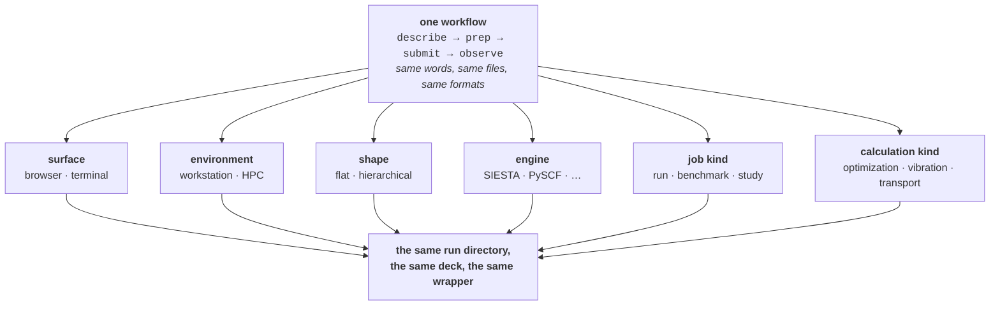
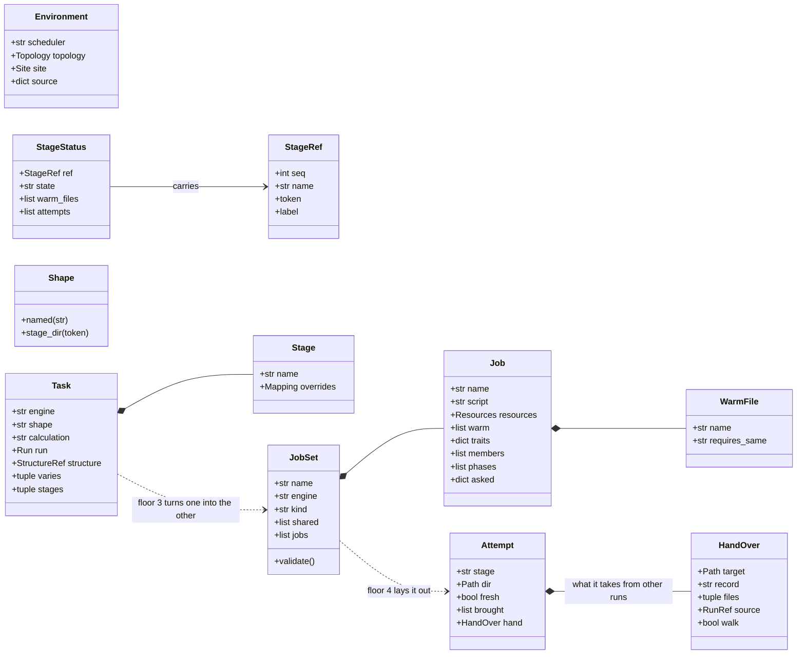
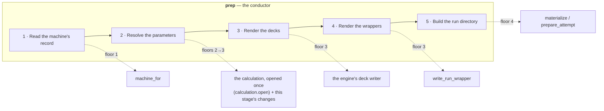
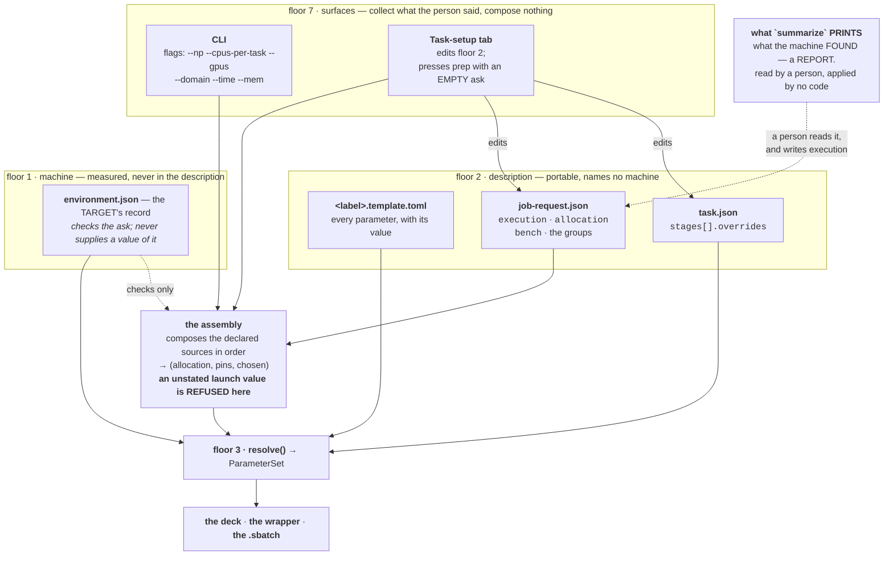
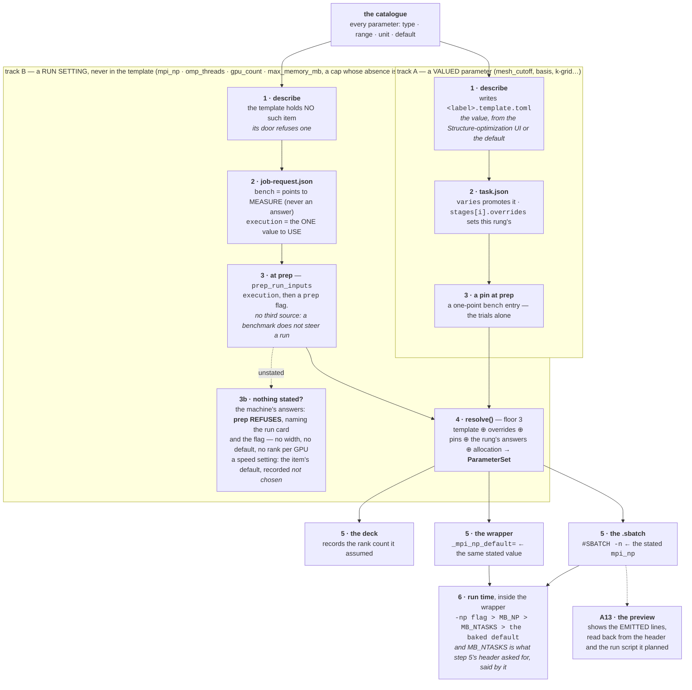
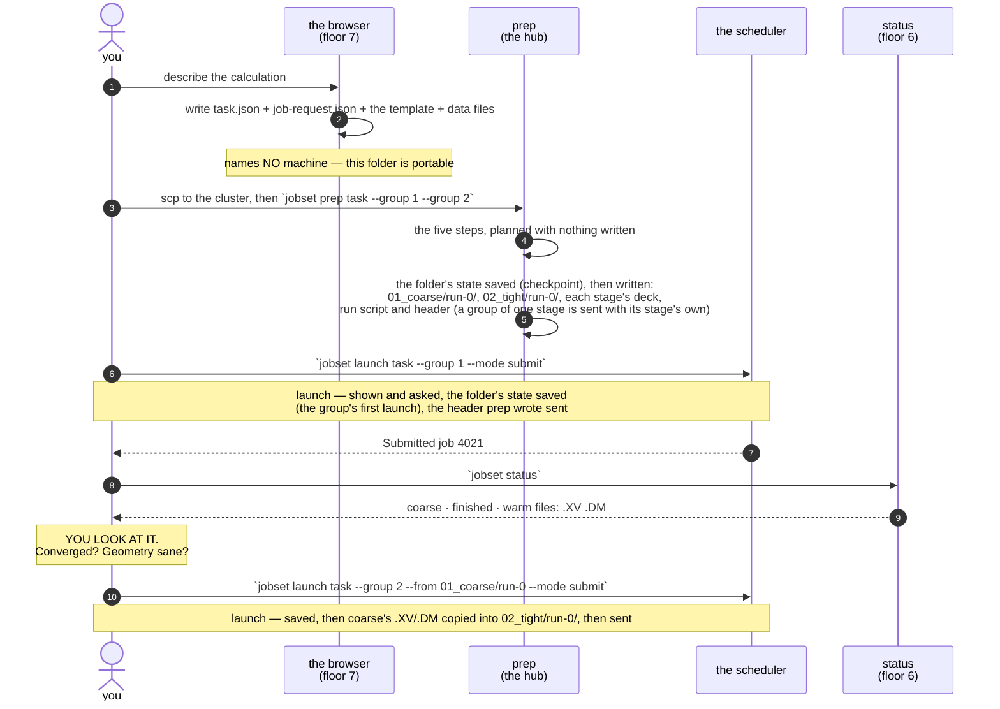
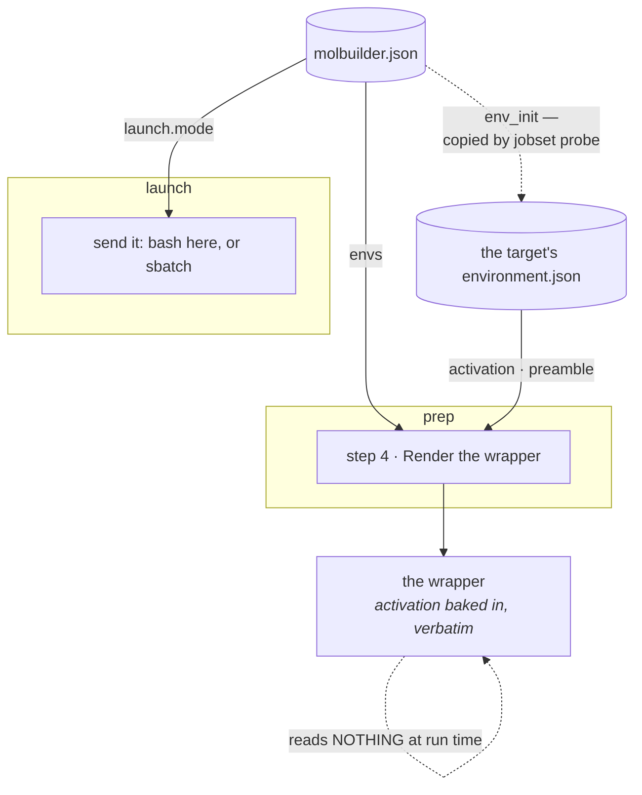
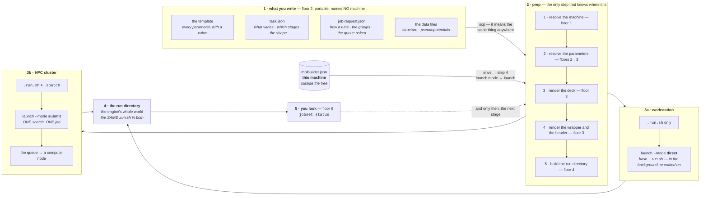
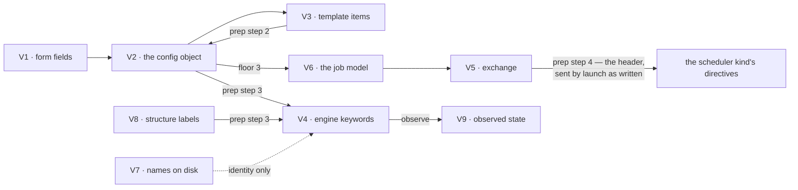

# Execution architecture — who owns which decision

**Role:** contract
**Domain:** execution

**Companions:**
[`execution/overview.md`](?doc=execution/overview.md) — which document to open;
[`execution/project-layout.md`](?doc=execution/project-layout.md) — what a
project directory *is*, and the five steps `prep` runs;
[`execution/job-contracts.md`](?doc=execution/job-contracts.md) — the file
formats and the shared parameter vocabulary;
[`architecture.md`](?doc=architecture.md) — the whole package by **import
depth** (`L1`/`L2`/`L3`), a different and coarser grouping than this one;
[`plans/plan.md`](?doc=plans/plan.md) — how much of this the code holds today.

> **This document says who is allowed to decide what.** It is the authority for
> the execution domain's internal shape: the floors, the objects that travel
> between them, the routes that cross them, and the rules that must never break.
> It says nothing about *when* any of it gets built — that is
> [`plans/plan.md`](?doc=plans/plan.md), and per the doc rules a contract does not
> hold a plan.

---

## 0. The goal: one workflow, flexible in six directions

*Stated 2026-08-11 (user): **"we need a unified and flexible workflow."** Every
rule below serves this; if a rule and this section disagree, this section is what
the rule was for.*

> **There is ONE way to run a calculation, and it bends in six places rather
> than forking into six systems.**



**What each axis is allowed to change, and what it may never touch:**

| axis | what it changes | what stays identical | where it is decided |
|---|---|---|---|
| **surface** — browser or terminal | how you *say* it | the files written (§ 11) | you |
| **environment** — workstation or HPC | one flag, one extra file, two floor-1 facts (§ 9) | floors 2, 3, 4, 6, 7 — and the inner `.run.sh` **byte for byte** | the target's record, probed on that machine (`jobset probe`, its activation **declared** in that machine's `molbuilder.json`) and read at `prep` |
| **shape** — flat or hierarchical | where results sit, and what survives | every rule in `project-layout.md`; only *depth* differs | `task.json`'s `shape`, once |
| **engine** — SIESTA, PySCF, … | which items exist and what keyword each becomes | the template format, the routes, the verbs, the layout | its items in the catalogue, and its record in the engine table (§ 3.3) |
| **calculation kind** — optimization · vibration · transport | the shape it fixes, its rungs and what each does, which rungs run per point, what each of its folders opens, the fields and checks its description carries | the verbs, the floors, the layout's grammar, the run door — one code path for every calculation | its record in the kind table (§ 3.3) |
| **job kind** — run · benchmark · study | **how many configurations get rendered** | every step of `prep`, which loops rather than branches | the length of the `ParameterSet`, at `prep` step 2 |

**One property makes it unified, and it is worth naming because everything else
follows from it:** *every axis is a **value read at one point**, never a branch
that grows a second code path.* A shape is a field somebody set; an environment
is what floor 1 found; an engine is the items the catalogue offers it and its
record; **a calculation kind is its record in the kind table**; **a benchmark is
a list with more than one element.** No axis is a fork.

> **The job kind is a length, not a fork.** `project-layout.md` § 2.3.1a says
> it in words —
> *"benchmarking is `prep` whose parameters are a set rather than a point"* — and
> [`generator.md`](?doc=execution/generator.md) makes it an object, so **a
> production run is that set with one element**. That document owns the data
> spine this axis rides on: schema → template → `ParameterSet` → decks.

> **Why the inner `.run.sh` really can be byte-for-byte, when the two machines
> load software differently** *(user, 2026-08-11)*. How a shell enters an
> environment is **a fact of each machine, in its record** — the `preamble`
> (e.g. `module load mamba/latest`) and the `activation` (`conda activate` /
> `source activate`), recorded by `jobset probe` on that machine
> (`configuration.md` § 5 M-1). A cluster's record names its own; **a
> workstation's names its conda hook**, and then nothing about the emitted
> script differs. So *"what differs between a laptop and Sol"* is **the record,
> not the code path** — which is this section's rule, applied to the one place
> people expect an exception.
>
> The init lines a person *sees* may differ between two machines. That is the
> **data** differing, not a second script.

**And one property makes it flexible: the contract stays small, and the
directory structure carries the variety.** Two reasons for a directory — the
science changed, or you continued (`project-layout.md § 1.5b`) — is the whole
rule, and you can read a folder and know what happened without opening a file.

> **The failure this is written against** is the one that shows up in every
> system that grew instead of being designed: a *web path* and a *CLI path*, a
> *laptop mode* and a *cluster mode*, a *simple* case and a *staged* case — four
> pairs, sixteen combinations, and a bug fixed in one of them. Hence *there is no
> `molbuilder run`* and *there is no `molbuilder fdf`*
> ([`process/conventions.md § 3`](?doc=process/conventions.md)): a second way in
> is the first crack in the first axis.

> #### ⚠ One kind of job is scoped out — stating the rule without it would be
> #### the overclaim this section exists to prevent
>
> **`transport` is a different kind of job** *(the user, 2026-08-11)*, and
> it stays one rather than being bent into a pipeline built for one parameter
> set: `--calculation transport` is one calculation citing a finished junction
> run, whose five stages run inside the job system — each an ordinary
> prep/launch rung, a rung's first launch gathering the files the runs before
> it hand on ([`engines/transport.md`](?doc=engines/transport.md) § 1, § 6.1).
> A `JobSet` still carries no edges: the stages do not chain — a person
> launches each after reading the last, or names several groups at one
> launch, one job launching each in turn (a sequence of groups,
> [`job-system.md`](?doc=execution/job-system.md) § 6.0) — and a bias scan's
> points ride ONE submission, the walk. The full comparison is
> [`process/conventions.md § 3`](?doc=process/conventions.md).
>
> **A benchmark is not a second lifecycle**: it is `prep` whose parameters are
> a set (`project-layout.md § 2.3.1a`), launched and summarized by the same
> verbs; `bench/` holds only the grid (`bench/grid.py`) and the result reader
> (`bench/result.py`).

---

## 1. The one idea: two questions, two different answers

People ask two things about this system, and **an answer to one is not an
answer to the other**:

| the question | the kind of answer | when you find out you were wrong |
|---|---|---|
| *Who is allowed to know about whom?* | a **floor** — about which file may read which | at rest, from a test |
| *What happens, and in what order?* | a **route** — about time | when you run it |

**A floor is a storey of a building.** You may always go *down* and come back
with an answer. You may never go up, and never cut sideways through a wall.

**A route is the path a person walks through those floors to get one job done.**
It visits several floors in an order it chooses, and **that order is allowed to
disagree with the floor numbers** — because *what depends on what* and *what
happens first* are simply different things.

`prep` is a route, not a floor. Giving it a floor number is what once left one
of its five steps with nobody responsible for it: the machine was never resolved
for a staged run at all, because *"resolve the machine"* belonged to something
the floor plan had no room for.

> #### ⚠ Two different things in this repository are called a "layer"
>
> Both are real, and confusing them costs an hour every time.
>
> | | what it controls | who enforces it | the values |
> |---|---|---|---|
> | **import depth** | which file may `import` which | review — `process/code-audit.md` § 1c (e) | `L1` · `L2` · `L3` |
> | **floor** (this document) | which *role* owns a decision | review — `process/code-audit.md` § 1c (e), against § 2.1 (A7) | 1 names … 7 surfaces |
>
> They overlap without matching. `persist` is import-depth **L1** and sits on
> **floor 1** with the other plain facts (§ 2.1 row 1 lists it).
> `identity` is both. `jobset` is one import tier (`L2`) and spans **six**
> floors, 1 and 3–7 (§ 2.1 names each module's: `ledger` and `errors` on 1,
> `_cli` row 7's surface), with the conductors — prep, the launch entry,
> migrate — and the prep assembly beside them.
>
> **In this document, "floor" always means the second.** The import grouping is
> [`architecture.md`](?doc=architecture.md) § 3.

---

## 2. The seven floors

```mermaid
flowchart TB
    subgraph F7["<b>7 · surfaces</b> — ask the person, show the answer"]
      direction LR
      S1["cli.py"]; S2["jobset/_cli.py"]; S3["web/"]; S4["jobs_cli.py"]
    end
    subgraph F6["<b>6 · observe</b> — roll up what happened"]
      direction LR
      O1["jobset/runstatus.py"]; O2["jobset/summarize.py"]
    end
    subgraph F5["<b>5 · launch</b> — start one program"]
      direction LR
      U3["jobset/submit.py"]; U4["jobset/agreement.py"]; U5["jobset/ask.py"]
    end
    subgraph F4["<b>4 · layout</b> — folders, attempts, which run feeds which"]
      direction LR
      Y1["jobset/materialize.py"]; Y2["jobset/continuation.py"]
      Y3["jobset/gather.py"]; Y4["jobset/ready.py"]; Y5["jobset/reuse.py"]
      Y6["jobset/points.py"]
    end
    subgraph F3["<b>3 · plan &amp; render</b> — values, each job's ask, and the text of every file"]
      direction LR
      P1["siesta/stages.py"]; P16["pyscf/stages.py"]; P2["resolve.py"]; P3["bench/grid.py"]; P4["jobset/model.py"]
      P5["siesta/input.py"]; P6["pyscf/input.py"]; P7["runwrap.py"]
      P8["jobset/engines.py"]; P9["jobset/placement.py"]; P10["calculation.py"]
      P11["jobset/plan.py"]; P12["jobset/commands.py"]
      P13["jobset/group.py"]; P14["jobset/shelves.py"]; P15["jobset/transport_rung.py"]
      P17["jobset/naming.py"]; P18["jobset/ladder.py"]; P19["jobset/sweep_reader.py"]
    end
    subgraph F2["<b>2 · description</b> — what the person asked for"]
      direction LR
      D1["task.py"]; D6["job_request.py"]; D2["template_file.py"]; D4["runs.py"]; D5["task_reader.py"]
    end
    subgraph F1["<b>1 · names &amp; plain facts</b>"]
      direction LR
      N1["identity.py"]; N2["scheduler/"]; N3["persist.py"]
      N5["paths.py"]; N6["runfiles.py"]
      N8["calcdirs.py"]; N9["runrecord.py"]; N10["parse/"]
      N11["jobset/ledger.py"]; N12["jobset/errors.py"]; N13["jobset/machine.py"]
      N14["jobset/planned.py"]; N15["joblist.py"]; N16["jobset/sequence.py"]
      N17["template.py"]; N18["warmfiles.py"]; N19["kind_table.py"]; N20["engine_table.py"]
    end
    F7 --> F6 --> F5 --> F4 --> F3 --> F2 --> F1
    F5 -.-> F1
    F4 -.-> F1
    F7 -.-> F3
    PREP["<b>the conductors</b> — <code>jobset/prep.py</code> (prep),<br/>the launch entry and <code>jobset/migrate.py</code><br/><i>not floors: each walks the floors in its own order</i>"]
    PREP -.-> F5
```



Solid arrows are the ordinary way down. **Dotted arrows are allowed shortcuts:**
any floor may reach straight to floor 1, because floor 1 holds plain values and
keeps no state. `launch` asking `identity` for a name is not a violation — it is
floor 1 doing the job it exists for.

### 2.1 What each floor owns, and how you call it

| # | floor | the decision it owns | files | **entry points** | what it writes | it must never |
|---|---|---|---|---|---|---|
| **1** | **names & plain facts** | what a thing is called; what this machine is; what a file — or a run's own records — says; whether a job launched from this machine is going; every parameter an engine takes, and what a file of a template or a warm-files vocabulary says | `identity` · `paths` · `calcdirs` · `runfiles` · `runrecord` · `deck_record` (the grammar of a deck's blocks, and the one door of *the same calculation*, each engine's reading registered by the surfaces — [`job-request.md`](?doc=execution/job-request.md) § 6) · `template` (the catalogue of every parameter and the template format — the template FILE's door is `template_file`, floor 2) · `warmfiles` (the engines' warm-file and scratch vocabularies, and a calculation's own) · `scheduler/` (the record, the probe, the fit, the queue a job names bound to the record; a queue job's cluster, whether the queue lists it and how, its cancel) · `persist` · `parse` · `jobset/ledger` · `jobset/errors` · `jobset/machine` · `jobset/planned` (a plan's writes, as values) · `joblist` (each launch's address, and whether that job is going — `job-system.md` § 6.0a) · `jobset/sequence` (a sequence of groups' launch record — `job-system.md` § 6.0, *A sequence of groups*) · `kind_table` · `engine_table` (the kind table and the engine table, each its data file read once — § 3.3) | `kind_table.kind` · `CalculationKind.on` · `engine_table.engine` (a calculation kind's record, its part on one engine, an engine's record — § 3.3) · `resolve_stage_ref` · `stage_token` · `parse_token` · `rung_label` (the label a rung's files are named on — a lead's own stem) · `Shape.named` · `Shape.stage_dir` · `StageRef` · `run_id` · `calcdirs.described` (is a folder a calculation's root — the description's file, by its name, there) · `calcdirs.where` (where a folder is — its calculation, what it is, and the stage, run, trial and point it sits in) · `catalogue` · `select` · `one` · `read_template` · `warm_list` · `is_scratch` / `scratch_families` · `machine_for` (the record read) · `calculation_environment` (the calculation's copy, read) · `require_activation` · `resolve_environment` (the probe's) · `fit` · `place` · `read_json` / `write_json` · `launch_record` / `write_launch` · `ending` · `run_status` · `machine_record` / `set_machine` · `ledger.record` (a verb's decisions, one append each) · `PrepError` · `joblist.write` / `every` / `going_here` / `signal_here` · `joblist.is_going` (the one answer to *is this job going* — its process, or its scheduler's list, `None` where this machine cannot tell — which `molbuilder jobs`, `jobset scratch` and whether a sequence still going holds a group, `ready.held_by_sequence`, ask) · `joblist.inside` (the job a reader runs inside — a group's launch inside a sequence's job — whose runs it reads by their own files) with `joblist.Asked` (each scheduler's cluster, asked once a command) and `joblist.scheduler_of` (the scheduler its calculation's copy of the record names) · `queue.cluster` / `listed` / `cancel` · `sequence.write_record` / `read_record` / `sent` | `environment.json` · `jobset-decisions.log` · `run.json` and a run's markers · a job's address, `<state dir>/jobs/<id>.json` · a sequence's `launch/<seq>.launch.json` | open a calculation — its description, its ladder or its plan (the kind table declares what a kind fixes; it reads no calculation) |
| **2** | **description** | what the person asked for — what to compute (the description) and how and where to run it (the job request, [`job-request.md`](?doc=execution/job-request.md)) — and the run a file belongs to, read with it | `task` · `job_request` (the job request's door) · `template_file` (the template file's door) · `runs` · `task_reader` (the Results tab's reader of a transport calculation's description, registered by the surfaces) | `task.of` · `write_task` · `job_request.of` · `template_file.of` · `derive_run` · `varies_for` · `place_of` · `run_of` · `state_of` · `record_of` · `on_label_at` · `about` · `openable` · `folder_answer` | `task.json` · the template · `job-request.json` | the description: **name a machine**; the job request: **state what is computed** — nothing in one read as the other (A17); the run door: **compose a view over several runs or points** — it answers the one folder it is handed, reading only that folder, the folder its run's launch record lies in, the stage's folder prep wrote its deck in and the calculation's description; it opens no calculation, reads no plan and walks no run of points (§ 3.2) |
| **3** | **plan & render** | asked-for **+ machine** → a list of jobs, **each job's ask, and the text of every file** — and the names that plan gives a stage, a job and their files | `calculation` (the calculation, opened once, with the plan it holds) · `resolve` · `jobset/model` · `jobset/sweep_reader` (the Results tab's reader of a benchmark's plan, registered by the surfaces) · `jobset/naming` · `jobset/ladder` · `jobset/engines` · `jobset/placement` · `jobset/group` · `jobset/shelves` · `jobset/transport_rung` · `siesta/stages` · `pyscf/stages` · `bench/grid` · `siesta/input` · `pyscf/input` · `runwrap` · `jobset/plan` · `jobset/commands` | `calculation.open` · `Calculation.job` (a stage's row in the plan) · `resolve` (template ⊕ overrides ⊕ sweep point ⊕ pins ⊕ the rung's answers → `ParameterSet`) · `JobSet.of` / `write` / `validate` · `warm_declaration` · `stage_home` · `job_dir_names` · `stage_refs` · `run_names` · `open_container` · `upstream_of` · `stage_before` · `fresh_stages` · `engine_seam` · `placed` · `queue_table` · `gpu_request` · `spec_for` (each engine's) · `script_emit.render_deck` / `script_emit.prepare_deck` · `write_run_wrapper` · `render_sbatch` · `command` | `job-set.json` · the decks · `.run.sh` · `.sbatch` · `STAGE-PLAN.md` | **re-decide a value it was handed** |
| **4** | **layout** | where every file sits; which run feeds which; a **run of points** — one run whose rung runs per point (a bias sweep's voltages, a SIESTA vibration's calls), each point in a folder of its own inside the run — its points | `jobset/materialize` · `jobset/continuation` · `jobset/gather` · `jobset/ready` · `jobset/reuse` (a transport calculation that reuses a finished one, `engines/transport.md` § 2a.16) · `jobset/points` (a run of points: its kind's declaration, § 3.3), and each kind's run-of-points declaration | `points_of` · `point_rows` (a run of points' points with their state — § 3.2) · `points_state` · `point_of` (the point a folder is — § 3.2) · `open_run` · `hand_over` · `latest_attempt` · `ever_launched` · `continuation_answer` · `usable` · `gather_sources` · `composed_for_prep` (a transport calculation's junction, composed at prep only while no stage is launched) · `task_state` · `readiness` · `launched_without` · `regrouped` · `first_launch_takes` · `held_by_sequence` (a group a sequence still going holds, `job-system.md` § 6.0) · `scratch_in` · `decide` (the manifest: each group copied in or prepared here, each rung of points' take-over, each transmission point's sharing) · `copy_in` · `takes_over` · `take_into` · `shared_into` | the folder tree; `run-<n>/` | know about a queue |
| **5** | **launch** | start one program | `jobset/submit` · `jobset/agreement` · `jobset/ask` | `check_trial_starts_cold` · the one sender | `launch/` scripts — and through floor 1, `run.json` | decide physics |
| **6** | **observe** | where has it got to — the views a reader is shown, composed over floors 2 and 4 | `jobset/runstatus` · `jobset/summarize` · `jobset/memory` | `views_of` (the views a folder is read with, composed once per answer — § 3.2) · `jobset_status` · `every_run` (the ladder's every run, each with its state and what it opens) · `points_view` (a run of points, as a reader sees it — § 3.2) · `run_answer` (how the run a file belongs to is doing, for a viewer that follows it: a run's file by the run door, a file at a run of points' root by its view) · `render_status` · `render_stage_status` · `job_members` · `run_folders` (every run of a stage on the hierarchical layout, as folders — a run of points' through its declaration's walk, no state asked) · `scratch_answer` (which of a calculation's scratch a run still going keeps; it removes nothing) · `run_summarize_jobset` · `memory.need` · `memory.largest` (the memory a stage, and a job, needs — [`job-request.md`](?doc=execution/job-request.md) § 3.1a) | only `summarize`'s own records — `bench-result.json`, a transport calculation's I–V, a displacement sweep | write anything a run or a prep reads |
| **7** | **surfaces** | asking, and showing | `cli` · `jobset/_cli` · `jobs_cli` · `web` | `molbuilder describe` · `molbuilder jobset {prep,launch,summarize,status,scratch,probe,machines,migrate}` · `molbuilder jobs {status,stop}` · the web blueprints — each appending its verb's decisions to the ledger, except `prep`'s, `launch`'s and `migrate`'s, which their entries append (`launch`'s verb only the refusals it says before it calls its entry; `migrate`'s its refusals) | — | work out a name, a folder, or a launch — **or assemble what a route receives** (A12); **keep a list of a door's fields** — a route serves a door's answer whole, beside the views it adds; **decide which views a folder is read with** — floor 6's `views_of` does; **send a path the page must join** — every path the page opens or sends back is whole, so it joins none — the absolute path the server resolves a request's path to (`files._resolve_within_roots`); a name the page only shows — a run's `run-0`, a stage's folder name, the output a status speaks from — stays a name |

**Every `jobset` module has a floor**, so an import into any of them can be
judged; the table names each. **`kind_table` and `engine_table` are floor 1**:
each reads its data file and imports no kind and no engine — a part that is
code is named in a record and resolved by the floor it lives on (§ 3.3). **A
kind's own modules sit on floors by what they hold**: a run of points'
declaration is floor 4's, whichever kind's it is, so it is never kept beside
what a lower floor reads — the transport rungs' points and what each computes
(`transport/stages`), the phases of a SIESTA vibration, which travel beside
its job (`siesta/vibration_phases`, floor 1). **`parse/` is floor 1**: a reader turns a file, or a run folder's files, into facts and knows no
calculation — which is what lets launch (5) and the layout (4) ask how a run
ended without reaching up. The readers of a calculation's OWN records, which
read through their owners' doors — a transport calculation's `task.json`, a
benchmark's `job-set.json` — sit on those records' floors (`task_reader`,
`jobset/sweep_reader`), and each surface registers them into the parse
registry as it starts (`calculation.register_readers`), which imports
neither. **A run's own records** — `run.json`, its
conclusion marker, `.continued-from`, `.gathered-from` — are floor 1's
`runrecord`, read and written through `persist`; the layout decides where a run
is, not what its records hold. **`jobset/__init__` re-exports nothing**, so
a reader of `jobset.model` loads no conductor.

**The rule that makes it a layering:** *a floor may call down and return up; it
may never reach across.* Floor 5 deciding a rank count that floor 3 already
assumed is that reach, and it once cost a real run.

> **`prep` is not a floor — it is the conductor.** It walks floors 1 → 4 in order
> — and asks floor 6 what each stage's runs held, for the memory its answer
> says ([`job-request.md`](?doc=execution/job-request.md) § 3.1a) —
> and owns no decision of its own, which is why it is drawn beside the stack
> rather than in it. **It may call, but it may never decide**: a value settled
> inside `prep` is a value no floor owns, and that is the shape of the "stomp"
> failures — an allocation re-applied over per-element resources floor 3 had
> already resolved. **Only a surface may import it**; launch plans nothing
> again and compares nothing with it ([`job-system.md`](?doc=execution/job-system.md)
> § 6.0); the gather
> renders a rung's deck now through prep's own assembly
> (`prep_inputs.run_inputs`, `gather.rung_deck_now`). The sequence it walks is
> [`script-preparation.md`](?doc=execution/script-preparation.md) § 3.
> Beside it sit its own assembly (`jobset/prep_inputs.py`, what a prep
> receives — A12) and its entries (`prep_task` and `prep_bench`, which both
> prep doors call and which append the verb's decisions to the ledger;
> `plan_stage` the one member planner both entries — and launch, quiet —
> ask, [`job-system.md`](?doc=execution/job-system.md) § 9.1); a surface
> imports them as it imports the conductor.
>
> **`launch` has an entry of its own, built the same way**: it plans every
> submission with nothing sent, the surface shows the plan and asks, and the
> send carries it out
> ([`job-system.md`](?doc=execution/job-system.md) § 6). It too is imported by
> surfaces only. **Nothing below the two entries imports either**: what a lower
> floor needed from the conductor — the stage namer, the engine seam, the error
> type, the launch-value check — lives on the floor that owns it (§ 3.2), so
> status and a spectra reader never reach the conductor to ask it, and
> launch reaches it only for the comparisons above.
>
> **`migrate` is a conductor too** (`jobset/migrate.py`, `migrate_state`):
> it reads every record of an older calculation once and raw, decides each
> rewrite by asking the floors that own the rule — the description's, the
> plan's, the layout's — and writes nothing until every step has decided;
> its entry appends the verb's line to the ledger. Only a surface imports
> it.

---

## 3. The objects that travel between floors

Each object exists to replace *"work it out again"* with *"ask"*. **An object
belongs to exactly one floor** — the floor whose question it answers — and
travels upward as a return value.



| object | floor | the question it answers, once | who may build one |
|---|---|---|---|
| **`StageRef`** | 1 | *which stage is this?* — an ordinal and a name, together | the resolver, `stage_refs` |
| **`Environment`** | 1 | *what is this machine?* | `resolve_environment` |
| **`Task` / `Stage`** | 2 | *what did the person ask to compute?* | `task.of` |
| **`JobRequest`** | 2 | *how and where did the person ask it to run?* — the scheduler ask, the run cards, the groups, a benchmark's plan, the reports ([`job-request.md`](?doc=execution/job-request.md)) | `job_request.of` |
| **`JobSet` / `Job` / `WarmFile`** | 3 | *what jobs does that mean, on this machine?* | `prep`, from the resolved `ParameterSet` (`resolve.py`) — one `Job` per element |
| **`Resources`** | 3 | *what does this job ask the machine for?* — the fields of [`job-contracts.md § 6.2`](?doc=execution/job-contracts.md), in the exchange vocabulary | **two roles, and they are not the same answer twice.** A **surface** assembles *the ask* from what the person said — `--np`, the Build tab's form — which is what [`generator.md § 4.1a`](?doc=execution/generator.md) means by *"stated in the command, at prep"*. `resolve.py` then produces *the per-element allocation*, the ask ⊕ this sweep point's machine axes, one per `ParameterSet` element. § 4.1's containment (capability ⊇ allocation ⊇ sweep) is exactly the relationship between them |
| **`Shape`** | 1 | *flat or hierarchical — how deep do this calculation's files go?* | `Shape.named`, from the description — never inferred from the disk |
| **`Where`** | 1 | *where is this folder in its calculation?* — its calculation's folder, what it is, its record's role, the stage, run, trial and point it sits in, the run's own folder ([`project-layout.md`](?doc=execution/project-layout.md) § 1.4a) | `calcdirs.where` |
| **`CalculationKind`** · **`Engine`** | 1 | *what does this kind of calculation decide, on this engine — and what is this engine?* — their records in the kind table and the engine table (§ 3.3) | `kind_table.kind`, `CalculationKind.on`, `engine_table.engine` — each table read once from its file |
| **`Run`** | 2 | *which run is this file of, and where are its files?* — its calculation and description, its folder, the label its files are named on, its stage, its run index; its files by role ([`project-layout.md`](?doc=execution/project-layout.md) § 5) | `run_of` |
| **`Declared`** | 2 | *what did this run declare about its atoms?* — the held atoms, regions and annotations, the axis kinds and the cell its atoms were placed in, its stated parameters: its own deck's records | `declared` |
| **`StageHome`** | 3 | *where does this stage live, and what is its number?* — read off the disk: a stage with a folder keeps its number, one without takes the next unused ([`project-layout.md`](?doc=execution/project-layout.md) § 4.2) | `stage_home` |
| **the launch record** | 1 | *was this run launched — how, where, from what?* — its `run.json`, read through `persist`, its schema checked, as a mapping | `launch_record` |
| **`Ending`** | 1 | *did this run end on its own, and how?* — molbuilder's marker for that run (it carries the exit code); a run our wrapper did not run is not a run of ours | `ending` |
| **`Continuation`** | 4 | *what does this run start from?* — the run it continues from (by default or named) or none (cold), what that run was, **and the files it carries** | `continuation_answer` |
| **`Placement`** | 1 | *where does this job go?* — the queue the job names, bound on the target's record (its partition and QoS), and its fit there: the nodes that hold its whole request and each limit it is over | `scheduler.place.place`; floor 3's `jobset.placement.placed` asks it and records on the job the queue's name, partition and QoS, and where each value came from |
| **`Attempt`** | 4 | *which try is this, and what was put in it?* | `open_run` — the one opener of a run folder (a stage's attempt, a trial's, a bias point's) |
| **`Plan`** | 1 | *what will this prep — or this launch — write?* — every file's text and every folder, decided with nothing written, then written in order by `Plan.carry_out` after the save | `jobset/planned.py` — made by the prep entry (`prep_task`, `prep_bench`), filled by `prep_calculation` through `plan_stage`; a launch's is its `LaunchPlan.writes`, carried out by `send_launch` |
| **`LaunchPlan`** | the launch entry's | *what will this launch send?* — every submission, its members, their attempts, the exact lines and what the send writes | `plan_launch` |
| **`StageStatus` / `JobSetStatus`** | 6 | *where has this got to?* | `jobset_status` |

**A `Job` names no other `Job`.** It declares `warm` — *what* it would take from
a run it continues, and the condition on each — and never *from whom*. Which run
that is, is named by a person at `prep`. `traits` holds the values a condition is
compared against: SIESTA puts its optimizer there, so a conjugate-gradient
history is not handed to a Broyden stage.

### 3.1 An object travels whole — the other half of "one owning function"

The table above answers *who may build one*. **This section answers who may take
one apart, and the answer is nobody.**

> **An object crosses a floor boundary as itself.** A function that consumes one
> takes the object; it never takes a hand-picked list of its fields, and a
> caller never destructures one to call it.

**This is A4 seen from the receiving end, and without it A4 buys nothing.** One
owning function guarantees the object is *assembled* correctly and says nothing
about what survives the call — so a structure built whole on floor 3 can still
arrive on floor 5 with two of nine fields missing, and every rule above is
satisfied while the artifact is wrong.

**The failure it forbids, in the form it actually takes.** A door with N loose
keyword arguments has 2^N ways to be called and one that is right. Every caller
re-derives which subset matters, so the doors disagree by construction — and the
disagreement is invisible, because a missing field is indistinguishable from a
field whose value happens to be the default:

| | asked for | wrote |
|---|---|---|
| `jobset/prep.py` | 16 ranks × 8 cores | `.sbatch -c 8` · `.run.sh` OMP default **1** |
| `web/blueprints/build.py` | 16 ranks × 8 cores | `.run.sh` OMP default 8 · `.sbatch` **no `-c`** |

*(Measured 2026-08-17. Two call sites of one door, eleven loose arguments, ten
passed by one and five by the other — each correct about one artifact and wrong
about the other. The same door had already lost `max_memory_mb` this way on
2026-08-11; that fix moved the field onto `Resources` and left the calling
convention alone, so the class stayed open and fired again four days later.)*

**What stays loose, and why that is not a hole.** A parameter that belongs to the
*invocation* rather than to the *job* is not part of any object: `--env` is a
per-call override, `emit_sbatch` is a surface's choice about what to write.
The test is ownership — if a field has a home in § 3's table, it arrives in that
home or not at all.

**Two names for one fact stay two names.** `job-contracts.md` § 6.2 keeps
`omp_threads` and `cpus_per_task` distinct because they are read by different
layers, and this rule does not merge them. It removes the thing that made the
distinction dangerous: with the object passed whole, *which* name a door uses
internally is its own business, and no caller can supply one and forget the
other.

### 3.2 One door per fact

§ 3 gives each object one owning function (A4). **This gives each FACT one
door** — the facts every verb asks. Two answerers of one fact disagree on
real inputs; the splits this ends, each measured: a stage's number by its
place in the description *or* by the folder on disk; a run's end by
molbuilder's marker *or* by the engine's output; the restart files from the
calculation's own list *or* the shipped one; a GPU job by its count *or* by
`use_gpu`; `run.json` read raw *or* through `persist`.

| the fact | its door | floor | every reader asks it — among them |
|---|---|---|---|
| **a stage's number and folder** | `stage_home(base, task, stage)` — the number on disk for a stage that has a folder (its directory in the hierarchy, its deck's token in the flat shape); the next unused for one that has none ([`project-layout.md`](?doc=execution/project-layout.md) § 4.2) | 3 | prep, launch, status, `#N`, what a stage continues from, the transport record, the displacement sweep, a benchmark's folder, Task setup |
| **prepared** | a stage: `calc.job(stage)` (`Calculation.job`) — its row in the plan (`JobSet.job`, matched by `identity.stage_key`), none with no plan; a benchmark: `prepared_already(calc, "bench", stage)` — its bench folder holds a sweep, the conductor's | 3 (a benchmark's: prep) | prep's gate, launch's gate, status, the plan's merge, Task setup's folder answer, its Save, its commands |
| **ready** | `jobset.ready.readiness(calc, stage)` → `Readiness`: for a prepared stage not launched, **ready to launch** with what its launch would take (its `Continuation`'s line, or each file a transport rung gathers), or **waits for** with the refusal saying what for — the one door that decides what a stage takes (`continuation_answer`, `gather_sources`), asked by launch at a first launch; for a stage not prepared, preparable ([`job-system.md`](?doc=execution/job-system.md), *The task*) | 4 | launch's gate and its offer, `prep task`'s offer, status's table and next step, Task setup's Prep and its group tabs |
| **launched** | `launch_record(where, names, run)` — the run's `run.json` (a flat stage's run's own `<stem>-run<N>.run.json`, the stage's newest run when no number is asked; one with no number, written before 2026-10-06, refused naming `jobset migrate`); one that does not read is an error naming the file, never *launched* or *not launched* | 1 | status, the Run panel, every launch gate, the transport citation |
| **how a run ended** | `ending(where, basename, run)` — the run's own conclusion marker, which carries the exit code; nothing else answers — the engine's own end mark says the engine ended, not the job | 1 | status (its state is built on it), continuation, the frequency stage, the transport gather and citation, a re-launch's plan, the transport record, a benchmark's trials, the viewers through the server |
| **a run to build on** | `usable(state)` — the one status door says it **finished**: it ended on its own with exit code 0 and nothing in its output says the engine stopped (`parse.dirs.run_status`, the door `status` asks; user, 2026-10-06); the default of every hand-over, while a run named with `--from` is taken as said and a structure can be stated relaxed ([`job-system.md`](?doc=execution/job-system.md) § 5.4) | 4 | every hand-over by default: a continuing stage, the frequency stage's geometry, a transport rung's inputs |
| **what a run starts from** | `continuation_answer(...)` → `(Continuation, refusal)`, the files it carries included | 4 | a first launch — checked, written and ledgered as one object — a re-launch, status, Task setup's *Continue from* |
| **a stage launched again** | `relaunch(..., cold=)` → `Continuation` or `None` — warm, its own latest run, however it ended, when it continues from a run of its own (`Job.relaunch_continues`: its kind resumes and it takes something from a run); cold, or a stage that takes nothing, `None` | 4 | launch — opened, written and ledgered as prep's hand-over is — and status, which words what launching again will do from the same fact ([`job-system.md`](?doc=execution/job-system.md) § 5.4) |
| **the restart files** | `warm_list(engine, kind, base)` — the calculation's own `warm-files.toml` first, else the shipped one ([`job-contracts.md`](?doc=execution/job-contracts.md)) | 1 | a job's declaration, status's column, the run script's detection and a bias scan's hand-forward — both written at prep from it |
| **the engine's scratch** | `is_scratch(name)` — whether a file of that name is one of `scratch_families()`: `*<suffix>` for every suffix any engine's shipped vocabulary (`molbuilder/<engine>/warm-files.toml`) names `scratch` — SIESTA's `*.TSGFL`, `*.TSGFR`, `*.contrib.EPSIMG`; PySCF's none — read once a process. It takes no engine: the files are named by what wrote them, and no engine writes another's, so a folder needs no record of its engine for this answer. A calculation's own copy of the vocabulary decides none of it ([`job-contracts.md`](?doc=execution/job-contracts.md) § 4.2a) | 1 | the checkpoint — its save, its status, its restore and every read of a MANIFEST (`state_entries`) — which stores it in neither store and whose restore removes it ([`checkpointing.md`](?doc=execution/checkpointing.md) S1); `jobset scratch`, through `materialize.scratch_in(calc)` and `runstatus.scratch_answer(calc)`; a run of points' take-over (`submit._points_walk`), which copies a done point's files but those; the walk's `empty_scratch`, its `ls`, `du` and `rm` globs rendered from `scratch_families()`; the device's line of `jobset status` (`transport.gf_files`) |
| **the GPU request** | `gpu_request(resources)` → `GpuRequest(uses, count)` — a job's `use_gpu` as `resolve` carries it from the job's own values, and its count; a GPU run with no count, or a count for a run that does not use the GPU, is refused — at prep before anything is written, of the job the stage resolves to (`prep._resolve_stage`; the Task setup card shows the entry's preview of it), by the run card or `--gpus`, either engine ([`gpu.md`](?doc=execution/gpu.md) G5) | 3 | the header, the run script, prep's placement and its queue list, a benchmark's trials, their shelves and their report, the Task setup card |
| **what a queue offers, and how a job fits it** | `Domain.devices`, `node_types` and the record's limits; `fit(row, request)` with the job's whole request — the nodes that hold it, each limit it is over; it refuses nothing ([`scheduler.md`](?doc=execution/scheduler.md) R6) | 1 | prep (the placement, and the one request of every job that walks several members), the queue list, a benchmark's cells, the Task setup card |
| **the shape** | `Shape.named(task.shape)` — asked, never inferred from what is on disk | 1 | every reader of the layout |
| **what a calculation kind is, and what an engine is** *(2026-10-28)* | `kind_table.kind(calculation)` → `CalculationKind`: its name as a person reads it, its rungs' roles and what each computes, whether its stages are linked, its results, what its root and a rung's folder open, what its description carries and the checks it asks, its hand-over; `CalculationKind.on(engine)`, its part on one engine — the shape it fixes and why, the stages it fixes and the ladder a new description starts from, how its stages play the roles, its run of points, its rung's builder, its benchmark, its sum, its retired stages — an engine it does not run on refused, naming those it does; `engine_table.engine(name)` → `Engine`: its name as a person reads it, the setting that names its files, its config class and seam, what it computes in, how its runs run (§ 3.3) | 1 | every reader of a fact of a kind or an engine: the description's reader and `molbuilder describe` (the shape and stages a kind fixes), Task setup's folder answer and hand-over, the catalogue (roles, results), prep (the rung's builder, the benchmark, the seam), the run of points (its declaration), `summarize` (its sum), the preflight (retired stages, the checks), the run door (what a folder opens) |
| **where a folder is** *(2026-10-21)* | `calcdirs.where(folder)` → `Where` — the calculation's folder (`root_of`: the one `task.json` is in, or the one the folder's `calcdir.json` names), what the folder is (the calculation, a stage's, an attempt, a point's, the engine's scratch, a benchmark's, a trial, support), its record's role, the stage, run, trial and point it sits in, and the run's own folder it lies in (`run_folder`, where the run's launch record lies), read off its place in the names the layout gives its folders ([`project-layout.md`](?doc=execution/project-layout.md) § 1.4a, *Where am I*); a folder no calculation claims answers empty | 1 | what a folder is, with its description (`runs.place_of` — the run door, the Results tab's `place`), the checkpoint panel (*is this a calculation's folder*), the transport record's route, whose benchmark a folder is and its stage (`materialize.bench_owner`, `bench_stage_of` — the bench summary, `status`, `launch`) |
| **the run a file belongs to, and its files** | `run_of(path)` → `Run` — where the folder is (`calcdirs.where`; its role, at a root, the description's shape), the description (`task.of`), the label molbuilder's files are named on (the description's; a benchmark trial's `<label>-<point>`, `paths.trial_label`), the stage — the one its folder's path names, else the one a reader asks about in a folder several stages share (`run_of(path, stage)`, a flat calculation's) — and the run index; its files read back with that label through `runfiles`: one by role (`Run.file(role, run)`), its deck (`Run.deck`), the folder prep wrote its files in — its folder with the `run-<n>` level taken out: the stage's, or a bias point's within it; a flat run's and a benchmark trial's own folder (`Run.prepared`) — and there the stage's deck (`Run.stage_deck`) and the check written beside it (`Run.report`, the `.validation.txt` — none once a re-prep has written a deck there that is another calculation), a file named on its label alone, as an engine names its own and a run its result — SIESTA's `.FC` and `.ORB_INDX`, a vibration's `.spectra.json` — (`Run.on_label(role)`; at the root of a run in phases, where the run's own record step writes its result, `on_label_at(folder, role)` — the one door a reader of a stage's result takes, whichever shape the run has, [`engines/vibration.md`](?doc=engines/vibration.md) § 5.11 § 2), its engine output at its run index (`Run.stdout`), every output of its stage newest run first (`Run.outputs`), its session log — the one whose first section is its run (`Run.session_log`). A reader takes a run's files at its one run index, so what it reports never mixes two runs. **A folder speaks for one run**: the highest stage launched, by its launch records — none launched, the folder's one stage with a deck — then that stage's newest run, by one rule (`runrecord.newest_run`): where a stage's runs share the folder, its newest launched run, by its launch records; in a folder of the run's own, its newest try, the highest index its files reached. A file's time decides nothing. A folder that states no place — no `task.json`, no `calcdir.json` naming its root (`calcdirs.where`) — holds no run of ours. What a file is — its catalogue row, or *not written by molbuilder* — is `about(path)`, on the same door *(B11)* | 2 | the Results tab's folder answer and its file card, the run record, the viewers' loads and run answer, the structure reader (an engine's own `.xyz`), `summarize` (a benchmark trial's figures), the transport record, prep (the geometry a relaxation left), continuation (what a run concluded), `xv2xyz`, the transport citation (a cited run's folder) -- status and launch's re-launch ask a run's state by the stem they compose (`run_status`, `ending`) |
| **what a folder opens** | `openable(folder)` → `(path, trail)`, of the one folder it is handed, asked of three of the declarations (§ 3.3): what the folder is (`calcdirs.where`); what its kind declares a folder of that rung opens (the kind table — a transport calculation's root, its description, through which its report is opened; a transmission run's folder, its calculation's report); else the first result role its calculation produces in which the folder holds a file of its run a parser claims (the catalogue, `runfiles.result_roles`) — a container's product the same way, a run of points' root its own result or nothing; a folder no calculation claims, `parse.dirs.openable_in` ([`model/parse.md`](?doc=model/parse.md) § 5.2). What a run of points opens before its own result is written is its view's (below) | 2 | the folder's answer (`folder_answer`), the views (`every_run`, `points_view`), the trajectory load, the structure inspector's record (`/api/results/contract`), the Modify tab's load from a folder, the relaxation record, the transport citation |
| **a run of points' points** *(2026-10-28)* | the run's kind's declaration walks them, `PointsOf.points_in` — each point the run holds, its folder and the point in its one wire form, in the walk's order, nothing asked of a run; `point_rows(run, …)` → those points with their state — done, or as its run reads (`runs.concluded`) — whether it is done and why not, whether its run holds an engine output, what it started from and what it is a copy of. **A run's points are read once per answer**: a view asks `point_rows` once and composes everything it shows from the rows | 4 | the status door (`points_state`), the views (`points_view`, `every_run`), the transport record; `run_folders` (the memory a stage needs) the walk alone, no state |
| **a run of points, as a reader sees it** *(2026-10-28)* | `points_view(calc, run)` → its state and its count in the kind's words (`points_state`), **the point at work** — the point running; else the last, in the walk's order, whose run holds an engine output; none before any has — with that point's record (the run door's `record_of` of the point's folder) and what its folder opens, and **what the run opens**: its own result where its root holds one (`openable` of the root), else the point at work's — the one answer a reader opens wherever this view is served | 6 | `views_of` (below) — `/api/results/dir`; the ladder's row for the run |
| **the point a folder is** *(2026-10-28)* | `point_of(folder)` → the point, in its one wire form, that a folder of a rung with points is: a point's folder, its point; a run of a rung that runs once, its one point; a transmission point's `shared/`, the point it lies in — from its kind's declaration (`points_of`); `None` for any other folder | 4 | `views_of` — a transmission folder's report opened at its point — and the ladder's rows (`every_run`) |
| **the views a folder is read with** *(2026-10-28)* | `views_of(folder)` → `{ladder, points, point}`: what is asked of a folder beyond its own answer, by what it is ([`model/parse.md`](?doc=model/parse.md) § 5.2) — at a calculation's root, its **ladder** (`jobset_status`, each stage's every run, `every_run`, in one wire form); at a run of points' root and each of its points' folders, the **run of points' view** (`points_view`); at a folder of a rung with points, **the point it is** (`point_of`). The calculation is opened once (`calculation.open`) and its description handed to the run door, so one answer reads it once | 6 | `/api/results/dir`, which serves the folder's answer and these beside it, whole; Task setup's folder answer (each stage's runs) |
| **what a run declared about its atoms** | `declared(run)` → `Declared` — from the run's own deck (`Run.deck`): its `atom-metadata` block (held atoms, regions, annotations), its `engine-offset` record (the axis kinds, the cell its atoms were placed in), its stated parameters. The calculation's structure pair is reached only through the description; nothing is looked for beside an output by its name *(B12; D19 is its first reader)* | 2 | `view_of` (below), the codec reading an engine's own structure file (`model/structure-periodicity.md` § 6.0) |
| **what a run says about the structure it ran on** | `view_of(run, output=, traj=, n_atoms=, lattice=)` → `RunView` — three sources, one question: the labels and held atoms its deck declared for a structure of `n_atoms` (`Declared.atom_metadata_for`), the box from its output's `lattice` or its deck's record (`Declared.frame`), and what it says about itself, `info.calculation` and `info.relaxation` (`parse.dirs.run_info` of its deck and `output`); `RunView.structure(elements, positions)` makes one geometry step of the run a `Structure` with all of it. A file no run of ours holds is viewed alone: its lattice and its own record | 2 | the Results trajectory's load (`/api/watch/load`), `xv2xyz --from-run`, the transport citation (a cited run: its result through `openable`, parsed by the registry, its last step viewed) |
| **what molbuilder writes, and what each file is** | `runfiles.WRITTEN` — every file molbuilder writes into a calculation folder, one row each: its name (a role on the label, or a fixed name), where it sits in each shape, what it holds, who writes it and when, its door, its kind; the names a stage will have, per shape (`manifest`), and the glob family (`patterns`) are its readings. A fixed name's owner takes it from the catalogue *(B13)* | 1 | the Task setup card, the Results file card (through `about`), `--cold`'s sweep, [`project-layout.md`](?doc=execution/project-layout.md) § 5 — rendered from it |
| **the machine** | `machine_for(base, target=)` — the record by its scopes, the calculation's copy first; read once per verb and passed whole. The calculation's own copy alone is `calculation_environment(base)` — a copy that does not read is refused by name, never read past to another scope; `None` before the first prep — and the machine's name it carries, `calculation_machine(base)` | 1 | prep and its preview on the Task setup card (`machine_for`, through `jobset.machine.machine_record`), the printed commands (whether the machine takes a queue); launch, read once for the whole launch, `summarize`, the run door and `molbuilder jobs` (`calculation_environment`); the printed commands' mode and Task setup's folder answer (`calculation_machine`) |
| **a stage's resolved values** | `resolve` — the ladder's view is made of its answers, never composed a second way | 3 | prep, the preflight's sequence checks, continuation, the frequency stage's force criterion, the transport gather |
| **the order a structure's atoms are in, and the way back** *(2026-10-14 — [`model/overview.md`](?doc=model/overview.md) § 2.2a)* | the structure's `atom_order`, its order record (null: the user order); `transport.sort.sort_by` into an engine's order, `Structure.restored()` back, the order record's own methods for a result's per-atom rows and atom indices | 1 | prep, the transport composer, the codec (which refuses to write a remapped structure but for an engine's record), every door that writes for a person, the run door, the vibration finish, the transport record and report |
| **a run's order record** *(2026-10-14)* | its deck's ATOM-METADATA block, through `runs.declared(run)` | 2 | `runs.view_of` and every door that builds from a run; the vibration finish beside the job, through `deck_record` |
| **a described calculation** *(2026-10-19, A16)* | `calculation.open(base)` → `Calculation`: its description, its job request, its template with its text, and its plan when one is written — read ONCE per verb and passed whole, never the files again; refused in its readers' own words, or as *not a described calculation* (`calculation.refusal`: which of the two records is missing; from one of its stage or attempt folders, the root). **A path a page names** — the calculation's folder, or any file or folder below it — is opened at its root by `calculation.at(path)` (`calcdirs.where`), nothing there refused as `FileNotFoundError`: the transport report's and the exports' doors ask it. A plan with no description beside it is no calculation of molbuilder's: `launch` and `status` refuse it, naming the hand-built sweep's own road | 3 | prep (`prep_task(calc, …)`; its `Described` is this plus prep's later checkpoints), launch (`plan_launch(calc, mode=, bench=…)` — `bench` a benchmark's set with the container it was read from; the send's remake opens the calculation again and reads the bench set again from its container, by design, `job-system.md` § 6.0 step 4 — the one second open of a verb), status (`jobset_status(calc, sweep=)`), summarize, `jobset scratch` (`scratch_answer(calc)`, through `scratch_in(calc)`), the readiness doors (`readiness`, `ladder`, `task_state` take it), `continue_from_choices`, `prepared_already`, `shape_fixed`, `bench_inputs`, the transport record and the displacement sweep, the Task setup tab's routes |
| **the job request** *(2.27.0)* | `job_request.of(base, description)` — the folder's `job-request.json`, `None` when there is none, checked against the description its caller holds; every stage of the description with its entry, or refused naming both files ([`job-request.md`](?doc=execution/job-request.md) § 3) | 2 | `calculation.open` (`Calculation.request`); prep's assembly (`prep_inputs`); the group door (`group`); Task setup's cards; status |
| **the same calculation** *(2.27.0)* | `deck_record.same_calculation(engine, a, b)` → each difference: what the engine computes from two decks, the run settings aside — SIESTA's engine input (`siesta.engine_input`) with every run setting's keyword aside, PySCF's script with its run-settings block, comments and stamps aside ([`job-request.md`](?doc=execution/job-request.md) § 6) | 1 | the transport gather; prep of a launched stage; the run record's `current` and `Run.report` — *is the stage's deck still this run's calculation* |
| **the description** *(A16)* | `task.of(base)` — the folder's `task.json`, `None` when there is none; one written before a rule is refused naming `jobset migrate`; `task.from_text(text, said_as)` reads a description that is not yet a file (the tab's save); whether one is there, without reading it, is the ground floor's answer, `calcdirs.described(base)` — its file, by the catalogue's name, joined to the folder in one place (`calcdirs.description_path`, which `task.path_of` gives its writer) | 2 | `calculation.open`; what a folder is (`runs.place_of`), the Results tab's reader of a transport calculation's description (`task_reader`) |
| **the plan** *(A16)* | `JobSet.of(folder, plan=)` — the folder's `job-set.json`: the root's ladder, or a sweep's in its bench container (`materialize.sweep_set_dirs` lists the containers); `None` when there is none; as a prep's plan leaves it when one is given (`jobset.planned`) — the one read prep makes of the set it is writing | 3 | `calculation.open`; the sweep's door, a bench folder's status, the Results tab's reader of a benchmark's plan (`jobset.sweep_reader`), the Results sidebar; `JobSet.write(folder, plan=)` is its writer |
| **the template** *(A16)* | `template_file.of(base, label)` → `TemplateFile(path, text)`, `None` when there is none; two, or one under another name, refused by name | 2 | `calculation.open`; the writers that need the path (`template_path`) |

**Where two answerers disagreed, the door's answer is the one kept** — a stage
removed after its prep (the numbers), an output that ended with no marker (the
end), a calculation whose own list withholds `.DM` (the restart files), `--gpus`
on a run that does not use a GPU (the request). A door is asked; it is never
worked around.

### 3.3 The declarations — every situation is a record

*(The user, 2026-10-28: "different situations should be mainly driven by
config file and meta data as appropriate, minimize handcrafting code or design
when possible"; "organized data driven branch handling could reduce error and
provide better extensibility".)*

**What differs between one calculation and another — its kind, its engine,
the folder a reader stands in, the file it holds — is a record, and the code
reads the record.** Four declarations answer every such question, each read
through one door on floor 1:

| declaration | what it is the list of | its file · its door |
|---|---|---|
| **the kind table** | the calculation kinds, each with its part on every engine it runs on | `molbuilder/data/kind_table.toml` · `kind_table.kind`, `CalculationKind.on` |
| **the engine table** | the engines | `molbuilder/data/engine_table.toml` · `engine_table.engine` |
| **the file catalogue** | every file molbuilder writes: its role, where it lies in each shape, who writes it and when, its reader, the calculations whose result it is | `runfiles.WRITTEN` · `runfiles` (§ 3.2) |
| **the folder record** | what each folder is — a calculation's root by its description, any other folder by the record its creator stamps on it | `calcdir.json` · `calcdirs.where` ([`project-layout.md`](?doc=execution/project-layout.md) § 1.4a) |

**A fact that has a home keeps it.** The two tables hold what nothing else
declares, and copy nothing that is declared elsewhere: what a file is and its
name — the file catalogue; which settings an engine offers a kind, each
setting's choices and why one is not offered, and the settings retired — the
parameter catalogue (`template`: an item's `engines`, `calculations`,
`offered`, `not_offered`, `RETIRED_ITEMS`); what a run hands on — the
warm-file vocabularies. **The two tables are the lists of kinds and engines**:
every other declaration that names one — a file catalogue row's engine, a
shipped warm-file vocabulary's sections (a kind its engine runs, or a role of
one), the parameter catalogue's engines and each item's kinds
(`calculations`, `citation`, `role`, `shared`, `required`) — is checked
against them when it loads, and a name with no record is refused naming the
file and the key.

**A kind's record** says what is the kind's whichever engine runs it:

- its name as a person reads it — *an optimization*, *a transport
  calculation*;
- its rungs' roles, each named by what the rung does — a transport
  calculation's seed, leads, device and transmission; a vibration's
  relaxation, force constants and optical calls — and what the rung computes:
  an SCF, or a product that runs none (each also the named set of roles a
  catalogue item's `stages` may cite). **Its ladder is read off its roles**
  ([`job-system.md`](?doc=execution/job-system.md) § 5.4): a kind without
  roles is **independent** — one calculation tuned stage by stage, each stage
  continuing from the one before (an optimization's); a kind with roles is
  **linked**, the kind deciding what each stage builds on — the inputs its
  rungs take from the rungs its kind names (a transport calculation's, its
  part naming them), or nothing of another stage, each built on the
  calculation's structure (a vibration's);
- the results it gives, in the order a person decides them, each a card a
  form of the kind draws ([`engines/template.md`](?doc=engines/template.md)
  § 6.2a) — which of them an engine gives is its catalogue items';
- what its root opens where that is not one of its runs' results — a
  transport calculation's, its description, through which its report is
  opened — and what the folder of one of its rungs opens where that is not
  the run's own result: a transmission run's, its calculation's report at the
  point the folder is;
- what its description carries beyond every kind's fields — a transport
  calculation cites a junction instead of holding a structure, states its
  voltages and may extend a finished calculation — what its identity is made
  of, and the label its rungs' files are named on where a rung has its own (a
  lead's);
- the charge it fixes, where it fixes one, and why — a transport junction is
  neutral — read by the electronic state, and by the chemistry check, which
  refuses a stated other;
- why it takes no benchmark, where it takes none — a transport
  calculation's one axis is its bias list;
- which tab hands it over to Task setup (`web/tabs.py`'s key), or, with
  none, that it describes on its own tab, nothing awaiting (a transport
  calculation).

**Its part on each engine it runs on** says what the pair decides:

- the engine's own name for it, where there is one — *TranSIESTA*;
- the shape it fixes and why, in the one sentence every surface says it in
  ([`web/task-setup.md`](?doc=web/task-setup.md) § 4);
- how its stages play the roles: a SIESTA vibration's one stage plays every
  role, a PySCF vibration's stages the force constants', a transport rung its
  own — which fixes its stages: its rungs, every one, in order;
- the ladder a new description starts from, and whether a ladder's tiers
  (`--stage-strategy`) apply;
- whether a rung runs per point, and that run's declaration (a part, below);
- for a linked kind whose rungs take inputs, which rung hands which file to
  which (a part) and the gather that takes them at a first launch (a part);
- the builder of its rung, for a pair with steps of its own (a part);
- what `summarize` adds up for it (a part) — a transport calculation's I–V, a
  SIESTA vibration's displacement sweep;
- the stages a description of it may no longer hold, with the way out
  (`jobset migrate`).

**The engines a kind runs on are its parts**: no second list says which engine
runs which kind, and a kind asked on an engine it has no part for is refused
by the one door, in one sentence naming the engines it runs on.

**An engine's record** says:

- its name as a person reads it — *SIESTA*, *PySCF*;
- the setting that names a calculation's files — `system_label`, `job_name`;
- its config class — the floor-1 dataclass a template is rebuilt into
  (`config/`, a part) — and its seam (a part, floor 3: its deck writer, the
  readers of its warm files and traits, its data files and its shared
  package — `jobset/engines.py`'s `EngineSeam`,
  [`script-preparation.md`](?doc=execution/script-preparation.md) § 4);
- what it computes in — a molecule in free space, whatever the structure's
  cell (PySCF), or the structure's cell;
- its method, where its catalogue offers no choice — SIESTA is a
  density-functional code;
- whether a run is one process with threads (PySCF) or ranks;
- what its run script runs and how — its launch line, its threads, the step
  after the engine, the environment a GPU run activates;
- its stage presets, and whether it has a benchmark lane — the measurement
  pins of a benchmark name its settings.

**A part that is code is named, and lives on the floor that resolves it.** A
record names each as `module:NAME`, and the floor that asks resolves it — the
conductor a rung's builder, the run of points (floor 4) its declaration,
the ladder (floor 3, `jobset/ladder`) a linked kind's inputs, the ready door
its gather, `summarize` (floor 6) its sum, `jobset/engines.engine_seam` the seam for
floor 3 and the surfaces, any floor the config class. The part's module stands
on that floor: it uses that floor and those below, never one above. A module
holding parts of two floors is two modules — a kind's run of points'
declaration (floor 4) is never kept beside facts a lower floor reads, and a
module that travels beside a job holds no part of a higher floor. **Each door
says what it cannot answer**: a table's door reads data only, and refuses a
kind, an engine or a key its file does not hold, naming the file and the key;
the floor that resolves a part refuses a name that does not resolve, naming
the record and the key.

**What stays code, deliberately**, by package, so it can be reviewed:

- **an engine's own modules choose by kind**, because what they choose is
  that engine's language — `siesta/`, `pyscf/`, `config/siesta.py`,
  `config/pyscf.py`, `validation/siesta.py`, `validation/pyscf.py`,
  `parse/engines/`, `parse/coords/`;
- **a kind's own modules choose by engine, and refuse another kind at their
  doors** — `transport/`, and the vibration's `spectra/`;
- **the electronic state's rules about two settings together, by engine** —
  the count of unpaired electrons SIESTA (and TranSIESTA on a transport
  calculation) cannot hold under a treatment
  (`electronic_state.count_must_float`), and SIESTA's odd count under
  restricted, run half-filled (`validation/chemistry`) — a rule of two
  settings is a check, not a choice set ([`engines/template.md`](?doc=engines/template.md)
  § 6.3a), and these are the state's own science, kept beside its
  capability table ([`science/chemistry-correctness.md`](?doc=science/chemistry-correctness.md)
  § 2a.3).

Shared code — every other module — compares no kind's or engine's name (A18):
it asks the record.

**So a new kind is** a record in the kind table, its own modules, its
catalogue items, its file catalogue rows and its warm-file sections; **a new
engine** is a record in the engine table, its config class and seam, its
catalogue items, its file catalogue rows and warm-file vocabulary, and the
environment its runs activate — no branch in shared code changes. A new folder
is its creator's record (`calcdir.json`), a new file a catalogue row.

---

## 4. The four routes

A route owns **an order**, not a floor.

| route | you type | the job it does | its order | floors it visits |
|---|---|---|---|---|
| **describe** | `molbuilder describe` | **write** the portable description and its job request — the template, `task.json`, `job-request.json`, the data files | ask → check → write | **2 only** |
| **prep** | `jobset prep` | assemble a runnable folder **on the machine that will run it** | plan → save → write → record ([`job-system.md`](?doc=execution/job-system.md) § 5.0); the plan is the five steps below, decided with nothing written | 1 → 2 → 3 → 4 |
| **submit** | `jobset launch` | one job becomes one running program | plan → show → ask → send → record ([`job-system.md`](?doc=execution/job-system.md) § 6.0); the send saves the folder's state first at a group's first launch, and sends the header prep wrote | 1 → 4 → 5 |
| **observe** | `jobset status`, `jobset summarize` | answer *where has this got to*, and add up what has landed | newest attempt → read it → add up | 4 → 6 |

> **The first route is named `describe`, and it stops at floor 2.** Rendering
> is `prep` step 3, so describing renders nothing — which is what makes *the
> description names no machine* a structural fact rather than a rule to
> remember. Where a passage elsewhere says *a produce*, it means this route:
> *"a produce is transactional"* reads *"describing a calculation writes every
> file or none"*.
>
> **`jobset scratch` is no route of its own.** Its decision is floor 6's
> `runstatus.scratch_answer(calc)`, which reads and removes nothing: through
> floor 4's `materialize.scratch_in`, every file the one answer names an
> engine's scratch (`warmfiles.is_scratch`, § 3.2) below each stage's folder —
> on the flat layout the calculation's own — and of those, the ones a run
> still going keeps, each with why. It is asked of each RUN, the file's run
> folder (`paths.run_folder_of`): a run is going when a job launched from this
> machine that holds it is going or this machine cannot tell
> (`joblist.is_going`), or when the run door reads it queued or running
> (`continuation.read_run`); a run whose state does not read keeps its
> scratch too, said; a file in no run is free. On the flat layout the runs
> share the folder, so while any stage is going every file is kept. The verb
> shows each kept file and why, asks one question before `--empty` removes
> the rest — a file gone meanwhile passed over — and writes its answer and
> what was removed to the ledger
> ([`job-system.md`](?doc=execution/job-system.md) § 5.3).

`prep` is the important one, and
[`project-layout.md`](?doc=execution/project-layout.md) § 2.3 calls it **the
hub**: you come back to it after every look at a result. **Notice that only
`describe` is off the target machine** — the other three all require it, which
is the whole shape of the split.

### 4.1 `prep` — the same five steps, every time



**The sequence is owned by**
[`script-preparation.md`](?doc=execution/script-preparation.md), which states it
at three resolutions — the decision chain below, these five steps, and the eleven
sub-steps inside step 3. This section says only which floor answers each step.

**The floors never go backwards** — 1 → 2·3 → 3 → 3 → 4 — which is a property to
check rather than a coincidence: `runwrap` renders text from decided values and
sits on floor 3 with the engines' own deck writers.

**Why the order is forced, not chosen:** step 3 cannot precede step 1, because a
script carries values that *depend on how it will be launched* — the rank count
its BENCH-MARKS block records, with the `BlockSize` window that count allows,
and the GPU line written from the job's GPU request, the request that also picks
the environment the wrapper activates (§ 9.2). **A parameter that depends on the launch cannot be decided
before the launch is known.** The full dependency table, pair by pair, is
[`script-preparation.md`](?doc=execution/script-preparation.md) § 4.1.

### 4.2 A worked example, in plain words

Both groups are prepared. You have looked at the coarse stage, you are happy
with it, and you type:

```bash
molbuilder jobset launch task --group 2 --from 01_coarse/run-0
```

Here is what happens, and **who decides each thing**:

| # | what happens | who decides | why it is theirs |
|---|---|---|---|
| — | your words are read | **7 · surface** | asking and showing is its whole job |
| 2 | the calculation is opened once (`calculation.open`): `task.json` — what you asked for, and what the tight stage changes — its template, its job request (`job-request.json`, how each stage runs) and the plan prep wrote (`job-set.json`) | **2 · description**, **3 · plan** | the description is the only thing that knows what you asked for; the plan, what prep made of it on this machine |
| 1 | the calculation's own copy of its machine's record is read, once for the whole launch (`calculation_environment`); a launch never probes and reads no other record | **1 · plain facts** | a fact about that machine, not about your calculation |
| — | *"tight"* is turned into *which stage that is* | **1 · names** | so a name, a number and a token all reach the same stage |
| 3 | what prep recorded it prepared a stage with is compared with what its records give now — by `status` and Task setup, never by launch | **3 · render** | it is text rendered from decided values; an edit since prep is said, and the stage prepared again ([`job-system.md`](?doc=execution/job-system.md), *Changed since prepared*) |
| — | sent to a queue, the line's request is read off the header prep wrote — its queue, wall and memory as they stand there, `--time` the one value a launch may restate; the job is told the wall it is sent with (`MB_WALL_S`) — a run here, its card's | **5 · launch** | prep decided every value; the launch sends what prep wrote |
| — | what was resolved is printed for you, and asked | **7 · surface** | so the send is a plain yes |
| — | the folder's state is saved — the group's first launch | the launch entry's send, through the one save (`checkpoint.save_before`), a file protocol beneath the floors (§ 11) | the state a redo of this group restores, coarse's runs in it |
| 4 | `02_tight/run-0/`, which prep opened, is filled: coarse's geometry is **copied** in; then the job is sent | **4 · layout**, then **5 · launch** | where files sit is the layout's only job; sending is the launch's |

**`launch` decided none of that.** It decided only **the order**. Every answer came
from the floor that owns it, which is what makes it possible to change one answer
without hunting through the others.

**Why coarse's geometry is copied rather than linked, and at the launch** is
[`project-layout.md § 1.6`](?doc=execution/project-layout.md), which owns that
rule and the reasoning behind it. In one line: the engine writes to that very
filename.

---

## 5. The decision chain — the same question, answered as a sequence

§ 2 says **who owns** each decision. This says **in what order** decisions get
fixed, and the two are different views of one rule.

Overlap between modules is fine. A **loop** is not: if two parties can each
overrule the other, nobody can predict the outcome and nobody can test it. So
the whole system is one sequence, and one rule keeps it one:

> **Each step decides within what the steps above it already fixed, and nothing
> later rewrites something earlier.**

| # | who decides | what it fixes | written down in |
|---|---|---|---|
| 1 | the **project tree** | where anything may live — the topics, and `[A-Za-z0-9_-]+` per segment | `job-contracts.md` § 2.5 |
| 2 | the **structure** | which atoms exist — an input, never edited by the generator | `model/structure.md` |
| 3 | **2 + the name you typed**, inside 1's character set | the **id**, tidied once and then quoted by everything after | `run-identity.md` §§ 2–3 |
| 4 | the **schema** | which fields exist, their types and ranges | `web/form-schema.md` |
| 5 | the **description** | the values, which fields vary, the stages and their order | `engines/stages.md` § 6 |
| 5b | the **job request** | how and where each run runs — the queue, wall and memory asked, each run's card, which stages share a job | [`job-request.md`](?doc=execution/job-request.md) |
| 6 | the **preflight** | whether this file can be read here at all | `engines/stages.md` § 6.6 |
| 7 | **validation** | whether it may be written — errors block, per stage, on the resolved whole | `science/validation.md` |
| 8 | the **generator** | the decks and their wrappers: the merge, the cell, the pseudopotentials, BENCH-MARKS | `engines/stages.md` § 7 |
| 9 | the **target's record** | the wrapper's shell — preamble and activation (§ 8.3) | `configuration.md` § 5 |
| 10 | **you** | which stage to run, and when | — this is the point of the whole framework |
| 11 | the **wrapper**, at run time | which statement of ranks and threads applies — a flag given to it, then the scheduler's echo of the header, then the value baked at prep; GPU pinning, the restart banner — never the run's number, which `launch` gives it (`--run N`), nor its wall, which `launch` tells it (`MB_WALL_S`: the wall it is sent with — a run here, its card's) | `running-a-job.md` § 3 |
| 12 | the **engine** | whether warm files are honoured, given those parameters | `job-contracts.md` § 4 |

Read it downward and the tangles disappear:

- **The browser lives in rows 3–5b only.** That is why it never renders a deck or
  computes a cell — those are row 8, and row 8 needs row 9, which is a fact
  about a machine the browser is not on.
- **The id is fixed at row 3 and quoted by everything after.** No later step
  derives it again, which is why tidying it once is a rule rather than a
  tidiness preference.
- **Row 10 is a person, and that is deliberate.** Every earlier row exists to
  make row 10's choice safe; none of them makes it.
- **Nothing in rows 1–8 knows what a cluster is.** *The portable folder names no
  machine* is not a policy anyone has to remember — it falls out of where row 9
  sits.

**Rows 6 and 7 both refuse things, and both belong.** One asks *can this file be
read here at all*, the other *is this a sound calculation*. They are ordered, so
a description aimed at an engine this backend does not have never receives a
lecture about its mesh cutoff first.

### 5.2 Where a VALUE is fixed — the five ladders

§ 5 orders the *decisions*. This orders the **values**, because *"where does
this number come from?"* is the question a person actually asks, and it has
one answer only if nothing appears in two ladders.



#### The full chain, for ONE parameter, birth to artifact

**Every parameter of the calculation already has a value** — that is the
premise, and it is the catalogue's doing. The exceptions are the run settings,
which no template carries (`template.md` § 2, § 6.4): how a run runs is the
job request's, never the description's ([`job-request.md`](?doc=execution/job-request.md) § 2). So
there are exactly two tracks:



**Read the two tracks and the confusion goes away:**

- **Track A never reaches step 6.** A mesh cutoff is fixed by step 4 and
  written into the deck; no run-time chain touches it. *"What if nobody set
  it?"* cannot arise — the template holds a value for every one.
- **Track B is the only place an item has no value in the template, and an
  unstated machine answer has exactly one answer: prep refuses it** *(user,
  2026-10-02: "explicit job config is the only way allowed")* — all but the
  memory cap, `max_memory_mb`, whose absence asks for nothing: no cap is
  written ([`job-contracts.md`](?doc=execution/job-contracts.md) § 6.2). The
  refusal names the two places to state it — the run card (`execution` in
  `job-request.json`) and the prep flag. **An unstated speed setting takes the
  item's default**, recorded *not chosen* ([`job-request.md`](?doc=execution/job-request.md) § 4, the user's
  choice of 2026-10-21): it changes how fast a run goes, never its answer. There is no width of the target, no rank per GPU, no thread count of
  one: each of those was a value nobody stated, and a run is hours before
  anyone finds out which one it got.
- **Step 5's two artifacts carry the one stated value**, which is why the
  `.sbatch` header and the wrapper's baked value agree (A9): when each worked
  out its own default, the header floored
  at `-n 1` while the wrapper read this box's core count — and since step 6
  reads the ranks granted *from that header*, a 64-core node ran the job on
  one rank.

> **This is why nothing at prep may work out a track-B value.** A layer that
> fills one in *"because it must be decided"* decides for the person — a
> sweep's enumerator handed a run's condition answers a rank count the
> condition never stated. So prep maps the names, writes the values, and
> refuses what was not written.

#### A run shows its END POINT, never its inputs

*(User, 2026-09-02: "for run, we cannot have surprises, because this is a long
task and it is unclear until the task finishes. Any implicit discrepancy would
be a disastrous surprise. I suggest for the run card/result, we need to always
explicitly show what would be the end point emitted parameter that at the
execution time used.")*

> **A13 — the run's surface shows its END POINT: the launch values as what it
> will be launched with carries them — the `.sbatch` where a scheduler runs
> it, else the run script — read back from that text by each writer's own
> reader.** Not what you typed; not what the description holds; **what the
> `.sbatch` will carry and what the wrapper will use.**

**Why a run and not a bench.** A benchmark is short by construction and its
answer is the comparison — a trial that ran at the wrong width is a data point
you discard. A run is hours or days, and a wrong width is discovered when it
finishes. So the two surfaces owe different things: the measure card shows
*what will be tried*, and the run card shows *what will be executed*.

**The surprise this exists to stop**: the number a run is executed with
lives two layers below what a person types — in the header and the run
script — and a card showing the description's fields would show an empty one
where the header carries a rank count. Track B's chain (above) is correct
and complete, and it is still invisible unless a surface reads it back out.

**So the preview reads the chain back** — the prep entry stopped before the
save ([`job-system.md`](?doc=execution/job-system.md) § 5.0), line for line
from the text the plan holds: the header's `#SBATCH` lines
(`scheduler.emit.Directives.lines_of`) where a scheduler runs the job — the
run script takes its counts from the allocation there — and on a machine
without one the run script's stated counts (`runwrap.stated_counts`), which it
runs with. A transport bias scan shows its walk's one header — every point
in one job, the points' walls summed, written and placed at prep
(`prep.walk_header_of`) — and a benchmark each shelf's. A value stated
nowhere is not shown blank: the preview is **the refusal prep will give**,
naming where to state it.

**And it is resolved by the emitter, not re-derived.** A13 is A12 applied to
display: a surface that computed the emitted value itself would be a second
implementation of the thing it is reporting, and would agree with the
`.sbatch` only until one of them changed.

**Five kinds, five ladders, weakest first — and no value is in two of
them.**

**The last three are the launch values, and every one of them is stated or
refused** *(user, 2026-10-02: "explicit job config is the only way allowed")*.
Nothing fills one in: not this machine's config (`molbuilder.json` holds no
job value, `configuration.md` § 4), not the target's record (it **checks**
that the queue named exists, and says the ask's fit — the nodes that hold its
cores, memory and GPUs, and whether its wall is past the queue's — and never
supplies a value), not the run script. A value stated nowhere is refused
before prep writes anything, and the refusal names every place it may be
stated.

| kind | example | weakest → strongest | stated nowhere |
|---|---|---|---|
| **physics** | `mesh_cutoff` · basis · k-grid | catalogue default → **template value** → that stage's `overrides` | cannot happen: the template holds a value |
| **deck / speed** | `diag_algorithm` · `block_size` · `use_gpu` | the item's default → **`execution`**, the calculation's then the rung's, in the job request *(a one-point `bench` pin sets only the bench's trials)* | the item's default, recorded *not chosen* ([`job-request.md`](?doc=execution/job-request.md) § 4) |
| **launch shape** | SIESTA's `mpi_np` · cores per rank (`omp_threads`, PySCF's `threads`) · `gpu_count` for a GPU run | **`execution`** → a `prep` **flag** (`--np`, `--cpus-per-task`, `--gpus`) | **refused at prep**, every target |
| **scheduler ask** | `mem` | `allocation` → a `prep` **flag** | **refused at prep** when the target has a scheduler |
| **scheduler ask, per lane** | `time` · `domain` | `allocation` *(the calculation's, and the BENCH's)* → **`execution`** *(this run's)* → a `prep` **flag** — and `time` alone, for a submitted job, a `launch` **flag** | **refused at prep** when the target has a scheduler |

**Prep decides every value; launch restates one.** `--time` on `launch`
restates a submitted job's wall on the `sbatch` line — for a run launched again
that ran out of it — and never stands in for a value prep refused, because prep
refuses before there is anything to launch. The queue, the memory, the ranks,
the cores and the GPUs are prep's alone (the user, 2026-10-17). A benchmark trial's shape is its grid point (`generator.md` § 4.3a); its
queue, wall and memory follow these ladders like a run's. *"A target with a
scheduler"* means a prep that writes a `.sbatch` for it: `prep --no-sbatch`
writes none, and then nothing is asked of a queue.

**Two scheduler asks take a fifth rung, and only these two.** `allocation` is
folded by the shared prep path, so `prep bench` and `prep task` read one `time`
and one `domain` — and the two lanes want opposite things: a trial's steps are
cut so it wants minutes, a run wants days. `execution` carries the run's own
(`job-request.md` § 3.2a). **`mem` does not join them**: a trial and a run compute
the same system and hold about the same amount, so a second home for it would
be a second place to look and no new answer.

**A BENCHMARK DOES NOT STEER A RUN — it informs a person, who decides.**
*(User ruling, 2026-09-02: "the run parameter needs to be explicitly
decided/written … benchmark recommendation should be named such that it is
understood not as a user input but for result presentation.")*

There is no verdict rung in any of the five ladders. `summarize` writes
the report `summarize` prints, beside the `bench-result.json` record; both are **read by a
person and by no code**, and what the run uses is `execution` — which exists
whether or not you ever benchmarked, and a run never requires one
(`job-request.md` § 3.2).

After a benchmark, a run that does not name the winner in `execution` does
**not** use the winner — prep refuses it until a shape is written.

**A choice travels from the person to the machine in four moves, each with
one owner.** The person states it — whether a run uses a GPU and how many,
its ranks and cores, whether its cores are bound to its GPUs. Prep checks it
and writes it: a value stated nowhere, or two statements that disagree — a GPU
run with no count ([`gpu.md`](?doc=execution/gpu.md) G5) — are refused; what
the target's record says of the queue — a GPU on a queue that lists none,
more GPUs, cores or memory than a node holds, a wall past the queue's — is
shown as the job's fit, never a refusal: the scheduler decides
([`scheduler.md`](?doc=execution/scheduler.md) R6). Launch sends what prep
wrote. At run time the run script places it on
what the job was given: the ranks spread over the GPUs the job holds, MPS
where ranks share one; off a scheduler each rank bound to cores of its own,
under one the ranks inside the cores it gave the job. **A placement that costs
is warned about, never refused** *(the user, 2026-10-17: a rank whose cores
sit on another socket than its GPU pays in traffic, and the job goes on)*. A
rung takes a calculation-wide choice only where it reads the item
([`job-request.md`](?doc=execution/job-request.md) § 3.2). The GPU's case, whole,
is [`gpu.md`](?doc=execution/gpu.md).

**Where the UI enters, and it is only two places** — which is § 5's *"the
browser lives in rows 3–5b only"*, restated as values: it **edits floor 2**,
and it **presses prep with an empty ask**, having no flags. Everything between
is the same code the command line runs (A12).

### 5.1 How the chain and the floors line up

They are not a re-labelling of each other — the chain spans domains the floors
do not:

| chain rows | floor |
|---|---|
| 1–2 | outside this stack — the project tree and the structure model |
| 3 | **1 · names** |
| 4–5 | **2 · description** |
| 6–7 | outside — preflight and validation are their own contracts |
| 8 | **3 · plan** (and the engine renderers it calls) |
| 9 | **3 · plan & render**, at `prep` step 4 |
| 10 | **7 · surfaces** |
| 11–12 | outside — the wrapper and the engine, at run time |

**Six of the twelve rows sit outside the floors** (1–2, 6–7, 11–12), and
that is the honest answer rather than a gap: this stack is about turning a description into a
running job, and the structure model, the form schema and the science
validators are separately-owned contracts that hand it their results.

---

## 6. The whole workflow, once through



**The pause before the last three steps is the design, not a gap in it.** It is
where the judgement goes that no data structure can hold: *is this result worth
building on?* A stage is a long job, and one that continues by itself can spend a
week refining a geometry you would have rejected in a minute.

---

## 7. The rules that must never break

Each is written so it can be **checked**, because a rule nobody checks is a wish.

> **A1, A4, A7, A8 and A11 are checked by review, not by a test.** A test that
> asserts the shape of the repository rather than a result goes red when the
> layout moves, not when the code is wrong (`process/testing.md` § 3b). The
> property each row states is what a reviewer reads the diff for.
>
> **They are not equally checkable.** **A7 is partly mechanised** — its row
> says where, and where not. **A8 is stated as a set operation on names and is
> still not decidable**: the intersection is computable, and what it computes
> is not the rule, because § 3.1's carve-out for a parameter that belongs to
> the invocation rather than to the job is semantic — its row records the
> checker that was built and rejected. **A1 and A4 cannot be checked either**: "assembles `<NN>_<name>`" has no exact definition across f-strings,
> `.format`, `%` and concatenation, and "re-derives" is semantic — two
> functions computing one thing look nothing alike. For those two, *review* is
> not a gap to be closed; it is the honest label.

| | rule | checked by |
|---|---|---|
| **A1** | **one speller for the stage token.** `<NN>_<name>` is assembled in `identity` and nowhere else | **review** (see the note under this table) — the set of modules that spell `<NN>_<name>` must BE `{identity.py}` |
| **A2** | **one layout per calculation**, and nothing guesses which | `test_jobset` — every consumer's layout comes from `Shape.named(task.shape)` |
| **A3** | **a deck and its launch are prepared together.** One prep renders a deck, its run script and its header from one request, and launch sends what prep wrote; nothing reads a launch value back out of a deck ([`job-request.md`](?doc=execution/job-request.md) § 6) | `tests/data/launch_values.toml` (A9) — one prep's header and run script carry the request the deck was rendered with |
| **A17** *(2.27.0)* | **two records, never read as each other.** The description says what is computed, the job request how and where it runs; a value of one is never taken for a value of the other — a template's run setting asking the scheduler, a deck comment standing in for a launch, a run setting making two decks two calculations ([`job-request.md`](?doc=execution/job-request.md) § 1, § 6); an engine library's limits behind a run setting — gpu4pyscf's — are said as a hint, never counted (§ 2 there) | **review**, and the same-calculation door's case table |
| **A4** | **ask, do not work it out again.** Each object in § 3 has exactly one owning function | **review** (see the note under this table) — **all three**: a `StageRef` only by its resolver, and `Attempt` / `Shape` each in one named function |
| **A5** | **a stage's number is worked out, never stored** | `test_task_description`, `test_stage_resolution` |
| **A6** | **once a run has started, its folder never changes** | `test_jobset` |
| **A7** | **nothing depends upwards** — a floor-N file imports floors ≤ N; every `jobset` module has a floor (§ 2.1 names each), and only a surface imports a conductor (prep's entry, launch's, migrate's) or prep's assembly | **review**, both halves (`process/code-audit.md` § 1c (e); user, 2026-09-27: *"a static code review problem"*) — L1/L2/L3 between top-level packages against `architecture.md` § 3's index, and a floor boundary **inside** a package against § 2.1's table (`jobset/` alone holds floors 1 and 3–7, so `runstatus.py` (6) importing `_cli.py` (7) is a finding). What an upward import breaks at run time shows up by itself (a cycle fails the import; a shipped monitor file fails beside the job, `tests/test_monitor_watches_a_live_run_e2e.py`) |
| **A8** | **an object travels whole** (§ 3.1). A door that consumes one of § 3's objects takes the object; its signature may not also name that object's fields, and no caller may destructure one to call it | **review — and the checker was BUILT and rejected, 2026-09-21.** The formulation below is exact and mechanical: read the eleven § 3 classes' fields from their own definitions, read every signature, intersect. Run over the tree it returned **two candidates and zero real violations**, so **the rule currently holds everywhere**. Both candidates collide on `name`: `describe.build_description` takes `Sequence[Stage]` *and* a `name` that its docstring calls *"what the user called this calculation"* — it reads the real stage names off the objects (`tuple(s.name for s in ladder)`), so it is a model citizen that the check flags anyway; `submit._prepare_side_group` takes a `JobSet` and the SHELF's name. Telling those apart needs § 3.1's own carve-out — *a parameter belonging to the invocation rather than to the job* — which is semantic and unreadable from a signature. Shipping it would ship a growing exemption list for correct code, which is what got `test_architecture_rules.py` deleted. The formulation stays here as **what a reviewer computes by hand** |
| **A9** | **two artifacts of one object agree.** Where a single object is rendered into more than one file, the files are checked against **each other**, not only against a test's intent | `tests/data/launch_values.toml` — one prep's `.sbatch` header and `.run.sh` carry the same stated ranks and cores (*the header carries each stated value*) |
| **A10** | **an anchor is declared, never discovered.** A path molbuilder is handed resolves against an anchor its own **spelling** names; no resolver may pick one by trying candidates and taking whichever happens to exist | `test_psml_anchor` — the eight-spelling matrix, and the refusal names the one place it looked |
| **A11** | **one home per root and per name molbuilder writes.** Nothing climbs a parent chain to a root, and nothing re-spells a filename molbuilder itself writes | **review** (see the note under this table) — the set of files that climb to the install root must be `{__init__.py}`; the set that spells `job-set.json` / `task.json`, `{runfiles.py}` -- the catalogue's `JOBSET_FILE` / `TASK_FILE`, which their owners import |
| **A12** | **one assembly per route.** A route's inputs are composed in **one** function, and every surface calls it — a surface may collect what the person said and may render the answer, and may compose nothing. For `prep` the whole verb is one entry per kind, `jobset/prep.py::prep_task` and `prep_bench` | the prep road through both doors — `tests/test_prep_from_the_browser.py` (one prep through each door: the same findings, attempt, agreement and ledger; the preview is the entry stopped before the save; the axis-less bench on both) and `tests/test_task_setup_prep_e2e.py` (the tab previews, then preps the plan it showed) |
| **A14** | **one composer for a run file's name.** `<label>[_<stage>][-run<N>]<role>` is built by `runfiles` and read back by `runfiles.parse`. No call site concatenates a name, spells a role, or invents a counter keyword — see `job-contracts.md` § 2.2a for which door to call | `test_runfile_names` — the generator over the product of its segments: round trip, and what each segment refuses |
| **A15** | **one door per fact.** Each fact in § 3.2 is answered by its door alone; a reader asks it and never works the fact out from the files itself | **review**, and each door's case table — a disagreement found is a row of it |
| **A16** *(2026-10-19)* | **a record is read through its owner's door, and the door takes the folder.** The name of a record molbuilder writes into a calculation — `task.json`, `job-request.json`, `job-set.json`, the template, `run.json`, the warm files, the machine record, the pipeline log, the last-run mark, the ledger — is the catalogue's (`runfiles.WRITTEN`, B13), taken from it by the record's owner alone (`task`, `job_request`, `jobset.model`, `template_file`, `runrecord`, `warmfiles`, `scheduler.record`, `pipeline_log`, `jobset.ledger`); a path to one is formed only by that owner (`task.path_of`, `JobSet.path_of`, `template_path`, `warmfiles.path_of`) -- the description's by the ground floor, which answers whether a folder is a calculation's root without reading it (`calcdirs.description_path`, which `task.path_of` gives its writer), for its writer and for migrate. A reader asks the owner's door with the FOLDER — `task.of`, `job_request.of`, `JobSet.of`, `template_file.of` — and the door forms the path, reads, and answers `None` for a record that is not there: no caller joins the name to a folder, probes the path, or reads its bytes. A verb opens its calculation once (`calculation.open`) and passes the object down — the readiness doors take it, the launch planner takes it, the status door takes it; a function that takes a calculation's folder and reads a record its caller holds is the defect, and its signature carries the object instead. A refusal is the door's, said once (`calculation.refusal`); a boundary — the CLI, a route — translates the kind of exception into its own and never re-words or prefixes it. The one second open of a verb is the launch's send, which plans again from the folder as it is (`job-system.md` § 6.0, step 4). Raw reads exist in `jobset/migrate` alone: the description, the template and the plans are read once (`migrate._Records`) and every step reads the decided bodies; the machine record and the run records are read once each by the step that rewrites them. | **review** against this row at every milestone; `tests/test_calculation_door.py` — the refusals through the one door |
| **A13** | **a run shows its end point.** The launch values the run will be executed with are displayed as what it is launched with carries them — its header where a scheduler runs it, else its run script — read back by each writer's own reader, never re-derived by the surface; a value stated nowhere is the prep's refusal, never a blank | `test_bench_grid_card.py::test_a_run_preview_carries_its_header_line_for_line`, through the browser's door; `tests/test_task_setup_prep_e2e.py` on the page |
| **A18** *(2026-10-28)* | **a situation is a record, never a branch.** What differs between calculation kinds, engines, folders and files is a field of its record — the kind table, the engine table, the folder record, the file catalogue (§ 3.3) — read through its door; shared code compares no kind's or engine's name (`calculation == "transport"`, `engine == "siesta"`). An engine's own modules choose by kind, and a kind's own modules choose by engine and refuse another kind at their doors — listed by package in § 3.3, *What stays code* | **review**, against this row and § 3.3's list at every milestone; the tables' doors — a kind, an engine or a key their file does not hold, refused naming the file and the key; and the floor that resolves a part — a name that does not resolve, refused naming the record and the key |

> **A1, A4, A7 and A8 are about the shape of the source** — who may spell a name,
> who may build an object, who may import whom, who may take one apart — and no
> amount of running the program shows you that. They are checked by parsing
> `molbuilder/` rather than calling it. **Each is a fence, not a proof:** A1
> knows the spellings a person actually reaches for, and A7 judges the files
> § 2.1 names.
>
> **A9 is the one that has to run the program**, and it is here because A8 alone
> would not have caught the 2026-08-17 defect from the outside: both call sites
> were internally consistent, and only the *pair* of files they produced
> disagreed. A rule about signatures cannot see a wrong number in a rendered
> file, so the two rules cover each other — A8 makes the mistake unwritable, A9
> makes it visible if it is written another way.
>
> **A4's unit is the function, not the module.** The owning module legitimately
> builds its own object; what must not happen is a *second* function building
> one — including inside the same file, which a module-level rule would wave
> through.

> **A1 and A14 are two rules.** `identity` owns the stage **token** and the
> run **id** (A1); the filename itself — label, token, counter, role — is
> `runfiles`' (A14). A filename built out of strings by each writer and reader
> gave one file six spellings, only the emitter's right (§ 2.2a of
> `job-contracts.md` has the measurement).
>
> **A14's check is the generator; the call sites are review's.**
> `test_runfile_names` proves the API is total and reversible over its whole
> parameter space, which is what makes a name trustworthy without looking at
> it. A *new* call site building a name by hand beside it is caught by review,
> never by a source fence — a scan of the package's own `.py` is not a test
> (`process/testing.md` § 3b). A name emitted *into* a generated script, where
> the label is a runtime variable, takes its tail from `runfiles.tail`.

> **A10 is the rule the 2026-08-21 Sol failure was missing.** `prep bench`
> refused over pseudopotentials naming
> `…/optimization/Relax/projects/pseudopotential` — a folder assembled out of
> wherever the user happened to be standing. The resolver took a relative
> `psml_lib` and *tried* anchors in turn — the calculation folder, then the
> tree above it, then the working directory — so the same string named a
> different folder on every machine, and the message on a total miss pointed
> at the last candidate rather than at anywhere the user had chosen. **The fix
> is not a better fallback order; it is having no fallback order.** The three
> spellings each name their anchor (`job-contracts.md` § 2.5), and a miss is
> reported against the one anchor the spelling asked for.
>
> **A12 is A4 widened from objects to ROUTES.** A4 says each object in § 3
> has one owning function; A12 says the same of the *input tuple* a route
> consumes. The browser and the command line both prepare runs, and **two
> surfaces that assemble separately do not drift eventually; they drift on
> the first change** — a solver chosen on the run card reaching the header's
> neighbour and not the deck — and nothing about either one looks wrong in
> isolation.
>
> Its contract is stated where the assembly lives: the ask handed in is what
> the person is saying *right now* — the CLI's flags, or an **empty** `Resources()`
> from a surface that has none. Never `None`: the run card and the allocation
> are folded *under* it field by field, and there is no field-by-field merge
> onto nothing.
>
> **And the whole VERB is one entry**:
> `jobset/prep.py::prep_task` (and `prep_bench`) does everything a prep does — the preflight,
> the plan, the save, the attempt, the ledger — and returns what it found and decided as data; the
> command line prints it, the Task setup tab shows it, its preview the same
> answer stopped before the save ([`job-system.md`](?doc=execution/job-system.md)
> § 5.0, § 5.3). A launched stage is prepared again only as the same
> calculation, for its job request ([`job-request.md`](?doc=execution/job-request.md) § 5); one never launched
> is prepared again; what a stage takes from another stage's run is its first
> launch's. A surface that did part of the act itself would skip the rest of
> it. **The assembly lives beside the conductor**, as its own
> (`jobset/prep_inputs.py`, § 2's note: `prep_run_inputs`, `bench_inputs`),
> so both surfaces reach it downward; its refusals are `PrepError`s, which
> each surface shows as they are.

> **A11 is A1 widened from names to roots and filenames.** A1 stops a second
> module *assembling* a name; A11 stops a second module *arriving at* a place —
> by climbing `.parent.parent` to the install root, or by re-typing a filename
> that already has a constant. Both failure modes are the same one: a fact
> with two spellings drifts, and the drift is invisible until the two
> disagree on some machine that is not this one. The roots have one owner
> each — the install root is the package's own self-knowledge
> (`molbuilder.repo_root`), the user's tree is `projects.py`'s
> (`projects_root` / `find_projects_root`), and the per-user config root is
> **`config_dir.config_dir()`**'s. Three roots, three owners, no fourth way to
> reach any of them.
>
> **A FILE's resolver is not a way to reach its ROOT.** Every file under the config root is named by its own format
> owner, which exposes a resolver for it — `configuration.md` § 3.1 lists all
> fourteen. Those resolvers answer *"where is this file"*, and taking
> `.parent` off one of them to get the directory is precisely the climb this
> rule forbids; it is no better for being a climb off a door instead of a path
> string — `record.machine_scope_path().parent` is that climb, and the
> config root is `config_dir()`'s.
>
> *(`envs/builds.py` climbs a parent chain too — to the **nvcc toolchain's**
> root, which is not ours to own. A11 is about molbuilder's own roots.)*

> **A comment citing `2026-08-12 plan A<N>` is not citing this table.** A
> review programme that ran on 2026-08-12 lettered its own items A3…A8, and
> two comments in `jobset/` still cite them (`errors.py`, `prep.py`). That plan is not in the doc set:
> the letters are the programme's own history and **resolve nowhere**, exactly
> as an archived document's section numbers do. They are kept, in that
> one spelling — *"2026-08-12 plan A4"*, never a bare `A4` — because they
> correlate the two sites with each other, which is the only thing they can
> still do. **This table is the only live meaning of an A-letter.** If you are
> following an `A8` from a comment and land on *"an object travels whole"*, the
> comment was not sent here.

---

## 8. Configuration — which floor reads each part

**What `molbuilder.json` may hold, and what each key is for, is
[`configuration.md`](?doc=configuration.md) § 4** — the one list. This section
says only where in the stack each part is read.

**Two things a calculation needs never come from this file** *(user,
2026-10-01 and 2026-10-02)*: a **value of the job** — its queue, wall, memory,
ranks, cores per rank, GPU count — which the job states itself (§ 5.2), and a
**fact about the machine it runs on** — its queues, topology, activation and
preamble — which is that machine's record (`configuration.md` § 5).

### 8.1 Where it is found

**The file has one location** — the config directory (`configuration.md`
§ 2.1c), `$MOLBUILDER_CONFIG_DIR`, else XDG; a `./molbuilder.json` in the
working directory is not read. A malformed file refuses to start rather than
half-configuring something.

### 8.2 Which floor reads each section

| section | read by | reaches |
|---|---|---|
| `launch` | `get_launch_mode` | **floor 7**, `jobset launch` — `mode`, when no `--mode` is given; and floor 3's printed launch lines (`commands.configured_mode`), which state their mode when none is configured |
| `env_init` | `get_env_init` | `jobset probe`, which copies it into the record it writes — what prep then reads (§ 8.3) |
| `envs` | `get_envs`, `get_env_manager` | **floor 3**, `prep` step 4 — the environment name the wrapper activates (`runwrap`, through `diagnostics.get_capabilities().env_for_category`); and the `envs` verbs |
| `paths` | `get_paths` | `projects.projects_root` — every surface |
| `checkpoint` | `get_checkpoint`, `get_checkpoint_engines` | **outside the stack** — the file protocol: the size limit and the always-large families. An engine's scratch, which it never stores and a restore removes, is no config: it is the engines' shipped vocabularies (`warmfiles.is_scratch`, § 3.2) |
| `auth` · `tls` · `rate_limit` · `admin` | `get_auth`, `get_tls`, `get_rate_limit`, `get_admin_emails` | the **server** |
| retired keys (`configuration.md` § 4) | their own refusal | nothing — each is **refused by name**, with what to do instead |

### 8.2a The section registry — the loader's one table

**Everything the loader knows about a section is one row of one table** —
`_SECTIONS` in `runtime_config.py`: the section's validator and whether
provenance may print its values. `_normalise` (the loader),
`config_provenance`'s safe list and `write_config_scope` all consult that table
and nothing else.

**Why one table:** sites that each keep their own partial list of sections
drop a section silently — the file looks configured and, with `admin`
dropped, nobody can be admin, with nothing anywhere saying why. Every section
is validated when the file is read; a malformed one refuses to start.

Two rules fall out of the table:

| rule | what it means for you |
|---|---|
| **an unknown top-level key is refused, never ignored** | a typo'd section name (`"shceduler"`) is an error naming the known sections, not a silently dead block. The one carve-out: a key starting with `_` (the templates' `"_comment_tls"` idiom) is a comment by design |
| **provenance prints only what its row allows** | `config_provenance` (the `config:` lines prep and submit echo and the decision ledger records) shows values only for `launch` and `paths` — never anything near a secret |

*(That the § 8.2 table and the registry name the same sections, both ways,
is a review step, like A1, A4, A7, A8 and A11 in § 7.)*

**What a calculation takes from config, and when.** Two moments: `prep`
step 4 bakes the environment name (`envs`) into the wrapper, with the
activation and preamble from the TARGET's record; `launch` reads `launch.mode`
when no `--mode` is given. Beneath both, each save of the folder's state
(`checkpoint.save_before`) reads the `checkpoint` classification; a
restore's sweep reads none — two records, git's and the target's MANIFEST,
and the one answer to an engine's scratch (§ 3.2) decide what it removes and
copies back; only its question about unsaved work (no `--force`) reads the
classification, through the status
([`checkpointing.md`](?doc=execution/checkpointing.md) I2a). **Nothing
reads config at run time** — the wrapper is self-contained by then
(`job-contracts.md` § 2.1).



### 8.3 The one fact that stops everything

The **activation** has **no default**, and rendering *any* wrapper refuses
without it — not only a cluster one. It is how a shell enters an environment on
the machine the wrapper runs on, so it is that machine's fact, carried by its
record (`configuration.md` § 5 M-1). It is declared once on each machine
molbuilder is installed on, in that machine's own `molbuilder.json` — `envs
init-config` asks for it at install —

```json
"env_init": {"activation": "conda activate",
                      "preamble": "source ~/miniconda3/etc/profile.d/conda.sh"}
```

and `jobset probe --write` copies it into the record it writes. A record without
one is refused at prep, saying where to declare it; to change a copy, change that
machine's `molbuilder.json` and probe again — the probe copies it as it stands,
asking nothing ([`configuration.md`](?doc=configuration.md) § 4).

**Why no default:** the wrapper runs in a non-interactive shell that never reads
your `~/.bashrc`, so `conda activate` is an undefined function unless something
loaded conda's hook first. A guessed default would produce a wrapper that dies
on the compute node with `CondaError: Run 'conda init' before 'conda activate'`
— far from the machine where it could be fixed. Refusing at generate time puts
the error where you can act on it.

---

## 9. The same design on a workstation and on a cluster

**Nothing in §§ 2–4 changes between them.** The same floors, the same routes,
the same five steps. What differs is what **two floors find**, and one flag.

### 9.0 The whole thing in one picture

This is §§ 2–4 and § 8 assembled: what you write, what crosses the wall, and
where the two environments diverge. **Read it left to right and notice that the
divergence starts as late as possible** — everything before `prep` is one path.



**Three things that picture is trying to make obvious:**

1. **Box 1 is byte-identical on both machines.** That is the whole point of floor
   2's *must never name a machine*. `scp` it anywhere and it still describes the
   same calculation.
2. **The divergence is inside box 2 and it is small** — one floor finds different
   facts, and one extra file gets written. Boxes 4 and 5 are the same again.
3. **The dotted arrow at the bottom is a person.** Nothing advances on its own
   (§ 6, and `project-layout.md § 1.6`).

### 9.1 What actually differs — two floors and one flag

| | **workstation** | **HPC cluster** |
|---|---|---|
| **floor 1 — the machine** | detected: `lscpu`, `nvidia-smi` | detected: `scontrol`, `sinfo`, `sacctmgr` — the queues you can reach and their limits |
| **the record must carry** | the activation | the activation **and** the queues |
| **what each run states** | ranks and cores per rank (and a GPU count for a GPU run) | the same, **plus** its queue, wall and memory |
| **floor 5 — how it starts** | `--mode direct`: `bash …run.sh`, in the background unless waited on (`job-system.md` § 6.0) | `--mode submit`: one `sbatch`, one job |
| **what is emitted** | `.run.sh` | `.run.sh` **and** `.sbatch` — the outer one is a header whose body says what the scheduler tells the job in molbuilder's names, then one line calling the inner one |
| **many jobs at once** | a sweep's trials walk in order in one run here | **never** one per trial: a task's launch sends one job — a group, or one stage — and a benchmark's one job per resource shelf ([`generator.md`](?doc=execution/generator.md) § 4.3a), each launch by hand |
| **floors 2, 3, 4, 6, 7** | *identical* | *identical* |

**The wrapper is the same file.** That is the point of the two-layer split: the
inner `.run.sh` owns activation and launch and is byte-identical whether a
scheduler is involved or not, so a run you debugged on your laptop is the run
the cluster performs. *(Checked — `test_jobset::test_the_inner_wrapper_is_byte_
identical_on_both`; that a workstation gets no `.sbatch` at all is the
`launch_values` case table's row *"a run on a machine with no scheduler is
asked for no queue, wall or memory"*.)*

**A workstation's record names a scheduler with no queue** (`workstation`,
[`scheduler.md`](?doc=execution/scheduler.md) § 6a), and no `.sbatch` is
written —
asking for one would be the nanny behaviour this project refuses. **A cluster's
record lists its queues**, and a run prepared for it names one of them, with its
wall and memory, or prep refuses: a header without them is rejected by the
scheduler rather than by molbuilder, so molbuilder refuses first, where the
message is useful (§ 5.2).

### 9.2 The same two commands, on both — a worked pair

You wrote one folder — a two-stage SIESTA relaxation, `coarse` (group 1) then
`tight` (group 2), a CPU run. Here is what the *same* two stages look like in
each place, with nothing edited between them.

**On your workstation** — 8 cores, no queue:

```bash
molbuilder jobset prep task --group 1 --group 2 --np 8 --cpus-per-task 1
molbuilder jobset launch task --group 1 --mode direct      # runs here, in the background
molbuilder jobset status                                   # follow it; look before deciding
molbuilder jobset launch task --group 2 --from 01_coarse/run-0 --mode direct
```

**On the cluster**, after `scp -r bdt-relax/ cluster:~/`, where the cluster's own
record is the probe's:

```bash
molbuilder jobset prep task --group 1 --group 2 --np 16 --cpus-per-task 1 \
                            --domain public --time 2-00:00:00 --mem 64G
molbuilder jobset launch task --group 1 --mode submit
molbuilder jobset status                                   # look before deciding
molbuilder jobset launch task --group 2 --from 01_coarse/run-0 --mode submit
```

*(Stated once instead: the same values in the description — the ranks and
cores on the run card, the queue, wall and memory in `allocation` — and the
prep takes no flags.)*

Each prep prints what it resolved — where the configuration came from, what
it wrote, each stage's run and its own files, what `tight`'s first launch
will take (`coarse`'s newest run, which must have finished, or the run
`--from` names), what each will launch with —
then the launch line ([`job-system.md`](?doc=execution/job-system.md) § 5.3).

**The folder is the same; what you stated at prep is each machine's run**:

| | workstation | cluster | decided by |
|---|---|---|---|
| the machine's **capability** | 8 cores, no scheduler | its nodes and queues, a scheduler | floor 1 — the target's record, read at `prep` step 1 |
| this run's **allocation** | 8 ranks × 1 core | 16 ranks × 1 core, on `public`, 2 days, 64 GB | **you** — the run card or a `prep` flag (§ 5.2) |
| the deck | rendered for 8 ranks | rendered for 16 ranks | floor 3, at step 3 — its BENCH-MARKS records the rank count it was rendered for, with the run script and the header prep writes beside it (A3); a `BlockSize` the run card states is written as given, and the BENCH-MARKS window that count allows is widened to hold it; an unset one is left to SIESTA and draws no window |
| the env the wrapper activates | the CPU environment | the CPU environment | floor 3, at step 4 — the job's **GPU request** (`gpu_request`, § 3.2): its `use_gpu` as `resolve` carries it, and its count — never the deck's solver |
| `.sbatch` | not written | written | floor 3, at step 4, from the target's record naming a scheduler |
| **the template, `task.json`, `job-request.json`** | **byte-identical** | **byte-identical** | — |

**Read the allocation and deck rows together and § 4.1's forced ordering falls
out.** The deck records the rank count it was rendered for, and the wrapper is
written for that deck — so the machine and the allocation are settled before
the deck, and the deck before the wrapper. The solver decides no environment:
the packaged SIESTA runs ELPA on CPU, so `Diag.Algorithm` is a deck keyword
like any other. A GPU run states `use_gpu` and a GPU count on its run card,
and its GPU environment follows from that request on whichever machine runs it
([`gpu.md`](?doc=execution/gpu.md)). That is why `prep` exists at all instead
of the browser finishing the job.

### 9.3 The two shapes are the same on both

The **flat** and **hierarchical** layouts (`project-layout.md` § 1) are a
separate choice from where you run — they are `task.json`'s `shape` field, and
the machine never sees it. Either shape works on either machine: `prep` builds
what you asked for, and `launch` starts one stage of it.

|  | `--mode direct` | `--mode submit` |
|---|---|---|
| **`shape: flat`** | a quick relaxation on a laptop, one directory, only the latest state kept | ordinary — a single production ladder where you keep the checkpoints |
| **`shape: hierarchical`** | ordinary — a laptop where you want to compare stages afterwards | the long mission: every stage and attempt on disk, benchmarked per stage |

**All four cells are normal.** `--mode` is *how the job is launched*; `shape` is
*how the results are kept*. Nothing in the framework infers one from the other,
and a workstation running `hierarchical` is not an unusual thing to want.

---

## 10. The vocabularies, and where one becomes another

**§ 8 answered *which config section reaches which floor*. This answers a
different question: *what language is spoken where, and who translates.***

One fact — *how many cores this job gets* — is called `omp_threads` by a
scientist, `cpus_per_task` by an exchange file, and `-c` by SLURM. Every rename
is a place drift can enter, and **the renames are the joints of the system**: a
new engine, a new scheduler or a new surface is mostly a question of which
vocabulary it speaks and who translates for it.

### 10.1 The nine vocabularies

| | vocabulary | what it names | owned by |
|---|---|---|---|
| **V1** | **form fields** | what a person sets on a surface | [`web/form-schema.md`](?doc=web/form-schema.md) |
| **V2** | **the config object** | the same values as a Python dataclass — `SiestaConfig`, `PySCFConfig` | `engines/`, per engine |
| **V3** | **template items** | the same values **on disk and portable**, each with a `kind` | [`engines/template.md`](?doc=engines/template.md) |
| **V4** | **engine keywords** | what the engine itself reads — `MeshCutoff`, `%block …` | [`engines/siesta.md`](?doc=engines/siesta.md), [`pyscf.md`](?doc=engines/pyscf.md) |
| **V5** | **exchange / scheduler** | what a queue understands — `cpus_per_task`, `-c` | [`job-contracts.md`](?doc=execution/job-contracts.md) § 6.2 |
| **V6** | **the job model** | `JobSet` · `Job` · `Resources` · `WarmFile` | § 3 of this document |
| **V7** | **names on disk** | labels, stage tokens, filenames | [`job-contracts.md`](?doc=execution/job-contracts.md) § 6.3 |
| **V8** | **structure labels** | regions, frozen atoms, annotations | `model/` |
| **V9** | **observed state** | the status envelope · `StageStatus` | floor 6 |

### 10.2 Every point where one becomes another



| translation | where it happens | route · step | who owns it | derivable? |
|---|---|---|---|:--:|
| **V1 → V2** | the schema builder | describe | the web schema builder | ✅ one metadata source |
| **V2 → V3** | writing the template | describe | the template writer | ✅ from the field metadata |
| **V3 → V2** | reading it back | **prep step 2** | `prep` | ✅ the item names the field |
| **V2 → V4** | rendering the deck | **prep step 3** | the deck writer, via `anchor` / `expands` | ✅ the item carries its keyword |
| **V8 → V4** | ATOM-METADATA + `Geometry.Constraints` | **prep step 3** | the deck writer | ✅ |
| **0-based → 1-based** | the single conversion boundary | **prep step 3** | `model/overview.md` | ✅ one point, stated once |
| **V2 → V6** | asked-for + machine → a list of jobs | floor 3, at `prep` | `resolve` (the `ParameterSet`); `prep` writes the `JobSet` from it | ✅ |
| **V2 → V5** | building the job's resources | floor 3, at `prep` | `resolve` — the allocation rides the element, a sweep axis enters only through its declared `MachineTranslation` | ❌ **a maintained table** — § 6.2 |
| **V5 → the kind's header** | building the header | **prep step 4** | `scheduler.emit`, in the target's scheduler kind's language (`scheduler/kinds.toml`) | ✅ from § 6.2 |
| **label → V7** | naming any file | every route | **`identity` and nothing else** (A1) | ✅ |
| **run dir → V9** | reading it back | observe | `run_status` | ✅ |

### 10.3 The rule, and why it is the flexible part

> **One translation per pair, in one place — and it is derivable unless the two
> vocabularies are genuinely independent.**

**Ten of the eleven are derivable**, which is what makes the framework flexible
rather than a maintenance burden: the mapping is carried *on the thing being
translated* — an item's `anchor`, a field's `engine_key`, a label handed to
`identity` — so **adding an engine adds items, not translations.**

**V2 → V5 is the one genuine exception, and it earns it.** A scientist's word
for a resource and a scheduler's word for it are independent languages; neither
can be derived from the other, so § 6.2 keeps a table. **It is also the one that
actually drifted** — a job-set field once read `omp` / `walltime` while every
other exchange file said `cpus_per_task` / `time`. That is not an argument
against the table; it is the argument *for* keeping it in exactly one place.

**What this buys, concretely:**

| you are adding… | what you touch |
|---|---|
| **a new engine** | items in V3/V4 with their `kind` and `anchor`. **No new translation** |
| **a new scheduler** | a block in `scheduler/kinds.toml` and its readers ([`scheduler.md`](?doc=execution/scheduler.md) § 6a) |
| **a new surface** | it reads V3. It never learns V4, and never speaks V5 |
| **a new parameter** | one field's metadata. V1, V3 and BENCH-MARKS all follow from it |

### 10.4 The failure this framework exists to catch

**When a rule about a translation is written in two documents, one copy gets
fixed and the other does not.** That is not hypothetical — it is the single
mechanism behind every cross-document defect found on 2026-08-11:

| the rule | fixed in | left stale in |
|---|---|---|
| *why `required` cannot be checked at `prep`* — the reason rested on `Carry`, deleted 2026-08-10 | `job-contracts.md` § 4.4 (2026-08-10) | `engines/stages.md` § 5 — **found a day later** |
| *the template holds every parameter* | `engines/template.md` | four docs still said *"everything no stage varies"* |
| *BENCH-MARKS and the template come from one source* | — | had fallen **into the archive**, live nowhere |

**So the diagnostic is simple: if you are about to write down how one vocabulary
becomes another, check this table first.** If the pair is already there, the
statement belongs in the owning document and nowhere else — a second copy is a
future inconsistency with a date on it.

---

## 11. How this serves the other contracts

Every contract sentence should land on **one** floor. Where it takes a route to
make several sentences true in order, that is named too — and a sentence that
needs *"either here or there"* to place is a sentence whose owner does not exist
yet.

| contract | the sentence | lands on |
|---|---|---|
| [`run-identity.md`](?doc=execution/run-identity.md) § 2 | one name, tidied once | floor 1 |
| [`engines/stages.md`](?doc=engines/stages.md) § 6.7 | the layout is declared, never guessed | floor 2 writes it, floor 4 reads it |
| [`project-layout.md`](?doc=execution/project-layout.md) § 2.1 | the portable folder names no machine | floor 2's *must never* |
| [`project-layout.md`](?doc=execution/project-layout.md) § 2.3.1 | the five steps, in that order | **the `prep` route** |
| [`project-layout.md`](?doc=execution/project-layout.md) § 2.3.1b | capability at `prep`, allocation as its input | floor 1 resolves capability; floor 5 sends what prep wrote |
| [`project-layout.md`](?doc=execution/project-layout.md) § 1.6 | stages do not chain | floor 3 emits no link; the `launch` route acts on one group or stage — or on several groups named at once, one job whose walk runs each group's own launch (`submit._plan_sequence`) |
| [`job-contracts.md`](?doc=execution/job-contracts.md) § 2.1 | the caller's cwd is the contract | floor 5's wrapper activates and execs, nothing more |
| [`checkpointing.md`](?doc=execution/checkpointing.md) § 2.1 | saving chooses *how*, never *whether* | **outside this stack** — a file protocol beneath all of it, which knows nothing about stages |
