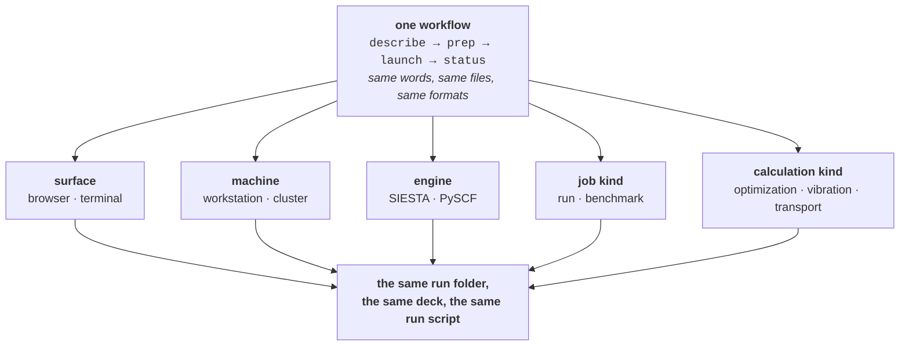
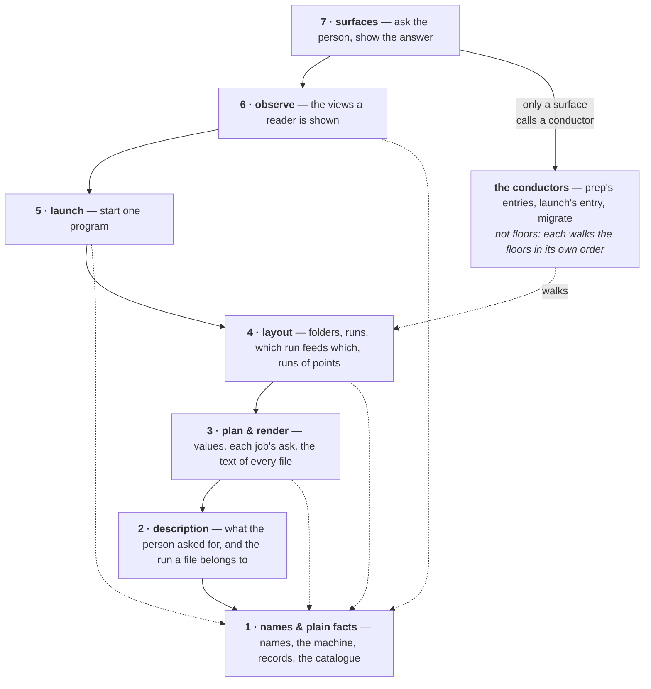
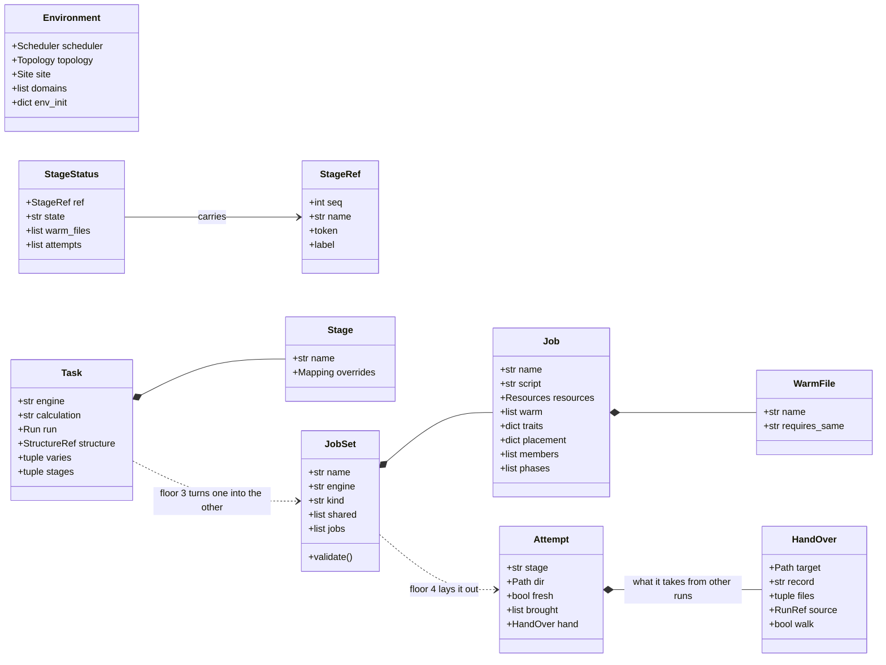
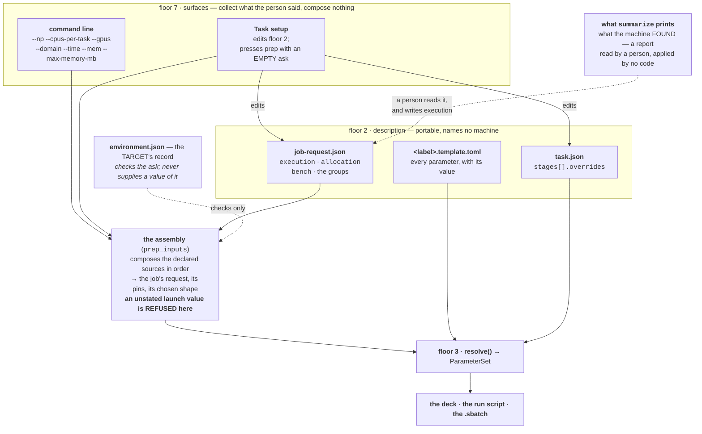
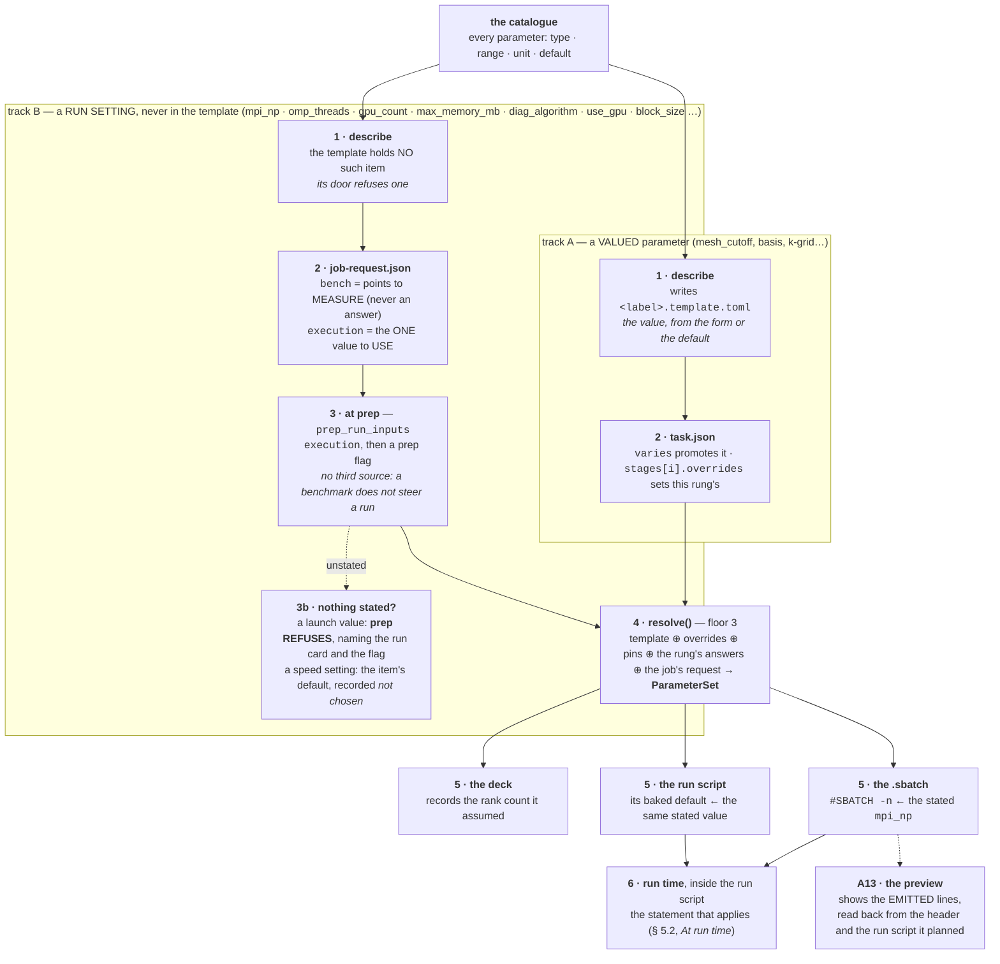
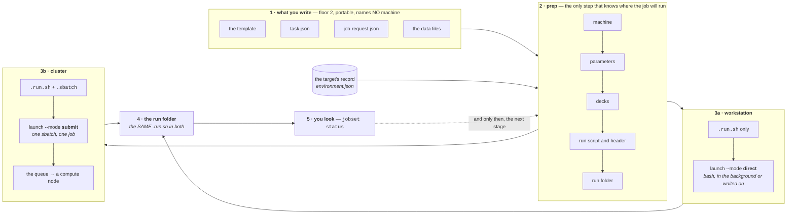
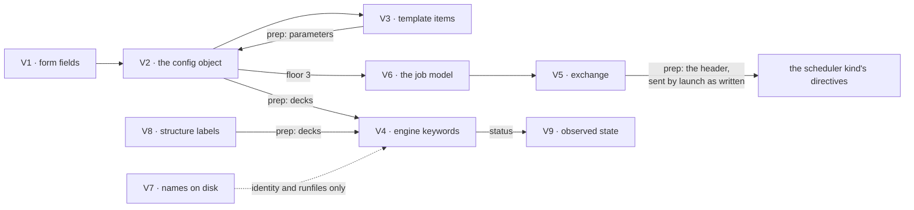

# Execution architecture — who decides what

**Role:** contract
**Domain:** execution
**Owns:** the floors and what each may decide; the objects that travel between
them; the door index — one door per fact (§ 3.2); the declarations (§ 3.3); the
four routes; the value ladder — every launch value stated or refused at prep
(§ 5.2); the rules A1–A18 (§ 7).
**Read with:**
[`script-preparation.md`](?doc=execution/script-preparation.md) (prep's steps and the engine seam) ·
[`job-system.md`](?doc=execution/job-system.md) (the verbs, as a person uses them) ·
[`project-layout.md`](?doc=execution/project-layout.md) (the folder on disk) ·
[`job-contracts.md`](?doc=execution/job-contracts.md) (file formats and names) ·
[`configuration.md`](?doc=configuration.md) (`molbuilder.json` and the machine record) ·
[`architecture.md`](?doc=architecture.md) (the whole package by import depth, L1/L2/L3)

## The short version

- **One workflow** — describe → prep → launch → status — bends in five places and never forks (§ 0).
- **A floor** says which code may know about which; **a route** says what happens when (§ 1).
- **Seven floors**, names (1) up to surfaces (7): call down, never across; the conductors call, never decide (§ 2).
- **Each fact has one door** — a stage's number, *launched*, how a run ended, the machine (§ 3.2, A15).
- **What differs between kinds and engines is a record**, never a branch in shared code (§ 3.3, A18).
- **Every launch value is stated or refused at prep** — nothing fills one in (§ 5.2).
- **The rules** that must never break, and who checks each, are § 7.

**Reading map.** Rules: § 0, § 1, § 5.2, § 7. Design — how it is built and why:
§ 2, § 3, § 3.1, § 4, § 5, § 5.1, § 9, § 10. Developer reference — where to look
in the code: § 2.1, § 3.2, § 3.3, § 8, § 11.

---

## 0. The goal: one workflow, flexible in five directions

*Stated 2026-08-11 (user): **"we need a unified and flexible workflow."** Every
rule below serves this; if a rule and this section disagree, this section is what
the rule was for.*

> **There is ONE way to run a calculation, and it bends in five places rather
> than forking into five systems.**



| axis | what it changes | what stays identical | where it is decided |
|---|---|---|---|
| **surface** — browser or terminal | how you *say* it | the files written (§ 11) | you |
| **machine** — workstation or cluster | how a job is sent (`--mode`), whether a `.sbatch` header is written, and the record's lines that enter an environment (§ 9) | floors 2, 3, 4, 6, 7 — and the inner `.run.sh`'s code path | the target's record, probed on that machine (`jobset probe`) and read at prep |
| **engine** — SIESTA, PySCF | which settings exist and what keyword each becomes | the template format, the routes, the verbs, the layout | its items in the catalogue, and its record in the engine table (§ 3.3) |
| **calculation kind** — optimization, vibration, transport | its rungs and what each does, which rungs run per point, what its folders open, what its description carries | the verbs, the floors, the layout, the run door | its record in the kind table (§ 3.3) |
| **job kind** — run or benchmark | **how many configurations are rendered** | every step of prep, which loops rather than branches | the length of the `ParameterSet`, at prep step 2 |

**One property makes it unified:** *every axis is a value read at one point,
never a branch that grows a second code path.* A machine is what its record
says; an engine is its catalogue items and its record; a calculation kind is
its record in the kind table; a benchmark is a list with more than one element.

**The job kind is a length, not a fork.** A production run is a `ParameterSet`
of one element, a benchmark one of many
([`generator.md`](?doc=execution/generator.md) § 2 owns the set and the
benchmark).

**Why one run script serves two machines that load software differently**
*(user, 2026-08-11)*: how a shell enters an environment is a fact of each
machine, in its record — the preamble (`module load mamba/latest`) and the
activation (`conda activate`) — copied there by `jobset probe`
([`configuration.md`](?doc=configuration.md) § 5, M-1). The run script bakes
those two lines in (`runwrap.env_bootstrap`) and nothing else about it differs:
what differs between a laptop and a cluster is the record, not the code path.
Two machines whose records enter environments the same way get byte-identical
run scripts (§ 9.1).

**And one property makes it flexible: the contract stays small, and the folder
structure carries the variety.** A new folder means the science changed or the
work continued ([`project-layout.md`](?doc=execution/project-layout.md) § 1.6),
so a reader can tell what happened from the folders alone.

**The failure this is written against** is a system that grew instead of being
designed: a web path and a command-line path, a laptop mode and a cluster mode,
a simple case and a staged case — sixteen combinations, and a bug fixed in one
of them. Hence there is no `molbuilder run` and no `molbuilder fdf`
([`process/conventions.md`](?doc=process/conventions.md) § 3).

**Transport and benchmarks bend the workflow; they do not fork it.**

- A transport calculation (`--calculation transport`) cites a finished
  junction run. Its five stages run inside the job system, each an ordinary
  prep and launch, a stage's first launch gathering the files the runs before
  it hand on ([`engines/transport.md`](?doc=engines/transport.md) § 1, § 6.1).
  A bias scan's points ride one submission.
- A `JobSet` carries no edges: stages do not chain. A person launches each
  after reading the last, or names several groups at one launch — one job
  that launches each in turn (a sequence of groups,
  [`job-system.md`](?doc=execution/job-system.md) § 6.0).
- A benchmark is prep whose parameters are a set, launched and summarized by
  the same verbs. `bench/` holds only the result reader (`bench/result.py`).

---

## 1. The one idea: two questions, two different answers

People ask two things about this system, and **an answer to one is not an
answer to the other**:

| the question | the kind of answer | when you find out you were wrong |
|---|---|---|
| *Who is allowed to know about whom?* | a **floor** — which file may read which | at rest, in review |
| *What happens, and in what order?* | a **route** — about time | when you run it |

**A floor is a storey of a building.** You may always go *down* and come back
with an answer. You may never go up, and never cut sideways through a wall.

**A route is the path a person walks through those floors to get one job done.**
It visits several floors in an order it chooses, and **that order may disagree
with the floor numbers**, because *what depends on what* and *what happens
first* are different things.

`prep` is a route, not a floor. A route given a floor number leaves the steps
the floor plan has no room for with nobody responsible for them.

**Two different things in this repository are called a "layer":**

| | what it controls | who keeps it | the values |
|---|---|---|---|
| **import depth** | which top-level package may `import` which | review — [`process/code-audit.md`](?doc=process/code-audit.md) § 1c (e), against [`architecture.md`](?doc=architecture.md) § 3's index | `L1` · `L2` · `L3` |
| **floor** (this chapter) | which *role* owns a decision | review — the same step, against § 2.1's table (A7) | 1 names … 7 surfaces |

No test enforces either; both are review steps (A7). They overlap without
matching: `persist` is import depth L1 and sits on floor 1; `jobset` is one
import tier (L2) and spans floors 1 and 3–7. **In this chapter, "floor" always
means the second.**

---

## 2. The seven floors



**A floor may call any floor below it**; the solid arrows show the stack's
order. **The dotted arrows are the shortcut every floor takes to floor 1**,
which holds plain values and keeps no state: `launch` asking `identity` for a
name is floor 1 doing its job. The conductors (§ 2.2) are called by a surface
and walk the floors in their own order. Which module sits on which floor is
§ 2.1 — the one list.

**The rule that makes it a layering:** *a floor may call down and return up; it
may never reach across.* Floor 5 deciding a rank count that floor 3 already
assumed is that reach.

### 2.1 What each floor owns, and how you call it

| # | floor | the decision it owns | what it writes | it must never |
|---|---|---|---|---|
| **1** | **names & plain facts** | what a thing is called; what a machine is; what a file — or a run's own records — says; whether a job launched from here is going; every setting an engine takes | `environment.json` · `jobset-decisions.log` · `run.json` and a run's markers · a job's address (`<state dir>/jobs/<id>.json`) · a sequence's launch record | open a calculation — its description, its ladder or its plan |
| **2** | **description** | what the person asked for — what to compute (the description) and how and where to run it (the job request) — and the run a file belongs to | `task.json` · the template · `job-request.json` | name a machine in the description; state what is computed in the job request (A17); compose a view over several runs (below) |
| **3** | **plan & render** | asked-for **+ machine** → a list of jobs, each job's ask, and the text of every file — and the names that plan gives a stage, a job and their files | `job-set.json` · the decks · `.run.sh` · `.sbatch` · `STAGE-PLAN.md` | re-decide a value it was handed |
| **4** | **layout** | where every file sits; which run feeds which; a run of points — one run whose rung runs once per point, each point in a folder of its own | the folder tree; `run-<n>/`; `prepared-with.json` (through prep's plan) | know about a queue |
| **5** | **launch** | start one program | `launch/` scripts — and, through floor 1, `run.json` | decide physics |
| **6** | **observe** | where has it got to — the views a reader is shown, composed over floors 2 and 4 | only `summarize`'s own records — `bench-result.json`, a transport calculation's I–V, a displacement sweep | write anything a run or a prep reads |
| **7** | **surfaces** | asking, and showing | — | work out a name, a folder or a launch, or assemble what a route receives (A12); see below |

**The modules on each floor**, with the entry points other floors call:

- **Floor 1 — names & plain facts.**
  - `identity` — the stage token and the run id: `StageRef`, `resolve_stage_ref`, `stage_token`, `parse_token`, `run_id`, `stage_key`.
  - `paths` · `calcdirs` — is a folder a calculation's root (`described`), does it lie inside one or hold one (`calculation_above`, `calculation_below`), where a folder is (`where` → `Where`).
  - `runfiles` — every file molbuilder writes and its name (`WRITTEN`, `compose`, `parse`, `tail`, `manifest`).
  - `runrecord` — a run's own records: `launch_record`, `write_launch`, `ending`, `read_continued_from`, `carried_gather`, `copied_of`, `read_notified`.
  - `runpoints` — a run of points' index and its rules ([`runs-of-points.md`](?doc=execution/runs-of-points.md) § 2.3).
  - `deck_record` — the grammar of a deck's record blocks, and the one door of *the same calculation* (`same_calculation`).
  - `template` — the catalogue of every setting and the template format (`catalogue`, `select`, `one`, `read_template`); the template *file*'s door is `template_file`, floor 2.
  - `warmfiles` — the warm-file and scratch vocabularies (`warm_list`, `is_scratch`, `scratch_families`).
  - `kind_table` · `engine_table` — the two tables, each read once from its data file (`kind`, `CalculationKind.on`, `run_of_points`, `rung_label`, `engine`; § 3.3).
  - `scheduler/` — the machine record (`machine_for`, `calculation_environment`, `calculation_machine`, `resolve_environment`), the probe, the fit (`fit`), the queue a job names bound to the record (`place`), a queue job's cluster, listing and cancel (`queue.cluster`, `listed`, `cancel`).
  - `persist` (`read_json`, `write_json`) · `parse/` (`run_status`) · `wrapper_log` (a run's session log, `log_of_run`) · `monitor_log` (the words of the monitor's two files) · `pipeline_log` (prep's log, written by its two callers, [`script-preparation.md`](?doc=execution/script-preparation.md) § 4.5).
  - `joblist` — each launch's address and whether that job is going (`write`, `every`, `going_here`, `signal_here`, `is_going`, `holding`, `inside`, `Asked`, `scheduler_of`; [`job-system.md`](?doc=execution/job-system.md) § 6.0a).
  - `jobset/ledger` (`record`, `read`) · `jobset/errors` (`PrepError`) · `jobset/machine` (`machine_record`, `set_machine`, `require_activation`) · `jobset/planned` (a plan's writes as values, `Plan`) · `jobset/sequence` (a sequence of groups' launch record: `write_record`, `read_record`, `sent`).
- **Floor 2 — description.** `task` (`of`, `from_text`, `write_task`) · `job_request` (`of`) · `template_file` (`of`) · `runs`, the run door (`run_of`, `place_of`, `state_of`, `concluded`, `record_of`, `on_label_at`, `about`, `openable`, `declared`, `view_of`, `folder_answer`) · `task_reader` (the Results tab's reader of a transport calculation's description).
- **Floor 3 — plan & render.** `calculation` (`open`, `at`, `Calculation.job`) · `resolve` · `jobset/model` (`JobSet.of`, `write`, `validate`, `gpu_request`) · `jobset/naming` (`stage_home`, `job_dir_names`, `stage_refs`, `run_names`, `open_container`) · `jobset/ladder` (`independent`, `inputs_of`, `upstream_of`, `stage_before`, `fresh_stages`) · `jobset/engines` (`engine_seam`) and each engine's seam (`siesta/seam`, `pyscf/seam`) · `jobset/placement` (`placed`, `queue_table`, `launch_refusal`) · `jobset/group` · `jobset/shelves` · `jobset/rung` (`Rung`, `described_rung`, `structure_for`, `citation_of`) and the SIESTA vibration's rung builder (`spectra/siesta_rung`) · `transport/stages` · `describe` (§ 4) · `jobset/plan` · `jobset/commands` · `jobset/sweep_reader` · `siesta/stages` · `pyscf/stages` · `siesta/input` · `pyscf/input` · `script_emit` (`render_deck`, `prepare_deck`) · `runwrap` (`render_wrappers`, `write_run_wrapper`, `render_sbatch`).
- **Floor 4 — layout.** `jobset/materialize` (`open_run`, `prepare_attempt`, `hand_over`, `gather_into`, `latest_attempt`, `newest_launched`, `runs_launched`, `ever_launched`, `job_folder`, `scratch_in`) · `jobset/continuation` (`continuation_answer`, `usable`, `relaunch`, `point_rows`, `points_state`) · the transport calculation's gather (`transport/gather`: `gather_sources`, `composed_for_prep`) and rung builder (`transport/rung`), on this floor by what they hold — the composed junction and a launched rung's records · `jobset/ready` (`task_state`, `readiness`, `first_launch_takes`, `launched_without`, `regrouped`, `held_by_sequence`) · the transport calculation's reuse of a finished one (`transport/reuse`: the doors `kind_table.REUSE_DOORS` lists, and the writer of an extension, `write_reusing`) and the one way it is described (`transport/describe`: the doors `kind_table.DESCRIBE_DOORS` lists) · `jobset/points` (`points_of`, `point_of`) and each kind's declaration (`transport/points`, `spectra/vibration_points`) · `jobset/prepared_with` (what a stage was prepared with, and what changed since: `values_of`, `changes`).
- **Floor 5 — launch.** `jobset/submit` (the one sender, `_go`; launch's entry, `plan_launch` and `send_launch`, lives in this module and is a conductor, § 2.2) · `jobset/agreement` (`check_trial_starts_cold`) · `jobset/ask`.
- **Floor 6 — observe.** `jobset/runstatus` (`jobset_status`, `every_run`, `points_view`, `views_of`, `run_answer`, `render_status`, `render_stage_status`, `job_members`, `run_folders`, `scratch_answer`) · `jobset/summarize` (`run_summarize_jobset`) · `jobset/memory` (`need`, `largest`) · each kind's sum (`transport/sum`, `spectra/vibration_sum`).
- **Floor 7 — surfaces.** `cli` · `jobset/_cli` · `jobs_cli` · `web`. The verbs: `molbuilder describe`, `molbuilder jobset {prep, launch, status, summarize, scratch, export, probe, machines, migrate}`, `molbuilder jobs {status, stop}`, and the web blueprints. Each appends its verb's decisions to the ledger, but prep's, launch's and migrate's, whose entries append them.

**What floor 2's run door must never do.** It answers the one folder it is
handed, reading only that folder, the folder its run's launch record lies in,
the stage folder prep wrote its deck in and the calculation's description —
and, as every reader of a run's state, the jobs this machine launched that hold
the run (`joblist`). It opens no calculation, reads no plan and walks no run of
points.

**What floor 7 must never do**, beyond the table: keep a list of a door's
fields (a route serves a door's answer whole, beside the views it adds); decide
which views a folder is read with (floor 6's `views_of` does); send a path the
page must join — every path the page opens or sends back is whole (the server
resolves a request's path in `files._resolve_within_roots`), and a name the page
only shows, such as `run-0`, stays a name.

**Every `jobset` module has a floor**, so an import into any of them can be
judged — the lists above name each; the conductors and prep's assembly are
§ 2.2. **`kind_table` and `engine_table` are floor 1**: each reads its data file
and imports no kind and no engine — a part that is code is named in a record
and resolved by the floor it lives on (§ 3.3). **A kind's own modules sit on
floors by what they hold**: a run of points' declaration is floor 4's, whichever
kind's it is; a transport ladder — its rungs, what each takes, its points
(`transport/stages`) — is floor 3's, which the ladder asks; what travels beside
a job — a SIESTA vibration's phases (`siesta/vibration_phases`), a run of points'
index (`runpoints`), its words (`transport/run_words`) — is floor 1's; an
engine's deck modules and `transport/deck` are floor 3's; what a kind's sum
composes — `transport/record`, `tbtnc`, `datafile`,
`spectra/displacement_sweep` — floor 6's. **`parse/` is floor 1**: a reader turns a file, or a run folder's files,
into facts and knows no calculation, which is what lets launch and the layout
ask how a run ended without reaching up. The readers of a calculation's own
records — a transport calculation's `task.json`, a benchmark's `job-set.json` —
sit on those records' floors (`task_reader`, `jobset/sweep_reader`), and each
surface registers them into the parse registry as it starts
(`calculation.register_readers`). **`jobset/__init__` re-exports nothing**, so a
reader of `jobset.model` loads no conductor.

### 2.2 The conductors

**`prep` is not a floor — it is a conductor.** It walks floors 1 → 4 in order,
and asks floor 6 what each stage's runs held, for the memory its answer says
([`job-request.md`](?doc=execution/job-request.md) § 3.1a). It owns no decision
of its own, which is why it is drawn beside the stack. **It may call, but it
may never decide**: a value settled inside prep is a value no floor owns — the
ask applied again over the per-element requests floor 3 had already resolved is
that failure. This is rule **W1** of
[`script-preparation.md`](?doc=execution/script-preparation.md) (§ 2.3 there),
stated here.

- **The entries.** `jobset/prep.py`'s `prep_task` (a task's groups) and
  `prep_bench` (one stage's benchmark) — what both prep doors call, each
  appending the verb's decisions to the ledger.
- **The member planner.** `prep.plan_stage` plans one member — its inputs,
  step 2, its launch values stated and placed, the steps
  (`prep_calculation`) — into the prep's one plan. Both prep entries ask it;
  launch does not.
- **The assembly.** `jobset/prep_inputs.py` — what a prep receives
  (`prep_run_inputs`, `bench_inputs`, `fold_allocation`; A12).
- **The steps it walks** are [`script-preparation.md`](?doc=execution/script-preparation.md) § 3.0.

**`launch` has an entry of its own, built the same way**: `submit.plan_launch`
plans every submission with nothing sent, the surface shows the plan and asks,
and `submit.send_launch` carries it out
([`job-system.md`](?doc=execution/job-system.md) § 6.0); it lives in floor 5's
module. **Launch re-decides nothing prep
decided** and sends what prep wrote; its send makes its own plan again only to
check that the folder is the one the plan was made from.

**`migrate` is a conductor too** (`jobset/migrate.py`, `migrate_state`). It
reads every record of an older calculation once and raw, decides each rewrite by
asking the floors that own the rule, and writes nothing until every step has
decided; its entry appends the verb's line to the ledger.

**Only a surface imports a conductor or prep's assembly** (A7). What a lower
floor needs from a conductor — the stage namer, the engine seam, the error type,
the launch-value check — lives on the floor that owns it (§ 3.2), so no reader
below a surface, `status` or a spectra reader, has a reason to reach one.

---

## 3. The objects that travel between floors

Each object exists to replace *"work it out again"* with *"ask"*. **An object
belongs to exactly one floor** — the floor whose question it answers — and
travels upward as a return value.



| object | floor | the question it answers, once | who may build one |
|---|---|---|---|
| **`StageRef`** | 1 | *which stage is this?* — an ordinal and a name, together | the resolver, `stage_refs` |
| **`Environment`** | 1 | *what is this machine?* | `resolve_environment` |
| **`Task` / `Stage`** | 2 | *what did the person ask to compute?* | `task.of` |
| **`JobRequest`** | 2 | *how and where did the person ask it to run?* — the scheduler ask, the run cards, the groups, a benchmark's plan, the reports ([`job-request.md`](?doc=execution/job-request.md)) | `job_request.of` |
| **`JobSet` / `Job` / `WarmFile`** | 3 | *what jobs does that mean, on this machine?* | prep, from the resolved `ParameterSet` — one `Job` per element |
| **`Resources`** | 3 | *what does this job ask the machine for?* — its launch shape and its allocation, in the fields of [`job-contracts.md`](?doc=execution/job-contracts.md) § 6.2 | prep's assembly, from the ask a surface hands it (below) |
| **`Where`** | 1 | *where is this folder in its calculation?* ([`project-layout.md`](?doc=execution/project-layout.md) § 1.4a) | `calcdirs.where` |
| **`CalculationKind`** · **`Engine`** | 1 | *what does this kind decide, on this engine — and what is this engine?* (§ 3.3) | `kind_table.kind`, `CalculationKind.on`, `engine_table.engine` |
| **`Run`** | 2 | *which run is this file of, and where are its files?* | `run_of` |
| **`Declared`** | 2 | *what did this run declare about its atoms?* — from its own deck's records | `declared` |
| **`StageHome`** | 3 | *where does this stage live, and what is its number?* — read off the disk ([`project-layout.md`](?doc=execution/project-layout.md) § 4.2) | `stage_home` |
| **the launch record** | 1 | *was this run launched — how, where, from what?* — its `run.json` | `launch_record` |
| **`Ending`** | 1 | *did this run end on its own, and how?* — molbuilder's marker for that run, with the exit code | `ending` |
| **`Continuation`** | 4 | *what does this run start from?* — the run it continues from, or none, and what it carries | `continuation_answer` |
| **`Placement`** | 1 | *where does this job go?* — the queue it names, bound on the target's record, and its fit there | `scheduler.place.place`; floor 3's `jobset.placement.placed` asks it and records the queue and each value's source on the job |
| **`Attempt`** | 4 | *which run is this, and what was put in it?* | `prepare_attempt`, its folder opened by `open_run` — the one opener of a run folder |
| **`Plan`** | 1 | *what will this prep — or this launch — write?* — every file's text and folder, decided with nothing written, then written in order by `Plan.carry_out` after the save | made by the prep entry, filled by `prep_calculation` through `plan_stage`; a launch's is its `LaunchPlan.writes`, carried out by `send_launch` |
| **`LaunchPlan`** | the launch entry's | *what will this launch send?* — every submission, its members, their runs, the exact lines | `plan_launch` |
| **`StageStatus` / `JobSetStatus`** | 6 | *where has this got to?* | `jobset_status` |

**A job's `Resources` has two roles, not the same answer twice:**

- **the ask** — what a surface hands prep: the command line's flags, or an
  empty `Resources()` from Task setup, which has none;
- **the job's request** — prep's assembly folds the run card's launch shape and
  the job request's `allocation` (queue, wall, memory) under the ask, field by
  field (`prep_inputs.fold_allocation`), and `resolve` lays each sweep point's
  machine axes over that: one request per `ParameterSet` element
  ([`generator.md`](?doc=execution/generator.md) § 4.1).

**A `Job` names no other `Job`.** It declares `warm` — *what* it would take from
a run it continues, and the condition on each — never *from whom*. Which run
that is, is the continuation's answer at launch (§ 3.2). `traits` holds the
values a condition is compared against: SIESTA puts its optimizer there, so a
conjugate-gradient history is not handed to a Broyden stage.

### 3.1 An object travels whole — the other half of "one owning function"

§ 3 answers *who may build one*. **This section answers who may take one apart,
and the answer is nobody.**

> **An object crosses a floor boundary as itself.** A function that consumes one
> takes the object; it never takes a hand-picked list of its fields, and a
> caller never destructures one to call it (A8).

**This is A4 seen from the receiving end.** One owning function guarantees the
object is assembled correctly and says nothing about what survives the call: a
structure built whole on floor 3 can still arrive on floor 5 with two of nine
fields missing. A door with N loose keyword arguments has 2^N ways to be called
and one that is right, and a missing field looks exactly like a field at its
default. Two callers of one door that each pass a different subset of a job's
fields write two files that disagree — a header asking eight cores per rank
beside a run script defaulting to one thread — and each caller looks right
alone.

**What stays loose, and why that is not a hole.** A parameter that belongs to the
*invocation* rather than to the *job* is part of no object: `--env` is a
per-call override, `emit_sbatch` a surface's choice about what to write. The
test is ownership — a field with a home in § 3's table arrives in that home or
not at all.

**Two names for one fact stay two names.** `omp_threads` and `cpus_per_task`
stay distinct because different layers read them
([`job-contracts.md`](?doc=execution/job-contracts.md) § 6.2). With the object
passed whole, which name a door uses inside is its own business, and no caller
can supply one and forget the other.

### 3.2 One door per fact

§ 3 gives each object one owning function (A4). **This gives each FACT one
door** — the facts every verb asks. Two answerers of one fact disagree on real
inputs: a stage's number by its place in the description *or* by its folder; a
run's end by molbuilder's marker *or* by the engine's output; the restart files
from the calculation's own list *or* the shipped one; a GPU job by its count *or*
by `use_gpu`. **Where two answerers disagreed, the door's answer is the one
kept**, and a door is asked, never worked around (A15).

One line per fact; the detail is in the linked chapter.

**A calculation's records**

| the fact | its door | floor | detail |
|---|---|---|---|
| a described calculation | `calculation.open(base)` → `Calculation` — read once per verb and passed whole; a path below it, `calculation.at(path)`; the refusal, `calculation.refusal` | 3 | A16 |
| the description | `task.of(base)`; a text not yet a file, `task.from_text`; whether one is there, `calcdirs.described(base)` (floor 1); whether a folder lies inside a calculation's or holds one, `calcdirs.calculation_above(folder)`, `calcdirs.calculation_below(folder)` (floor 1; [`project-layout.md`](?doc=execution/project-layout.md) § 7, invariant 2a) | 2 | [`engines/stages.md`](?doc=engines/stages.md) § 6 |
| the job request | `job_request.of(base, description)` | 2 | [`job-request.md`](?doc=execution/job-request.md) |
| the template | `template_file.of(base, label)` → `TemplateFile` | 2 | [`engines/template.md`](?doc=engines/template.md) |
| the plan | `JobSet.of(folder, plan=)` — the root's ladder, or a sweep's in its bench container (`materialize.sweep_set_dirs`); its path, `calcdirs.plan_path(folder)` (floor 1) | 3 | [`job-contracts.md`](?doc=execution/job-contracts.md) § 6.1 |
| what a stage was prepared with, and what changed since | `prepared_with.values_of(calc, stage)`; `prepared_with.changes(calc, stage)` — renders and writes nothing | 4 | [`job-system.md`](?doc=execution/job-system.md), *Changed since prepared* |
| the machine | `machine_for(base, target=)` — the record by its scopes, the calculation's copy first, saying which scope answered (`Environment.scope`); that copy alone, `calculation_environment(base)`; its machine's name, `calculation_machine(base)` | 1 | [`configuration.md`](?doc=configuration.md) § 5 |
| the same calculation | `deck_record.same_calculation(engine, a, b)` → each difference, the run settings aside | 1 | [`job-request.md`](?doc=execution/job-request.md) § 5 |

**Stages and the plan**

| the fact | its door | floor | detail |
|---|---|---|---|
| a stage's number and folder | `naming.stage_home(base, task, stage)` → `StageHome` | 3 | [`project-layout.md`](?doc=execution/project-layout.md) § 4.2 |
| a plan's job folders; one job's folder | `naming.job_dir_names(jobset)`; `materialize.job_folder(calc, job)` | 3; 4 | [`job-contracts.md`](?doc=execution/job-contracts.md) § 6.3 |
| which stage a job is; its files' names | `naming.stage_refs`; `naming.run_names` | 3 | [`job-contracts.md`](?doc=execution/job-contracts.md) § 6.3 |
| what a stage builds on by default | `ladder.independent`, `inputs_of`, `upstream_of`, `stage_before`; a new description's ladder, `fresh_stages` | 3 | § 3.3 |
| prepared | a stage: `calc.job(stage)` (`Calculation.job`, its row in the plan), floor 3; a benchmark: `prep.prepared_already(calc, stage)` — its refusal, saying where, or `None` | 3; the conductor | [`job-system.md`](?doc=execution/job-system.md), *The task* |
| the task, read once | `ready.task_state(calc)` → `TaskState` — every stage's answer and every group's, and what `prep task` and `launch task` offer | 4 | [`job-system.md`](?doc=execution/job-system.md), *The task* |
| ready | `ready.readiness(calc, stage)` → `Readiness` — ready to launch with what it would take, or what it waits for | 4 | [`job-system.md`](?doc=execution/job-system.md), *The task* |
| what a first launch takes | `ready.first_launch_takes` — every kind's refusal with it | 4 | [`job-system.md`](?doc=execution/job-system.md) § 5.4 |
| a group a running sequence holds | `ready.held_by_sequence` | 4 | [`job-system.md`](?doc=execution/job-system.md) § 6.0 |
| a stage's group; a job's members; what members share; a job's file names | `JobRequest.group_of` (floor 2); `group.members_of`, `group.envelope`, `group.names_for` | 3 | [`job-request.md`](?doc=execution/job-request.md) § 3.3 |
| a stage's resolved values | `resolve` — the ladder's view (`resolved_ladder`) is made of its answers | 3 | [`generator.md`](?doc=execution/generator.md) § 5 |
| the GPU request | `model.gpu_request(resources)` → `GpuRequest(uses, count)` | 3 | [`gpu.md`](?doc=execution/gpu.md) G5 |
| where a job goes, and how it fits | `placement.placed` asks `scheduler.place.place`; `scheduler.fit.fit(domain, request)` — refuses nothing | 3; 1 | [`scheduler.md`](?doc=execution/scheduler.md) R6 |
| every line a person types, and the way back | `commands` — `way_back`, `redo_launched` | 3 | [`job-system.md`](?doc=execution/job-system.md) § 5.3 |

**Runs**

| the fact | its door | floor | detail |
|---|---|---|---|
| a stage's newest run folder | `materialize.latest_attempt(stage_dir)` | 4 | [`project-layout.md`](?doc=execution/project-layout.md) § 1.6.1 |
| launched | a run: `runrecord.launch_record(where)` — one that does not read is an error naming the file; a stage's newest launched run: `materialize.newest_launched(container)`, which `launched_run` and `ever_launched` ask; how many were: `materialize.runs_launched(container)` | 1; 4 | [`project-layout.md`](?doc=execution/project-layout.md) § 1.6.3 |
| how a run ended | `runrecord.ending(where, basename)` — the run's conclusion marker, with the exit code; the engine's own end mark says the engine ended, not the job | 1 | [`running-a-job.md`](?doc=execution/running-a-job.md) § 4.2 |
| how a run stands | `runs.concluded(folder, names, base=)` — the door every reader of a run's state asks; the file reader beneath it, `parse.dirs.run_status` (`rundir.run_state_of`) | 2; 1 | [`running-a-job.md`](?doc=execution/running-a-job.md) § 4.2 |
| a run to build on | `continuation.usable(state)` — the run **finished** | 4 | [`running-a-job.md`](?doc=execution/running-a-job.md) § 4.2 |
| what a run starts from | `continuation.continuation_answer(...)` → `(Continuation, refusal)` | 4 | [`job-system.md`](?doc=execution/job-system.md) § 5.4 |
| a stage launched again | `continuation.relaunch(..., cold=)` → `Continuation` or `None` | 4 | [`job-system.md`](?doc=execution/job-system.md) § 5.4 |
| what a run continued from | `runrecord.read_continued_from(where)` — a marker that does not read stops what would build on it | 1 | [`project-layout.md`](?doc=execution/project-layout.md) § 1.6.3 |
| what a run carries | `runrecord.carried_gather(base, source)` — its own `.gathered-from`, then what each run it continued from gathered | 1 | [`job-system.md`](?doc=execution/job-system.md) § 5.4 |
| a rung's inputs | the pair's `gather` part (`ready.gather_of`; a transport rung's, `transport.gather.gather_sources`, `transport_inputs`), handed over by `materialize.gather_into` | 4 | [`engines/transport.md`](?doc=engines/transport.md) § 6.1 |
| what a folder is a copy of | `runrecord.copied_of(base, folder)` | 1 | [`engines/transport.md`](?doc=engines/transport.md) § 2a.16 |
| a run's own records, and what a copy of the run does with each | `runrecord.RUN_RECORDS` — each one's name and the one function that forms its path | 1 | [`project-layout.md`](?doc=execution/project-layout.md) § 1.6.3 |
| what was sent about a run | `runrecord.read_notified(where)` | 1 | [`run-reports.md`](?doc=execution/run-reports.md) § 2.5 |
| a run's session log — its being there is the run's start | `wrapper_log.log_of_run(directory, label, stage)` | 1 | [`project-layout.md`](?doc=execution/project-layout.md) § 1.6.3 |
| the run a file belongs to, and its files | `runs.run_of(path)` → `Run` (`Run.file`, `deck`, `prepared`, `stage_deck`, `current`, `report`, `on_label`, `stdout`, `session_log`); a stage's result wherever the run's shape puts it, `runs.on_label_at`; what a file is, `runs.about` | 2 | [`model/parse.md`](?doc=model/parse.md) § 5 |
| what a folder opens | `runs.openable(folder)` → `(path, trail)` | 2 | [`model/parse.md`](?doc=model/parse.md) § 5.2 |
| what a run declared about its atoms | `runs.declared(run)` → `Declared` — from its own deck's records | 2 | [`model/structure-periodicity.md`](?doc=model/structure-periodicity.md) § 6.0 |
| what a run says about its structure | `runs.view_of(run, …)` → `RunView` | 2 | [`model/parse.md`](?doc=model/parse.md) § 5 |
| the restart files | `warmfiles.warm_list(engine, kind, base)` — the calculation's own `warm-files.toml` first, else the shipped one | 1 | [`job-contracts.md`](?doc=execution/job-contracts.md) § 4.2a |
| an engine's scratch | `warmfiles.is_scratch(name)`, `scratch_families()` — from the engines' shipped vocabularies; takes no engine | 1 | [`job-contracts.md`](?doc=execution/job-contracts.md) § 4.2a |
| which scratch a run still going keeps | `runstatus.scratch_answer(calc)`, through `materialize.scratch_in(calc)` — removes nothing | 6 | [`job-system.md`](?doc=execution/job-system.md) § 5.3 |
| is a job launched from here going | `joblist.is_going` (`None` where this machine cannot tell); the jobs holding a run, `joblist.holding` | 1 | [`job-system.md`](?doc=execution/job-system.md) § 6.0a |

**Runs of points**

| the fact | its door | floor | detail |
|---|---|---|---|
| a run of points' points | its kind's declaration, `PointsOf.points_in`; with their state, `continuation.point_rows` — read once per answer | 4 | [`runs-of-points.md`](?doc=execution/runs-of-points.md) § 4 |
| a run of points' index, and what the job judges by it | `runpoints` — `index_path`, `read_index`, `rows_of`, `still_to_run`, `run_state`, `taken_from` | 1 | [`runs-of-points.md`](?doc=execution/runs-of-points.md) § 2.3 |
| a run of points' state and count | `continuation.points_state` | 4 | [`runs-of-points.md`](?doc=execution/runs-of-points.md) § 4 |
| a run of points, as a reader sees it | `runstatus.points_view(calc, run, reading=)` — its state, the point at work, what the run opens | 6 | [`runs-of-points.md`](?doc=execution/runs-of-points.md) § 4 |
| the point a folder is | `points.point_of(calc, folder)` — the opened calculation | 4 | [`runs-of-points.md`](?doc=execution/runs-of-points.md) § 4 |
| the views a folder is read with | `runstatus.views_of(folder)` → `{ladder, points, point}` | 6 | [`model/parse.md`](?doc=model/parse.md) § 5.2 |

**Folders, files, kinds, engines, structure**

| the fact | its door | floor | detail |
|---|---|---|---|
| where a folder is | `calcdirs.where(folder)` → `Where`; a folder no calculation claims answers empty | 1 | [`project-layout.md`](?doc=execution/project-layout.md) § 1.4a |
| a launch group's files | `runfiles.GroupNames` — each one's name (`name`), where it lies (`path`), and as the walk names it from its container (`walked`) | 1 | [`project-layout.md`](?doc=execution/project-layout.md) § 5.5 |
| what molbuilder writes, and what each file is | `runfiles.WRITTEN` — one row per file, its role a constant (`runfiles.ROLE_*`); the engines' files it names, `runfiles.ENGINE_FILES`; a name composed by `runfiles.compose` and read back by `runfiles.parse` (A14) | 1 | [`job-contracts.md`](?doc=execution/job-contracts.md) § 2.2, § 2.2a; [`project-layout.md`](?doc=execution/project-layout.md) § 5 |
| what a calculation kind is, and what an engine is | `kind_table.kind(calculation)` → `CalculationKind`; `CalculationKind.on(engine)`, and why it does not run on one in the one sentence the engine tab, the web doors and `molbuilder describe` say (`why_not_on(engine)`, named by `engine_label`) — the description's reader keeps `on`'s own words, from the same record; `engine_table.engine(name)` → `Engine` | 1 | § 3.3 |
| the order of a structure's atoms, and the way back | the structure's `atom_order`; `transport.sort.sort_by` into an engine's order, `Structure.restored()` back | 1 | [`model/overview.md`](?doc=model/overview.md) § 2.2a |
| a run's order record | its deck's ATOM-METADATA block, through `runs.declared(run)` | 2 | [`model/overview.md`](?doc=model/overview.md) § 2.2a |
| the code that reads a file of a role | `runfiles.reads_of(role, question)` — its catalogue row's `reads`, `module:NAME`, resolved by `runpoints.part` on the machine and beside a job | 1 | [`model/parse.md`](?doc=model/parse.md) § 5.5 |

### 3.3 The declarations — every situation is a record

*(The user, 2026-10-28: "different situations should be mainly driven by
config file and meta data as appropriate, minimize handcrafting code or design
when possible"; "organized data driven branch handling could reduce error and
provide better extensibility".)*

**What differs between one calculation and another — its kind, its engine,
the folder a reader stands in, the file it holds — is a record, and the code
reads the record.** Four declarations answer every such question, each read
through one door on floor 1:

| declaration | what it is the list of | its file · its door |
|---|---|---|
| **the kind table** | the calculation kinds, each with its part on every engine it runs on | `molbuilder/data/kind_table.toml` · `kind_table.kind`, `CalculationKind.on` |
| **the engine table** | the engines | `molbuilder/data/engine_table.toml` · `engine_table.engine` |
| **the file catalogue** | every file molbuilder writes: its role, where it lies, who writes it and when, the code that reads it, the calculations whose result it is, and whether it travels beside a deck; and, apart, the engines' files molbuilder names | `runfiles.WRITTEN`, `runfiles.ENGINE_FILES` · `runfiles` (§ 3.2) |
| **the folder record** | what each folder is — a calculation's root by its description, any other folder by the record its creator stamps on it | `calcdir.json` · `calcdirs.where` ([`project-layout.md`](?doc=execution/project-layout.md) § 1.4a) |

**A fact that has a home keeps it.** The two tables hold what nothing else
declares, and copy nothing declared elsewhere: what a file is and its name —
the file catalogue; which settings an engine offers a kind, each setting's
choices, why one is not offered, the settings retired — the parameter catalogue
(`template`: an item's `engines`, `calculations`, `offered`, `not_offered`,
`RETIRED_ITEMS`); what a run hands on — the warm-file vocabularies. **The two
tables are the lists of kinds and engines**: every other declaration that names
one — a file catalogue row's engine, a shipped warm-file vocabulary's sections,
the parameter catalogue's engines and each item's kinds (`calculations`,
`citation`, `role`, `shared`, `required`) — is checked against them when it
loads, and a name with no record is refused naming the file and the key.

**A kind's record** says what is the kind's, whichever engine runs it:

- its name as a person reads it — *an optimization*, *a transport
  calculation*;
- its rungs' roles, each named by what the rung does — a transport
  calculation's seed, leads, device and transmission; a vibration's
  relaxation, force constants and optical calls — and what each computes: an
  SCF, or a product that runs none. **Its ladder is read off its roles**
  ([`job-system.md`](?doc=execution/job-system.md) § 5.4): a kind without
  roles is **independent** — one calculation tuned stage by stage, each stage
  continuing from the one before (an optimization's); a kind with roles is
  **linked**, the kind deciding what each stage builds on — the inputs its
  rungs take from the rungs its kind names (a transport calculation's), the
  stage a stage continues from (a SIESTA displacement sweep's later stage,
  `continues`), or nothing of another stage (a vibration's first);
- **a role may be a lead**, named by the region of the junction it is cut
  from — a transport calculation's `electrode_L` is `L-electrode`'s crystal:
  its files are on that region's name, `<label>_L-electrode`
  (`kind_table.rung_label`,
  [`job-contracts.md`](?doc=execution/job-contracts.md) § 2.1 rule 2), and it
  samples the transport axis with its own count, `electrode_kz`. **A kind with
  leads is open along the transport axis on every other rung**, one k-point
  there ([`engines/siesta.md`](?doc=engines/siesta.md) § 6.1, `kmesh`). A
  lead says what its label is for, in a sentence (`about`);
- **the other labels its structure's atoms carry that it reads**, each with
  its sentence (`regions`) — a transport calculation's `bridge` and `buffer`,
  which place every atom with the leads
  ([`engines/transport.md`](?doc=engines/transport.md) § 4). `transport/sort.py`
  reads the leads' and these names here, and the server hands them, each with
  its sentence, beside every structure MolView holds (`labels`,
  `_shared.structure_answer`): the label palette offers them, keeping no copy
  ([`web/molview.md`](?doc=web/molview.md));
- whether its deck relaxes the structure (`relaxes`), which the progress log
  seeded for its run reads as its targets;
- the science checks its decks run before they are written, where it has its
  own (`validator`, a part);
- the module that exports its results, where it has one (`export`, a
  module named whole, providing every door `kind_table.EXPORT_DOORS`
  lists, refused naming a door it lacks as it resolves:
  `kind_table.export_of`; `jobset export`);
- the results it gives, in the order a person decides them, each a card a form
  of the kind draws ([`engines/template.md`](?doc=engines/template.md) § 6.2a);
- what its root opens where that is not one of its runs' results
  (`root_opens`), and what the folder of one of its rungs opens where that is
  not the run's own result (the role's `opens`) — a transmission run's folder
  opens its calculation's report at that point;
- what its description carries beyond every kind's fields — a transport
  calculation cites a junction instead of holding a structure, states its
  voltages and may extend a finished calculation — and what its identity is
  made of; the kind of run a citation is (`cited_kind`: a transport
  calculation cites an optimization, whose order rule judges the cited
  deck); and the code each shared door asks of a kind that cites or extends,
  a part each *(names, the user 2026-11-02)*: the limits of extending a
  finished calculation (`extension`, where the description carries
  `reuses`), the frames its citation holds (`cited_frames`), the citation's
  atom order recorded at a prep that names no group (`order_record`), how
  it is described from its citation or from the calculation it extends
  (`describe`, a module named whole, providing every door
  `kind_table.DESCRIBE_DOORS` lists — the one describe the command line and
  the kind's own tab both take), and the reuse of the calculation it
  extends — what a prep copies in from it
  and says in its manifest, what a rung of points' first launch takes over
  from it and what each point shares with it (`reuse`, a module named whole,
  providing every door `kind_table.REUSE_DOORS` lists, refused naming a door
  it lacks as it resolves). What the doors answer is the kind's own record
  ([`engines/transport.md`](?doc=engines/transport.md) § 2a.16): prep reads
  the manifest, launch the take-over's points, their origins and its words
  (`Takes`). The shared doors ask these parts — which floor asks which is
  *A part that is code is named*, below — and import none of the kind's modules; a
  kind whose description names no reuse runs no reuse step. The one fact
  the conductor carries is the reuse part's decision, handed to every rung
  builder alike and read by the kind's own;
- its description's own checks, before any deck is written, where it has its
  own (`description_checks`, a part, resolved by the description's check,
  `validation.task.preflight`) — a transport calculation's bias list against
  its setting, its window against the largest voltage;
- the charge it fixes, where it fixes one, and why — a transport junction is
  neutral, and net charge and gating are deferred by ruling;
- why it takes no benchmark, where it takes none (`no_benchmark`) — a
  transport calculation's one axis is its bias list;
- which tab hands it over to Task setup (`web/tabs.py`'s key), or that it
  describes on its own tab;
- its topic — the folder every new project lays down for its calculations
  (a vibration's, `spectrum/`;
  [`job-contracts.md`](?doc=execution/job-contracts.md) § 2.5).

**Its part on each engine it runs on** says what the pair decides:

- the engine's own name for it, where there is one — *TranSIESTA*;
- how its stages play the roles — a SIESTA vibration's one stage plays every
  role, a PySCF vibration's stages the force constants', a transport rung its
  own — which fixes its stages;
- the ladder a new description starts from (`ladder`): the stages it fixes,
  or the pair's own start (a vibration's one stage, `freq`, to which a person
  may add a displacement sweep,
  [`engines/vibration.md`](?doc=engines/vibration.md) § 5.9), else its
  engine's ladder (the engine's `presets`), whose tiers alone a
  `--stage-strategy` picks from;
- what relaxes the structure first, in a person's words, where the pair
  relaxes before it measures (`relaxation`);
- **its run of points**, where a rung runs per point —
  `[<kind>.on.<engine>.points]` (`kind_table.run_of_points` → `RunOfPoints`):
  its declaration (a part, `jobset.points.PointsOf`), what one point is called
  (`unit`), when its run is finished (`finished`: every point `done`, or every
  point `ran`), whether its points share one wall (`wall`: `one` or `each`),
  its words (`count`, `outcome`), and its own steps around a point's engine
  (`steps`: `before`, `after`, `finish` — a SIESTA vibration's `plan`,
  `record`, `finish-run`) ([`runs-of-points.md`](?doc=execution/runs-of-points.md)
  § 2.1, § 2.2);
- for a linked kind whose rungs take inputs, which rung hands which file to
  which, and the gather that takes them at a first launch (parts); for one
  whose stage continues from another, which stage (`continues`);
- the builder of its rung, for a pair with steps of its own (`rung`, a part
  in the kind's own package — `transport/rung.py`, `spectra/siesta_rung.py`;
  what every builder shares, the `Rung` and the structure step, is
  `jobset/rung.py`'s, so no builder imports the conductor);
- the order its decks list atoms in, where it is not the structure's own
  (`atom_order`: a SIESTA vibration's held atoms first, `held-first`; a
  transport calculation's TranSIESTA order, `transport`) — a word of
  `atom_permutation`'s, checked when the table loads, asked by prep, the run
  door and the working copy alike (`kind_table.atom_order`);
- the line Status shows about a rung's scratch folder, for a pair whose rung
  keeps one (`scratch_status`, a part — a transport device's lead files);
- what `summarize task` adds up for it, and the options that summary reads (a
  part) — a transport calculation's current against voltage, a SIESTA
  vibration's displacement sweep with its `--tolerance-cm1`;
- a stage older versions wrote that it no longer holds — the stage's name, the
  role it played, the version that retired it and why: the reader refuses a
  description still holding it, naming `jobset migrate`.

**The engines a kind runs on are its parts**: no second list says which engine
runs which kind, and a kind asked on an engine it has no part for is refused by
the one door, naming the engines it runs on.

**An engine's record** (`engine_table.Engine`) says:

- its name as a person reads it — *SIESTA*, *PySCF* (`words`);
- the setting that names a calculation's files — `system_label`, `job_name`
  (`identity_field`);
- its config class (`config`, a part) — which also says what the engine does
  with the electronic state: a count of unpaired electrons it
  cannot hold under a spin treatment (`count_must_float`), an odd electron
  count under restricted spin, run anyway and said (`odd_count_restricted`),
  and a setting of its own the engine stops on with a spin state — SIESTA's
  OMM solver with a spin it does not hold (`spin_hint`, said as information,
  never refused).
  **A config's engine is the engine whose `config` names its class**
  (`engine_table.engine_of_config`), and a caller holding the task asks the
  task's;
- its own settings checks (`validator`, a part, resolved by the settings gate,
  [`science/validation.md`](?doc=science/validation.md) § 7);
- how it tells that two decks are the same calculation (`same_calculation`, a
  part on floor 1, resolved by `deck_record.same_calculation`);
- the longest label it keeps whole in the names of the files it writes, where
  it cuts longer ones (`longest_label`: SIESTA's 48) — a longer label is
  refused at prep in its words, never cut;
- its seam (`seam`, a part, floor 3, its own package's — `siesta/seam.py`,
  `pyscf/seam.py` — building `jobset/engines.py`'s `EngineSeam`,
  [`script-preparation.md`](?doc=execution/script-preparation.md) § 4);
- what it computes in — a molecule in free space whatever the structure's cell
  (PySCF), or the structure's cell (`computes_in`);
- its method, where its catalogue offers no choice (`method`);
- whether a run is one process with threads (PySCF) or ranks (`one_process`)
  — the one answer: the parameter catalogue offers a rank count only to an
  engine that runs ranks, checked when it loads;
- where its deck states its settings as keywords the engine reads, the reader
  of them — SIESTA's fdf, `parse.fdf:KEYWORDS`; none for PySCF's script
  (`keyword_reader`, `module:NAME` naming an object on floor 1 that travels
  beside a job: its key rule, its switch reading and its deck reader);
- the environment its runs enter — a category of
  [`configuration.md`](?doc=configuration.md) § 4 (`environment`) — and, where
  a run that uses a GPU needs another build, that one's category
  (`gpu_environment`: SIESTA's GPU capability is an environment; PySCF's is a
  device its deck checks, [`gpu.md`](?doc=execution/gpu.md) G8);
- the programs its runs start, each with its name as the run's log says it —
  `siesta` (*SIESTA*), the engine's own, and `tbtrans` (*TBtrans*) — or none,
  where its deck is a script the job's own python runs (`programs`);
- its stage presets (`presets`, read by the one ladder rule,
  `jobset.ladder.engine_ladder`), and whether it has a benchmark lane
  (`benchmark`) — only an engine whose deck states keywords has one, since a
  trial's cold start is read from its deck's restart keywords (a record with a
  benchmark lane and no `keyword_reader` is refused as the table loads).

**A part that is code is named, and lives on the floor that resolves it.** A
record names each as `module:NAME`, or as a module named whole (a kind's
`export`; a description's `describe` and `reuse`), each with the doors it
provides (`kind_table.WHOLE_MODULE_PARTS`), and the floor that asks resolves it — the
conductor a rung's builder; the run of points (floor 4) its declaration; the
ladder (floor 3) a linked kind's inputs and the stage a stage continues from;
the ready door its gather, which launch hands over
(`materialize.gather_into`); `summarize` (floor 6) its sum; Task setup a
description's `extension` (its Save and its folder answer) and
`cited_frames` (its frame set); prep its `order_record`; `molbuilder
describe` its `describe` part; prep and launch its `reuse`; the settings gate
(`validation.validate`) an engine's and a kind's checks; `deck_record` an
engine's reading of the same calculation; `jobset/engines.engine_seam`
the seam; any floor the config class; and a run of points' `count` and
`outcome` words beside the job by `runpoints.part`, and for `status` by
`kind_table.part`; and an output's readers, its catalogue row's `reads`, by
`runpoints.part` wherever they are asked — the one resolver that answers in the
package and beside a job alike. The part's module uses its floor and those below, never one
above; a module holding parts of two floors is two modules. **Each door says
what it cannot answer**: a table's door refuses a kind, an engine or a key its
file does not hold, naming the file and the key; the floor that resolves a part
refuses a name that does not resolve, naming the record and the key.

**A part read beside a job travels by its record.** The bundle beside every
job (`mb_monitor.pyz`) carries each run of points' `count` and `outcome` words,
each engine's keyword reader, and the readers of each output's role that a
job asks — how it ended, its stops, its live reading pass, its loop's words
and its timing (the row's `reads`,
`runfiles.READ_BESIDE_A_JOB`) — each with the modules it says it needs beside
it (its own `TRAVELS_WITH`), gathered from the records when the bundle is
built (`runwrap.monitor_companions`). The monitor travels the same way: it is
the one member named apart (`mb_monitor.py`), and what it imports beside the
job is its own `TRAVELS_WITH`, every member stating in turn the modules it
imports there — no module is listed in the bundle by hand. So a new kind's parts, a new engine's
keyword reader and a new output's readers travel by their records, with no
edit of the bundle's member list *(the user, 2026-11-03: "One column on the
catalogue row"; "Finish bundle by row")*.

**What stays code, deliberately**, by package, so it can be reviewed:

- **an engine's own modules choose by kind**, because what they choose is that
  engine's language — `siesta/`, `pyscf/`, `config/siesta.py`,
  `config/pyscf.py`, `validation/siesta.py`, `validation/pyscf.py`,
  `parse/engines/`, `parse/coords/`, and `kmesh.py` (SIESTA's k-point grids);
- **a kind's own modules choose by engine, and refuse another kind at their
  doors** — `transport/` and `validation/transport.py`; the vibration's
  `spectra/` and `validation/spectra.py`. **A kind's own module is one its
  entry names, or one only its entry's parts call, and it lives in its
  kind's package** — a run of points' declaration, a summary, a gather, a
  reuse — on the floor of what it holds; `jobset/` holds none, and shared
  code reaches it through the record (the floor that resolves each part,
  above);
- **`jobset migrate`'s rewrites of an older molbuilder's files** — each names
  the version and the layout it rewrites.

Shared code — every other module — compares no kind's or engine's name (A18):
it asks the record. **So a new kind is** a record in the kind table, its own
modules, its catalogue items, its file catalogue rows and its warm-file
sections; **a new engine** is a record in the engine table, its config class,
validator, reading of the same calculation and seam, its keyword reader where
its deck states keywords, its catalogue items, its file catalogue rows — its
outputs' naming their readers — its files in `ENGINE_FILES` and its warm-file
vocabulary, and the recipe of the environment its record names. Its run script is the one
every engine's run script is: the record decides each block, beside its catalogue
items' declarations and its outputs' catalogue rows
([`running-a-job.md`](?doc=execution/running-a-job.md) § 1). A new folder is its creator's record
(`calcdir.json`), a new file a catalogue row.

---

## 4. The four routes

A route owns **an order**, not a floor.

| route | you type | the job it does | its order | floors it visits |
|---|---|---|---|---|
| **describe** | `molbuilder describe`, or Task setup's Save | write the portable description and its job request — the template, `task.json`, `job-request.json`, the data files | ask → check → write | 2, asking 3 and 4 about the description itself |
| **prep** | `jobset prep` | assemble a runnable folder for the machine that will run it, from that machine's record ([`job-system.md`](?doc=execution/job-system.md) § 5.0) | plan → save → write → record; the plan is prep's steps, decided with nothing written | 1 → 2 → 3 → 4 |
| **launch** | `jobset launch` | one job becomes one running program | plan → show → ask → send → record ([`job-system.md`](?doc=execution/job-system.md) § 6.0); the send saves the folder's state first at a group's first launch, and sends the header prep wrote | 3 (the calculation, opened once) → 1 → 4 → 5 |
| **status** | `jobset status`, `jobset summarize` | answer *where has this got to*, and add up what has landed | newest run → read it → add up | 3 (the calculation, opened once) → 4 → 6 |

**Describing writes no deck and reads no machine.** It writes floor 2's records
and asks the floors above about the description itself: floor 3's ladder, for
the numbers a new calculation's stages take and whether the stated ones keep it;
floor 4's transport describe, which renders a reusing calculation's points in
memory to compare each with the finished run. The decks a run takes are prep's —
which makes *the description names no machine* a structural fact rather than a
rule to remember.

**Where each route runs.** Describing and prepping may run on any machine:
prep reads the target's record, the one the calculation was first prepared for
([`configuration.md`](?doc=configuration.md) § 5, M-3), and
`--target` names it ([`preparing-for-another-machine.md`](?doc=execution/preparing-for-another-machine.md)).
Launching runs on the machine that runs the job. `prep` is the hub: you come
back to it after every look at a result.

**`jobset scratch` is no route of its own.** Its answer is floor 6's
`runstatus.scratch_answer(calc)`, which reads and removes nothing. The verb
lists the engine's scratch each run holds, with its stage and size, and asks
nothing; `--empty` asks one question, then removes it from every run not
queued or running ([`job-system.md`](?doc=execution/job-system.md) § 5.3).

### 4.1 `prep` — the same five steps, every time

**Prep's steps, what each decides and the order that is forced, are
[`script-preparation.md`](?doc=execution/script-preparation.md) § 3.0** — the
one home. Which floor answers each step, and why the floors never go backwards,
is its § 5 (rule W6). The order is forced because a deck carries values that
depend on how it will be launched: the rank count it records, and the GPU line
written from the job's GPU request (§ 5.2).

### 4.2 One launch, floor by floor

The two-stage walk a person does is
[`worked-example.md`](?doc=execution/worked-example.md). This is one of its
commands — a prepared group's first launch, continuing from a finished run —
seen as *who decides each thing*:

```bash
molbuilder jobset launch task --group 2 --from 01_coarse/run-0
```

| what happens | who decides | why it is theirs |
|---|---|---|
| your words are read | **7 · surface** | asking and showing is its whole job |
| the calculation is opened once (`calculation.open`): the description, the template, the job request and the plan prep wrote | **2 · description**, **3 · plan** | only the description knows what you asked; the plan, what prep made of it |
| the calculation's own copy of its machine's record is read once (`calculation_environment`); a launch never probes | **1 · plain facts** | a fact about that machine |
| *"tight"* and `01_coarse/run-0` are turned into a stage and a run | **1 · names** | a name, a number and a token reach the same stage |
| what the stage takes is answered (`ready.first_launch_takes`, `continuation_answer`) | **4 · layout** | which run feeds which is the layout's |
| the request is read off the header prep wrote — `--time` the one value a launch may restate; the job is told its wall (`MB_WALL_S`) | **5 · launch** | prep decided every value; launch sends what prep wrote |
| the plan is shown and asked | **7 · surface** | so the send is a plain yes |
| the folder's state is saved — the group's first launch | the send, through `checkpoint.save_before` — a file protocol beneath the floors ([`checkpointing.md`](?doc=execution/checkpointing.md) § 9) | the state a redo of this group restores |
| `02_tight/run-0/` is filled — the run it continues from **copied** in — and the job sent | **4 · layout**, then **5 · launch** | where files sit is the layout's; sending is the launch's |

**`launch` decided none of that.** It decided only **the order**. Why the files
are copied rather than linked is
[`project-layout.md`](?doc=execution/project-layout.md) § 1.6.5.

---

## 5. The decision chain — the same question, answered as a sequence

§ 2 says **who owns** each decision. This says **in what order** decisions are
fixed — two views of one rule.

Overlap between modules is fine. A **loop** is not: if two parties can each
overrule the other, nobody can predict the outcome and nobody can test it. So
the whole system is one sequence, and one rule keeps it one:

> **Each step decides within what the steps above it already fixed, and nothing
> later rewrites something earlier.**

| # | who decides | what it fixes | written down in |
|---|---|---|---|
| 1 | the **project tree** | where anything may live — the topics, and `[A-Za-z0-9_-]+` per segment | [`job-contracts.md`](?doc=execution/job-contracts.md) § 2.5 |
| 2 | the **structure** | which atoms exist — an input, never edited by prep | [`model/structure.md`](?doc=model/structure.md) |
| 3 | **2 + the name you typed**, inside 1's character set | the **id**, tidied once and then quoted by everything after | [`run-identity.md`](?doc=execution/run-identity.md) |
| 4 | the **schema** | which fields exist, their types and ranges | [`web/form-schema.md`](?doc=web/form-schema.md) |
| 5 | the **description** | the values, which fields vary, the stages and their order | [`engines/stages.md`](?doc=engines/stages.md) § 6 |
| 5b | the **job request** | how and where each run runs — the queue, wall and memory asked, each run's card, which stages share a job | [`job-request.md`](?doc=execution/job-request.md) |
| 6 | the **preflight** | whether this file can be read here at all | [`engines/stages.md`](?doc=engines/stages.md) § 6.6 |
| 7 | **validation** | whether it may be written — errors block, per stage, on the resolved whole | [`science/validation.md`](?doc=science/validation.md) |
| 8 | the **deck writer** | the decks and their run scripts: the merge, the cell, the pseudopotentials, BENCH-MARKS | [`engines/stages.md`](?doc=engines/stages.md) § 7 |
| 9 | the **target's record** | the run script's shell — preamble and activation | [`configuration.md`](?doc=configuration.md) § 5 |
| 10 | **you** | which stage to run, and when | — the point of the whole framework |
| 11 | the **run script**, at run time | which statement of ranks and threads applies (§ 5.2, *At run time*); GPU pinning; never its wall, which launch tells it (`MB_WALL_S`) | [`running-a-job.md`](?doc=execution/running-a-job.md) § 3 |
| 12 | the **engine** | whether warm files are honoured, given those parameters | [`job-contracts.md`](?doc=execution/job-contracts.md) § 4 |

Read it downward:

- **The browser lives in rows 3–5b only.** It never renders a deck or computes
  a cell — those are row 8, and row 8 needs row 9, a fact about a machine the
  browser may not be on.
- **The id is fixed at row 3 and quoted by everything after.** No later step
  derives it again.
- **Row 10 is a person, on purpose.** Every earlier row exists to make row
  10's choice safe; none of them makes it.
- **Nothing in rows 1–8 knows what a cluster is.** *The portable folder names
  no machine* falls out of where row 9 sits.
- **Rows 6 and 7 both refuse, and both belong.** One asks *can this file be
  read here at all*, the other *is this a sound calculation*. They are ordered,
  so a description aimed at an engine this backend does not have never receives
  a lecture about its mesh cutoff first.

### 5.1 How the chain and the floors line up

They are not a re-labelling of each other — the chain spans domains the floors
do not:

| chain rows | floor |
|---|---|
| 1–2 | outside this stack — the project tree and the structure model |
| 3 | **1 · names** |
| 4–5b | **2 · description** |
| 6–7 | outside — the preflight and validation are their own contracts |
| 8 | **3 · plan & render** (and the engine writers it calls) |
| 9 | **3 · plan & render**, at prep's wrappers step |
| 10 | **7 · surfaces** |
| 11–12 | outside — the run script and the engine, at run time |

Six rows sit outside the floors (1–2, 6–7, 11–12): this stack turns a
description into a running job, and the structure model, the form schema and
the science validators are separately owned contracts that hand it their
results.

### 5.2 Where a VALUE is fixed — stated or refused at prep

§ 5 orders the *decisions*. This orders the **values**, because *"where does
this number come from?"* is the question a person asks, and it has one answer
only if nothing appears in two ladders. **This section is the one statement of
that ladder**; every other chapter names it and links here.

**The rule** *(user, 2026-10-02: "explicit job config is the only way
allowed")*: **every launch value is stated or refused at prep.** Nothing fills
one in — not this machine's `molbuilder.json`, which holds no job value
([`configuration.md`](?doc=configuration.md) § 4); not the target's record,
which checks that the queue named exists and says the ask's fit, and never
supplies a value; not the run script. A value stated nowhere is refused before
prep writes anything, and the refusal names every place it may be stated — the
Task setup card, the `job-request.json` key that card writes, and the prep flag.

**Kinds of value, weakest source first — and no value is in two of them:**

| kind | examples | weakest → strongest | stated nowhere |
|---|---|---|---|
| **physics**, and a stage's restart policy | `mesh_cutoff` · basis · k-grid · `restart` | the catalogue's default → the **template**'s value → that stage's `overrides` | cannot happen: the template holds a value for every one |
| **run setting** (deck and speed) | `diag_algorithm` · `block_size` · `use_gpu` · `parallel_over_k` · `wall_slack` | the catalogue's default → the calculation's **`execution`** → the rung's `execution` | the catalogue's default, recorded *not chosen*; an item with no default writes what its not-set line says (`block_size`: no keyword, SIESTA's own) |
| **launch shape** | SIESTA's `mpi_np` and `omp_threads` · PySCF's `threads` | **`execution`** (the calculation's, then the rung's) → a prep **flag** (`--np`, `--cpus-per-task`) | **refused at prep**, on every target |
| **GPU count**, for a run that uses the GPU | `gpu_count` | **`execution`** → `--gpus` | **refused at prep**: a GPU run with no count, or a count for a run that uses no GPU ([`gpu.md`](?doc=execution/gpu.md) G5) |
| **memory cap** | `max_memory_mb` | **`execution`** → `--max-memory-mb` | no cap — the run script writes no limit |
| **scheduler ask** | `mem` | **`allocation`** → `--mem` | **refused at prep** where prep writes a `.sbatch` |
| **scheduler ask, per lane** | `time` · `domain` | **`allocation`** → the run's **`execution`** → a prep flag (`--time`, `--domain`); `time` alone, for a submitted job, a `launch` flag | **refused at prep** where prep writes a `.sbatch` |
| **GPU binding** | `gpu_binding` | molbuilder's (bound) → **`allocation`** (`false` turns it off) | bound: every GPU ask carries `--gres-flags=enforce-binding` ([`gpu.md`](?doc=execution/gpu.md) G9) |

- **A flag is what the person says now, field by field.** `--np 8` changes the
  rank count and leaves a memory ask nobody mentioned standing
  (`prep_inputs.fold_allocation`: a flag, then the run card, then the
  allocation).
- **A calculation-wide value reaches only the rungs that read it** — a
  transport ladder's transmission takes no `use_gpu`; a rung's own card naming
  an item it does not read is refused
  ([`job-request.md`](?doc=execution/job-request.md) § 3.2). `null` on a rung's
  card leaves an optional item unset on that rung.
- **Every value on a card is its item's to judge and spell**, where the job
  request is read: `"mpi_np": "8"` is refused in the item's words
  ([`engines/template.md`](?doc=engines/template.md) § 5.4).
- **An engine that runs one process takes no rank count**: a PySCF run states
  its threads, and `--np` for it is refused.
- **Two scheduler asks take the per-lane rung, and only these two.**
  `allocation` is shared by `prep bench` and `prep task`, and the two lanes
  want opposite walls and queues — a trial's steps are cut, a run's are not.
  `execution` carries the run's own. **`mem` does not join them** — why is
  [`job-request.md`](?doc=execution/job-request.md) § 3.2a.
- **A benchmark's trial** takes, for each setting, its grid point, over its
  one-point `bench` declarations, over the calculation's run card, over the
  catalogue's default — never a rung's own card. Its queue, wall and memory are
  the prep flags, else the calculation's `allocation` — never a run card's
  ([`generator.md`](?doc=execution/generator.md) § 4.3a).
- **"Where prep writes a `.sbatch`"** means a target whose scheduler has a
  queue, and no `--no-sbatch`; where no header is written, no queue, wall or
  memory is asked for. When the header is withheld is
  [`scheduler.md`](?doc=execution/scheduler.md) § 6a.
- **`--trial-timeout`** (on `launch bench`) bounds one trial so the rest of the
  walk runs; unstated, no per-trial bound exists. What a trial killed at it
  reads is [`generator.md`](?doc=execution/generator.md) § 4.3a.
- **At run time** the run script picks the statement of ranks and of threads
  that applies, in the order
  [`running-a-job.md`](?doc=execution/running-a-job.md) § 3.1 and § 3.2 give —
  a flag given to it first, the value baked at prep last. It never decides a
  value prep left unstated, because prep left none.

**What prep refuses, and what it only shows.** Prep refuses a statement that is
missing or contradicts another: a launch value stated nowhere; a queue the
target's record does not list; a scheduler whose record lists no queues; a GPU
run with no count. What the record says of the queue — a GPU on a queue that
lists none, more cores, GPUs or memory than a node holds, a wall past the
queue's — is **shown as the job's fit, never a refusal**: the scheduler decides
([`scheduler.md`](?doc=execution/scheduler.md) R6).

**Prep decides every value; launch restates one.** `--time` on `launch`
restates a submitted job's wall on the `sbatch` line — for a run launched again
that ran out of it — and never stands in for a value prep refused. The queue,
the memory, the ranks, the cores and the GPUs are prep's alone (the user,
2026-10-17).

The cases are rows of `tests/data/launch_values.toml` (A9) — among them *the
run card's wall and queue beat allocation's*, *a prep flag states what the
description does not*, *a benchmark keeps the calculation's wall and queue,
never a run card's*, *a memory cap left unset is no cap*.

**Where each source enters** — the surfaces collect, the assembly composes, the
record checks:



#### The full chain, for ONE parameter, birth to artifact

**Every parameter of the calculation already has a value** — the catalogue's
doing. The exceptions are the run settings, which no template carries: how a
run runs is the job request's, never the description's
([`job-request.md`](?doc=execution/job-request.md)). So there are exactly two
tracks:



- **Track A never reaches step 6.** A mesh cutoff is fixed by step 4 and
  written into the deck; no run-time chain touches it.
- **Track B is the only place a setting has no value in the template**, and an
  unstated launch value has one answer: prep refuses it. An unstated speed
  setting takes the item's default, recorded *not chosen* — it changes how fast
  a run goes, never its answer. There is no width of the target, no rank per
  GPU, no thread count of one: each would be a value nobody stated, and a run is
  hours before anyone finds out which one it got.
- **Step 5's two artifacts carry the one stated value**, so the `.sbatch`
  header and the run script's baked value agree (A9). Two artifacts that each
  work out their own default disagree, and because the run script reads the
  ranks granted from the header, the header's default is the one the job runs
  with.

> **This is why nothing at prep may work out a track-B value.** A layer that
> fills one in *"because it must be decided"* decides for the person. So prep
> maps the names, writes the values, and refuses what was not written.

#### A run shows its END POINT, never its inputs

*(User, 2026-09-02: "for run, we cannot have surprises, because this is a long
task and it is unclear until the task finishes. Any implicit discrepancy would
be a disastrous surprise. I suggest for the run card/result, we need to always
explicitly show what would be the end point emitted parameter that at the
execution time used.")*

> **A13 — the run's surface shows its END POINT**: the launch values as what it
> will be launched with carries them — the `.sbatch` where prep writes one,
> else the run script — read back from that text by each writer's own reader.

**Why a run and not a bench.** A benchmark is short and its answer is the
comparison — a trial at the wrong width is a data point you discard. A run is
hours or days, and a wrong width is discovered when it finishes. So the measure
card shows *what will be tried*, and the run card *what will be executed*.

**So the preview reads the chain back** — the prep entry stopped before the save
([`job-system.md`](?doc=execution/job-system.md) § 5.0), line for line from the
text the plan holds: the header's `#SBATCH` lines
(`scheduler.emit.Directives.lines_of`) where prep writes a `.sbatch`, and
otherwise the run script's stated counts (`runwrap.stated_counts`).
A transport bias scan shows its walk's one header (`prep.walk_header_of`), a
benchmark each shelf's. A value stated nowhere is not shown blank: the preview
is **the refusal prep will give**, naming where to state it. **It is read back
from the emitter, never re-derived** — A13 is A12 applied to display.

#### A benchmark does not steer a run

*(User ruling, 2026-09-02: "the run parameter needs to be explicitly
decided/written … benchmark recommendation should be named such that it is
understood not as a user input but for result presentation.")*

There is no verdict rung in any ladder. `summarize` prints its report and
writes `bench-result.json`; both are **read by a person and by no code**
(`prep_inputs.prep_run_inputs`: there is no second rung). What a run uses is
`execution`, which exists whether or not you ever benchmarked; a run never
requires a benchmark. After a benchmark, a run that does not state its shape in
`execution` or a flag does **not** use the winner — prep refuses it until a
shape is written. The record of a benchmark's plan is
[`job-request.md`](?doc=execution/job-request.md) § 3.4; its result,
[`generator.md`](?doc=execution/generator.md) § 4.4b.

#### A choice travels from the person to the machine in four moves

Each move has one owner:

1. **The person states it** — whether a run uses a GPU and how many, its ranks
   and cores, whether its cores are bound to its GPUs.
2. **Prep checks it and writes it** — a value stated nowhere, or two
   statements that disagree, are refused; the fit is shown, never refused.
3. **Launch sends what prep wrote.**
4. **The run script places it** on what the job was given: the ranks spread
   over the GPUs the job holds, MPS where ranks share one; off a scheduler each
   rank bound to cores of its own, under one the ranks inside the cores it gave
   the job. **A placement that costs is warned about, never refused** *(the
   user, 2026-10-17: a rank whose cores sit on another socket than its GPU pays
   in traffic, and the job goes on)* ([`gpu.md`](?doc=execution/gpu.md) G10).

**Where the UI enters, and it is only two places** — § 5's *"the browser lives
in rows 3–5b"* as values: it **edits floor 2**, and it **presses prep with an
empty ask**, having no flags. Everything between is the same code the command
line runs (A12).

---

## 6. The whole workflow, once through

The whole walk — describe, prep, launch, look, launch the next stage — with a
real molecule on a workstation and a cluster, is
[`worked-example.md`](?doc=execution/worked-example.md). Why nothing advances
by itself — *the pause before each next stage is the design* — is
[`project-layout.md`](?doc=execution/project-layout.md) § 1.6.

---

## 7. The rules that must never break

Each is written so it can be **checked**, because a rule nobody checks is a
wish.

| | rule | checked by |
|---|---|---|
| **A1** | **one speller for the stage token.** `<NN>_<name>` is assembled in `identity` and nowhere else | **review** — the set of modules that spell `<NN>_<name>` must be `{identity.py}` |
| **A2** | **one layout**, and nothing reads another — a description stating any other `shape` is refused by its one door (`task.of`, [`project-layout.md`](?doc=execution/project-layout.md) § 1.1) | **review** — no code branches on a layout |
| **A3** | **a deck and its launch are prepared together.** One prep renders a deck, its run script and its header from one request, and launch sends what prep wrote; nothing reads a launch value back out of a deck | `tests/data/launch_values.toml` (A9) |
| **A4** | **ask, do not work it out again.** Each object in § 3 has exactly one owning function | **review** — a `StageRef` only by its resolver, an `Attempt` in one named function |
| **A5** | **a stage's number is worked out, never stored** — read off the disk by `stage_home` | **review** |
| **A6** | **once a run has started, its folder never changes** | **review** |
| **A7** | **nothing depends upwards** — a floor-N file imports floors ≤ N; every `jobset` module has a floor (§ 2.1); only a surface imports a conductor or prep's assembly (§ 2.2) | **review**, both halves (below); four stand on purpose: `parse/dirs/setup` asking `script_emit`'s read API, `submit._go` asking `runstatus.job_members` at a stop, `parse/coords`' two readers through the structure codec, `transport/reuse` reading a finished point's energies through `energies.held` |
| **A8** | **an object travels whole** (§ 3.1): a door that consumes one of § 3's objects takes the object, never also its fields; no caller destructures one to call it | **review**, by hand (below) |
| **A9** | **two artifacts of one object agree.** Where one object is rendered into more than one file, the files are checked against each other | `tests/data/launch_values.toml` — one prep's `.sbatch` header and `.run.sh` carry the same stated ranks and cores |
| **A10** | **an anchor is declared, never discovered.** A path molbuilder is handed resolves against the anchor its own spelling names; no resolver tries candidates | `tests/test_psml_anchor.py` — one row per spelling, and the refusal names the one place it looked |
| **A11** | **one home per root and per name molbuilder writes.** Nothing climbs a parent chain to a root, and nothing re-spells a filename molbuilder writes | **review** — the files that climb to the install root must be `{__init__.py}`; a record's name is spelled in `runfiles` alone |
| **A12** | **one assembly per route.** A route's inputs are composed in one function, and every surface calls it; a surface collects and renders, and composes nothing. For prep the whole verb is one entry per kind, `prep_task` and `prep_bench` | `tests/test_prep_from_the_browser.py`, `tests/test_task_setup_prep_e2e.py` (below) |
| **A13** | **a run shows its end point** (§ 5.2) — read back by each writer's own reader, never re-derived; a value stated nowhere is the prep's refusal, never a blank | `tests/test_bench_grid_card.py::TestTheBenchPreviewSaysNothingAboutTheRun::test_a_run_preview_carries_its_header_line_for_line`; `tests/test_task_setup_prep_e2e.py` |
| **A14** | **one composer for a run file's name.** `<label>[_<stage>]<role>` is built by `runfiles` and read back by `runfiles.parse`; no call site concatenates a name ([`job-contracts.md`](?doc=execution/job-contracts.md) § 2.2a) | `tests/test_runfile_names.py` — round trip over the product of its segments; new call sites by review |
| **A15** | **one door per fact.** Each fact in § 3.2 is answered by its door alone | **review**, and each door's case table |
| **A16** | **a record is read through its owner's door, and the door takes the folder** (below) | **review** at every milestone; `tests/test_calculation_door.py` — the refusals through the one door |
| **A17** | **two records, never read as each other.** The description says what is computed, the job request how and where it runs; a value of one is never taken for a value of the other ([`job-request.md`](?doc=execution/job-request.md)) | **review**, and the same-calculation door's case table |
| **A18** | **a situation is a record, never a branch.** What differs between kinds, engines, folders and files is a field of its record (§ 3.3), read through its door; shared code compares no kind's or engine's name | **review**, against this row and § 3.3's *What stays code*; the tables' doors refuse what their file does not hold; the run script's engine branches found today are [`plans/plan.md`](?doc=plans/plan.md) F2's work |

**A16 in full.** The name of a record molbuilder writes into a calculation —
`task.json`, `job-request.json`, `job-set.json`, the template, `run.json`, the
warm files, the machine record, what a stage was prepared with, the plan's
notes, the pipeline log, the ledger — is the
catalogue's (`runfiles.WRITTEN`), taken from it by the record's owner alone
(`task`, `job_request`, `jobset.model`, `template_file`, `runrecord`,
`warmfiles`, `scheduler.record`, `jobset.prepared_with`, `jobset.plan`,
`pipeline_log`, `jobset.ledger`). A path to one
is formed only by that owner (`task.path_of`, `JobSet.path_of`,
`template_path`, `warmfiles.path_of`, `prepared_with.path_of`,
`jobset.plan.path_of`, `runrecord.RUN_RECORDS`' paths). A reader asks the owner's door with the
FOLDER — `task.of`, `job_request.of`, `JobSet.of`, `template_file.of` — and the
door forms the path, reads, and answers `None` for a record that is not there:
no caller joins the name to a folder, probes the path or reads its bytes. A
verb opens its calculation once (`calculation.open`) and passes the object
down; a function that takes a calculation's folder and reads a record its caller
holds is the defect. A refusal is the door's, said once (`calculation.refusal`);
a boundary translates the kind of exception and never re-words it. The one
second open of a verb is the launch's send, which plans again from the folder as
it is ([`job-system.md`](?doc=execution/job-system.md) § 6.0). Raw reads exist
in `jobset/migrate` alone (`migrate._Records`); it writes through the
owners' writers into one plan (`jobset.planned.Plan`), the template's text
its own, and a write that fails is recorded in the ledger with how far the
plan got (`planned.CutShort`).

**How review checks A7, A8 and A12.**

- **A7, both halves** ([`process/code-audit.md`](?doc=process/code-audit.md)
  § 1c (e); user, 2026-09-27: *"a static code review problem"*): import depth
  (L1/L2/L3) between packages against [`architecture.md`](?doc=architecture.md)
  § 3, and a floor boundary inside a package against § 2.1 — an import inside a
  function included, since no run shows it.
- **A8, by hand**: read the § 3 classes' fields, read every signature,
  intersect, and judge each hit against § 3.1's carve-out for a parameter of
  the invocation.
- **A12's tests** send one prep through each door — the command line and Task
  setup — and compare the findings, the run, the agreement and the ledger; the
  page previews, then preps the plan it showed.

**Why most of these are review's.** A test that asserts the shape of the
repository rather than a result goes red when the layout moves, not when the
code is wrong ([`process/testing.md`](?doc=process/testing.md) § 3b). A1, A4,
A7 and A8 are about the shape of the source — who may spell a name, build an
object, import whom, take one apart — and no amount of running the program shows
that. A1 and A4 cannot be computed exactly ("assembles `<NN>_<name>`" has no
exact definition across string forms; "re-derives" is semantic), and A8's
intersection is computable but its carve-out is semantic, so a checker would
ship a growing exemption list for correct code. For those, review is the honest
label.

**How the rules cover each other.**

- **A9 runs the program**, because a rule about signatures cannot see a wrong
  number in a rendered file: A8 makes the mistake unwritable, A9 makes it
  visible if it is written another way.
- **A4's unit is the function, not the module**: a second function building an
  object is the defect, even inside the owning file.
- **A1 and A14 are two rules.** `identity` owns the stage token and the run id
  (A1); the filename — label, token, role — is `runfiles`' (A14). A
  name emitted into a generated script, where the label is a runtime variable,
  takes its tail from `runfiles.tail`.
- **A10 has no fallback order.** Every `psml_lib` spelling names one folder
  under the projects tree's root, and a miss is reported against that folder
  ([`job-contracts.md`](?doc=execution/job-contracts.md) § 2.5a). A resolver
  that tries candidates in turn names a different folder on every machine.
- **A12 is A4 widened from objects to routes.** Two surfaces that assemble
  separately drift on the first change. The ask handed in is what the person is
  saying now — the command line's flags, or an empty `Resources()` from a
  surface that has none; never `None`, because the run card and the allocation
  are folded under it field by field. The whole verb is one entry
  (`prep_task`, `prep_bench`): the preflight, the plan, the save, the run, the
  ledger — returned as data that the command line prints and Task setup shows,
  its preview the same answer stopped before the save. A launched stage is
  prepared again only as the same calculation
  ([`job-request.md`](?doc=execution/job-request.md) § 5).
- **A11 is A1 widened from names to roots.** The roots have one owner each —
  the install root `molbuilder.repo_root`, the package's data folder
  `molbuilder.data_dir`, the user's tree `projects.py`
  (`projects_root`, `find_projects_root`; a folder named by its address
  from it, `address`), the per-user config root
  `config_dir.config_dir()`. Taking `.parent` off a file's resolver
  (`record.machine_scope_path().parent`) is the climb A11 forbids. A11 is about
  molbuilder's own roots: `envs/builds.py` climbing to the nvcc toolchain's root
  is not ours.

**Which rule ids are whose.** Ids are told apart by chapter and spelling:

| ids | whose | what they are |
|---|---|---|
| **A1–A18** | this chapter | the rules above — the one meaning of an A-id in the execution chapters, but one: |
| **A1–A6** | [`checkpointing.md`](?doc=execution/checkpointing.md) | its own rules about the saved history; `checkpoint.py`'s *A1*, *A5*, *A6* are checkpointing's, its *A11* this chapter's |
| *2026-08-12 plan A8* | none | a comment in `jobset/errors.py` and `jobset/prep.py` citing an old review programme |
| **W1–W13** | [`script-preparation.md`](?doc=execution/script-preparation.md) | the preparation layer's rules |
| **W14** and above | [`plans/plan.md`](?doc=plans/plan.md), or an old review programme | plan items cited in code and other chapters — W36, W37, W38, W52, W54, W55, W57 among them; never script-preparation's |
| **M-1…M-6** (hyphen) | [`configuration.md`](?doc=configuration.md) § 5 | the machine record's rules |
| **M1–M6, M2a, D1–D4** (no hyphen) | [`project-layout.md`](?doc=execution/project-layout.md) | one-line rows, each naming the configuration rule or chapter it equals, kept because code cites them |
| **M1–M5** | [`ops/installation.md`](?doc=ops/installation.md) | the environment manager's rules |
| **S1–S9, L1–L8, I1–I3** | [`checkpointing.md`](?doc=execution/checkpointing.md) | its own rules; `checkpoint.py` cites them bare |
| **S1–S5** | [`submission.md`](?doc=execution/submission.md) | another set with the same spelling, cited with the file's name (*submission.md S4*) |

---

## 8. Configuration — which floor reads each part

**What `molbuilder.json` may hold, what each key is for and how the file is
validated are [`configuration.md`](?doc=configuration.md) § 4** — the one list
(where it is found, § 2.1 there). This section says only where in the stack
each part is read. The file holds no value of a job (§ 5.2), and of a machine's
facts only `env_init`, which the probe copies into that machine's record
([`configuration.md`](?doc=configuration.md) § 5).

### 8.1 Where it is found

[`configuration.md`](?doc=configuration.md) § 2.1 — one location, the config
directory.

### 8.2 Which floor reads each section

| section | read by | reaches |
|---|---|---|
| `launch` | `get_launch_mode` | **floor 7**, `jobset launch` — `mode`, when no `--mode` is given; and floor 3's printed launch lines (`commands.configured_mode`) |
| `env_init` | `get_env_init` | `jobset probe`, which copies it into the record it writes — what prep then reads from the target's record |
| `envs` | `get_envs`, `get_env_manager` | **floor 3**, prep's wrappers step — the environment name the run script activates (`runwrap`, through `diagnostics.get_capabilities().env_for_category`); and the `envs` verbs |
| `paths` | `get_paths` | `projects.projects_root` — every surface |
| `checkpoint` | `get_checkpoint`, `get_checkpoint_engines` | **outside the stack** — the file protocol: which store each saved file goes to. An engine's scratch is no config: it is the engines' shipped vocabularies (`warmfiles.is_scratch`, § 3.2) |
| `auth` · `tls` · `rate_limit` · `admin` | `get_auth`, `get_tls`, `get_rate_limit`, `get_admin_emails` | the **server** |

What a calculation takes from the file, and when, is
[`configuration.md`](?doc=configuration.md) § 4 (*What a run reads of it*).
Beneath the stack, each save of the folder's state reads the `checkpoint`
section. **Nothing reads `molbuilder.json` at run time** — the run script is
self-contained by then; the monitor beside a job reads only its notification
destination from the config directory's `secrets/`
([`run-reports.md`](?doc=execution/run-reports.md)).

### 8.2a The section registry

[`configuration.md`](?doc=configuration.md) § 4 — `runtime_config._SECTIONS`,
the loader's one table: every section validated when the file is read, an
unknown key refused naming the known ones, provenance printing only what its row
allows.

### 8.3 The one fact that stops everything

[`configuration.md`](?doc=configuration.md) § 4 (`env_init`) — the activation
has no default; a record without one is refused at prep, saying where to declare
it.

---

## 9. The same design on a workstation and on a cluster

**Nothing in §§ 2–4 changes between them.** The same floors, the same routes,
the same steps. What differs is what the target's record says, and one flag.

### 9.0 The whole thing in one picture



1. **Box 1 is byte-identical on both machines** — floor 2's *must never name a
   machine*. Copy it anywhere and it describes the same calculation.
2. **The divergence is inside box 2, and it is small** — the record says
   different things, and one extra file is written.
3. **The dotted arrow is a person.** Nothing advances on its own
   ([`project-layout.md`](?doc=execution/project-layout.md) § 1.6).

### 9.1 What actually differs

| | **workstation** | **cluster** |
|---|---|---|
| **the record** — written by `jobset probe` on that machine | its cores and GPUs (`lscpu`, `nvidia-smi`); a scheduler with no queue | its scheduler's queues and their limits (`scontrol`, `sinfo`, `sacctmgr`) |
| **the record must carry** | the activation | the activation **and** the queues |
| **what each run states** | ranks and cores per rank (and a GPU count for a GPU run) | the same, **plus** its queue, wall and memory |
| **floor 5 — how it starts** | `--mode direct`: `bash …run.sh`, in the background unless waited on | `--mode submit`: one `sbatch`, one job |
| **what is written** | `.run.sh` | `.run.sh` **and** `.sbatch` — a header whose body says what the scheduler tells the job, then one line calling the inner script |
| **many jobs at once** | a benchmark's trials, each its own run, in order in one walk here | never one per trial: a task's launch sends one job — a group, or one stage — and a benchmark one job per shelf ([`generator.md`](?doc=execution/generator.md) § 4.3a) |
| **floors 2, 3, 4, 6, 7** | identical | identical |

**The run script is the same file.** The inner `.run.sh` owns activation and
launch; the `.sbatch` only wraps it. For two machines whose records enter
environments the same way, it is byte-identical with a queue or without, so a
run you debugged on your laptop is the run the cluster performs
(`tests/test_jobset.py::test_the_inner_wrapper_is_byte_identical_on_both`, a
workstation and a cluster with the same way in). That a machine with no queue
gets no `.sbatch` is the `launch_values` row *"a run on a machine with no
scheduler is asked for no queue, wall or memory"*. The header's lines are
[`scheduler.md`](?doc=execution/scheduler.md) § 6a.

### 9.2 What is decided where, for the same folder

The commands for both machines are
[`worked-example.md`](?doc=execution/worked-example.md). For one two-stage
SIESTA relaxation prepared on each, nothing edited between them:

| | workstation | cluster | decided by |
|---|---|---|---|
| the machine's **capability** | 8 cores, a machine with no queue | its nodes and queues | floor 1 — the target's record, read at prep |
| this run's **launch shape** | 8 ranks × 1 core | 16 ranks × 1 core | **you** — the run card or a prep flag (§ 5.2) |
| this run's **allocation** | none — nothing is asked of a queue | a queue, a wall and memory | **you** — the job request's `allocation`, the run card or a prep flag (§ 5.2) |
| the deck | rendered for 8 ranks | rendered for 16 ranks | floor 3 (below) |
| the environment the run script activates | the CPU one | the CPU one | floor 3 — the job's **GPU request** (`gpu_request`, § 3.2), never the deck's solver |
| `.sbatch` | not written | written | floor 3, from the target's record naming a scheduler with a queue |
| **the template, `task.json`, `job-request.json`** | **byte-identical** | **byte-identical** | — |

**The deck row**: its BENCH-MARKS block records the rank count it was rendered
for; a `BlockSize` the run card states is written as given, and the window that
count allows is widened to hold it; an unset one is left to SIESTA and draws no
window.

**Read the launch-shape and deck rows together and prep's order falls out**: the
deck records the rank count it was rendered for, and the run script is written
for that deck — so the machine and the launch shape are settled before the
deck, and the deck before the run script. **The solver decides no environment**: the
packaged SIESTA runs ELPA on CPU, so `Diag.Algorithm` is a deck keyword like any
other; a GPU run states `use_gpu` and a GPU count on its run card, and its GPU
environment follows from that request ([`gpu.md`](?doc=execution/gpu.md)).

---

## 10. The vocabularies, and where one becomes another

§ 8 answered *which config section reaches which floor*. This answers *what
language is spoken where, and who translates*.

One fact — *how many cores this job gets* — is called `omp_threads` by a
scientist, `cpus_per_task` by an exchange file, and `-c` by SLURM. Every rename
is a place drift can enter, and **the renames are the joints of the system**: a
new engine, scheduler or surface is mostly a question of which vocabulary it
speaks and who translates for it.

### 10.1 The nine vocabularies

| | vocabulary | what it names | owned by |
|---|---|---|---|
| **V1** | **form fields** | what a person sets on a surface | [`web/form-schema.md`](?doc=web/form-schema.md) |
| **V2** | **the config object** | the same values as a Python dataclass — `SiestaConfig`, `PySCFConfig` | `config/`, per engine |
| **V3** | **template items** | the same values on disk and portable, each with a `kind` | [`engines/template.md`](?doc=engines/template.md) |
| **V4** | **engine keywords** | what the engine itself reads — `MeshCutoff`, `%block …` | [`engines/siesta.md`](?doc=engines/siesta.md), [`engines/pyscf.md`](?doc=engines/pyscf.md) |
| **V5** | **exchange / scheduler** | what a queue understands — `cpus_per_task`, `-c` | [`job-contracts.md`](?doc=execution/job-contracts.md) § 6.2 |
| **V6** | **the job model** | `JobSet` · `Job` · `Resources` · `WarmFile` | § 3 |
| **V7** | **names on disk** | labels, stage tokens, filenames | [`job-contracts.md`](?doc=execution/job-contracts.md) § 6.3 |
| **V8** | **structure labels** | regions, frozen atoms, annotations | `model/` |
| **V9** | **observed state** | the status envelope · `StageStatus` | floor 6 |

### 10.2 Every point where one becomes another



| translation | where it happens | route · step | who owns it | derivable? |
|---|---|---|---|:--:|
| **V1 → V2** | the schema builder | describe | the web schema builder | ✅ one metadata source |
| **V2 → V3** | writing the template | describe | the template writer | ✅ from the field metadata |
| **V3 → V2** | reading it back | prep: parameters | prep | ✅ the item names the field |
| **V2 → V4** | rendering the deck | prep: decks | the deck writer, via `anchor` / `expands` | ✅ the item carries its keyword |
| **V8 → V4** | ATOM-METADATA + `Geometry.Constraints` | prep: decks | the deck writer | ✅ |
| **0-based → 1-based** | the single conversion boundary | prep: decks | [`model/overview.md`](?doc=model/overview.md) | ✅ one point, stated once |
| **V2 → V6** | asked-for + machine → a list of jobs | floor 3, at prep | `resolve` (the `ParameterSet`); prep writes the `JobSet` from it | ✅ |
| **V2 → V5** | building the job's resources | floor 3, at prep | `resolve`, through the one name map (`model.AS_RESOURCE`: `omp_threads` and `threads` → `cpus_per_task`, `gpu_count` → `gres`); a sweep's machine axis enters only through its declared `MachineTranslation` | ❌ **a maintained table** |
| **V5 → the kind's header** | building the header | prep: the wrappers | `scheduler.emit`, in the target's scheduler kind's language (`scheduler/kinds.toml`) | ✅ |
| **label → V7** | naming any file | every route | `identity` (the token, A1) and `runfiles` (the name, A14) | ✅ |
| **run folder → V9** | reading it back | status | `run_status` | ✅ |

### 10.3 The rule, and why it is the flexible part

> **One translation per pair, in one place — and derivable unless the two
> vocabularies are genuinely independent.**

**All but one are derivable**, which keeps the framework flexible rather than a
maintenance burden: the mapping is carried *on the thing being translated* — an
item's `anchor`, a field's `engine_key`, a label handed to `identity` — so
**adding an engine adds items, not translations.**

**V2 → V5 is the one exception, and it earns it.** A scientist's word for a
resource and a scheduler's word for it are independent languages; neither can be
derived from the other, so one table keeps the map — in exactly one place.

**Before you write down how one vocabulary becomes another, check this table.**
If the pair is there, the statement belongs in the owning document and nowhere
else: a rule about a translation written in two documents gets fixed in one and
left stale in the other.

| you are adding… | what you touch |
|---|---|
| **a new engine** | items in V3/V4 with their `kind` and `anchor`. **No new translation** |
| **a new scheduler** | a block in `scheduler/kinds.toml` and its readers ([`scheduler.md`](?doc=execution/scheduler.md) § 6a) |
| **a new surface** | it reads V3. It never learns V4, and never speaks V5 |
| **a new parameter** | one field's metadata. V1, V3 and BENCH-MARKS all follow from it |

---

## 11. How this serves the other contracts

Every contract sentence should land on **one** floor. Where it takes a route to
make several sentences true in order, that is named too — and a sentence that
needs *"either here or there"* to place is a sentence whose owner does not exist
yet.

| contract | the sentence | lands on |
|---|---|---|
| [`run-identity.md`](?doc=execution/run-identity.md) | one name, tidied once | floor 1 |
| [`engines/stages.md`](?doc=engines/stages.md) § 6.7 | the layout is declared, never guessed | floor 2 — the description's door refuses any other layout (`task.of`); no floor branches on it (A2) |
| [`project-layout.md`](?doc=execution/project-layout.md) § 2.1 | the portable folder names no machine | floor 2's *must never* |
| [`script-preparation.md`](?doc=execution/script-preparation.md) § 3.0 | prep's steps, in that order | **the prep route** |
| [`configuration.md`](?doc=configuration.md) § 5 | a machine's capability is its record; the allocation is the job's own | floor 1 holds the record; the job states the allocation (§ 5.2); floor 5 sends what prep wrote |
| [`project-layout.md`](?doc=execution/project-layout.md) § 1.6 | stages do not chain | floor 3 writes no link; the launch route acts on one group or stage — or on several groups named at once, one job whose walk runs each group's own launch (`submit._plan_sequence`) |
| [`job-contracts.md`](?doc=execution/job-contracts.md) § 2.1 | the caller's working folder is the contract | the run script, at run time — written by floor 3, run outside the floors (§ 5.1, row 11) |
| [`checkpointing.md`](?doc=execution/checkpointing.md) | saving chooses *how*, never *whether* | **outside this stack** — a file protocol beneath all of it, which knows nothing about stages |
