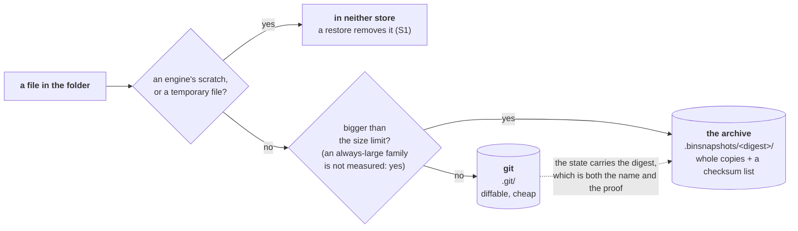
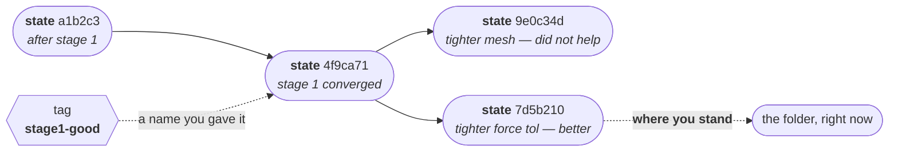
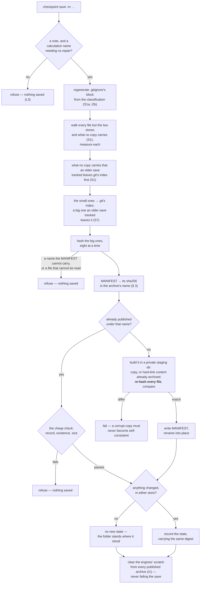
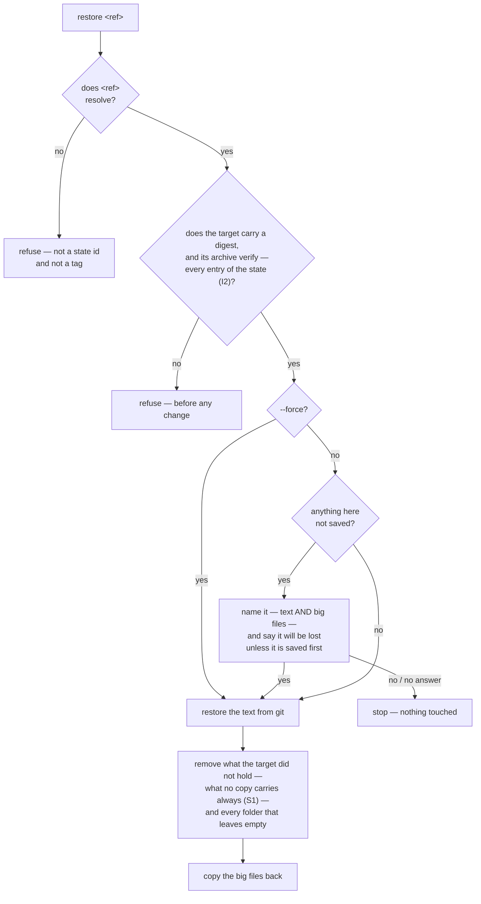
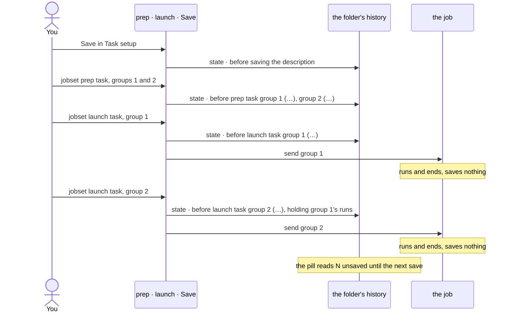

# Checkpointing — saving a calculation so you can always get it back

**Role:** guide (§§ 1–10) and contract (§§ 11–16)
**Domain:** execution
**Owns:** a calculation folder's saved history — states, tags, the two stores, saving and restoring, when molbuilder saves and when it never does (§ 9), the `molbuilder checkpoint` verbs and the run-history panel
**Read with:** [`job-contracts.md`](?doc=execution/job-contracts.md) § 6.1 (the MANIFEST and archive formats) ·
[`project-layout.md`](?doc=execution/project-layout.md) § 1.1 (the folder being saved) ·
[`job-system.md`](?doc=execution/job-system.md) § 5.0 and § 6.0 (prep and launch, the acts that save first) ·
[`job-contracts.md`](?doc=execution/job-contracts.md) § 4.2a (which files are an engine's scratch) ·
[`run-identity.md`](?doc=execution/run-identity.md) (the calculation name every state carries)

**The short version.**

- A calculation folder's history is a list of **states**: snapshots of the whole folder, each with a note and the
  state it came from (§ 5). Restoring one makes the folder equal to it, text and large files together (§ 7).
- **molbuilder saves a state before three acts that change the folder**: every `prep` that writes, a group's first
  `launch` wherever it runs, and Task setup's Save. It never saves in a run, at a run's end, or between the stages
  of one group (§ 9).
- You save whenever you like with `molbuilder checkpoint save -m "…"`. Going back and saving again is how you
  branch (§ 7.1).
- Small files go to git; files over 10 MB go to a side archive named by its content. An engine's scratch is in
  neither (§ 3, § 4).
- Use the `checkpoint` verbs, never bare git, in a calculation folder (§ 2.0).
- **Reading map.** §§ 1–10 are for the person using molbuilder: the goal and its limits, the shape, the commands,
  saving and restoring, when molbuilder saves, examples. §§ 11–16 are for developers: the rules, their status,
  the tests, the code and what other chapters own. § 14 lists every section.

---

## 1. The goal

> ### The promise
>
> **A state you saved is one you can return to.** Come back to it, change what
> you like, run again — and save that as a new state if it is worth keeping.
>
> Every rule in this document exists to keep that sentence true.

**What was never saved was never promised.** A snapshot is taken, never
inferred, so the only states you can return to are the ones somebody saved —
you, or an act that saved before it changed the folder (§ 9).

**Nothing else competes with the promise.** Not disk space, not speed, not
tidiness. If a rule here and a saving of disk ever disagree, the rule wins — a
folder that is cheap to store and wrong is worth nothing.

---

## 2. What checkpointing is not

- **It is not a backup system.** The history lives inside the folder it
  records. A deleted folder takes its history with it; copy the folder
  somewhere else for that.
- **It never saves on its own.** A state is saved when you save one, and
  before three acts that change the folder — every `prep` that writes, a
  group's first `launch`, Task setup's Save — each of which saves first and
  says so (§ 9). No timer, no run script and no monitor saves.
- **It does not decide what is worth keeping.** It saves the whole folder — a
  benchmark's trials in `<stage>/bench/` included — but for an engine's
  scratch and molbuilder's temporary files, which the engines' file
  vocabularies and the file catalogue name, not this system (S1).
- **It never saves inside a running calculation.** A save runs where the act
  that takes it runs: your workstation, a cluster's login node where you typed
  `jobset launch`, and a job's node only where a sequence of groups launches
  its groups there (§ 9).
- **It is not a way to move a calculation between machines.** It records
  history; `rsync` moves folders.
- **It is not a safety net for work you never saved.** A restore tells you what
  it is about to overwrite and then does it (A5). Nothing is stashed or set
  aside on your behalf.
- **It does not deal in files.** A state is the whole directory. Reading one
  file of the past is a different request with its own commands (§ 2.2).

### 2.0 One rule for you: use the verbs, not git

**A calculation folder is managed through `molbuilder checkpoint`. Running bare
git commands in it is outside this contract.**

It *is* a git repository — that is how the snapshots are made — so nothing stops
you, and molbuilder does not try to. But git alone sees only half of it: the big
files live in the archive, which git is told to ignore, so a `git checkout` of an
older commit rewinds the text and leaves every large file exactly where it was.
The folder is then in a state no save ever produced, and **that mess is yours**.

Two things make this a fair deal rather than a trap:

- **The verbs cover the work.** Saving, going back, naming a state, reading what
  is unsaved — § 5 is the whole list, and none of it needs git.
- **You will not be quietly fooled.** Every state carries the digest of the
  archive that belongs with it (I2b), so a folder pulled out of step is
  detectable: the big files on disk no longer match the record of the state the
  folder now stands at. A restore refuses and **names the files that differ**,
  and the panel shows them as unsaved — without guessing why (S8).

### 2.1 What it decides, and what it does not

| | |
|---|---|
| **You choose** | *which folder* to save, and *when* |
| **Checkpoint chooses** | *how* each file is stored |
| **Checkpoint never chooses** | *whether* a file is stored |

The middle row is the only decision it owns, and it is mechanical: git is bad
at very large files, so those go somewhere else. An engine's scratch, stored
nowhere, does not break the last row: the engines' own vocabularies name it,
and checkpointing asks them (S1).

**Why size picks the store and never the saving:** once a file's size may argue
with whether it is saved, a large file — a trajectory, say — ends up in no
snapshot, and nobody chose that.

### 2.2 Reading one old file without moving anything

Both commands print and touch nothing. **Which one you need depends on the
store the file was in** — the one place where the two stores reach you.

**Small enough for git** — the deck, `task.json`, `run.json`, an `.XV`:

```bash
git show <state>:<path>
```

**Large enough for the archive** — a `.DM`, an `.HSX`, a `.TSHS`. Git cannot
show it, and says so (`path '…' does not exist in '…'`): § 3 keeps large files
out of every commit. The state names its archive, and the file is inside it
under the same path:

```bash
git show -s --format=%B <state>      # its `Manifest-SHA256:` line names the archive
cat .binsnapshots/<digest>/<path>    # …and the file sits there under the same path
```

---

## 3. The overall shape

Two stores. Every file is in exactly one of them — but an engine's scratch and
molbuilder's temporary files, which are in neither (S1).



**The archive is named by what it contains, not by the state it belongs to.**
Its directory is the sha256 of its own MANIFEST. That one value *locates* the
archive, *proves* it (I2b), and makes an archive impossible to change without
becoming a different archive — the one removal I1 names aside.

Three things follow, and each removes a problem rather than adding a mechanism:

- **The archive can be written before the state is recorded**, because it does
  not need the state's name. There is no moment where a state exists with
  nothing beside it (§ 6).
- **Two states with the same big files share one archive** — the *same
  directory*, referred to by both.
- **A save that is interrupted and run again writes the identical path with the
  identical bytes**, so a repeat is harmless by construction rather than by
  locking (S9).

**Which store, by measuring — not by file type.** A file over the limit goes to
the archive; everything else to git. Extensions are not consulted, because a
name is not the property being tested: a 4 GB `.EIG` nobody listed would be
committed, and an empty `.DM` somebody did list would be archived.

The engine entries in the config (§ 4) name families that are *always* large,
so those skip the measuring. That is an effort saving and nothing else — **a
hint can make a save faster; it can never make it store less.**

**A file over the limit is never handed to git at all.** `git add` writes a blob
the moment it stages a file, so a big file merely unstaged afterwards has already
left its bytes in `.git/objects`. The save excludes big files by pathspec
instead, so *exactly one store* is true of what is on disk, not only of git's
index.

### 3.1 A real folder, after two saves

```text
bdt-relax/                           the folder: the user typed this name
├── .git/                            the text history
├── .gitignore                       generated — the archive's patterns, the engines' scratch, molbuilder's temporary files (S1a)
├── .binsnapshots/                   the archive
│   ├── a19f0b72…c8e5/                 named by the sha256 of its own MANIFEST
│   │   ├── 01_coarse/run-0/BDT_Au_relax.DM
│   │   └── MANIFEST.do_not_edit       what is in here, and a sha256 each
│   └── 4d7ba930…1f62/
│       ├── 01_coarse/run-0/BDT_Au_relax.DM   ← unchanged since the save above,
│       │                                        so this is a hard link: no disk
│       ├── 02_tight/run-0/BDT_Au_relax.DM
│       └── MANIFEST.do_not_edit
├── task.json                        ┐  (and this is where the run id lives)
├── BDT_Au_relax.template.toml        │  small → git
├── 01_coarse/                       │
│   ├── BDT_Au_relax_01_coarse.fdf      │
│   └── run-0/                       │
│       ├── BDT_Au_relax_01_coarse.out   ┘
│       ├── BDT_Au_relax.XV            small → git
│       ├── run.json                   small → git
│       └── BDT_Au_relax.DM            large → the archive
└── 02_tight/…
```

A MANIFEST is three tab-separated columns — sha256, bytes, path — sorted by
path ([`job-contracts.md`](?doc=execution/job-contracts.md) § 6.1 gives the
format and why each rule is there):

```text
7ef4c645…344a→8388608→01_coarse/run-0/BDT_Au_relax.DM
36c54395…a572→8388608→02_tight/run-0/BDT_Au_relax.DM
```

*(`→` is the tab; it is drawn here only so you can see it.)*

**The path is relative to the folder root, not a bare filename**, so one archive
holds a `.DM` from every stage without them colliding. What else a path may not
hold — and so where a restore can never be steered — is the format's
([`job-contracts.md`](?doc=execution/job-contracts.md) § 6.1).

**Identical content is stored once.** Two saves that both hold an unchanged
`.DM` record the same sha256, so the second hard-links the first's file rather
than copying it (a copy where the filesystem allows no link). The archive still
holds a real file at that path, so nothing reading it can tell.

---

## 4. The pieces

| Piece | What it is | Who writes it |
|---|---|---|
| **git** | the history of everything small | every save |
| **the archive** — `.binsnapshots/<digest>/` | whole copies of everything large, named by content | every save |
| **`MANIFEST.do_not_edit`** | what one archive holds, a sha256 each — the name is the reminder (I2b) | every save |
| **`.gitignore`** | what git skips, *generated* from the classification (S1a) | every save, and nothing else |
| **the config** | the size limit and the always-large families | you, in `molbuilder.json` |
| **the engines' file vocabularies** | which files are an engine's scratch, stored nowhere (S1) | shipped with molbuilder |
| **the file catalogue's `transient` rows** | which files are molbuilder's temporary files, stored nowhere (S1) | shipped with molbuilder |
| **the folder's engine** — `molbuilder.engine` in `.git/config` | which config entry's always-large families this folder's saves use | `Repo.name_engine`, once |
| **`molbuilder checkpoint …`** | the verbs you type (§ 5) | — |
| **`Repo`** (`molbuilder/checkpoint.py`) | the class every surface goes through | — |

*Every save* is `Repo.save`, however it is reached: `checkpoint init` and
`save`, the panel, and the save an act takes first (§ 9).

**The config is molbuilder-wide, not per folder.** It is the `checkpoint`
section of `molbuilder.json` ([`configuration.md`](?doc=configuration.md) § 4),
and it holds two keys and nothing else (`runtime_config._validate_checkpoint`):

- **`size_limit_bytes`** — 10 MB (10 485 760 bytes) unless you set it; a
  positive whole number of bytes. It is a *storage* threshold and nothing else:
  moving it changes where a file is kept, never whether it is kept (§ 2.1).
- **`engines`** — per engine, the globs of families that are always large.
  Shipped: `generic` (none — every file is measured), `siesta` (`*.DM`, `*.HSX`,
  `*.TSHS`, `*.*.AVTRANS_*`, `*.TBT.CC`, `*.*.DOS`) and `pyscf` (`*.chk`,
  `*.cube`) — each the family of an engine file the catalogue names
  (`runfiles.ENGINE_FILES`, `runfiles.family`), every spin channel's. An entry `molbuilder.json` names replaces the shipped entry of that
  name; a new name adds an engine. Each glob matches a file's *name*: a pattern
  holding `/` is refused, since git would read it as a path the size check never
  matches, and that file would be in no store.

A caller may name its engine to get the matching entry; with no name, or one no
entry has, `generic` is used — always correct, merely slower. There is no
per-folder copy of this config, on purpose (S1c).

**What no copy carries is not in this config.** Two families of names are in
neither store, and no person's config names them:

- **an engine's scratch** — `*<suffix>` for each suffix any section of any
  shipped `molbuilder/<engine>/warm-files.toml` names `scratch`
  (`warmfiles.scratch_families`, read once a process): SIESTA's `*.TSGFL`,
  `*.TSGFR`, `*.contrib.EPSIMG`; PySCF none
  ([`job-contracts.md`](?doc=execution/job-contracts.md) § 4.2a). No engine is
  asked, because no engine writes another's files: every folder gets one answer,
  `warmfiles.is_scratch(name)`;
- **molbuilder's temporary files** — the rows the file catalogue
  (`runfiles.WRITTEN`) calls `transient`
  ([`project-layout.md`](?doc=execution/project-layout.md) § 5): a file being
  written before it replaces its target, a sidecar's lock, a data file's
  reading's claim, the per-rank GPU launcher.

The one answer for both is `warmfiles.never_carried(name)`; the save, the
status, the restore and every reader of a MANIFEST ask it (S1).
`molbuilder checkpoint config` prints the size limit, the always-large families
the folder is saved under, and, on the line `in neither`, both families.

**Which engine a folder's saves use is recorded in the folder, once** —
`molbuilder.engine` in the folder's own git config, inside `.git/`, which is
never stored and no file anybody edits (`Repo.name_engine`). It picks one
thing: the config entry whose always-large families skip the measuring. It is
recorded by `checkpoint init --engine` — on a new checkpoint folder, or on one
that records none — and by the first save of a folder with no history that an
act takes (`checkpoint.save_before`, § 9), whose caller names the calculation's
engine. A history an act finds keeps the engine it records, or none: recorded
then, the engine would change the generated `.gitignore` and make a state of
nothing the person changed. A recorded engine is never replaced. A folder that
records none is saved under `generic`.

---

## 5. Using it

Three ideas, and nothing else to learn.

| | |
|---|---|
| a **state** | a saved snapshot of the whole folder: an id, a note, and the state it came from |
| a **tag** | a name you give a state so you can find it again |
| **where you stand** | the one state the folder is at: `init` puts you at the first state, `save` at the one it just made, `restore` at the one you asked for |

**Where you stand is what makes the other two work**, even though you never type
it:



- **It decides what "unsaved" means** — the folder differs from the state it
  stands at, never from the *newest* one. Stand at `4f9ca71` above and the
  folder is clean, even though two later states exist. That is why going back
  does not make everything look modified (§ 7, A5).
- **It decides where a new state hangs.** `save` records where you stood as the
  new state's parent, then moves you onto it. **You never declare a fork** —
  two states hang off `4f9ca71` because somebody stood there twice. Going back
  and trying again *is* the fork (§ 7.1).

### The commands

```bash
# once, in the calculation folder
molbuilder checkpoint init

# save the folder as a state -- the note is required (§ 5.1)
molbuilder checkpoint save -m "stage 1 converged, 41 steps -- before retightening"

# what have I got?
molbuilder checkpoint list

# name one you know you will come back to
molbuilder checkpoint tag stage1-good -m "geometry I trust"

# go back to a state -- by id or by tag.  The whole folder returns.
# Anything unsaved here is named first, and you are asked.
molbuilder checkpoint restore 4f9ca71
molbuilder checkpoint restore stage1-good
molbuilder checkpoint restore 4f9ca71 --force   # answers yes, for a script

# which files go where: the size limit, the always-large families,
# and what is in neither store
molbuilder checkpoint config
```

Every verb takes `-p/--path`, the calculation folder (default: the current
directory).

- **`init`** — makes the folder a checkpoint folder and saves its first state
  (`-m`, default `set up`). `--engine siesta|pyscf` records the engine whose
  always-large families skip the measuring (§ 4); omit it and every file is
  measured. `--calculation` sets the name written into every state; it defaults
  to the folder's name, and a name needing repair is **refused**, never quietly
  fixed (L3). On a folder that already is one, `init` writes nothing outside
  `.git/`: it names a folder that has no name, records an engine where none is
  recorded, and says where the folder stands.
- **`save -m`** — the note is required (§ 5.1). It says plainly when nothing
  changed (`nothing changed since the state this folder stands at.`) rather
  than making a state.
- **`list`** — newest first, each state naming the one it came from; `-n N`
  shows the newest N. It answers **cheaply**, from size and timestamp, and says
  so; `--check` compares content when you want certainty now (§ 7.2).
- **`tag NAME -m`** — the note says why the state is worth returning to.
  `--at` names a state other than where you stand. Nothing tags on your behalf
  (L4).
- **`restore STATE`** — STATE is a state id or a tag. The **whole folder**
  returns: a rewind, not a fetch (§ 7). At a terminal you are asked before
  unsaved work is lost; a script passes `--force`. To read one old file
  without moving anything, § 2.2 gives the two commands.
- **`config`** — read-only: the classification has one home (§ 4).

**Exit codes:** `2` means your input — a name to repair, a folder holding
several calculations, an unknown state, a question nobody was there to answer —
and `1` means the machine.

**When an act saved for you**, it says so where you are: prep, a group's first
launch and Task setup's Save print *the folder's state was saved first:
`<id>` -- `<note>`*, or *the folder's state was already saved: `<id>` --
`<note>` (nothing changed since)* (§ 9).

**A state's id is permanent and never reused.** It is git's own commit hash, so
`restore 4f9ca71` means the same next month as today. Nothing assigns it,
stores it or renumbers it — a second numbering would be a second identity for
one thing. The **archive's digest** is a different hash with a different job: a
sha256 molbuilder computes, a *proof* of what the archive holds (I2b).

### The panel, and the routes

The projects sidebar's run-history panel does the same work for a calculation
folder: a pill reading `saved`, `N unsaved` or `no states saved`; the states as
a list or as a graph drawn from parentage; and buttons to make the folder a
checkpoint folder, save (asking for the note), name a state and restore one.
**Refresh is explicit**: the panel reads when you enter a directory and when you
press Refresh, which asks the exact content question rather than the cheap one.
There is no polling ([`web/projects.md`](?doc=web/projects.md)).

Over HTTP: `GET /api/checkpoint/state` and `list`; `POST /api/checkpoint/init`,
`save`, `tag` and `restore` ([`web/web-api.md`](?doc=web/web-api.md) § 5). The
panel and the CLI go through one class, `Repo`, so a rule proved on one holds
on the other.

**There is no `branch`, `diff`, `prune` or `verify` verb, and none is planned.**
A fork is a save after a restore (§ 7.1). Two states are compared by restoring
each, or by reading one file of each (§ 2.2); the panel's graph shows how they
relate. Nothing a state holds is ever reclaimed (§ 12). An archive is verified
by the restore that uses it (§ 12, *Verifying without restoring*).

### 5.1 The note

A history is only useful if you can pick from it a month later, and the note is
what you read when you come back. **A state's note is written by whoever takes
the save:**

- **a save you take** carries the note you type — required, never defaulted; a
  save with no note is refused (L3). The question you bring to the list is
  never *where was I* — the list answers that — it is **why did I stop here, and
  what was I about to do?** A note holding only a time answers neither and
  repeats the time printed under it.
- **a save an act takes** writes the act's own note, and asks nothing: the time
  the state was taken, then what the act is about to change —
  `2026-10-31 21:19:11 · before launch task group 1 (coarse)` (§ 9).

```text
$ molbuilder checkpoint list
-> e30bb92  stage 2 at 300 Ry -- forces now below 0.02
      2026-08-08T16:30:12+02:00   from b2e033d
   7a1c0e4  stage 2 at 200 Ry -- forces worse than stage 1
      2026-08-08T14:02:11+02:00   from b2e033d
   b2e033d  stage 1 converged, 41 steps -- before retightening  [stage1-good]
      2026-08-08T11:40:05+02:00   from 4f9ca71
   4f9ca71  set up
      2026-08-08T09:15:40+02:00   from -

-> is where this folder stands (e30bb92).
   nothing unsaved (by size and timestamp; --check compares content).
```

Newest first, each state with its tags, the time it was taken (with the saving
machine's zone) and the state it came from; `->` marks where the folder stands.
Unsaved files are named one per line under `N unsaved change(s) here`, in place
of the last line.

**The two newest states are visibly alternatives** — both say `from b2e033d`.
That is the whole mechanism for branching (§ 7.1): nothing was declared,
nothing was named, and both tries are intact.

**There is no text-only restore, on any surface** (A4). Rewinding the text and
leaving the big files would be the mixed state S8 describes, reached on purpose.

---

## 6. Saving, step by step



**A save fingerprints its large files eight at a time** (`sha256_all`): every
large file is read for its sha256 on every save, so that read is a save's
floor, and the hashes run side by side. A restore's verify (§ 7) reads its
archive the same way. A file that does not read ends the read — the files not
yet begun are never read. The re-hash of a copy and an exact `status` read one
file at a time.

**What no copy carries leaves at two moments.** A copy git tracks — from a save
taken before the rule — leaves git's index before anything is added, so its new
bytes never reach `.git/objects`; an engine's scratch an archive holds is
cleared from every published archive at the end of the save, after it records
its state or finds nothing changed, and the clearing never fails the save (I1).

**The archive is written before the state is recorded.** It is named by its own
content (§ 3), so it does not wait for the state's name. The worst an
interruption leaves behind is an archive nothing points at yet — no lost data,
and the next save writes the identical bytes to the identical path.

**Why the copy is re-hashed rather than trusted.** If the MANIFEST's checksum
came from the copy alone, a copy corrupted on the way to disk would be
*self-consistent*: it would verify against its own bad checksum forever and be
restored as truth. Hashing the source and re-hashing the copy makes that
impossible.

**An archive that is already there is checked before it is reused** — and the
check is the *cheap* one: the record's own digest, then existence and size. A
save that adopted a damaged archive on the strength of its name would record a
state you could not return to.

> **Why cheap here and exact at a restore — the model is git's own.** Corrupt a
> loose object and `git commit` exits 0 without looking, while `git checkout`
> answers *"inflate: data stream error"* and restores nothing: git verifies on
> the **read**, where zlib gives it away free. Our archive is raw bytes, so our
> read cannot be free — which is why § 7 has the restore verify explicitly; that
> check **is** our inflate check. A full re-hash on the save as well would double
> the commonest save there is — a tweak to an input, with gigabytes of density
> matrices untouched — to catch one save earlier the damage a restore refuses
> anyway. What the cheap check buys is the *moment*: at save time the files that
> could rebuild the archive are still on disk.

**Content reused by hard link is checked in full**, because a link into a *new*
archive is not inheriting old damage, it is minting a record that is false the
moment it is written. A link avoids the copy, not the check.

Where either check fails the save is **refused**, and the way out is cheap
because the archive is content-addressed: delete it and save again, and it is
rebuilt byte-identically from the files still in the folder.

**Publishing is *create if absent*, never *overwrite*.** An archive at a given
name always holds the same content, so there is nothing to replace. It is built
in a staging directory and renamed into place all the same: the rename makes a
directory appear complete or not at all, so a reader never meets a half-written
archive (A1).

**That staging directory is private to the saver, never `<digest>.tmp`.** Content
addressing makes the *final* name safe to race for — same content, same digest,
same bytes — but it makes a derived temporary name **collide**, because two
savers of the same content agree about that too: one would delete the directory
the other is still filling. With a directory each, the only shared moment is
the single atomic rename, which already handles "somebody got there first" (S9).

---

## 7. Restoring, step by step



**Two refusals, then one question, and the order is the rule.** The refusals
come first because they are about the *target*: an unknown ref or a corrupt
archive means the operation cannot happen at all, and nobody should be asked to
accept a loss for an operation that then fails for another reason. The question
comes last, immediately before the first byte moves.

**The question is answered by you, and the answer is honoured.** It names what
is unsaved — changed, added and deleted alike — and says plainly that **it will
be lost unless you save it first**. Nothing is rescued, stashed, renamed or set
aside. Say yes and it is gone (A5). With no terminal and no `--force`, nothing
is assumed: the restore stops, and nothing changes.

**`--force` is that answer given in advance, so the question is not asked at
all.** Working out what is unsaved means reading the *standing* state's record
and hashing every large file in the folder; doing it anyway would make a forced
restore pay for a message nobody sees, and let damage to the state you are
**leaving** refuse a restore whose target verified perfectly — a folder no verb
could move (§ 2.0).

**What must never happen is a half-restore**: text from one save and binaries
from another, a state no save ever held. That is why the archive is verified
*before* the text is touched.

**What the sweep removes is decided by two records and one answer** (I2a):
`git ls-files` and the target's MANIFEST say what the target holds, and
`warmfiles.never_carried` says what no state holds — an engine's scratch and
molbuilder's temporary files (S1). Everything else the target does not hold is
removed too, without a warning: it is still in the state that holds it. So a
device run's `tsgf/` comes back holding only its marker (`calcdir.json`, text
the state holds) where the target holds that run, and a run folder the target
never had is removed whole. A directory the sweep empties goes with its files:
`git clean` leaves a directory of ignored files standing, and an empty `run-N/`
would be counted as a run by every reader of the tree.

**The decision ledger is part of the state, and a restore writes nothing.**
`jobset-decisions.log` is text the state holds, so after a restore it reads as
the target wrote it, and the order of the folder's restores is `checkpoint
list`'s. A line the restore wrote would be the one unsaved file the next
restore asks about, and A5 says the folder equals the target *exactly*.

### 7.1 Going back and trying something else, with the original intact

This is the thing the whole design exists for.

You have run two stages. Stage 2 used a 200 Ry mesh and the forces came out
worse than you wanted. You want to go back to the geometry stage 1 produced and
try 300 Ry instead — **without losing the 200 Ry try**, because it may turn
out to have been the better answer.

```bash
# 1. Keep what you have.  It costs nothing and you cannot get it back later.
molbuilder checkpoint save -m "stage 2 at 200 Ry -- forces worse than stage 1"

# 2. Go back to stage 1's state.  The whole folder returns to that moment.
molbuilder checkpoint restore b2e033d

# 3. Retune, rerun, and keep the result.
molbuilder checkpoint save -m "stage 2 at 300 Ry -- forces now below 0.02"
```

```text
$ molbuilder checkpoint list
-> e30bb92  stage 2 at 300 Ry -- forces now below 0.02
      2026-08-08T16:30:12+02:00   from b2e033d
   7a1c0e4  stage 2 at 200 Ry -- forces worse than stage 1
      2026-08-08T14:02:11+02:00   from b2e033d
   b2e033d  stage 1 converged, 41 steps
      2026-08-08T11:40:05+02:00   from 4f9ca71
   4f9ca71  set up
      2026-08-08T09:15:40+02:00   from -

-> is where this folder stands (e30bb92).
   nothing unsaved (by size and timestamp; --check compares content).
```

**Both tries are there, and the list says they are alternatives** — they share
a parent. You declared nothing, named nothing, and ran no extra command.

**Why the original is intact: nothing a state holds is ever rewritten.** A
state, once saved, is never modified or removed (the one removal from an
archive is an engine's scratch, which no state holds — I1). Restoring
`b2e033d` changed the *folder*; it did not touch `7a1c0e4`, which still holds
every byte of the 200 Ry try. Going back to it is one more restore.

**Where the fork comes from: every state records the state it came from.** Step 3
saved while the folder stood at `b2e033d`, so the new state's parent is
`b2e033d` — no branch verb, nothing to name, nothing to clean up afterwards.

**Comparing them later** is `restore 7a1c0e4`, look, `restore e30bb92`, look.
Neither is more "real" than the other, and neither can shadow the other. If one
turns out to be the one you care about, **tag it**.

> **The one thing to get right is step 1.** Restoring is not destructive to the
> *history*, but it does overwrite the *folder*. Anything you had not saved when
> you typed step 2 is named to you, once, and then gone if you say yes (A5).

**And nothing you save can become unreachable** — not after any sequence of
restores. Every state stays listed and restorable for as long as the folder
exists (A6). That is what makes it safe to wander.

In a calculation run through `jobset`, the same moves are what a launched
stage's *way back* is made of — the state saved before its group's first launch,
restored, and the group prepared again
([`job-system.md`](?doc=execution/job-system.md), *How the checkpoint supports
you*).

### 7.2 How much is checked, and when

Two questions wear the same words, and they deserve different answers:

| | asked | answered from | being wrong costs |
|---|---|---|---|
| **Is anything unsaved?** | constantly — every folder you open, every list | **size and timestamp** | a sentence on a screen |
| **What will this destroy?** | once, immediately before the folder changes | **content** | data |

**A folder holds gigabytes of density matrices, and the panel reads it every
time you enter the directory.** Hashing all of that to draw a pill is a cost the
pill does not earn.

**What the cheap read still sees.** A different size is already an answer: a run
that grew a density matrix, a file that appeared, a file that was deleted. What
is left is a file of *exactly the same size*, and for those the question is
whether its timestamp is newer than the state's.

**So the blind spot is a same-size file whose timestamp is not newer than the
state.** That includes a timestamp that is **older**: `cp -p`, `tar -x` and
`rsync -a` carry the source's timestamp along with the bytes, so a file can
arrive holding different content, dated *before* the state it lands in, and the
cheap read will call it saved.

> **Both halves of that comparison are forced — recorded here so nobody
> tightens one and breaks the other.**
>
> **Why *newer than*, rather than *different from*.** A restore copies each big
> file back out of the archive with its own timestamp intact, so a correctly
> restored file is dated *before* the state you just returned to. Requiring the
> two to match would report every large file as unsaved the instant you restored
> anything — a false alarm fired by the one operation the warning matters most
> for.
>
> **Why one second of slack, which is resolution rather than laxity.** A state's
> timestamp is whole seconds; a file's is not. A file saved at 12:00:00.3 sits
> in a state that records 12:00:00, so a bare comparison would read the folder
> *unsaved* the instant after a save.
>
> **And the obvious repair is worse than the gap.** Comparing each file against
> the archive's own copy instead breaks on *identical content is stored once*
> (§ 3.1): an archive's copy carries the timestamp from the **first** time those
> bytes were archived, so a rerun that writes byte-identical output would read
> unsaved **permanently**, with nothing you could do about it. A false alarm
> that never clears is worse than one missed change.

**None of that width is dangerous**, because a status call moves no bytes, and
the operations that *can* lose something never trust it:

| | |
|---|---|
| **`save`** | checksums every large file, always — the digest **is** the archive's name (§ 3) |
| **the save an act takes first** (§ 9) | is a `save`: whether the folder was already saved is that save's answer, by content — never the cheap read's *clean* |
| **`restore`** | verifies the target archive (I2), then asks what is unsaved **by content** — unless `--force` already answered (§ 7) |
| **Refresh**, `list --check` | asks the exact question on demand |

**The depth concerns large files only.** Everything in git is compared by git.
"Cheap" means *the archive is not re-read*, and nothing else.

**An unreadable timestamp means check, not assume.** If a state's time cannot be
parsed, the file is hashed rather than declared changed — slower, never wrong.

**Slow work is said before it happens.** Checksumming gigabytes takes time, and a
pause nobody explained reads as a hang, so the verbs announce it — *"checking
the folder and checksumming its large files…"*, *"verifying the archive, then
checking what is unsaved here…"*.

---

## 8. What a saved state is for

Every stage and every run stays on disk at once: each launch opens a new run
folder beside the ones before it, and a run's files and records live in that
run folder whether or not any state holds them
([`project-layout.md`](?doc=execution/project-layout.md) § 1.6.1, § 1.6.3).
Going back to stage 1's geometry means opening `01_coarse/run-0/`. A saved
state is protection against loss and a place to branch from — valuable, not
load-bearing.

**Going back costs the present unless it is saved first** (§ 7.1): a restore
rewinds the whole folder, so what the folder holds now and no state holds is
what it loses.

---

## 9. When molbuilder saves, and when it never does

> **Every save is an act's decision, and always said. Checkpointing never
> starts one.**

**The decision belongs to the act about to change the folder.** A prep knows
what it is about to write; a launch knows what it is about to copy in and send.
Checkpointing knows none of that — to it a folder is files. Three acts save
first — every prep that writes, a group's first launch, Task setup's Save —
because the state each saves is the one a redo restores. Each owns three
things: **noticing** the moment, **saving** before it changes anything, and
**saying so** — the terminal prints the state and its note, Task setup shows
them, and the calculation's ledger records them
*(user, 2026-10-03: "always save through checkpoint, notify user, and make sure
name of the checkpoint clearly shows timestamp")*. All of them call one
function, `checkpoint.save_before`. **A save that fails stops the act**: prep
prepares nothing, launch sends nothing, Save writes nothing — that state is the
one a redo restores.

### Who saves, and who never does

| moment | saves? | where it runs |
|---|---|---|
| `prep` (`prep task`, `prep bench`), at the terminal or Task setup's Prep | **yes**, when it has something to write | where prep runs |
| Task setup's Save | **yes**, when it has something to save | the machine the server runs on |
| a group's first `launch`, whatever its flags | **yes** | where the launch runs: your workstation, a cluster's login node |
| a group's first launch inside a sequence of groups' job | **yes** | on the job's node |
| a prep with nothing to write, a preview, a Save with nothing to save | no | — |
| a launch again — any launch of a group already launched, whatever its flags | no | — |
| sending a sequence's job; a benchmark's launch | no | — |
| a launch you decline, `--mode ask`, `--dry-run` | no | — |
| `jobset migrate` | no — it keeps each file it rewrites | — |
| between the stages of one group | **never** | — |
| the run script, the monitor, a run's end | **never** | — |
| after the last run | no — until you save, or the next act does | — |

- **prep** saves once every check has passed and the plan stands, before it
  writes anything — its ledger lines included, so the state holds no line of
  this prep ([`job-system.md`](?doc=execution/job-system.md) § 5.0).
- **Task setup's Save** saves before it writes `task.json` and
  `job-request.json` ([`web/task-setup.md`](?doc=web/task-setup.md) § 8).
- **A group's first launch** — any member never launched, whatever its flags (a
  one-stage group's first launch with `--from` or `--cold` included) — saves once
  you have answered yes, before it copies anything in or sends; a send the
  scheduler then refuses has made its save all the same. This is the state a
  launched stage's way back restores: it holds every run the group builds on
  ([`job-system.md`](?doc=execution/job-system.md) § 6.0).
- **A sequence of groups** (`prep task --group 1 --group 2 --one-job`, then one
  launch) sends one job whose walk runs `jobset launch --in-sequence` for every
  group in turn, the first included, on the job's node; the send itself only
  shows the first group's plan, and saves nothing. Each of those launches saves
  as a group's first launch does — and only then: a group the sequence names
  that was launched already goes as a launch again and saves nothing. A later
  group's state holds the finished runs of the group before it
  ([`job-system.md`](?doc=execution/job-system.md) § 6.0, *A sequence of
  groups*).
- **A launch again** — any launch of a group already launched, whatever its
  flags — opens a new run beside the old ones and saves nothing; the state
  before the group's first launch is still the way back. **A benchmark's
  launch** saves nothing; its `prep bench` saved.
- **`jobset migrate`** rewrites the files an older molbuilder wrote and saves no
  state: each file it rewrites is kept beside the new one as
  `<name>.pre-<rule>` ([`job-request.md`](?doc=execution/job-request.md) § 8).
- **Between the stages of one group** there is nothing to save: a group's stages
  take nothing from each other — they run one after another in one job with
  nothing handed between them, and prep refuses a group holding a stage and one
  it builds on ([`job-request.md`](?doc=execution/job-request.md) § 3.3;
  `group.check_groups`). Stages that build on each other are separate groups,
  and each group's first launch saves.
- **The run script and the monitor never save**
  ([`running-a-job.md`](?doc=execution/running-a-job.md) § 3). The monitor sits
  beside the job, knows when the run has ended, reads the outputs and can notify
  you — it observes and tells, and never changes the calculation.
- **After the last run** nothing saves, because no act follows. The sidebar's
  pill reads `N unsaved` until you save or the next act saves first.



### The note an act writes

The time the state was taken, by the clock of the machine that saves, then what
the act is about to change, each group named by its number and its members:

| act | the note |
|---|---|
| prep of groups | `2026-10-30 19:03:24 · before prep task group 1 (seed, electrode_L, electrode_R), group 2 (device), group 3 (transmission)` |
| prep of a benchmark | `… · before prep bench coarse` |
| prep of a transport calculation's older junction, no group named | `… · before prep task: the junction's order record` ([`engines/transport.md`](?doc=engines/transport.md) § 1.1) |
| prep copying a group in from a finished calculation | `… · before prep task group 1 (seed, electrode_L, electrode_R), copied in from <calculation>` ([`engines/transport.md`](?doc=engines/transport.md) § 2a.16) |
| a group's first launch | `2026-10-31 21:19:11 · before launch task group 1 (coarse)` |
| a group's first launch inside a sequence's job | `… · before launch task group 2 (medium), in job 4817 (sequence H2_sequence-01_coarse-02_medium)` — the job as `molbuilder jobs status` names it (a run here's walk, `<host>-<pid>`), and the sequence its header and launch record are named by |
| Task setup's Save | `2026-10-30 19:01:58 · before saving the description` |

A state the job took says so, so it is never read as one your own launch took.
A group is named by its members as well as its number because a number shifts
when a stage above it is removed ([`job-request.md`](?doc=execution/job-request.md)
§ 3.3). The note's words are read back: a launched stage's way back finds its
state by the note its group's first launch wrote, and a copied-in group's by the
note of the prep that copied it in.

A real folder after a few acts — the test calculation
`my-project/optimization/h2_siesta`:

```text
$ molbuilder checkpoint list
-> 870ef61  2026-11-01 07:48:16 · before prep task group 1 (coarse)
      2026-11-01T07:48:16-07:00   from df02d18
   df02d18  2026-10-31 22:32:07 · before prep task group 1 (coarse)
      2026-10-31T22:32:07-07:00   from 3ea9776
   3ea9776  2026-10-31 21:54:41 · before prep task group 1 (coarse)
      2026-10-31T21:54:41-07:00   from 3266a73
   3266a73  2026-10-31 21:19:11 · before launch task group 1 (coarse)
      2026-10-31T21:19:11-07:00   from f8d9376
   f8d9376  2026-10-31 21:01:57 · before prep task group 1 (coarse)
      2026-10-31T21:01:57-07:00   from -

-> is where this folder stands (870ef61).
   4 unsaved change(s) here; `molbuilder checkpoint save` keeps them.
     01_coarse/h2_siesta_01_coarse.fdf
     01_coarse/h2_siesta_01_coarse.run.sh
     h2_siesta_01_coarse.siesta.hierarchical.pipeline.log
     jobset-decisions.log
```

The note's time, taken as the save begins, has no zone; the date line under it
is when git recorded the state, with the saving machine's zone — checksumming a
large folder can put seconds between the two. The four unsaved files are what
the last prep wrote *after* its save: an act's own writes are in the next state,
not its own.

**Each saving act names the calculation's engine**, so a folder with no history
records it with its first state (§ 4). **Nothing changed** means no new state:
the state the folder stands at is named, and whether anything changed is the
save's own answer, by content (§ 7.2).

### Why a run's end saves nothing

*(the user, 2026-11-01: "let's not do this for now. it seems too costly")*

A save at a run's end would run inside the job, on its node, and there it costs:

- **molbuilder on the node.** A save needs molbuilder's own environment and its
  folder — molbuilder runs from its checkout, not as an installed package. A
  plain run needs only its engine's environment: the monitor and the steps at a
  run's end travel beside the job as Python zip files (`mb_monitor.pyz`; a
  SIESTA vibration's `mb_vibration.pyz`). Only a sequence of groups brings
  molbuilder to the node, to launch its groups — and each first launch's save
  there pays the cost below.
- **Disk and wall time.** A save copies every new large output into the archive
  — an output already stored is hard-linked, a new one is copied whole, so the
  disk holds it twice — and checksums each, inside the job's wall.

So a finished run is unsaved until you save or the next act saves first, and its
files are in its run folder either way (§ 8).

---

## 10. Worked examples

### 10.1 Several tries from one state

Going back once is § 7.1. Going back to the *same* state repeatedly is the
ordinary way a parameter gets swept by hand, and it needs nothing extra:

```bash
molbuilder checkpoint restore b2e033d
# run at 300 Ry
molbuilder checkpoint save -m "stage 2 at 300 Ry -- forces below 0.02"

molbuilder checkpoint restore b2e033d
# run at 400 Ry
molbuilder checkpoint save -m "stage 2 at 400 Ry -- no better than 300, 3x slower"
```

```text
$ molbuilder checkpoint list -n 4
-> 1f8d5c0  stage 2 at 400 Ry -- no better than 300, 3x slower
      2026-08-08T18:05:27+02:00   from b2e033d
   e30bb92  stage 2 at 300 Ry -- forces below 0.02
      2026-08-08T16:30:12+02:00   from b2e033d
   7a1c0e4  stage 2 at 200 Ry -- forces worse than stage 1
      2026-08-08T14:02:11+02:00   from b2e033d
   b2e033d  stage 1 converged, 41 steps
      2026-08-08T11:40:05+02:00   from 4f9ca71

-> is where this folder stands (1f8d5c0).
   nothing unsaved (by size and timestamp; --check compares content).
```

Three tries, one parent, none of them privileged and none of them lost.

**This is where tags earn their place.** Four ids and four notes are readable
today and a puzzle in a month. Tag the one you decided on:

```bash
molbuilder checkpoint tag chosen-mesh -m "300 Ry: the cheapest that met the force tolerance"
```

and `restore chosen-mesh` works for as long as the folder exists.

### 10.2 From Python

```python
from molbuilder.checkpoint import Repo

repo = Repo("projects/BDT-Au/optimization/bdt-relax")
if not repo.initialized:
    repo.init(engine="siesta")          # the engine picks the always-large
                                        # families (§ 4)

state = repo.save(note="stage 1 converged, 41 steps -- before retightening")
print(state.id if state else "nothing changed")

for s in repo.states(limit=5):
    print(s.id[:7], s.note, "from", s.parent[:7] if s.parent else "-")

repo.restore("stage1-good")             # a tag or a state id; text + binaries
```

`save()` returns `None` when there was nothing to save, and **raises when no note
is given** — the note is not defaulted (L3). `restore()` raises rather than
half-completing (§ 7), and every state stays listed afterwards (A6).

---

## 11. The rules

Each rule names what it prevents and how it is tested; § 12 says which hold and
which are asserted. The ids are cited by code and keep their meaning:

| group | rules |
|---|---|
| Everything is saved | S1, S1a, S1b, S1c, S7, L2, L7 |
| The record can be trusted | I1, I2, I2a, I2b, I2c |
| A save or a restore completes, or does not happen | A1, A2, A3, A4, A5, A6 |
| Nothing else touches the state | I3, L4 |
| A history you can read back | L1, L3 |
| The folder is also a real git repository | S8, S9 |
| Rules of the run layer, as a save sees them | S2, S3, S4, S5, S6, L8 |

### Everything is saved

**S1 — every regular file is in git or in the archive: never both, never
neither — but the two stores and what no copy of a run folder carries: an
engine's scratch and molbuilder's temporary files.** The list, each with its
reason:

1. **The two stores** — `.git/` and `.binsnapshots/` — because a store cannot
   contain itself.
2. **An engine's scratch** *(the user, 2026-10-20, after a prep on Sol copied a
   device run's two lead Green's-function files, 98 of the folder's 99 GB, into
   its save)* — the files the engines' own vocabularies name `scratch`
   ([`job-contracts.md`](?doc=execution/job-contracts.md) § 4.2a: TranSIESTA's
   `*.TSGFL`, `*.TSGFR`; an optical call's `*.contrib.EPSIMG`). The vocabulary
   already says these are recomputed by every run, never carried and never taken
   over, and the checkpoint asks the one answer every reader asks
   (`warmfiles.is_scratch`, § 4) — one answer to *is this file kept*, not two.
   Not archived, not in git (the generated `.gitignore` names them, S1a), never
   reported unsaved by `status`, and **removed by a restore**, like every file
   the target does not hold (I2a). Between saves they are the run's own: the
   run's walk empties them
   ([`engines/transport.md`](?doc=engines/transport.md) § 2a.11), or a person
   does (`jobset scratch --empty`,
   [`job-system.md`](?doc=execution/job-system.md) § 5.3). The families are
   every engine's, whatever engine the folder records.
3. **molbuilder's temporary files** *(the user, 2026-10-22: "leave them
   out")* — the files the file catalogue calls `transient`, there only while a
   write or a reading runs (`runfiles.is_transient`, § 4). A state holding one
   would bring back, at a restore, a file speaking for a process that is no
   longer there.

Both kinds go through one answer, `warmfiles.never_carried`, which every copier
of a run folder asks — a save, a restore's sweep, a folder's download, a
calculation that reuses a finished one, a launch taking points over. They are
not stored, named in the `.gitignore`, taken out of git's index where an older
save tracked one, left out of every state's entries (`state_entries`), and
removed by a restore. **What an earlier save stored goes**: the save untracks a
tracked copy before anything is added, and clears an engine's scratch from every
archive published before, at the save's end (I1). The save, the status and the
restore's sweep walk the folder through one function (`walk_entries`); the walks
of what a store takes (`walk_files`, `walk_symlinks`) pass these files over.

**No other category is exempt, including the ones it is tempting to exempt.**
Editor leftovers, caches nothing names — all stored. Storing them costs a little
disk, which § 1 has already ruled is never an argument; and every exemption is a
judgement about what is worth keeping, which § 2.1 says this system does not
make. A snapshot of *most* of a folder is not a snapshot of the folder.

> **Any future exception belongs here, in this list, with its reason** — never in
> a constant inside a module. A file excluded by code nobody agreed to is
> indistinguishable from a file lost.

**Symlinks are outside the archive, and "regular" is load-bearing.** Nothing
molbuilder writes into a calculation is a link — every file in a run is a real
copy ([`project-layout.md`](?doc=execution/project-layout.md) § 1.6.5) — but a
link a person plants is still an entry of the tree. A link has no content of its
own, so following one would archive the content a *second* time under the link's
path, and a restore would write a real file where a link belongs. **The link
itself is saved, to git**, which stores it as the short path text it is — and a
save force-adds a link an ignore pattern would otherwise swallow: an
always-large entry matches a **name**, so a link called `job.DM` would land in
neither store. The force is for links only; forcing a big *file* past the ignore
rules is this rule's other losing branch.

- **Fails as:** both → a multi-gigabyte blob in git history forever. Neither →
  the file is in no snapshot, and a restore silently does not bring it back.
- **Test:** walk every regular file and assert `archived` ≠ `tracked`, with
  `.git/` and `.binsnapshots/` the only excluded paths — and every file of a
  family no copy carries in **neither** store, and gone after a restore. **No
  allow-list** — a file is stored or the test fails. The walk must not reuse the
  skip rule the classification uses, or it can only ever agree with it.
- **Test, the links:** give a link a name an always-large entry matches, and
  assert it is in git, not in the archive, and comes back **as a link** after a
  restore.

**S1a — `.gitignore` is generated from the classification, never hand-kept
beside it.** One *source*, not merely one writer: the archive's patterns and
what no copy carries (`warmfiles.never_carried_families`) — nothing else. A
user's own entries outside the generated block are left alone.

- **Fails as:** a hand-kept list answers to no rule — a pattern in it sends a
  file to no store.
- **Test:** the generated block contains **nothing that is not an archive
  pattern or a family no copy carries**. That check catches the whole class,
  and no fixture can be too short for it.

**S1b — which store a file goes to is decided by measuring the file.** Its size
is the property being tested, so its size is what is read. Names may only be
used to *skip* a measurement for a family that is always large (§ 3) — never to
decide the answer.

- **Fails as:** the two errors are not symmetric. A large file no pattern names,
  committed, is carried by git forever. A small file a pattern names, archived,
  costs a little disk and nothing else.
- **Test:** an unlisted file above the limit and an unlisted file below it, each
  asserted into the right store — no pattern involved in either direction.

**S1c — the classification lives outside every calculation folder.** The size
limit and the always-large families are molbuilder's config (§ 4):
`molbuilder.json` is one file in the config directory, with no project or
calculation scope to put a `checkpoint` section in
([`configuration.md`](?doc=configuration.md) § 4), and its accessor
(`runtime_config.get_checkpoint`) takes no directory argument. An engine's
scratch is named by the vocabularies molbuilder ships, read once a process —
never a calculation's own `warm-files.toml`, which is a file somebody can edit
between a save and a restore. The one thing the folder holds is *which* engine —
`molbuilder.engine` inside `.git/`, set once and never replaced (§ 4) — a name
to look up, not a classification.

- **Fails as:** a per-folder copy makes two folders behave differently with
  nothing on disk explaining why, and makes the classification editable between
  a save and a restore — which is I2c.
- **Test:** two folders under different engines produce the same store decision
  for the same file, and the config is read from one scope only.

**S7 — a file that changes category is removed from the store it left.** Files
grow: an `.EIG` at 8 MB last save and 12 MB this one crosses the limit by
itself. Nothing in git untracks a file that becomes large, so the save does —
otherwise it would be **tracked *and* archived**, S1's other losing branch, a
large blob committed on every save.

- **Fails as:** git history grows a multi-gigabyte blob that no S1 walk of the
  *current* tree notices, because the current tree is classified correctly.
- **Test:** save a file just under the limit, grow it past the limit, save
  again — it is archived **and no longer tracked**. Then the reverse: a file
  that shrinks below the limit is tracked and dropped from the archive.

**L2 — the archive matches at depth.** A gitignore pattern with no slash matches
at *every* level, so a nested `01_coarse/run-0/job.DM` is ignored by git — and
if the archive walk looked only at the top level it would be ignored **and**
unarchived. Both sides resolve depth the same way.

**L7 — a change to a big file alone still produces a state.** Big files are
gitignored, so `git status` is clean when only they changed; the save must not
conclude there is nothing to do.

- **Fails as:** you rerun a stage that rewrites its `.DM` and nothing else,
  save, and are told the tree was clean.
- **Test:** change only a big file, save, and assert a new archive exists whose
  MANIFEST records the new sha.

### The record can be trusted

**I1 — an archive's content is never changed once written, with one
removal.** The name enforces it: a directory is the sha256 of its own MANIFEST
(§ 3), so changed content is a *different* archive at a *different* path; the
old one is still there, still correct, still named by what it holds. No write
adds a file to a published archive or changes one in it, and publishing an
archive that already exists is a no-op.

**The one removal is an engine's scratch, which is no entry of any state
(S1).** A save clears it from every published archive at its end, after it
records its state or finds nothing changed (`checkpoint.prune_scratch`) — only
an archive saved before the scratch was left out holds any. It reads each
archive's MANIFEST and removes the files `warmfiles.is_scratch` names, with the
folders they leave empty up to the archive's own; the MANIFEST and the archive's
name stay. Every reader of a MANIFEST asks `state_entries`, which leaves those
files out (I2), so every state is still named by what it holds and still
verifies. A staging directory — a name that is no sha256, or no MANIFEST yet —
is never entered. **The clearing never fails a save**: a file already gone, an
archive that does not read, a permission error — each is passed over. When
every archive was cleared, the folder records the families it cleared them of
(`molbuilder.scratchCleared` in `.git/config`), and the next saves skip the walk
until the shipped vocabularies name other families; a lost record costs one
more walk.

The archive format needs no migration
([`job-contracts.md`](?doc=execution/job-contracts.md) § 6.1).

**I2 — a MANIFEST is authoritative for its archive.** For every entry of a
state — every entry but what no copy carries (`state_entries`): the file exists,
its size matches, its sha256 matches.

- **Test:** run it over every archive in a folder. This is the single most
  valuable test in the system.

**I2a — a restore is decided by what the save recorded, never by
configuration.** What a restore removes and copies back is decided by two
records — `git ls-files` for the text, the target's MANIFEST, verified and read
through `state_entries`, for the big files — and by one answer besides,
`warmfiles.never_carried`, named by what molbuilder ships, never by a person's
config (S1, S1c). The restore reads no size limit and no always-large family.
The question asked before the folder changes measures what is big on disk now,
which is I2c's, not this rule's.

- **Why it matters:** the classification lives outside the folder and can be
  edited at any time. Because a restore never re-derives, every archive already
  written stays readable.
- **Test:** save, then change the engine, empty the family list, delete the
  config outright — the restored tree is byte-identical each time.

**I2b — every record the history leans on is tamper-evident.** Two records, and
they fail in opposite directions:

| record | decides | protected by |
|---|---|---|
| `MANIFEST` | what a **restore** returns | a sha256 **anchored outside itself** |
| `.gitignore` | what the **next save** even sees | **regeneration** — the correct content is computable |

The MANIFEST records facts that cannot be recomputed, so it needs a digest.
`.gitignore` records a derivation, so the derivation is the check — and
regeneration says which line is wrong, where a digest could only say that
something is.

**A block that differs is said, and the next save rewrites it.** `checkpoint
list` prints *note: .gitignore's generated block is not what this molbuilder
generates (edited, or written by another release). The next save rewrites it
from the classification.*, and the panel's state carries `ignore_edited`. The
cause is not known there, so it is not guessed.

> **Why `.gitignore` gets no digest.** A stored digest cannot catch the hazard it
> would be for. `.gitignore` is *tracked*, so an uncommitted edit is already
> visible; the real hazard is an edit that **rides into the next save** — and a
> save computes the digest of whatever it finds, so it would record the
> tampered file and call it correct from then on. Comparing against what the
> generator *would* produce is the only check that survives that, and it is the
> standard treatment for generated files (`gofmt -l`, `terraform fmt -check`).

- **Fails as:** delete a MANIFEST line and that file is simply not restored — it
  reads exactly like "this archive never held it". Change a sha *and* the file
  to match and a restore returns the wrong bytes **and reports success**. Add
  `*.XV` to `.gitignore` and the next save stores no `.XV` at all.
- **Test:** the three MANIFEST edits are all refused, naming the *record* as
  what failed. For `.gitignore`, edit inside the marked section as well as
  outside.

#### Where the MANIFEST's digest lives: a trailer on the commit

```text
Manifest-SHA256: a19f0b72…c8e5
```

**One value doing two jobs.** Since § 3 names an archive by the sha256 of its
own MANIFEST, this trailer is both the **pointer** — where the archive is — and
the **proof** — what it must contain. There is nothing to keep in step.

**Why the commit and not a tag or a note: the commit sha covers the message.**
Tamper with the digest and you get a different commit, pointing at an archive
that does not exist. The anchor inherits git's own hashing. A tag can be moved
or deleted; a git note lives on a mutable ref and can be rewritten in place; a
record chained into the next save needs a next save, and the last save never
gets one. A trailer is also the ordinary git idiom for machine-readable metadata
(`Signed-off-by`), so it is greppable.

**Nothing is circular.** A MANIFEST holds three columns of `sha256 bytes key` and
no commit sha, so the chain runs forward:

```text
hash the big files → build the MANIFEST → sha256 it → that is the archive's name
  → publish the archive        (it needs no commit)
  → commit, carrying the same digest
```

**Only the digest, never the record.** A second copy of the MANIFEST in the
commit would be a second thing that can disagree with the first.

**Verification has two outcomes: it matches, or it is refused.** Every state
carries a trailer, so a state without one is damage, named as such. **A commit
that archived nothing still carries a trailer** — the digest of an empty
MANIFEST, a fixed value — so *"this save had no big files"* and *"this save's
archive is gone"* are two different observations (§ 12).

**Records are named so nobody mistakes one for a setting.** `MANIFEST` looks like
a file a person may adjust; `MANIFEST.do_not_edit` does not. That buys nothing
against deliberate tampering — the digest's job — and everything against
somebody tidying a directory. `.gitignore` cannot take the suffix, since git
requires that name.

**I2c — the warning is measured against the records, not against the config.**
I2a made the *action* config-free; this is its other half. **What the warning
names is A5's answer** — everything that differs from the state you stand at:
changed, added and deleted alike. This rule adds *where those differences are
measured from*: for big files, **the MANIFEST of the state you stand at, unioned
with what is big on disk now** — both without what no copy carries, which is no
unsaved work (S1). The MANIFEST because it records what that state held; what
is big now because that is the only way a file created since the save is noticed
at all. Never the glob list.

- **Fails as: you are told the wrong thing and agree to it.** A `.DM` is
  archived while `*.DM` is classified big. The classification is later narrowed.
  You modify that `.DM` and restore an earlier state. A warning measured by the
  glob list would not mention it; the copy would overwrite it anyway, because the
  MANIFEST still lists it. **Losing it is your call to make** (A5) — being asked
  a question that omits it is not.
- **Test:** archive a big file, narrow the classification so nothing matches it,
  modify it, restore an earlier state — the warning still names that file. Then
  create a big file no MANIFEST mentions and assert `save` still sees it.

### A save or a restore completes, or does not happen

**A1 — archiving is build, verify, publish** (§ 6). *Publishing deletes
nothing:* an archive at a given name always holds the same content, so
publishing is *create if absent* and there is never an old one to remove. (The
one removal from a published archive is not publishing's: I1.)

- **Test:** kill the process between each step; afterwards the archive set is
  the old one or the new one, never a mixture.

**A2 — a restore verifies before it changes anything** (§ 7), in that order.

- **Test:** corrupt one byte of the target archive and try a restore — it
  refuses, and the folder is byte-identical to before.

**A3 — the save precedes the change it protects.** The save an act takes (§ 9)
is committed *before* the act writes its first file: prep's plan and its ledger
lines, a launch's copies and its send, Save's two files.

- **Test:** in a folder saved a moment before, a prep names the state it stands
  at — so nothing it wrote came before its save. The same for a group's first
  launch and for Save is owed (§ 12).

**A4 — a restore returns the whole folder, or it does not happen.** Text and
binaries are one state; returning half of one save and keeping half of another
produces a folder no save ever held, and § 1's promise is about *states*. **No
surface offers a partial restore**: the CLI has no such flag and rejects one, the
Python `Repo.restore` takes `state` and `force` and nothing else, and the HTTP
route **refuses** `include_binaries` with 400 rather than dropping it — a caller
that still sends it believes it is getting a text-only restore. Reading an old
input without disturbing the present is § 2.2's pair of read commands.

- **Fails as:** exactly S8, offered by molbuilder itself.
- **Test:** no surface accepts a request for a text-only restore.

**A5 — a restore makes the folder equal the target state exactly, and warns
first about anything that will be lost.** It does not refuse, and it does not
rescue.

**Unsaved means the folder differs from the state it stands at** (§ 5) — never
from the newest state. Three shapes, and the warning names all three:

| | |
|---|---|
| **changed** | the state held a file at this path — **in either store** — and what is on disk now differs from it |
| **added** | the state held no file at this path, in either store |
| **deleted** | the state held a file at this path, in either store, and the folder no longer has one |

All three are gone once the folder equals the target, so all three are named,
and `--force` — or a `yes` — accepts all three at once.

**Which store held it is not one of the questions.** A file that crossed the size
limit without its content changing has not changed: the state still holds those
exact bytes. Otherwise moving the size limit would light up a folder nobody
touched.

**Files merely absent from the target are removed without a warning, because
that is not a loss.** Restore stage 1 while standing at stage 2 and stage 2's
outputs leave the folder — they are still in the state that holds them. Warning
about a non-loss teaches people to stop reading warnings. Leaving them is worse
than untidy: a `.DM` the target never held, left in a run folder, is exactly the
file a later launch could take from that run.

**Exactness is spent where being wrong costs data.** A *display* is answered
from size and timestamp; an *operation* from content (§ 7.2). The warning is an
operation's question, so it is always answered exactly.

**Checkpointing is not responsible for work you did not save.** There is no
stash, no move-aside, no automatic save before a restore, no `.orig` copies —
each of those owns a decision it should not, and each leaves debris a later
restore has to reason about. "Keep this one file while rewinding the rest" is a
**different** request, and its tools are § 2.2's read commands, or a second
folder.

- **Fails as, in both directions:** a refusal makes the user hand-delete files
  to get past it. A silent rescue leaves the folder holding something no save
  produced (A4, S8).
- **Test:** with an unsaved edit, an unsaved new file *and* a deleted one, a
  non-interactive restore stops and changes nothing while naming all three;
  `--force` completes; afterwards the folder equals the target state exactly,
  with no rescue copies and no leftovers.

**A6 — every state you saved stays listed and restorable, for as long as the
folder exists.** Going back and carrying on is the ordinary way to run an
experiment (§ 7.1), and no sequence of restores may make an earlier state
unreachable.

The hazard is git-shaped, which is why the rule is stated in states: saving while
the folder sits at an old state, with nothing referring to the result, leaves
that save unreferenced — and unreferenced objects are eventually discarded. Each
state is kept referred to by a ref of its own (`refs/molbuilder/state/<id>`), so
nothing depends on where HEAD points.

- **Fails as:** you restore, retune, save, then restore something else. The save
  in between is gone, with no message, and the folder looks healthy.
- **Test:** restore, save, restore elsewhere, collect git's garbage, then list —
  the intermediate save is still there and still restorable.

### Nothing else touches the state

**I3 — `restore` is the only checkpoint operation that changes a file you
made.** Listing and tagging touch only the history; saving reads your files and
writes only its own — the generated `.gitignore` (S1a regenerates it on every
save) and what lives under `.git/` and `.binsnapshots/`. The exception is named
by what may be written, not by which verb writes it.

- **Test:** after `init`, run every checkpoint operation other than `restore`
  and assert **no file you made** differs — the generated `.gitignore` and
  anything under the two stores excepted by name. A test that excepted a *verb*
  would pass a save that quietly rewrote an input.

**L4 — a tag is yours; nothing tags a state on your behalf.** A tag is a name you
give a state so you can find it again (§ 5), and that only works if the namespace
is yours alone. Every state already carries a note saying what happened; a tag
machine-made beside it would only bury your own.

- **Test:** run a full staged calculation and assert the tag list is empty until
  somebody types `checkpoint tag`.

### A history you can read back

**L1 — one repository per calculation**, at the calculation folder, covering the
root and every stage beneath it. Three reasons it sits there:

- **The shared package is above the stages.** A history rooted inside
  `01_coarse/` could not restore a pseudopotential one level up.
- **Going back to a stage is a whole-calculation act.** Branching at *coarse* to
  try a different *tight* needs a history holding both.
- **Results are already separated by path**, so each run's big files stay its
  own without a history of their own.

A folder whose subfolders hold working directories is accepted only when it
carries its description — `task.json`, which says *these are my stages*
(`calcdirs.described`); a plan alone marks no root — a benchmark's container
holds its own plan, and its history is its calculation's — so a topic folder
of independent calculations is refused, since they
would share a history and rewind together. A subfolder that is already a
repository is refused: a history inside a history cannot be restored
consistently.

**L3 — every state carries a note, and names its calculation.** Two parts, both
required.

*The calculation's name*, as a `Calculation:` trailer, so a folder moved to a
cluster or opened a year later still says which calculation its history belongs
to ([`run-identity.md`](?doc=execution/run-identity.md)). Nothing is normalised —
a name needing repair is **refused**, because silently fixing it would decouple
the history's name from the folder's. **It is refused on the save, not only at
`init`**, since a folder somebody `git init`-ed by hand never passes `init`'s
gate; reading the name stays unchecked, so `checkpoint config` and the panel
still work on such a folder. **`init` is the verb that repairs it**:
`checkpoint init --calculation <name>` names an unnamed folder and leaves an
already-named one alone. Every surface can answer the refusal: the route's
advisory carries `where: "calculation"`, which tells *this folder needs a name*
from *this folder holds several calculations*, where a name would not help.

*The note* — written by whoever takes the save (§ 5.1). A save you take carries
the note you type, required and never defaulted: a save with no note is refused,
never filled in. A save an act takes writes the act's own note — the time and
what it is about to change (§ 9) — never a time alone. The note answers the
question you bring to a history: *why did I stop here, and what was I about to
do?*

- **Test:** a save with no note is refused; a state names its calculation
  without polluting the note; a name needing repair is refused, on the save too;
  the note round-trips through the one parser, and a note that looks like a
  trailer stays a note.

### The folder is also a real git repository

These rules exist because molbuilder's verbs are not the only door into the
folder: it is a git repository, and the people using it know git.

**S8 — a folder pulled out of step by bare git is never *acted on* as if it
were whole.** Using git directly is outside the contract (§ 2.0), so molbuilder
does not defend against it or repair it — **that mess is the user's.** What it
must never do is *proceed* over one. `.binsnapshots/` is gitignored, so
`git checkout <older-state>` rewinds the text and leaves every big file where it
was: a folder no save ever produced.

**What molbuilder can honestly say, and what it cannot.** The big files on disk
do not match the MANIFEST of the state the folder now stands at, so a restore
refuses and names them (§ 7.2's exact check), and the panel shows them as
unsaved. It **cannot** say *why* — a big file that differs looks the same whether
git moved the text or you edited the file — and a confident wrong diagnosis is
worse than an accurate plain one: *the files differ from the state, here they
are.*

**A save is not a refusal.** Saving such a folder records exactly what is on
disk; the resulting state is internally consistent and restores correctly. § 1
promises to save what is there, not to adjudicate how it got there.

- **Fails as:** the run that follows uses last week's inputs with this week's
  state, converges, and is believed.
- **Test:** `git checkout` an older state by hand, then try a restore — it
  refuses and names the files that differ.

**S9 — two saves of one folder cannot corrupt each other.** Two preps, or the
CLI and the browser, can reach a folder at once. **Content addressing does most
of this rather than a lock**: two saves of the same big files compute the same
digest and publish to the same path with the same bytes; two saves of different
content publish to different paths and never meet. What remains is that a
**partially written** directory must never be mistaken for a complete one —
A1's build-then-publish, with a staging directory per saver (§ 6) — and git
serialises its own index; losing a race for git's index is a refusal, and
allowed.

- **Fails as:** a reader finds a half-published archive and treats it as whole.
- **Test:** two concurrent saves of one folder; afterwards every archive present
  verifies (I2), and neither save reports success over a directory the other was
  still writing.

### Rules of the run layer, as a save sees them

The folder's layout is [`project-layout.md`](?doc=execution/project-layout.md)'s:
these rules are its, kept here under their ids because code cites them and
because a save is where breaking them would show.

**S2 — shared state lives above; a run writes only inside its run folder.** What
lives above is the calculation's own records — its ledger
(`jobset-decisions.log`), a submission's `launch/` folder — written by the verbs,
never by a run ([`project-layout.md`](?doc=execution/project-layout.md) § 1.1).

- **Test (owed):** run one stage, then read what changed since the last save —
  every changed path is under that run, or one of the calculation's own records.
  Git cannot see the big files, so their shas are compared against the last
  archive too; git's half alone passes while a run overwrites another run's
  `.DM`.

**S3 — a run records what it started from.** `run.json`'s `continued_from` names
the run its files came from, or is `null` when it started from the structure —
the key is always written. A `.continued-from` that does not read, or names no
run, stops what would build on it rather than reading as a start from the
structure; so does a `.gathered-from` whose line does not read as
`<file> <- <run>` (`runrecord`). The record is explicit because the files are
copies, and a copy says nothing about where it came from
([`project-layout.md`](?doc=execution/project-layout.md) § 1.6.3, § 1.6.5).

- **Test (owed):** for every run in a finished tree, `continued_from` names a
  directory that exists, or is `null`.

**S4 — the description is input; everything else is derived.** No prep, no
launch and no run edits `task.json` or `job-request.json`. Task setup's Save
writes them, after its save (§ 9); `jobset migrate` rewrites an older
molbuilder's, keeping each old file beside its rewrite
([`job-request.md`](?doc=execution/job-request.md) § 8).

- **Test (owed):** hash them before and after a prep, a launch and a run.

**S5 — identity is calculation-level; the run folder is invocation-level.**
Nothing about a run may change the calculation's id, or the files it produced
would be orphaned by the act of producing them.

- **Test, the half a save sees:** add runs to a saved folder — `run-1`,
  `run-2`, in every stage — and every state still names one calculation.
- **The other half** — that the run layer never rewrites the id — needs a prep
  and a run to test (owed).

**S6 — a restored folder is internally consistent.** `task.json` is tracked
text, so a restore brings back the description *together with* the decks it
produced.

- **Test (owed):** restore a state and prep the restored group again — prep
  answers *nothing to write* for a group already as it would prepare it
  ([`job-system.md`](?doc=execution/job-system.md) § 5.0), the comparison this
  needs.

**L8 — a run that ended never differs afterwards, but for what the layout lets
it receive**: its launch record's `ended`, readings kept beside a file, an
engine's scratch taken away
([`project-layout.md`](?doc=execution/project-layout.md) § 1.6.3), and names an
older molbuilder gave its files, renamed by `jobset migrate`
([`job-request.md`](?doc=execution/job-request.md) § 8). This
is I2 pointed at a directory. A run saved while it still runs — another group's
prep saves the whole folder — is saved mid-run, and the next save records what
it wrote since.

- **Test (owed):** save a folder holding an ended run, then at every later save
  that run's files match the earlier state's, but for what the layout names.

---

## 12. Status

✅ held and asserted · **held** held by the code, its test owed · the test files
are § 13.4's.

| Rule | | Held | Asserted |
|---|---|:--:|---|
| **S1** | everything stored but the two stores and what no copy carries | ✅ | ✅ — but a save untracking what an older save tracked (owed) |
| **S1a** | `.gitignore` generated, one source | ✅ | ✅ |
| **S1b** | the store is chosen by measuring the file | ✅ | ✅ |
| **S1c** | the classification lives outside every calculation folder | ✅ | ✅ |
| **S7** | a file that changes category leaves the store it left | ✅ | ✅ both directions |
| **L2** | the archive matches at depth | ✅ | ✅ |
| **L7** | a big-file-only change still produces a state | ✅ | ✅ |
| **I1** | archived content is never changed, but for an engine's scratch | ✅ | ✅ |
| **I2** | a MANIFEST is authoritative | ✅ | ✅ |
| **I2a** | a restore replays the save and consults no config | ✅ | ✅ |
| **I2b** | the records are tamper-evident | ✅ | ✅ |
| **I2c** | the warning is measured against the records | ✅ | ✅ |
| **A1** | build, verify, publish | ✅ | ✅ |
| **A2** | verify before changing anything | ✅ | ✅ |
| **A3** | the save precedes the change | ✅ | prep ✅ — a group's first launch and Save owed |
| **A4** | a restore is whole or does not happen | ✅ | CLI ✅, route ✅ — the Python surface owed |
| **A5** | the folder equals the target; warn, then obey | ✅ | ✅ |
| **A6** | every state stays listed and restorable | ✅ | ✅ |
| **I3** | only `restore` changes a file you made | ✅ | ✅ |
| **L4** | nothing tags on your behalf | ✅ | ✅ |
| **L1** | one repository per calculation | ✅ | ✅ |
| **L3** | a note, and the calculation's name | ✅ | ✅ |
| **S8** | a folder out of step is never acted on as whole | ✅ | ✅ |
| **S9** | two saves cannot corrupt each other | ✅ | ✅ |
| **S2** | a run writes only inside its run folder | held | owed |
| **S3** | a run records what it started from | held | owed |
| **S4** | the description is never modified but by Save and `jobset migrate` | held | owed |
| **S5** | nothing about a run changes the id | ✅ | the half a save sees ✅ — the run layer's owed |
| **S6** | a restored folder is consistent | held | owed |
| **L8** | an ended run never differs afterwards | held | owed |

Where each owed test stands:

- **A3** — every act's save is asserted (§ 13.4); that a group's first launch and
  Save write nothing before it is held by the code — `save_before` is called
  before `plan.writes.carry_out()` in `submit.send_launch`, and before
  `write_task` in the Save route — with no test.
- **A4, the Python surface** — `Repo.restore(state, force=False)` takes nothing
  else; no test asserts that, as the CLI's and the route's tests do theirs.
- **S1, the untracking** — the save's `_untrack` of what no copy carries, before
  anything is added, exists; no test.
- **S2, S3, S4, L8** — their surfaces exist (the run folders, `runrecord`'s
  records, `task.json`); the tests are not written.
- **S5's run-layer half, S6** — need a prep and a run, or a prep again, inside
  the test.

### A lost archive is a fact, not a suspicion

**Every state carries the digest of the archive it expects** — including the
empty one, whose digest is a fixed value (I2b). So "this state had no big files"
and "this state's archive is gone" are two different observations.

That is read on **both** paths. A restore verifying the target is the obvious
one; but a folder whose archive has vanished must not sit in the panel reading
*"12 unsaved"* until somebody acts on it — with no record of what the state held,
every archived file would look newly created, an invitation to save over the
loss. So a missing archive, a missing digest, and a MANIFEST that does not hash
to its own name are each named where they are found; `list` still prints the
states, then the damage, and exits 1.

### Nothing a state holds is reclaimed

A6 makes every state permanent, so every archive a state names is permanently
needed: there is no garbage to collect among them. The one thing a save frees is
an engine's scratch an archive still holds from before it was left out — bytes
no state holds (I1).

**One kind of archive is garbage**, with a single cause: a save interrupted after
the archive was written and before the state was recorded (§ 6). Nothing names
it; the next save of the same content adopts it. No verb sweeps it.

**So the folder grows, and that is the design.** If a calculation's history
becomes more than you want to carry, the answer is § 2's: this is not a backup
system — copy what you want elsewhere, or delete the whole folder. Removing
*part* of a history would make § 1's promise conditional.

**Disk cost.** *Identical content is stored once* (§ 3.1), so a second save of an
unchanged 2 GB file costs a directory entry. That is a property, not an
invariant, and it is never bought by storing less. No surface prints an archive
total: hard links would be counted in full — ten saves of an unchanged 2 GB file
would read as 20 GB where the disk holds 2 — and the number feeds no decision,
since nothing prunes.

**Verifying without restoring.** `verify_archive` checks everything I2 asks and
touches nothing, but no verb reaches it: the exact check runs when a restore
uses an archive, and the cheap one whenever a status reads the standing state.
There is no `checkpoint verify` verb, and none is planned
([`plans/plan.md`](?doc=plans/plan.md)).

---

## 13. How the tests are designed

**Every test is derived from this document, never from the source.** A test that
reads the implementation to build its assertion can only confirm the code still
says what it said; it passes for behaviour that has drifted from this contract
and fails for a rename that changed nothing.

### 13.1 Fixtures come from the config, not from imagination

A walk over a saved folder asserting every file is in git or in the archive is
correct and still blind: **a walk can only judge files the fixture created.** A
family nobody created a file of can sit in neither store with the walk green.

> **So the fixture is generated from the configuration**, not hand-written:
>
> - for every engine entry, for every pattern it names → make a file, assert it
>   is stored;
> - make an *unlisted* file above the size limit and one below it → assert each
>   lands in the right store;
> - assert nothing under the two stores is stored, and that a file of every
>   family the shipped vocabularies name scratch is in neither store — the
>   families asked of the vocabularies (`warmfiles.scratch_families`), never
>   listed in the test.
>
> Adding a pattern to the config extends the test. Adding an engine gets a full
> suite for free (`runtime_config.get_checkpoint_engines`).

### 13.2 The checks that cannot be defeated by a short fixture

Two assertions are made about the **rules themselves**, so no fixture can be too
small for them:

- **Every pattern in the generated `.gitignore` is an archive pattern or a
  family no copy carries** (`warmfiles.never_carried_families`). If git is told
  to skip anything else the archive does not take, that file is in no store —
  and this catches it without any file existing at all.
- **The ignore file matches what regenerating it would produce.** `.gitignore`
  records a *derivation*, so the derivation is the check (I2b).

### 13.3 What that rules out

- **Asserting on emitted text where the end result is what matters.** A test
  that greps generated text for an expected glob passes for a glob that is
  present and wrong. Run the thing and look at what moved.
- **Lists copied out of the code.** A pinned list of extensions is a second copy
  of the classification, and it agrees with the first until the day it matters.
- **Mocking the filesystem.** These rules are about what is on disk after an
  operation. A mocked `is_file` stays green while the real predicate reads the
  wrong names.

### 13.4 Where each rule is asserted

Six files test the checkpoint itself, `tests/test_checkpoint_<name>.py`, named
below by `<name>`: `states` (the rules, on real folders), `config`, `manifest`,
`cli`, `routes` and `sensor_js` (the panel). Three more test the saves the acts
take. A test file in no entry is a file nobody maintains against this document.

**Everything is saved**

- **S1, S1a, L2** — `states`: a **staged tree** (two stages, two runs each, big
  files at depth, a planted link in each stage), every file in exactly one store.
  The walk is the test's own `os.walk`, excluding the two stores by literal name,
  never the module's `walk_files`. What no copy carries, one case per kind: in a
  folder recording no engine, a file of each family, big by size too, in a run
  folder the first state never held, is in neither store and reads as nothing
  unsaved; a forced restore removes it and leaves no run folder behind.
- **S1b, end to end** — `states`: a fixture **generated from the config**
  (§ 13.1), and an unlisted file either side of the limit.
- **S1b, S1c** — `config`: the size gate (10 MB unset, changeable); `generic`
  names nothing; an engine's entry, a configured one replacing the shipped one, a
  new one added, an unknown one falling back to `generic`; a malformed section
  refused; one scope only.
- **S7** — `states`: a file grows past the limit, one shrinks below it, and the
  round trip — a file held in git by one state and in the archive by the next
  comes back from either, S1 holding at every step.
- **L7** — `states`: a big-file-only change.
- **symlinks** — `states`, one test per half: a link to a file over the limit is
  not followed into the archive; a link whose name an always-large entry matches
  is saved to git and comes back as a link; a stray link no state held is
  removed by a restore.
- **volume** — `states`: 500 large files, all archived, none in git's object
  database, one `git add`.

**The record can be trusted**

- **I1** — `states`: changed content lands at a different name and the old
  archive keeps its bytes; an archive published holding the scratch loses it to
  `prune_scratch`, which keeps every other file and the MANIFEST.
- **I2** — `states`: its three conditions, each alone — a listed file gone, a
  size that disagrees, a sha that does not match — and `verify_archive` over
  every archive a multi-state folder holds, the cleared one included.
- **I2a** — `states`: restore under every mutation the rule names — another
  engine, an emptied family list, the config deleted — and the tree is
  byte-identical each time.
- **I2b** — `states`: a deleted MANIFEST line; a sha edited to match a swapped
  file, made consistent first so anything looking only inward would pass; a
  hand-edited ignore block; a tampered MANIFEST caught by the cheap read too.
- **I2c** — `states`: narrow the classification; the warning still names the
  file.
- **the MANIFEST format** — `manifest`: one content has exactly one MANIFEST;
  every deviation a lenient reader could "understand" is refused, naming the
  archive; no key can steer a restore out of the folder or into a store.
- ***Disk cost*** — `states`: unchanged big files share an inode across two
  archives.

**A save or a restore completes, or does not happen**

- **A1** — `states`: killed mid-copy and as the MANIFEST is written; an archive
  published but never committed is adopted by the next save, not built twice.
- **A2** — `states`: a corrupted archive is refused and the folder is
  byte-identical; with unsaved work present too, **the archive is what
  refuses**.
- **A3** — `test_prep_protocol.py`, rows in `tests/data/prep_protocol.toml`:
  prep saves first, a new state when the folder changed and none when nothing
  did (the row that pins prep's order), and a group's first launch saves at the
  send, named though the scheduler then refuses it; `test_prep_from_the_browser.py`:
  Task setup's Prep and Save save first; `test_prep_bench_fold.py`: `prep
  bench`'s save is the ledger's first line.
- **A4** — `cli`: `restore` has the options `state`, `--force` and `-p` and no
  other; `routes`: `include_binaries` is refused, not dropped. The Python surface
  is owed (§ 12).
- **A5** — `states`: an edit, a new file and a deleted one, all named, nothing
  changed by the refusal; `--force` completes; the folder then equals the
  target, no leftovers, no rescue copies.
- **A6** — `states`: restore, save, restore elsewhere, `git gc --prune=now` —
  the state saved in between is still listed and restorable.
- **§ 7, `--force`** — `states`: with the standing state's archive damaged and
  the target's intact, a forced restore completes; with an unreadable large file
  the target does not hold, a forced restore completes, so the working tree was
  never read.
- **§ 7.2** — `states`: a restored file keeps its own mtime (aged an hour first,
  so a stamp of *now* cannot pass); a same-size rewrite dated at the state and
  one dated an hour before are missed by the cheap read and caught by the exact
  one; a rerun writing identical bytes reads clean.

**Nothing else touches the state; a history you can read back**

- **I3** — `states`: after `init`, every operation but `restore` leaves the
  files you made byte-identical.
- **L4** — `states`: the tag list stays empty across a **staged** calculation
  until somebody types `checkpoint tag`.
- **L1** — `states`: independent calculations refused, one declared
  calculation accepted, a repository inside a repository refused.
- **L3** — `states`: no note refused; the calculation named without polluting
  the note; a name needing repair refused, a bare `git init` included; the round
  trip through the one parser; a note that looks like a trailer stays a note.
- **§ 2.2** — `states`: both read commands, as this document gives them.

**The folder is also a real git repository; the run layer**

- **S8** — `states`: `git checkout` by hand, then a restore refuses naming the
  file; a save of that folder records what is there and restores correctly.
- **S9** — `states`: four threads publish one archive; two concurrent `save`s
  of one folder.
- **S5, the half a save sees** — `states`: runs added to every stage, every
  state still naming one calculation.

**The surfaces**

- **the five refusals** — `states`: `GitNotInstalledError` is raised where git
  is absent and says how to fix it.
- **the verbs as printed** — `cli`: the verb set is exactly `init`, `save`,
  `list`, `tag`, `restore`, `config`; what each verb prints and exits with, the
  question at a terminal, and that a remedy a refusal names works — refusal →
  repair → save, exit codes included.
- **the HTTP routes** — `routes`: the verbs over the wire, and which bucket each
  refusal lands in — a name to repair and a folder of independent calculations
  are advisories, an unknown state and a bad `limit` the caller's mistake,
  everything else a fault.
- **the panel** — `sensor_js`: the state route opens no big file it can rule out
  by size and timestamp; a failure is a structured envelope; the panel **runs**
  in Node against a stub DOM and `fetch` — re-entering the directory it shows
  fetches nothing, a refusal the user can answer gets one question, one they
  cannot gets none.

---

## 14. Every section, and what it is for

| | |
|---|---|
| **1** | the one promise everything else serves |
| **2** | the limits — what it will not do, § 2.0 the one rule for you, § 2.1 what it decides, § 2.2 reading one old file |
| **3** | the two stores, and why the choice between them is a measurement · § 3.1 a real folder |
| **4** | the parts, the config, and what is in neither store |
| **5** | the commands, the panel and the routes · § 5.1 the note |
| **6** | what happens on a save, in order |
| **7** | what happens on a restore · § 7.1 going back and trying something else · § 7.2 how much is checked, and when |
| **8** | what a saved state is for |
| **9** | when molbuilder saves and when it never does, the note an act writes, why a run's end saves nothing |
| **10** | worked examples — § 10.1 several tries from one state, § 10.2 from Python |
| **11** | the rules a change must not break |
| **12** | which hold, which are asserted, and what is owed |
| **13** | how the tests are designed · § 13.4 where each rule is asserted |
| **14–15** | this index, and where the code is |
| **16** | what other chapters own |

---

## 15. The file map

| | |
|---|---|
| `molbuilder/checkpoint.py` | all of it — `Repo` is the class every surface goes through; `State` / `Tag` / `FolderStatus` are § 5's vocabulary |
| `Repo.init` / `.save` / `.restore` | the three verbs everything else is built on |
| `Repo.tag` / `.states` / `.status` | naming and reading a history — no branch, diff, prune or verify (§ 5) |
| `Repo.classification` · `classification_for(engine)` | the size limit and always-large families for the engine the folder records, and what no copy carries, for the `.gitignore` and `checkpoint config` — taking **no directory**, the shape of S1c |
| `Repo.name_engine` | records the folder's engine in `.git/config` when none is recorded — `init`, the first save `save_before` takes (§ 4) |
| `walk_entries` | the one walk of a folder — the save's, the status's and the restore's sweep — never entering the two stores (S1) |
| `state_entries` · `prune_scratch` | a state's entries, what no copy carries left out (I2); an engine's scratch cleared from every published archive, never failing the save (I1) |
| `sha256_all` | a save's fingerprints and a restore's verify, eight at a time (§ 6) |
| `publish_archive` · `verify_archive` | build, check, publish (§ 6, A1); the check, cheap or exact (I2, § 7.2) |
| `Repo._manifest_of` | a state's MANIFEST, read off its own record — the one place damage to it is named (I2b) |
| the note and calculation-name builder | `message_with_trailers`, `note_of`, `calculation_of`, `trailer_of` — written and read through one parser (L3) |
| `save_before(path, what, *, engine)` · `Kept` | the save an act takes before it changes the folder — a `save`, so *already saved* is answered by content — and the line both doors show and the ledger records (§ 9) |
| `CheckpointError` and its five subclasses | what a refusal raises. `CalculationNameError` and `NestedRepoRefusedError` are the **user's** to resolve; `GitNotInstalledError` and the rest are faults. Every surface buckets them by class, on every verb — a blanket `except CheckpointError` reports "fix your input" for a broken disk |
| `molbuilder/warmfiles.py` | `never_carried`, `is_scratch`, `scratch_families`, `never_carried_families` — what no copy carries (S1) |
| `molbuilder/runtime_config.py` | the `checkpoint` section: `get_checkpoint`, `_validate_checkpoint`, `get_checkpoint_engines` (§ 4) |
| `molbuilder/cli.py` | the `molbuilder checkpoint` verbs |
| `molbuilder/jobset/prep.py` | `save_before` before `prep task`, `prep bench` and the junction's order record |
| `molbuilder/jobset/submit.py` | a group's first launch: `_planned` sets `plan.save_before`, `send_launch` saves before it writes or sends; a sequence's groups save through the same launch, inside the job (`_plan_sequence`) |
| `molbuilder/web/blueprints/build.py` | Task setup's Save: `save_before`, then `task.json` and `job-request.json` |
| `molbuilder/jobset/commands.py` | reads a history, never writes one: a launched stage's way back finds its state by the note (`redo_launched`, `_state_before`) |
| `molbuilder/web/blueprints/checkpoint.py` | the HTTP routes the sidebar calls |
| `molbuilder/web/static/lib/projects/checkpoint.js` | the sidebar panel — where a note is asked for |
| `tests/test_checkpoint_*.py` | six files — § 13.4 maps them to rules |

---

## 16. What this does not own

- **The file formats** — the MANIFEST, the archive, the trailers' files:
  [`job-contracts.md`](?doc=execution/job-contracts.md) § 6.1.
- **Which files are an engine's scratch**, and `jobset scratch`:
  [`job-contracts.md`](?doc=execution/job-contracts.md) § 4.2a;
  [`job-system.md`](?doc=execution/job-system.md) § 5.3.
- **The folder being saved** — the tree, a run's record files, one start per
  run, copy never link: [`project-layout.md`](?doc=execution/project-layout.md)
  § 1.1, § 1.6.3, § 1.6.1, § 1.6.5.
- **What a change to a calculation takes** — prep again, or the way back through
  a saved state: [`job-system.md`](?doc=execution/job-system.md), *How the
  checkpoint supports you*.
- **The prep and launch protocols** that save first:
  [`job-system.md`](?doc=execution/job-system.md) § 5.0, § 6.0.
- **The routes' envelope** and the panel's place in the sidebar:
  [`web/web-api.md`](?doc=web/web-api.md) § 5,
  [`web/projects.md`](?doc=web/projects.md).
- **What is built when** — [`plans/plan.md`](?doc=plans/plan.md).
