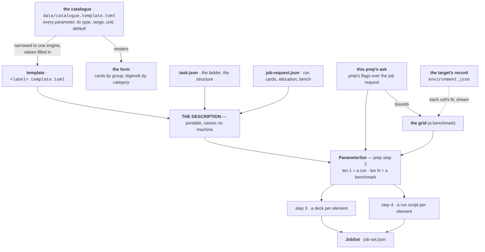

# The benchmark — one pipeline, a set of runs

**Role:** contract
**Domain:** execution
**Owns:** `ParameterSet` (a run is a set of one); what bounds a sweep; a
benchmark's grid, its trial pins, its shelves, how it is measured and its
winner; `bench-result.json`.
**Read with:** [`architecture.md`](?doc=execution/architecture.md) § 5.2 (where
every value comes from) ·
[`job-request.md`](?doc=execution/job-request.md) § 3.4 (the `bench` block) ·
[`job-system.md`](?doc=execution/job-system.md) § 7 (the bench verbs) ·
[`scheduler.md`](?doc=execution/scheduler.md) R6 and R11 (fit, comparability) ·
[`worked-example.md`](?doc=execution/worked-example.md) § 5 (a benchmark, walked)

---

## The short version

**A run is a sweep of length one.** `prep` step 2 always produces a list of
resolved configurations, a `ParameterSet`: one element for a run, N for a
benchmark, rendered by one loop (§ 2, § 5).

**A benchmark measures what runs one stage fastest on one queue.** You declare
what to try in `job-request.json`'s `bench` block; `prep bench <stage>` turns
it into cells fit on the benchmark's queue (§ 4.3a), renders each trial from
the description with the trial pins over it (§ 4.2), and lays the trials in
the stage's `bench/` folder; `launch bench <stage>` sends one job per resource
shelf (§ 4.3a); `summarize bench <stage>` writes `bench-result.json` and
prints a report (§ 4.3a, § 4.4b).

**Nothing applies a verdict.** The run uses what its run card states
(`execution`); a person reads the report and writes that card
([`architecture.md`](?doc=execution/architecture.md) § 5.2).

**Reading map.** For the person running a benchmark: § 4.3a, § 4.4, § 4.4a,
§ 4.4b. The design: § 1–§ 4.3, § 5. For a developer: § 6, § 7, § 10.

---

## 1. What this owns

> *"Takes only one set of parameters to set up and then formulate the actual
> job"* (user, 2026-08-11) — the ordinary job is a `ParameterSet` of length
> one, and nothing about sweeps appears on its path. The list exists so that a
> benchmark is the same pipeline, not a second one.

| owns | does not own |
|---|---|
| `ParameterSet`, and why it is a list | where a value comes from, rung by rung ([`architecture.md`](?doc=execution/architecture.md) § 5.2) |
| what bounds a sweep, and from which source | the `bench` block's keys and what may be swept ([`job-request.md`](?doc=execution/job-request.md) § 3.4) |
| the grid: declared and proposed cells, value axes, the GPU family | whether a request fits a queue ([`scheduler.md`](?doc=execution/scheduler.md) R6) |
| the trial pins | the bench verbs' grammar ([`job-system.md`](?doc=execution/job-system.md) § 7) |
| the shelves, and the order they are sent in | sending itself ([`submission.md`](?doc=execution/submission.md) S4) |
| measuring, the winner and the mismatch rule, `bench-result.json`, record-and-present | the file's schema string ([`job-contracts.md`](?doc=execution/job-contracts.md) § 6.1) |
| the engine seam's catalogue half (§ 7) | the seam's code half ([`script-preparation.md`](?doc=execution/script-preparation.md) § 4) |

**Which calculations have a benchmark.** A SIESTA optimization's or vibration's
stage. A transport calculation has none — its one axis is the bias list — and
a PySCF description has none: the trial pins are SIESTA settings. `prep bench`
refuses both by name before it reads any machine (`prep_inputs.bench_refusal`,
from the kind table's `no_benchmark` and the engine table's `benchmark`).

---

## 2. The one idea: a run is a sweep of length one

[`architecture.md`](?doc=execution/architecture.md) § 0 names the five axes
of the workflow; each is *a value read at one point, never a branch that grows
a second code path*. **The job kind — run or benchmark — is the length of the
`ParameterSet`**, read at `prep` step 2.

> **`prep` step 2 always produces a list of resolved configurations.** A run is
> that list with one element. A benchmark is the same list with N. Steps 3, 4
> and 5 loop over it.

**One loop, never a second path.** The code that renders one deck and the code
that renders sixteen is the same loop. What a trial differs in — its folder,
its relabel, its point — is read off the element (`point`, `is_trial`) and the
plan's kind (`KIND_SWEEP`), as data. What differs above step 2 is where the
values come from: a run hands down one condition, its run card; a benchmark
hands down a grid and its translation (§ 4.3a, § 6.0a). A third kind of prep —
a convergence study, a set of trial geometries — would be a `ParameterSet` with
another axis, and needs nothing new at the top.

---

## 3. The spine, in one picture



**The catalogue is the single source of every parameter's bound**
([`template.md`](?doc=engines/template.md) § 2.1), so a sweep needs no bounds of
its own. **This prep's ask bounds a benchmark's grid** (§ 4.1). **The target's
record never bounds what you declare**: it shapes only the machine's own
proposal, and each cell's fit on the queue is shown, never a veto
([`scheduler.md`](?doc=execution/scheduler.md) R6).

### 3.1 The form is built from the catalogue

The template and the Build form are made from one file, the catalogue:
`template.template_with_values(config, engine=…)` narrows it to one engine and
writes in the answers, and `_shared.catalogue_to_form_schema(engine)` emits the
form's sections from it. A blank form is the catalogue at its defaults; an
existing calculation's form is its template. One format, one renderer, two
states.

#### 3.1a The keys a surface needs

`label`, `category` and `null_label` are template keys because the form
cannot name or group a field without them. The key set and its rules are
[`template.md`](?doc=engines/template.md) § 5.

---

## 4. What bounds a sweep

A sweep axis is an item and a set of values. There are two families, and they
differ in who bounds them:

| family | examples | its values are bounded by |
|---|---|---|
| **parameter** | `block_size`, `diag_algorithm` | **the catalogue** — the item's own `range`, `choices`, `type` |
| **machine** | `mpi_np`, `omp_threads`, `gpu_count` | **this prep's ask** (§ 4.1) — a template never carries a machine value ([`template.md`](?doc=engines/template.md) § 7) |

A benchmark's **value** axes are only what its `bench` block declares, and only
run settings — the catalogue's `execution` category, *knobs that change speed
and not the answer* ([`job-request.md`](?doc=execution/job-request.md) § 3.4).
Its **machine** axes are the grid's three, `mpi_np`, `omp_threads` and
`gpu_count` (`template.GRID_AXES`): declared in `bench`, or, where nothing is
declared, proposed by the machine from its record (§ 4.3a, *The grid*).

**A bound that spans both families is computed once, where both values are in
hand.** `block_size`'s useful ceiling is orbitals ÷ ranks, and ranks are a
machine fact; the deck writer is handed the element's rank count with its
values (§ 5) and draws the window, only for a block size the deck carries
(`siesta/input.py`; [`tuning.md`](?doc=engines/tuning.md) § 2.11).

### 4.1 Capability, the ask, the sweep

A machine's **capability** is what its record says it has; the **allocation**
is the queue, the wall and the memory a run asks the scheduler for. Both words
are [`configuration.md`](?doc=configuration.md) § 5's. What bounds a benchmark
is neither: it is **this prep's ask** — the launch shape (ranks, cores per
rank, GPUs) and the allocation, as this prep holds them:

- **a run's**: prep's flags, then its run card, then the job request's
  `allocation` (`prep_inputs.fold_allocation`;
  [`job-request.md`](?doc=execution/job-request.md) § 3.1–3.2);
- **a benchmark's**: `prep bench`'s flags over the job request's `allocation` —
  never a run card, which is the run's own.

**The sweep — the cells a benchmark tries — fits inside that ask.** A cell past
this prep's own `--np`, `--cpus-per-task` or `--gpus` is left out by name,
proposed or declared: that is two of your statements disagreeing. Nothing is
clamped, and the prep is refused only when no cell is left. The record bounds
nothing you declare; each cell's fit on the queue is shown (§ 4.3a).

**Which ask:** the one for *this* prep. A benchmark and the run it informs are
two preps, usually on two queues (§ 4.4a), each with its own.

**Why the ask is not "the capability":** *how a job is scheduled depends on how
much you ask for* (user, 2026-08-11). Ask for the most and the job waits; ask
for less and it starts sooner. That trade is yours and changes per run, so
nothing fills an ask in from what the machine has.

### 4.2 A pin is the benchmark's

**A pin is a value every trial of a benchmark runs with**, laid over what the
trial takes otherwise, and over nothing else. A run has no pin: it runs at its
run card. There are two kinds:

- **The trial pins** — what makes a trial a measurement rather than a run, the
  same for every SIESTA benchmark (`template.TRIAL_PINS`):

  | pin | value | why |
  |---|---|---|
  | `max_scf_iter` | `3` | you are timing an iteration, not converging the chemistry; iteration 3 is the first clean timing sample ([`tuning.md`](?doc=engines/tuning.md) § 2.12) |
  | `relax_steps` | `0` | a single point, not a geometry |
  | `restart` | `clean` | a cold start, so no trial reads or writes the real run's state |
  | `scf_must_converge` | `false` | the capped SCF ends cleanly instead of aborting |

  None of them is a run setting, so no `bench` row can name one.
- **A one-point declaration** — a non-machine `bench` entry with one point,
  such as `"use_gpu": [true]`, pins the trials and only them
  ([`job-request.md`](?doc=execution/job-request.md) § 3.4).

**Each trial is also relabelled**, `<label>-<point>` (`paths.trial_label`), and
the deck's own `SystemLabel` line carries it (`EngineSeam.relabel`). SIESTA
finds its restart files by label, so a trial cannot read or overwrite the real
run's. The relabel and the cold start are why a trial can live inside its
stage's folder.

**The cold start is verified where the trial is sent.** The pin is its one
setter; `launch bench` reads the rendered deck and refuses a trial whose deck
would start warm, by name (`agreement.check_trial_starts_cold`) — prep bakes
the intent, the send checks the deck.

**What is not pinned:** the GPU, the eigensolver, the block size. They are what
the calculation states, and a benchmark measures what was described.

**`block_size` is a run setting** ([`job-request.md`](?doc=execution/job-request.md)
§ 2). On a run card it is written into the deck as given; stated nowhere, the
keyword is not written and SIESTA uses its own automatic value
(`siesta/input.py`; [`tuning.md`](?doc=engines/tuning.md) § 2.11). A benchmark
may sweep it as a value axis (§ 4.3a), and a person then writes the winner's
value on the run card.

### 4.3 A sweep is declared; the ask is stated

**What to measure is declared**, in the job request, floor 2, portable:
*"try 4, 8 and 16 ranks"* is true on every cluster. **What those points mean on
a machine is resolved at `prep bench`**, for the target, from its record, and
against this prep's ask. A machine axis is resolved *against* the ask; it is
not one.

**The same portable folder is what you benchmark, what you then run at the
configuration you chose, and what someone else runs on another cluster at
their own.** None of the three edits it.

**A request is prepared, never vetoed.** What you asked for is written —
`prep` never trims a number to fit — or prep refuses a value stated nowhere,
naming where to state it ([`architecture.md`](?doc=execution/architecture.md)
§ 5.2). A run's request is placed on its queue at prep and its fit printed
([`job-system.md`](?doc=execution/job-system.md) § 5.0); a benchmark's cells are
fit the same way (§ 4.3a).

#### 4.3a A stage's benchmark — the grid, the shelves, the summary

> *"Sweep is decided at prep, not in the description, and it is specifically
> tied to a stage because a stage chooses its run parameters based on bench
> results"* (user, 2026-08-17).

What runs fastest changes between stages: a finer mesh or a larger basis is a
different grid and matrix, and a different best rank count. So a benchmark
measures **one stage**, named at its prep, and lives in that stage's folder.
Two kinds of tuning nest, one inside the other:

| | a **stage** — tunes the science | a **trial** — tunes the machine |
|---|---|---|
| varies | mesh cutoff, tolerances, the relaxation method | ranks, cores per rank, GPUs |
| its deck | its own, from the template and its overrides | the stage's settings with the pins over them (§ 4.2) |
| its label | the calculation's, so it continues from the stage before | its own, `<label>-<point>` |
| ordered | yes — each builds on the one before | no — trials are independent |
| outcome | a result you keep | a number; its run is thrown away |
| made by | `prep task` | `prep bench <stage>` |

##### The four acts

| act | where | what it is |
|---|---|---|
| **what to measure** | `job-request.json`'s `bench` — `{"mpi_np": [4, 8, 16], "omp_threads": [1, 2]}` | declared, portable; one block for the calculation |
| **which stage, on which queue** | `jobset prep bench <stage>`, its queue `--domain` or `allocation.domain` | resolved for the target, from its record: the cells, the trials, the shelves' headers |
| **the run** | `jobset launch bench <stage>` | one job per shelf on a queue; one walk here |
| **what was fastest** | `jobset summarize bench <stage>` → `<NN>_<stage>/bench/bench-result.json` | measured; a report a person reads |

##### What a trial runs with

A trial's settings come from its sweep point, the benchmark's one-point
declarations and the **calculation's** run card — never a stage's own card —
in the order [`architecture.md`](?doc=execution/architecture.md) § 5.2 gives;
the trial pins (§ 4.2) are laid over all of it. **Whether the trials are a GPU
family** is the same answer for `use_gpu`: the bench's points for it, else the
calculation's card, else the catalogue's default, `false`. A benchmark's
verdict is not on that ladder.

##### The run's condition is its own — `execution`

> *"Run parameter is independent from bench grid or bench result. User can run
> without bench. Bench and run share the same framework to choose/set
> parameters but run does not produce grid but a single user defined condition
> to run"* (user, 2026-09-02).

| block | shape | means | produces |
|---|---|---|---|
| `bench` | several values per axis | measure these | N cells, one trial each |
| `execution` | one value per setting | use this | one cell — the run |

The two are independent and both optional; a run never requires a benchmark.
A one-point `bench` entry is not the run's condition: narrowing a row to say
what the run uses would destroy the plan to measure, so the run reads
`execution` ([`job-request.md`](?doc=execution/job-request.md) § 3.2). Both
lanes end in the same pipeline — `resolve()`, the `ParameterSet`, the
renderers — and a run's machine values reach its `Resources` by a direct map
from the catalogue's names (`prep_inputs.declared_run_shape`), never through
the grid enumerator, which exists to invent the axes a sweep does not state.

##### The grid

A **cell** is a machine shape — `G` GPUs, `N` ranks in all, `C` cores per
rank — and its trials carry that shape in their names, `bench-G0N8C2`. Every
trial carries `G`, `G0` for a CPU trial (`resolve.point_token`).

- **A declared grid states both its axes**, `mpi_np` and `omp_threads`; one
  alone is refused, never filled. `mpi_np` is the total rank count, as
  everywhere. Its cells are every pair.
- **On the GPU, the device count is declared with `gpu_count`**: exactly those
  counts, and every `(mpi_np, G)` pair is a cell, its ranks spread over its
  devices as a run spreads them — an uneven split said
  (`ask.gpu_share_notes`, the sentence a run's prep says). A `gpu_count` on a
  CPU benchmark is refused.
- **With no declaration, the machine proposes**, from what its record says
  (`bench/grid.py`): rank counts from the divisors of the probed cores per
  socket, each with a bracket of cores per rank — one, a socket's share, twice
  that; on the GPU, each device count from one to the GPUs a node holds — the
  named queue's, else the most any GPU queue in the record holds, and the
  probed node's own only where the benchmark goes to no queue — with those rank
  counts per device. A declared rank grid with no
  `gpu_count` takes as its device counts each rank count's divisors, up to what
  a node holds — a proposal, so fit like one. A record that does not state its
  cores per socket proposes no grid; a GPU benchmark whose record states no GPU
  count, and that declares none, is refused, naming the probe that writes it.
- **A value axis multiplies the grid.** A non-machine entry with several points
  — `"diag_algorithm": ["ELPA-1STAGE", "ELPA-2STAGE"]` — crosses every cell,
  in declaration order; each trial carries its coordinates on its point, and
  the resolver applies them like any parameter (provenance `sweep`). Its trials'
  names go on past the cell: `bench-G0N8C2ELPA1STAGE`.
- **`use_gpu` with two points is the family axis.** The grid is enumerated once
  per flag — the CPU family at `G0`, the GPU family over device counts — so a
  trial's deck and its family agree by construction.

##### Fit on the one queue

**A benchmark measures on one queue**, the one its prep names (`--domain`, else
`allocation.domain`) — *"You need one domain to bench. If you need a different
domain, another bench"* (user, 2026-10-17). Each cell is fit on that queue by
the fit `scheduler.place` asks (`scheduler.fit`), so a cell here and a run at
prep get one reading. On a machine whose scheduler has no queue, or with
`--no-sbatch`, a cell is fit on the target's probed node, and the benchmark
runs where it is launched.

| a cell that is… | outcome |
|---|---|
| **declared** — every coordinate stated: ranks, cores per rank, and on the GPU its device count | **kept**, whatever the record says, its fit printed under it — the scheduler decides (R6) |
| **proposed** by the machine, and no node of the queue holds it | **left out**, with the numbers that rule it out; a cell that fits is never denied by a sibling that does not |
| past this prep's own ask (§ 4.1) | **left out by name**, proposed or declared |

Before its grid, a benchmark states its queue, wall and memory like any run on
a scheduler; a queue the target's record does not list, or a record that lists
no queues, is refused with the way out. **No cell left** is a refusal; **no GPU
cell left** is a refusal for a GPU benchmark and a note for a CPU-versus-GPU
one, which then measures the CPU family alone. Where the queue's record states
a per-user job cap and the shelves exceed it, prep says so: the jobs past the
cap come back refused, and launching again sends exactly them.

The prep prints the outcome — one line per kept cell, its fit on the queue
under it — then the cells left out, each with why:

```text
  bench grid: 4 combination(s) enumerated, 4 kept on <queue>
    G0N8C1      8 rank(s) x 1 core(s)
    …
```

##### The shelves

**Trials that ask for exactly the same resources share one job**, sized to fit
them exactly, so nothing idles inside it — *"lighter tasks scheduled for heavy
resource idling for hours is not a good use of cpu time"* (user, 2026-08-21).
`jobset/shelves.py` makes them, once, for prep and launch:

1. **By side** — a trial's GPU request (`model.gpu_request`). The CPU side's
   jobs ask no GPU, so no device is held while CPU trials run.
2. **By exact ask** — ranks, cores per rank, GPU count. A value axis shares its
   cell's shelf, so the job count stays at the number of distinct shapes.
3. **Named in full** — `bench-group-<side>-<cell>`, e.g.
   `bench-group-cpu-G0N8C2`, `bench-group-gpu-G2N32C1`
   (`runfiles.GroupNames.of_trials`).
4. **Ordered** — the CPU side's shelves, then the GPU side's, each side widest
   first: cores (ranks × cores per rank), then GPUs.

**Each shelf's one header is written at prep** — its trials' shared request
placed on the benchmark's queue, its fit said — in the benchmark's `launch/`
folder (`prep.walk_header_of`). Its wall is the benchmark's wall, for the
shelf's whole job.

**Launch sends the shelves one at a time**, in that order, each as its header
stands (`submit._plan_shelves`), after every shelf's walk is written — so a
refusal costs one shelf, never the scripts of those behind it. Each shelf is
its own job; the queue may run two side by side. **Inside a shelf the trials
run one after another**, each with its own explicit `-np` and `-omp`, so no
trial shares its job's resources with another and none falls back to the width
of the job. When the scheduler accepts a shelf, every trial on it is recorded as
launched, with the shelf's job id. The order lands the expensive measurements
first: you can watch the trend (`launch/bench-group*.log`, `summarize`
mid-flight) and stop early, and what completed still summarizes.

- `--only cpu|gpu` sends one side; the other stays pending for a later
  `launch bench`.
- `--trial-timeout MINUTES` kills a single trial past that bound so the walk
  goes on; the walk's log names the bound it hit. **The killed trial reads
  `failed`**: the kill leaves no conclusion marker, and the monitor's closing
  record says the job was stopped
  ([`running-a-job.md`](?doc=execution/running-a-job.md) § 4.2). Unstated, a
  trial runs until it ends or the job's wall.
- A shelf the scheduler refuses keeps its trials pending, with no launch
  record; the rest go, and launching the benchmark again sends exactly the
  refused ones.
- `--mode direct` runs every unlaunched trial here as one walk, in order, in
  the background unless `--foreground`
  ([`job-system.md`](?doc=execution/job-system.md) § 6.0).
- Naming a trial (`launch bench <stage> G0N8C2`) launches that one alone.

**A trial is launched once.** A shelf stopped early leaves its trials that
never ran recorded as launched, so `launch bench` does not send them again. To
measure any trial again, restore the state saved before the benchmark's prep
and prepare it anew
([`project-layout.md`](?doc=execution/project-layout.md) § 1.5a).

##### The summary

`summarize bench <stage>` reads every trial that has run — it is blind to how
they were sent — and builds one record (`summarize.bench_record`):

- **each point**: what it asked (its knobs), what it measured — the
  steady-state seconds per SCF iteration (`scf_timing_rows.timing_of`), the
  monitor's CPU, memory and GPU samples — the machine it landed on, and its
  state, the run door's (`runs.state_of`);
- **the winner** (`bench.result.choose_winner`): the fastest point that
  finished and ran what it was asked to run. With no point to rank, `choice` is
  `{"none": "<why>"}`, and every reader says that sentence;
- **how the winner computed** — its `use_gpu` and eigensolver, read from its
  own deck (`summarize._winner_mechanism`).

**A trial that ran something else cannot win.** The fallbacks are silent: an
ELPA build that cannot use the GPU drops to the CPU solver and says so only in
its output, a launcher may hand back fewer ranks than asked, and an
`OMP_NUM_THREADS` in the environment overrides the scheduler's cores per rank.
So each trial's own artifacts are read back — SIESTA's `* Running on N nodes in
parallel.` and its `diag:` line, the run script's ranks-and-threads record —
into the point's `effective` block, and compared with what it asked for into
its `mismatch` block (`bench.result.parse_effective_run`,
`compare_asked_to_ran`): the ranks, the cores per rank, the eigensolver. The
block size SIESTA settled on is recorded and never compared — SIESTA shrinking
it to the rank count is documented behaviour. A mismatched trial stays in the
record, is named in the rationale and in the table, and is barred only from
winning; if every timed trial mismatches there is no winner, and `choice` says
why.

The terminal prints a table, one row per point, the verdict, and **the
report**: the `execution` block that would run at the winner, to paste into
`job-request.json` (`summarize.recommendation_text`). It recommends no wall and
no memory — those are stated by a person
([`architecture.md`](?doc=execution/architecture.md) § 5.2). Nothing applies it;
until a person writes the block, `prep task` runs at what the job request
states. **`bench-result.json` is the sweep's archival record**, read back by no
code: the Results panel reads the trials again through `sweep_view`
([`job-system.md`](?doc=execution/job-system.md) § 7.1).

##### A worked grid

A CPU stage, its job request declaring:

```json
"bench": {"mpi_np": [8, 16], "omp_threads": [1, 2],
          "diag_algorithm": ["ELPA-1STAGE", "ELPA-2STAGE"]}
```

| step | result |
|---|---|
| cells | `G0N8C1`, `G0N8C2`, `G0N16C1`, `G0N16C2` — all declared, so all kept, each with its fit |
| trials | each cell × each eigensolver: eight trials, `bench-G0N8C1ELPA1STAGE` … `bench-G0N16C2ELPA2STAGE` |
| shelves | four, one per cell, two trials each: `bench-group-cpu-G0N16C2` (32 cores) first, `bench-group-cpu-G0N8C1` (8 cores) last |
| launch | four jobs, sent one at a time; inside each, its two trials one after another |

---

### 4.4 What a benchmark produces — a scaling rule

**A benchmark is not a stopwatch; it is a scaling rule.** Averaged across a
trial, what the monitor samples and the SCF timing say what happens if you
spend more — which shape goes faster, where the returns stop.

It answers half the question. The other half — *should we ask for the most?* —
is § 4.1's priority trade, and no measurement settles it: **the configuration a
real run asks for sits between *fastest* and *soonest*.** The benchmark tells
you the first, the queue the second, and you pick the point between them —
which is why `summarize` writes a recommendation and not a decision. Designing
the grid itself — what the GPU accelerates, ranks per device, which points to
cut — is [`tuning.md`](?doc=engines/tuning.md) § 2.12.

#### 4.4a The benchmark normally runs on a different queue

The benchmark and the real run are preps of one calculation, so both run on
its machine — the machine of its first prep, which does not change
([`configuration.md`](?doc=configuration.md) § 5, M-3). What differs is the
queue each asks for:

| | typically runs on | why |
|---|---|---|
| **the benchmark** | a short, high-priority queue | its trials are minutes — SCF capped, steps zeroed — so they fit a short limit and start soon |
| **the real run** | a long queue | the calculation needs the time; on ASU Sol, [`asu-sol.md`](?doc=execution/asu-sol.md) |

So what `bench-result.json` carries splits by whether it crosses to the other
queue. It holds no sizing: no wall, no memory.

| part | what it is | crosses? |
|---|---|---|
| **`choice`** | the mechanism — the winning shape, its GPU use and eigensolver | yes, where the node is the same kind |
| **`points`** | each trial's measurements, on the node it landed on | no: a measurement of specific nodes |

**Whether two nodes are the same kind is decided by where each trial actually
ran**, never by the queue's name — a queue holds many kinds of machine
([`scheduler.md`](?doc=execution/scheduler.md) R0, R11; the writers of the
sent-to queue and the landed-on machine are R12).

#### 4.4b A sweep records what each trial ran on, and shows it

**What each trial ran on is part of the measurement.** On a queue holding many
machines, two trials of one sweep can land on different hardware without anyone
choosing it.

| | |
|---|---|
| **record** | every trial carries the machine it ran on — the monitor's `[MACHINE]` line ([`scheduler.md`](?doc=execution/scheduler.md) R12) |
| **present** | the summary shows it per trial, and says when the trials ran on more than one kind of node (`machine_census`) |
| **never** | rank, discount, annotate or refuse on that basis |

> *"Speed comparison is speed comparison, don't overstep — you are not the
> analyzer, you present the data"* (user, 2026-08-27).

A sweep with a GPU axis lands its two sides on different machines by
construction — a queue offers GPU nodes and wide CPU nodes, never one node that
is both. That is a fact about the hardware, not a defect in the sweep; the
person who asked for the comparison reads it. How the winner is chosen is
§ 4.3a, *The summary*. **A `choice` is never carried
into another prep by itself**: a person writes it into `execution`
([`architecture.md`](?doc=execution/architecture.md) § 5.2).

---

## 5. `ParameterSet` — the object that makes *kind* a value

| | |
|---|---|
| **built by** | the resolver, `resolve.resolve()`, at `prep` step 2 |
| **answers** | *what configurations are we about to render?* |
| **shape** | an ordered tuple of `ResolvedConfig`, the axes that produced it, and the stage it resolves |
| **writes** | nothing |

**Each element is complete and renderable on its own.** Its values are laid in
one order, last wins:

1. the template's values, then the stage's overrides;
2. the run settings — a card's, else the catalogue's default (a trial takes
   only the calculation's card);
3. the sweep point;
4. the pins;
5. last, the rung's own answers to the items it fixes (`role`,
   [`template.md`](?doc=engines/template.md) § 6.4).

No reader downstream re-derives a value.

| field of `ResolvedConfig` | why it exists |
|---|---|
| `values` | the resolved engine config — what the deck writer renders |
| `resources` | this element's own request — per element, see below |
| `point` | the sweep coordinate (`{}` for a run) — what names the trial folder |
| `label` | the `SystemLabel` in force; a trial's is relabelled (§ 4.2) |
| `provenance` | which source set each value — `template`, `stage`, `stage_card`, `calc_card`, `default`, `sweep`, `pin`, `role`; a launch field `flag`, `run card` or `allocation` |
| `deck_sources`, `said` | who set each value, in words — the deck's provenance table and the pipeline log's ([`job-contracts.md`](?doc=execution/job-contracts.md) § 3.2) |

**`resources` is per element** because a sweep over `mpi_np` gives each trial
its own rank count. `Job.resources` is copied from it, so the deck writer and
the run script writer read one object.

**`point` is why a trial folder needs no naming rule of its own.**
`bench-<point>` is the point rendered by one function, `resolve.point_token`
([`job-contracts.md`](?doc=execution/job-contracts.md) § 6.3).

**A benchmark nests inside the stage it measures**, in its `bench/` container
(abridged):

```text
<NN>_<stage>/bench/
├── job-set.json            the benchmark's own plan: every trial, its point as data
├── STAGE-PLAN.md           that plan in words
├── bench-<point>/          a trial: its deck, run script, data files
│   └── run-0/              its one run, launched once — its run.json once launched
├── launch/                 each shelf's header, walk and log: bench-group-<side>-<cell>.*
└── bench-result.json       the record, written by summarize
```

The calculation's root `job-set.json` stays the run plan. The names are
[`job-contracts.md`](?doc=execution/job-contracts.md) § 6.3's; the tree is
[`project-layout.md`](?doc=execution/project-layout.md) § 1.1's, and every file,
with who writes it, is its manifest (§ 5 there).

---

## 6. For developers — where it lives

**Floors.** The resolver is floor 3 and imports downward only; every module's
floor is [`architecture.md`](?doc=execution/architecture.md) § 2.1.

| module | owns |
|---|---|
| `resolve.py` | `ParameterSet`, `ResolvedConfig`, `MachineTranslation`, `point_token`, `MACHINE_AXES` |
| `jobset/prep_inputs.py` | the two assemblies (§ 6.0a), the declared bench split, the cell fit and the printed grid |
| `bench/grid.py` | the machine's proposal |
| `template.py` | `TRIAL_PINS`, `GRID_AXES` |
| `jobset/shelves.py` | sides, shelves, a shelf's one request |
| `jobset/prep.py` | `walk_header_of` — each shelf's header at prep |
| `jobset/submit.py` | `_plan_shelves`, `_plan_bench_here` — the send |
| `jobset/agreement.py` | `check_trial_starts_cold` |
| `jobset/summarize.py` · `bench/result.py` | `bench_record`, `choose_winner`, `recommendation_text`, the `bench-result@1` record |

**Tests:** `test_prep_bench_fold.py` (the benchmark through `prep`, shelves,
a named trial), `test_value_axes.py` (value axes, declared cells, the GPU
split), `test_bench_grid_card.py` (the grid the Task setup card shows),
`test_bench_result.py` and `test_bench_summarize.py` (the record, the winner),
`test_machine_in_summary.py` (§ 4.4b), `test_resolve.py` (the resolver).

### 6.0a One assembly per route

Every surface calls one function to compose a route's inputs, and composes
nothing itself — the rule is [`architecture.md`](?doc=execution/architecture.md)
A12. For `prep` there are two, one per kind (`jobset/prep_inputs.py`):

| | returns |
|---|---|
| `prep_run_inputs` | `(allocation, settings, chosen)` (the code's names) — this prep's ask as a `Resources`, the run settings with their cards, the run card's launch shape |
| `bench_inputs` | `(points, pins, translation)` — the cells as points, the pins, the point → `Resources` map |

### 6.1 What the resolver reads

| reads | never |
|---|---|
| the template, the description, the target's record (`Environment`), this prep's ask (§ 4.1; `allocation: Resources`, the code's name), the sweep, the pins | writes a file |

`MachineTranslation.to_resources` receives the `Environment` beside the point;
none of the benchmark's translations reads it. The same table for every floor
is [`architecture.md`](?doc=execution/architecture.md) § 2.1's *must never*
column.

---

## 7. The engine seam — a plugin, not a branch

**Adding an engine adds records and a seam; no shared code branches on its
name** ([`architecture.md`](?doc=execution/architecture.md) A18). It adds rows
to the catalogue, a record to the engine table (`data/engine_table.toml`: its
config class, its seam, whether it has a benchmark lane), and the seam's
answers — its own modules, joined by a seam constructor in
`jobset/engines.py`.

**This chapter owns the catalogue half**: every parameter the engine models,
each with the item keys [`template.md`](?doc=engines/template.md) § 5 defines
(its `type`, `default`, `kind` and the rest) and an `engines` list, as rows of
the one shared file; an item with no `engines` list applies to every engine
([`template.md`](?doc=engines/template.md) § 6.3).

### 7.1 The code half

What an engine answers at each preparation step is
[`script-preparation.md`](?doc=execution/script-preparation.md) § 4's table:
sixteen questions, one row each, by the step that asks it — one at describe,
one at step 2, fourteen inside step 3. An answer of *nothing* is a recorded
answer, never a gap.

### 7.2 Where the engines stand

Counted in `data/catalogue.template.toml` (133 items):

| `engines` | items |
|---|---|
| SIESTA only | 71 |
| PySCF only | 45 |
| both named | 12 |
| no list (every engine) | 5 — `use_gpu`, `gpu_count`, `max_memory_mb`, `verbose_comments`, `write_molwatch_log` |

To count again, read the file's `[item.*]` tables and group them by their
`engines` key. Both engines ship a `warm-files.toml`. The stage's names
(`runfiles.RunNames`) are a render argument, so one writer serves a ladder:
the engine never learns the stage's word, and every name its deck writes or
prints carries the stage's token
([`run-identity.md`](?doc=execution/run-identity.md) § 3.2).

---

## 10. How a value is decided

Who decides each value, when, and what beats what is
[`architecture.md`](?doc=execution/architecture.md) § 5.2.

### 10.1 The catalogue is the one default table

Every parameter's default is its catalogue item's, and no other list of
defaults exists ([`template.md`](?doc=engines/template.md) § 5). A stage
changes a value by override
([`stages.md`](?doc=engines/stages.md) § 2); a run setting nobody stated
takes the catalogue's default
([`job-request.md`](?doc=execution/job-request.md) § 4).
