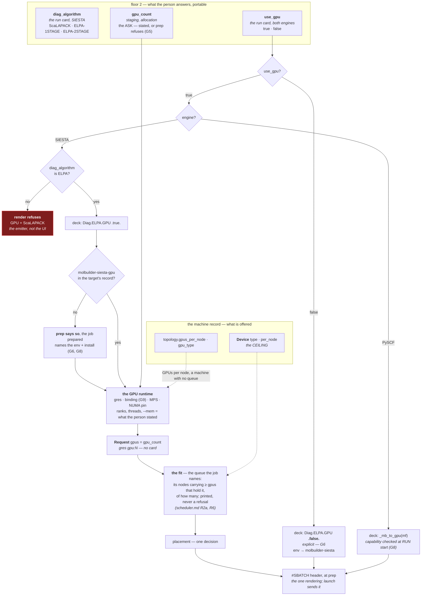

# How a GPU decision travels — one question, every name it is read under

**Role:** contract
**Domain:** execution

**Companions:**
[`engines/siesta.md`](?doc=engines/siesta.md) § 7 — the two orthogonal
decisions and what each emits, which stays there;
[`engines/overview.md`](?doc=engines/overview.md) — the SIESTA/PySCF
comparison table;
[`execution/scheduler.md`](?doc=execution/scheduler.md) — what a queue
offers and whether a request fits;
[`engines/template.md`](?doc=engines/template.md) § 6.1 — `read_by`, the
declaration that a value leaves the deck;
[`web/task-setup.md`](?doc=web/task-setup.md) § 6.2 — the ruling that
makes this a person's choice.

A GPU decision starts as **one tick-box** and ends as an environment, a
scheduler flag, an MPI launch, a memory cap and a NUMA pin. Between those
two points it is read under the names of § 1.3, and this document draws the
path: each GPU fact has one home, named here.

---

## 0. What this document owns

**Owns:** **which GPU questions are molbuilder's and which are the
machine's** (§ 1); which GPU question each name answers, who answers it,
where the answer is read, and the one walk from the tick-box to the running
job — `use_gpu`, one item for every engine.

**Does not own:** what a GPU *does* for a calculation
([`engines/tuning.md`](?doc=engines/tuning.md) § 2.12), how the
`molbuilder-siesta-gpu` environment is *built* (`ops/`), or whether a
request fits a queue ([`scheduler.md`](?doc=execution/scheduler.md) § 3).

---

## 1. Whose business each GPU question is

*(The user, 2026-10-01: molbuilder's part "need to be explicit and
accurate/accommodating" — "and which part is none of your business".)*

### 1.1 molbuilder's — stated explicitly, done exactly

| question | answered by, where | what molbuilder does with it |
|---|---|---|
| **Does this run use a GPU?** | the person — `use_gpu` on the run card (`execution`), over the catalogue's default (`false`, [`job-request.md`](?doc=execution/job-request.md) § 4); an axis of a bench | renders each engine's keyword (`Diag.ELPA.GPU`, gpu4pyscf), takes SIESTA to its GPU build, asks the scheduler for GPUs. Not said, no GPU is asked for |
| **How many GPUs?** | the person — `gpu_count` on the run card, both engines, or `--gpus N` on the prep | asks `--gres=gpu:N`. **No default, and no count without the GPU:** a run that uses a GPU and states no count, or states a count and does not use the GPU, is refused at prep, before anything is written, naming where each is said (G5). A bench that names no `gpu_count` measures each count that divides its rank counts, up to the most one node holds (§ 3.1) |
| **Which queue may take it?** | the person — the queue the job names (`allocation.domain`, the run card, `--domain`); the target's scheduler decides | the job is placed there and its fit printed: the nodes of that queue carrying at least N GPUs that also hold its cores and memory, of how many — a queue whose record lists no GPUs has none ([`scheduler.md`](?doc=execution/scheduler.md) R2a, R3). Never refused for it (R6) |
| **Where is GPU work submitted?** | the job — the queue it names | that queue, as for any job; nothing on the record sends GPU work elsewhere |
| **Which rungs take the calculation's GPU?** | the catalogue — the rungs whose role reads `use_gpu` | a calculation-wide `use_gpu` and `gpu_count` reach only those rungs: never a transport ladder's transmission, whose `tbtrans` has no GPU path ([`job-request.md`](?doc=execution/job-request.md) § 3.2); a rung's own card stating one there is refused |
| **Are the job's cores bound to its GPUs?** | molbuilder: yes — and the person may turn it off, `"gpu_binding": false` in `job-request.json`'s `allocation` | sends `--gres-flags=enforce-binding` with every GPU ask, unless turned off (G9) |
| **How do the ranks share the GPUs?** | molbuilder's launch script, at run time | spreads the ranks over the GPUs the job was GIVEN (counted from `CUDA_VISIBLE_DEVICES`), starts MPS when ranks outnumber GPUs and says so as decided, binds each rank to cores of its own off a scheduler and runs the ranks inside the cores a scheduler gave ([`running-a-job.md`](?doc=execution/running-a-job.md) § 3.3) — a rank whose cores lie on another socket than its GPU is warned about in the run's log, never refused (G10). The rank and thread counts are the stated ones — a GPU job that states none is refused at prep, like any job ([`architecture.md`](?doc=execution/architecture.md) § 5.2) |
| **Can the deck run on a GPU there?** | the target's record — which environments exist | SIESTA: said at prep when the target's record lists no GPU build of SIESTA — the job is prepared, the note names the env and its install; PySCF: checked at run start, because a login node cannot see a device (G6, G8) |

**Every fact comes from the target's own record.** A target is known only
through its `environment.json`, written by `jobset probe` on that machine —
this machine's at `~/.config/molbuilder/environment.json`, another's at
`environments/<name>.json`. A prep reads that record and nothing else about
the machine: `molbuilder.json` supplies no GPU fact and no GPU ask for any
target, this machine included ([`configuration.md`](?doc=configuration.md)
§ 5, M-1, M-3).

**What a record says is taken as it says it.** The GPUs of a queue are read
from the probe's `{"a100": 4}` (`scheduler.md` § 4, *Device*); any card name,
MIG slices included, counts as GPUs; a record
whose probe ran on a login node that sees none gives the count from its
queues; and a queue whose `gpu` column marks GPUs without saying how many
is never refused on the number (R3: silence never bars).

### 1.2 The machine's — never asked, compared, chosen or configured

- **Which card** — the model, its memory, a MIG slice. A GPU ask is a
  count. The record keeps the card the probe saw (`jobset machines` shows
  it) and nothing decides by it; the card a job LANDED on is recorded in its
  run log, to compare runs by the hardware they ran on (`scheduler.md` R11,
  R12) — measured, never asked for.
- **Whether the GPU is there and works when the job lands** — drivers,
  CUDA, the card's memory, whether the calculation fits on it. The target's
  scheduler and the job itself answer that: the fit owns only what the
  scheduler decides (`scheduler.md` § 0).
- **Which node the scheduler picks, and whether it can enforce the
  binding.** `enforce-binding` asks; a scheduler that does not know which
  cores sit near which GPU cannot honour it.
- **Anything about this machine, when this machine is not the target.**

**`molbuilder.json` holds no GPU setting** — its `scheduler` block is refused
by name ([`configuration.md`](?doc=configuration.md) § 4): a GPU job's card,
queue and memory are its own, its memory asked exactly as a CPU job's
(`running-a-job.md` § 5.3.1), and nothing asks for a whole node.

### 1.3 The vocabulary — every GPU name, and who answers it

| name | answered by | lives in | decides |
|---|---|---|---|
| **`use_gpu`** | **the person** | catalogue · `staging` · `read_by=[wrapper]` | run the solve on a GPU or not |
| `diag_algorithm` | **the person** | catalogue · `staging` · SIESTA only | the eigensolver — **and nothing else** |
| `gpu_count` | **the person** | catalogue · `allocation` · `staging` · both engines | how many GPUs a run or a trial **asks** for — no default (G5); read by the rungs that read `use_gpu` (`stages`: never a transport ladder's transmission, whose `tbtrans` has no GPU path) |
| `gres` | **derived at prep** | `Resources` | the GPU ask, `gpu:<n>` — a count, which the header's GPU directive takes in the target's scheduler kind's words ([`scheduler.md`](?doc=execution/scheduler.md) § 6a); molbuilder names no card (R2a) |
| `gpu_binding` | **the person**, to turn it off | `job-request.json` · `allocation` → `Resources` | whether the ask carries `--gres-flags=enforce-binding` (G9) |
| `Diag.ELPA.GPU` | *(rendered)* | the SIESTA deck | the keyword `use_gpu` becomes |
| `gpu4pyscf` / `to_gpu()` | *(rendered)* | the PySCF deck: `_mb_to_gpu(mf)`, imported from its bundle (`runtime_info.to_gpu`) | the same, for PySCF |
| `Device(type, per_node)` | **the probe** | `environment.json` · `Domain.gpu`, each machine's `gpu` | what one node of a queue **offers**; its `type` is shown, never compared |
| `topology.gpus_per_node` · `gpu_type` | **the probe** | `environment.json` | what the probed node has — a machine with no queue's own; on a cluster, one sampled node, never read as the cluster's; the card is shown, never compared |

> **The ask and what a node offers are different variables, and the names
> hide it.** `gpu_count` is what a run or a trial asks for; `Device.per_node`
> is what one node of a queue carries. The fit reads them together — the
> nodes carrying at least the number asked — and a bench that names no
> `gpu_count` proposes the divisors of each rank count **up to the most one
> machine of its queue carries**. A reader who takes `gpu_count` for what a
> node offers will size a run to the hardware and call it a request.

---

## 2. The rules

**G1 — One question, one item.** *"Does this run want a GPU?"* is one
question with one answer, named `use_gpu`, for every engine (`kind = "deck"`,
`template.md` § 6.3). The item carries the answer; each engine's writer
renders its own keyword — SIESTA's `Diag.ELPA.GPU` behind its ELPA gate,
PySCF's backend selection — and the item never learns either spelling.

**G2 — The person answers it, and nothing derives it from the machine.**
`use_gpu` is an ordinary explicit option with a real default (`false`).
It is **not** in the `allocation` set — that set is exactly `mpi_np`,
`gpu_count`, `omp_threads`, `max_memory_mb`, `threads`, and membership is a
flag on the catalogue item read through one door. *A document that calls
`use_gpu` a machine fact is wrong, not shorthand.*

**G3 — The solver is not the accelerator.** `diag_algorithm` chooses the
eigensolver and decides **no environment and no resource** — the packaged
SIESTA carries ELPA through ELSI and runs both stages on CPU, measured.
Only `Diag.ELPA.GPU true` re-routes anything. The two are easy to confuse,
so they are two rows on the run card, each its own question.

**G4 — The ask and what a node offers are different names.** A request
states `gpu_count`; a record states each machine's `gpu`. The fit counts the
nodes of the queue the job names that carry at least the number asked, and
says so; the job is placed there whatever the count, and the scheduler
decides ([`scheduler.md`](?doc=execution/scheduler.md) R2a, R6). Neither may
be read as the other.

**G5 — No default for the count, and no count without the GPU.** A run that
uses a GPU states how many — `gpu_count` on its run card, or `--gpus N` on its
prep — and a run that does not use one states none: either disagreement is
refused at prep, before anything is written, saying where each half is stated
*(the user, 2026-10-01: "there is no default. all resources are explicit")*.
The two halves
are one answer, the job's **GPU request** (`jobset.model.gpu_request`,
`architecture.md` § 3.2), and every reader asks it — the header, the run
script, prep's placement and its queue list, a benchmark's trials, their
shelves and their report, the Task setup card, which shows a request prep refuses as the refusal. A bench is
not a run: a bench that names no `gpu_count` measures the counts § 3.1
describes.

**G6 — No silent fallback, in either direction.** A GPU deck never runs on
the CPU build, and a CPU deck never on the GPU one. SIESTA's GPU build is an
environment, and whether the target has it is the target's record's to say —
the record is shown, never a veto (the user, 2026-10-17): when the record lists no `molbuilder-siesta-gpu`, **prep prepares the job as
asked and says so** in its notes — the env the run script enters at its
start and stops without, and the command that installs it
(`bash scripts/install-env.sh install molbuilder-siesta-gpu`, the one
spelling of an env command, `envs.hints.fix_cmd`); the person
installs it, or turns `Use GPU` off and preps again. PySCF's GPU is a device,
checked at run start: the script exits with the reason. A CPU-ELPA deck
writes `Diag.ELPA.GPU .false.` **explicitly**, never left to the engine's
default — omitted, it crashes a CPU-ELPA run
([`engines/siesta.md`](?doc=engines/siesta.md) § 7).

**G7 — The value travels; the deck is not re-read for it.** `use_gpu`
declares `read_by = ["wrapper"]` precisely so the wrapper can be *handed* the
value. `resolve` carries it from the job's own values — what its deck renders —
onto the job's resources, and the GPU request is read off them (G5's one door).
*A scan of the rendered SIESTA deck for `Diag.ELPA.GPU` cannot route a PySCF
GPU run at all: its deck carries no SIESTA keyword.*

**G8 — Capability is checked where it can be seen.** SIESTA's GPU capability
is an **environment** — visible in the target's record, so read at prep and
said there (G6). PySCF's is a **device** — not visible from a login node, so
checked at run start. This asymmetry is a fact about the two stacks, not an
inconsistency.

**G9 — The job's cores are bound to its GPUs, unless the calculation says
not.** Every GPU ask carries `--gres-flags=enforce-binding`: the scheduler is
asked to give the job cores on the socket its GPUs are attached to, which the
launch script's per-rank NUMA pin relies on. It never makes a submission
fail; it can delay the start while such cores free up. `"gpu_binding":
false` in `job-request.json`'s `allocation` turns it off for the whole calculation —
its benchmark and its runs alike, so a benchmark measures the layout the run
will use ([`job-request.md`](?doc=execution/job-request.md) § 3.1). *(The user,
2026-10-01: "some task never needs this and some task may benefit, i believe
sol never guarantees this anyway".)*

**G10 — A rank away from its GPU is a warning, never a refusal.** At run time
the launch script gives each rank its GPU — off a scheduler OpenMPI binds each
rank to cores of its own, the ranks spread over the sockets; under a
scheduler the ranks run inside the cores it gave the job
([`running-a-job.md`](?doc=execution/running-a-job.md) § 3.3). A rank whose
cores lie on another socket than its GPU pays in traffic: the run's log says
so and the run goes on *(the user, 2026-10-17)*.

---

## 3. The decision graph

### 3.1 The bench walks the same graph, once per family

`use_gpu` with **two points** is not a knob being optimised — it is the
**grid-family axis**. The machine grid is enumerated once per flag: the CPU
family holds the device count at `G = 0`, the GPU family ranges `G` over each
rank count's divisors, and the flag rides each point as an ordinary
coordinate, so a trial's deck and its family agree by construction.
Submission then groups trials by their exact resource ask, so **a CPU trial
never holds a device**.

With **one point** it is the trials' value, applied at prep as a pin for the
bench's trials, over the calculation's run card; the run's GPU choice is its run card's
(`execution`, [`job-request.md`](?doc=execution/job-request.md) § 3.2).

*(This is § 4.3a of [`generator.md`](?doc=execution/generator.md); it is
drawn here only because the graph is the same walk.)*

---

## 4. The tests

**§ 1's cases are one table, run down the road**:
`tests/data/gpu_contract.toml`, each row what a person or a probe writes and
what molbuilder must answer, and `tests/test_gpu_contract.py` driving every
row through `describe → prep → launch --dry-run`. Two layers: allowed or
refused, with the words; what is produced (the header, the line a launch
sends, the deck, the run script, a benchmark's trials). What a run does with
the GPUs it is given is read where the GPUs are, with the engine:
`tests/test_siesta_on_the_gpu_e2e.py` and PySCF's GPU run in
`tests/test_pyscf_relaxation_outcome_e2e.py`, skipped where no GPU is
visible ([`testing.md`](?doc=process/testing.md) § 0). A rule here
changes; its rows change, and a row reaches an internal step through the road
([`testing.md`](?doc=process/testing.md) § 6). The page's half — that the
queue card's box writes `allocation.gpu_binding` — is one browser test,
`test_task_setup_prep_e2e.py::test_the_gpu_binding_box_writes_the_switch`.

**Each test pins a rule:**

| test | the rule |
|---|---|
| `test_gpu_answerers.py` — the `allocation` set is read from the catalogue and `use_gpu` is not in it | **G2.** The one door, so a document cannot disagree with the data |
| the solver decides no environment and no resource — two pairs of rows of the table, each pair differing only in `diag_algorithm` (one-stage and two-stage ELPA on the GPU, ELPA and ScaLAPACK on the CPU) and asking the same queue, GPUs and environment | **G3** |
| a GPU job is fit on the nodes of its queue that carry the GPUs it asks, whatever their card — prepared as asked on a queue that lists none, or past the most a node carries, its fit saying so — rows of the table, and the fit's own (`tests/data/the_fit.toml`) | **G4** |
| a GPU run with no count, and a count for a run that does not use the GPU — by the run card or `--gpus`, either engine — are refused at prep before anything is written, naming where to write it — rows of the table; the Task setup card shows each refusal on its devices row (`test_bench_grid_card.py`, API-level: no `jobset` verb reaches the card) | **G5** |
| a calculation that turns the binding off asks without it, in the header and in a benchmark's trials — rows of the table | **G9** |
| a CPU deck writes `.false.` explicitly | **G6.** Absence crashes a CPU run |
| a SIESTA run asked on the GPU runs SIESTA's GPU build — the build's ELPA GPU key, read from the run's record (`test_siesta_on_the_gpu_e2e.py`) | **§ 1.1, G6.** A run on the packaged CPU build finishes all the same |
| its dry run, given one GPU, says MPS off for one rank, on for two — the decision, not the permission (the same file; skipped where `nvidia-cuda-mps-control` is not on PATH) | **§ 1.1**, MPS said as decided |
| a calculation-wide GPU reaches the SCF rungs and not the transmission (`test_where_an_item_binds.py`) | **§ 1.1**, which rungs take the calculation's GPU |

That every name in § 1's table resolves to exactly one answerer is this
document's own integrity, held by review: a new GPU name arrives with its row
or it does not arrive (`process/testing.md` § 3a: a test asks what ships,
never the document; a document's claims are review's).
