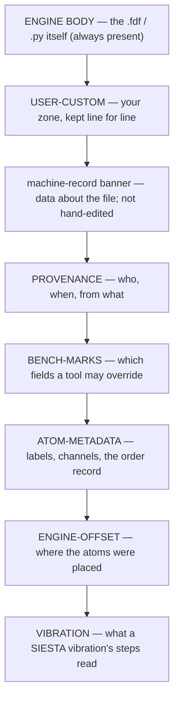
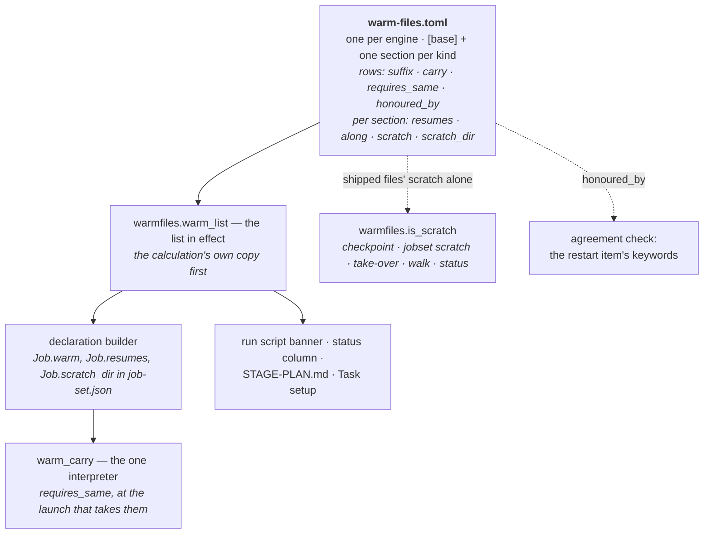

# Job contracts — the formats molbuilder writes, and their names

**Role:** contract
**Domain:** execution
**Owns:** the file catalogue and the name grammar; the projects tree's names, its topics, `psml_lib` and `--bundle`; what each block of a run script is; the reserved deck blocks; the warm-file vocabulary and the MODE lines; the persisted-file registry and the schema rule; the parameter vocabulary; every naming rule.
**Read with:** [`project-layout.md`](?doc=execution/project-layout.md) § 1.1 (the folder tree) · [`running-a-job.md`](?doc=execution/running-a-job.md) § 3 (what the run script does at run time) · [`run-identity.md`](?doc=execution/run-identity.md) (the label, and the restart group) · [`architecture.md`](?doc=execution/architecture.md) § 3.2 (the code doors) · [`checkpointing.md`](?doc=execution/checkpointing.md) (saved history)

---

## The short version

Every file molbuilder writes has one shape and one name, stated here once, so
the browser, the terminal and a compute node read and write the same thing.

- **What molbuilder writes** is one table in code, `runfiles.WRITTEN`, and
  every name is `<label>[_<stage>]<role>`, made by `runfiles` alone (§ 2.2,
  § 2.2a).
- **A calculation lives at** `projects/<project>/<topic>/<calculation>/`
  (§ 2.5); `psml_lib` is a path in that tree (§ 2.5a); `--bundle` names a
  calculation from its root (§ 2.5b).
- **The run script** is a closed list of blocks (§ 2.6); a deck carries
  reserved blocks, your own zone among them (§ 3).
- **What carries between runs** is each engine's `warm-files.toml` (§ 4.2a);
  the MODE line says what a run starts from (§ 4.4).
- **Every persisted file** is a registry row with its schema (§ 6.1); config
  names become scheduler names at one boundary (§ 6.2); naming rules, § 6.3.

**Reading map.** For the person using molbuilder: § 2.5, § 2.5a, § 2.5b,
§ 3.5, § 4.4. Formats: § 2.2, § 2.2a, § 2.6, § 3, § 4.2a, § 6.1–§ 6.3. For the
developer: § 2.2a *Which door to call*, § 7.

---

## 1. Two conventions every format follows

- **Atom indices count from 0 everywhere but the UI's display**, which
  numbers atoms from 1. Every JSON payload here (`regions`, `frozen_atoms`,
  ATOM-METADATA, the sidecar) counts from 0; an engine's own coordinate block
  uses the engine's convention (SIESTA's `.fdf` counts from 1). The rule and
  its one conversion boundary are
  [`model/overview.md`](?doc=model/overview.md) § 2.
- **Schema versions are checked, never guessed.** A persisted file carries
  its schema; a reader handed another artifact or a newer major refuses by
  name (§ 6.1).

---

## 2. The run directory and the names in it

### 2.1 What the engine assumes, and the two rules that serve it

The engine runs inside one directory and reads only what is there; it knows
nothing of stages, descriptions or earlier runs
([`project-layout.md`](?doc=execution/project-layout.md) § 1.0). So `prep`
and `launch` put every file a run reads into its folder before it starts —
as a copy, never a link
([`project-layout.md`](?doc=execution/project-layout.md) § 1.6.5).

**The caller's working directory is the contract.** The launcher puts the
engine in its directory, and nothing else does:

| launched | how the directory is set |
|---|---|
| a stage alone, here | `jobset launch` starts the `.run.sh` with its working directory set to the run's folder |
| a stage alone, on a queue | `jobset launch` sends the `.sbatch` from the run's folder, and the scheduler starts the job there (`SLURM_SUBMIT_DIR`) |
| a walk — a group, a run of points, a benchmark shelf | the walk is started, or sent, from the folder holding its `launch/`; the walk script runs each member's run script in a subshell in that member's run folder (`( cd "$_dir" && … )`, `submit._walk_script`) |

The run script inherits that directory and changes it for nothing: no run
script contains a `cd`
([`project-layout.md`](?doc=execution/project-layout.md) invariant 6a; where
each run happens, § 1.5). Its own files land there because it writes them
there; SIESTA writes where it runs; a PySCF deck writes beside itself
(§ 4.2). A run script that navigated would break the one property the engine
depends on, and differently under the two launchers.

**One carve-out: the run script asks the engine build it is about to run.**
`siesta --version` tells it which parallelisations the binary has, and that
decides the launcher (`mpirun` or the bare binary). The binary on the
machine's `PATH` may have been rebuilt since `prep`, so the answer cannot be
baked. The probe reads the engine alone — never a config file, the
description or anything molbuilder wrote; those had their moment at prep
([`running-a-job.md`](?doc=execution/running-a-job.md) § 2.1).

#### What a stage needs from the runs before it, and who checks

*The user, 2026-08-08: "based on how the job is run inside the stage run
subdir, that's where the check is done."* Continuing a relaxation means a
known set of restart files (§ 4.2a). A transport rung needs files other
stages made — the device needs the seed's `.DM` and each electrode's `.TSHS`;
the transmission needs the device's `<label>.TS.HSX` and the electrodes'
`.TSHS` — and that is the kind's own graph, never a field a description sets
(`transport.stages.inputs_of`). Both arrive in the run
folder at the stage's first launch, before anything is sent: the restart
files by the hand-over, the rung's inputs by the gather, under its gates and
with the record `.gathered-from`
([`engines/transport.md`](?doc=engines/transport.md) § 6.1; `--gather` on a
later launch, [`job-system.md`](?doc=execution/job-system.md) § 5.4). The run
script checks none of it (§ 4.4).

#### The monitor beside the engine

Each run has a monitor, `mb_monitor.pyz`, which travels with the job, runs
beside the engine, follows the run script's process, appends what it learns
to its own log and sends the reports the calculation asks for. It observes
and notifies; it never decides and never changes the calculation
([`run-reports.md`](?doc=execution/run-reports.md) § 5; its lifecycle § 2.4).

**Rule 1 — one calculation per directory.** Each calculation has its own
folder, each stage a folder of its own and each run a folder below it
([`project-layout.md`](?doc=execution/project-layout.md) § 1). A run folder
holds its stage's input and the engine's outputs, and never the input of a
*different* calculation — SIESTA's restart files (`<label>.XV`, `.DM`, `.CG`)
are named on the label alone, so a second calculation's `SystemLabel` would
overwrite them. PySCF's checkpoint and trajectory follow the same rule.

**Rule 2 — every file shares one basename.** Every file the generator writes
and a reader opens carries the same basename:

- **SIESTA** — the deck's `SystemLabel`. A transport lead's is its own,
  `<label>_L-electrode` / `<label>_R-electrode`, the stem the device deck's
  `TS.Elec.<name> HS` line names (`kind_table.rung_label`,
  [`engines/transport.md`](?doc=engines/transport.md) § 1).
- **PySCF** — the script's `JOB = "…"` literal.

The basename is one token of `[A-Za-z0-9_-]` — no space, dot or slash. What
you type becomes one by
[`run-identity.md`](?doc=execution/run-identity.md) § 3; a config holding
anything else is refused (`config/siesta.py::_validate_basename`).
It stays the same across a calculation's stages, which is what lets SIESTA
pick up `<basename>.XV` and `.DM` from the stage before.

**One validator, two ways of writing it, and the difference decides how each
is read back.** `config/siesta.py::_validate_basename` serves both
`SiestaConfig.system_label` and `PySCFConfig.job_name`, so what a basename may
be is one rule. How it is written is not: a `SystemLabel` is a bare fdf token,
a `JOB` is a Python string literal whose quotes are syntax. So a SIESTA
reader never strips quotes — the alphabet admits none — and a PySCF reader
always does. **And a reader verifies rather than extracts**: `pyscf/layout.py`
takes the identity the deck was written *for* and checks that the deck states
it, which accepts both emitted spellings (`JOB = "name"`, the vibration
deck's aligned `JOB   = 'name'`) and answers the question that matters.

### 2.2 The file catalogue

**`molbuilder/runfiles.py::WRITTEN` declares every file molbuilder writes
into a calculation folder**, `task.json` to the conclusion marker, one row
each *(user, 2026-10-04)*. A row says:

| column | what it says |
|---|---|
| `role` or `name` | a role on the label (`.molwatch.log`, composed by § 2.2a's grammar), or a fixed name (`task.json`, `calcdir.json`) |
| `level` | where it sits: the calculation's root, a stage, a run, a benchmark, a launch folder, or transient |
| `what` · `writer` | one line a person reads; who writes it, and when |
| `when` | the moment it appears: setup, prep, launch, run or summarize |
| `door` | the one function its readers ask ([`architecture.md`](?doc=execution/architecture.md) § 3.2) |
| `kind` | source · input · derived · record · result · transient ([`project-layout.md`](?doc=execution/project-layout.md) § 5) |
| `staged` · `engine` · `calculation` · `only` | whether its name carries the stage token; which engine and which kinds write it; the condition when it is written only sometimes |
| `output` | whether it is evidence of how a run went ([`model/parse.md`](?doc=model/parse.md) § 5.5) |
| `fields` · `listed_by` · `counted_by` · `travels` | a templated name's fields; which atom index a file lists by; an engine input's numbering; whether it travels beside a deck into every folder the deck runs in |
| `reads` · `stderr_apart` | for a file a reader of ours reads by its role, the reader that answers each question about it, `module:NAME` — how a run ended, its stops, its live reading pass, its loop's words, its SCF rows, its timing, the engine's log of what it read, the run record's fields, a deck's recorded settings (the questions, `runfiles.READ_QUESTIONS`); for a run output, whether its engine's stderr stays apart ([`running-a-job.md`](?doc=execution/running-a-job.md) § 3.5) |

A fixed name's owner takes its name from the catalogue — `task.json`'s from
the row `task.py` reads — so a name is spelled once; **a role is spelled once
too**, as the catalogue's constant (`runfiles.ROLE_*`), which the rows and
every reader and writer import — but a deck's, asked by its engine
(`deck_role(engine)`), since shared code names no engine's deck.

**Its readings, and nothing else may hold a copy:**

- `runfiles.manifest(label, stage, engine, when, calculation)` — the names a
  stage will have, each with where it lands, which the Task setup page shows
  before a queue slot is spent;
- `about(path)`, on the run door — what one file is: its row, read back with
  its run's label, or *not written by molbuilder*, which the Results tab's
  file card shows ([`web/results.md`](?doc=web/results.md) § 3b);
- the row's `reads`, the reader it names for each question —
  `reader(role, question)`, which every reader of an output asks, on the
  machine and beside a job, resolves it; by the rows the readers' modules
  travel with the job (`runwrap.monitor_companions`,
  [`architecture.md`](?doc=execution/architecture.md) § 3.3): a new engine's
  output is one row *(the user, 2026-11-03: "One column on the catalogue
  row")*;
- the manifest, [`project-layout.md`](?doc=execution/project-layout.md) § 5,
  rendered from the rows by `tools/manifest.py`; a check fails when the two
  differ, so a row is edited in the catalogue and never in the document.

**Only our half can be complete, and that is the point.** An engine's output
set depends on its version and options, so listing it would be a snapshot
posing as a rule. What molbuilder writes is knowable, so *"did the engine
leave this?"* is answered by subtraction: a file named on the label that is
not ours came from the engine (§ 4.2). That makes an omission from the
catalogue a defect — a file of ours it does not name is read as the
engine's.

**The engines' files molbuilder names are a second table, `runfiles.ENGINE_FILES`**
*(the user, 2026-11-03: "One table in runfiles")* — a row each: the engine,
the file's role on the label or its whole name, what it is, and the reader of
ours that reads it, or none; each named in code by its constant
(`runfiles.SIESTA_FC`, `runfiles.PYSCF_CHK`, …). **It is never complete**: it
holds what molbuilder itself composes, reads or carries, and the other files
of a run it explains by name (SIESTA's `MESSAGES`, `CLOCK`, …) *(the user,
2026-11-03: kept)* — the
rows [`project-layout.md`](?doc=execution/project-layout.md) § 5.4 is rendered
from — and *did the engine leave this?* is still answered by subtraction from
`WRITTEN`. **Which of them carry is the engine's restart-file list's**
(§ 4.2a): every file a shipped list names is a row here, checked when the list
loads; a calculation's
own copy may add a file a new engine build writes, and the code composing a
name from that list hands it in as the vocabulary (`roles=`). The two tables
never overlap, checked when the catalogue loads.

**SIESTA's history is the run's own, under SIESTA's names.** SIESTA appends
every step to `<SystemLabel>.MD.nc`, `.MD`, `.MDE` and `.ANI`, and reads none
of them back. A run folder holds one start, and no hand-over copies a history
into a new run, so the four hold that run's steps alone. Which of them a run
writes is its deck's: `WriteMDhistory` the first three, `WriteMDXmol` the
animation.

**The `.molwatch.log` is the progress channel every run has.** Prep seeds the
first run's with the initial geometry as step 0, so a viewer pointed at a
prepared run finds something; a PySCF deck writes each step into it; SIESTA
never does, so a SIESTA run's trajectory is its `.out`, which a viewer is
offered first (`runfiles.result_roles`).

**Why PySCF's stdout is `.pyscf.log`, not `.out`.** The run script captures
both engines' stdout: SIESTA's into `<stem>.out`, through its tee, PySCF's
into `<stem>.pyscf.log`. The Results tab picks a viewer by suffix, and a
PySCF log named `.out` was handed to the SIESTA reader; the `.pyscf.` infix
says which engine wrote it, and the distinct suffix lets the viewer choose
correctly.

### 2.2a The name grammar — one form, composed and parsed in one place

**Every run file is some of three segments:**

```
<label>[_<stage>]<role>

my-job.chk                        carried: no stage
my-job_optimized.xyz              carried: a role that begins with _
my-job_01_coarse.molwatch.log     this rung's
my-job_01_coarse.out              this rung's output, in its run folder
```

- **`<label>`** is § 2.1's basename — the `SystemLabel` / `JOB` literal.
- **`<stage>`** is the stage token (`01_coarse`), and it sits **immediately
  after the label**, never inside the role: every per-stage file uses that
  position (`.py`, `.run.sh`, `.out`, `.molwatch.log`, `.validation.txt`,
  geomeTRIC's `_geom_optim.xyz` included) *(user ruling, 2026-09-07)*.
- **`<role>`** is what the file is, and begins with `.` or `_`. A role is a
  row of the catalogue — ours in `WRITTEN`, an engine's in `ENGINE_FILES` —
  with its constant, and never spelled at a call site.

**A carried file has no stage token, and that is what carrying means.**
SIESTA's `.XV` / `.DM` / `.CG` and PySCF's `.chk` / `_optimized.xyz` hand one
rung's geometry and density to the next, so a token in them would make every
rung look for a file only its own stage wrote.

**A run file carries no counter.** The folder is the run and holds one start
([`project-layout.md`](?doc=execution/project-layout.md) § 1.6.1), so nothing
in a name numbers it. `_` introduces the stage, which is a name; that is what
makes the name reversible.

**A benchmark trial is a whole label** (`bdt-G1N4C6`), never a qualifier,
because a trial's restart files must never meet the run's: a qualifier would
put them back in one name space. `bdt-G1N4C6_01_coarse.out` parses as that
label, and returns nothing against `bdt`.

**There is no engine segment.** The two engines' roles are disjoint already
(`.XV` / `.DM` against `.chk` / `_optimized.xyz`; `.fdf` against `.py` /
`.pyscf.log`), the files they share belong to the one run script that runs
both, and a carried file is found by name by the next rung, which may be the
other engine — a SIESTA relaxation into a PySCF spectrum *(user,
2026-09-07)*.

### Which door to call — before you write code that names a file

**Rule A14** ([`architecture.md`](?doc=execution/architecture.md) § 7). If you
are about to build, find, glob or split the name of a file a run produces,
you are calling `runfiles`. There is no case where concatenating one is
right:

| you have… and you want… | call |
|---|---|
| a stage → the name each of its files has | `RunNames(label, stage)` → `.name(role, **fields)`; `.tail(role)` for a deck that names its files from its own `JOB` (`naming.run_names` builds a job's, `runs.Run.names` a run's) |
| a label, a role, maybe a stage → the name | `compose(label, role, stage=None, **fields)` |
| a filename → its segments back | `parse(filename, label, roles=())` — `roles` only for a vocabulary neither table holds (a calculation's own restart-file list) |
| a label and a stage → the part every role attaches to | `stem(label, stage=None)` |
| a role, the label known only at run time (emitted into a generated script) | `tail(role, stage=None)` |
| a file's name → the name of another role's file beside it, on its stem | `named_beside(name, role)` |
| a name → the fields its templated role carries (a lead's, a channel's) | `fields_of(name, role)`; the stem before a role, `stem_before(name, role)` |
| a role → every name it makes, as a glob | `family(role)` |
| a name as a page or a description shows it, a field left open | `shown(template, **fields)` |
| a name → does it cross rungs? | `parse(name, label).stage is None` |
| a label and a rung → every file that will appear, a line each | `manifest(label, stage, engine, when, calculation)` |
| a folder and a label → which of its files are that label's | `find(directory, label, role=, stage=)`; which of them molbuilder wrote is `about`'s |
| a folder and a dotted role, before anything says whose | `find_by_role(directory, role)` |
| a file → the run it belongs to, and that run's other files | `run_of(path)` → `Run`: `Run.file(role)`, `.on_label(role)`, `.deck`, `.stdout`, `.session_log` (`runs.on_label_at(folder, role)` at a run of points' root). The run door ([`architecture.md`](?doc=execution/architecture.md) § 3.2) reads the label from the description, never from a deck or a name |
| a file → what it is | `about(path)`, on the run door |
| a name known to be one of your run's outputs → its role | `role_of(name)` — never for a name met in a folder, which is read back with its label (`about`) |
| a role, in code | its constant, `runfiles.ROLE_*`; a deck's, `deck_role(engine)` |
| an engine's file, in code | its constant, a row of `ENGINE_FILES` (`SIESTA_XV`, `PYSCF_CHK`, …) |
| a role → the code that reads it | `reader(role, question)` — the row's `reads`, resolved (`reads_of` its name) |
| a new kind of file | a row in `WRITTEN` and its constant; an engine's file, a row in `ENGINE_FILES`; never its suffix spelled at the call |

**Never do these**, each of which has cost a defect: build a name with
`f"{label}_{token}{suffix}"`; write a role literal (`".molwatch.log"`,
`"_geom_optim.xyz"`) at a call site; glob with a star placed by hand; split a
name on `_`; key a name on a stage's *position* rather than its token; or read
`""` as "no ladder" — every description has a stage, and an empty token is
refused where a name is made (`paths.bench_container`, `naming.stage_home`,
`pipeline_log.log_name`).

**`parse` takes the label, and that is what makes it exact.** A role may
contain underscores (`_geom_optim.xyz`) and so may a label, so nothing can
find the boundary by looking at the string — sites that split on `_` read
`my-job_01_coarse_geom_optim.xyz` as stage `01` in one place and
`01_coarse_geom` in another. **`tail` exists because a generated deck names
its own outputs from its own `JOB` / `SystemLabel`**, so the emitter supplies
only what follows the label — cut off a real `compose` result, never
assembled beside one.

**The one module** is `molbuilder/runfiles.py`:

```python
compose(label, role, stage=None, roles=(), **fields) -> str  # a role neither table
                                                         # nor ``roles`` declares,
                                                         # or a field the role does
                                                         # not carry, is refused
parse(filename, label, roles=())            -> RunFile | None
stem(label, stage=None)                     -> str
tail(role, stage=None, roles=(), **fields) -> str        # label known only at run time
find(directory, label, role=, roles=, stage=) -> list[(Path, RunFile)]
find_on_label(directory, label, role)       -> list[Path]   # named on the label alone
find_by_role(directory, role)               -> list[Path]   # dotted roles only
role_of(name)                               -> str | None
stem_before(name, role)                     -> str | None   # a templated role by its pattern
named_beside(name, role)                    -> str | None   # role's name on name's stem
fields_of(name, role)                       -> dict | None  # a templated role's fields
family(role)                                -> str          # its names, as a glob
shown(template, **fields)                   -> str          # words, a field as <field>
RunNames(label, stage)                      -> RunNames     # .name / .tail / .run_script / .header
WRITTEN                                     # the catalogue (§ 2.2)
ENGINE_FILES                                # the engines' files it names (§ 2.2)
reads_of(role, question)                    -> str | None  # `module:NAME`
reader(role, question)                      -> the reader it names, resolved
stderr_apart(role)                          -> bool
manifest(label, stage, engine, when, calculation) -> list
```

**Every door that takes a role asks one check** (`runfiles.declared`) —
`compose`, `tail`, `find`'s `role`, `find_on_label`, `find_by_role`,
`stem_before`, `named_beside`, `fields_of`, `family`, `RunNames.name`,
`reads_of`, `reader`, `stderr_apart`: a role of `WRITTEN` or of `ENGINE_FILES`
— a templated one, or a name of it — or of the vocabulary a caller hands in as
`roles`, and nothing else. `RunNames.name` takes a role of the two tables, its
row saying whether it is named on the stage's stem; `find_by_role` a dotted
role of `WRITTEN` alone, the roles a name is read by without its label. A
caller holding a role read off a name in a folder asks the rows first
(`read_roles`): such a name may be no file of ours. `engine_of_role` and
`cut_from_output` say what a row says, `None` for a role no row names.

**The generator is the guarantee, and it is tested as one.**
`tests/test_runfile_names.py` drives `compose` and `parse` over the product of
their segments and asserts the round trip, and what each segment refuses: a
label that could not be read back, a malformed stage, a stage *position*, a
role neither table declares, a field its role does not carry, a counter. A name is correct because it came
out of a checked generator, not because a search of the output found nothing
wrong.

### 2.3 The stages of one calculation share the label

The stages of a calculation keep **one** label, unsuffixed, so the engine's
restart files carry between them under the engine's own names
(`MD.UseSaveXV`, `DM.UseSaveDM`, `MD.UseSaveCG` read `<label>.XV`, `.DM`,
`.CG`). Only the files molbuilder names for a stage carry its token,
`<label>_<NN>_<name>…`: its deck and run script, written in the stage's folder
and copied into each run, and each run's stdout and progress log (the tree is
[`project-layout.md`](?doc=execution/project-layout.md) § 1.1). Every stage
runs as a separate process, on both engines
([`engines/stages.md`](?doc=engines/stages.md) § 1.1a), and each run has its
own `<label>_<token>.molwatch.log` — seeded by prep in the first run, written
by a PySCF deck; a SIESTA run's trajectory is its `.out` (§ 2.2).

**Stages are separate runs, and nothing joins them** *(user ruling,
2026-09-05)*. You pick one stage, inspect it, and judge it; there is no
combined view, and a folder opens exactly one file (§ 2.4). Comparing runs is
a different question with its own answer — the benchmark summary
([`web/bench-summary.md`](?doc=web/bench-summary.md)).

### 2.4 Resolving a directory

When a reader — the Results tab, `molbuilder watch` — is handed a folder
instead of a file, the run door answers which one file opens
(`runs.openable`, `runs.folder_answer`), by what the folder is
([`project-layout.md`](?doc=execution/project-layout.md) § 1.4a): a run of
ours opens at the first role its calculation produces in which it has a file;
a container opens its calculation's product, or nothing; a folder no
calculation claims tries the catalogue's roles, newest file first, and reads
no label off a deck. The rule is
[`model/parse.md`](?doc=model/parse.md) § 5.1–§ 5.2. The search's trail is the
body of the refusal when nothing matched; a path that is a file is loaded
directly.

### 2.5 The projects tree and the canonical topics

A calculation is a folder at the third level of the projects tree:
`projects/<project>/<topic>/<calculation>/`. The three upper levels are
organisational only; what is inside a calculation, and who creates each
level, is [`project-layout.md`](?doc=execution/project-layout.md) § 1.1 and
§ 1.4a.

**Each path segment is one token of `[A-Za-z0-9_-]`.** `<project>` and
`<calculation>` are what you type; `<topic>` is one of the canonical topics.

**The canonical topics** (`projects.CANONICAL_TOPICS`): the two storage
topics, **one run topic per calculation kind** — the kind's `topic` in the
kind table ([`architecture.md`](?doc=execution/architecture.md) § 3.3) — and
the free-form `user`, in that order:

| topic | from | used for |
|---|---|---|
| `structure` | storage | the project's structures: `.xyz` / `.pdb` / `.cif` |
| `pseudopotential` | storage | the project's SIESTA `.psml` pseudopotentials |
| `optimization` | the optimization kind | geometry relaxation |
| `spectrum` | the vibration kind | vibrational modes, thermochemistry, infrared and Raman |
| `transport` | the transport kind | TranSIESTA junctions: the leads, the device, the transmission |
| `user` | free-form | a workspace with no molbuilder rule inside it |

So every kind has its folder in every new project, and a kind added to the
table brings its own. A closed list is on purpose: an open one would
fragment the tree across people and break *compare the same analysis across
structures*, which is why topics come before calculations. A run topic holds
its kind's calculations by your choice — nothing refuses a calculation under
another topic. A folder at the topic level that is no topic (an older
project's `frequency/`) is an ordinary folder: listed, renamed and deleted
like any other; only a new one is refused a name outside the topics.

**How the tree is found — one door, `projects.projects_root`, in declared
order, nothing probed:**

1. an explicit argument (a caller serving another tree);
2. `$MOLBUILDER_PROJECTS`;
3. `molbuilder.json` → `paths.projects` (a relative value read from the
   molbuilder root, [`configuration.md`](?doc=configuration.md) § 4);
4. `<molbuilder root>/projects` — the default, git-ignored (`.gitignore`
   carries `projects/*`).

**The tree is the folder named `projects`, wherever it is.** A calculation
finds its tree by walking up to that name (`projects.find_projects_root`), so
steps 2 and 3 move the folder and never rename it: a setting that names a
folder called anything else is refused wherever the tree is resolved,
naming this rule (`projects.named_projects`) — served under another name,
every calculation in it would find no tree, and its citations and
`psml_lib` would name nothing.

**A launched job needs nothing from the checkout.** The run script, the decks
and the code a run reads itself with travel inside the calculation
(`mb_monitor.pyz`, and `mb_pyscf.pyz` beside a PySCF script,
[`running-a-job.md`](?doc=execution/running-a-job.md) § 2.0a), so a
calculation moved to a cluster where you may install nothing still runs
*(user, 2026-08-22)*.

The tree's API is `molbuilder/projects.py`: `validate_name`,
`validate_topic`, `project_dir` / `topic_dir` / `structure_dir`,
`ensure_structure_dir`, `projects_root` / `find_projects_root`, `contain`,
`populate_project_skeleton`, and `list_projects` / `list_topics` /
`list_structures` (the `structure_*` names mean the calculation level).

#### 2.5a `psml_lib` is a path inside the projects tree

*User, 2026-08-28: "psml-lib is always inside the project directory".* One
rule, resolved through the same `projects` door the sidebar uses, so the
browser, the command line and a template cannot disagree about what a path
means (`pseudos.resolve_psml_lib`):

| you write | it means | refused when |
|---|---|---|
| a relative path — `pseudopotential`, `shared/psml` | that folder under the tree's root: the tree the calculation lives in, found by walking up from its folder; the server's own tree when no calculation folder exists yet | the folder is not there (the refusal names the tree it searched); or it holds a `..` anywhere — the fence refuses a `..` in any path before it resolves one (`projects.contain`) |
| an absolute path inside the tree | itself — another spelling of the same folder | it lies outside the tree |
| `./psml`, `../psml` | nothing | always: pseudopotentials beside the calculation are used without this field (prep adopts them), so the dotted spelling has no job |

**Do not write the `projects/` prefix.** Paths are measured from the tree's
root, so `projects/pseudopotential` looks for a `projects/` inside the tree;
the refusal says so rather than stripping it.

**Nothing is tried and discarded** (rule **A10**,
[`architecture.md`](?doc=execution/architecture.md) § 7): a spelling names
exactly one folder, and a miss is reported against that folder.

**Which files are checked is which files are opened.** `prep` and the
settings gate read pseudopotentials by one rule, `pseudos.psml_sources`: the
calculation's own folder first, then the library for what it lacks — the
template's `psml_lib` on SIESTA, the cited run's folder on transport. So a
calculation whose files sit beside it needs no `psml_lib`, and a library
missing a species the calculation already has refuses nothing. Before a
calculation folder exists only the library can answer; how the Build tab and
the Send report a species no library covers is
[`science/pseudopotentials.md`](?doc=science/pseudopotentials.md) § 1.

#### 2.5b Naming a calculation: from the root, and inside it

A path that names a **calculation** is read from the projects root
*(user, 2026-08-22)*:

| `--bundle` | means |
|---|---|
| omitted | the working directory |
| anything else | read from the projects root — `<project>/<topic>/<calculation>` |

**Either way it must be inside the tree.** `..` segments and absolute paths
are resolved and then checked by the one fence, `projects.contain`, which the
sidebar backend's own resolver calls too. So you need not stand in a
calculation to act on it: `jobset launch task --bundle
Au-BDT-Au/optimization/Relax` works from anywhere. (The flag keeps the word
*bundle* for the calculation folder.)

**Two kinds of address, and only one starts at the root:**

| | addresses | measured from | example |
|---|---|---|---|
| **tree address** | something in the tree — a calculation, a project, a structure file | the projects root | `--bundle Au-BDT-Au/optimization/Relax` |
| **inside-calculation address** | a part of one calculation — a stage, a run | the calculation folder | `--from 01_coarse/run-0` |

The second is not an oversight to fix: a calculation travels, and
`01_coarse/run-0` names the same run on a cluster, while a path from the root
would name a tree that may not exist there.

**Where each option stands:**

| verb | option | address |
|---|---|---|
| `molbuilder describe`; `jobset status`, `prep`, `launch`, `summarize`, `migrate`, `export`, `scratch` | `--bundle` | tree address, fenced to the root |
| `molbuilder describe` | `--structure` | tree address — a structure lives in `<project>/structure/` |
| `molbuilder describe` | `--psml-lib` | § 2.5a's rule |
| `jobset launch` | `--from NN_STAGE/run-N` | inside-calculation address |

**Every verb names a calculation through one declaration**: `--bundle` is
one `click` option shared by all eight verbs (`_cli._bundle_option`), so the
rule, the fence and the refusal text exist once. `describe` differs in one
parameter of it — its calculation may not exist yet, because describing
creates it. `describe` is not a `jobset` verb
([`job-request.md`](?doc=execution/job-request.md) § 9).

### 2.6 The run script — `.run.sh` and `.sbatch`

**`prep` writes the run script for the machine that will run the job, from
that machine's record — prepared here, or here for another machine with
`prep --target` — and nothing else writes one** (`runwrap.render_run_wrapper`,
through `jobset/prep.py`). The machine's preamble and activation are taken
from its record and baked in as literals; at run time the script reads only
what its launch and the scheduler tell it, the hardware, and the engine build
(§ 2.1)
([`running-a-job.md`](?doc=execution/running-a-job.md) § 2.1;
[`preparing-for-another-machine.md`](?doc=execution/preparing-for-another-machine.md)).
A job that walks several members — a group, a run of points, a benchmark's
shelves — has its header written at its prep (`prep.walk_header_of`) and its
walk script written at its launch from the members still to run
([`job-system.md`](?doc=execution/job-system.md) § 6.0). There is no
`molbuilder run`: `prep` makes the folder and its script, and `jobset launch`
starts it *(user, 2026-08-11)*.

**The engine's environment is chosen at prep, from its engine's record**
([`architecture.md`](?doc=execution/architecture.md) § 3.3): its `environment`
category — `siesta`, `pyscf`, whose environments are `molbuilder-siesta`,
`molbuilder-pySCF` — or its `gpu_environment`, `siesta-gpu`
(`molbuilder-siesta-gpu`), when the job's GPU request says it uses a GPU
(`jobset.model.gpu_request(resources).uses` — never a keyword read out of the
deck); an env you name always wins. **One run script serves every engine**: the
record, the job, a catalogue item's declaration (`launch`, `limit_applied_by`) and the
parse layer's tables for the output's role decide each block below, and nothing
in it is chosen by the engine's name or the deck's suffix. A program's launcher is chosen on the node
by the build probe (§ 2.1); a deck that is a script runs on its environment's
own python. Both are [`running-a-job.md`](?doc=execution/running-a-job.md)
§ 2.3.

#### What a run script is made of

**Each block is work on a compute node, so the list is closed.** A generated
run script holds these and nothing else. The order they run in, step by
step, and what each one does at run time — its exit codes and its
refusals — is [`running-a-job.md`](?doc=execution/running-a-job.md) § 1.
**Adding a block is a contract change**: anything that computes, decides or
arranges files belongs to Python on the host.

| block | what it is |
|---|---|
| PROVENANCE | the record at the head: engine, generator version, when, `resolved-defaults` (§ 3.2) |
| header comment | what the script is, that `jobset launch` starts it, what its deck reads of the restart files a launch copies in (§ 4.1), and that it changes no directory |
| **Arguments** | the flags the script takes, read once before anything is written |
| the wall | the job's start (`MB_JOB_STARTED`) and the wall slack, for the engine |
| **One start per run** | the guard that keeps a run folder to one start ([`project-layout.md`](?doc=execution/project-layout.md) § 1.6.1) |
| **Launch-door gate** | the guard that takes a start only from `jobset launch`, which says so in `MB_LAUNCHED_BY` |
| **Session log** | `<stem>.runwrap.log`, the start's own log |
| **The one exit trap** | the script's one EXIT trap, and one handler for every signal that stops a run (`runwrap._STOPPING_SIGNALS`); it writes the conclusion marker of a script that failed on its own ([`project-layout.md`](?doc=execution/project-layout.md) § 1.6.3) |
| **Baked preamble** | the target machine's own lines, verbatim from its record |
| **Activation** | the record's one activation statement, verbatim |
| the node's shape | the node's physical cores and sockets (`lscpu`), logged |
| **GPU mode: placement** | *(a job that uses a GPU, its engine running ranks)* whether MPS is on the machine, and GPU 0's NUMA node |
| **The counts, resolved** | the thread count the run uses, and its rank count where its engine runs ranks |
| **The job's python** | `$_mb_py`, the activated env's own python |
| **Runtime status banner** | what the run holds of the restart files, read at run time, and the atoms its deck holds, stated at prep from its ATOM-METADATA record (§ 3.4); printed, with the program and its build, its counts and its wall, once the launch is chosen |
| **GPU load-balance** | *(the same)* each MPI rank matched to a visible GPU |
| the occupancy notice | *(an engine that runs ranks)* the rank count set against the deck's own orbital estimate ([`running-a-job.md`](?doc=execution/running-a-job.md) § 3.1a) |
| **Thread / BLAS pinning** | the OpenMP thread export; where the engine runs ranks, MKL and OpenBLAS pinned to one thread; where ranks are placed on GPUs, the threads bound (`OMP_PROC_BIND`, `OMP_PLACES`) |
| **MPS daemon** | *(a job that uses a GPU, its engine running ranks)* the per-job daemon when ranks share a GPU |
| the memory cap | *(the run states `max_memory_mb`, and the item's `limit_applied_by` says the run script applies it, [`engines/template.md`](?doc=engines/template.md) § 5)* `ulimit -v` before the program |
| **Probe the program's build** | *(an engine that runs a program)* the build's parallelisations, which choose the launcher (§ 2.1) |
| **The deck is a script** | *(an engine whose deck is a script)* the launch on the job's python, one process |
| **GPU<->CPU socket co-location** | *(a job that uses a GPU, its engine running ranks)* ranks pinned beside the GPU's NUMA node, each rank starting the job's program |
| **Record resolved launch command + placement** | the command about to run, logged |
| **Dry-run preview** | `--dry-run`: the resolved command and each value's source, nothing started |
| **SCF per-iteration timing instrument** | *(where the file catalogue cuts a file from the output — the timing log's row names its `cut_from`, a SIESTA output — its rows recognised by the patterns the output's row names, its `reads`' `scf_rows`)* the per-iteration timing log a benchmark reads |
| **How a run ended** | `_mb_ending`, the script's question to the framework's reader of endings, and the one ask `_mb_ending_able` — see below |
| **Background job monitor** | `mb_monitor.pyz` at `nice 19`, watching the script's process ([`run-reports.md`](?doc=execution/run-reports.md) § 2.4, § 2.6) |
| **Can the job finish itself?** | *(a job with a finish)* the check that the finish bundle loads on the job's python ([`engines/vibration.md`](?doc=engines/vibration.md) § 5.5) |
| **The run's report step: point started** | *(a point of a run of points)* [`runs-of-points.md`](?doc=execution/runs-of-points.md) § 3, operation 9 |
| **What the engine will read** | *(a deck that states keywords)* the `effective-parameters` record: a row for each catalogue item the rung reads (its kind's, its stage's roles') that writes a keyword into its deck, with its default, then the deck as the engine parses it, read by the bundle beside it with the engine's keyword reader (`mb_monitor.pyz deck READER DECK`) |
| **Launch the engine + capture exit** | the wall left, told to the engine; the engine, run as a child, never `exec`'d; after a failure, `_mb_ending` — see below — and the conclusion marker |
| **The run's report step: point ended** | *(a point of a run of points)* [`runs-of-points.md`](?doc=execution/runs-of-points.md) § 3, operation 10 |
| USER-CUSTOM | your own zone (§ 3.5) |

**`_mb_ending` is the script's question to the framework's reader of endings**
in `mb_monitor.pyz`: `ending OUTPUT [--stderr LOG] [QUESTION]` — `--stderr` where
the output's role keeps the engine's stderr apart, in the session log. With no
question it prints the ending in words; `out-of-time` answers by exit status, 0
for yes, 1 for no; `advice` prints the advice for the cause, exit 0 where there is
some and 1 where there is none; 2, for any of them, when the ending cannot be read
— asked once first, *the one ask*. What it answers and what the script then prints
is [`running-a-job.md`](?doc=execution/running-a-job.md) § 3.5.

#### Plain, readable bash

- **Activation is the machine record's line, never `conda run`**: `conda
  activate <env>` or `source activate <env>`, after the record's preamble
  ([`running-a-job.md`](?doc=execution/running-a-job.md) § 5.2). The job's
  python is the env's own, found through `CONDA_PREFIX`.
- **A run's outputs are its own and never overwritten.** stdout goes to its
  engine's stdout role in the file catalogue (`runfiles.stdout_roles`) —
  `<label>_<NN>_<stage>.out` (SIESTA), `<label>_<NN>_<stage>.pyscf.log` (PySCF) — in the
  run's folder, and a run holds one start, so a launch again is a new folder.
- **`run-` is a reserved folder prefix, and its members are numbers.** A run
  folder is made in Python — the first when the stage is prepared, each next
  by the launch that sends it — never by the script
  ([`project-layout.md`](?doc=execution/project-layout.md) § 1.6.2).

**Two layers.** For a machine whose scheduler has a queue, `prep` writes an
outer `<stem>.sbatch` beside the `.run.sh` — the header, which runs
`bash <stem>.run.sh "$@"` — and `jobset launch` alone sends it; a machine with
no queue (`workstation`), or `prep --no-sbatch`, gets none, and `jobset launch`
starts the `.run.sh` itself. The header's lines, when it is withheld and the
line that sends it are [`scheduler.md`](?doc=execution/scheduler.md) § 6a.
molbuilder does not manage the launched process: the monitor watches and
tells, and the Results tab reads the folder back
([`running-a-job.md`](?doc=execution/running-a-job.md) § 4.2).

### 2.7 What the layout does not govern

- **Pseudopotential files** (`<species>.psml`, `runfiles.PSEUDO_FILE`) are
  named by the species label (`Au`, or `Au1` where the structure labels its
  gold), not the basename; the calculation keeps them in `pseudos/`, and each
  run gets a copy beside its deck.
- **SIESTA's post-processing outputs** (`<basename>.MullikenPop`, `.bands`,
  PDOS files) follow SIESTA's own naming and inherit the basename.
- **Files you make after a run** are outside the layout.

---

## 3. The generated-script contract

A generated deck is copied away from the structure and the description it was
made from, so molbuilder keeps its record **inside the file**, in reserved
comment blocks — plus, in a PySCF script, one block of live lines — and
leaves one zone for you. `tail -40 my-job.fdf` answers which molbuilder made
it and from what; the deck carries the same labels as the sidecar that
produced it; tools read a stable surface instead of scraping the engine body;
and your edits survive regeneration.

### 3.1 The reserved blocks

**Blocks follow the engine body — the physics first.** A scientist opening a
deck reads the calculation, then your zone, then the machine record behind a
banner. **Every block is optional** except a PySCF script's RUN-SETTINGS,
whose names the script's lines read: a file with none of the others is still a
valid engine input. A tool that needs a block refuses cleanly when it is
absent, and parsers find blocks by their markers, never by position.



Every block sits between literal marker lines:

```
# === molbuilder <block-name> BEGIN ===
...comment-prefixed content...
# === molbuilder <block-name> END ===
```

**The grammar has one home, `molbuilder/deck_record.py`** — the block names,
the markers and the one reader of a block's JSON payload — below
`script_emit`, which writes the blocks, because a job reads blocks beside
itself where `script_emit` cannot be imported
([`engines/vibration.md`](?doc=engines/vibration.md) § 5.5).

**A block the deck does not carry records nothing; one it carries that cannot
be read is refused.** Fences that are not a pair, no JSON object between them,
or JSON that does not parse: the reader raises
`deck_record.DeckRecordUnreadable`, the run door (`runs.declared`) names the
deck, and every surface says so — a route as a 400, the command line and prep
as their error, a job's finish as its own. The blocks are records nobody
edits, so the way out is the folder's saved state (`molbuilder checkpoint
restore`) or the stage prepared again.

**Which file carries which block:**

| block | SIESTA `.fdf` | PySCF `.py` | TranSIESTA `.fdf` | run script `.run.sh` |
|---|:--:|:--:|:--:|:--:|
| HEADER | — | — | — | — |
| PROVENANCE | ✅ | ✅ | ✅ | ✅ |
| BENCH-MARKS | ✅ | — | — | — |
| ATOM-METADATA | ✅ | ✅ | ✅ | — |
| ENGINE-OFFSET | ✅ | ✅ | ✅ | — |
| VIBRATION | ✅¹ | — | — | — |
| SHARED | — | — | ✅² | — |
| USER-CUSTOM | ✅ | ✅ | ✅ | ✅ |
| RUN-SETTINGS | — | ✅ | — | — |

¹ A force-constant deck only (`script_emit.emit_vibration_record`, read by
`deck_record.extract_vibration_record`): the stationarity criterion, your
statement, the thermochemistry's temperature, every atom's mass and *Raman
for*, which the job's record step and finish read
([`engines/vibration.md`](?doc=engines/vibration.md) § 5.3, § 5.11).
² A transmission point that shares energies with a finished calculation's
point: the energies it computes and the point it shares with, inside its
engine body ([`engines/transport.md`](?doc=engines/transport.md) § 2a.16).

- **ENGINE-OFFSET** states where the deck's atoms were placed — the resolved
  cell, the offset applied, the axis kinds, whether the origin was stated;
  every deck carries it, and a spec without a frame is refused
  ([`model/structure-periodicity.md`](?doc=model/structure-periodicity.md)
  § 6.0).
- **RUN-SETTINGS** is a PySCF script's first lines, live code before its first
  import: the names it gives every run setting it carries — `THREADS`,
  `USE_GPU`, `GPU_COUNT`, `MAX_MEMORY_MB`, `WALL_SLACK` — which every other
  line reads by name, the effective-parameters table included. The
  same-calculation door sets it aside, so a launched stage may be launched
  with another request and its script stay the same calculation
  ([`job-request.md`](?doc=execution/job-request.md) § 6). A SIESTA deck needs
  no such block: its door reads keywords by name.
- **BENCH-MARKS is SIESTA's alone** *(user, 2026-09-03)*: the benchmark lane
  speaks SIESTA ([`job-request.md`](?doc=execution/job-request.md) § 3.4), so a
  PySCF block would advertise something nothing can use.

### 3.2 PROVENANCE — the generation snapshot

A key/value record of what wrote the file. From a real deck and its run
script:

```
# === molbuilder provenance BEGIN ===
#   engine               siesta
#   generator-version    2.60.0 (git 6231d093)
#   generated-at         2026-11-01T07:48:15-07:00
#   parameters:          who set each value this deck is rendered from
#     write_coor_step         the rung
#     basis_size              the template · not chosen
#     mesh_cutoff             the template · not chosen
# === molbuilder provenance END ===

# === molbuilder provenance BEGIN ===        (the run script's)
#   engine               siesta
#   generator-version    2.60.0 (git 6231d093)
#   generated-at         2026-11-01T07:48:16-07:00
#   resolved-defaults:
#     max_memory_mb  n/a
#     mpi_np         1
#     omp_threads    1
#     target_env     molbuilder-siesta
# === molbuilder provenance END ===
```

- **`engine`** is which engine the file was written for — `siesta` or
  `pyscf`, from `DeckSpec.engine`, the field that chose the catalogue rows and
  the layout of the body. A TranSIESTA deck says `siesta`: same engine, same
  `.fdf` contract (`transport/deck.py::transport_spec`). How a reader weighs
  this against a run's other declarations is
  [`running-a-job.md`](?doc=execution/running-a-job.md) § 4.2.
- **`generator-version`** is molbuilder's version and its git commit
  (`script_emit.generator_version`). A later molbuilder compares versions
  (`deck_record.written_by`): the version moves with every change to what
  molbuilder writes ([`process/conventions.md`](?doc=process/conventions.md)
  § 2), so a transport gather that meets an upstream deck written by another
  version refuses, naming both and the
  [changelog](?doc=process/changelog.md). A file written before 2.0.0 names
  only its commit. A PySCF vibration script states the version again, for its
  result (`deck_record.BUILD_NAME`). Both are masked when two decks are compared
  (`deck_record.without_stamps`): which build wrote a deck is not what it
  computes.
- **`generated-at`** is ISO-8601 with its time zone.
- **`parameters`** is who set each value the deck is rendered from, a row per
  item of the rung by the template's own name
  ([`engines/template.md`](?doc=engines/template.md) § 6.6, obligation 5):
  `resolve`'s layer (*a pin · a sweep point · this stage's override · the
  rung*), a run setting's source (*the stage's run card · the calculation's
  run card · the catalogue's default · not chosen*,
  [`job-request.md`](?doc=execution/job-request.md) § 4), or the template's
  own record (*the template · from the junction you cited · you set this · not
  chosen · not recorded*). *Not chosen* marks a value nobody chose; for an
  optional item nobody set, the row says who answers instead
  (`resolve.BLANK_ANSWERED_BY`). A value set after `resolve` is said as that
  step's (`resolve.SET_AFTER`) — a transport rung's `SystemLabel`, a trial's.
  Every road that renders a deck hands the rows over, the gather's comparison
  render included (`gather.rung_deck_now`); a deck rendered without them says
  *not recorded*.
- **`resolved-defaults`** is the run script's, four keys always:
  `target_env`, `omp_threads`, `max_memory_mb` (`n/a` when none is stated) and
  `mpi_np` (`n/a (PySCF is OMP-only)` for PySCF). Each is the stated value:
  both engines refuse an unstated count at prep
  ([`architecture.md`](?doc=execution/architecture.md) § 5.2). A deck carries
  none.
- **Keys are additive.** PROVENANCE has no version tag; an old parser ignores
  a key it does not know.

### 3.3 BENCH-MARKS — the override surface (SIESTA `.fdf`)

Which engine-body fields a benchmark may override, and within what limits:

```
# === molbuilder bench-marks BEGIN ===
#   version v1
#   n_atoms             212
#   n_orbitals_est      2120
#   gpu_mode            true
#   mpi_np              4
#
#   field BlockSize        anchor=BlockSize        type=pow2  range=[8,256] default=256
#   field MaxSCFIterations anchor=MaxSCFIterations type=int   default=1000
#   field MD.Steps         anchor=MD.Steps         type=int   default=200
#   field MeshCutoff       anchor=MeshCutoff       type=float unit=Ry default=300.0
#   field Diag.Algorithm   anchor=Diag.Algorithm   type=enum
# === molbuilder bench-marks END ===
```

- **`version v1`** is the block's format, recorded for a tool that reads it.
- **The top keys are a record**: `n_atoms`, `n_orbitals_est`
  (`10 × n_atoms`, a rough double-zeta-polarised estimate), `gpu_mode`, and
  `mpi_np`, the rank count the deck was rendered for. Nothing reads them as a
  launch: one prep renders a deck and its launch together, and launch sends
  what prep wrote (rule **A3**,
  [`architecture.md`](?doc=execution/architecture.md) § 7).
- **`field` lines declare the only parameters a tool may override**
  (SIESTA's, `siesta.input.BENCH_FIELDS`, beside its deck writer). `anchor` names the keyword a value
  belongs to; it is read back as a string and compared with `==` — a trial is
  rendered from the description with pins, never spliced into a deck
  ([`engines/template.md`](?doc=engines/template.md) § 8.1).
- **`type`** is one of `int`, `float`, `str`, `pow2`, `enum`; `range=[a,b]`
  and `unit=` are advisory bounds for checking a requested override.
- **A line is written only for a keyword the deck carries** (the example is a
  relaxation deck whose `BlockSize` was set). `MD.Steps` appears only for a
  deck that relaxes. `BlockSize` has two states: a value
  you set or a benchmark measured, written verbatim with its line; or unset —
  SIESTA chooses — and **no `field BlockSize` line at all**. A tool treats an
  absent field as *not offered*, as § 3.1's *every block is optional*
  already requires.
- **`BlockSize`'s window is this deck's.** SIESTA distributes orbitals, not
  atoms, so the ceiling is the largest power of two under
  `min(256, floor(n_orbitals_est / mpi_np))` (on one rank, a size ladder up to
  8); the floor is 1 on CPU and 8 on GPU; and the window widens to contain the
  value the deck carries (`siesta/input.py::_block_size_bounds`). A 20-atom
  molecule on 16 ranks has 200 estimated orbitals, a ceiling of 8. Why the
  value matters is [`engines/tuning.md`](?doc=engines/tuning.md) § 2.11.

**BENCH-MARKS and the template come from one source.** Both declare `type`,
`range`, `unit` and `default` for the same fields, and two hand-kept copies
of a default would drift silently. A `field` line's type must equal its
catalogue item's (`tests/test_template_declarations.py` matches each line to
the item that anchors its keyword). The five types are not a second
vocabulary: they are the members of the template's types
([`engines/template.md`](?doc=engines/template.md) § 5) a benchmark may
vary — a scalar it can order or enumerate — derived by
`script_emit.benchmark_declarable_types()`. `str` is among them and no line
uses it: a free string has no order to sweep.

### 3.4 ATOM-METADATA — labels that ride with the deck (`.fdf` / `.py`)

The region, frozen-atom and annotation metadata a `.molstruct.json` sidecar
carries beside an `.xyz`, embedded so a deck copied into a run does not strand
it. The payload is the sidecar's schema
([`model/structure-molstruct.md`](?doc=model/structure-molstruct.md) § 2):

```
# === molbuilder atom-metadata BEGIN ===
# format: molstruct-json/v<N>
# {
#   "schema_version": <N>,
#   "n_atoms_total":  212,
#   "regions":     { "L-electrode": [11,12,…], "R-electrode": [200,…],
#                    "bridge": [60,…], "frozen_atoms": [88, 89, …, 211] },
#   "annotations": { … },
#   "customized":  null,
#   "atom_order":  { "key": "transport", "sorted_to_original": […],
#                    "original_to_sorted": […] },
#   "created_by":  "molbuilder",
#   "created_at":  "2026-10-14T14:23:00Z"
# }
# === molbuilder atom-metadata END ===
```

**Rules:**

- **`<N>` is read, never typed**: `sidecars/molstruct.SCHEMA_VERSION`, the
  sidecar's one authority, so the block, the sidecar and this page cannot
  disagree.
- **Every deck writes the block**, every field it carries stated, `null` or
  empty where the structure has none — always its atom count
  (`n_atoms_total`, the count every map of its run is made from) and its order
  record (`atom_order`, the run's one order record, `null` in the user order;
  [`model/overview.md`](?doc=model/overview.md) § 2.2a). A deck written from a
  reordered copy — a SIESTA vibration's every stage, every transport rung but
  the electrodes — states its order here. The block carries every metadata
  field but the box (ENGINE-OFFSET's) and the view's
  (`structure.BOX_FIELDS` / `ATOM_METADATA_FIELDS`, `structure.VIEW_FIELDS`;
  the writer `script_emit.emit_atom_metadata`).
- **One reader**, `deck_record.extract_atom_metadata` with the order record's
  `deck_record.order_record_of`, used by `runs.declared`, the vibration finish
  beside the job and prep's run script,
  which states the atoms the deck holds on its banner (`runwrap._held_words`). **It applies no
  version gate**: a block is read as written, nothing retired is translated.
  Each piece refuses what it owns — the block reader a block that does not
  read (`DeckRecordUnreadable`), the order-record reader a record that is not
  one (`atom_permutation.PermutationError`), and `Structure.apply_atom_metadata` a block
  whose `n_atoms_total` disagrees with the structure (`MolstructPairingError`).
  The `.molstruct.json` file keeps its own version gate.
- **Older decks still read.** A deck written before every deck carried the
  block wrote it only when one predicate found something to say — a label, a
  channel, a named value or an order record
  (`structure.atom_metadata_has_something`), which its readers still ask: a
  block with nothing to say reads as a deck that labels nothing and never
  hides a sidecar. Such a deck, for a kind that reorders, states no
  `atom_order`: a door that builds from its run refuses it by name, and a door
  that shows it says so (`runs.Declared.order_unstated`).
- **Frozen atoms are a label inside `regions`**, named by
  `structure.FROZEN_LABEL` (`frozen_atoms`), not a string typed here:
  transport looks up electrode, bridge and frozen membership in this block.
- **Indices count from 0**, matching the sidecar and `Structure.regions`;
  SIESTA's `%block Geometry.Constraints` in the same file counts from 1. A tool
  must not assume one indexing for both.
- **No `geometry_hash`**: the metadata and the coordinates are written by one
  generator pass and cannot drift apart.
- **The block wins over a sidecar.** A deck with this block beside a
  `.molstruct.json` is read from the block; the sidecar is for plain `.xyz`
  loads.

### 3.5 USER-CUSTOM — your territory

**The one zone of a generated file that is yours.** molbuilder writes every
other block and rewrites it on the next generation. This one it reads only to
find where it is, then copies **line for line, unchanged** into the new file —
the lines strictly between the outermost `BEGIN` and the last `END`, joined
with the new file's own line endings (`script_emit.merge_user_custom`,
`_user_custom_span`).

```
# === molbuilder user-custom BEGIN ===
# Your own additions go here.  molbuilder will preserve
# this section verbatim across regenerations.
# === molbuilder user-custom END ===
```

**The format is almost none, and that is the contract:**

| rule | why |
|---|---|
| anything between the markers is yours — comments, engine keywords, a `%block`, a path to a Lua script | molbuilder does not read it; the engine judges it, and its own message is more useful than one molbuilder could invent |
| do not write the marker lines yourself, and do not nest a second pair | they are how the zone is found: the merge carries the outermost pair's span forward without guessing, and the deck check then refuses the written file, its marker count not one |
| comment syntax is the host file's — `#` in `.fdf`, `.py` and `.run.sh` alike | the zone is plain text in a file the engine parses |
| the zone may be absent | a file without it is valid; the next generation writes an empty one |
| it carries no version | its content is not molbuilder's to version (§ 3.6) |

**Which roads keep your text.** Every writer of a generated file goes through
`script_emit.write_script`, which merges the zone from what it replaces — the
file on disk, or the plan's copy of it:

| road | your text |
|---|---|
| `jobset prep` of a stage prepared before — every kind, TranSIESTA included | **kept** — merged from the deck it replaces |
| `jobset prep`, the first time | **empty** — there is no earlier deck to read |
| the run script, written again by prep | **kept**, the same way |
| the web Build tab, regenerating | **kept** — merged on a fresh write (`web/blueprints/files.py`) |
| the web Build tab, saving your edit | **as you saved it** — the merge is skipped, because you are committing your own text |

A launched stage is prepared again only when each deck is the same
calculation its runs ran
([`job-request.md`](?doc=execution/job-request.md) § 5).

**What the zone is for.** Things an engine supports that molbuilder's forms
do not model — a SIESTA `%block` with no form field, a PySCF call, a Lua
script driving SIESTA. Text written into a stage's deck lives in that one
folder: a first prep on another machine has no deck to read it from. A
person's own engine text as an input of its own is
[`plans/plan.md`](?doc=plans/plan.md) § 5e.

### 3.6 Versioning and what a tool may assume

Each structured block versions on its own: BENCH-MARKS `version v1`,
ATOM-METADATA `format: molstruct-json/v<N>`, PROVENANCE additive keys with no
tag, USER-CUSTOM none. There is **no autodetection and no silent upgrade**: a
parser reads the version and handles it or refuses, pointing at *prepare it
again with the current molbuilder*. For the `.molstruct.json` file that means
refusal; for the in-deck ATOM-METADATA block it means a retired key is simply
not read, and the run opens without it.

Given a conforming file, a tool may assume: PROVENANCE says what wrote it;
BENCH-MARKS lists the overridable fields and their bounds; ATOM-METADATA
round-trips through `Structure.apply_atom_metadata`; USER-CUSTOM survives a generation
on the roads § 3.5 marks kept.

### 3.7 The template — `engines/template.md`

A template is the description a deck is rendered **from** — not a generated
file, not a deck — and its format, items and `kind` vocabulary are
[`engines/template.md`](?doc=engines/template.md). This document keeps its
name, `<label>.template.toml` (§ 6.3), and its registry row (§ 6.1).

---

## 4. Warm and cold

How a run starts from what a run before it left — the same to you on both
engines though the machinery differs: SIESTA resumes inside its binary from
`.DM` and `.XV`; a PySCF script carries the read branches itself. What a
stage takes at its launch, `--from`, `--cold` and launching again are
[`job-system.md`](?doc=execution/job-system.md) § 5.4.

### 4.1 Warm and cold are decided at launch

| | what happens |
|---|---|
| **the label** | every deck declares it in one literal (`SystemLabel` / `JOB = "…"`), and the engine names its restart files on it: `<label>.XV`, `<label>.chk` |
| **warm** | `launch` copies the restart files of the run a stage continues from into its new run, and records which run (`.continued-from`, `run.json`'s `continued_from`). The engine reads them as its deck says — SIESTA's restart keywords, a PySCF script's reads gated on its described `continue` ([`run-identity.md`](?doc=execution/run-identity.md) § 4) |
| **cold** | `launch --cold` copies nothing: the run holds its stage's own files, and the engine starts from the deck |

**Cold needs no sweep.** A run folder is opened empty and filled by prep and
launch alone ([`project-layout.md`](?doc=execution/project-layout.md)
§ 1.6.2), so a cold run holds no restart file to remove, and the run script
removes nothing.

### 4.2 Per-engine warm-file inventory

**These lists are the files that drive a warm start, not an inventory of what
an engine writes.**

> **molbuilder is not the engine. It is a setup and automation program, and
> its job is to give the engine the right hint.** *(2026-08-08)*

| question | answered by |
|---|---|
| which restart keywords a deck writes, and which files a launch carries | the engine's `warm-files.toml` (§ 4.2a) — documented restart files whose names the engine fixes: a hint, and a hint may be a small stable set |
| has this run started? | its session log — a run is one start ([`project-layout.md`](?doc=execution/project-layout.md) § 1.6.1) |
| did the engine leave this file? | subtraction from the catalogue (§ 2.2) |

**Nothing enumerates an engine's outputs to detect them.** The lists exist to
be written into a deck and a launch, not matched against a folder. A restart
file is in its reader's atom order by construction: every deck of one
calculation is written from its one structure, which its description pins
([`model/overview.md`](?doc=model/overview.md) § 2.2a, I6).

**SIESTA** — `siesta/warm-files.toml`. Three rows do the work a launch cares
about: `.XV` (the geometry), `.DM` (the density) and `.CG` (the optimizer's
history). The rest are inventory: SIESTA reads them when present, under the
same label, with no help. Transport's `.TSHS` and `.TSDE` have their own
section; the device's own `<label>.TS.HSX` (SIESTA 5) is in no list — tbtrans
reads it through the deck's `TBT.HS` line (`runfiles.SIESTA_TS_HSX`). A
force-constant run's `.FC` / `.FCC` are inventory under `[vibration]`. **One
base row means something else there**: a force-constant run writes its last
displacement to `.XV`, so its deck writes `MD.UseSaveXV .false.` whatever the
description says and reads only the density
(`siesta/vibration_deck.py::start_state_lines`). SIESTA reads these files
when the matching `MD.UseSave*` / `DM.UseSaveDM` keyword is set — the file's
`honoured_by` column.

**The restart keywords are one group set by one field**, `restart` — why, and
the two silent failures it prevents, are
[`run-identity.md`](?doc=execution/run-identity.md) § 4.

**PySCF** — `pyscf/warm-files.toml`: the checkpoint in `[base]`, the optimized
geometry under `[optimization]`, and `[vibration]` stating `resumes = false` —
a vibration deck writes the checkpoint and reads none back, so a stopped one
starts again. geomeTRIC's trajectory and scratch are not warm state and have
no row ([`engines/stages.md`](?doc=engines/stages.md) § 1.1a). The generated
script carries the reads itself, which is why its rows have no `honoured_by`:

```python
# SCF initial guess from a prior checkpoint, if present:
mf.chkfile = _mb_outfile(JOB + ".chk")
_chk = _mb_outfile(JOB + ".chk")
if _os.path.exists(_chk) and _os.path.getsize(_chk) > 0:
    mf.init_guess = "chkfile"
    print(f"[molbuilder] continuation: SCF init guess from {_chk}")

# Geometry from a prior optimization, if present:
#   <JOB>_optimized.xyz replaces the literal _atom_block before gto.M(...)
```

Every path above is `_mb_outfile`'s: a PySCF deck writes and reads its files
beside itself — the run folder the run script runs it in — whatever the
working directory (`pyscf/input.emit_outfile_helper`).

### 4.2a The warm-file rules file — the inventory as data

**Each engine ships its warm-state vocabulary as one data file,**
`<engine>/warm-files.toml` in the engine's package, schema-stamped
(`molbuilder/warm-files@1`), and every reader derives from it
(`molbuilder/warmfiles.py`, the one reader). *Where do I check?* has a
filename for an answer, and an engine version that adds a restart file is one
reviewed edit. A disagreement between hand-kept lists would not crash: it
would carry a file the deck will not read, or withhold one it would — the
silent pair ([`run-identity.md`](?doc=execution/run-identity.md) § 4).

**The file is per engine, per calculation kind** *(user, 2026-08-13)*: a
`[base]` section — what every calculation of the engine shares — and one
section per kind, extending it. What a SIESTA optimization hands forward
(`.XV`, `.DM`, `.CG`) is not what a transport run keeps (`.TSHS`, `.TSDE`):

```toml
schema = "molbuilder/warm-files@1"
engine = "siesta"

# -- every SIESTA calculation ------------------------------------
[[base.file]]
suffix       = ".XV"              # relaxed coordinates
carry        = "when-continuing"  # follows the stage's restart policy
honoured_by  = "MD.UseSaveXV"     # the deck keyword that reads it

[[base.file]]
suffix       = ".DM"
carry        = "when-continuing"
honoured_by  = "DM.UseSaveDM"

# -- optimization: extends base ----------------------------------
[[optimization.file]]
suffix        = ".CG"
carry         = "when-continuing"
requires_same = "optimizer"       # the pair condition
honoured_by   = "MD.UseSaveCG"

# -- transport: a section's own facts, then its rows -------------
[transport]
along       = [".TSDE"]           # what a done point hands the next
scratch     = [".TSGFL", ".TSGFR"]
scratch_dir = "tsgf"

[[transport.file]]
suffix = ".TSHS"                  # inventory only: the device's arrive by the gather

[[transport.file]]
suffix = ".TSDE"                  # the NEGF density, a device run's warm state
carry  = "when-continuing"
```

**A row has three keys beside its suffix, and the vocabulary stays closed:**

| key | values | says |
|---|---|---|
| `carry` | `when-continuing`, or absent | carried to a continuing run; absent means inventory only |
| `requires_same` | a trait name | carried only when both stages agree on it (`optimizer`) |
| `honoured_by` | a deck keyword | the keyword that reads the file |

A fourth row key is refused as the signal to design: the moment a rules file
grows conditionals it becomes a worse programming language. What the
vocabulary cannot say belongs in the one interpreter,
`jobset/model.py::warm_carry`.

**A section states the facts of its kind:**

| key | says |
|---|---|
| `resumes` | whether a re-run of this kind continues from what the last one left — true unless stated; a section without it answers as `[base]` does |
| `along` | for a swept kind, what a done point hands the next ([`engines/transport.md`](?doc=engines/transport.md) § 2a.11) |
| `scratch` | the engine's scratch at a run, by suffix: files a run writes for itself and the next run writes again — never carried, never taken over into a new run, never saved |
| `scratch_dir` | the folder of the run's own that scratch lives in (`tsgf`); stated only with `scratch` |

- **`resumes`.** SIESTA's force-constant run does not resume: SIESTA restarts
  it at its reference step (`siesta_init.F`) and reloads the density saved at
  that step before every displacement (`m_new_dm.F90`), so `[vibration]`
  states `resumes = false`. `prep` asks it of the section each run script's
  work reads — a SIESTA vibration's `relax` phase reads `[optimization]`, its
  force-constant phase `[vibration]`, its optical calls `[optical]` — and
  bakes the answer into that run script (`Job.resumes`), so the script can say
  what a launch again will do
  ([`running-a-job.md`](?doc=execution/running-a-job.md) § 3.5).
- **`scratch`.** Under SIESTA's `[transport]`, the leads' surface Green's
  functions `.TSGFL` and `.TSGFR`, written and read back within the run; under
  `[optical]`, an optical call's breakdown by transition, `.contrib.EPSIMG`,
  which no reader of ours reads. PySCF names none.
- **`scratch_dir`.** The device deck names `tsgf/`, the run's opener makes it
  with the run and stamps it `scratch` (`materialize.open_scratch`), `prep`
  records the name on the device's job (`transport.rung.scratch_dir_of` →
  `Job.scratch_dir`), and a run of points' walk empties it as each round begins
  and when the walk ends
  ([`engines/transport.md`](?doc=engines/transport.md) § 2a.11). A kind that
  states `scratch` alone keeps it beside the run's own files.

**Grow by section, never by branch.** A new kind, an engine version's extra
file, a new result: each is a new section or row, reviewed as data. The
reader resolves `[base]` plus the kind's section and refuses an unknown kind
by naming the sections that exist. Code changes only when the vocabulary
cannot say something — the signal to design, not to patch.

**One door to the list in effect, every reader.**
`warmfiles.warm_list(engine, kind, base)` is the list in effect: the
calculation's own copy in `base` first, else the engine's file; for a kind's
section over `[base]`, or every section when no kind is asked; and, asked with
no folder, the engine's file alone. It says which file answered and whether it
is the calculation's own, its rows, `resumes`, `along`, `scratch_dir`, and two
views: **what carries** (the `carry` rows) and **every restart file**. Its
readers, each asking with the calculation's folder:

- the declaration builder — `Job.warm` (a kind's carry rows, declared only for
  a stage whose `restart` is `continue`) and `Job.resumes`;
- `jobset status`'s warm-files column;
- the run script — its banner's list of restart files, written in at prep;
- a run of points' hand-forward — what each point takes from the one before,
  the device job's own declaration;
- `STAGE-PLAN.md`'s warm-files line — which file answered;
- the device rung's scratch folder (`Job.scratch_dir`);
- the Task setup page, which says which list is in effect and where a
  calculation's own copy goes
  ([`web/task-setup.md`](?doc=web/task-setup.md));
- asked with no folder, the engine sniff of a folder molbuilder did not write
  (`parse.contract`).

**Whether a file is an engine's scratch is a different question, answered
from the shipped files alone** — `warmfiles.is_scratch(name)`, over
`warmfiles.scratch_families()`: `*<suffix>` for every suffix any section of
any engine's shipped file names `scratch` (`*.TSGFL`, `*.TSGFR`,
`*.contrib.EPSIMG`), read once a process. No engine is asked for — no engine
writes another's files — and a calculation's own copy decides none of it,
because a copy can be edited between a save and a restore
([`checkpointing.md`](?doc=execution/checkpointing.md) S1c). Its readers: the
checkpoint, which stores no scratch and removes it on a restore
([`checkpointing.md`](?doc=execution/checkpointing.md) S1, I1); `jobset
scratch`, which lists it and empties it from every run not still going
([`job-system.md`](?doc=execution/job-system.md) § 5.3); a run of points'
take-over, which never copies it; the walk's emptying of the scratch folder
(`submit._empty_scratch_fn`); and the device's status line
(`transport.gf_files`). `warmfiles.never_carried` adds the catalogue's
transient files to it, for every copier.



**Worked example — the shipped ladder, both directions.** `coarse` relaxes
with the CG optimizer, `medium` and `tight` with Broyden. `jobset launch task
--stage medium --from 01_coarse/run-0`: `.XV` and `.DM` carry (the stage
continues), but `.CG` is **withheld** — `requires_same = "optimizer"`
compares `cg` with `broyden`, and a CG history handed to a Broyden stage
would corrupt the restart while the run still reports success. Launching
`tight` from `02_medium/run-0`: both stages are Broyden, and the history
**carries**. Every fact here is readable from data — the stage's `restart` in
the description, the declaration and traits in `job-set.json`.

**A calculation may carry its own copy** *(user, 2026-08-13 and
2026-09-27)*. The engine's file is the default; a copy beside `task.json`,
edited there, answers for that calculation instead — to withhold `.DM` for one
debugging ladder, declare a file a new engine build writes, or tighten a pair
condition. The copy is made by hand: the shipped files open with where it
goes, what each key means and what an edit does. Two guards keep a copy
honest: the `honoured_by` agreement check reads whichever file is in effect,
and `STAGE-PLAN.md` names the file that answered (`prep.py`), so a
surprising carry is explained by the plan alone.

**What stays code, and why:**

- **`warm_carry` is the one interpreter** — the pair condition needs both
  stages in hand, which exists only at the launch that takes them (a first
  launch, or one with `--from`).
- **A file of its own, not a section of the parameter catalogue** — warm files
  are not parameters: the catalogue's rows are things you tune, with bounds
  and units, and its readers have no use for suffixes.
- **The agreement check is mandatory** — `honoured_by` must name the same
  keywords the catalogue's `restart` item writes (`tests/test_warmfiles.py`),
  or the silent pair returns as config drift.
- **The restart policy stays in the description** — which files exist is the
  engine's vocabulary; whether *this* stage continues is the calculation's
  choice.

### 4.3 The label is written into the run script

For its banner to name the restart files a run holds, the run script needs
the label the engine names them by — `<label>_02_tight.fdf` says
`SystemLabel <label>`, not `<label>_02_tight`. **The label is baked, never
read back**: the script is rendered with `_warm_label="<label>"`, the
description's own label, checked when its names were made (`runfiles.stem`),
and the deck is not opened to recover a value molbuilder held when it wrote
it ([`gpu.md`](?doc=execution/gpu.md) G7).

### 4.4 The status banner

Before the engine starts, the run script prints one MODE line saying what the
run starts from. The words are the same for both engines; `<files>` are the
restart files of the list in effect (§ 4.2a) that lie in the run, each named
(`runwrap._CLEAN_START_MODE` and its three siblings):

| MODE line | means |
|---|---|
| `CLEAN START (no restart file here)` | the run holds none — a first launch with nothing to take, or a cold one |
| `CONTINUES (engine will load <files>)` | launch copied restart files in, and the deck reads them; the run it continued from is its `.continued-from` |
| `CLEAN (this deck reads no prior state; the files here are not read)` | restart files lie here, but the deck's `restart` is `clean` ([`run-identity.md`](?doc=execution/run-identity.md) § 4) |
| `FROM THE FIRST STEP (this kind of run does not resume)` | restart files lie here, on a kind that does not resume (`resumes = false`): it runs from its first step, reading back only what that step saved |

From a real run's session log (a 2.63.0 run; since 2.64.0 the banner's labels are padded to its longest):

```
  Launch mode   : pure MPI (1 ranks; OMP setting irrelevant to this binary)
  Mode          : CLEAN START (no restart file here)
```

#### What a run holds before the engine starts

Everything a stage takes from the runs before it is in its run folder before
the job is sent — the restart files copied at a continuing launch, a transport
rung's inputs gathered at its first launch (§ 2.1, *What a stage needs*) — so
the run script checks nothing of the kind: it prints the MODE line from the
files that lie there and starts the engine.

---

## 5. No hand-over bundle

A finished run is not packed up for the next calculation. A calculation that
builds on one **cites** it — a transport calculation names its junction's run
— and prep reads the citation
([`engines/transport.md`](?doc=engines/transport.md) § 3.1). The structure
hand-over from the building tabs to Task setup is a different thing, the
structure pair of § 6.1.

---

## 6. The shared data vocabulary

If two parts of molbuilder name the same concept, they use the name defined
here, and every persisted file follows one schema convention — one concept,
one name.

### 6.1 Persisted artifacts — the registry

**Every file molbuilder persists with a schema, one row each: what it is,
where it lies, its schema, the module that owns it, and where its fields are
described.** Which files exist, by name and level, is the manifest
([`project-layout.md`](?doc=execution/project-layout.md) § 5).

**Configuration and machine**

| artifact | file | schema | owner module | fields |
|---|---|---|---|---|
| your settings | `molbuilder.json` | validated, no `@N` | `runtime_config.py` | [`configuration.md`](?doc=configuration.md) § 4 |
| machine record | `environment.json` — the calculation's, a named target's, then this machine's | `molbuilder/environment@3` | `scheduler/record.py` | [`configuration.md`](?doc=configuration.md) § 5 |
| report card layouts | `report-cards.json` | `molbuilder/report-cards@1` | `report_cards.py` | [`configuration.md`](?doc=configuration.md) § 3.1 |
| notebook settings | `data/jupyter.toml` | `molbuilder/jupyter@1` | `jupyter.py` | [`web/jupyter.md`](?doc=web/jupyter.md) |

**The calculation's description**

| artifact | file | schema | owner module | fields |
|---|---|---|---|---|
| description | `task.json` | `molbuilder/task@2` | `task.py` | [`engines/stages.md`](?doc=engines/stages.md) § 6; a cited junction, [`engines/transport.md`](?doc=engines/transport.md) § 3.1 |
| description hand-over | `task.1st.json`, beside where `task.json` will go; removed when the description is saved | `molbuilder/task-handover@1` | `web/blueprints/build.py` | [`engines/stages.md`](?doc=engines/stages.md) § 6.5a |
| job request | `job-request.json`, beside `task.json` | `molbuilder/job-request@1` | `job_request.py` | [`job-request.md`](?doc=execution/job-request.md) § 3 |
| template | `<label>.template.toml` | `molbuilder/template@2` | `template.py` | [`engines/template.md`](?doc=engines/template.md) § 4 |
| structure pair | `<stem>.xyz` + `<stem>.molstruct.json`; a description's own `<label>.source.xyz` + `.source.molstruct.json` | a bare integer `schema_version`, `sidecars/molstruct.SCHEMA_VERSION` | `sidecars/molstruct.py`, `workingcopy_structure.StructureCodec` | [`model/structure-molstruct.md`](?doc=model/structure-molstruct.md) § 2 |
| warm-file vocabulary | `<engine>/warm-files.toml` in the engine's package; a calculation's own copy beside `task.json` | `molbuilder/warm-files@1` | `warmfiles.py` | § 4.2a |
| slot provenance | `slot-provenance.json` at a transport calculation's root | `molbuilder/slot-provenance@2` | `transport/compose.py` | [`engines/transport.md`](?doc=engines/transport.md) § 3.1 |

**What prep and launch record**

| artifact | file | schema | owner module | fields |
|---|---|---|---|---|
| job set | `job-set.json` at the root, merged per stage; a benchmark's in `<NN>_<stage>/bench/` | `molbuilder/job-set@1` | `jobset/model.py` | below; what each field means, [`job-system.md`](?doc=execution/job-system.md) § 3 |
| what each stage was prepared with | `prepared-with.json` at the root, merged per stage | `molbuilder/prepared-with@1` | `jobset/prepared_with.py` | [`job-system.md`](?doc=execution/job-system.md), *Changed since prepared* |
| folder record | `calcdir.json` in every folder prep and launch make below the calculation — a container, a run, a run's scratch folder, a point's `shared/` | `molbuilder/calcdir@1` | `calcdirs.py` | [`project-layout.md`](?doc=execution/project-layout.md) § 1.4a |
| run launch record | `run.json` in each run | `molbuilder/run-launch@1` | `runrecord.py` | [`project-layout.md`](?doc=execution/project-layout.md) § 1.6.3 |
| sequence launch record | `launch/<label>_sequence-<tokens>.launch.json` | `molbuilder/sequence-launch@1` | `jobset/sequence.py` | [`job-system.md`](?doc=execution/job-system.md) § 6.0, *A sequence of groups* |
| job address | `<state dir>/jobs/<host>-<pid>.json` for a run here; `<cluster>-<id>.json` for a queue job, `<id>.json` where its cluster was not read (`joblist._file_of`) | `molbuilder/job@1` | `joblist.py` | [`job-system.md`](?doc=execution/job-system.md) § 6.0a |
| a run of points' index | `<stem>.points.json` at the run's root | `molbuilder/run-points@1` | `runpoints.py` | [`runs-of-points.md`](?doc=execution/runs-of-points.md) § 2.3 |
| notification record | `notified.json` in the run | `molbuilder/run-notified@1` | `runrecord.py` | [`run-reports.md`](?doc=execution/run-reports.md) § 2.9 |
| decision ledger | `jobset-decisions.log` at the root, append-only | one JSON object a line: `at`, `verb`, `decision` and its facts | `jobset/ledger.py` | every decision a verb makes — the mode and its source, the queue and its source, each question and answer, each refusal, what a stage continues from |
| pipeline log | `<stem>.<engine>.hierarchical.pipeline.log` beside `STAGE-PLAN.md` | text: `in` / `⊕` / `out` per step | `pipeline_log.py` | [`script-preparation.md`](?doc=execution/script-preparation.md) § 4.5 |
| checkpoint archive | `.binsnapshots/<sha256>/MANIFEST.do_not_edit` | no schema: the canonical format below | `checkpoint.py` | [`checkpointing.md`](?doc=execution/checkpointing.md) § 3 |

**Results**

| artifact | file | schema | owner module | fields |
|---|---|---|---|---|
| benchmark result | `<NN>_<stage>/bench/bench-result.json` | `molbuilder/bench-result@1` | `bench/result.py` | [`generator.md`](?doc=execution/generator.md) § 4.4b |
| vibration result | `<label>.spectra.json` in the run that computed it | a bare integer `schema_version`, `spectra/results.SCHEMA_VERSION` | `spectra/results.py`, `sidecars/spectra.py` | [`engines/vibration.md`](?doc=engines/vibration.md) § 6.2 |
| vibration data | `<label>.spectra.nc` beside it | `molbuilder/spectra-data@8` | `spectra/datafile.py` | [`engines/vibration.md`](?doc=engines/vibration.md) § 6.10 (part 5, *The data file*) |
| optical data | `<label>.optical.nc` at a SIESTA vibration run's root | `molbuilder/optical-data@3` | `spectra/optical_data.py` | [`engines/vibration.md`](?doc=engines/vibration.md) § 5.11 |
| displacement sweep | `<label>.fc-sweep.json` at the root | `molbuilder/fc-displacement-sweep@2` | `spectra/displacement_sweep.py` | [`engines/vibration.md`](?doc=engines/vibration.md) § 5.9 |
| Raman view | a NetCDF file an export writes | `molbuilder/raman-view@2` | `spectra/raman.py` | [`model/datafiles.md`](?doc=model/datafiles.md) § 1 |
| transport result | `<label>.transport.json` at the root | `molbuilder/transport-result@16` | `transport/record.py` | [`engines/transport.md`](?doc=engines/transport.md) § 2a.12 |
| transport data | `<label>.transport.nc` at the root | `molbuilder/transport-data@8` | `transport/datafile.py` | [`engines/transport.md`](?doc=engines/transport.md) § 2a.12 |
| transmission point digest | `<label>.TBT.digest.nc` beside each point's TBtrans data (`.TBT_UP…`, `.TBT_DN…` for spin) | `molbuilder/tbt-digest@4` | `parse/engines/tbtrans_nc.py` | [`model/parse.md`](?doc=model/parse.md) § 5e |

**A job set is written whole.** `job-set.json` holds `name` (the
calculation's label), `engine`, `kind`, `shared` and `jobs[]`, and each job
every one of `jobset.model.JOB_KEYS`, every time — `null` or `{}` where there
is none:

- `name`, `script`, `resources` (§ 6.2), `program` (the binary that runs the
  deck: a rung's own, the transmission's `tbtrans`, `null` for the engine's);
- `warm` and `traits` — what it would take from a run it continues, and the
  values a condition on one is compared against (§ 4.2a); `resumes`;
  `scratch_dir` (a device run's scratch folder, `null` for every other stage);
- `point` (a trial's sweep coordinate, `{}` otherwise), `finish` (the bundle
  that finishes a run its engine leaves unfinished), `phases` (a SIESTA
  vibration's phases in walk order,
  [`engines/vibration.md`](?doc=engines/vibration.md) § 5.11);
- `members` — the members of the job it was prepared in, in ladder order,
  `null` for a group of one
  ([`job-request.md`](?doc=execution/job-request.md) § 3.3);
- `placement` — for a run prepared for a queue, the queue (`domain`,
  `partition`, `qos`) and where each value came from (`from`: `flag`, `run
  card` or `allocation`, per field), what its header renders and launch sends
  to ([`job-system.md`](?doc=execution/job-system.md) § 6.0).

None of these names another job as its source: which run a stage continues
is decided at its launch. A set missing a key, or holding a run setting a
release retired, is refused naming `jobset migrate`
([`job-request.md`](?doc=execution/job-request.md) § 8).

**Older versions still read.** Every other reader takes its current version
only: an older `task.json`, `job-set.json` or calculation's copy of
`environment.json` is refused naming `jobset migrate`; an older record of this
machine or of a named target is refused naming the probe that writes it again
([`configuration.md`](?doc=configuration.md) § 5); an older transport data
file is refused naming the
command that writes it again; an older transmission digest is not a kept
reading, and the point's data file is read again. These four read older
versions as they are:

| file | also reads |
|---|---|
| `.molstruct.json` | every `schema_version` in `sidecars/molstruct.READABLE_VERSIONS` |
| `.spectra.json` | every `schema_version` in `spectra/results.READABLE_SCHEMA_VERSIONS` |
| `.spectra.nc` | `@1`–`@7` (`spectra/datafile.READABLE_DATA_SCHEMAS`) |
| `.optical.nc` | `@1`, `@2` (`spectra/optical_data.READABLE_DATA_SCHEMAS`) |

What each version changed is the [changelog](?doc=process/changelog.md).

**The schema-string convention: `molbuilder/<name>@<major>`.** A reader checks
the **name and the major** — a same-major addition passes, a different major
is refused, and so is the wrong artifact by name — through the one helper
`molbuilder/persist.py` (`schema_major`, `check_schema`, `read_json`,
`write_json`). New persisted files use it. The two bare-integer versions,
`.molstruct.json` and `.spectra.json`, keep their number in their module and
never in a document.

**A JSON file is JSON a browser reads**: a number JSON cannot hold — NaN or
an infinity, which a reader decodes from an engine's overflowed Fortran field
(`siesta_grammar.fortran_float`) — is written `null`, *not stated*, by the one
rule `persist.json_safe`, which the file writer (`json_text`), the web app's
JSON provider, the trajectory's wire form and the transport record all ask.
Where a format states that such a number is refused instead — the spectra
file ([`engines/vibration.md`](?doc=engines/vibration.md) § 6.8), the
structure sidecar ([`model/structure.md`](?doc=model/structure.md) § 2.4) —
its writer refuses it before `json_text` writes.

**One writer, one reader, for every JSON file molbuilder writes.** Written by
`persist.json_text` (`write_json`): two-space indent, a trailing newline, a
character beyond ASCII written as itself (`Å`, a region label's `α`). Read by
`persist.read_json`: UTF-8, a byte-order mark read past, since it says nothing
of what a file holds and an editor may add one to a file a person keeps
(`molbuilder.json`, [`job-request.md`](?doc=execution/job-request.md)'s two
records); text that is not UTF-8, or not JSON, does not read. A prep reads a
record through its plan (`Plan.read_text`: what the prep has written so far,
otherwise the file).

**A run's status is not a file.** `run_status(run_dir)` answers it in memory
(`parse/dirs/job.py`; its fields,
[`running-a-job.md`](?doc=execution/running-a-job.md) § 4.2, *The call*); a
folder's served answer carries four of them — `state`, `detail`,
`last_change_at`, `active_source` — and no version.

#### The checkpoint MANIFEST — its canonical format

**One set of files has exactly one possible MANIFEST, byte for byte**: an
archive's folder is named by the sha256 of its MANIFEST
([`checkpointing.md`](?doc=execution/checkpointing.md) § 3), so two ways of
writing the same content would be two archives. The parser accepts exactly
this and refuses everything else — no field-count fallback, no header, no
comments, no BOM.

```text
<sha256>\t<bytes>\t<key>\n
```

| | rule | why |
|---|---|---|
| encoding | plain ASCII, LF only, no BOM | one byte sequence per content |
| terminator | every line ends `\n`, the last included; no blank lines | same |
| separator | one tab | a key may hold no control character, so a tab never occurs inside one |
| field order | `sha256`, `bytes`, `key` | the key is the only field of unbounded length, so it is last |
| `sha256` | 64 lowercase hex characters | one spelling per digest |
| `bytes` | a decimal integer, no leading zeros | one spelling per value |
| `key` | a relative POSIX path, printable ASCII | refused: absolute paths, `.` / `..` / empty parts, backslashes, and a part naming a store (`.git`, `.binsnapshots`) — a restore must not be steered out of the folder or into the history; other dot-names (`.gitignore`, a `.scratch/` folder) are ordinary files |
| order | sorted by `key` | two machines archiving the same files write the same bytes |
| duplicates | a key appears once | a key names one file |
| empty file | legal: the state archived nothing | not the same as a missing archive folder, which means the archive was lost |

**There is no version field and no legacy form.** A version line would be a
header, which the format forbids, and would change the digest that names the
archive. What a MANIFEST lists — every large file of its state, never an
engine's scratch — and how a save clears scratch from archives published
before are [`checkpointing.md`](?doc=execution/checkpointing.md) S1 and I1.

### 6.1a Machine facts — `configuration.md`

Which file a machine fact belongs in — facts in `environment.json`,
preferences in `molbuilder.json` — is
[`configuration.md`](?doc=configuration.md) § 5, M-1 to M-6. Their registry
rows are § 6.1.

### 6.2 The parameter vocabulary — config ↔ scheduler

**Two layers, one documented translation between them; inside a layer, one
concept has one name.** The config layer is the scientific settings you set
(`SiestaConfig` / `PySCFConfig`, the job request); the exchange layer is the
persisted files (`job-set.json`) and the scheduler flags they become, and
`jobset.Resources` uses its names.

| concept | config name | exchange / SLURM name | translated at |
|---|---|---|---|
| MPI ranks | `mpi_np` | `mpi_np` → `-n` | the same name |
| OpenMP cores per rank | `omp_threads` (SIESTA), `threads` (PySCF) | `cpus_per_task` → `-c` | `resolve.py`, at prep; a sweep's `C` axis through `MachineTranslation` |
| wall time | `time` (`allocation`, the run card) | `time` → `-t` | `scheduler.quantities.canonical_time` at every human edge, and `Resources.__post_init__` |
| memory | `mem` (`allocation`) | `mem` → `--mem` | `scheduler.quantities.canonical_mem`, the same way |
| per-rank memory cap | `max_memory_mb` | `max_memory_mb` — no scheduler flag | the run script's `ulimit -v` before a program, or the deck where its engine applies the cap itself (PySCF's `mol.max_memory`) |
| whole node | — no config name sets it | `exclusive` → `--exclusive --mem=0` (the kind's `whole_node`, written instead of `--mem`) | — |
| GPU binding | `allocation.gpu_binding` | `gpu_binding` → `--gres-flags=enforce-binding` beside a GPU ask, unless `false` | prep's fold of the job request ([`gpu.md`](?doc=execution/gpu.md) G9) |
| GPU request | `use_gpu`, `gpu_count` | `gres` → `--gres=gpu:<count>`; `use_gpu` rides `Resources` | a count, stated and never defaulted, naming no card ([`gpu.md`](?doc=execution/gpu.md) G5); carried, never read back out of the deck (G7) |
| partition · QoS | — the target's record | `partition` → `-p`, `qos` → `-q` | resolved from `domain` |
| routing domain | `domain` (`allocation`, the run card) | `domain` | `--domain` → `-p` / `-q` |
| eigensolver | `diag_algorithm` | `.fdf`: `Diag.Algorithm` | `siesta/input.py::spec_for` (an ELPA solver's MPI section) |

- **Wall time** on the exchange side is SLURM's spelling and nothing else
  ([`job-request.md`](?doc=execution/job-request.md) § 3.1).
- **Memory and the per-rank cap are different questions**: `mem` asks the
  scheduler; `max_memory_mb` is a guard applied on the node — by the run
  script, or by the deck, as its catalogue item says for each engine
  (`limit_applied_by`, [`engines/template.md`](?doc=engines/template.md) § 5).
- **`partition` and `qos` are not `Resources` fields**: they are the target
  record's, resolved from `domain`.

**The translation rule:** persisted files use the exchange name, and the map
from config to exchange happens at one boundary — `resolve.py`, prep's
step 2: the job's request is assembled in exchange names and rides the
`ParameterSet` element, and a sweep axis reaches `Resources` only through its
declared `MachineTranslation`. Never mix the two in one file.
`render_sbatch` is a consumer: it receives `cpus_per_task` already
translated. Under a scheduler the header's cores per rank reach the job as
`MB_CPUS_PER_TASK`, which the run script takes as its thread default; off a
scheduler the stated value is the whole answer.

**A `Resources` crosses a boundary whole** (rule **A8**,
[`architecture.md`](?doc=execution/architecture.md) § 7). A door that renders
from one takes the object, and no caller passes a subset: a run script whose
thread default was `1` beside its own `.sbatch` asking `-c 8`, and an
`.sbatch` with no `-c` beside a correct run script, were both a subset passed
by hand.

**`jobset.Resources` holds fifteen fields** — the job's request, nothing of
what it computes: eight the scheduler reads, and seven riders that become no
scheduler flag. A rider rides here because the alternative is a second
hand-kept road from a job to its run script, and a copied argument list has
lost fields on that road before.

| field | read by | carries |
|---|---|---|
| `domain` · `time` · `exclusive` · `mem` · `gres` · `gpu_binding` · `mpi_np` · `cpus_per_task` | the sender | the ask the scheduler reads (the table above) |
| `max_memory_mb` | the run script, or the deck that applies it | the per-rank memory cap |
| `wall_slack` | the run script | how much of the wall the engine keeps to stop cleanly, its files saved ([`running-a-job.md`](?doc=execution/running-a-job.md) § 3.6) |
| `use_gpu` | the run script | whether the run uses a GPU — carried, never read back out of the deck ([`gpu.md`](?doc=execution/gpu.md) G7): the environment it enters where its engine has a GPU build of its own (SIESTA's), the GPU placement where its engine runs ranks, the monitor's GPU sampling |
| `notify_on_scf` · `notify_every_hours` | the monitor's command line | when the calculation speaks ([`run-reports.md`](?doc=execution/run-reports.md) § 2) |
| `notify_channels` | the monitor's command line | which of the running machine's channels, by name: unset renders no flag and nothing is sent; `*` is every channel; an empty list is none ([`run-reports.md`](?doc=execution/run-reports.md) § 3.0) |
| `notify_report` | the monitor's command line | which report fields a chat card shows, the name always sent: unset is every field, an empty list the summary line alone ([`job-request.md`](?doc=execution/job-request.md) § 3.5) |

**Where to send a report never rides here.** A run script is a file anyone
who can read the folder can read, so an address and its credential stay in
your own file on the machine that runs the job
([`run-reports.md`](?doc=execution/run-reports.md) § 1); a channel name may
ride, because it grants nothing.

### 6.3 Identifier and path conventions — every name in the system

**This section is the one authority on naming rules**; if another document
disagrees, this rule wins and the other is a defect. Which files exist, and
each one's name, is the manifest
([`project-layout.md`](?doc=execution/project-layout.md) § 5), every name in
it made by these rules.

#### The four separators, and what each one means

Read a name left to right and the punctuation gives its structure, which is
what lets a reader, a glob or a parser split it without knowing what is in
it:

| | means | example |
|:-:|---|---|
| `_` | joins the parts of one name; neither side names the thing alone | `bdt_au_relax`, `<label>_<NN>_<stage>`, `01_coarse` |
| `-` | attaches a counter or qualifier to a name that stands alone | `run-0`, `bench-G1N4C6` |
| `.` | introduces a type suffix — what the file *is* | `.fdf`, `.XV`, `.molwatch.log`, `.template.toml` |
| `/` | separates the levels of a path | `01_coarse/run-0/` |

- **A stage name may not hold a hyphen**
  ([`engines/stages.md`](?doc=engines/stages.md) § 2): a hyphen announces a
  qualifier, so one inside a name would hide where the name ends.
- **A description's own structure pair is `<label>.source.xyz` +
  `<label>.source.molstruct.json`.** Every identity is validated to
  `[A-Za-z0-9_-]`, no dot, so a dotted segment like `.source` names something
  no engine output can take: an engine names every file on an identity
  (`WriteCoorXmol` writes `<SystemLabel>.xyz`). Without it, a SIESTA
  relaxation run beside its source, its label matching the structure's stem,
  overwrote its own input. The writers mark the pair (the hand-over and
  `molbuilder describe`); every reader follows `task.json`'s
  `structure.source`.
- **A sweep coordinate renders as one qualifier.** The token is the point's
  axes in declaration order, each `<axis><value>`, concatenated with no
  separator (`G1N4C6`); a value's `.` is spelled `p`; every other character
  outside `[A-Za-z0-9_]` is dropped (`ELPA-1Stage` → `ELPA1Stage` — a value
  axis carries an engine's spelling you cannot change); a rider the `G`
  coordinate already states is left out; and a trial label past 48 characters
  is refused (SIESTA truncates near 50, which merged two trials once). Two
  points whose labels collide refuse the whole sweep at resolve. Built by
  `resolve.point_token` alone: the token is an identifier, never parsed — what
  varied travels as data, in `job-set.json`'s `point`.

#### Character sets

| what | set | fixed by |
|---|---|---|
| **label** — the stem of every file | `[A-Za-z0-9_-]+`, one token | [`run-identity.md`](?doc=execution/run-identity.md) § 3 — normalised once, refused rather than truncated |
| **run id** — a record, never a filename | `<label>_<formula>`, the same set | [`run-identity.md`](?doc=execution/run-identity.md) § 2 |
| **stage name** | `[A-Za-z0-9_]+`, no hyphen, compared case-insensitively | [`engines/stages.md`](?doc=engines/stages.md) § 2 |
| **project-tree segment** | `[A-Za-z0-9_-]+`; a topic one of the topics | § 2.5 |
| **a name the run script interpolates** | `[A-Za-z0-9._-]+` — the label's set plus the dot of a file's suffix (`<stem>.fdf`) | `runwrap._SAFE_WRAPPER_NAME_RE`: a shell-safety guard at emission, not the grammar |

The label's set survives a filename, a shell line and a scheduler argument,
and so it is already git-ref-safe: no second sanitiser exists for refs.

#### Label, id and folder

The **label** is the only one of the three that is ever a file stem; the
**id** is a record in `task.json`; the **folder** is what you named the
calculation's directory. Which is which, and why, is
[`run-identity.md`](?doc=execution/run-identity.md) § 2.0a. *Decided
2026-08-09 (user)*: every name derives from the label, and sequence or run
information is attached to it.

#### Files

**Who names the file decides whether it carries the stage.** A file SIESTA
names is bare, because SIESTA looks for `<SystemLabel>.XV` and molbuilder has
no say — its history among them (§ 2.2). A file molbuilder names for a stage
carries `_<stage>`, repeating what its folder says, and the repetition is the
point: without it every stage folder holds an identically named deck, and two
swapped by a bad copy disagree with nothing. The progress log takes the deck's
stem. A file of the calculation rather than of a stage — `task.json`, the
template, the structure pair, `job-set.json` — carries no stage, and neither
does a run's own record in its run folder (`run.json`, `.continued-from`).

**`<NN>_<stage>` is one token, not two fields** — the stage token, built by
`identity.stage_token` and used verbatim as a folder name and in a filename.
The ordinal makes a long ladder's files sort in the order they ran; it is
assigned once and never reassigned, which keeps it clear of
[`engines/stages.md`](?doc=engines/stages.md) R5 (*decided 2026-08-10*).

**A run's files carry no counter**: the run is a folder, `run-<n>/`, one
start ([`project-layout.md`](?doc=execution/project-layout.md) § 1.6.1).

#### Directories

| what | form | why that shape |
|---|---|---|
| **calculation** | what you type, `[A-Za-z0-9_-]+` | not derived — it holds `task.json`, which says which calculation it is ([`run-identity.md`](?doc=execution/run-identity.md) § 3.0) |
| **stage** | `<NN>_<stage>`, two digits | the number orders, so it pads and sorts; assigned once ([`project-layout.md`](?doc=execution/project-layout.md) § 4.2) |
| **run** | `run-<n>`, not padded | a count of starts that happened, not a designed sequence; `run-` is reserved and its members are numbers |
| **benchmark** | `bench/` inside the stage it measures | a benchmark nests in what it measures |
| **trial** | `bench-G<gpus>N<ranks>C<cores-per-rank>` — `N` the ranks in all, `G0` a CPU trial | a sweep has no order, so the name says what was tried — which lets `summarize` map a folder back to its point |
| **bias point** | `v<V>`, the voltage as `%g`: `v0`, `v0.2`, `v-0.5` — `<NN>_<rung>/run-<n>/v<V>/`, and prep's decks at `<NN>_<rung>/v<V>/` | a point is a level inside one run, never a run of its own; one spelling, `task.bias_token` ([`engines/transport.md`](?doc=engines/transport.md) § 2a.11) |
| **surface Green's functions** | `tsgf/` inside a device run — `tsgf/<label>.<v>.TSGF<lead>` | the vocabulary's `scratch_dir` (§ 4.2a): emptied by the walk, never saved, removed by a restore, emptied by `jobset scratch --empty` |
| **launch group** | `launch/` in the folder its members share: the calculation's root for stages sent as one job, the stage's folder for a run of points' walk, the benchmark folder for its trials | the submission's own files apart from every run it starts (`runfiles.LAUNCH_DIR`) |

**A launch group's files** are `<group>.run.sh`, `<group>.sbatch`,
`<group>.log`, the scheduler's own output files (the catalogue's
`<scheduler>.<jobid>.out` / `.err`), and a sequence's
`<group>.launch.json`, the group named by `runfiles.GroupNames`:

| walk | group name | example |
|---|---|---|
| a group's stages in one job | `<label>_group-<every member's token>` | `h_tr_group-01_seed-02_electrode_L-03_electrode_R` |
| a sequence of groups | `<label>_sequence-<every member's token>` | `h_tr_sequence-01_seed-02_electrode_L-03_electrode_R-04_device` |
| a run of points | `<stem>-sweep` | `h_tr_05_transmission-sweep` |
| a benchmark's trials run here | `bench-group` | `bench-group` |
| a benchmark shelf sent to a queue | `bench-group-<side>-<cell>` | `bench-group-cpu-G0N4C1` ([`generator.md`](?doc=execution/generator.md) § 4.3a) |

#### Scheduler

| what | form |
|---|---|
| **job name** | `<label>/<job>` — the job set's name, then the job: `bdt_au/coarse`, a benchmark shelf's `bdt_au/bench-group-cpu-G0N4C1` (`submit._scheduler_job_name`). The calculation first, because that is what you tell apart when several are queued. The header's own `-J <stem>` line is the one the send line's `-J` overrides ([`scheduler.md`](?doc=execution/scheduler.md) § 6a) |

#### History and schema strings

A saved state's message is your note followed by its trailers
(`Calculation: <folder>`, `Manifest-SHA256: <sha256>`) —
[`checkpointing.md`](?doc=execution/checkpointing.md) **L3**. Schema strings
are `molbuilder/<name>@<major>`, checked name and major (§ 6.1).

---

## 7. Change process

A change to any format in this document needs, in the **same commit**, the
code change, a test pinning the new rule, and this document updated to
match. A generator that changes a filename, a reader that changes a
discovery rule, or a new restart file without its row in the engine's
`warm-files.toml` is a defect, not a feature: the point of pinning these
shapes here is that everything above them can rely on them without reading
the code again.
