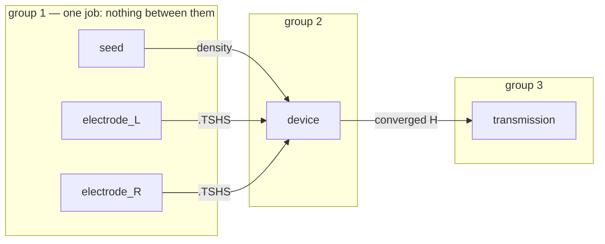
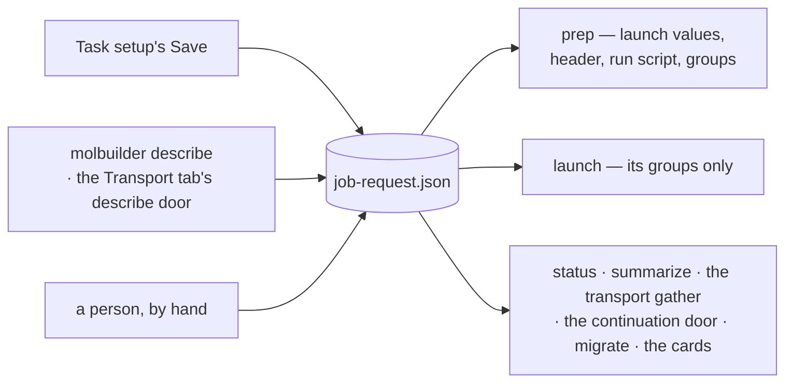

# The job request — how and where a calculation runs

**Role:** contract
**Domain:** execution
**Owns:** `job-request.json` — what a run setting is; every key (`allocation`,
`execution`, each stage's `group`, `bench`, `notify`); the memory need shown
beside the ask; which stages share one job and what they share; what of a
launched stage may change; when two decks are the same calculation; who writes
and reads the record; and `jobset migrate`.
**Read with:** [`engines/stages.md`](?doc=engines/stages.md) § 6 — the
description · [`engines/template.md`](?doc=engines/template.md) — every
parameter · [`architecture.md`](?doc=execution/architecture.md) § 5.2 — a launch
value stated, or refused at prep · [`job-system.md`](?doc=execution/job-system.md)
— prep and launch · [`scheduler.md`](?doc=execution/scheduler.md) — the queue,
the fit, the header · [`gpu.md`](?doc=execution/gpu.md) — the GPU decision ·
[`web/task-setup.md`](?doc=web/task-setup.md) — the cards that write it

## The short version

A calculation is two records. The **description** (`task.json` and the
template) says what is computed; the **job request** (`job-request.json`, beside
it) says how and where it runs (§ 1). A run setting — anything that changes
how fast a run goes and never its answer — lives in the job request alone (§ 2).
The file's keys (§ 3): `allocation`, what the calculation asks the scheduler for
(§ 3.1); `execution`, the one condition a run uses, calculation-wide and per
stage (§ 3.2, § 3.2a); each stage's `group`, the job it runs in (§ 3.3); `bench`,
a plan to measure (§ 3.4); `notify`, when it reports (§ 3.5). Beside the memory
ask, each stage's measured need is shown, never filled in (§ 3.1a). A speed
setting nobody stated takes the catalogue's default (§ 4). A launched stage's
request may change; what it computes may not (§ 5, § 6). Older calculations are
rewritten by `jobset migrate` (§ 8).

**Reading map.** *For the person setting up a calculation:* § 1, § 3 – § 3.5,
§ 5. *How it works:* § 2, § 4, § 6. *Developer reference:* § 7 (doors and
checks), § 8 (`jobset migrate`), § 9, § 10.

---

## 1. Two records, two editors

> **A calculation is two records with two editors. The description says what
> is computed; the job request says how and where it runs. Nothing in one is
> read as the other.**

*(The user, 2026-10-20: "carefully evaluate the jobset logic and see how much
mixing you already have between science request vs job request".)*

| | **the description** | **the job request** |
|---|---|---|
| its files | `task.json` and `<label>.template.toml` | `job-request.json`, beside them |
| it says | what the calculation is | how and where it runs |
| it must never | say how or where it runs | state anything the calculation computes |

- **The description holds** the structure or the junction it cites, the kind,
  the stages and what each varies, the bias points, every parameter's value
  ([`stages.md`](?doc=engines/stages.md) § 6,
  [`template.md`](?doc=engines/template.md)). Its `shape` names the one layout,
  `hierarchical`, which no request changes.
- **The job request holds** the queue, the wall and the memory; each run's
  ranks, cores, GPUs and run settings; which stages share one job; what a
  benchmark measures; when the calculation reports, and to whom.
- **Who writes them**: Task setup — its stage table and the parameter tabs'
  hand-over write the description; its run, group, benchmark and report cards
  write the job request — `molbuilder describe` and the Transport tab's
  describe door write both; a person may edit either (§ 7).
- **Who reads them**: prep reads both — every deck from the description; each
  job's launch values, header, run script and groups from the job request.
  Launch reads the job request for its groups only (§ 7).

**What "nothing in one is read as the other" forbids.** A reader of the job
request may read the description to learn which stages there are and what each
builds on — the group check does (§ 3.3): that reads the science as science.
What is forbidden is taking a value of one record for a value of the other: a
template's `use_gpu` asking the scheduler for GPUs while the run card says
nothing; a deck comment standing in for the rank count a job is launched with;
a run setting making two decks two calculations.

**Why two files, saved apart.** Each changes at its own moments. A queue, a
wall, more memory for a run that ran out of it — a job-request edit, which
changes no deck's science; a mesh cutoff — a description edit. The check of
what is computed reads the description and the decks alone (§ 6), so a change
of how a run runs is never read as another calculation: a launched stage takes
more memory without going back past its runs (§ 5).

## 2. Which settings are run settings — the catalogue says

**The catalogue's `execution` category is the run settings**: what changes how
fast and where a calculation runs, and never its answer
([`template.md`](?doc=engines/template.md) § 6.2). *Never its answer* means
within the description's own tolerances, not bit for bit: a run setting moves
the order of floating-point sums and how many processors share the data, and
an iterative solve turns that into differences inside the tolerances it
converges to. They are of two kinds:

| kind | the items | stated nowhere |
|---|---|---|
| **the launch shape and the memory cap** — the catalogue's machine-answered items (its `allocation = true` flag, not the `allocation` block of § 3.1) | `mpi_np`, `omp_threads`, PySCF's `threads`, `gpu_count`, `max_memory_mb` | see [`architecture.md`](?doc=execution/architecture.md) § 5.2 |
| **the speed settings** | `use_gpu`, `diag_algorithm`, `block_size`, `parallel_over_k`, `ts_solution_method`, `ts_elecs_out_of_core`, `wall_slack` | the catalogue's default (§ 4) |

What is refused at prep when a launch value is stated nowhere, and what a
missing value means, is one ladder:
[`architecture.md`](?doc=execution/architecture.md) § 5.2.

**A run setting lives in the job request and nowhere else.**

- The catalogue declares it; no template carries it, valueless or not. A
  template holding one is refused by its reader, naming `molbuilder jobset
  migrate` (§ 8), which takes it out and moves a value it holds onto the
  calculation's run card ([`template.md`](?doc=engines/template.md) § 2: *a
  home that must stay empty is removed, never policed*).
- A stage's `overrides` never names one
  ([`stages.md`](?doc=engines/stages.md) § 6.2).
- **Its default is the catalogue's `default`**, a kind's `recommended` first —
  the one answer `template.default_of` gives every reader
  ([`template.md`](?doc=engines/template.md) § 5.4). A run setting states no
  `value` in the catalogue, since no template starts from one.
- Every run setting is in the catalogue's `staging` group, which the parameter
  tabs do not offer and Task setup's run card shows
  ([`stages.md`](?doc=engines/stages.md) § 1.3;
  [`task-setup.md`](?doc=web/task-setup.md) § 6.1), so the hand-over and
  `molbuilder describe` write a template with none.

**Each holds under a condition the rest of molbuilder keeps:**

- **`diag_algorithm`** — every solver offered computes the whole spectrum:
  molbuilder never writes `NumberOfEigenStates`, which ELPA, MRRR and Expert
  would honour, and a reduced count changes the physics.
- **`ts_elecs_out_of_core`** — the electrode Green's-function file is the
  device run's own, written fresh for each run and each voltage
  ([`engines/transport.md`](?doc=engines/transport.md) § 2a.11); TranSIESTA's
  check of a file it reuses compares the electrode's geometry and its energy
  points, never its Hamiltonian.
- **`use_gpu`** — the GPU path is the same calculation within each engine
  library's own limits, which are said and never refused: SIESTA's GPU build
  and PySCF's gpu4pyscf ([`gpu.md`](?doc=execution/gpu.md) G11).

**What is not a run setting:**

- **A setting that moves an iterative solve's path** — the mixing, its history,
  the initial guess, a step's size. Where a system has several SCF solutions or
  several minima, the path decides which one is reached: the description's.
- **A budget the engine's own run counts** — `relax_steps`, `max_scf_iter`,
  PySCF's `geom_continue_retries`, the deck's own loop. It decides where an
  unconverged run stops and what a later stage takes from it: the description's.
- **A keyword that only shapes what a run writes** — a `write_*` switch, a
  verbosity: the description's, and changing one on a launched stage is a
  change of the description like any other (§ 5).
- **`density_fit`** — PySCF's density fitting moves its energy (its own help:
  up to 0.1 kcal/mol): category `method`.
- **`restart`** — whether a stage starts from what the stage before it left is
  what the ladder computes: a stage's own science, set as its override
  ([`stages.md`](?doc=engines/stages.md) § 2), category `procedure`. Which
  stages may share a job is read from it (§ 3.3).

**A stop that launching again resumes is the run's**: the wall and its slack
([`running-a-job.md`](?doc=execution/running-a-job.md) § 3.6). A run is one
start, and to continue is to launch again
([`project-layout.md`](?doc=execution/project-layout.md) § 1.6.1), so no run
card counts starts: a run card stating `continue_retries`
(`template.RETIRED_ITEMS`) is refused, told the item is retired.

**A run setting the deck writes stays in the deck.** A SIESTA deck writes
`Diag.Algorithm`, `BlockSize`, `Diag.ParallelOverK`, `Diag.ELPA.GPU`,
`TS.SolutionMethod` and `TS.Elecs.Out-of-core`; a PySCF script states its run
settings — `THREADS`, `USE_GPU`, `GPU_COUNT`, `MAX_MEMORY_MB`, `WALL_SLACK` — in
its run-settings block at its head, and every other line reads them there by
name, its effective-parameters table included
([`job-contracts.md`](?doc=execution/job-contracts.md) § 3.1). So a deck is the
whole record of what its run computed, and with what; which of its lines are
the calculation is § 6's.

## 3. `job-request.json`

```jsonc
{
  "schema": "molbuilder/job-request@1",

  // what this calculation asks the scheduler for (§ 3.1)
  "allocation": { "domain": "htc", "time": "0-04:00:00", "mem": "128G" },

  // the run card every rung runs at, unless its own says otherwise (§ 3.2)
  "execution": { "mpi_np": 8, "omp_threads": 2,
                 "diag_algorithm": "ELPA-2STAGE" },

  // every stage of the description: the job it runs in (§ 3.3), its own card
  "stages": {
    "coarse": { "group": 1 },
    "tight":  { "group": 2,
                "execution": { "mpi_np": 16, "time": "1-00:00:00" } }
  },

  // what to measure (§ 3.4) and when to report (§ 3.5)
  "bench":  { "mpi_np": [4, 8, 16], "omp_threads": [1, 2] },
  "notify": { "on_scf_converged": true, "every_hours": 6,
              "channels": ["slack"], "report": ["*"] }
}
```

- **`schema` is `molbuilder/job-request@1`**, checked by name and major
  ([`job-contracts.md`](?doc=execution/job-contracts.md) § 6.1).
- **`stages` holds every stage the description holds, by its name, and no
  other.** Each entry's `group` is required, its `execution` optional. A name
  is matched as every stage name is, case aside (`identity.stage_key`). Two
  keys that are one name, an entry for a stage the description does not hold,
  and a stage of the description with no entry are each refused by the reader,
  naming both files: one Save writes both (§ 7), so a difference is an edit of
  one without the other.
- **A description with no job request beside it is refused** when the
  calculation is opened (§ 7).
- **The rest is optional, and absent is a state**: no allocation, no
  calculation-wide card, no benchmark plan, no reports.
- **It names no machine.** A queue's name is the person's ask, true of this
  calculation wherever the folder is opened; the target's record checks it at
  prep ([`scheduler.md`](?doc=execution/scheduler.md) R8). What a machine
  *found* — a benchmark's verdict — is never written here (§ 3.4).

### 3.1 `allocation` — what this calculation asks the scheduler for

Four optional fields; absent means **unstated**:

```json
"allocation": { "domain": "htc", "time": "0-04:00:00", "mem": "128G" }
```

| field | what it says |
|---|---|
| `domain` | which **queue** — the answer `--domain` gives |
| `time` | the **wall** |
| `mem` | the **memory ask** |
| `gpu_binding` | whether a GPU ask carries `--gres-flags=enforce-binding`; unstated, it does ([`gpu.md`](?doc=execution/gpu.md) G9) |

Where each is stated besides — a run card, a prep flag — and what prep does
when it is stated nowhere: [`architecture.md`](?doc=execution/architecture.md)
§ 5.2.

**Why it is here and not in `bench`.** The file records what a person
*asked*, never what a machine *found* (§ 3.4), and these are asks. `bench` says
which settings to measure; this says what to request. A queue name is a
decision about this calculation, true wherever the file is opened.

**One spelling, and it is SLURM's** — `"0-04:00:00"`, `"128G"`: what the file
holds is what `sbatch` takes *(user, 2026-08-24: "your record should set
unified time format while it is the UI that can do some translation for human
readability/input")*. The reason is that the two vocabularies disagree:
`04:30` is four minutes thirty to SLURM and four and a half hours to a person,
so a field holding whichever spelling arrived cannot be read correctly by
anybody.

**Translation lives at the edges where people are** — the Task setup tab's
input box, `--time` / `--mem`, and a file typed by hand. All of them go through
one door (`scheduler/quantities.py`: `canonical_time`, `canonical_mem`), and the
reader normalises on the way in, so a person may type `4h` anywhere and no layer
behind those edges meets a second spelling. `Resources` holds the same
invariant on itself, because several roads reach it.

**The queue name is not judged here.** A job request written for one cluster
is opened on another; refusing a queue this machine never heard of would refuse
a file that is correct where it is going. A spelling is machine-independent and
is settled at the door; a queue name is checked against the target's record at
prep, where the machine is known
([`scheduler.md`](?doc=execution/scheduler.md) § 5).

**A prep flag wins field by field.** `--mem 64G` overrides the memory and
leaves the queue and the wall standing. Whole-object precedence would let an
unrelated flag silently drop an ask nobody mentioned.

### 3.1a The memory a run needs — measured, shown beside the ask

*(The user, 2026-10-20: "estimate the memory need … as a suggested value, and
task setup … would put it next to the request"; 2026-10-22: "we don't want to
misalign and allocate less memory than actually needed and one job at a
node/task is good enough to know, document the limitation, and that's it".)*

**The ask stays the person's.** Nothing fills `allocation.mem`, and nothing
estimates it in the person's place *(user decision, 2026-08-24)*: a model that
answers a question the person was never asked is the wrong shape, whatever its
coefficients. No prep refuses an ask for being under the need; the ask and the need are shown side by side
and nothing compares them in words. **Beside the ask, each stage's need is
shown, measured on the runs of that stage** — computed when asked and stored
nowhere: it follows the runs and the ranks, so a stored copy would be a second
source, and one key could not hold a ladder whose rungs each need their own.

```text
transmission  about 49.3G at 64 ranks -- held 12.31G at 16 ranks × 1 thread, 05_transmission/run-0 on qlabsrv (the largest sample; finished)
device        at most 9.6G at 32 ranks -- held 9.58G at 32 ranks × 1 thread, 04_device/run-1/v0.2 on sg013 (the kernel's counter, the job's; finished)
seed          nothing measured -- no finished run of seed has stated its memory
```

**What a run held** is the one memory peak its run record states,
`mem_peak_gb` ([`model/parse.md`](?doc=model/parse.md) § 5c.1), at the ranks its
run script launched (`ranks_asked`), its threads named beside them. A PySCF run
is one process, and so is a run whose run script states no ranks. Where the peak was
read decides the word the figure is said with:

| run | where the peak is read (`mem_peak_from`) | the word | how it errs |
|---|---|---|---|
| under a scheduler | the kernel's counter for the job's cgroup, since the job began | **at most** | high: a later stage or point of a job that runs several one after another — a group, a run of points, a sequence — carries the largest of those before it; the cgroup is charged the file cache a run's writes leave |
| a run here | the largest sample of its own processes — every 10 s, a row when memory moves by 10 % or more | **about** | low: a spike shorter than a sample, or up to that tenth |

**The bound — a finished run that held X at N ranks needs at most
X · max(1, M/N) at M ranks.** An engine that gives every rank its own copy of
the matrices — TBtrans, and TranSIESTA's solver, which deals the energy points
out among the ranks — holds about M/N times as much at M; one that divides its
matrices among the ranks holds less a rank as ranks grow; with fewer ranks than
measured neither holds more than it did. So one rule bounds both, scaling up and
never down. Threads are not modelled. A PySCF run's figure is what it held,
never scaled; its own cap (`max_memory_mb`) is what it was let hold.

**Which runs count:**

- the stage's runs and each point of a run of points, by the lister the Results
  tab asks (`runstatus.run_folders`);
- **a point's need is the smallest** of its finished runs' bounds — every bound
  holds;
- **a stage's need is the largest of its points'**, naming the run that gave it
  (`runrecord.RunRef`, its folder);
- **a job's need is the largest of what it runs** — a group's members, a
  sequence's groups — said with the stage it is, and the stages nothing has
  measured named after it (`jobset.memory.largest`). Every job asks the
  calculation's `allocation.mem`, so the figure beside the ask is the largest
  need of the stages; `prep --mem` asks for one prep's jobs alone;
- **a run that did not finish gives no bound** — what it held is less than the
  stage needs. The one that held the most is said beside the figure, with how
  many give none: one still going as what it *holds so far*, one that ended as
  what it *held before it ended*;
- **nothing measured says so**, and nothing is invented in its place: a stage's
  first finished run is what measures it.

**How it is said.** In tenths of a GB, rounded up — the side that asks for no
less than a run needs — what a run held in hundredths as its record states it;
in the scheduler's units and spelling, 1024-based, as `--mem` asks (`48G`). It
is the host's memory: a GPU's own is not in it.

**Where it is shown, and nowhere else** — never in a header, a deck, the job
request or a refusal:

- **Task setup** — under the memory field of the queue card, the largest need
  and its stage ([`task-setup.md`](?doc=web/task-setup.md) § 6.1); each stage's
  line in *What a prep will write, per stage* (§ 7.1 there); prep's answer in
  the Preview (§ 11.1 there). The page asks it in a request of its own once the
  plan has painted, again when the folder or a rank count changes — never on
  every edit — and drops an answer a newer one overtook.
- **prep** — each stage's answer carries its line (`need`), printed after its
  placement and fit, or, on a machine with no queue, after the line stating
  where its values came from; a group's beside the group's fit, a sequence's
  beside its own ([`job-system.md`](?doc=execution/job-system.md) § 5.0, *What
  prep answers*). A
  benchmark's prep shows none: what its trials held is `summarize bench`'s to
  report.

### 3.2 `execution` — the ONE condition the run uses

*(User, 2026-09-02: "run parameter is independent from bench grid or bench
result. User can run without bench… bench and run share the same framework to
choose/set parameters but run does not produce grid but a single user defined
condition to run." And: "bench is bench and run is run.")*

```json
"execution": { "mpi_np": 8, "omp_threads": 2, "diag_algorithm": "ELPA-2STAGE" }
```

**One value per parameter, never a list.** A list is `bench`'s shape, and a list
here is refused by name, with that said — the two blocks are one vocabulary at
different arity, and the arity tells them apart:

| block | shape | means |
|---|---|---|
| **`bench`** | several values per axis | *measure these* → N trials, in `<stage>/bench/` |
| **`execution`** | one value per parameter | *use this* → one run, in `<stage>/run-N/` |

**Independent, and both optional.** Declare a bench and no run condition, a run
condition and no bench, both, or neither. A run never requires a benchmark — not
executed, not declared. **A benchmark does not fill it**: it writes a report,
and what the run uses is what you wrote here (§ 3.4).

**Calculation-wide and per stage, composed field by field.** The top-level
block is what this calculation runs at; a rung that wants something else says
so on itself, and a stage naming only `mpi_np` keeps the calculation's solver
and thread count:

```json
"stages": { "tight": { "group": 2, "execution": { "mpi_np": 16 } } }
```

**A calculation-wide value reaches the rungs that read it** — the item's
`stages`, by role, asked of `template.reads`
([`template.md`](?doc=engines/template.md) § 6.4). A transport ladder's
transmission takes no `use_gpu` or `gpu_count`, its `tbtrans` having no GPU
path, while the seed, the leads and the device take them. A rung's own block
naming an item it does not read is refused; so is the calculation's naming one
no rung of the description reads. `time` and `domain`, which are not catalogue
items (§ 3.2a), reach every rung.

**And nowhere else.** A run setting is stated in this block — the
calculation's or the rung's — and in no other record: not the template (§ 2),
not a stage column of the description, not a `bench` row, which sets only the
trials (§ 3.4). Every reader — the deck, the scheduler's device ask, the
run script, the Task setup cards — takes the one answer the ladder gives
([`architecture.md`](?doc=execution/architecture.md) § 5.2): the rung's card
over the calculation's over the catalogue's default (§ 4). A benchmark's trial
takes no rung's card (§ 3.4).

**Every value on a card is its item's to judge and spell**: a catalogue item's
by the setting door — its type, its choices, its limits, and whether a run card
may hold it at all (`template.accepts`, `template.spell`,
[`template.md`](?doc=engines/template.md) § 5.4) — and a card's `time` and
`domain` by this reader (§ 3.2a). So `"mpi_np": "8"`, `"use_gpu": "yes"` and
`"diag_algorithm": "elpa"` are refused where the job request is read — at Task
setup's Save and at prep's preflight — in the item's words.

**`null` on a card is *unset*.** For an item whose unset is an answer — the
catalogue's `optional`: the launch shape, `block_size`, `parallel_over_k` — a
rung's `null` leaves it unset on that rung, over the calculation's card: a
calculation-wide `"use_gpu": true, "gpu_count": 2` and a rung's
`"use_gpu": false, "gpu_count": null` run that rung on no GPU. For any other
item `null` is refused, naming the key: a speed setting with a default is
stated or left out.

**Which names may appear**: the catalogue's `execution` items — the
membership `bench` uses — plus `time` and `domain` (§ 3.2a). A machine-answered
item becomes the launch shape; anything else is a run setting laid over the
catalogue's default. The launch shape is a direct map of the block's machine
items onto the run's request (`resolve.declared_run_shape`), never the
benchmark's grid enumerator, and that request is placed on its queue at prep,
its fit said ([`scheduler.md`](?doc=execution/scheduler.md) R6).

**Why not `allocation`.** That block is what the calculation asks the
**scheduler** for — the queue, the wall, the memory, the GPU binding (§ 3.1).
`execution` is what the **job** runs as. A `--mem` and an `mpi_np` are answered
by different things and refused by different doors; a block holding both could
not say which a key belongs to.

#### 3.2a `time` and `domain` in `execution` — the two asks a RUN owns

**A benchmark and a run want different wall clocks, and one field cannot hold
both.** `allocation` is read by `prep bench` and `prep task` alike:

| `allocation.time` | the benchmark | the real run |
|---|---|---|
| `0-04:00:00` | fine | **killed at four hours** |
| `2-00:00:00` | every ten-minute trial asks for two days, and queues behind everything | fine |

A short ask is scheduled into gaps almost at once, so a benchmark that asks for
two days waits a day to start — and a benchmark is what you run to *save* time.
So a run card may state its own `time` and `domain` *(user, 2026-09-02: "explicit,
right next to prep run so easy to see and confirm")*:

```json
"allocation": { "time": "0-04:00:00", "domain": "htc", "mem": "256G" },

"stages": { "tight": { "group": 2,
                       "execution": { "mpi_np": 64,
                                      "time": "2-00:00:00", "domain": "public" } } }
```

**`allocation` is the calculation's ask and the benchmark's; `execution` is
this run's.** A card's `time` and `domain` lie over the allocation's, a prep
flag over both; the ladder, and what is refused when neither is stated, is
[`architecture.md`](?doc=execution/architecture.md) § 5.2.

**Spelled as the allocation's are.** A card's `time` is read through the same
door (`scheduler/quantities.canonical_time`) and held in SLURM's spelling —
`"4h"` is read, and written back, as `"0-04:00:00"`; one that cannot be read is
refused, naming the card. A card's `domain` is a queue's name, judged at prep
against the target's record.

**`mem` is deliberately not among them.** The line is *does this differ between
the two lanes*, and memory does not: a trial and a run compute the same system
with the same basis. A wall differs because a trial's step count is cut; a queue
differs because short and long work belong in different ones.

**They are not catalogue items.** The catalogue describes what an engine
computes with; a wall and a queue are what a scheduler is asked for. They are
admitted to this block by name — which is also why a run's condition can never
make one a `bench` axis: `bench` takes catalogue items only, and a benchmark
that swept its own wall would be measuring the queue.

### 3.3 `group` — which stages share one job

**A group is stages that take nothing from each other, run one after another in
one job.** The stages with one number are one job: prepared together, launched
together, walked in the ladder's order inside one job — each member in its own
run with its own records, one that fails not stopping the others
([`project-layout.md`](?doc=execution/project-layout.md) § 1.6.6). Stages that no
judgement stands between — a transport ladder's seed and its two leads, each
starting from the structure — wait in the queue once instead of once each.

**Stages that build on each other are separate groups**, linked into one job as
a **sequence**: `prep task --group 1 --group 2 --one-job` writes the sequence's
one header, and `launch task --group 1 --group 2` sends it; inside the job each
later group is launched when the one before has finished, taking what it builds
on then ([`job-system.md`](?doc=execution/job-system.md) § 6.0, *A sequence of
groups*). Each group's first launch saves the folder's state first, inside the
job too ([`checkpointing.md`](?doc=execution/checkpointing.md) § 9).



A transport ladder: the device takes the seed's density and both leads'
`.TSHS`, so it is a later group; the transmission takes the device's converged
Hamiltonian, so it is another (`transport.stages.stage_inputs`).

**The numbers.** The first stage of the description is group 1; each later
stage **repeats the number above it or adds one**, so the groups run in the
ladder's order. Every entry states one; an entry without one is refused. A
group's members are compared by **who they are**, never by the number: removing
a stage above shifts the numbers below it, and that is no change to any job.

**The defaults** `molbuilder describe` and Task setup write repeat the number
above wherever that is allowed — the stage builds on none of that group, and its
run card states what theirs do on what a job shares (`group.may_join`):

| ladder | groups |
|---|---|
| transport: seed, electrode_L, electrode_R, device, transmission | 1 1 1 2 3 |
| optimization: coarse, medium, tight | 1 2 3 |
| SIESTA displacement sweep — each later stage builds on the first ([`engines/vibration.md`](?doc=engines/vibration.md) § 5.9) | 1 2 2 |
| stages set `restart: clean`, building on nothing | 1 1 1 |

**What a group's members share — one job's request** (`group.envelope`):

| | in a group |
|---|---|
| queue | one — each member's placement on the same domain |
| ranks, cores per rank, GPUs, GPU use, GPU binding | the same for every member |
| wall | the sum of the members' walls — they run one after another |
| memory | the largest of the members' asks (`0`, the whole node's, if any states it) |
| the whole node | asked when any member asks it (nothing molbuilder writes asks it) |

Each member's run card states the same values for those, which Task setup's
group card writes into every member at once. Members that cannot share one
job's request are refused at prep, naming the member and each value that
differs (`job-system.md` R-P13). A sequence's one request is composed differently — the
largest any group asks, the walls summed — and is
[`job-system.md`](?doc=execution/job-system.md) § 6.0's.

**A stage never shares a group with a stage it builds on** — its continuation,
a transport rung's upstream — because a job runs its members one after another
with nothing handed between them. Whether a stage builds on another is the
description's to say (its `restart`, [`stages.md`](?doc=engines/stages.md) § 2;
a linked kind's inputs), and the check reads it there. The check,
`group.check_groups`, is the description's preflight's — an error at every prep
([`job-system.md`](?doc=execution/job-system.md) § 5.0) and at Task setup's
Save — and its refusal names the way out:

```text
`tight` is in group 2 with `medium`, which it builds on: one job runs its members one after another with nothing handed between them, so `tight` would start before you have looked at what `medium` produced (execution/job-request.md § 3.3).  Give `tight` a new group -- one more than the group above; or, for it to start from its own deck rather than from `medium`, set its `restart` override to `clean`.
```

The `restart: clean` way out is offered for an independent ladder (an
optimization's), whose stage builds on the one before only while it continues;
a linked kind's input (a transport rung's) is its kind's, whatever its
overrides say.

**A group is its members, never its number — and a job whose members change is
formed again by its prep.** Groups and prepared jobs are matched by membership
(`group.same_members`):

- **a prepared job whose members are no longer one group is formed again whole,
  in one prep** — the prep must name every group its members are in now
  (`group.formed_again`), else it is refused, naming the groups to pick too; the
  old job's header is removed in that prep;
- **a stage the description no longer holds**, never launched, leaves
  `job-set.json` at the next prep, and the header of the job it was in goes with
  it — named while every member's row is still there;
- **a launched stage's row stays, and its job's header**: its runs are read
  through them. A launched group's members are fixed — putting a stage into it
  or taking one out is refused, naming the way back (`job-system.md` R-P5, R-L7;
  § 5).

**A first launch sends a group whole**; launched again, a stage goes alone or
with its group, as you name it. Every group may be prepared at once; a stage
that builds on another is launched after you have looked at the one it builds on
— or, named with it at one launch, after it has finished, inside one job (a
sequence, above).

**It is the job request's because it says how the calculation runs** — which
stages one launch sends, and what they share. It says nothing about what a run
computes.

### 3.4 `bench` — a plan to measure, never a measurement

```json
"bench": { "mpi_np": [4, 8, 16], "omp_threads": [1, 2] }
```

A calculation's resource settings depend on the machine, so they cannot be
chosen in a browser. But *which of them are worth measuring, and over what
points* is a decision about this calculation, made by the person who set it up
— so it belongs in the job request, beside the run it measures for. How prep
turns it into trials, shelves and a summary is
[`generator.md`](?doc=execution/generator.md) § 4.3a; this section is the key.

> **The job request records what the person asked — points to try, or a value
> they chose. It never records what a machine found.**

- **A machine-answered entry is a plan, at any length.** `mpi_np: [8]` is
  *measure eight* — one trial, never the run's value. What the run uses is
  `execution` (§ 3.2); a grid and a decision coexist, because narrowing a row to
  state the run would destroy the plan to measure.
- **One point on a non-machine entry is the trials' value, and only theirs**
  *(user rule, 2026-08-20; "trials only")*: `use_gpu: [true]` is applied at prep
  to the bench's trials. The run reads its own card — a pin on it would be a
  second home for the run's value.
- **What a trial takes for a setting the bench does not declare** is the
  trial's ladder — never a rung's own card, which is that rung's run
  ([`architecture.md`](?doc=execution/architecture.md) § 5.2).
- **What may be swept is the `execution` category**
  ([`template.md`](?doc=engines/template.md) § 6.2, *"knobs that change speed and
  not the answer"*): sweeping anything else would measure a different
  calculation at each point. Of the machine's answers, only the grid's axes —
  ranks, cores per rank, devices — are rows; a memory cap is none. A row
  outside that is refused where the job request is written, by the setting door
  (`template.home_of`, [`template.md`](?doc=engines/template.md) § 5.4), never
  first at `prep bench`; a point is a value to try, never `null`.
- **The verdict goes elsewhere.** The trials run on the target; `jobset
  summarize bench` writes `bench-result.json`
  ([`generator.md`](?doc=execution/generator.md) § 4.4b) and prints it as a
  report, and no code reads it. Two files, two jobs:
  the job request says what to ask, the result says what the machine said.

**A field may appear here that may never appear in the template.** `mpi_np` as
a point to try is a question; as an item value it would be an assertion about a
machine the template has not met — and no template carries `mpi_np` at all
([`template.md`](?doc=engines/template.md) § 7, `template_file.of`).

**Which calculations it serves: a SIESTA optimization's or vibration's stage.**
A trial is a measurement because of the pin set laid over every point — SIESTA
keywords that cap the SCF, stop relaxation and force a cold start
([`generator.md`](?doc=execution/generator.md) § 4.2). A PySCF script reads none
of them, so `prep bench` refuses another engine by name, before any trial is
rendered, pointing at the engine's own scaling guidance
([`tuning.md`](?doc=engines/tuning.md)); a transport calculation's `prep bench`
is refused too ([`task-setup.md`](?doc=web/task-setup.md) § 11.1). Extending the
lane to another engine means giving that engine its own pin set, not relaxing
the check.

### 3.5 `notify` — when this calculation speaks, to whom, and with what

`notify` is the calculation's reporting **policy**: when to speak, to which of
the running machine's channels — by name — and which fields a chat card shows.
It travels with the calculation; what a channel name resolves to never does
([`run-reports.md`](?doc=execution/run-reports.md) § 1).

```json
"notify": {"on_scf_converged": true, "every_hours": 6,
           "channels": ["slack"], "report": ["elapsed_s", "energy", "max_force"]}
```

| key | type | every / never | none |
|---|---|---|---|
| `on_scf_converged` | boolean | — | `false` |
| `every_hours` | number of hours | `null` is **never** | — |
| `channels` | list of channel names | `["*"]` — every channel the running machine has | `[]` — reports off for this calculation |
| `report` | list of report field names | `["*"]` — every field the run states, of those the receiver's layout shows for the event ([`run-reports.md`](?doc=execution/run-reports.md) § 4.1c) | `[]` — the name, the state and the summary line, no field grid |

**Refused at Save, by name:**

- `on_scf_converged`: anything but a JSON boolean;
- `every_hours`: a string (`"6h"`), `0`, a negative or a non-finite number;
- `channels`: a name that is not letters, digits, `-` and `_`; `"*"` beside a
  name;
- `report`: a name that is not a report field, or one this calculation's runs
  can never state; `"*"` beside a name;
- **a block that leaves a key out** — a block states all four, every time, so a
  choice and a block that never said it are never the same bytes;
- **`notify` present but empty** — absent and empty would be two spellings of
  one state.

**No `notify` block is no notification**: no channel hears anything, the start
and the end included. The events every run says — `start`, `wall_near`,
`finish`, and a run of points' `milestone` and `part_failed` — are said and
recorded with the run whether or not there is a block, so they are not keys; the
block decides only which channels hear them, and whether `scf_converged` and
`periodic` are said at all. What each
occasion is and what every message carries are
[`run-reports.md`](?doc=execution/run-reports.md) § 2 and § 4.1a; which channels
a list selects is § 3.0 there. **`["*"]` and `[]` are two states** for
`channels` and `report`: a person who unticked every box asked for something
different from one who kept *every*.

**The name is not on the `report` list, because it is not optional.** Every
report carries the run's name and, under a scheduler, its job id — in a chat
card's title, first. So `report` is *what else*: it can be empty, and it can
never remove the name.

**A field is offered for what the run can state.** The fields, their units and
which runs state each are [`run-reports.md`](?doc=execution/run-reports.md)
§ 4.1a's table, read from one declaration, `molbuilder/report_fields.py`, which
the job request, the run script, the monitor, the listener and the Task setup card
all read. A field's name is the report's own wire name, so what you tick, what
travels and what a listener parses are one word. **A list is a ceiling, never a
floor**: asking for `energy` on a run that has not printed one yields no
`energy` field.

**It is fixed at `prep`, not read at run time.** The run script bakes the whole
block into the monitor's command line
([`run-reports.md`](?doc=execution/run-reports.md) § 2.6), carried there on
`jobset.model.Resources` ([`job-contracts.md`](?doc=execution/job-contracts.md) § 6.2),
so what a running job reports cannot change because `job-request.json` was
edited while it sat in the queue.

## 4. A speed setting nobody stated takes the catalogue's default

**For each speed setting a rung reads, a run takes the rung's card, else the
calculation's, else the catalogue's default** — `template.default_of`, the one
default every reader asks ([`template.md`](?doc=engines/template.md) § 5.4),
which `resolve` lays over whatever the engine's config class held. For an item
the catalogue gives no default (`block_size`, `parallel_over_k`), its not-set
line says what happens: no keyword written, the engine's own, or worked out
(`parallel_over_k`, from the k-point grid and the solver;
[`template.md`](?doc=engines/template.md) § 6.6, obligation 4). Each is written
into the deck, the run script or the header as any value is.

**Why a default, and no refusal.** A speed setting changes how fast a run goes,
never its answer, and the catalogue states each default with its reason
([`template.md`](?doc=engines/template.md) § 5.2). A rank count has no such
default: it is the machine's, and nothing but the person can say how much of
the machine a run takes — the launch shape, a queue's wall, memory and queue
stay stated or refused ([`architecture.md`](?doc=execution/architecture.md)
§ 5.2).

**Where each value came from is recorded in one vocabulary** — `template.SAID`
([`template.md`](?doc=engines/template.md) § 5.4):

| source | the words |
|---|---|
| the job request | *the stage's run card*, *the calculation's run card*, *the run card* (the launch shape as prep's fold records it), *the job request's allocation* |
| a flag | *a prep flag* |
| the catalogue | *the catalogue's default · not chosen* |
| the description | *this stage's override*, *the template · …* |
| a benchmark | *a pin*, *a sweep point* |

They are written in the deck's PROVENANCE `parameters:` rows for what the deck
renders, and in the pipeline log for every run setting, the run script's own
(`wall_slack`) included
([`job-contracts.md`](?doc=execution/job-contracts.md) § 3.2;
[`template.md`](?doc=engines/template.md) § 6.6, obligations 4 and 5). Task
setup's run card shows each default in its place before anyone fills it.

## 5. A launched stage's request may change

**What a stage computes is fixed once it is launched; how it runs is not.**

- **Prep again.** `prep task --group N`, for a group with launched members,
  prepares it again: every member's deck, run script and header rendered anew
  from both records, its row in `job-set.json` replaced, and no run opened — the
  next launch opens the next one.
- **The same calculation, or refused.** Each launched member's deck must be the
  same calculation as the deck its newest launched run ran (§ 6), else the prep
  is refused, naming each difference and the way back: the state saved before
  the group's first launch
  ([`checkpointing.md`](?doc=execution/checkpointing.md) § 5). A change of the
  job request passes; so does an edit of the description that leaves what the
  engine computes unchanged — the test is the engine's input, never which file
  was edited.
- **Its runs are untouched.** Each holds its own copy of the deck and scripts it
  ran with ([`project-layout.md`](?doc=execution/project-layout.md) § 1.5). The
  next launch opens the next run with the new files, and that run's launch
  record says what it was sent with (`placed_on`, `command`): status shows a
  stage's row, which is what its next launch sends, and each run's own request
  is its launch record's.
- **The members of a launched group stay fixed.** A stage put into it or taken
  out takes the way back (`job-system.md` R-P5, R-L7). What may be done to a
  group now is one answer, `ready.GroupAnswer` — prep's offer and refusals, the
  launch's, `status`'s next step and Task setup's boxes all read it — and every
  way on is one composer's (`commands.way_back`).
- **A launch sends what prep wrote.** A job request changed since its prep
  reaches a run when its group is prepared again; until then `status` and
  Task setup say the group is *changed since prepared*, each value that
  differs, and a launch that names no group does not send it
  ([`job-system.md`](?doc=execution/job-system.md), *Changed since prepared*). In a sequence
  (`--one-job`), a launched group is read as its last prep wrote it
  ([`job-system.md`](?doc=execution/job-system.md) § 5.0).

So a run out of memory or out of wall goes on with a bigger request: change the
job request, prepare the group again, launch the stage again — warm, from where
its last run reached ([`job-system.md`](?doc=execution/job-system.md) § 5.4).

## 6. The same calculation — one door, each engine's reading

**Two decks are the same calculation when their engine computes the same thing
from both, the run settings aside.** One door,
`deck_record.same_calculation(engine, a, b)` → every difference, by name — none
when they are the same. It sits with the grammar of a deck's blocks, below every
reader that asks it (floor 1,
[`architecture.md`](?doc=execution/architecture.md) § 2.1), and imports no
engine: each engine's reading is that engine's own module, the part its engine
record names (`same_calculation`, [`architecture.md`](?doc=execution/architecture.md)
§ 3.3), which the door resolves:

- **SIESTA** — `siesta.engine_input`: both decks read as SIESTA reads them
  ([`engines/transport.md`](?doc=engines/transport.md) § 6.1, *the same engine
  input*), every run setting's keyword aside — the keywords the catalogue's run
  settings write (their `anchor`, or their `expands`). It reads keywords by
  name, so it holds of any deck molbuilder wrote.
- **PySCF** — `pyscf.script_input`: the script's statements as Python reads
  them — its comments, its layout and how a value is spelled saying nothing of
  what it computes — with its run-settings block and molbuilder's stamps aside
  — when it was written and by which release (`deck_record.without_stamps`)
  ([`job-contracts.md`](?doc=execution/job-contracts.md) § 3.1, § 3.2) — and
  what it only reports aside *(the user, 2026-11-12: "ignore the report-only
  text")*: a statement filling one of the names it reports under
  (`pyscf.script_input.REPORTS` — its parameters record,
  [`model/parse.md`](?doc=model/parse.md) § 5d.3a, its runtime facts, the
  convergence targets its progress log shows, a vibration's settings copy,
  Methods text, bibliography and result-record version, and its words: each
  message it records in its result, hands a call or writes on a saved
  geometry, put there where it is composed and read from there where it is
  used), a message it prints,
  a string standing alone (its docstrings), and the message a `raise` carries,
  the raise itself compared — none of which PySCF's computation reads, another
  release free to word or record them otherwise, and every value that changes
  what PySCF computes stated by statements that are compared; a script that
  does not read as Python is compared line by line as written, its comment
  lines aside — and its structure line (`pyscf.script_input.SIDECAR_NAME`) compared by what it holds — a field
  the structure reader retires and the record's version number set aside, since
  neither says what PySCF computes *(the user, 2026-11-03: "Compare by meaning")*.

**Asked by:**

- the transport gather — the upstream run computed what this rung's deck
  computes now ([`engines/transport.md`](?doc=engines/transport.md) § 6.1);
- prep, of a launched stage (§ 5);
- the run record's `current` and the run door's `Run.report` — whether the
  stage's deck, and the check written beside it, are still the calculation the
  run ran ([`model/parse.md`](?doc=model/parse.md) § 5d).

**Not asked of what a launch sends**: a stage's own files go as prep wrote them
([`job-system.md`](?doc=execution/job-system.md) § 6.0). A deck's comments —
PROVENANCE's `resolved-defaults`, BENCH-MARKS' rank count — record what it was
rendered with, and nothing reads them as a launch: prep writes a deck and its
launch together, once ([`architecture.md`](?doc=execution/architecture.md) A3).
What `jobset/agreement` checks at a launch is a benchmark trial's cold start
(`check_trial_starts_cold`, `job-system.md` R-L29), read from the deck's own
restart keywords by the one reader of a deck's restart group, which the run
script's Mode line reads through too (`script_emit.restart_group`, the engine
handed in).

## 7. Who writes it, and who reads it



**Writers.** Task setup's Save writes both records, each whole, the folder's
state saved first, once ([`web/task-setup.md`](?doc=web/task-setup.md) § 8);
each card writes the record it belongs to. `molbuilder describe` writes both at
a calculation's start (§ 9), as the Transport tab's describe door does. A person
may edit either file; a reader refuses what does not read, naming the file.

**Readers.**

- **prep** reads it once per prep, inside the calculation it opens
  (`calculation.open` → `Calculation.request`, beside its description, template
  and plan). Prep's flags lay over it field by field for that prep alone; what a
  flag said reaches the job's row as the values it resolved to (`resources`),
  never this file.
- **launch takes no launch value from it**: it sends what prep wrote, `--time`
  restating a submitted job's wall for that launch
  ([`job-system.md`](?doc=execution/job-system.md) § 6.0). It reads the job
  request for its groups — which stages one launch sends.
- **status, summarize, the transport gather and the continuation door** take it
  from the calculation their verb opened (`Calculation.request`, A16);
  `jobset migrate` and the Task setup cards read it through the same door.
- **Task setup works on both as edited**: its prep plan reads the job request as
  the page holds it — the page sends it, read by the one reader — and its bench
  grid the benchmark's points and the queue picked; its Preview, the prep entry,
  reads both files on disk, so the page refuses it while an edit is unsaved
  ([`web/task-setup.md`](?doc=web/task-setup.md) § 7a).

**A calculation's folder holds both records.** A description with no job
request beside it is refused when the calculation is opened (`calculation.open`,
`job-system.md` R-P1), naming the file and Task setup's Save, which writes both.

**The doors** — `molbuilder/job_request.py`, floor 2 beside the description
([`architecture.md`](?doc=execution/architecture.md) § 2.1); its file name is the
catalogue's (`runfiles.WRITTEN`):

| door | answers |
|---|---|
| `of(folder, description)` | the `JobRequest`, or `None` when there is none — checked against the description the caller holds (A16) |
| `from_text(text, description)` | the same reading of a body Task setup sends |
| `write(folder, request)` | the record, whole |
| `JobRequest.run_condition(stage)` | a rung's card laid over the calculation's, for the items the rung reads (§ 3.2) — the one run-card door |
| `JobRequest.group_of(stage)` | the stage's group (§ 3.3) |

**Two checks, two moments:**

- **the reader** checks what the record says of itself against the description
  beside it — the schema, the stage names, the groups' order, each card's one
  value and each benchmark row's list of points, the allocation's spellings, the
  reports, a card's `time` spelled and an unset key's `null` (§ 3.2);
- **the preflight** checks what needs the vocabulary or the ladder — through the
  setting door, each value on a card or a benchmark row one its item takes in
  that home: a run setting the rung reads, of its type, among the choices the
  kind offers, within its limits (`template.accepts`,
  [`template.md`](?doc=engines/template.md) § 5.4); and no stage sharing a job
  with one it builds on (`group.check_groups`, § 3.3).

## 8. What moves on disk — `jobset migrate`

`molbuilder jobset migrate --bundle <calc>` rewrites a calculation an older
molbuilder wrote. It is the one road for every file a reader refuses naming
this command — the description, the job request, the job set, the
calculation's copy of its machine's record, a run's files and the template.

**How it works** (`jobset/migrate.py`, `migrate_state`):

- **Every record is read once, and every step decided before any file is
  written.** A refusal of any step writes nothing, naming why; the ledger
  records `migrate` `refused`.
- **What it moves is decided by what a file holds, never by its version** —
  each change where it is found.
- **Each file it rewrites is kept beside its new one, once**, as
  `<name>.pre-<rule>` — the earliest rule it was written before. A kept file is
  never written over: a migration that would is refused, nothing written. A file
  it only names anew keeps every byte, and nothing is kept beside it.
- **Each change is said, with its rule**, and written in the calculation's
  ledger. Its writes are one plan, carried out in order — each kept file, each
  rewrite through its record's own writer, then each rename; a migration
  stopped by a write or a rename that failed says so and writes, in the
  ledger, what it had done and where it stopped.
- **A calculation holding nothing an older molbuilder wrote is current, and said
  so** — `<calc> is current -- nothing to migrate: …`, what was checked, no
  failure; the ledger records `migrate` `current` *(the user, 2026-10-22:
  "change the word of migrate so it does not look like an error")*.

**What it rewrites** — each change in a few words, the detail below:

| found | rewritten as |
|---|---|
| a job request inside `task.json` (`molbuilder/task@1`) | its own `job-request.json` (1) |
| a run setting in the template | onto the calculation's run card (2) |
| `restart` or `density_fit` on a run card | into the description (3) |
| a run setting a release retired | taken off (4) |
| a job key nothing reads — `asked`, `written_at` | taken off (4a) |
| older keys of `task.json` and `job-set.json` | written with the meaning their absence had (5) |
| the calculation's copy of its machine's record | today's shape (6) |
| a run named by the try (`<stem>-run0<role>`) | each file named once (7) |
| the template's older spellings | today's items (8) |

1. `job-request.json` is written from `task.json`'s `allocation`, `execution`,
   each stage's `execution` and `group`, `bench` and `notify` — a `notify`
   block's missing keys with what their absence meant, `every_hours: 0` as
   `null` — and `task.json` is rewritten without them, at `molbuilder/task@2`.
2. Every run-setting item leaves the template, valueless or not; a value it
   holds moves onto the calculation's run card where the card states none —
   unless the template records it *not chosen* and it is the catalogue's
   default now (`template.default_of`). Every deck renders the values it did.
3. The calculation's card's value goes into the template, a stage's into its
   overrides, `varies` gaining it. A `bench` row naming either is refused, naming
   it.
4. `template.RETIRED_ITEMS` (`continue_retries`): taken off every run card and
   out of each job's resources in `job-set.json`, saying why. A job set that
   held one names each group's prep again — a benchmark's prep anew where a
   trial is not yet launched.
4a. `jobset.model.JOB_RETIRED_KEYS`: a job's `asked`, which 2.41.0 retired,
   and its `written_at`, which 2.42.0 retired — read by nothing since, and
   left in place by the migrations before 2.65.7. The job set's reader
   refuses a job holding either, naming this command, which takes it out of
   each job, saying so, the old file kept as written before 2.65.7.
5. Among them each stage's `group`, the program onto the job (`Job.program`),
   and a placement's source `description` as `allocation`.
6. Its scheduler as a block — the word it held becomes its kind, each command
   its kind's own name, run from PATH
   ([`configuration.md`](?doc=configuration.md) § 5, M-2) — and its environment
   entry under its name, `env_init`.
7. On its stage's stem, SIESTA's history under SIESTA's own name, a session log
   stamped with the clock as the one session log; every byte kept, each old name
   said and in the ledger.
8. The electronic state's items, renamed items (`template.RENAMED_ITEMS`) and
   retired ones (`Retired.runs`): each old value carried as a stated value; a
   value that cannot run as before is refused by name.

**A run it cannot name so is left as it is, said with its reason, and not
read.** A run is decided whole — a run of points with every point of it — and
left when:

1. any folder of it started more than once — a `-run1`, a copy an earlier
   migration kept of one, or a second session log;
2. its job is one this machine holds, and is still going or cannot be asked;
3. a folder of it cannot be written here;
4. a new name is one a file already holds, or two of its files would take;
5. a file of it names a role this molbuilder does not write -- a copy an earlier
   migration kept is that migration's own, and is named anew every byte kept.

A run no job of this machine's holds is read as the copy it is. Why a run is one
start is [`project-layout.md`](?doc=execution/project-layout.md) § 1.6.1.

**What it leaves:** a transmission point's digest of another version is out of
date, and the next reading of its data file writes it whole
([`model/parse.md`](?doc=model/parse.md) § 5e); a vibration result is not
rewritten — its map is made as it is read.

**After a migration:**

- **A prepared stage is prepared again before its first launch**: the files prep
  writes now differ — the run script takes its counts alone and no start's
  number, a run being one start, and its wall slack from the job (§ 4).
- **A launched stage keeps its runs**; a SIESTA one's group may be prepared again
  as § 5 says. A PySCF script written before holds no run-settings block, so none
  rendered now is the same calculation (§ 6): a launched PySCF stage takes the
  way back for any change.
- **A benchmark's trials take the calculation's card** (§ 3.4) where they took
  the template's values — the same values, but where the two disagreed.

## 9. Describing is not a job verb — `molbuilder describe`

**`molbuilder describe` writes the description, its job request and its data
files**, with its flags ([`job-system.md`](?doc=execution/job-system.md) § 5.1).
**`molbuilder jobset` prepares, launches, observes, summarizes and migrates**,
and has no verb that describes. The next step describe prints is prep's line
(`jobset.commands`).

## 10. What this contract does not own

- **The ladders a launch value is fixed by**, and what is refused when it is
  stated nowhere — [`architecture.md`](?doc=execution/architecture.md) § 5.2.
- **The queue's record, a request's placement, its fit and its header** —
  [`scheduler.md`](?doc=execution/scheduler.md).
- **What prep and launch do with it** — [`job-system.md`](?doc=execution/job-system.md).
- **The benchmark: its grid, shelves, pins and winner** —
  [`generator.md`](?doc=execution/generator.md) § 4.3a, § 4.4b.
- **The cards that write it** — [`web/task-setup.md`](?doc=web/task-setup.md).
- **The description** — [`engines/stages.md`](?doc=engines/stages.md) § 6 and
  [`engines/template.md`](?doc=engines/template.md).
