# The job system — the jobset protocol

**Role:** contract
**Domain:** execution
**Owns:** the jobset words (calculation, task, stage, group, run, run of points, warm and cold, saved state); the task acted on group by group; the states of a stage and a group, and the acts that move them; *Changed since prepared*; the next step; the prep protocol (§ 5.0); the verbs' grammar and printed commands (§ 5.3); what a stage takes, `--from` / `--cold` / `--gather`, and launching again (§ 5.4); the launch protocol (§ 6.0); a sequence of groups; `molbuilder jobs` (§ 6.0a); every refusal and its way on; the benchmark verbs (§ 7)
**Read with:** [`running-a-job.md`](?doc=execution/running-a-job.md) (a run at run time, and its states, § 4.2) · [`runs-of-points.md`](?doc=execution/runs-of-points.md) (a run of points) · [`job-request.md`](?doc=execution/job-request.md) (the request's keys, groups § 3.3) · [`project-layout.md`](?doc=execution/project-layout.md) (the folder on disk) · [`checkpointing.md`](?doc=execution/checkpointing.md) (saved states, § 9) · [`scheduler.md`](?doc=execution/scheduler.md) (placement and the header) · [`job-contracts.md`](?doc=execution/job-contracts.md) (file formats) · [`architecture.md`](?doc=execution/architecture.md) (the floors and doors) · [`submission.md`](?doc=execution/submission.md) (nothing sent unseen, one job at a time) · [`generator.md`](?doc=execution/generator.md) (the benchmark) · [`worked-example.md`](?doc=execution/worked-example.md) (one calculation, end to end)

---

## The short version

**Everything is a job set**: one calculation is a job set of one, a ladder or
a benchmark a bigger one, and the same verbs drive each (§ 1).

- You **describe** a calculation once, and its job request gives each stage a
  **group** number (*The task*, § 5.1).
- **`jobset prep task`** prepares the groups you pick, for the machine whose
  record it names, deciding everything before it writes anything (§ 5.0).
- **`jobset launch task`** sends **one** job — the next group whose upstream
  has finished, or one stage again — shown, and asked once (§ 6.0, § 5.4).
- **`jobset status`** says where every stage stands, and the line that moves
  each group (*The next step*). Every verb is in one table (§ 5.3).
- **Nothing starts a stage but you**, or a sequence of groups you name at one
  launch. Every run is kept; going back is a `checkpoint restore` (*How the
  checkpoint supports you*). Every refusal names its way on.

**Reading map.** The section numbers are fixed by the code that cites them, so
the categories interleave:

| you want | read |
|---|---|
| **the rules, as you use molbuilder** | *Runs, stages and checkpoints* (the words, the task, the states, the next step, every refusal, what molbuilder does and what stays yours, the checkpoint) · § 5.0 prep · § 5.1 describe · § 5.3 the verbs · § 5.4 what a stage takes, and launching again · § 6.0 launch, and *A sequence of groups* · § 6.0a `molbuilder jobs` · § 7 the benchmark |
| **the design — why it is built this way** | § 1 what the job system is · § 2 the six decisions · § 4 where the plan comes from |
| **the developer's reference** | § 3 the plan's fields · § 5.2 what prep lays on disk · § 6.1 when a header is written · § 7.1 the benchmark's one composer · § 8 what this contract does not own · § 9 the layers |

---

## Runs, stages and checkpoints — the contract

> *"the contract really should be a rule for the user: what you should do and
> what you should not do otherwise things could be broken, and here are the
> tools for you to keep track of intermediate known good states"* · *"run
> continue warm or cold is user's decision, and error or not, that's user's
> responsibility"* (user, 2026-10-07)

**molbuilder is a research tool, not a guard.** It keeps your runs apart,
tells you truthfully where each stands and how it ended, and keeps the states
you can go back to. It never decides for you whether a result is good, whether
to run again, or how. This block is the contract for runs and stages; the
numbered sections say how each part works.

### The words

| word | what it is |
|---|---|
| **calculation** | one folder, described once by `task.json` and its template, and asked to run by its job request, `job-request.json` ([`job-request.md`](?doc=execution/job-request.md)) |
| **task** | the calculation, as the verbs name it: `jobset prep task`, `launch task`, `summarize task` |
| **stage** | one step of the calculation's ladder — `coarse`, `relax`, `device` — named in the description |
| **group** | the stages one number names in the job request: stages that take nothing from each other, prepared together and launched together as one job (*The task*) |
| **run** | one launch of a stage. Every launch is a new run, numbered on from the last, each its own folder: `01_coarse/run-0`, `run-1`, … A run is one start of its run script; to continue it is to launch again ([`project-layout.md`](?doc=execution/project-layout.md) § 1.6.1). The code names a run's folder its *attempt*, and `status` heads that column so |
| **run of points** · **point** | a run whose work is several engine runs, each a **point** in a folder of its own below the run: a transport rung's frames × voltages, a SIESTA vibration's calls. One launch, one job walking its points, one state ([`runs-of-points.md`](?doc=execution/runs-of-points.md)) |
| **warm** / **cold** | what a run starts from. **Warm**: the restart files (density, geometry, optimiser history — [`job-contracts.md`](?doc=execution/job-contracts.md) § 4.2a) a run left. **Cold**: none of them; the engine starts from the deck alone |
| **saved state** | a checkpoint of the whole calculation folder — an id, a note, the time ([`checkpointing.md`](?doc=execution/checkpointing.md)): `molbuilder checkpoint save / list / restore / tag` |

### The task — prepared group by group, launched group by group

> *"we can let prep to prep the whole task and ask the user which stage it
> intend to do"* (user, 2026-10-07) · *"the stages should have a group number
> assigned to it"* (user, 2026-10-11)

**The verbs act on the task — the calculation `task.json` describes — group
by group.** Each stage states a group number in the job request
([`job-request.md`](?doc=execution/job-request.md) § 3.3): the stages with one
number are **one job**, prepared together and launched together.

**A group is stages that take nothing from each other**, run one after
another in one job; what its members share — one queue, the same counts — is
[`job-request.md`](?doc=execution/job-request.md) § 3.3's. **Stages that build
on each other are separate groups.** To have them go unattended in one job,
name them at one launch: a **sequence of groups**, where each later group is
launched in its turn, taking what it builds on then (§ 6.0, *A sequence of
groups*).

```
jobset prep task      # the groups, and which are prepared; prepare the one(s) you pick
jobset launch task    # send the next group whose upstream has finished -- one job
jobset status         # every stage: where it stands, and what is next
jobset summarize task # read a result that gathers stages (a transport I-V, a sweep)
jobset prep bench <stage> · launch bench <stage> · summarize bench <stage>
                      # a benchmark measures ONE stage, named (§ 7)
```

#### What a stage takes, and when

**What a stage takes from the stages before it is files, copied in at its
first launch** — an optimization ladder's restart files, a transport rung's
inputs, a displacement sweep's relaxation. No stage's deck depends on another
stage's run, so **every stage is prepared any time**, and what it takes is
copied when the run it comes from exists. **By default it takes the newest run
of what it builds on, which must have finished**; `--from` and `--cold` choose
otherwise, and a stage launched again follows the same rules. Each kind's
rules are § 5.4.

#### The states, and what moves them

**Three things have a state, and nothing stores it.** A **stage**, its
**group** and each **run** of a stage are read from the files every time —
`task.json`, `job-set.json`, the run folders and their records — by one door
each: the ready door (`ready.task_state`, `ready.readiness`,
`ready.GroupAnswer`) for a stage and a group, the run doors
(`materialize.ever_launched`, `parse.dirs.run_status`) for a run
([`architecture.md`](?doc=execution/architecture.md) § 3.2). `status`, `prep`,
`launch`, the Results tab and Task setup all ask the same doors, so they cannot
disagree.

**Five acts change what the doors read.** Every edge in the diagrams below
names its act and, after the `·`, who makes it:

| act | who | what it writes |
|---|---|---|
| **`prep task`** | `prep_task` | a group's files and rows; with no group named, an older transport junction's order record ([`engines/transport.md`](?doc=engines/transport.md) § 1.1); for a calculation that reuses a finished one, the runs of the groups it copies in |
| **`launch task`** | `send_launch` | fills a run and sends it |
| **the run** | the scheduler and the run script | its output and its conclusion |
| **`checkpoint restore`** | `checkpoint` | the whole folder, put back |
| **the description and its job request** | Task setup's Save, `molbuilder describe`, or either file by hand | what each stage's files are compared with, which stages there are and how they are grouped — never a stage's files |

**What marks each state.** No file holds a state, and none is named for one.
A state is read from the files the acts write: some by a file being there — a
stage's row, a run's launch record — some by what one says — the row's
members, the marker's exit code. Every such file is a row of the manifest
([`project-layout.md`](?doc=execution/project-layout.md) § 5), which names its
writer and the one door that reads the file:

| what | it is | when the files say | the door that reads the state |
|---|---|---|---|
| a stage | **described** | the description names it (`task.json`'s `stages`; its group, `job-request.json`'s) | `task.of`, `job_request.of` |
| | **prepared** | its job's row is in `job-set.json` — the row's `members` name the job it is prepared in | `Calculation.job` |
| | **ready to launch** / **waits for** | the newest run of each stage it builds on has finished / has not | `ready.first_launch_takes` |
| | **its job's members changed** | its row's `members` are not its group's now | `ready.regrouped` |
| | **missing** — against the design | its row is there, and no `run-<n>` is under the folder the plan names | `ready.readiness` (`materialize.job_folder`, `latest_attempt`) |
| | **launched** | a run of it has a launch record, `run.json` | `materialize.ever_launched` (`runrecord.launch_record`) |
| a group | **prepared** / **launched** / **its members changed** | every member's row names these members / a member is launched / a row names other members than the group holds | `ready.GroupAnswer` — the one answer every verb and surface reads (below) |
| | **goes in job N** | a sequence still going holds it and has not launched it yet (§ 6.0, *A sequence of groups*) | `ready.held_by_sequence` (`joblist.is_going`) |
| a run | **pending** — opened, not launched | its `run-<n>` folder is there, stamped by its `calcdir.json` (`role: run`; a run of points' run, `container` — its points are the runs), with no `run.json` | `paths.attempts_in`, `runrecord.launch_record` |
| | **queued** · **running** · **finished** · **failed** · **unreadable** | the run door's reading of its launch record, session log, output and conclusion marker, in the order of evidence ([`running-a-job.md`](?doc=execution/running-a-job.md) § 4.2); *converged* is its own column, never the state | `rundir.run_state_of` (`parse.dirs.run_status`) |
| a point, a run of points | *done*, *not run*, and the run's own state | [`runs-of-points.md`](?doc=execution/runs-of-points.md) § 4 | `continuation.points_state` |

**What a run started from is a record, not a state**: `.continued-from` (the
one run it continues from) and `.gathered-from` (a transport rung's inputs,
each from its run), written by the one hand-over (§ 5.4); a run's own
`continued_from` is its `run.json`'s, written with it.

*A stage* — the ready door's answer (`ready.readiness`):

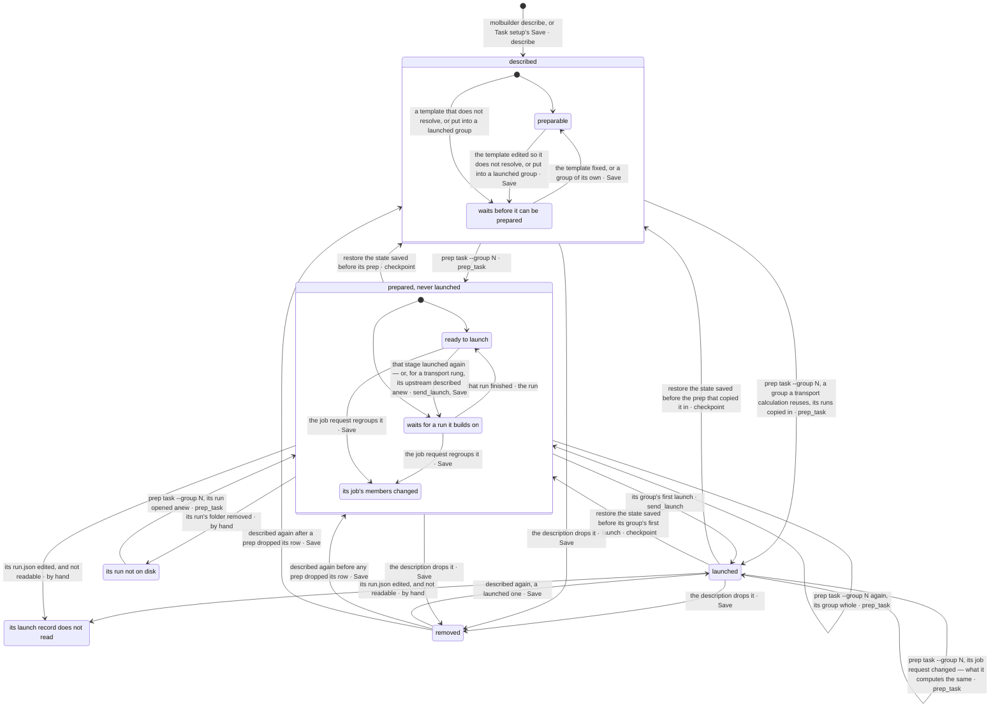

| state | what `status` shows | what may come next |
|---|---|---|
| **described**, preparable — no row in `job-set.json` | *described* — what its first launch will take | `prep task --group N` |
| **described**, waits before it can be prepared — a template that does not resolve, or a stage put into a group launched without it | *described* — *waits before it can be prepared:* and why | the template fixed; a group of its own (R-P5) |
| **prepared, ready to launch** — its row, its deck and scripts rendered from the records **as they stood when you prepared it**, its first run opened with its own files, nothing taken | *pending* — *ready to launch*, what it takes, and which molbuilder prepared it when another did | its group's first launch; or prepared again |
| **prepared, changed since prepared** — its records resolve now to other values than its prep recorded | *pending* — *changed since prepared:* each value, `was → now` | prepared again: nothing ran (*Changed since prepared*) |
| **prepared, waits for** a run it builds on — not finished, not there, or (a transport rung) not the deck its description gives now | *pending* — *waits for:* and what | that stage launched or let finish; or prepared again |
| **prepared, its job's members changed** | *pending* — *its job's members changed:* | prepared again, every group the old job's members are in now named in one prep (R-P6); its launch is refused meanwhile |
| **launched** — a run of it has a `run.json` | the newest run's state, *converged* in its own column; *changed since prepared* when its records changed | launched again; prepared again for its job request; a change to what it computes (below) |
| **its launch record does not read** | *unreadable* — the record's own words | what the words say; nothing launches or prepares it until it reads (R-L21) |
| **prepared, its run not on disk** — against the design: its folder removed by hand | *missing* | prepared again — its group's prep opens its run anew, the launched members' runs as they are; launch refuses it meanwhile (R-L28) |
| **removed** — no longer in `task.json`; its folder, runs and number kept | not listed | described again, it is what its files say |

**What may come next for a launched stage:** launched again — alone, or its
group whole: warm, `--cold`, `--from`, `--gather` (§ 5.4); prepared again for
its job request, what it computes kept
([`job-request.md`](?doc=execution/job-request.md) § 5); a change to what it
computes goes back to the state saved before its group's first launch
(*Changed since prepared*).

##### Changed since prepared

*(the user, 2026-10-25)* **A stage is *changed since prepared* when its
records no longer give what it was prepared with.** Prep records, for each
stage it prepares, the values it prepared it with — every setting as resolved
for it (the template ⊕ the stage's overrides; a run setting is its run
card's, `template.run_settings`), its points (a rung of points' frames and
voltages) and its run card (the job request's values that reach it) — in
`prepared-with.json` at the calculation's root, merged per stage as
`job-set.json` is. `status`, Task setup and the Results ladder resolve the
same values from the records as they read now — a read that renders and
writes nothing — and name each that differs: `mesh_cutoff: 300 → 400`.

- **Only what the person changed is a difference.** A deck a newer molbuilder
  words otherwise is none, nor an item a newer molbuilder added or retired. A
  run-card value stated or taken away is one: *run card mpi_np: not stated →
  4*.
- **A record that does not read** — not JSON, or another file's schema — is
  said in its reader's words, naming the file and the way back: the state
  saved before the last prep, or the file removed and every group prepared
  again. It is the stage's answer and its group's next step, *unreadable*,
  and a prep refuses over it in the same words.
- **A stage whose prep recorded nothing** says so in one spelling on every
  surface (`prepared_with.UNRECORDED_SAID`) and is compared with nothing;
  prepared again, it is recorded.
- **Launch compares nothing**: it sends what prep wrote (§ 6.0).

The way on:

- **never launched** — *prepare it again*: nothing ran, and prep writes its
  files anew (`prep task --group N`);
- **launched, its job request changed alone** — the run card, the allocation,
  the notification: *prepare its group again; its runs are kept*, as a run
  out of memory goes on with a bigger request
  ([`job-request.md`](?doc=execution/job-request.md) § 5);
- **launched, changed in what it computes** — its runs computed the
  description as it was. To compute it as described now, **start the group
  from the beginning**: save the folder as it stands, so its runs are kept in
  a saved state; go back to the state saved before the group's first launch;
  prepare the group again. Task setup's Save refuses such a change over a
  stage that has run, with these lines
  ([`web/task-setup.md`](?doc=web/task-setup.md) § 8); the change is made
  after the restore, before the prep. The three lines are printed whole, the
  state named by its id (`commands.redo_launched`) — here for a transport
  calculation whose device, its group 2, has run:

```
molbuilder checkpoint save -p /…/projects/P/transport/S -m 'group 2 (device) as launched, before going back'
molbuilder checkpoint restore -p /…/projects/P/transport/S 4f9ca71
molbuilder jobset prep task --group 2 --bundle P/transport/S
```

*A group* — the stages one number holds, matched to what is prepared by its
members, never its number (`ready.GroupAnswer`):

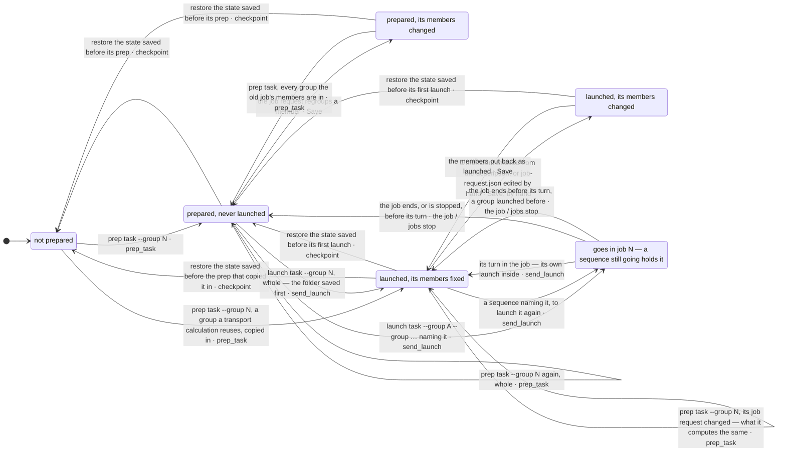

**One answer for a group, which every verb and surface reads.** Each group's
`ready.GroupAnswer` (`ready.task_state(calc).groups`) gives:

- the group's state — one of the diagram's, by its name there (`said`);
- whether it **may be prepared now** (`preparable`) and, when not, why
  (`why`; a launched group whose members changed says so in the one rule's
  words, `members_changed` — `ready.launched_without`, `ready.joined_launched`);
- whether it **may be launched now** (`launchable`);
- a stage's **way on**, composed once (`commands.way_back`): a stage never
  launched, its group's prep; a launched one, its group's prep for how it
  runs, the state saved before its group's first launch for what it computes.

`prep task`'s offer and its refusals (R-P5, R-P22, R-P23), `launch task`'s
offer and its refusals (R-L6–R-L10), the command line's question, `status`'s
next step and Task setup's boxes all read it — **none decides a group's state,
or words its way on, itself**. `prep task` offers every group that may be
prepared now and is not prepared as described; `launch task` offers every
group prepared as described, never launched, each member's upstream finished.

**A launched group's members are fixed.** Task setup's Save refuses a stage put
into it, or a member moved to another group, in the answer's words. A group
whose members changed anyway — a member removed from the description, or
`job-request.json` edited by hand — is **launched, its members changed**:
offered by no verb, its prep refused ([R-P5](#every-refusal-and-its-way-on))
and its launch whole refused ([R-L7](#every-refusal-and-its-way-on)). The way
on: each member launched again alone, the members put back, or the state saved
before the group's first launch restored.

*A run* — one launch of a stage, each a folder, `run-0`, `run-1`, …; what
happens to it once launched is the run door's
([`running-a-job.md`](?doc=execution/running-a-job.md) § 4.2):

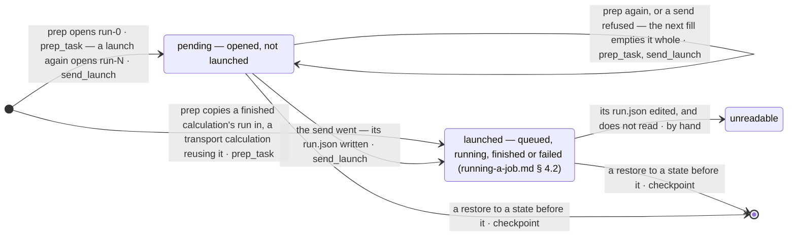

**A pending run** — prep's `run-0`, or a `run-N` a launch opened whose send
was refused — is **emptied whole** by whatever fills it next, then filled as
that act says ([`project-layout.md`](?doc=execution/project-layout.md)
§ 1.6.3). It is not yet a run in the sense of *The words* — a refused send
writes no `run.json` — but it is the stage's newest, so a stage that builds on
it waits for it (an older run never stands in). `status` names it with the
launch that fills it: prep's `run-0`, its group's launch (a group goes whole
the first time); a `run-N` a refused send opened — *opened by a launch whose
send was refused* — `launch task --stage S`. A first send refused saved the
folder's state first; the next one saves again when anything changed.

**A run of points** — a stage that sweeps the bias, a SIESTA vibration's
stage — is one run with one state, read by one rule that `status`, the
gather, `jobset scratch` and the transport record all ask
(`continuation.points_state`): its states, *not run*, and the count of its
points are [`runs-of-points.md`](?doc=execution/runs-of-points.md) § 4.

#### The next step — every group, where it stands, and the line that moves it

*(The user, 2026-10-15: "the current design is clear about the first step, but
unclear about the follow up".)*

**One answer for the whole task, from the ladder door** (`runstatus
.jobset_status`, its `steps`): every group of the job request, in the
description's order, with its stages, a few words for where it stands, and the
line that moves it — or what it waits for, when no line can. The words are
read off its members' rows, the same rows `status` prints, so the two cannot
disagree; every line is composed by `commands`. Its wire form, which the
Results tab reads, is `steps: [{group, stages, state, words, lines, next}]`.
A group's row is the first of these that applies, read top to bottom:

| the group's members | the group says | the line |
|---|---|---|
| launched in a job whose members changed — a member taken out, or a stage put in | **launched, its members changed** — which stage | its way on (`ready.joined_launched`): each member launched again alone, the members put back, or the restore |
| prepared in a job whose members changed | **prepared, its members changed** | `prep task` naming every group the old job's members are in now (R-P6) |
| a member not prepared, the group preparable | **not prepared** | `prep task --group N`, with any group it must be prepared with |
| a member not prepared, the group not preparable | **waits before it can be prepared**, and what for | — |
| held by a sequence still going that has not launched it yet | **goes in job N** — after group K | `molbuilder jobs status` |
| a member's record of what it was prepared with does not read | **unreadable** — in its reader's words, naming the file and the way back | — |
| a member changed since prepared, no run queued or running | **changed since prepared** — the member and each value, `was → now` | never launched, or changed in its run card alone: `prep task --group N`; changed in what it computes: the three lines (*Changed since prepared*) |
| a member's run not on disk (`missing`), no run queued, running, failed or unreadable | **missing**, naming the stage | `prep task --group N` — that member's run opened again, the launched members' runs kept |
| never launched, what each member takes there | **ready to launch** — and which molbuilder prepared it, when another did | `launch task --group N`, one line per mode the machine takes |
| never launched, a member waiting | **waits for** the run it takes — its stage, its group, where it stands | — |
| launched, a run queued or running | **queued** or **running**, *let it finish* | `status` |
| launched, a launch record that does not read | **unreadable**, naming the stage, in its reader's words | — |
| launched, a run failed — ended with an error, or stopped before its end | **failed**, naming the stage | `launch task --stage S`, warm or `--cold`; or its way on first (below) |
| launched, a pending run — a refused send's `run-N`, or a first run prepared again in a launched group | the stage, *opened by a launch whose send was refused* — or prep's words | the launch that fills it (`commands.launch_pending`) |
| every member's newest run finished | **finished** | — |
| any other state | that state, naming the stage | — |

**A failed group's line**: `launch task --stage S` launches the failed stage
again — warm from its own latest run, or `--cold` starting it over (§ 5.4).
Below it comes its way on, to change it first (`commands.way_back`): a run out
of memory or wall goes on with its job request changed and its group prepared
again; a change to what it computes is the three lines.

**The next step is the first group not finished**, marked *next*, its lines
under it; the groups after it each say where they stand. With every group
finished, the last group says so — and, for a calculation whose result gathers
its stages, names `summarize task`: one door, asked by the step and by the
verb alike (`summarize.sum_of`, the summary the kind table names for the
calculation's kind on its engine — a transport calculation's, a SIESTA
vibration's displacement sweep). A benchmark keeps its own next step (§ 7).

**Shown where the next step is asked, and nowhere else:**

- **`status`** ends with it; `status <stage>` shows one stage in full and no
  next step (§ 5.3);
- **`launch task`** ends with it, read after what it sent;
- **the Results tab's ladder card** draws it, read only
  ([`web/results.md`](?doc=web/results.md) § 2.4);
- **Task setup's Prep card** lists it under the groups, read from the folder
  whatever the page last did ([`web/task-setup.md`](?doc=web/task-setup.md)
  § 11); `prep task` at the terminal ends with the launch it makes possible,
  or — a prep that opened no run — this answer.

For a transport calculation, its device just sent:

```text
each group, and what is next:
  group 1  seed, electrode_L, electrode_R  finished
  group 2  device                          running, let it finish -- next:
           molbuilder jobset status --bundle AuBDTAu/transport/lowbias_local
  group 3  transmission                    waits for: the transmission stage consumes lowbias_local.TS.HSX from device's newest run, 04_device/run-0, which is running.  Let it finish
```

and once the device has finished:

```text
each group, and what is next:
  group 1  seed, electrode_L, electrode_R  finished
  group 2  device                          finished
  group 3  transmission                    ready to launch -- next:
           molbuilder jobset launch task --group 3 --bundle AuBDTAu/transport/lowbias_local
```

Once the transmission has finished, the last group says *finished -- every
group has; gather the results -- next:* `molbuilder jobset summarize task
--bundle AuBDTAu/transport/lowbias_local`.

#### Every refusal, and its way on

**Every refusal comes before anything is written**, names the way on in lines
you can type, and is written down in `jobset-decisions.log` — but a dry run's
and a preview's, which write nothing. The send's own refusals (R-L25, R-L35)
come after its save, with nothing launched. A reader's refusal — a record that
does not read, a job no file can be named for, a calculation's own
`warm-files.toml` that does not read — is the verb's, in its reader's words,
never a traceback. The command line's usage refusals — a word where none is
taken, `--stage` twice, `--group` with `--stage`, an answer that is no group's
number, a `--time`, `--mem` or `--gpus` that is no amount — are said where
they are typed, and written down too. The numbers missing from the sequence
name no refusal.

| | when | the way on | decided in |
|---|---|---|---|
| **R-P1** | the folder is not a described calculation, or is one of its stage or run folders; or it has no job request | `molbuilder describe`; the calculation's own folder; no job request: Task setup's Save; an older description (`task@1`): `jobset migrate` | `calculation.open` (`calculation.refusal`) |
| **R-P2** | `task.json`, its template or `job-request.json` does not read, or a stage states no group | its reader's words; an older file: `jobset migrate` | `task.of`, `job_request.of` |
| **R-P3** | no group named and nobody to ask; or none to offer, and no junction order to record ([`engines/transport.md`](?doc=engines/transport.md) § 1.1) | the line that picks the groups offered (`ready.prep_offer`); none offered: `status` | `_cli._ask_which_groups`, `prep._prep_groups` |
| **R-P4** | a group the job request does not hold | the groups it holds | `prep._prep_groups` |
| **R-P5** | a launched member's deck, rendered now, is not the same calculation as its runs ran, or its points are not ([`job-request.md`](?doc=execution/job-request.md) § 6), each difference named; or a stage put beside a launched group, or taken out of one | the state saved before the group's first launch; a stage put in: a group of its own; one taken out: put back | `prep._prep_groups` (`ready.launched_without`, `deck_record.same_calculation`) |
| **R-P6** | a job whose members changed has members in groups not picked | every group to pick, in one line | `group.formed_again` |
| **R-P8** | the description fails its own checks — a stage sharing a group with one it builds on among them | the check's words: a new group; or, for an independent stage, its `restart` set to `clean` | `prep.checked` (`validation.task.preflight`) |
| **R-P9** | no machine record answers, or it states no activation | the record named, or probed again | `prep.checked` (`machine.require_activation`) |
| **R-P10** | a launch value not stated (ranks, cores; with a header, queue, wall, memory), or a queue the record does not list | the value to state; the record's queues, with their machines and the fit | `prep.plan_stage` (`placement`) |
| **R-P12** | a deck's own checks refuse it; a data file it needs is missing | the check's words | `prep.plan_stage` (`prep_calculation`) |
| **R-P13** | a job walking several members — a group, a benchmark's shelf — whose members do not ask the same of what they share | the same values for each, or groups of their own | a group, `prep.group_header` (`group.envelope`); a benchmark, `prep.prep_jobset` (`shelves.shelf_request`) |
| **R-P14** | a Prep whose plan differs from the one previewed | preview again | `prep._prep_groups` |
| **R-P15** | the folder's state cannot be saved | the save's words | `checkpoint.save_before` |
| **R-P16** | the structure is missing, or not the one described | the structure put back, or the calculation described anew | `rung.structure_for` |
| **R-P17** | a run's GPU request disagrees with itself: GPUs used and none counted, or counted and not used | the count stated, or no GPU | `prep.plan_stage` (`model.gpu_request`) |
| **R-P19** | a description stating a layout other than the one, `"shape": "flat"` among them ([`project-layout.md`](?doc=execution/project-layout.md) § 1) | the calculation described again | `task.of` — at describe, at Save and at every read |
| **R-P20** | a stage the description no longer holds has a launch record that does not read | the record's own words | `prep.prep_calculation` (`materialize.ever_launched`) |
| **R-P21** | a transport junction record that is not usable while a stage is launched; or, no group named, its order not found ([`engines/transport.md`](?doc=engines/transport.md) § 1.1) | the state saved before the launched group's first launch; none launched: a prep of its groups | `gather.no_usable_record` |
| **R-P22** | `--one-job` that cannot make one job (below) | the groups' run cards alike on what differs, or each group sent alone | `prep.sequence_header` (`group.sequence_request`), `prep._prep_groups`, `_cli.prep_cmd` |
| **R-P23** | a group a sequence still going holds (§ 6.0): its job is about to launch the files it was prepared with | the prep once that job has ended, or `molbuilder jobs stop` of the job first | `prep._prep_groups` (`ready.held_by_sequence`) |
| **R-L1** | nothing is prepared | `prep task` for the first group | `_cli._nothing_prepared`, asked by `_cli._launch` and `_cli._launch_unit` |
| **R-L2** | no prepared group can go, and no stage was launched | each group says what it waits for | `_cli._launch_unit` |
| **R-L3** | nobody to ask which — several groups could go, or none can and stages launched before are offered | one line for each | `_cli._launch_unit` |
| **R-L4** | no `--mode` and no `launch.mode`, or a `launch` block that does not read; a flag the mode or the launch does not take (below) | the launch with each mode | `_cli._launch` (`_refuse_flags_without_effect`, `commands.LAUNCH_FLAGS`) |
| **R-L5** | the stage named is described and not prepared | its group's prep, then its launch | `_cli._refuse_unprepared` |
| **R-L6** | a stage never launched named alone while its group holds others | the group's launch | `submit._the_group` |
| **R-L7** | a launched group whose members the job request changed | a member launched again alone; the members put back; or the restore | `submit._the_group` (`ready.launched_without`) |
| **R-L8** | a group whose prepared jobs hold other members than it does now | its prep, every group named | `ready.regrouped` |
| **R-L9** | `--from`, `--cold` or `--gather` on a group of several | `--stage`, for a member launched again | `submit._the_group` |
| **R-L10** | a member of the group named is not prepared | the group's prep | `submit._the_group` |
| **R-L11** | at a first launch, or a launch again with `--gather`: what it builds on is not usable (below) | that stage launched, or let finish; or the restore; for the junction, a prep of the calculation's groups | `ready.first_launch_takes` (`continuation`, `gather`); with `--gather`, `submit._gathered_now` |
| **R-L12** | `--from` or `--cold` at the first launch of a vibration stage that continues from none — it builds on the calculation's structure ([`engines/vibration.md`](?doc=engines/vibration.md) § 5.9) | launch it; `--cold` is a launch again's ([`engines/vibration.md`](?doc=engines/vibration.md) § 5.11 § 6) | `continuation.cannot_be_named` |
| **R-L13** | `--from` on a transport rung, or `--cold` at its first launch — but a rung of points of a calculation that reuses a finished one, where `--cold` takes none of its points over ([`engines/transport.md`](?doc=engines/transport.md) § 2a.16) | `--gather` or `--cold`, launched again | `continuation.cannot_be_named`, `ready.first_launch_takes` |
| **R-L14** | `--gather` at a first launch, on a stage that is not a transport rung, on a rung that gathers nothing (the seed, a lead), or with `--from`; `--from` with `--cold` | the flag that does it, or none | `submit._plan_member`, `continuation.cannot_be_named` |
| **R-L17** | launched again warm, and its newest launched run left none of the files it takes — a run of points: no point done, and none that would continue from its warm files left them | `--cold` | `submit._launch_again`; a run of points, `submit._points_walk` |
| **R-L18** | a run of points launched again warm with every point done and nothing more needed (a vibration's finish done too); or, at its first launch over a reused finished calculation, nothing left to walk | warm: `--cold`; over a finished calculation: its group prepared again, which copies it in, or `--cold` | `submit._points_walk` (`_all_done`, `PointsOf.also_needs`; [`runs-of-points.md`](?doc=execution/runs-of-points.md) § 3) |
| **R-L21** | a record the plan reads does not read, or a job of the plan no file can be named for (below) | the record's own words | each reader (`runrecord.LaunchRecordError`, `naming.NamingError`, `warmfiles.WarmFilesError`), refused once by `submit.plan_launch` (`_refusal_kinds`) |
| **R-L22** | at the send, the folder is not what it was when planned — the plan made again from it now differs, or is refused | launch again, to see the new plan | `submit.send_launch` (`_same_folder`) |
| **R-L23** | at the send, nobody to ask and no `--yes` | `--yes` | `submit.send_launch` |
| **R-L24** | the folder's state cannot be saved | the save's words | `checkpoint.save_before` |
| **R-L25** | the scheduler refuses the request | the scheduler's words; each run stays pending, and the next launch fills it anew | `submit._go` |
| **R-L26** | a group the job request does not hold | the groups it holds | `submit._the_group` |
| **R-L27** | the description does not read | its reader's words | `calculation.open` |
| **R-L28** | a stage, or a benchmark trial, with no run open | a stage: its group prepared again, or the restore; a trial: the state saved before the benchmark's prep | `submit._plan_member`, `submit._plan_trial` |
| **R-L29** | a benchmark trial's deck that would not start cold | the state saved before the benchmark's prep | `agreement.check_trial_starts_cold` |
| **R-L30** | launched again, the inputs gathered for its run are gone | `--gather` | `submit._carry_the_gather` |
| **R-L31** | a stage, group, run of points or benchmark shelf sent to a queue with no header — prepared with `--no-sbatch`, or for a machine with no queue (§ 6.1) | its group prepared again, with a header; a benchmark: the state saved before its prep | `submit._no_sbatch` |
| **R-L35** | the line could not be run at all | its words | `submit._go` |
| **R-L36** | a stage the description does not hold | the stages it holds | `_cli._described_stage` |
| **R-L37** | `--from` naming what cannot be taken (below) | a run that has run, and holds what the stage takes; at a vibration stage's first launch, neither flag | `continuation.cannot_be_named`, `materialize.continuation_files`, `ready.first_launch_takes` (`continuation.carried_points`) |
| **R-L38** | the calculation's copy of its machine's record is missing or does not read | a calculation is launched after its prep, which copies the record; the record's words | `submit._machine_of` (`record.calculation_environment`) |
| **R-L39** | a benchmark trial named that was launched before | `summarize bench`; to measure it again, the state saved before the benchmark's prep | `submit._plan_trial` |
| **R-L40** | a benchmark whose trials — of the side `--only` names — are all launched, or `--only` a side the sweep has none of | `summarize bench` | `submit._all_launched`, `submit._plan_shelves` |
| **R-L41** | `launch bench` on a calculation that takes no benchmark, with no stage named, on a stage with no benchmark prepared, a trial the sweep does not hold (a trial is named by its point, `G1N4C6`), or a kind that is not the set's | the benchmark's prep; the stages with one; the sweep's trials; the set's kind | `_cli._stage_bench_dir` (`prep_inputs.bench_refusal`), `_cli._load_bench_set`, `_cli._pick_trial`, `_cli._check_kind` |
| **R-L43** | a benchmark's trials in more than one container, or not shelved as its prep shelved them | the state saved before the benchmark's prep | `submit._one_container`, `shelves.shelves_of` |
| **R-L44** | a job sent to a queue, or asked of it, whose header states no wall and no `--time` restates one — prep writes one into every header, so this one was edited since | prepared again where nothing of it was launched, or the state saved before the edit; `--time` for this launch alone | `submit._sbatch_request` |
| **R-L45** | a sequence of groups that cannot go, or a group a sequence still going holds (below) | the group's prep; `molbuilder jobs stop` of the job that holds it; `prep task --group … --one-job`; the stage launched alone | `submit._plan_sequence`; a group launched alone, `submit._planned` (`ready.held_by_sequence`) |
| **R-L46** | `--in-sequence` or `--in-job` typed otherwise than a sequence's walk types them (below) | the sequence's own launch; the groups left sent again | `_cli.submit_cmd`, `submit.Inside.of` (`sequence.read_record`), `submit._planned` |

What the longer rows hold:

- **R-P22, `--one-job` that cannot make one job**: fewer than two groups; a
  benchmark; every group named launched already; a launched group named whose
  members are not the ones it was prepared with; groups whose own requests
  name two queues, or GPU groups asking two GPU counts or binding their GPUs
  differently — one job sits in one queue, with one set of GPUs.
- **R-L4, the flags a launch does not take** (`commands.LAUNCH_FLAGS`, one
  table): `--foreground` with a queue, `--time` here; `--cold`, `--from`,
  `--gather` on a benchmark, whose trial starts cold from its deck; `--only`
  and `--trial-timeout` on a task or with a named trial, `--only` here,
  `--trial-timeout` under `ask`.
- **R-L11, what it builds on is not usable**: the newest run of what it
  builds on has not finished, is not there, or holds none of the files the
  stage takes; a transport rung's upstream is not prepared, a run of points
  has points short of done, or the run did not run the same engine input as the
  deck its description gives now
  ([`engines/transport.md`](?doc=engines/transport.md) § 6.1), every
  difference named; the junction a transport rung is composed from has no
  usable record (in R-P21's words).
- **R-L37, what `--from` cannot take**: no run of this calculation's stages;
  a run never launched, the pending run this launch fills among them; a run
  holding none of the files the stage takes (a stage whose override says
  `restart: clean` takes none); a run of points holding none of the points its
  kind carries done (a displacement sweep's later stage: the relaxation);
  `--from` or `--cold` at the first launch of a vibration stage that
  continues from none.
- **R-L21, a record that does not read**: a run's launch record,
  `.continued-from` or `.gathered-from`; a job of the plan no file can be
  named for — a deck named on no stage, or not on its label; the calculation's
  own `warm-files.toml` — not TOML, not stamped `molbuilder/warm-files@1`,
  another engine's, or a section or row the vocabulary does not take.
- **R-L45, a sequence that cannot go**: a group of it not prepared; a group a
  sequence still going holds, launched alone or in another sequence; under
  `submit` or `ask`, no header prep wrote for exactly these groups; a flag that
  speaks for one stage (`--stage`, `--cold`, `--from`, `--gather`).
- **R-L46, the walk's own flags**: `--in-sequence` and `--in-job` are taken
  only together, with one `--group`, with `--mode direct --foreground --yes`
  and no `--stage`, naming a sequence whose launch record is in `launch/`;
  inside the job, a group the job request no longer gives as the sequence was
  sent with (renumbered since: groups are matched by their members) is refused
  too.

A benchmark's prep refuses as a task's, and besides: a calculation that takes
no benchmark, a stage not named, and a benchmark prepared already — its way
back the state saved before its prep (`prep.prep_bench`).

#### Worked examples

*A transport calculation*, `lowbias`, its groups the defaults — 1 1 1 2 3 —
on a workstation:

| step | you type | seed · electrode_L · electrode_R (group 1) | device (2) | transmission (3) |
|---|---|---|---|---|
| 0 | `molbuilder describe`, or the Transport tab's Describe | described, preparable | described, preparable | described, preparable |
| 1 | `prep task --group 1 --group 2 --group 3` | prepared, ready to launch — takes nothing; the state saved first, `… · before prep task group 1 (seed, electrode_L, electrode_R), group 2 (device), group 3 (transmission)` | prepared, **waits for** seed's newest run, `01_seed/run-0`, not launched | prepared, **waits for** device's |
| 2 | `launch task` (it offers group 1 alone) | launched — one job, three runs one after another; the state saved first, `… · before launch task group 1 (seed, electrode_L, electrode_R)` | waits for seed | waits |
| 3 | — group 1 finishes | finished | **ready to launch** — takes `lowbias.DM` from `01_seed/run-0`, each lead's `.TSHS` from its run | waits for device |
| 4 | `launch task` (it offers group 2) | finished | launched — the state saved; the three files copied into `04_device/run-0`, with `.gathered-from` | waits for device's run, running |
| 5 | — the device finishes; you change its `mixing_weight` on Task setup | finished | finished — Save refuses: the device has run; it names `mixing_weight` and the way back, the state saved before the first launch of group 2 (device) | ready to launch — takes the device's newest run |

*An optimization ladder*, `coarse → medium → tight`, `tight`'s override
`restart: clean` — so `tight` builds on nothing, and its groups are 1 2 2:

| step | you type | coarse (1) | medium, tight (2) |
|---|---|---|---|
| 1 | `prep task --group 1 --group 2` | prepared, ready | medium **waits for** coarse; tight ready — the group waits for its member |
| 2 | `launch task --group 2` | prepared | refused before anything is sent (R-L11): medium continues from coarse, which has not run — launch group 1; to start medium otherwise (`--from`, `--cold`), give it a group of its own first |
| 3 | `launch task` | launched, then finished | ready to launch |
| 4 | `launch task` | finished | launched — one job: medium from `01_coarse/run-0`, tight from its deck |

*A refused send*: `coarse` ran; `launch task --stage coarse --mode submit`
opens `01_coarse/run-1`, fills it warm from `run-0`, and `sbatch` refuses the
request (R-L25). `run-1` stays pending; `status` names it so and gives
`launch task --stage coarse`; medium's first launch waits for it.
`launch task --stage coarse --cold --mode submit` empties `run-1` and sends it
cold; `run-0` stays what it was.

### What molbuilder does for you

1. **Before every prep that writes, and before a group's first launch, it
   saves the folder's state**, and tells you which; a prep with nothing to
   write saves nothing (§ 5.0, checkpoint 2a). When it saves, and the note's
   form (`2026-10-03 14:05:12 · before launch task group 1 (seed,
   electrode_L, electrode_R)`), are
   [`checkpointing.md`](?doc=execution/checkpointing.md) § 9's. So the state
   before any prep, and before a group's first launch — every run that group
   builds on in it — is one `checkpoint restore` away. **A group's first
   launch saves wherever it runs**: in a sequence of groups every group, the
   first included, is launched inside the job, so each first launch saves
   there, on the job's node (*A sequence of groups*). A first launch with
   `--from` or `--cold` saves too; only a launch again saves nothing.
2. **It keeps every run.** A new launch never writes into an earlier run's
   folder: its output, logs, restart files, launch record and conclusion stay
   what they were.
3. **It launches any stage again, however its last run ended** — finished,
   failed or stopped — **warm by default, or cold when you say `--cold`**
   (§ 5.4, *A stage launched again*). Before anything is sent it shows the
   exact line, which run it follows, how that run ended and what is copied,
   and asks once; it refuses only warm with nothing to be warm from (R-L17,
   R-L18).
4. **It tells you where each stage and run stands, from one door.** `jobset
   status`, the Results tab and every reader that needs a run's state ask
   the same doors (*The states*): pending, queued, running, finished or
   failed — with the reason the run gave, or that it stopped before its end —
   and, in a column of its own, whether it converged (`SCF yes` / `NO`,
   `geometry yes` / `NO`): a run can finish and not converge. It says what
   launching again would do; it does not tell you whether to.
5. **It writes every decision down** — what each prep and launch found, what
   each run continued from, what you were asked and what you answered — in
   the calculation's `jobset-decisions.log`.
6. **It starts the engine once per run.** A run whose SCF did not converge,
   whose relaxation used its steps, or that stopped at its wall ends there; to
   continue it is to launch the stage again, as 3 says
   ([`project-layout.md`](?doc=execution/project-layout.md) § 1.6.1;
   [`running-a-job.md`](?doc=execution/running-a-job.md) § 3.5).

### What stays yours

* **Whether a run is good enough to use** — its convergence, its geometry, its
  physics. molbuilder reports; you judge.
* **Whether to launch again, warm or cold, and when.**
* **Which stages share a job, and when the next group goes.** You number the
  groups; `launch task` sends a group only once what it builds on has
  finished, and takes the newest run of what each stage builds on, saying
  which. You can name any run with `--from` — taken as said; launch states
  what it sees there, failed or not converged — or none with `--cold`
  (§ 5.4). Whether that run is worth building on is yours to judge.
* **Keeping a state you trust** — `molbuilder checkpoint save -m "…"` at any
  moment, and `checkpoint tag` to name it.

### How the checkpoint supports you

Each run keeps its own copy of the deck and scripts it ran with, so every
run's record stays true to what ran.

- **A stage prepared and never launched is changed by preparing it again**,
  its group whole.
- **How a launched stage runs** — its queue, wall, memory, ranks, its run
  settings — **is changed the same way**: change its job request and prepare
  its group again. Each deck must stay the same calculation as its runs ran,
  and the next launch sends the new request
  ([`job-request.md`](?doc=execution/job-request.md) § 5).
- **What a launched stage computes** — a setting of the description, the
  machine, the run it builds on — is changed by **starting its group from the
  beginning**, the three lines *Changed since prepared* prints. The state
  saved before the group's first launch holds every run the group builds on;
  the restore names the runs made since that save — the group's own, what
  built on them, any other stage's launched since — before it goes back, and
  the save the lines start with keeps them.

A group a transport calculation copied in from a finished one was launched by
no launch of this calculation: its way back is the state saved before the prep
that copied it in ([`engines/transport.md`](?doc=engines/transport.md)
§ 2a.16).

**Going back is not losing**: restoring a state and working from it is how you
**branch** — the state you left stays listed, and you can restore it again
([`checkpointing.md`](?doc=execution/checkpointing.md) § 7.1).

**A stage you remove from the description** leaves its files where they are,
untouched, and its number stays taken (`tight` stays `03_tight`); nothing
lists, preps or launches it. A launched one keeps its row in `job-set.json`, so
described again it is what it was, launched; and the group it was launched in
is no longer launched whole — its other members are launched again alone
(R-L7). To have the calculation as it was, restore a state saved before you
removed it ([`project-layout.md`](?doc=execution/project-layout.md) § 4.2).

### Use the jobset commands

These promises hold for what the `jobset` commands do. A deck or run script
run by hand, a file edited in a run's folder, a folder copied elsewhere —
molbuilder reads what it finds and says what it sees, but it did not write it
and cannot vouch for it. Use the checkpoint verbs rather than bare `git` in a
calculation folder ([`checkpointing.md`](?doc=execution/checkpointing.md)
§ 2.0).

---

## 1. What the job system is

> **Everything is a job set** *(decided 2026-08-11, user)*. One calculation is
> not a smaller, different thing than a ladder or a sweep — **it is a job set
> of one**, and it goes through these commands, not a shortcut beside them.
> There is no `molbuilder run`.

A single result usually needs a **sequence** of runs — relax a molecule
loosely, then tightly — and getting runs onto a cluster adds chores: scheduler
headers, a folder per stage, restart files carried between stages, and knowing
what resources run a calculation fastest. The job system makes that a
described, repeatable thing: you say *what* you want as data, and molbuilder
lays it out, sends it and watches it, the same way on a laptop or a cluster.
**What it does not do is decide that one stage should follow another; that is
yours** (§ 2, decision 6).

It sits **above** the single run script
([`running-a-job.md`](?doc=execution/running-a-job.md)): every job it sends is
one such run script, or a walk of several. Three kinds of "many jobs" are the
same object, a `JobSet` (§ 3):

- a **ladder** — one calculation in stages, each a job you start once you have
  looked at the one it builds on;
- a **benchmark sweep** — one stage run at many resource settings, to find the
  fastest (§ 7);
- a **linked ladder** — a transport calculation's seed, leads, device and
  transmission, each taking files from the ones before it
  ([`engines/transport.md`](?doc=engines/transport.md)).

Where the job system sits among molbuilder's other parts, and which chapter
answers which question, is [`overview.md`](?doc=execution/overview.md)'s.

---

## 2. The design logic — why it is built this way

Six decisions shape everything below.

**1. Describe work as data; keep the engine out of the verbs.** A `JobSet` is
a plain data object (a JSON file), not code. Prep derives it from the
description through each engine's **seam** (its own package's, `siesta/seam.py` and `pyscf/seam.py`, each an `EngineSeam` of `jobset/engines.py`), and the
verbs (`prep` / `launch` / `status`) act on it **without knowing which engine
it targets**. So one small set of verbs drives SIESTA ladders, PySCF ladders
and benchmark sweeps alike, and a new engine is one engine seam, not a new
orchestrator ([`script-preparation.md`](?doc=execution/script-preparation.md) § 4, the seam's questions).

**2. Reuse the single run script unchanged.** Each job is launched by the
`.run.sh` / `.sbatch` pair of
[`running-a-job.md`](?doc=execution/running-a-job.md), built by the same
function. So everything true of a single run — environment routing, restart,
GPU pinning, the monitor — is true of every job in a batch. The framework adds
orchestration *around* the run script, never *inside* it.

**3. The machine's facts come from the machine's record.** The description
names no machine. The facts of the machine a calculation runs on — how a shell
enters an environment, how many cores a node has, which queues exist — come
from that machine's record, read at `prep` and baked into the scripts. Prep
reads the record of the machine you name (`prep --target`): it can prepare a
calculation **here, for there**
([`preparing-for-another-machine.md`](?doc=execution/preparing-for-another-machine.md)),
and you need not know the cluster's layout to send to it.

**4. Fail early, never guess.** A launch value stated nowhere — ranks, cores,
and on a machine with a queue the queue, wall and memory — is refused at prep
([`architecture.md`](?doc=execution/architecture.md) § 5.2), never filled in;
so no header is written incomplete. A malformed plan — an unknown `kind`,
duplicate job names, a warm-file condition naming a trait the job never
declares — is refused at prep by `JobSet.validate()`. Nothing is discovered halfway
through a cluster run.

**5. molbuilder informs; the user decides.** Nothing resumes a failed or
interrupted run by itself. `status` says where each stage stands and what
launching again would do; **you** launch again. So no surprise re-run quietly
writes over hours of results.

**6. The order is a person's, not the data's.** **Nothing in a `JobSet` says
"start this one after that one."** A ladder and a sweep differ in how their
folders are named and whether a person is meant to take them in order —
neither waits for the other. Whether stage 2 should start is a judgement about
stage 1's result, and nothing in the data can make it: a stage is a long job,
and one that continues by itself can spend a week refining a geometry you
would have rejected in a minute. So every group may be prepared at once, and
one `launch` sends one job. Naming several groups at one launch is that
judgement made in advance, and recorded as such (§ 6.0, *A sequence of
groups*).

**What this costs.** A branching graph — a "diamond" — has no
representation. If one is ever needed, it is something a person asks for at
launch, never a field a description stores.

---

## 3. The plan — `job-set.json`, and what each field means

A `JobSet` is the whole plan of a calculation's jobs, saved as `job-set.json`
at its root (`molbuilder/jobset/model.py`). Prep writes it whole, merged per
stage; its format — the schema string, the keys every job carries, the
refusal of a job missing one — is
[`job-contracts.md`](?doc=execution/job-contracts.md) § 6.1's. A benchmark's
sweep keeps its own `job-set.json` in its stage's `bench/` folder.

**There is no edge in it.** No job names another job as its source or its
dependency (decision 6).

| field | what it means |
|---|---|
| `kind` | `ladder` or `sweep`. **Both are sets of independent jobs**: the kind says how their folders are named — `<NN>_<stage>` against `<NN>_<stage>/bench/bench-<point>` ([`job-contracts.md`](?doc=execution/job-contracts.md) § 6.3) — and whether a person takes them in order. Never that one waits for another |
| `shared` | files every job needs that never change between jobs — the pseudopotentials — **copied** into each job's folder as real files ([`project-layout.md`](?doc=execution/project-layout.md) § 1.6.5) |
| `name` · `script` | a job's name keys its folder **and** its scheduler job name (`-J <label>/<job>`), so a queue listing reads as the layout does; `script` is its deck, inside that folder, named on its label (a transport lead's own) and its stage's token, `<label>_<NN>_<stage>.<ext>` — the folder's `NN` read back off the deck, never counted (`naming.job_dir_names`); a deck with no token is refused (R-L21) |
| `resources` | the job's launch values — queue (`domain`), wall, memory, ranks (`mpi_np`), cores per rank (`cpus_per_task`), GPUs (`gres`), and the run's own riders — each `null` when **unstated**, which nothing fills in. The names are the scheduler's vocabulary ([`job-contracts.md`](?doc=execution/job-contracts.md) § 6.2) |
| `warm` · `traits` | what this job would take **from whatever run it is continued from** — never from a named job. Each `warm` entry is a file name; `requires_same` names a trait both runs must agree on for the file to mean anything, compared as opaque strings against `traits` ([`job-contracts.md`](?doc=execution/job-contracts.md) § 4.2a) |
| `point` | a benchmark trial's coordinate, as data (`{}` for a stage): `summarize` reads it, never the folder name |
| `finish` | the bundle a run of points' report steps run around the engine when the engine alone leaves no result — a SIESTA vibration's `mb_vibration.pyz` ([`runs-of-points.md`](?doc=execution/runs-of-points.md) § 2.1); `null` otherwise |
| `resumes` | whether a launch again continues from what the last run left — the kind's warm-files fact; the run script reads it to say what a launch again will do ([`running-a-job.md`](?doc=execution/running-a-job.md) § 3.5) |
| `scratch_dir` | the folder of the run's own its engine's scratch lies in — a transport device's `tsgf` — emptied by its walk; `null` otherwise |
| `placement` | where prep placed a job prepared for a queue: the queue, bound on the record (`domain`, `partition`, `qos`), and where each value came from (`from`: a prep flag, the run card, the job request's allocation) — what its header renders and launch sends to; `null` with no queue |
| `members` | the stages of the group it was prepared in, in ladder order; `null` for a group of one |
| `phases` | a SIESTA vibration stage's calls, in the order its run walks them; `null` otherwise |
| `program` | which program the job runs when not the engine's own — a transport ladder's transmission is `tbtrans`; `null` otherwise |

**It says WHAT, never FROM WHOM**, and that is the whole design of `warm`.
Which run a job continues from is decided at its first launch — the newest
run of the stage it builds on by default, or a run named with `--from`
(§ 5.4) — by a person who has looked; prep, which runs long before, is not
asked to know. `requires_same` exists for the optimiser's history (§ 4.1).

**`null` is a value, and it does not mean "zero" or "off".** It means
**unstated**, and prep never leaves a launch value the job needs unstated: it
refuses instead (R-P10). What stays `null` is what this job does not use. The
fields are written out even when null, so the file shows every question that
was answered, not a default nobody chose. A `mem` of `"0"` is SLURM's "the
whole node's memory".

**`JobSet.validate()`** checks every plan before prep writes it (`prep.prep_jobset`, `materialize`): the `kind` is
known, the job names are unique (their folders and `-J` names would collide),
and every `requires_same` names a trait the job declares — a condition on a key
that is not there could never be met, so the file would never be carried.

### 3.1 A real `job-set.json`

Prep wrote this one for a one-stage SIESTA optimization of H₂, prepared for a
test SLURM record's `cpu` queue and run here with `--mode direct` (a test
calculation; formatting compacted):

```json
{
  "schema": "molbuilder/job-set@1",
  "name": "h2_siesta", "engine": "siesta", "kind": "ladder",
  "shared": ["pseudos/H.psml"],
  "jobs": [{
    "name": "coarse", "script": "h2_siesta_01_coarse.fdf",
    "resources": {"domain": "cpu", "time": "0-01:00:00", "exclusive": null,
                  "mem": "4G", "gres": null, "gpu_binding": null,
                  "use_gpu": false, "mpi_np": 1, "cpus_per_task": 1,
                  "wall_slack": 600, "notify_on_scf": null,
                  "notify_every_hours": null, "notify_channels": null,
                  "notify_report": null, "max_memory_mb": null},
    "warm": [{"name": "h2_siesta.XV"}, {"name": "h2_siesta.DM"},
             {"name": "h2_siesta.CG", "requires_same": "optimizer"}],
    "traits": {"optimizer": "cg"},
    "point": {}, "finish": null, "resumes": true, "scratch_dir": null,
    "placement": {"domain": "cpu", "partition": "cpu", "qos": "public",
                  "from": {"domain": "flag", "time": "flag", "mem": "flag",
                           "mpi_np": "flag", "cpus_per_task": "flag"}},
    "members": null, "phases": null, "program": null
  }]
}
```

Read back in plain words: *a SIESTA ladder named `h2_siesta`, one
pseudopotential shared; its stage `coarse` asks one rank of one core for up to
an hour and 4 GB on the `cpu` queue, every value from a prep flag; and if it is
ever continued from a run, it takes that run's `.XV` coordinates and `.DM`
density matrix — and its `.CG` history only if that run also used CG.*
**Notice what it does not say: when a stage runs, or after what.**

What the file becomes on disk is
[`project-layout.md`](?doc=execution/project-layout.md) § 1.1's tree; a
sweep's tree, its trials named by their settings, is § 1.5a there.

---

## 4. Where the plan comes from — derived at prep

A `JobSet` is never written by hand, and never shipped beside the description.
**`prep` derives it from the description and its job request** — the
template, `task.json` and `job-request.json` — for the machine the calculation
is set to, from that machine's record. Its steps are
[`script-preparation.md`](?doc=execution/script-preparation.md) § 3.0's: the
description resolved against the machine into a `ParameterSet` — **always a
list**, a run the list of one and a benchmark the list of N
([`generator.md`](?doc=execution/generator.md) § 5) — then one deck and run
script rendered per element, and the plan written down.

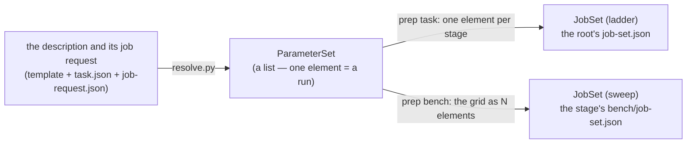

### 4.1 A ladder's stages, as jobs

**Every engine's ladder is the same object: N decks, N jobs**, a person
looking between the rungs ([`engines/stages.md`](?doc=engines/stages.md)
§ 1.1a). The ladder lives in `task.json`, never in an engine config
([`engines/stages.md`](?doc=engines/stages.md) § 1.1). Prep makes one job per
stage of the description, its deck `<label>_<NN>_<stage>.<ext>`, through the
engine seam (`jobset/engines.engine_seam`, SIESTA's `siesta/seam.py`; SIESTA's stage knowledge,
`siesta/stages.py`). Three things are derived, each a design decision:

- **A stage that runs out of steps without converging simply stops**, and you
  decide what to do about it — which is what you do between stages anyway.
- **The warm-file declaration is chosen for correctness.** Each stage declares
  what it would take from a run it continues from, and **a stage whose
  description says `restart: clean` declares nothing**: it continues from
  nothing. A continuing SIESTA stage declares `.XV` (coordinates), `.DM`
  (density matrix) and `.CG` (the conjugate-gradient optimiser's state), the
  last with `requires_same: "optimizer"` — **a CG state is meaningless to a
  Broyden stage, so carrying it blindly would corrupt the restart**. The
  comparison is made at the launch that takes the files, between this stage
  and **the run it continues from** — by default, or named with `--from`,
  which may be a stage two rungs back or an earlier run of this same stage.
  Which files each kind carries, and when, is
  [`job-contracts.md`](?doc=execution/job-contracts.md) § 4.2a's.
- **Resources are per stage** — each stage's run card states its own over the
  calculation's, and nothing is filled in
  ([`architecture.md`](?doc=execution/architecture.md) § 5.2) — so a coarse
  stage and a tight stage are sized apart.

**The shipped ladder** is coarse, medium and tight, and `molbuilder describe
--stage-strategy` picks which it starts with
(`config.stages.STAGE_STRATEGY_PRESETS`): `loose-only` coarse; `publishable`
coarse and medium; `vib-quality` all three. Each stage's values and their
scientific reasons are [`engines/tuning.md`](?doc=engines/tuning.md)'s.

### 4.2 A benchmark sweep

`jobset prep bench <stage>` builds a **sweep** — one independent trial per
point of a resource grid, handed to the same steps as a longer
`ParameterSet`, nothing carried between points. Because a sweep is just
another `JobSet`, the same verbs run it: benchmarking is a `prep` whose
parameters are a set rather than a point. The trials' pins are
[`generator.md`](?doc=execution/generator.md) § 4.2's, the grid, the shelves
and the winner § 4.3a's; the verbs are § 7.

---

## 5. The workflow — describe, prep, launch, status, summarize

You describe a calculation once; then prep, launch, look, and launch the next
— or measure first, with a benchmark. The commands are § 5.3's table.

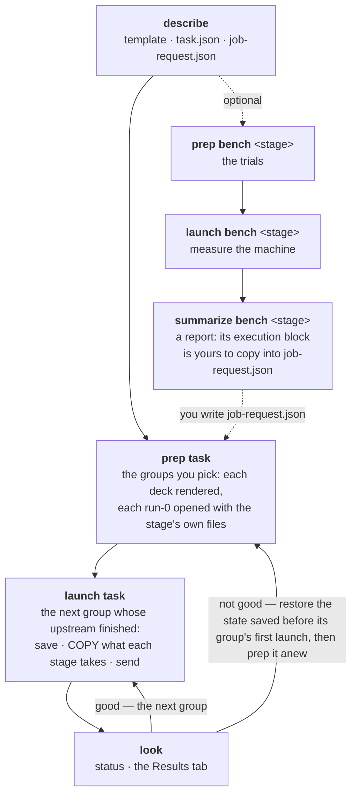

**`prep` prints what it resolved, and `launch` shows what it decides**: prep
shows the decks, the jobs and what each stage's first launch will take; launch
shows which run each stage takes and how it ended, what it copies, and the
exact line it sends — and asks before anything is sent.

### 5.0 The prep protocol — the agreement, and every checkpoint in order

> **This is the one statement of the prep protocol.** Both doors run it — the
> command line's `jobset prep` and Task setup's **Preview** / **Prep** for the
> task and for a benchmark ([`web/task-setup.md`](?doc=web/task-setup.md)
> § 11) — through one entry, `prep.prep_task` (a task's groups) and
> `prep.prep_bench` (one stage's benchmark). What prep does inside, step by
> step, is [`script-preparation.md`](?doc=execution/script-preparation.md)
> § 3.0's.

The entry does the whole act and returns what it found and decided **as
data**; it asks nothing. **The asking is each door's**: the terminal asks
which groups to prepare, offering ticked every group not prepared as
described that may be prepared now (`ready.GroupAnswer`); Task setup ticks the
same groups. `--group N`, repeated for several, answers without a terminal;
with no terminal and none named, the prep is refused, naming the line that
picks them (R-P3) — nothing is prepared unseen.

#### Before prep: a described calculation

A calculation is described **once**, and prep only reads that description.
A parameter tab hands its work to Task setup
([`web/handover-procedure.md`](?doc=web/handover-procedure.md)); you complete
it there and save, which writes `task.json` and `job-request.json` beside the
template ([`web/task-setup.md`](?doc=web/task-setup.md) § 2, § 8) — or
`molbuilder describe` writes the same files (§ 5.1). A Save that changes a
described calculation saves the folder's state first. What the calculation
**is** — its name, engine, structure and label — is read-only once described.

#### The agreement

1. **You state; molbuilder checks.** Every value a run is launched with — its
   ranks and threads; a GPU run's GPU count; and where a header is written its
   queue, wall and memory — is stated by you, in the job request or on the
   prep's command line ([`architecture.md`](?doc=execution/architecture.md)
   § 5.2 lists them). A run that uses a GPU and states no count, or states a
   count and uses none, is refused (R-P17; [`gpu.md`](?doc=execution/gpu.md)
   § 1.1). The machine's record **checks** each value and supplies none.
2. **You choose the machine, once.** A calculation is set to the machine of
   its first prep — the one `--target` names (`--target this` for the machine
   you are on). With no other machine's record on file, a first prep naming
   none is for this machine; with **any** other machine's record on file, it is
   refused, listing every record and `--target this` — this machine always
   counts as a choice (`AmbiguousTarget`;
   [`preparing-for-another-machine.md`](?doc=execution/preparing-for-another-machine.md)
   § 4, C1). That choice does not change; preparing it for another machine is a new prep
   from a saved state ([`configuration.md`](?doc=configuration.md) M-3).
   Prep never measures a machine: its record is there, or prep refuses and
   prints the probe that writes it.
3. **Everything is decided before anything is written.** Prep first makes its
   whole plan — every check, every value, the text of every file, every folder
   and what goes into it — with nothing written in the calculation
   (checkpoints 1–4b). A refusal can only come from there, and writes nothing
   but its line in the ledger. Then the folder's state is saved (5); then the
   plan is written, which decides nothing and refuses nothing (6).
4. **A launched stage keeps what it computes; how it runs may change**
   *(the user, 2026-10-21)*. Prep renders it again for a changed job request,
   each deck the same calculation as its runs ran
   ([`job-request.md`](?doc=execution/job-request.md) § 5); a change to what
   it computes is a rollback *(user, 2026-10-02: "refuse it, redo via
   rollback")* — *How the checkpoint supports you*.
5. **You advance it, a group at a time** — or several named at one launch.
   Prep prepares the groups you pick; `launch` sends one group's job once what
   it builds on has finished, or one job launching several groups in turn
   (§ 6.0, *A sequence of groups*); nothing starts a stage but you.
6. **Every decision is written down** — each check that refused, each
   question and its answer, what each stage will take — in the calculation's
   `jobset-decisions.log`.

#### The checkpoints, in order

| # | checkpoint | passes when | otherwise |
|:--:|---|---|---|
| | ***the plan — nothing is written*** | | |
| 1 | **a described calculation** | the folder holds `task.json`, its job request and its one template, each read | R-P1, R-P2, R-P19 |
| 2 | **the groups picked** | each group picked is one the job request holds; for `prep bench <stage>`, the stage named, one the benchmark can measure | R-P3, R-P4; a benchmark's own refusals |
| 2a | **prepared before: as written, or the same calculation** (below) | a group never prepared; or prepared, never launched; or launched, each member's deck the same calculation as its runs ran — and held by no sequence still going | R-P5, R-P6, R-P22, R-P23 |
| 3 | **the description's own checks** — the preflight ([`engines/stages.md`](?doc=engines/stages.md) § 6.6), once per prep (`prep.checked`) | no error; warnings are shown and carried in the answer. No member of a group builds on another (`group.check_groups`) | R-P8 |
| 4 | **the machine, and each job's placement** (below) | the record answers and states its activation; every launch value is stated; each job is **placed** on the queue it names, its fit printed | R-P9, R-P10 |
| 4a | **no value hand-over** | prep reads no other stage's run: what a stage takes is copied at its first launch (§ 5.4) — but, for a transport calculation that reuses a finished one, that calculation's runs, to copy a group in ([`engines/transport.md`](?doc=engines/transport.md) § 2a.16) | the reuse's own refusals |
| 4b | **the steps, planned** (below) | every member planned into **one plan** by the one member planner (`prep.plan_stage`), in ladder order; each job that walks several members, its one header placed | R-P12, R-P13, R-P16, R-P17, R-P20, R-P21, R-P22 |
| | ***the save*** | | |
| 5 | **the save** ([`checkpointing.md`](?doc=execution/checkpointing.md) § 9) | the folder's state saved, always, once the whole plan stands: a new state when anything changed, its note led by the time (`2026-10-03 14:05:12 · before prep task group 1 (coarse), group 2 (medium)`); nothing new when nothing changed, and the state it stands at named. A prep whose every group has nothing to write (2a) saves nothing | R-P15 |
| | ***the writing — nothing is decided*** | | |
| 6 | **the plan written** (below) | the one plan, as it was made; each member's row in `job-set.json` last of its own files — the moment the stage is prepared | — nothing refuses. An error writing (a full disk) leaves the stage not prepared; the state saved at 5 is the way back |
| 7 | **the record** | the ledger, after the save — so the state saved holds no line of this prep: the question that picked the groups and its answer, the preflight's notes, the save, the groups prepared and which config files answered; with `--one-job`, *sequenced*; for a reused calculation, *copied in* for each run copied | — |

**2a — a group prepared before.**

- **A group is its members, never its number**: a job whose members are no
  longer one group is formed again in one prep, every group its members are
  in now named — naming only some is refused, naming the others (R-P6;
  `group.formed_again`). The rule is
  [`job-request.md`](?doc=execution/job-request.md) § 3.3's.
- **Prepared, never launched**: it is still the description's, so it is
  prepared again **whole** — its rows replaced, its files rendered again, its
  first runs emptied whole and opened anew — **unless it is already as this
  prep would write it now**. Then it has **nothing to write** *(the user,
  2026-10-23: "if nothing actually needs to be saved or nothing has changed,
  the prep should correctly just state what can be done next")*: every file
  each member's run takes, by the catalogue (`runfiles.WRITTEN`'s `kind` — an
  input it reads, or a file derived for the stage or its run: its deck,
  scripts and headers, the bundles beside them; never a record), each first
  run's deck the same calculation (`deck_record.same_calculation`), its row,
  its members, its record of what it was prepared with and its group's header
  (`prep.prepared_differs`, `prep.as_written`), their stamps aside. The answer
  says so, naming the group, with its next step; nothing is saved, written or
  recorded for it. One that differs is prepared again whole, its answer naming
  each file that differs.
- **Launched**: it is prepared again **only for its job request** — its files
  rendered again, its rows replaced, its runs untouched — and only when each
  member's deck, rendered now, is the same calculation as the deck its runs
  ran, its points the ones they ran
  ([`job-request.md`](?doc=execution/job-request.md) § 5, § 6). Otherwise it
  is refused, naming each difference and the way back (R-P5). A stage put
  into a launched group, or taken out of one, is refused the same way.
- **Held by a sequence still going** (§ 6.0, *A sequence of groups*): refused,
  naming the job's stop (R-P23) — its job is about to launch the files it was
  prepared with.
- **With `--one-job`**, a launched group named is read as prepared, not
  prepared again (R-P22). A sequence is one job: nothing to write when every
  group of it stands and its one header is as written, else every group of it
  is prepared.
- **For `prep bench`**, the stage's bench folder holds no sweep yet.

**4 — the machine, and the placement.**

- **The record** is read once per prep (`prep.checked`): the calculation's own
  copy of its machine's record — or, at its first prep, the record of the
  machine `--target` names. A first prep naming none is for this machine only
  while no other machine's record is on file; with any on file it is refused,
  listing them (agreement 2).
- **The stage resolves** — its parameters and the job they make, once: the
  record, the description and the template each read once, every later step
  reading what was read.
- **Each job is placed** on the queue it names, its whole request with it,
  and its **fit** on the record printed — the nodes that hold it, and each
  limit it is over with its numbers (`placement.placed`). **Never refused for
  the fit**: the scheduler decides, and its answer is shown. A queue named
  nowhere, or one the record does not list, is refused (R-P10). Where the
  queue comes from, what is placed and what is recorded are
  [`scheduler.md`](?doc=execution/scheduler.md) § 5.1 and R6's; the placement
  is recorded on the job (`placement`, § 3), the fit nowhere.
- **A benchmark** states its queue, wall and memory before its grid is
  enumerated; it measures on that one queue
  ([`generator.md`](?doc=execution/generator.md) § 4.3a).

**4b — the steps, planned.** The structure loads and matches what was
described; the data files are there; every deck passes its two gates —
**validate** the resolved values, and **check** the text exactly as it will be
written; every run script renders; the plan's new row merges; each run and
what it receives are known
([`script-preparation.md`](?doc=execution/script-preparation.md) § 3). Each
member sees what the members before it plan (their rows in `job-set.json`).
Each job that walks several members gets one request, placed on its queue,
and its header in the plan (`prep.walk_header_of`):

- a group of several — its members sharing one request
  (`prep.group_header`; what they share,
  [`job-request.md`](?doc=execution/job-request.md) § 3.3);
- a run of points — one job walking every point
  ([`runs-of-points.md`](?doc=execution/runs-of-points.md));
- a benchmark's shelves — each its trials' shared request
  (`shelves.shelves_of`);
- with `--one-job`, the sequence's one header — the groups' own requests
  together (`prep.sequence_header`; § 6.0, *A sequence of groups*).

A kind's own steps pass too — a transport junction composed, its record
round-tripped through its codec in a scratch folder outside the calculation.

**6 — the plan written.** Nothing is planned again. Every file of the plan;
each stage's first run opened
([`project-layout.md`](?doc=execution/project-layout.md) § 1.6.2) with the
stage's own files — nothing from another stage's run, which its first launch
copies in; a group a reused calculation supplies opens no run, its members'
runs copied whole, each launch record last; at the calculation's first prep,
its copy of the machine's record. **In the order the plan holds them**: each
member's files — a run of points' walk header in its stage's `launch/`, a
benchmark's shelves' headers in its own, among them — then its pipeline log,
then its row in `job-set.json`, the moment that stage is prepared
(`prep.prep_jobset`); then each group's header and a sequence's, in the
calculation's `launch/` folder; then the runs a reused calculation copies in;
then `job-set.json` merged with each group's members, `prepared-with.json`, and
`STAGE-PLAN.md` last (`prep._prep_groups`; `planned.Plan.carry_out` writes in
that order). **Every file prep lays beside a deck is
prep's** (`runfiles.beside_the_deck`, one list — its bundles, a charged deck's
correction script, its run script and header, a call's coordinates file): one
an earlier prep wrote that this prep does not — a header for a queue since
dropped, a correction script for a charge since made 0 — is taken away, never
left to be sent, run or read as this prep's.

Each refusal node names its row in [the refusal table](#every-refusal-and-its-way-on):

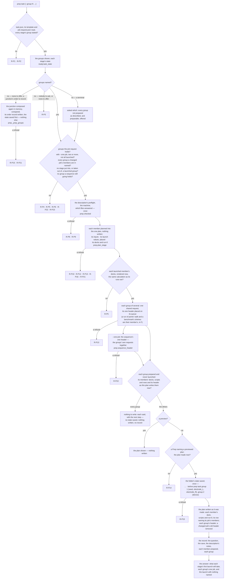

#### A preview

**A preview is the same entry, stopping before the save.** It shows the plan
— the answer a prep gives, said as what it would do: what it found (the
decks' own checks among it); for each stage, what its first launch will take
and from which stage (*"at launch: takes &lt;files&gt; from &lt;stage&gt;'s
newest run, which must have finished"*); which config files answered; every
file it would write; and the launch values the job would be launched with,
from the text it rendered (the header where a scheduler runs it, else the run
script) — or the refusal prep would give, with what it found. Nothing is
saved, written or recorded.

Task setup's **Preview** is this, and its **Prep** runs the entry again naming
the preview's plan by its identity (`jobset.planned.Plan.identity`: every file
it would write with its stamps masked, and what each copy or move takes, by
its file's path, size and time). When the plan made now differs — the folder,
the machine's record, a library file it takes, or molbuilder itself changed
between — it refuses, saying to preview again (R-P14). A Prep naming no plan
is not taken.

#### What prep answers

**What you get back** is the whole of what was found and decided: the terminal
prints it, Task setup shows it. The entry returns a `PrepAnswer` per stage:

| in the answer | what it is |
|---|---|
| `findings` | the description's preflight notes ([`engines/stages.md`](?doc=engines/stages.md) § 6.6); an error refuses instead |
| `notes` | what the inputs said: a bench's grid — enumerated, left out, kept |
| `saved` | the folder's state saved before the writing (checkpoint 5), or the one it already stood at, and its note; none for a prep with nothing to write |
| `unchanged` | a stage of a group prepared, never launched, and already as this prep plans it: the sentence both doors say |
| `differs` | a stage prepared again: each file, its row and its group's header that differ from what this prep writes now; empty for a first prep |
| `dirs` | the folders this prep's jobs run in |
| `provenance` | which configuration file supplied each setting ([`configuration.md`](?doc=configuration.md) § 2.2) |
| `machine` | the machine it is prepared for |
| `deck_findings` | what each deck's checks said — also written to the deck's `<deck>.validation.txt` |
| `attempt` | the first run it opened and what it brought in — the stage's own files |
| `takes` | what the stage's first launch will take, and from which stage (§ 5.4) |
| `copied` | a transport calculation reusing a finished one: its manifest — each group copied in or prepared here, and why ([`engines/transport.md`](?doc=engines/transport.md) § 2a.16) |
| `points` | a transport bias scan's point folders |
| `need` | the stage's memory need at the ranks it is prepared with, or that nothing has measured it ([`job-request.md`](?doc=execution/job-request.md) § 3.1a) — a hint that refuses nothing |
| `placement` | the queue it was placed on, where each value came from, and the fit of what it sends; none for a benchmark or a member of a group of several, whose shelves and group say theirs |
| `stated` | a stage prepared with no header: where each value it states came from |
| `shelves` | a benchmark's: each shelf's name, its header's lines, its fit |
| `resources` · `deck` | what the stage will launch with, and its deck |
| `pipeline_log` | the step-by-step record of the plan and the writing ([`script-preparation.md`](?doc=execution/script-preparation.md) § 4.5) |
| `group` | a member of a group of several: the group's one job — its members in order, its header in `launch/`, its fit |
| `sequence` | the last answer of a prep with `--one-job`: the sequence's one job — its groups, its header, its fit, and each group asking less than it |
| `preview` · `plan_id` · `writes` | a preview's: the plan, named, and every file it would write |

**The save is the entry's own, and it asks nothing** — the one function every
act that changes the folder calls first (`checkpoint.save_before`). The
terminal prints the state and its note, the tab shows them, and the ledger
records it. Everything prep reads of the machine is read in the plan, so every
refusal about that machine comes before the save.

**A refusal carries what the entry had found** (`PrepError`'s `findings` and
`notes`) — a bench refused because *no cell is left* points at its cells left
out. The command line prints them before the refusal's sentence; the tab's
route returns them beside it. A plain `ValueError` / `KeyError` the steps raise
for what is the person's to fix is refused the same way on both doors; a
`TypeError` is a bug, and looks like one.

**Where `prep bench` refuses the description itself** — a transport
calculation, an engine the bench lane does not speak — one function says so
for every door (`prep_inputs.bench_refusal`). A bench with no declared axes is
the machine's proposal ([`generator.md`](?doc=execution/generator.md)
§ 4.3a).

#### After prep

`launch` acts on a prepared group (§ 6.0). It shows the exact command of
everything it will send and asks before sending it
([`submission.md`](?doc=execution/submission.md) S4). Then you look —
`status`, the Results tab — and decide what to launch next.

### 5.1 Describe

**`molbuilder describe` writes the description** — the template, `task.json`,
`job-request.json` and the data files — into the calculation folder. Nothing
in it names a machine, so it means the same wherever you copy it. It is no job
verb: describing says what a calculation is, and `molbuilder jobset`
prepares, launches and observes it
([`job-request.md`](?doc=execution/job-request.md) § 9).

```bash
molbuilder describe --structure BDT-Au/structure/bdt.xyz \
    --bundle BDT-Au/optimization/bdt-relax --engine siesta \
    --calculation optimization --stage-strategy publishable \
    --psml-lib pseudopotential
```

- **Every path is an address from the projects root**, so the line works from
  anywhere ([`job-contracts.md`](?doc=execution/job-contracts.md) § 2.5b) —
  the pseudopotential library too; `describe` takes no positionals.
- **The engine and the kind are stated, every time** (`--engine`,
  `--calculation`): nothing is guessed from a folder's name.
- **Names and values are checked here**: a stage name outside
  `[A-Za-z0-9_]+`, a duplicate stage, an `overrides` key the schema does not
  know, or a value outside its bounds is refused with the field named
  ([`engines/stages.md`](?doc=engines/stages.md) § 6.6).
- **The job request it writes holds each stage's group and nothing else.** The
  queue, wall, memory and each run's card are stated on Task setup's cards or
  in the file; a launch value stated nowhere is refused at prep
  ([`architecture.md`](?doc=execution/architecture.md) § 5.2).

### 5.2 What prep lays out on disk

The tree prep lays out is
[`project-layout.md`](?doc=execution/project-layout.md) § 1.1's: a folder per
stage holding its deck, its run script and header (built by the same
builder as a single run's), its pseudopotentials and the bundles that travel
beside the deck (`mb_monitor.pyz` always; a finish's; beside a PySCF deck,
`mb_pyscf.pyz` — one list, `runwrap.bundles_for`), each a real copy; and the
stage's `run-0`, opened with the stage's own files. **A job folder holds its
own inputs and no link into a sibling's** — why a copy and never a link is
[`project-layout.md`](?doc=execution/project-layout.md) § 1.6.5.

### 5.3 The grammar and the printed commands

> **This section is the authority for what you type.** What happens on disk is
> [`project-layout.md`](?doc=execution/project-layout.md) § 1.6's; the one prep
> entry both doors call, and what it answers, are § 5.0's.

#### The grammar

```
molbuilder jobset prep task    [--group N ...]  [options]   # the groups picked; --one-job: and their sequence's header
molbuilder jobset launch task  [--group N]      [options]   # one group; nothing named, the one that can go
molbuilder jobset launch task  --group N --group M ...      # several: ONE job launching each in turn (§ 6.0)
molbuilder jobset launch task  --stage NAME     [options]   # one stage: launched again alone, or a group of one
molbuilder jobset <verb> bench <stage> [<trial>]  [options]
                    │      │       │        │
                    │      │       │        └─ launch bench only: which trial, by its
                    │      │       │           point's name (`G1N4C6`; its folder adds
                    │      │       │           `bench-`).  Omitted: every trial not yet
                    │      │       │           launched, on its shelf's job
                    │      │       └─ which stage, by its NAME (`tight`) or its
                    │      │          NUMBER with a `#` (`'#3'`, the NN of `03_tight`)
                    │      └────────── what is prepared or launched: `task` (the
                    │                  calculation) or `bench` (one stage measured)
                    └───────────────── prep · launch · summarize — the verbs that take a kind
```

- **On `task`, `--group N` names a group** — repeated for several at prep; at
  launch one, or several sent as one job (§ 6.0, *A sequence of groups*).
  **`--stage NAME` names one stage**: a member launched again alone, or the
  first launch of a group of one.
- **`--from`, `--cold` and `--gather` speak for one stage**: `--stage NAME`, or
  a `--group N` holding one stage (§ 5.4).
- **A name is matched in any case** — `TIGHT` is `tight`
  ([`engines/stages.md`](?doc=engines/stages.md) § 2). A name and a `#N` reach
  one resolver; a bare number and the token are legal stage names, so neither
  doubles as a number.
- **`#N` is the stage's `seq`, never its row.** With stage 2 disabled the
  ladder is `01_coarse` and `03_tight`, so `#3` is *tight* and there is no
  `#2` — the number in the folder, the deck's file name and `status`'s `seq`
  column ([`engines/stages.md`](?doc=engines/stages.md) R5). **Quote it in
  bash**: an unquoted `#` begins a comment, so `--stage #3` arrives with no
  value and is refused; type `'#3'`. A sweep's trials have no order and
  resolve by name only.
- **The kind is a positional, not a `--bench` flag**, because `prep bench` and
  `prep task` are peers: measuring and running are the same act over
  different parameters.
- **Every verb that acts on a calculation takes it as `--bundle`** — its
  address from the projects root — or runs from inside its folder; `probe`
  and `machines` take none.

#### The verbs

| verb | what it does | key flags | it writes | where |
|---|---|---|---|---|
| `molbuilder describe` | the description and its job request | `--structure`, `--bundle`, `--engine`, `--calculation`, `--stage-strategy`, `--psml-lib` | the template, `task.json`, `job-request.json`, the data files | § 5.1 |
| `jobset prep task` | the groups shown; the ones picked prepared — every one not prepared as described offered | `--group N`, `--one-job`, `--target`, `--domain`, `--np`, `--cpus-per-task`, `--gpus`, `--time`, `--mem`, `--max-memory-mb`, `--env`, `--no-sbatch` | a saved state; each member's deck, scripts and `run-0`; `job-set.json`; `prepared-with.json`; `STAGE-PLAN.md`; the ledger | § 5.0 |
| `jobset prep bench <stage>` | the machine's record read, the grid enumerated, the trials rendered into the stage's `bench/` | `--target`, `--domain`, `--time`, `--mem` | a saved state; the sweep's trials, their shelves' headers, its `job-set.json` and `STAGE-PLAN.md` in `bench/` | § 7 |
| `jobset launch task` | one group; several as one job launching each in turn; or one stage again | `--group N`, `--stage NAME`, `--mode direct\|submit\|ask`, `--from`, `--cold`, `--gather`, `--foreground`, `--time`, `--yes`, `--dry-run` | at a group's first launch, a saved state; each run filled; `run.json`; the job's address; the ledger | § 6.0, § 5.4 |
| `jobset launch bench <stage> [<trial>]` | under `submit`, the trials not yet launched as one job per resource shelf; under `direct`, each here in turn, in one walk; a named trial alone | `--mode`, `--only cpu\|gpu`, `--trial-timeout`, `--time`, `--yes`, `--dry-run` | each trial's `run.json`; the walk's script and log | § 6.0, § 7 |
| `jobset summarize task` | a transport calculation's bias points into `<label>.transport.json` ([`engines/transport.md`](?doc=engines/transport.md) § 2a.12); a SIESTA vibration's force-constant stages into `<label>.fc-sweep.json` ([`engines/vibration.md`](?doc=engines/vibration.md) § 5.9); any other calculation refused — its outputs *are* its results | `--tolerance-cm1` | that record | *The next step* |
| `jobset summarize bench <stage>` | the trials' measurements, the winner, and the report — printed | — | `bench/bench-result.json` | § 7.1 |
| `jobset status [<stage>]` | every stage, where it stands, and each group's next step; with a stage, that stage in full | — | nothing | below |
| `jobset scratch` | an engine's scratch the runs hold, listed; with `--empty`, the files no run still going keeps, removed after one question | `--empty`, `--yes` | the ledger, when it removes | below |
| `jobset migrate` | what an older molbuilder wrote in the calculation, rewritten, each change said — the road every reader names when it refuses such a file | — | the new files, each old one kept beside it | [`job-request.md`](?doc=execution/job-request.md) § 8 |
| `jobset export` | a transport calculation's every result, as NetCDF or as CSV tables, from what is already there; a vibration calculation's data files and, with `--laser-nm`, its Raman view | `--format netcdf\|csv`, `--to`, `--laser-nm`, `--broaden-ev` | into the folder `--to` names, never inside the calculation | [`engines/transport.md`](?doc=engines/transport.md) § 2a.12; [`engines/vibration.md`](?doc=engines/vibration.md) § 5.11 § 10 |
| `jobset probe` | this machine's record, measured — `--name` for a cluster you prepare for; `--set` and `--scheduler` declare what the probe cannot see | `--write`, `--name`, `--set`, `--scheduler`, `--yes` | `environment.json`, or `environments/<name>.json` | § 7; [`configuration.md`](?doc=configuration.md) § 5 |
| `jobset machines` | the machine records prep can target, each with where it lives | — | nothing | [`preparing-for-another-machine.md`](?doc=execution/preparing-for-another-machine.md) |
| `molbuilder jobs status` · `stop <id>` | the jobs launched from this machine, each member's state; stop one | `--yes` | the ledger, for a stop | § 6.0a |
| `molbuilder checkpoint save · list · restore · tag · init · config` | the folder's saved states; `config` says which files go where | `-p`, `-m` | the folder's history | [`checkpointing.md`](?doc=execution/checkpointing.md) § 5 |

#### What molbuilder prints, you can type

**A command molbuilder prints** — a deck's header, a *next:* line, a remedy, a
refusal's list — **names the stage by its NAME**: never the token (`03_tight`
is itself a legal name, of another stage), never `#N` (a pasted line would lose
it to bash). A deck's header holds only the token, so it prints the name
through `identity.command_stage`. A benchmark trial's deck names its own
launch, `launch bench <stage> <trial>`.

**Every printed command is composed in one place**: `jobset/commands.py`, for
what the verbs and their refusals print.

- **The calculation is named by its address from the projects root**
  (`--bundle`, quoted as a shell needs it), every time, as `checkpoint`'s
  folder (`-p`) is: a line is pasted where its reader is, and an omitted
  `--bundle` means the working folder
  ([`job-contracts.md`](?doc=execution/job-contracts.md) § 2.5b).
- **A launch's mode is stated** — unless the calculation is launched on this
  machine and this machine's `launch.mode` names one — as one line per mode
  its machine takes, each saying what it does with the machine named as its
  record names it: `# runs directly on sol`, `# submits to sol's queue`
  *(the user, 2026-10-25: "just claim what it is doing: submitting to execute
  on sol")*.
- **A refusal that asks for a stage offers the stages the verb takes**
  (`'#N'` quoted) and the command for the first.
- **One command a line**, any prose after `#`.
- **A launch offered again in another mode** — an ask's answer, a refusal for
  want of a mode or of a header — is the whole command, its flags as typed
  that the mode reads (`commands.launch_with`), never "the same command with
  `--mode X`".
- **A name only the person knows** (a machine's) is asked for in words, never
  a `<placeholder>`.
- **A text read later** — a deck's header, a result's remedy — says a launch
  through `identity.launch_as_typed`, the same for every engine: as typed from
  the calculation's folder, naming no folder, with what the mode means beside
  it; a deck's header names its group's first launch and the stage alone
  (`identity.deck_launch`).
- **A layer below `jobset`** (a machine record's refusal, a run script's banner)
  cannot import the composer, and prints plain text by the same rules; the way
  back it names is `identity.way_back_words`'s.

#### The read-only verb

```bash
molbuilder jobset status --bundle BDT-Au/optimization/bdt-relax   # every stage, where it stands, what is next
molbuilder jobset status                     # the same, from inside the folder
molbuilder jobset status tight               # ...and ONE stage in full
molbuilder jobset status '#3'                # the same stage, by its number
```

**The table is the description's ladder**: one row per stage `task.json`
names, in its order and with its number, from the moment it is described — so
it lists stages before anything is prepared, each with its group and its state
(*The states*). It ends with **the next step** (*The next step*). Here is a
SIESTA optimization whose one stage was launched twice and finished, then a
PySCF one prepared and not launched (two test calculations):

```text
JOB-SET STATUS -- h2_siesta (siesta)

  seq  stage   group  attempt  state     converged     warm files                                detail
  ---  ------  -----  -------  --------  ------------  ----------------------------------------  -------------
  1    coarse  1      run-1    finished  geometry yes  h2_siesta.XV, h2_siesta.DM, h2_siesta.CG  ended, exit 0

each group, and what is next:
  group 1  coarse  finished
```

```text
JOB-SET STATUS -- h2_pyscf (pyscf)

  seq  stage   group  attempt  state    converged  warm files  detail
  ---  ------  -----  -------  -------  ---------  ----------  ---------------------------------------------------------------------------------
  1    coarse  1      run-0    pending  -          -           ready to launch (prepared by molbuilder 2.60.0) -- takes nothing from another run

each group, and what is next:
  group 1  coarse  ready to launch (prepared by molbuilder 2.60.0) -- next:
           molbuilder jobset launch task --group 1 --bundle claude-s28-onestart/optimization/h2_pyscf
```

**`status <stage>` answers a different question**: not *where is this
calculation up to*, but *what is this stage* — its deck, what it declares it
may take, the resources it asks for — and *what happened to it*: which run it
is on, how it was launched, what it continued from, how it ended. This is the
look before a launch. For the first calculation above:

```text
STAGE 01_coarse -- finished

  deck            h2_siesta_01_coarse.fdf
  declares        h2_siesta.XV, h2_siesta.DM, h2_siesta.CG
  resources       domain=cpu, n=1, c=1, t=0-01:00:00, mem=4G
  attempt         run-1   (of run-0, run-1)
  launched        direct at 2026-11-01T04:19:56Z
  command         bash h2_siesta_01_coarse.run.sh -np 1 -omp 1
  continued from  nothing -- it started from the structure
  converged       geometry yes
  warm files      h2_siesta.XV, h2_siesta.DM, h2_siesta.CG
  detail          ended, exit 0

Directory: 01_coarse/run-1
```

- **None of it is inferred**: a run is a folder and a launch is a record
  ([`project-layout.md`](?doc=execution/project-layout.md) § 1.6.3).
  `continued from` is said every time: *nothing -- it started from the
  structure*, or, for a run that gathered its inputs, *nothing -- it started
  from what it gathered*; a run of points says which points it took over from
  which runs.
- **A stage removed from the description** after its prep is not listed; its
  folder is kept, untouched.
- **The Results tab's ladder is the same answer**
  ([`web/results.md`](?doc=web/results.md) § 2.4) — its wire form,
  `JobSetStatus.to_dict`, carries the groups `prep task` would offer
  (`offer`) and the next step (`steps`).
- **A benchmark's sweep** is read against the calculation it measures
  (`jobset_status(calc, sweep=…)`), and its next step is its own verbs (§ 7).
- **Any other folder** inside a calculation — a stage's, a run's — is refused,
  naming the calculation's own folder (R-P1). A plan with no description
  beside it is no calculation of molbuilder's, and is refused
  ([`architecture.md`](?doc=execution/architecture.md) A16).
- **`status` never resumes anything** (decision 5). To watch one run live,
  open it in the Results tab or `molbuilder watch`
  ([`running-a-job.md`](?doc=execution/running-a-job.md) § 4).

#### `jobset scratch` — an engine's scratch, listed and emptied

*(the user, 2026-10-20: "give me a tool before you ask me to do all these
trouble to clean up")*

**An engine's scratch** is what the engines' shipped file vocabularies name so
(`molbuilder/<engine>/warm-files.toml`, never a calculation's own copy; the
one answer, `warmfiles.is_scratch`,
[`job-contracts.md`](?doc=execution/job-contracts.md) § 4.2a): TranSIESTA's
leads' Green's functions, `*.TSGFL` and `*.TSGFR`, and an optical call's
breakdown of its spectrum by transition, `*.contrib.EPSIMG`; PySCF names none.
It is recomputed by every run, never carried, never taken over, never saved
([`checkpointing.md`](?doc=execution/checkpointing.md) S1). A run of points'
walk empties its run's scratch folder (`Job.scratch_dir`) as each round
begins and as it ends; a run that stopped first leaves it, and scratch a kind
keeps beside a run's own files stays until `jobset scratch --empty`.

- **`jobset scratch` lists** every such file below each stage the description
  holds, by name and size, never reading a file (`materialize.scratch_in`): a
  line per file — its stage, its size, its path — then the count and the
  total; then each file a run still going keeps, `  kept: <path> -- <why>`;
  then, when any file is free, the line that empties them. With none, it says
  *no engine scratch in &lt;folder&gt;.*
- **What a run still going keeps is asked of each run** — the run the file
  lies in (`paths.run_folder_of`), never its stage's newest — by one answer
  that removes nothing (`runstatus.scratch_answer` → `ScratchAnswer`:
  `found`, `kept` with why, `free`). A run keeps its scratch while a job
  launched from this machine that lists it is going, or this machine cannot
  tell (`joblist.is_going`, § 6.0a); while the run door reads it queued or
  running; and while its state does not read.
- **`--empty` removes the free files** after one question naming how many and
  how much, *remove them? [y/N]*; `--yes` answers it. With nobody to ask
  nothing is removed and the verb refuses. With none free it says *nothing to
  remove.*; after removing, *removed N file(s), X GiB.* The question, its
  answer and what was removed are written to the ledger. Nothing but what the
  vocabularies name scratch is ever touched.

#### One job at a time, and the mode

**`launch` hands a scheduler one job per invocation** — a stage, a group, or a
sequence of groups walked inside one job; a benchmark one job per resource
shelf. Never a queue flood: the rule, and why, is
[`submission.md`](?doc=execution/submission.md) S4's. `--mode direct` runs each
job here, one after another — which is not submission at all.

**`--mode` is the channel, not the layout**: `direct` (a local `bash`),
`submit` (the machine's scheduler) or `ask` (the scheduler asked when the line
would start, nothing sent). Unstated, it falls back to `launch.mode` in
`molbuilder.json`; unset in both is a refusal (R-L4), never a guess from the
detected scheduler ([`configuration.md`](?doc=configuration.md) § 4). The
results are kept on disk one way, whichever mode sends the job.

### 5.4 How a ladder advances — what a stage takes, and launching again

**Every ladder runs the same way** — `prep task` its groups, then `launch
task`, a group at a time, or several named at one launch as one job — and
nothing starts a stage but you. What differs is **what a stage starts from**.
Which ladder a kind has is read off its record in the kind table: a kind whose
rungs are named by role is linked, one without roles independent
([`architecture.md`](?doc=execution/architecture.md) § 3.3).

**What a stage takes is files, taken at its first launch** — the files the run
reads when it starts: an optimization ladder's restart files (SIESTA's `.XV`,
`.DM`, the optimiser's history; PySCF's `_optimized.xyz` and `.chk`), a
transport rung's inputs (the seed's `.DM`, the leads' `.TSHS`, the device's
`.TS.HSX`), a displacement sweep's later stage's relaxation. **No stage's deck
depends on another stage's run**, so every stage is prepared any time and what
it takes is copied when the run it comes from exists.

| | **independent stages** | **linked stages** |
|---|---|---|
| what they are | one calculation tuned several ways — an optimization's `coarse → medium → tight` | different jobs, each using another's output — transport's seed and leads → device → transmission |
| the stages | named by you, as many as you like ([`engines/stages.md`](?doc=engines/stages.md) § 2) | the kind's own, each by its role ([`engines/template.md`](?doc=engines/template.md) § 6.4) |
| what a stage starts from | **the stage before it**: its newest run's geometry, density and — for the same optimiser — history. The first stage, and a stage whose `restart` is `clean`, start from the calculation's structure | **the kind's inputs** (below) |
| when what it builds on has not finished | prepared all the same; its launch refuses before anything is sent, names what to do, and offers the choice of `--from` or `--cold` — a launch says these for one stage, so a member of a group of several is told to give it a group of its own. A run that finished without converging is taken, with a warning | its launch refuses before anything is sent, naming the stage to run first |
| another source | any run by `--from`, none by `--cold`, at the launch | none — see below |

**A linked kind's inputs**, by kind:

- **transport** — files at the first launch: the device takes the seed's
  density and the leads' Hamiltonians, the transmission the device's, each
  from the newest run that ended so and ran the same engine input as the deck
  that stage renders now ([`engines/transport.md`](?doc=engines/transport.md)
  § 2a.11). `--from` is refused, and `--cold` at a first launch (R-L13);
  launched again, `--gather` takes the inputs anew, and `--cold` starts it with
  none of its own files, keeping what it gathered.
- **a SIESTA vibration's first stage** — nothing: its run relaxes first and
  hands the geometry to its own force-constant call
  ([`engines/vibration.md`](?doc=engines/vibration.md) § 5.11 § 3). `--from`
  and `--cold` at its first launch are refused (R-L12); launched again, warm
  takes over every call done in its last run and `--cold` runs them all again
  ([`engines/vibration.md`](?doc=engines/vibration.md) § 5.11 § 6).
- **a displacement sweep's later stage** — the first stage's relaxation, its
  `relax` call taken over from the first stage's newest run, which must have
  finished — as an independent stage takes the stage before it's: `--from` a
  run whose relaxation it takes over, `--cold` none, the stage then relaxing on
  its own ([`engines/vibration.md`](?doc=engines/vibration.md) § 5.9).

**What crosses between stages when a deck is a reordered copy.** A call that
takes another's geometry — a SIESTA vibration's force-constant call taking its
`relax` call's — is written by the run's plan step through SIESTA's one
reading pass, in the one deck order both calls share
([`engines/vibration.md`](?doc=engines/vibration.md) § 5.11 § 3). A restart
file crosses as it is: every deck of one calculation is written from its one
structure, pinned by its description's fingerprint
([`engines/stages.md`](?doc=engines/stages.md) § 6.3), so writer and reader
list the atoms in one order.

#### What *finished* means, and how a choice is recorded

**By default, a stage takes the newest run of what it builds on, which must
have finished — one rule for every kind.** An older run never stands in,
because a run launched again to tighten is the one you mean *(the user,
2026-10-25: "newest, must be finished")*. *Finished* is the run door's answer,
as `status` gives it: the run ended on its own with exit code 0, and nothing in
its output says the engine stopped
([`running-a-job.md`](?doc=execution/running-a-job.md) § 4.2).

- **The launch reads that run before sending anything.** One still running,
  stopped without its conclusion marker, or failed is refused in the run
  door's words, naming what to do (R-L11). One that finished without
  converging is taken, with a warning.
- **A transport rung's gather keeps a second check**: the upstream run ran the
  same engine input as the deck that rung's description renders now, comments
  and molbuilder's records aside
  ([`engines/transport.md`](?doc=engines/transport.md) § 6.1); it waits,
  naming the way, when it did not.
- **A transport calculation that reuses a finished one** takes more, and
  earlier: its prep copies in each group the finished calculation computed as
  this one would now, as launched runs of this calculation, and a rung of
  points prepared here takes over, at its first launch, the finished points it
  would compute the same. One result is reused only when it finished in that
  calculation's newest run *(the user, 2026-10-25: "One rule: reuse
  completes")*; the rules are
  [`engines/transport.md`](?doc=engines/transport.md) § 2a.16's.

**The person can still force one**, two ways, both stated rather than refused
*(user: "yes, … but user can force a structure still")*:

- **a run named with `--from`** (Task setup's *Continue from*) is taken as
  said: the launch states what it sees there — *failed*, *not converged* — and
  refuses only what cannot be done (R-L37);
- **a structure stated relaxed** (`already_relaxed`,
  [`engines/vibration.md`](?doc=engines/vibration.md) § 2.2): the frequency
  stage takes it as given, the record it carries shown and checked, never
  required.

**What a stage builds on is decided once — at the launch that takes it — and
recorded where it lands.** A run it continues from is one `Continuation`: the
run, and what it was, recorded in the ledger (`continues`). A transport rung's
inputs are its kind's gather — each file and the run it came from — recorded
in the ledger (`gathers`). A first launch that takes nothing is recorded so
(`starts-cold`, and whether `--cold` asked it). Nothing picks the source again
later unless you ask at a launch (`--from`, `--gather`). `STAGE-PLAN.md` says
what each stage's first launch will take — the line both prep doors print.

#### One hand-over

**What a run takes from other runs is one hand-over**, whoever decided it
(`materialize.HandOver`): the run that takes; each file, with the run it comes
from; and its record — `.continued-from` (the one run it continues from) or
`.gathered-from` (each input with its run). One function carries every
hand-over out, `materialize.hand_over`: it copies the files and writes the
record.

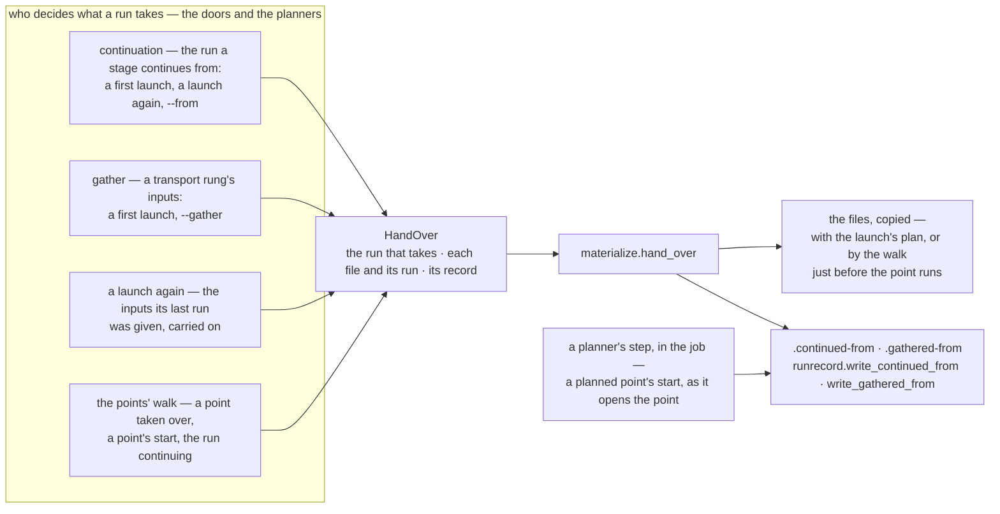

- **When the files are copied**: with the launch's plan, written at the send
  after the yes — except a point's start (a device point's `.TSDE`, a
  vibration's `fc` call's `.DM`), which the walk copies just before the point
  runs, since the point before it may finish in the same walk
  ([`runs-of-points.md`](?doc=execution/runs-of-points.md) § 3).
- **When the record is written**: with the files. A planned point's start —
  one no launch can know — is recorded by its planner's step in the job as it
  opens the point, through the same writer (`runrecord.write_continued_from`).
  A point a transport calculation takes over from a finished one it reuses is
  copied by the reuse's own two (`reuse.take_into`, `reuse.shared_into`), each
  recorded in `.copied-from`; the runs its prep copies in are no hand-over
  ([`engines/transport.md`](?doc=engines/transport.md) § 2a.16).
- **How a run is named in a record** — one spelling, written and read one way
  (`runrecord.RunRef`): its folder from the calculation's, `01_coarse/run-0`,
  a point's `04_device/run-0/v0.2`.
- **Who reads the record**: `runrecord.read_continued_from` (`status`'s rows
  for a run's points, and a launch taking a point over) and
  `runrecord.read_gathered_from` (`status`, the transport record, the Run
  panel). A run's own `continued_from` is its `run.json`'s, which the Run panel
  and `status <stage>` read.

#### A stage launched again

**Any stage may be launched again, however its last run ended** — finished,
failed or stopped — alone with `--stage`, or its group whole with `--group N`.
The next `run-<n>` is opened through the one opener; the earlier runs stay as
they are.

- **Warm, the default**: it continues from **that stage's own latest launched
  run** — the next run opened with the restart files it left. Whether warm
  continues is `Job.relaunch_continues`: its kind resumes (the warm-file
  vocabulary's `resumes`, [`job-contracts.md`](?doc=execution/job-contracts.md)
  § 4.2a — a PySCF vibration's does not) and the stage takes something from a
  run (`restart: clean` takes nothing). A stage that does not continue starts
  over from its deck. A warm launch again is one `Continuation`, carried out as
  every hand-over is, and recorded (`continues`).
- **`--cold`**: it takes nothing from a run of its own; the next run is opened
  with none of them.
- **A transport rung keeps the inputs its first launch gathered** (the leads'
  Hamiltonians, the seed's density), copied with their record — unless you ask
  for them anew with `--gather` (the newest run of each rung upstream, under
  the same gates). Warm, a file it carries from its own run stands: a device
  continues from its own density, not the seed's.
- **A run of points** takes over, warm, every point done in its latest run —
  a bias sweep's points, a SIESTA vibration's calls — and walks the rest, each
  point short of done again from its start or, where its kind says so, continued
  from its own last run's warm files; cold, it walks every point
  ([`runs-of-points.md`](?doc=execution/runs-of-points.md) § 3). Its ledger
  says so on the launch's `launched` line — which points it takes over, from
  which run, and which it walks (`walks`).
- **`--from` and `--gather`** are decided at that launch and recorded as a
  first launch's are.
- **Warm needs something to be warm from**: a run that left none of the files
  the stage takes is refused warm, naming `--cold` (R-L17, R-L18). Nothing
  else about how a run ended is refused, or asked about.

#### An explicit choice, and what launch prints

**An explicit choice is taken as said**: `--from <NN_stage/run-n>` names any
run of this calculation; `--cold` starts from the calculation's structure.
What cannot be taken is refused **before anything is written**: a run that is
not one of this calculation's, `--from` with `--cold`, the transport and
vibration cases above, and `--from` or `--cold` on a benchmark, whose trial
starts cold from its deck. Either way, `launch` prints which run the stage
continues from — before the question, and once sent — and the ledger records
it:

```text
  medium: WOULD launch it into run-0: it continues from 01_coarse/run-0 (the stage before it; concluded rc=0 at Thu Sep 24 02:38:51 PM MST 2026; converged): would copy H2.XV, H2.DM
  takes      medium         [launched into run-0: it continues from 01_coarse/run-0 (the stage before it; concluded rc=0 at Thu Sep 24 02:38:51 PM MST 2026; converged): copied H2.XV, H2.DM]
```

The optimiser's `H2.CG` is carried only between stages that use the same
algorithm — the shipped ladder's coarse is CG and its medium Broyden. A file it
takes that was written as that run's job ended — a kill may have caught it
mid-write — carries `-- WARNING: written as the job ended (…)` after its name,
in both lines and in the ledger (`written_as_ended`); the launch goes as asked
([`running-a-job.md`](?doc=execution/running-a-job.md) § 3.6).

**Both doors offer the same choice**: the terminal's flags, and Task setup's
**Continue from** in the group's tab, which puts it on the launch line and
shows the default — or why launch would refuse it — before anything is sent
([`web/task-setup.md`](?doc=web/task-setup.md) § 11).

The two-stage walk — both groups prepared, the first launched, looked at,
the second launched — is [`worked-example.md`](?doc=execution/worked-example.md)
§ 6–§ 8.

---

## 6. Launching — one entry, here or on a cluster

### 6.0 Plan, show, ask, send, record

`launch` is built as `prep` is (§ 5.0): **one entry decides everything before
anything is sent, and the send decides nothing** — `submit.plan_launch`, then
`submit.send_launch`.

| # | step | what happens |
|:--:|---|---|
| 1 | **the plan** — nothing is written | the machine, the work, its submissions and each member, planned (below); the exact lines and scripts to send. Every refusal is a row of the refusal table |
| 2 | **show** | the exact command of every submission and every value of the header it sends, a wall `--time` restates marked as this launch's (`Submission.request`); what each member takes, and from which run — [`submission.md`](?doc=execution/submission.md) S4 |
| 3 | **ask** | one question for the whole plan, a run here asked as a submission is *(user, 2026-10-05)*. `--yes` answers it in advance; with nobody to ask nothing goes and the launch is refused (R-L23). `--dry-run` stops here and writes nothing, the ledger included. `--mode ask` puts the plan's lines to the scheduler instead and writes down what it asked — what it asks and how its answer reads are [`submission.md`](?doc=execution/submission.md) S4's |
| 4 | **send** — nothing is decided | the folder checked against the plan (below); **a group's first launch saves the folder's state** ([`checkpointing.md`](?doc=execution/checkpointing.md) § 9); the plan's writes carried out; each submission sent through one function |
| 5 | **the record** | the ledger: every refusal; the questions and their answers; the save before a group's first launch (`saved`); what each member took (`continues`, `gathers`, `starts-cold`; a run of points', `walks`; a point taken over from a reused calculation, `taken over`); each submission sent and its job id, a run here with its pid, and the job's address (`job`, § 6.0a) |

**1 — the plan.**

- **The machine, first, for every mode**: the calculation's own copy of its
  machine's record, read once for the whole launch (`submit._machine_of`,
  through `record.calculation_environment`; R-L38). Its scheduler kind spells
  every line, and decides nothing.
- **The work** (`submit._the_group`): a prepared group, whole at its first
  launch, or one stage launched again; a benchmark's trials not yet launched.
- **Its submissions**, from the submission builders (§ 9.1) — each one
  scheduler job, or one process here, walking one or more members: a run is
  one member; a group, its stages in ladder order; a run of points, its points;
  a benchmark's resource shelf, its trials not yet launched. Each sends the one
  header its prep wrote for it.
- **Each member**, from the one member planner (`submit._plan_member`; a
  benchmark's trial, `submit._plan_trial`): the run it runs in — prep's first
  run, or the next one — and what it takes (§ 5.4), with the gates: every
  upstream it takes from has finished; a trial starts cold (R-L29).
- **What prep wrote is sent as it is** — nothing planned again, nothing
  compared *(the user, 2026-10-17, 2026-10-25)*. A stage whose records changed
  since its prep is said so by `status` and Task setup (*Changed since
  prepared*). The placement is the job's own, recorded at prep (*The
  placement*, below).

**4 — the send.** The folder is checked against the one the plan was made from:
the plan is made again from the folder as it is (`plan_launch`'s `again`) and
compared line by line — each submission's line and where it runs, each member
and what it takes, every file the send writes or copies and every file read
where it lies, each by its size and write time. A member launched, a run ended
or a file changed since is refused, saying which, and to launch again to see
the new plan (R-L22). Then a group's first launch saves; the launch's questions
and answers are written after the save, so the state holds no line of this
launch. Then each run is opened or filled through the one opener, a pending run
emptied whole first ([`project-layout.md`](?doc=execution/project-layout.md)
§ 1.6.2–§ 1.6.3), with its `.continued-from` / `.gathered-from` (§ 5.4); a
submission with several members gets its walk script; every script is on disk
before anything goes. Each submission goes out — `sbatch`, or the process here
— through one function (`submit._go`), each member's `run.json` written by the
one writer.

**5 — who writes the record.** The entry writes it (`submit.plan_launch`,
`send_launch`, `ask_launch`); the verb writes the refusals it says before it
calls the entry — a flag that means nothing for the mode, a stage not
prepared. **The questions the verb asked before the plan** — which group,
which stage — go to the entry with the plan (`plan_launch`'s `held`): written
before the plan's refusal when it refuses, at once under `--mode ask`, and
otherwise with the send's own question, after the save. One whose answer the
verb cannot act on is written by the verb as it refuses (`_cli._launch_unit`);
a dry run writes none.

**What `launch task` sends**:

- **the next group** — one prepared as described and never launched, whose
  every member's upstream has finished. When several can go it asks which
  (`--group N` answers): one job per invocation. A group goes whole the first
  time; a member is launched alone only again.
- **When no prepared group can go, it offers the stages launched before**, to
  launch one again (§ 5.4), beside what each waiting group waits for.
  `--stage NAME` names one; `--group N` sends a launched group again whole.
- **Several `--group`**: one job launching each in turn (*A sequence of
  groups*, below).

Each refusal node names its row in [the refusal table](#every-refusal-and-its-way-on):

```mermaid
flowchart TD
    A["launch task  [--group N … | --stage S]<br/>[--from R | --cold | --gather]"] --> L0{"a job set prepared,<br/>its description read?"}
    L0 -- no --> R1a["R-L1 · R-L27"]
    L0 -- yes --> M{"its mode, and every flag<br/>the mode and the launch take?<br/>commands.LAUNCH_FLAGS"}
    M -- no --> R4["R-L4 · R-L46 — --in-sequence / --in-job, the walk's alone"]
    M -- yes --> B{"named?"}
    B -- nothing --> O{"ready.task_state: groups prepared as described,<br/>never launched, upstream finished"}
    O -- one --> MR
    O -- several --> Q["asked which — one job a launch"] --> MR
    O -- none --> RL{"stages launched before?"}
    RL -- yes --> QS["offered, to launch one again —<br/>beside what each waiting group waits for"] --> SA
    RL -- "no, or nobody to ask" --> R1["R-L1 · R-L2 · R-L3"]
    B -- "a group" --> MR
    B -- "several groups" --> MR
    B -- "a stage" --> SA{"held by the description,<br/>and prepared?"}
    SA -- no --> R5["R-L5 · R-L36"]
    SA -- yes --> MR
    MR{"the calculation's copy of its machine's record reads?<br/>submit._machine_of — first, once, every mode"}
    MR -- no --> R38["R-L38"]
    MR -- "yes, several groups" --> SQ{"a sequence: each group as its own launch asks it —<br/>prepared, held by no sequence still going;<br/>no one-stage flag; to a queue, the header prep wrote<br/>for exactly them<br/>submit._plan_sequence"}
    SQ -- no --> R45["R-L45"]
    SQ -- yes --> SQP["the first group planned as its own launch plans it now;<br/>the walk — each group's own launch, in order —<br/>and the sequence's launch record"]
    SQP --> SH
    MR -- yes --> GC{"the work, submit._the_group: a group the job request holds,<br/>every member prepared, as launched or as prepared;<br/>a stage never launched, alone in its group;<br/>--from, --cold, --gather for one stage;<br/>held by no sequence still going — but its own;<br/>inside one, the group the sequence was sent with"}
    GC -- no --> R7["R-L6 – R-L10 · R-L26 · R-L45 · R-L46"]
    GC -- yes --> MB["each member planned, nothing written<br/>submit._plan_member (a trial: submit._plan_trial)"]
    MB -- "a refusal" --> R14["R-L14 · R-L21 · R-L28"]
    MB --> F{"its first launch?"}
    F -- yes --> T{"what it builds on is there?<br/>ready.first_launch_takes"}
    T -- no --> R11["R-L11 – R-L14 · R-L37"]
    T -- yes --> F0["run-0 emptied whole, prep's files back as they lie,<br/>and what it takes"]
    F -- "no — again" --> AG["from its newest launched run, warm;<br/>--cold nothing; --from a run, --gather anew —<br/>each checked as a first launch is"]
    AG -- refused --> R17["R-L11 – R-L14 · R-L17 · R-L30 · R-L37"]
    AG --> FN["run-N: new, or the one a refused send opened,<br/>emptied whole — then filled"]
    F0 --> PL["the submission: one job, a group's walk,<br/>a run's points' walk —<br/>the header its prep wrote"]
    FN --> PL
    PL -- refused --> R19["R-L18 · R-L29 · R-L31 · R-L44"]
    PL -- "the scheduler asked: mode ask" --> AK["each line asked of the scheduler, its kind's ask —<br/>nothing saved or sent; what was asked recorded"]
    PL --> SH["shown: each member, what it takes and from which run;<br/>the exact line, every value of its header"]
    SH -- "a dry run" --> DRY["nothing asked, nothing written —<br/>the ledger included"]
    SH --> ASK{"yes? — a run here: in the background,<br/>or the other way (--yes answers it)"}
    ASK -- no --> NO["nothing sent — the question and its no recorded"]
    ASK -- "nobody to ask" --> R23["R-L23"]
    ASK -- yes --> SF{"the folder as it was planned?<br/>the plan made again from it"}
    SF -- no --> R22["R-L22"]
    SF -- yes --> SV["a group's first launch: the folder's state saved, and said —<br/>… · before launch task group 2 (device)"]
    SV -- "a refusal" --> R24["R-L24"]
    SV --> WR["the questions recorded; the plan written:<br/>each run filled, its .continued-from / .gathered-from"]
    WR --> SEND["sbatch, or the process here — one job"]
    SEND -- refused --> R25["R-L25 · R-L35 — each run stays pending"]
    SEND -- went --> REC["each member's run.json — launched;<br/>the job's address (§ 6.0a)"]
    REC --> WT{"a run here, waited on?"}
    WT -- yes --> HE["each member's ending, read through the status door:<br/>finished — or FAILED, or UNREAD when it cannot be read: exit 1"]
    WT -- no --> NX
    HE --> NX["the next step: every group, where it stands,<br/>the line that moves it — runstatus.jobset_status"]
```

#### A run here starts in the background

*(user, 2026-10-09: "let it run in the background instead of having to wait
for it … check the log and output later on"; 2026-10-16: "make it default but
also explicitly changable in the question")*

**`launch … --mode direct` starts its process and leaves it**: its own
session, so closing the terminal does not end it; the send returns once the
process exists, the ledger's `launched` line carrying `background` and its pid.

- **The question offers the other way**: *launch in the background?
  [Y/n/foreground(F)]* — Enter, `y` or `yes` goes as shown, `n` or `no` sends
  nothing, `f` or `foreground` runs it in the foreground and waits. Under
  `--foreground` the plan is the waited-on run and the question *launch in the
  foreground? [Y/n/background(B)]*. `--yes` takes the plan as shown. The
  ledger keeps the question as asked and its answer.
- **What it says**: shown, *about to start here, in the background:* (or
  *about to run here, waited on:*); a dry run, *WOULD start in the background*
  (or *WOULD run*); sent, *started in the background*, its pid, and **how to
  stop it** — `molbuilder jobs stop <id>` (§ 6.0a). The run leads its own
  process group, so a signal to that group reaches the engine; to the run
  script alone it would wait for the engine to end.
- **Nothing it prints is lost**: the run script copies everything it prints
  into its `<stem>.runwrap.log` as its first act, the engine's own output is
  the run's `<stem>.out`, and a walk sends its own standard error and each
  member's output to its log under `launch/`. The launch prints the folder to
  read — or the walk's log — and the next step; for a benchmark, the
  `summarize bench` that reads its trials once they have run.
- **`--foreground` on a queue is refused** — under `submit` a scheduler's job
  runs without anyone waiting on it, under `ask` nothing is sent — and a
  queue's flag on a run here (`--time`) likewise, each with the launch as typed
  for each mode this machine takes (R-L4; `commands.launch_with`).

#### A run here, waited on

*(user, 2026-10-13: "if you already know a job fails why … do you not report
failure?")* **A run here, waited on, ends the launch with how it ended.** When
the process ends, the launch reads each member's state — its stage's row of
`jobset status` (`identity.stage_key`) — through the one status door
(`parse.dirs.run_status`; *finished* and *failed* as
[`running-a-job.md`](?doc=execution/running-a-job.md) § 4.2 defines them) and
prints it in that door's words on its submission's line, *FAILED* first when a
member did not finish. A state that cannot be read after the run ended is
said so, *UNREAD* with why: the send went, so it is never a refusal. **The
launch exits 0 when every member finished, 1 when any failed or its ending
could not be read**, so a script that trusts the exit status is told what
happened. Left in the background, the launch exits 0 having said *started*.

**A run here is told its wall**, as a sent job is told its header's: the wall
its job states, `MB_WALL_S` in seconds — how the run uses it is
[`running-a-job.md`](?doc=execution/running-a-job.md) § 3.6's. One stating
none runs until it is done. Inside a sequence's queue job, a group's runs are
told the job's wall instead (*A sequence of groups*).

#### A benchmark's walk

**A benchmark's trials sent together go as one submission walking them in
order**, through the benchmark's own script (`launch/<name>.run.sh`, written by
`submit._walk_script`): each trial `cd`ed into and its own run script run with
its own counts, timed, under the per-trial bound when one is given
(`--trial-timeout`). A trial that fails leaves the rest to run; the walk exits
nonzero when any failed. Stopped by the person — Ctrl-C at a launch waited on,
a lost terminal, `molbuilder jobs stop`, a cancel — it starts no further trial;
what it did not reach is measured again from the state saved before the
benchmark's prep.

**Sent to a queue, a benchmark goes one job per resource shelf**, sent one at
a time, its trials one after another inside it; run here, the trials not yet
launched go in one walk. The shelves — what makes one, their order, a refusal
that stops none of the others, `--only`, and how a trial killed at its bound
reads — are [`generator.md`](?doc=execution/generator.md) § 4.3a's, *The
shelves*.

**A transport bias sweep is not a benchmark** *(user, 2026-10-05: "bias scan
is its own mechanism — this is parameter sweep, not some … computation
resource experiment")*: it is one calculation swept over a parameter — one run
of points ([`runs-of-points.md`](?doc=execution/runs-of-points.md)). What it
shares with a benchmark's walk and a group's is the walk script alone, each
with its own settings.

#### A sequence of groups

*(the user, 2026-10-20: "how about we allow submission of multiple groups in
sequence for one job? this would simply require us to design the job script
to understand to execute the script under each group in sequence, so the lower
level logic stays the same")*

**What it is.** `launch task --group 1 --group 2 --group 3` — two groups or
more — sends **one job** that launches each group named, in the description's
order, as `launch task --group N --mode direct` would launch it on the job's
node: inside the one job, one after another. **Each group is
planned when its turn comes**, so it takes what it builds on from the runs the
groups before it have just finished, under every gate of a first launch.
**Nothing below the group changes**: a group's walk, a run of points' walk,
each member's run script, what each run takes and the ledger are the ones a
group sent alone has; only what each run records of the job it rode, and the
wall it is told inside a queue job, are the sequence's. **Every group, the
first included, is launched inside the job** by its own `jobset launch
--in-sequence` (*The walk*), so **each group's first launch saves the folder's
state there, on the job's node**, as a group sent alone saves at its first
launch; the launch that sends the sequence saves nothing, and a group the
sequence launches again saves nothing
([`checkpointing.md`](?doc=execution/checkpointing.md) § 9). A group whose launch is refused, or whose run does
not finish, ends the job there: the groups after it build on it. Naming several
groups is the decision to go on without looking between them, and the launch's
one question names every group.

**Its header is prep's** (`prep task --group 1 --group 2 --group 3
--one-job`). Prep prepares the groups named that are not launched, as `prep
task` does — never a group a sequence still going holds (R-P23) — and writes
the sequence's one header, `launch/<label>_sequence-<every member's
token>.sbatch` (`runfiles.GroupNames.of_sequence`). Its request is the groups'
own requests together (`group.sequence_request`):

- **one queue**, every group's;
- the **largest** ranks, cores per rank, GPUs and memory any group asks for;
- the **walls summed**;
- the node whole when any group asks it;
- the GPUs alike — one count, one binding — since a group using GPUs runs its
  ranks over every GPU the job holds.

Two queues, or GPU groups asking two counts or bindings, is no sequence: the
prep refuses `--one-job`, naming them (R-P22). The header is placed and its fit
said like every header, never a veto, and the fit names each group that uses
less than the job holds — it runs with its own run card inside it, the rest
of the job's cores and GPUs idle meanwhile. A group named that is launched already is
read as prepared, and its request is part of the sum. A machine with no queue
has no header to write: a sequence run here needs no `--one-job`. **A group of
it prepared again — alone, or in another sequence — takes the sequence's header
away** (`group.sequence_headers_holding`): that header summed the group's
request as it was; until `prep … --one-job` writes it again, a launch of the
sequence under `submit` or `ask` is refused, naming that line (R-L45).

**The launch** takes the groups in ladder order, whatever order they are named
in, and refuses before anything is sent: a group not prepared; a group a
sequence still going holds, naming `molbuilder jobs stop`; under `submit` or
`ask`, no header prep wrote for exactly these groups, naming the `prep …
--one-job` line; and the flags that speak for one stage (R-L45). A bare
`launch task` offers no group a sequence still going holds. The plan shown is
the first group's, made as its own launch makes it now; each group after it is
shown by its stages, *launched in this job when group K has finished, taking
what it builds on then*. `--time` restates the job's wall; `--dry-run` shows
and writes nothing; `--mode ask` asks the scheduler about the sequence's line.
The send writes the sequence's walk, `launch/<seq>.run.sh`, and its launch
record, `launch/<seq>.launch.json` — both before the job goes, since the job
reads them — then sends the header (`submit`), or runs the walk here
(`direct`, in the background unless `--foreground`). The ledger's `launched`
line names the groups (`sequence`); every line of each group's launch inside
it names the sequence (`in_sequence`) and the job (`in_job`). A launch record
that could not be stamped as the job went is said on the launch's line and in
the ledger (`record_unwritten`); the job went all the same.

##### The walk

**The walk is the one walk script** (`submit._walk_script`), each step a
group's launch (a `WalkCommand`). **It runs molbuilder in molbuilder's own
environment, entered as every job enters its environment**
(`runwrap.env_bootstrap`; [`running-a-job.md`](?doc=execution/running-a-job.md)
§ 2.2a): before its first step it runs the preamble of the machine record the
calculation was prepared with — every path it sources checked first, a line
that fails stopping the walk — and that record's activation of `molbuilder`.
molbuilder's python is then the environment's own, `$_mb_py`; a walk whose
activation did not give it — `CONDA_PREFIX` not naming `molbuilder`, or no
python there — stops before any group, its log saying which. The environment
is installed on that machine, as every engine's is:

```bash
<the record's preamble>
<the record's activation> molbuilder
_mb_py="${CONDA_PREFIX:+$CONDA_PREFIX/bin/python3}"
( cd "<molbuilder's folder>" && "$_mb_py" -m molbuilder jobset launch task --group 2 \
    --bundle "<the calculation's full path>" --mode direct --foreground --yes \
    --in-sequence <seq> --in-job "${MB_JOB_ID:-$(hostname)-$$}" )
```

- It runs from the folder molbuilder's package was imported from, which the
  job's node must see (a cluster's shared home).
- `--in-job` is the job's id as its shell knows it: the scheduler's,
  `MB_JOB_ID`, in a queue job; run here, `<host>-<pid>` (one template,
  `joblist.HERE_ID`) — so each group's runs join the job's entry
  `molbuilder jobs` lists.
- A step that exits nonzero stops the walk; its log, `launch/<seq>.log`, holds
  every group's launch as it printed it, and each group's own walk keeps its
  own log.
- **The wall each run is told**: sent to a queue, the job's — the sequence's
  wall, every group's summed — counted from the job's start, so a later group
  counts what the groups before it left; run here, each run its own card's.

**A group's launch inside it** (`--in-sequence <seq> --in-job <id>`, which the
walk alone types: refused with any mode but `direct --foreground`, R-L46) is
planned, shown, sent and recorded as any launch, and asked nothing. **Each run
it sends records the job it rides**, read off the sequence's launch record:
launched in a queue job, `mode: submit`, that job's id, the line that sent it,
where its scheduler writes the job's error file, and the queue, wall and memory
it was sent with; run here, `mode: direct` and the walk's line. So every reader
of a run reads it as a run of that job, and a job cancelled or killed reads its
runs failed, as any job's do. It writes **no address of its own**: it adds its
runs to the sequence job's address (§ 6.0a); runs it could not add are said on
its line and in the ledger (`not_on_address`). It reads how its runs ended as
any launch waited on does — a run of points by its points alone.

**The sequence's launch record**, `launch/<seq>.launch.json` (its format,
[`job-contracts.md`](?doc=execution/job-contracts.md) § 6.1): the groups, each
with its number and stages in order; the mode; the line that sends the job; the
queue, wall and memory it is sent with and the scheduler's kind and error-file
folder (both `null` run here); and, written by the one sender the moment the
job goes, when it went and the scheduler's job id. What each run records of the
job is read from here, never composed a second time.

**Status** reads a group the job holds and has not launched yet as **goes in
job N** — after the group before it in the job — its line `molbuilder jobs
status`; a group it has launched is read from its runs. One answer says it, for
status, prep, launch and the Results tab (`ready.held_by_sequence`): a group is
the job's while the job is going (§ 6.0a) and it has launched it by neither its
address nor the group's own runs, whose launch records name the sequence. A job
this machine cannot ask about holds nothing, `molbuilder jobs status` saying
so. **A launch inside the job reads a run of points its job sent by its
points** (`joblist.inside`): never as *running (between two points)* or
*queued* by asking the job — its own, still going — so the gather's gates and
the next step it prints say what the points say.

**To go on after a stop**, send the groups left: `launch task --group K …
--group last`, its header written by `prep task --group K … --one-job`, which
reads a launched group as prepared. A sequence that ended before a group leaves
that group as it was. Each launched group goes again as its own launch again
would — from its own newest run, a transport rung with what its last run
gathered (`--gather`, one stage's, is not taken in a sequence) — while a
group's first launch takes what it builds on from the runs the groups before it
have just finished.

#### The placement

**The placement is decided once, at prep, and recorded on the job** (§ 5.0,
checkpoint 4; § 3, `placement`); **launch sends the header prep wrote**, places
nothing again, and may restate one value only — a submitted job's wall,
`--time`. How a job is placed, its fit, what the launch records of the request
and the send line are [`scheduler.md`](?doc=execution/scheduler.md) R9, § 5.1
and § 6a's.

### 6.0a The jobs launched from this machine — `molbuilder jobs`

*(user, 2026-10-16: "can we keep the status of running jobs the same way as we
keep status of running server? … and we can use similar verb to stop a task if
we need to")*

**Every launch leaves an address, the way a server leaves its pidfile**
(`molbuilder serve status`, [`ops/deployment.md`](?doc=ops/deployment.md)).
The one sender (`submit._go`) writes it the moment a submission goes — a run
here once its process exists, a queue job once the scheduler gives its id (a
job whose id `sbatch` did not print gets none) — one file per submission in
molbuilder's state folder, `<state dir>/jobs/`
([`configuration.md`](?doc=configuration.md), the tree), kept past a logout.
A run here's is named `<host>-<pid>.json`, a queue job's `<cluster>-<id>.json`
— a home folder two clusters share holds both clusters' jobs of one number
*(the user, 2026-10-22)* — or by its number alone where its cluster was not
read (`joblist._file_of`); every file is read by what it says, never by its
name (`joblist.find`, `address_of`). The ledger's `launched` line names it
(`job`). A file that could not be written is said on the launch's line, and a
run left in the background is then named by its pid, `kill -- -<pid>`.

**It holds an address, never a state.** Its format is
[`job-contracts.md`](?doc=execution/job-contracts.md) § 6.1's
(`molbuilder/job@1`); what each field means:

| field | what it is |
|---|---|
| `id` | what `jobs stop` names: `<host>-<pid>` for a run here; a queue job's id as `squeue` lists it — a number two clusters' jobs share answered for by the cluster this machine's scheduler serves, and refused naming both where it serves neither |
| `how` | `here` (with `background`: left in the background, or waited on) or `queue` |
| `host` | the node it was launched on: a pid means something only there |
| `pid` · `started` | a run here: its process, and when the kernel started it (Linux's `/proc`) — together what tells the run from a later process given the same pid |
| `job_id` · `cluster` | a queue job: the scheduler's id, and the cluster it was sent to as the scheduler names it (`ClusterName`) |
| `calculation` | the calculation's folder |
| `members` | each member's stage → its run (`runrecord.RunRef`), and that run's launch record, which its state is asked through — a sequence's, added by each group's launch inside it |
| `sequence` | a sequence of groups: each group it launches, in order, with its stages, and the sequence's name; `null` otherwise |
| `launched_at` | when it went — UTC, to the second, `…Z`: the run records' one clock (`runrecord.stamp`), so a run's launch record compares with it |

**What it is doing is read fresh, each time** — one answer
(`joblist.is_going`), which `molbuilder jobs` asks of each job; whether a
sequence still going holds a group asks it (`ready.held_by_sequence`); so do
`jobset scratch` and a run of points' state (`continuation.points_state`).

- **A run here** is going while its process is — the same host, pid and start.
  A machine with no `/proc` says it cannot tell.
- **A queue job** is going while the scheduler lists it in a state not ended,
  said with that state and the scheduler's reason when it gives one — *the
  scheduler lists it: PENDING (QOSMaxWallDurationPerJobLimit)*, its own words,
  so a job it took and will never start says why
  ([`scheduler.md`](?doc=execution/scheduler.md) R6). One it lists ended is
  said so — *the scheduler lists it ended: FAILED (NonZeroExitCode)* — until
  the scheduler forgets it; then the run's own state says how it ended
  ([`scheduler.md`](?doc=execution/scheduler.md) R16).
- **Asked where**: its kind's query, run where the calculation's copy of its
  machine's record says the command is, on its own cluster — another
  cluster's job is said *sent to cluster C: ask there*. Asked at most once per
  ten seconds per job (`joblist.asked_here`, `asked_lately`); the run door asks
  by the same rule and hears the same answer. A record naming no query
  command, or a command that does not run here, says it cannot ask; a copy
  that does not read is said in its own refusal's words.
- **Each member's own state is its run's**, read through its launch record by
  the run door — that run, never its stage's newest; a run of points by the
  one door that answers a run's state whichever kind it is
  (`continuation.stage_run_state`). A run no longer on disk — a restore went
  back past it — is said so.
- **A job that has ended** — a queue job the scheduler no longer lists, a run
  here whose process is gone with no marker written — is written into its
  run's launch record by this very look, so the run reads `failed` from then
  on and the two agree ([`running-a-job.md`](?doc=execution/running-a-job.md)
  § 4.2, *Asked once, written once*).

**`molbuilder jobs status`** lists every file: its id, how it went, when, the
calculation, and each member with its state in the status door's words — here,
a transmission left in the background, then once it was stopped:

```text
qlabsrv-312877  run here on qlabsrv, in the background, pid 312877 -- its process is going
  launched 2026-10-16T22:06:45Z; its calculation:
  molbuilder jobset status --bundle P/transport/S
    transmission  05_transmission/run-0  running
```

```text
qlabsrv-312877  run here on qlabsrv, in the background, pid 312877 -- its process has ended
  launched 2026-10-16T22:06:45Z; its calculation:
  molbuilder jobset status --bundle P/transport/S
    transmission  05_transmission/run-0  failed -- stopped before its end: …
  ended -- said once; its address is removed
```

- **A sequence lists its groups**: the job's name says so (*a sequence of
  groups 1, 2, 3*), then each member of the groups it has launched with its
  state, then each group it has not reached yet, *not launched yet*. A group
  is launched by the sequence when its address, or its runs' launch records,
  say so (`ready.sequence_sent`, the one answer the next step and every launch
  and prep ask too).
- **A job that has ended is shown once — how each member ended — and its file
  removed**; its run folder and the calculation's ledger keep its history. A
  run waited on is shown by its own launch, which removes its file then;
  stopped at its terminal, the launch waits for the run script's own close —
  twice the ten seconds its exit trap gives its monitor
  (`runwrap.MONITOR_STOP_S`) — reads the run once and removes its file; a run
  not ended by then keeps its file for `jobs status` to ask.
- **A run here launched on another host** is said so — *on HOST: ask there* —
  and never removed or signalled here; a file that does not read is said, with
  its path, and kept.

**`molbuilder jobs stop <id>`** — the line a launch prints beside a run it left
in the background — shows what it will stop (the calculation, its members, the
pid or the job id) and asks *stop it? [y/N]*; `--yes` answers in advance, and
with nobody to ask nothing is stopped. The question and its answer are written
in the calculation's ledger, a *no* too.

- **A run here** is checked to be the process launched (host, pid, start), and
  checked again once the answer is given; SIGTERM goes to its process group,
  so it reaches the engine. A run waited on is stopped at its terminal, with
  Ctrl-C, and `jobs stop` says so.
- **A queue job**: its kind's cancel, from where the record says the command
  is.
- The ledger records the stop (`stopped`, and how), and the verb says it —
  *stopped: SIGTERM to its process group, &lt;pid&gt; -- `molbuilder jobs
  status` says how it ended*, or the line it ran, `/usr/bin/scancel 62039301`
  on SLURM. The run then reads *failed — stopped before its end* by its own
  files.

The address is floor 1's (`molbuilder/joblist.py`); whether the scheduler
lists a job, and its cancel, are `molbuilder/scheduler/queue.py`'s; the verbs
are a surface, `molbuilder/jobs_cli.py`
([`architecture.md`](?doc=execution/architecture.md) § 2.1).

### 6.1 On a cluster — when a header is written

**Every job prep writes for a machine with a queue gets a header**, every value
in it stated (R-P10). It is withheld in two cases only — a machine with no
queue (`workstation`), or `prep --no-sbatch` — and a job with no header sent to
a queue is refused, each case with its own way back (R-L31,
`submit._no_sbatch`). The header, the two layers it hands off through, the send
line (`sbatch -J <label>/<job> …`) and when there is no header are
[`scheduler.md`](?doc=execution/scheduler.md) § 6a's; what the run script does
with what it is sent is [`running-a-job.md`](?doc=execution/running-a-job.md)
§ 3.

---

## 7. Benchmarking — the verbs, and what a trial ran

Before you commit a long run to a node, you want to know which GPU count, rank
count and cores per rank run *this* calculation fastest on *this* machine. The
benchmark measures it, and it is the job system pointed at a resource grid:
`prep` whose parameters are a set (§ 4.2).

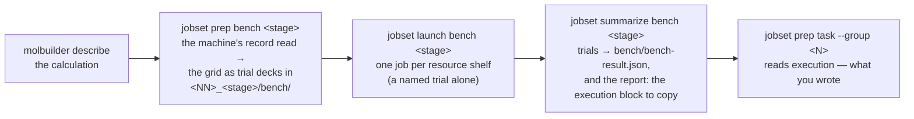

- **The machine's record** (`environment.json`, `molbuilder/environment@3`) is
  written by `jobset probe --write` on that machine — its scheduler and where
  its commands are, its topology resolved to the compute node's real cores and
  GPUs, the queues you can reach — or `--name` for a cluster you prepare for.
  It holds facts only: what was probed, and the activation and preamble that
  machine's `molbuilder.json` declares, copied in. A probe never chooses a
  queue for you ([`configuration.md`](?doc=configuration.md) § 5, M-1;
  [`preparing-for-another-machine.md`](?doc=execution/preparing-for-another-machine.md)).
- **The trials** are the stage's science made measurable: each deck rendered
  from the description with the benchmark's pins laid over it, on a
  `(G, N, c)` grid — GPUs, ranks in all, cores per rank — declared in the job
  request or proposed from the machine. The pins are
  [`generator.md`](?doc=execution/generator.md) § 4.2's; the grid and its
  folder names § 4.3a's.
- **A trial executes only through `jobset launch bench`** — a rider of its
  shelf's job on a queue, alone when named, or run here in the benchmark's one
  walk (§ 6.0, *A benchmark's walk*) — its launch recorded in its own
  `run.json`. A trial is launched once; measuring it again is the state saved
  before the benchmark's prep, restored, and a prep anew (R-L39).
- **`jobset status` on the sweep** lists its trials and its own next step: the
  sweep's launch while a trial is not launched; *let them finish* while one is
  queued or running; `summarize bench` once every trial's run has ended — and
  only then: a trial whose run is not on disk, or whose launch record does not
  read, is said by name first, with its way on (R-L28).
- **The winner** is the fastest, by steady-state seconds per SCF iteration,
  of the trials whose state is `finished` and that ran what they were asked
  to run (`bench.result.choose_winner`; the rule is
  [`generator.md`](?doc=execution/generator.md) § 4.3a's). It recommends
  no memory and no wall: those are the person's to state. **The recorded choice
  is a report, applied by nobody**: its `execution` block is yours to copy into
  `job-request.json`, and the next `prep task` reads what you wrote and nothing
  else. `summarize bench` ends with that step.

**A trial that ran something else cannot win**: what each trial really ran is
read back from its own output and compared with what it asked for, and a
mismatched trial stays in the record, barred only from winning — the rule and
its reasons are [`generator.md`](?doc=execution/generator.md) § 4.3a's, *The
summary*; the Results panel shows both
([`web/bench-summary.md`](?doc=web/bench-summary.md)).

### 7.1 One analysis, two presentations, nothing in between

**The measurement is composed once and shown twice.** There is no third
implementation and no file between the composer and either reader.

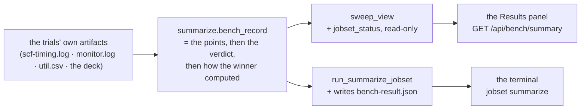

**Both readers ask the same composer, `bench_record`** — the winner's mechanism
(`_winner_mechanism`) included — so one sweep has one verdict whichever door
you came through. **They differ after it, only in what they do with the
record**: `sweep_view` adds live per-trial status and returns, opening no saved
file, so the panel recomputes on every request and can show a sweep
mid-flight; `run_summarize_jobset` writes `bench-result.json` and hands back a
report the command line prints.

| reader | how it gets the summary | writes a file? |
|---|---|---|
| the Results panel | `/api/bench/summary?path=<job-set.json>` → `sweep_view` → `bench_record` | **no** |
| the terminal | `jobset summarize bench <stage>` → `run_summarize_jobset` → `bench_record` | **`bench-result.json`**, then prints the report |

**The terminal prints the report; it writes no text file beside it** *(user,
2026-09-04: "that can be simplified by integrating that into the CLI, which
basically prints out instead of writing to a text")*.

**`bench-result.json` is the sweep's archival record** — the trials, their
measured numbers, the machine each ran on, and the verdict — and the one thing
persisted. It is what survives if the trials' artifacts are archived or
deleted. **No code reads it back**: what a run uses is what the person wrote in
`execution` (`prep_inputs.prep_run_inputs`), so nothing carries a verdict into
a launch. That is its normal condition — the record exists to outlive the
artifacts it was computed from *(user, 2026-09-06: archiving a sweep is a
use)*.

---

## 8. What this contract does not own

| fact | its owner |
|---|---|
| a run's states (queued, running, finished, failed), the order of evidence, what *finished* means | [`running-a-job.md`](?doc=execution/running-a-job.md) § 4.2 |
| the run script at run time — counts, wall, after a failure | [`running-a-job.md`](?doc=execution/running-a-job.md) § 3 |
| a point's and a run of points' states, *not run*, the walk | [`runs-of-points.md`](?doc=execution/runs-of-points.md) § 3, § 4 |
| when molbuilder saves the folder's state, and the note | [`checkpointing.md`](?doc=execution/checkpointing.md) § 9 |
| using the checkpoint, and branching | [`checkpointing.md`](?doc=execution/checkpointing.md) § 5, § 7.1 |
| the request's keys; what a group's members share; a launched stage's request change; `jobset migrate` | [`job-request.md`](?doc=execution/job-request.md) § 3.3, § 5, § 8 |
| placement, fit, the header lines and the send line | [`scheduler.md`](?doc=execution/scheduler.md) R6, § 6a |
| nothing goes out unseen; one job at a time | [`submission.md`](?doc=execution/submission.md) S4 |
| file formats and schema strings; file and folder names; warm files | [`job-contracts.md`](?doc=execution/job-contracts.md) § 6.1, § 6.3, § 4.2a |
| the folder tree on disk; one start per run; copy, never link; a run's record files | [`project-layout.md`](?doc=execution/project-layout.md) § 1.1, § 1.6.1, § 1.6.5, § 1.6.3 |
| prep's steps, inside | [`script-preparation.md`](?doc=execution/script-preparation.md) § 3.0 |
| "stated or refused at prep" — the value ladder; the code doors | [`architecture.md`](?doc=execution/architecture.md) § 5.2, § 3.2 |
| the machine record against the ask; `launch.mode` | [`configuration.md`](?doc=configuration.md) § 5, § 4 |
| the benchmark's grid, shelves, pins and winner | [`generator.md`](?doc=execution/generator.md) § 4.3a, § 4.4b |
| a stage's scientific values | [`engines/tuning.md`](?doc=engines/tuning.md) |
| the one worked walk-through | [`worked-example.md`](?doc=execution/worked-example.md) |
| what is built and what is owed | [`plans/plan.md`](?doc=plans/plan.md) |

---

## 9. A developer's map

### 9.1 Prep and launch — one framework, layer by layer

Both verbs are built the same way, and each layer has one role:

- a **surface** collects what the person said and prints the answer;
- **one entry** per verb is what both surfaces call;
- **the work** says which members it acts on;
- **one member planner** per verb plans a member;
- a **run filler** fills that member's run — one run folder, or a run of
  points;
- for a launch, a **submission builder** says how the members are sent,
  asking the member planner for each;
- then the folder is **saved, the plan written, the job sent, the records
  written**.

Underneath, the **doors** answer facts and never write — one door per fact, the
index [`architecture.md`](?doc=execution/architecture.md) § 3.2. Every layer
above the doors decides; nothing is written until the plan is whole, so a
refusal writes nothing but its line in the ledger.

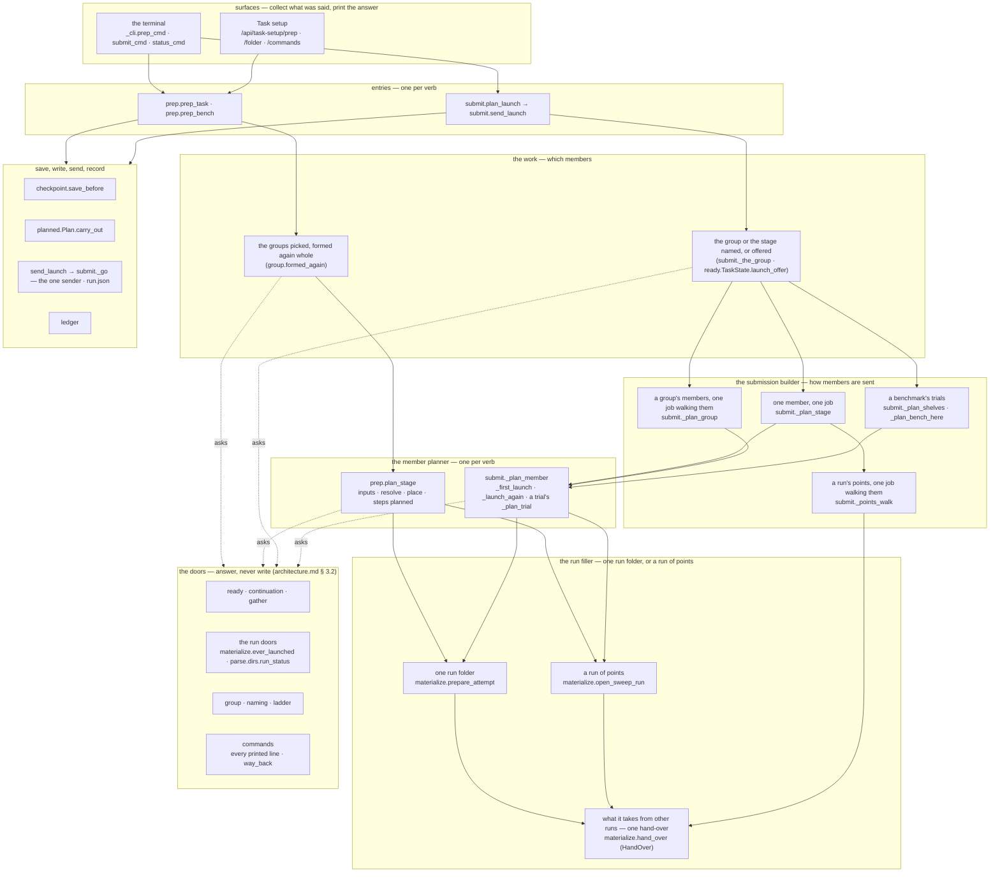

| layer | its role | `prep` | `launch` |
|---|---|---|---|
| surface | collect what was said — the flags, a question's answer — and print the answer; decides nothing | `_cli.prep_cmd`, `POST /api/task-setup/prep` | `_cli.submit_cmd` (`_launch_unit` puts the question) |
| entry | the verb's one function, whichever surface called; owns the save and the record | `prep.prep_task`, `prep.prep_bench` | `submit.plan_launch` → `submit.send_launch` |
| the work | which members: by the job request's groups, matched by their members | `prep._prep_groups` (`group.formed_again`; R-P5, R-P6) | `submit._the_group`: the group named or offered, or one stage again |
| member planner | one member — what it is, what it takes, its checks, its run — planned with nothing written | `prep.plan_stage`: inputs, resolved, launch values stated and placed, the steps planned (`prep_calculation`) | `submit._plan_member`: `_first_launch` (from the ready door) or `_launch_again` (from `materialize.newest_launched`); a trial, `_plan_trial` |
| run filler | fill the member's run | `prep_calculation` opens `run-0` with the stage's own files (`materialize.prepare_attempt`, `open_sweep_run`) | the same openers, then prep's own files back (`_prep_files_back`) and what it takes, each one hand-over (`materialize.hand_over`): a continuation, a gather (`materialize.gather_into`), or the inputs its last run was given (`_carry_the_gather`); a run of points' take-overs and starts (`_points_walk`) |
| submission builder | how the members are sent | — prep sends nothing; every job's header is planned with its members (`prep.walk_header_of`) | `_plan_stage` (a run of points to `_points_walk`), `_plan_group`, `_plan_shelves`, `_plan_bench_here`, `_plan_sequence` |
| save, write, send, record | only once the plan is whole | `checkpoint.save_before`, `Plan.carry_out`, `_record_prepared` | `send_launch`: the folder as planned, the save at a group's first launch, `Plan.carry_out`, `_go`, each member's `run.json` |

**One `prep task`, through the layers** — two groups picked:

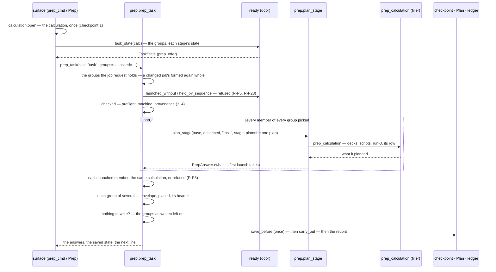

**One `launch task`, through the layers** — a group's first launch:

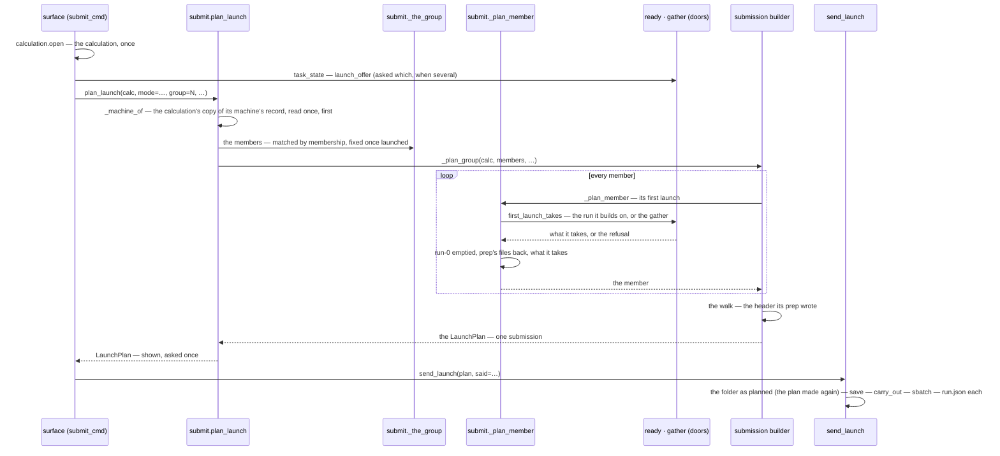

### 9.2 Where each responsibility lives

Every `jobset` module, its floor and its entry points are
[`architecture.md`](?doc=execution/architecture.md) § 2.1's table; the door for
each fact is § 3.2 there. The ones this chapter leans on: `jobset/prep.py`
(the prep entries and the member planner), `jobset/submit.py` (the launch
entry, the submission builders, the one sender), `jobset/ready.py` (the task's
and each group's answer), `jobset/continuation.py` and the pair's gather
part (what a run takes; a transport rung's, `transport/gather.py`),
`jobset/materialize.py` (the run opener and the hand-over),
`jobset/runstatus.py` (`status` and the next step), `jobset/commands.py`
(every printed line), `jobset/group.py` (a group, its
shared request, a sequence's), `joblist.py` (§ 6.0a) and `jobset/ledger.py`
(`jobset-decisions.log`). **To add an engine**, you write one engine seam
([`script-preparation.md`](?doc=execution/script-preparation.md) § 4) and nothing else: the
verbs, the opener, the sender and the status layer pick it up (decision 1).
