# The job system — batches, ladders, and HPC deployment

**Role:** guide
**Domain:** execution

**Companions:** [`execution/running-a-job.md`](?doc=execution/running-a-job.md)
— the single-job wrapper this framework runs many of;
[`execution/job-contracts.md`](?doc=execution/job-contracts.md) — the run-dir
layout, the wrapper files, and the `job-set.json` / parameter vocabulary this
framework produces;
[`execution/overview.md`](?doc=execution/overview.md) — the execution-domain
map and the current → target status picture;
[`engines/tuning.md`](?doc=engines/tuning.md) — the scientific *values* behind
the staged ladders (this page covers only how they are *scheduled*).

---

## The short version

**Everything is a job set** — one calculation is a job set of one; a
ladder or a benchmark sweep is a bigger one. Same verbs, no shortcuts:

```
jobset init        write the portable description        (your laptop)
jobset prep        derive decks + scripts FOR this machine   (the target)
jobset launch      ONE job per invocation -- run or submit
jobset summarize   summarize results that exist: a sweep's trials -> the
                   record + the report, PRINTED; a transport calculation's
                   bias points -> its I-V record; a SIESTA vibration's
                   force-constant stages -> its displacement sweep
                   (engines/vibration.md 5.9).  It never makes a run's
                   result: every run writes its own (a SIESTA vibration's
                   job derives its modes itself, engines/vibration.md 5.5)
jobset status      every stage of the description: where it stands + the
                   resume point; with a stage, that stage in full -- its
                   deck, what it carries, its resources, its attempts
```

| key rule | one line | where |
|---|---|---|
| **floor 3 is derived** | `job-set.json` is computed at prep ON the target — never produced on one host and shipped to another | § 4 |
| **one grouped job** | a bench sweep is ONE submission that runs trials in sequence, each recording its own `run.json` | § 7 |
| **the record shown, the scheduler decides** | prep prepares what is asked and prints its fit on the queue it names; a refusal is the scheduler's, shown in its own words (`scheduler.md` R6) | § 6 |
| **ladder = stages** | coarse feeds tight through declared warm files; the resume point is read, not guessed | § 3, § 5 |
| **the task** | `prep task` shows the groups — each stage's number in `task.json` — and prepares the ones you pick, each one job; `launch task` sends the next group whose upstream has finished, taking what it builds on then | *The task* |
| **runs are yours** | any stage launched again, warm or `--cold`, however it ended; molbuilder keeps every run, says how each ended, and saves the folder's state before every prep and before each group's first launch — going back or branching is a `checkpoint restore` | *Runs, stages and checkpoints* |

---

## Runs, stages and checkpoints — what molbuilder does for you, and what stays yours

> *"the contract really should be a rule for the user: what you should do and
> what you should not do otherwise things could be broken, and here are the
> tools for you to keep track of intermediate known good states"* · *"run
> continue warm or cold is user's decision, and error or not, that's user's
> responsibility"* · *"checkpoint is used for the rollover and branching"*
> (user, 2026-10-07)

**molbuilder is a research tool, not a guard.** It keeps your runs apart, tells
you truthfully where each stands and how it ended, and keeps the states you can
go back to. It never decides for you whether a result is good, whether to run
again, or how. This section is the whole contract for runs and stages; the
sections after it say how each part works, and none of them adds a rule this
one does not state.

### The words

| word | what it is |
|---|---|
| **calculation** | one folder, described once by `task.json` and its template |
| **task** | the calculation, as the verbs name it: `jobset prep task`, `launch task`, `summarize task` |
| **stage** | one step of the calculation's ladder — `coarse`, `relax`, `device` — named in the description, prepared with its group, and again until it is launched (*The task*, below) |
| **group** | stages that share one job — the stages one number names in the description (`engines/stages.md` § 2), prepared together and launched together, none building on another, walked in the ladder's order (`project-layout.md` § 1.6.6) |
| **run** | one launch of a stage (`jobset launch task`). Every launch is a new run, numbered on from the last: on the hierarchical layout its own folder, `01_coarse/run-0`, `run-1`, …; on the flat layout its own numbered files in the calculation's folder, `H2_01_coarse-run0.out`, `-run1.out`, … A stage that sweeps the bias (transport, `low_bias_approximation: false`) holds a folder per voltage inside its run (`transport.md` § 2a.11). Inside a run, each start of its wrapper is a **try**, its files carrying `-run<N>` (`project-layout.md` § 1.6.1). The code, and some pages, call a run's folder its **attempt** |
| **warm / cold** | what a run starts from. **Warm**: the restart files (density, geometry, optimiser history — the restart-file list, [`job-contracts.md`](?doc=execution/job-contracts.md) § 4.2a) a run left. **Cold**: none of them — the engine starts from the deck alone |
| **saved state** | a checkpoint of the whole calculation folder ([`checkpointing.md`](?doc=execution/checkpointing.md)): an id, a note, the time. `molbuilder checkpoint save / list / restore / tag` |

### The task — prepared group by group, launched group by group

> *"we can let prep to prep the whole task and ask the user which stage it
> intend to do. this way it can do the correct carry over of previous stage
> files when needed and when that is ready"* · *"we need one unified
> framework and protocol and verb design and api"* (user, 2026-10-07) ·
> *"the stages should have a group number assigned to it"* · *"the prep
> should be able to prepare all groups at the same time … that's the launch
> status, not the prep"* (user, 2026-10-11)

**The verbs act on the task** — the calculation `task.json` describes — **group
by group**. Each stage states a **group** number, by the rule of
[`engines/stages.md`](?doc=engines/stages.md) § 2: the stages with one number
are **one job**, prepared together and launched together.

```
jobset prep task      # the groups, and which are prepared; prepare the one(s) you pick
jobset launch task    # send the next group whose upstream has finished -- one job
jobset status         # every stage: where it stands, and what is next
jobset summarize task # read a result that gathers stages (a transport I-V, a sweep)
jobset prep bench <stage> · launch bench <stage> · summarize bench <stage>
                      # a benchmark measures ONE stage -- named, as before
```

#### What a stage takes, and when

**What a stage takes from the stages before it is one of two kinds**, and the
kind decides when it is taken:

* **files the run reads when it starts** — an optimization ladder's restart
  files (SIESTA's `.XV`, `.DM`, the optimizer's history; PySCF's
  `_optimized.xyz` and `.chk`), a transport rung's inputs (the seed's `.DM`,
  the leads' `.TSHS`, the device's `.TS.HSX`). The stage's deck does not
  depend on them, so it is **prepared any time** and they are **taken when
  the stage is first launched** — when the run they come from exists.
* **values written into the deck** — one case: a SIESTA force-constant stage,
  whose deck holds `relax`'s relaxed coordinates and cell
  ([`engines/vibration.md`](?doc=engines/vibration.md) § 5.2a: a
  force-constant run writes its last displacement into `.XV`, so the
  reference geometry cannot be a file it reads). It is **prepared once `relax`
  has finished**, from the run its prep takes; that run's files reach it at its
  first launch.

**Which run, by default, is one rule for every kind**: the **newest** run of
what it builds on, which **must have finished** — an older one never stands
in, because a run launched again to tighten is the one you mean. For an
independent ladder's stage, `--from` names any other run of this calculation
(`<NN>_<stage>/run-<n>`), taken as said (§ 5.4); a force-constant stage's `relax` run is named at its prep, and a
transport rung's inputs are its kind's, never named. A transport rung's gather
keeps a second check — the upstream run ran the same engine input as the deck
that rung's description renders now, comments and molbuilder's records aside
([`engines/transport.md`](?doc=engines/transport.md) § 6.1, *the same engine
input*) — and waits, naming the way, when it did not.

#### The states, and what moves them

**Three things have a state, and nothing stores it.** A **stage**, its
**group** and each **run** of a stage are read from the files every time —
`task.json`, `job-set.json`, the run folders and their records — by one door
each: the ready door (`ready.task_state`, `ready.readiness`,
`ready.GroupAnswer`; [`architecture.md`](?doc=execution/architecture.md) § 3.2)
for a stage and a group, the run doors (`materialize.ever_launched`,
`parse.dirs.run_status`) for a run. `status`, `prep`, `launch`, the Results tab
and Task setup all ask the same doors, so they cannot disagree. **Five acts
change what the doors read**: **`prep task`** (`prep_task`) writes a group's
files and rows — or, with no group named, an older transport junction's order
record ([`engines/transport.md`](?doc=engines/transport.md) § 1.1); **`launch task`** (`send_launch`) fills a run and sends it;
**the run itself** — the scheduler and the run script — writes its output and
its conclusion; a **`checkpoint restore`** (`checkpoint`) puts the whole
folder back; and **the description** (Task setup's Save, `describe` at
`jobset init`, or `task.json` by hand) changes what each stage's files are
compared with, which stages it holds and how it groups them — never a stage's
files. Every edge below names its act and, after the `·`, who makes it: one
of those five.

**What marks each state.** No file holds a state, and none is named for one.
A state is read from the files the acts write: some by a file being there —
a stage's row, a run's launch record, its conclusion marker — some by what
one says — the marker's exit code, the row's members. Every such file is a
row of the manifest ([`project-layout.md`](?doc=execution/project-layout.md)
§ 5), which names its writer and the one door that reads the file; the last
column is the door that reads the *state*, and it reads each file through
that file's own door:

| what | it is | when the files say | the file | manifest | the door that reads the state |
|---|---|---|---|---|---|
| a stage | **described** | the description names it | `task.json` — its entry in `stages`, its `group` | § 5.1 | `task.read_task` |
| | **prepared** | its job's row is in the plan | `job-set.json` — the row; its `members`, the job it is prepared in; a force-constant stage's `written_at`, the `relax` run its deck holds | § 5.1 | `ready.job_of` |
| | **ready to launch** / **waits for** | what it builds on has finished — the newest run of that stage, by that run's state below | the files of that run | § 5.3 | `ready.first_launch_takes` |
| | **its job's members changed** | its row's `members` are not its group's now | `job-set.json` against `task.json` | § 5.1 | `group.regrouped` |
| | **launched** | a run of it has a launch record | `run.json` — flat, `<base>-run<N>.run.json` | § 5.3 | `materialize.ever_launched` (`runrecord.launch_record`) |
| a group | **prepared** / **launched** | every member's row names these members / a member is launched | its members' rows and records | § 5.1, § 5.3 | `ready.GroupAnswer` |
| a run | **opened, not launched** | its `run-<n>` folder is there, stamped a run, and has no launch record | the folder (`calcdir.json`, `role: run`), no `run.json` | § 5.2 | `paths.attempts_in`, `runrecord.launch_record` (`materialize.resolve_attempt`) |
| | **queued** | launched, nothing written yet | `run.json`, no output | § 5.3 | `rundir.run_state_of` (`parse.dirs.run_status`) |
| | **running** | its engine is writing, and it has not concluded | `<base>-run<N>.out` (PySCF: `.pyscf.log`) | § 5.3 | the same |
| | **finished** / **failed** | it concluded with exit code 0 / with another — or with none that can be told, a marker empty or not reading — or its output says the engine stopped; a stop the marker never saw is the scheduler's own line, else the monitor's closing record | `<base>-run<N>.concluded` and its `rc=`; the output's ending; the scheduler's error file `run.json` names (`scheduler.stderr`); `<base>-run<N>.monitor.log` | § 5.3 | `runrecord.ending`, and the same door |
| | **unreadable** | its launch record is there and does not read | `run.json` | § 5.3 | `runrecord.launch_record` |
| | *converged* — its own column, never the state | the engine's own output says so | `<base>-run<N>.out` | § 5.3 | the same scan |
| a point of a run of points | **done** / **not done** | its run finished, converged, and left what the rungs after it take | its marker, its output, those files | § 5.3, § 5.4 | `continuation.done` |

**What a run started from is a record, not a state**: `.continued-from` —
the one run it continues from — and `.gathered-from` — a transport rung's
inputs, each from its run — written by the one hand-over (§ 5.4) and read
by `status`, the transport record and the Run panel (§ 5.3 of the manifest);
a run's own `continued_from` is its `run.json`'s, written with it.

*A stage* — the ready door's answer (`ready.readiness`):

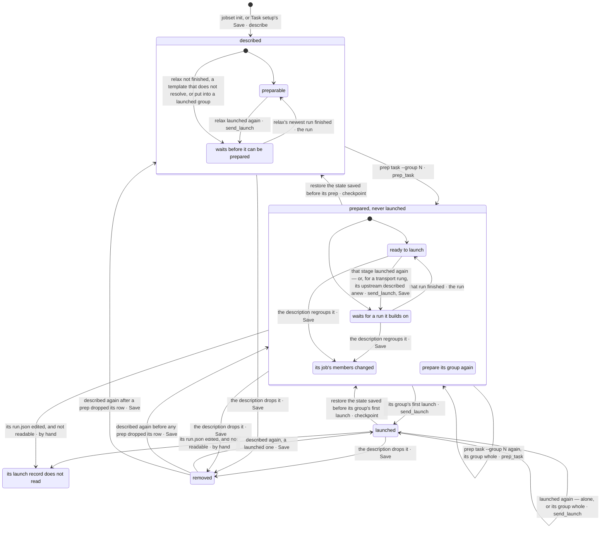

| state | what the files say | what `status` shows | what may come next |
|---|---|---|---|
| **described**, preparable | `task.json` names it; `job-set.json` holds no row for it | *described* — what its first launch will take | `prep task --group N` |
| **described**, waits before it can be prepared | the same; a force-constant stage whose `relax` has not finished — a run named with `--from` is taken as said (§ 5.4) — a template that does not resolve, or a stage put into a group that was launched without it | *described* — *waits before it can be prepared:* and why | `relax` launched and let finish, or `--from` at the prep; the template fixed; a group of its own (R-P5) |
| **prepared, ready to launch** | its row in `job-set.json`, its deck and scripts rendered **from the description as it stood when you prepared it**, its first run opened with its own files and nothing taken; every run it builds on has finished (a force-constant stage: the `relax` run its prep took, finished — or named with `--from`) | *pending* — *ready to launch* and what it takes | its group's first launch; or prepared again |
| **prepared, waits for** a run it builds on | the same, and the newest run of a stage it builds on has not finished, or is not there, or — a transport rung — did not run the deck its description gives now | *pending* — *waits for:* and what | the stage it names launched or let finish — the refusal names it; or prepared again |
| **prepared, its job's members changed** | its row's `members` lists other stages than its group holds now | *pending* — *its job's members changed:* | prepared again, every group the old job's members are in now named in the one prep (R-P6); its launch is refused, naming that prep |
| **prepared, prepare its group again** | a SIESTA force-constant stage prepared before 2.7.0, whose row records no `relax` run (`written_at`) | *pending* — *prepare its group again:* | `prep task --group N` |
| **launched** | a run of it has a `run.json`; its runs' states are the run doors' (*A run*, below) | the newest run's state, and *converged* in its own column | launched again — alone, or its group whole: warm, `--cold`, `--from` a run, `--gather` anew; never prepared again — a change goes back to the state saved before its group's first launch (*How the checkpoint supports you*) |
| **its launch record does not read** | a `run.json` there that is not one molbuilder wrote | *unreadable* — the record's own words | what the words say; nothing launches it, and no prep prepares it, until it reads (R-L21) |
| **removed** | no longer in `task.json`; its folder and runs untouched, its number taken; a launched one keeps its row in `job-set.json`, a never-launched one until the next prep drops it | not listed | described again, it is what its files say — launched, prepared while its row stands, else described |

*Ready to launch* says that what the stage takes is there. It does not compare
the prepared files with the description as it reads now — that is the
launch's own check (§ 6.0, step 1): a template value or a run card changed
after prep is refused at the launch ([R-L15](#every-refusal-and-its-way-on)),
naming the prep again.

*A group* — the stages one number holds, matched to what is prepared by its
members, never its number (`ready.GroupAnswer`):

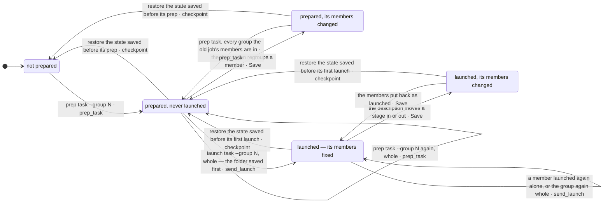

`prep task` offers every group **not prepared as described** and preparable
(`prep task`, 2); `launch task` offers every group **prepared as described, never launched**, each member's
upstream finished (`TaskState.launch_offer`). **A launched group's members are
fixed**: a stage put into it is told to take a group of its own — its prep
and the group's are refused ([R-P5](#every-refusal-and-its-way-on)) — and a
stage that leaves it, removed from the description or moved to another group,
leaves the group no longer launched whole
([R-L7](#every-refusal-and-its-way-on)): each member is launched again alone,
the members are put back, or the state saved before the group's first launch
is restored.

*A run* — one launch of a stage. On the hierarchical layout each is a folder,
`run-0`, `run-1`, …; on the flat layout each is its own numbered files in the
calculation's folder, and **no run is opened before its launch** — the flat
layout has no *opened* state:

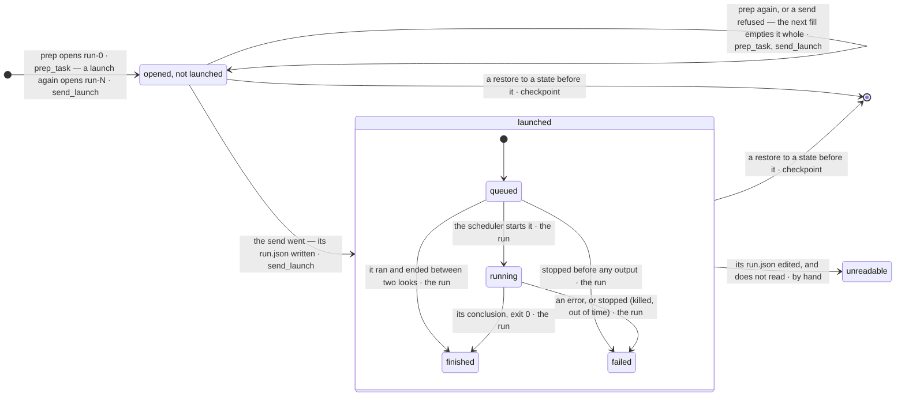

A run **opened, not launched** — prep's `run-0`, or a `run-N` a launch opened
whose send was refused — is **emptied whole** by whatever fills it next, then
filled as that act says ([`project-layout.md`](?doc=execution/project-layout.md)
§ 1.6.3). It is not yet a run in the sense of *The words* — a refused
send writes no `run.json` — but it is the stage's newest, so a stage that
builds on it waits for it (an older run never stands in), and `status` names it
with the launch that fills it: prep's `run-0`, its group's launch (a group
goes whole the first time, and a refused first send left it never launched);
a `run-N` a launch again opened — *opened by a launch whose send was refused*
— `--stage`, the stage launched again alone. A first send refused saved the
folder's state first; the next one saves it again when anything changed, and
the way back is the state saved before the first launch that went. **A run of points** (a stage that
sweeps the bias) is one run: *finished* once every point's run finished,
converged or not — the *converged* column says *SCF NO* when one did not — and
its row counts the points done.

#### The next step — every group, where it stands, and the line that moves it

*(The user, 2026-10-15: "improve the message of launch so it is clear to the
user what to do for each grouped launch" — "the current design is clear about
the first step, but unclear about the follow up"; then: "maybe this
information is best presented in the result tab where the whole task was
viewed … and give user some hint if user want to continue what's the command
to launch"; Task setup is setup, and shows no state.)*

**One answer for the whole task, from the ladder door** (`runstatus
.jobset_status`, its `steps`): every group of the description, in its order,
with its stages, a few words for where it stands, and the line that moves it
— or what it waits for, when no line can. The words are read off its members'
rows, the same rows `status` prints, so the two cannot disagree; every line is
composed by `commands`. Its wire form, in the ladder answer the Results tab
reads, is `steps: [{group, stages, state, words, lines, next}]` — the group's
number and stages, its state, its words, its lines (none when it waits), and
whether it is the next step. A group's row is the first of these that applies,
read top to bottom:

| the group's members | the group | the line |
|---|---|---|
| one not prepared, and the group preparable (`ready.prep_offer`) | **not prepared** | `prep task --group N` |
| one not prepared, and the group not preparable | **waits before it can be prepared**, and what for — a force-constant stage's `relax` | — |
| prepared in a job whose members changed | **prepared, its members changed** | `prep task --group N` |
| prepared, never launched, what each takes there | **ready to launch** | `launch task --group N`, a line for each mode the machine takes |
| prepared, never launched, a member waiting | **waits for** the run it takes — that run's stage and group, and where it stands | — |
| a run queued or running | **running** (or *queued*) | `status` |
| a run failed or stopped, or a launch record that does not read | **failed** (*stopped*, *unreadable*), naming the stage | its launch again — `launch task --stage S`, which continues from its own latest run or starts over as its job says (`relaunch_continues`), `--cold` starting it over — or its way back (§ 5.4, *A stage launched again*); for a record that does not read, its reader's words |
| every member's newest run finished | **finished** | — |

**The next step is the first group not finished**, marked *next*, its lines
under it; the groups after it each say where they stand — a waiting one, the
ready door's own reason. With every group finished, the last group says so —
and, for a calculation whose result gathers its stages, is the next step,
naming `summarize task`: one rule, asked by the step and by the verb alike
(`summarize.task_summary`: a transport calculation; a SIESTA vibration with
two or more force-constant stages). A benchmark's sweep keeps its own next
step, its own verbs (§ 7).

**Shown where the next step is asked, and nowhere else:**

- **`status`** ends with it, after the stages' table — in place of the stage
  to resume from; `status <stage>` is unchanged;
- **`launch task`** ends with it, read after what it sent — the group just
  sent *running*, or *finished* for a run here that has ended;
- **the Results tab's ladder card** draws it under the rows, read only — the
  next step's words and line, the later groups' words; the page launches
  nothing ([`web/results.md`](?doc=web/results.md) § 2.4);
- **`prep task`** keeps its own closing on both doors — the launch with
  nothing named, which sends the group that can go (§ 5.3, *One prep, two
  doors*): Task setup is where a task is set up, and shows no state.

For `AuBDTAu/transport/lowbias_local`, its device just sent:

```text
each group, and what is next:
  group 1  seed, electrode_L, electrode_R  finished
  group 2  device                          running, let it finish -- next:
           molbuilder jobset status --bundle AuBDTAu/transport/lowbias_local
  group 3  transmission                    waits for: the transmission stage consumes lowbias_local.TS.HSX from device's newest run, 04_device/run-0, which is running.  Let it finish
```

and once the device has finished:

```text
each group, and what is next:
  group 1  seed, electrode_L, electrode_R  finished
  group 2  device                          finished
  group 3  transmission                    ready to launch -- next:
           molbuilder jobset launch task --group 3 --bundle AuBDTAu/transport/lowbias_local
```

and once the transmission has finished, the last group names the summary:
*finished -- every group has; read what they gathered -- next:* `molbuilder
jobset summarize task --bundle AuBDTAu/transport/lowbias_local`.

#### `prep task`

One entry, which the terminal and Task setup's Prep both call (§ 5.3, *One
prep, two doors*); § 5.0 holds each checkpoint in full.

1. **It reads the description and shows the groups** — each with its stages,
   prepared or not, and for a stage not preparable yet, what it waits for.
2. **It asks which groups to prepare**, offering, ticked, every group not
   prepared as described and preparable — a changed one among them
   (`TaskState.prep_offer`). `--group N` answers without a terminal (repeat
   it for several), and prepares a group already prepared, never launched,
   again; with no terminal and none named, the prep is refused, naming the
   line that picks them — nothing is prepared unseen.
3. **Each group is one job.** Its members share one allocation — what they
   share is [`project-layout.md`](?doc=execution/project-layout.md) § 1.6.6's
   — and **the group's request is placed** on the queue it names, its fit
   said, as a run's is (§ 6.0). A group is matched to the description by **its
   members**, never by its number: removing a stage above it shifts numbers and
   changes no job. A pick whose groups' members changed since they were
   prepared, never launched, prepares every such group again in the same
   prep; naming only some of them is refused, naming the others.
4. **The description is checked and every picked group's members planned**
   — the machine and each member's placement, its decks planned and checked,
   and for a force-constant stage the `relax` run it is written at (`--from`
   names another) — **then the folder is saved once, and every picked group
   is written**: each stage's deck rendered now, its first run opened with the
   stage's own files, its row in `job-set.json`; each job that walks several
   members, its one header — a group of several's in the calculation's
   `launch/` folder, a run of points' walk's in its stage's, a benchmark's
   shelves' in its own. **Nothing is copied from
   another stage's run** — that is the launch's.
5. **A stage prepared and never launched may be prepared again** — it is still
   the description's: its row replaced, its files rendered again, its first
   run emptied whole and opened anew; **a group is prepared again whole**.
   **A launched stage is not prepared again** — its runs' facts are read from
   its job and its description, so they must stay what its runs ran with (*How
   the checkpoint supports you*).

Each refusal node names its row in [the refusal table](#every-refusal-and-its-way-on):

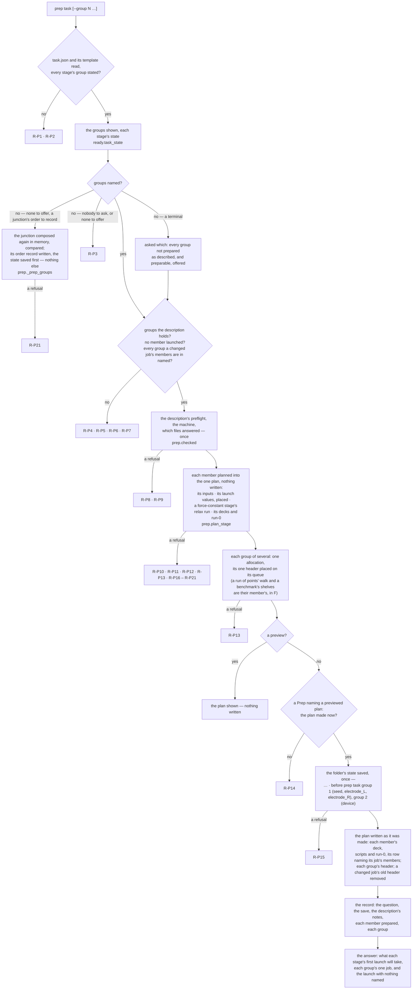

#### `launch task`

The plan, shown, asked once, sent (§ 6.0):

* **It sends the next group** — one prepared as described and never
  launched, whose every member's upstream has finished. When several can go
  it asks which (`--group N` answers), so it is one job per invocation. A
  group goes whole the first time; a member is launched alone only again.
* **At a group's first launch, each member takes what it builds on** (*What a
  stage takes, and when*). `--from` names another run, and `--cold` none, for
  an independent ladder's stage launched in a group of its own. While an
  upstream has not finished, the launch is refused before anything is sent,
  saying which and what to do.
* **The prepared stage must still be what the description gives**: at a first
  launch, and at any launch that takes inputs anew, each member's prepared deck,
  scripts, header and job are compared with what prep would write now; a
  difference is refused, naming the prep again (a stage never launched) or
  the restore (a launched one). An edit made after prep — a template value, a
  run card's ranks — never runs unsaid on another stage's new files.
* **When no prepared group can go, it offers the stages launched before**, to
  launch one again: warm by default, or `--cold` (*What molbuilder does for
  you*, 3), beside what each waiting group waits for. `--stage NAME` names one;
  `--group N` sends a launched group again whole. Launched again, a stage may
  take its inputs anew — `--from` another run, or
  `--gather` for a transport rung's upstream — decided at that launch and
  recorded; `--from` with `--cold`, and `--from` with `--gather`, are two
  answers to one question.

Each refusal node names its row in [the refusal table](#every-refusal-and-its-way-on):

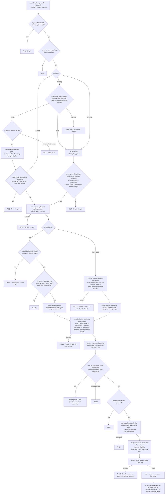

#### Every refusal, and its way on

Every refusal is written down (`jobset-decisions.log`), names the way on in
lines you can type, and comes **before anything is written** — the send's own
(R-L25, R-L35) after its save, with nothing launched. The module is where it
is decided. The command line's own usage refusals — a word where none is
taken, `--stage` twice, `--group` with `--stage`, an answer that is not a
group's number — are said where they are typed, and written down too.

| | when | the way on | decided in |
|---|---|---|---|
| **R-P1** | the folder is not a described calculation, or is one of its stage or run folders | `jobset init`; or the calculation's folder, named | `prep.read_description` |
| **R-P2** | `task.json` or its template does not read — written by an older molbuilder, or a stage with no group | its reader's words; an older one names `jobset migrate` | `task.read_task` |
| **R-P3** | no group named, and nobody to ask (not a terminal) — or none to offer, and no junction order to record (a transport calculation whose junction's sidecar states none records it instead, nothing else written: [`engines/transport.md`](?doc=engines/transport.md) § 1.1, *No group left to prepare*) | the line that picks them; each group says where it stands | `_cli._ask_which_groups`, `prep._prep_groups` |
| **R-P4** | a group the description does not hold | the groups it holds | `prep._prep_groups` |
| **R-P5** | a member of a group picked — or of a group a changed job's members are in — was launched; or the group holds a stage put beside one launched without it | the state saved before its group's first launch; for a stage put in, a group of its own | `prep._prep_groups` (`group.launched_without`, `ready.launched_already`) |
| **R-P6** | a job whose members changed has members in groups not picked | every group to pick, in one line | `group.formed_again` |
| **R-P7** | `--from` at prep with no force-constant stage among the groups picked | its first launch's `--from`, for a stage in a group of its own | `prep._prep_groups` |
| **R-P8** | the description fails its own checks — a stage sharing a group with one it builds on among them | the check's words: give it a new group — or, for an independent ladder's stage, set its run card's `restart` to `clean`, and it builds on nothing | `prep.checked` (`validation.task.preflight`) |
| **R-P9** | the machine: no record answers, or its record states no activation | the record named, or re-probed | `prep.checked` (`machine.require_activation`) |
| **R-P10** | a launch value not stated (processes; for a header, queue, wall and memory), or a queue the record does not list | the value to state, the record's queues listed with their machines and the fit of what is stated | `prep.plan_stage` (`placement`) |
| **R-P11** | a force-constant stage's `relax` run has not finished, or there is none and the structure is not stated relaxed | `relax` launched and let finish; or `--from` names a run | `continuation.continuation_answer` |
| **R-P12** | a deck's own checks refuse it; a data file it needs is missing | the check's words | `prep.plan_stage` (`prep_calculation`) |
| **R-P13** | a job that walks several members — a group, a run of points, a benchmark's shelf — whose members cannot share one allocation | the same values for each, or groups of their own | `prep.walk_header_of` (`group.envelope`, `shelves.shelf_request`) |
| **R-P14** | a Prep whose plan differs from the one previewed | preview again | `prep._prep_groups` |
| **R-P15** | the folder's state cannot be saved | the save's words | `checkpoint.save_before` |
| **R-P16** | the structure is missing, or not the one described | the structure put back, or the calculation described anew | `prep._structure_for` |
| **R-P17** | a run's GPU request disagrees with itself (GPUs used and none counted, or counted and not used) | the count stated, or no GPU | `prep.plan_stage` (`model.gpu_request`) |
| **R-P18** | a force-constant stage's `relax` run left no geometry that reads | its reader's words; `relax` launched again | `prep._vibration_stage_geometry` |
| **R-P19** | a flat calculation with more than one force-constant stage — they would share the one folder | the hierarchical layout, or one force-constant stage | `prep._siesta_vibration_rung` |
| **R-P20** | a stage the description no longer holds has a launch record that does not read | the record's own words | `prep.prep_calculation` (`materialize.ever_launched`) |
| **R-P21** | a transport calculation's junction record is not usable and a stage is launched — a launched stage's junction is never replaced; or, with no group named, its order is not found ([`engines/transport.md`](?doc=engines/transport.md) § 1.1) | the state saved before the launched group's first launch; with none launched, a prep of its groups | `transport_rung.no_usable_record` |
| **R-L1** | nothing is prepared | `prep task` for the first group | `_cli._load` (no `job-set.json`), `_cli._launch_unit` (none of the description's stages prepared) |
| **R-L2** | no prepared group can go, and no stage was launched | each group says what it waits for | `_cli._launch_unit` |
| **R-L3** | nobody to ask which — several groups could go, or none can and stages launched before are offered | one line for each | `_cli._launch_unit` |
| **R-L4** | no `--mode` and no `launch.mode`; a flag the mode does not take (`--foreground` with a queue, `--time` here) | the launch with each mode | `_cli._launch` (`_refuse_flags_without_effect`) |
| **R-L5** | the stage named is described and not prepared | its group's prep, then its launch | `_cli._refuse_unprepared` |
| **R-L6** | a stage never launched named alone while its group holds others | the group's launch | `submit._the_group` |
| **R-L7** | a launched group whose members the description changed | a member launched again alone; the members put back; or the restore | `submit._the_group` |
| **R-L8** | a group whose prepared jobs hold other members than it does now | its prep, every group named | `group.regrouped` |
| **R-L9** | `--from`, `--cold` or `--gather` on a group of several | `--stage`, for a member launched again | `submit._the_group` |
| **R-L10** | a member of the group named is not prepared | the group's prep | `submit._the_group` |
| **R-L11** | at a first launch, or a launch again with `--gather`: the newest run of what it builds on has not finished or is not there; a transport rung's upstream is not prepared, a run of points has points not done, the run did not run the same engine input as the deck its description gives now (`engines/transport.md` § 6.1) — the first difference named — or lacks the file | that stage launched, or let finish; or the restore | `ready.first_launch_takes` (`continuation`, `gather`) |
| **R-L12** | a force-constant stage with `--cold` at its first launch, or with `--from` at any launch — its run is its prep's | its prep's `--from` (on the hierarchical layout) | `ready.first_launch_takes`, `submit._launch_again` |
| **R-L13** | `--from` on a transport rung, or `--cold` at its first launch — its inputs are its kind's | `--gather`, launched again; `--cold` launched again | `continuation.cannot_be_named` |
| **R-L14** | `--gather` at a first launch, on a stage that is not a transport rung, or with `--from`; `--from` with `--cold`; on the flat layout, `--from` or `--gather`, and `--cold` at a first launch | the flag that does it, or none — a flat stage starts clean by its run card | `submit._plan_member`, `continuation.cannot_be_named` |
| **R-L15** | the prepared stage is not what the description gives now — its deck, scripts or row; a deck prepared by another molbuilder is named with that version and this one | prepare its group again (never launched); the restore (launched) | `submit._as_described` (`prep.plan_stage`) |
| **R-L16** | a group's header is not what prep would write now — edited since, or written by another molbuilder | the same | `submit._plan_group` |
| **R-L17** | launched again warm, and its newest launched run left none of the files it takes | `--cold` | `submit._launch_again` |
| **R-L18** | a run of points launched again warm, every point done | `--cold` | `submit._points_walk` |
| **R-L21** | a record of a run that does not read — its launch record, `.continued-from`, `.gathered-from` | the record's own words | each reader (`runrecord`), refused once by `submit.plan_launch` |
| **R-L22** | at the send, the folder is not what it was when planned | launch again, to see the new plan | `submit.send_launch` |
| **R-L23** | at the send, nobody to ask and no `--yes` | `--yes` | `submit.send_launch` |
| **R-L24** | the folder's state cannot be saved | the save's words | `checkpoint.save_before` |
| **R-L25** | the scheduler refuses the request | the scheduler's words; each run stays opened, not launched, and the next launch fills it anew | `submit._go` |
| **R-L26** | a group the description does not hold | the groups it holds | `submit._the_group` |
| **R-L27** | the description does not read | its reader's words | `submit._description` |
| **R-L28** | a stage on the hierarchical layout with no run open | its group prepared again, or the restore | `submit._plan_member` |
| **R-L29** | a deck rendered for other ranks or cores than its launch asks | its group prepared again, or the restore | `agreement.check_launch_matches_deck` |
| **R-L30** | launched again, the inputs gathered for its run are gone | `--gather` | `submit._carry_the_gather` |
| **R-L31** | a stage, a group, a run of points or a benchmark's shelf sent to a queue with no header — prepared with `--no-sbatch` | its group prepared again, with a header; a benchmark, the state saved before its prep | `submit._no_sbatch` |
| **R-L32** | a group's members cannot share one allocation as sent, or it holds a run of points | groups of their own | `submit._plan_group` |
| **R-L35** | the line could not be run at all | its words | `submit._go` |
| **R-L36** | a stage the description does not hold | the stages it holds | `_cli._described_stage` |
| **R-L37** | `--from` naming no run of this calculation's stages, or a run never launched — the run this launch fills, opened by a refused send, among them | a run that has run | `continuation.cannot_be_named` |

A benchmark's prep refuses as a task's, and besides: a calculation that takes
no benchmark, a stage not named, and a benchmark prepared already — its way
back the state saved before its prep (`prep.prep_bench`).

#### Worked examples

*A transport calculation*, `lowbias`, its groups the defaults — 1 1 1 2 3 —
on a workstation:

| step | you type | seed · electrode_L · electrode_R (group 1) | device (2) | transmission (3) |
|---|---|---|---|---|
| 0 | `jobset init`, or the Transport tab's Describe | described, preparable | described, preparable | described, preparable |
| 1 | `prep task --group 1 --group 2 --group 3` | prepared, ready to launch — takes nothing; the state saved first, `… · before prep task group 1 (seed, electrode_L, electrode_R), group 2 (device), group 3 (transmission)` | prepared, **waits for** seed's newest run, `01_seed/run-0`, not launched | prepared, **waits for** device's |
| 2 | `launch task` (it offers group 1 alone) | launched — one job, three runs one after another; the state saved first, `… · before launch task group 1 (seed, electrode_L, electrode_R)` | waits for seed | waits |
| 3 | — group 1 finishes | finished | **ready to launch** — takes `lowbias.DM` from `01_seed/run-0`, each lead's `.TSHS` from its run | waits for device |
| 4 | `launch task` (it offers group 2) | finished | launched — the state saved; the three files copied into `04_device/run-0`, with `.gathered-from` | waits for device's run, running |
| 5 | — the device finishes; you look at it, and change its `mixing_weight` on Task setup | finished | finished — not prepared again: to run it changed, restore the state saved before the first launch of group 2 (device), and prep anew | **waits for**: device's newest run did not run the deck its description gives now — the same restore named |

*An optimization ladder*, `coarse → medium → tight`, `tight`'s run card
`restart: clean` — its groups 1 2 2, since `tight` builds on nothing and so
shares `medium`'s job:

| step | you type | coarse (1) | medium, tight (2) |
|---|---|---|---|
| 1 | `prep task --group 1 --group 2` | prepared, ready | medium **waits for** coarse; tight ready — the group waits for its member |
| 2 | `launch task --group 2` | prepared | refused before anything is sent (R-L11): medium continues from coarse, which has not run — launch group 1; to start medium otherwise (`--from`, `--cold`), give it a group of its own first |
| 3 | `launch task` | launched, then finished | ready to launch |
| 4 | `launch task` | finished | launched — one job: medium from `01_coarse/run-0`, tight from its deck |

*A refused send*: `coarse` ran; `launch task --stage coarse --mode submit`
opens `01_coarse/run-1`, fills it warm from `run-0`, and `sbatch` refuses the
request (R-L25). `run-1` stays opened, not launched; `status` names it so and
gives `launch task --stage coarse`; medium's first launch waits for it.
`launch task --stage coarse --cold --mode submit` empties `run-1`
and sends it cold; `run-0` stays what it was.

### What molbuilder does for you

1. **Before every prep, and before a group's first launch, it saves the
   folder's state**, and tells you which — the moments and the note's form
   are [`checkpointing.md`](?doc=execution/checkpointing.md) § 9's
   (`2026-10-03 14:05:12 · before launch task group 2 (medium, tight)`). So whatever a prep or the runs after it do,
   the state before it is one `checkpoint restore` away — and the state before
   a group's first launch already holds every run that group builds on. A
   stage launched before 2.7.0, when a launch saved nothing, goes back to the
   state saved before its prep; every way back a verb prints says so.
2. **It keeps every run.** A new launch never writes into an earlier run's
   folder (hierarchical) or over its numbered files (flat): its output, logs,
   launch record and conclusion stay what they were. *On the flat layout the
   restart files are the exception, by what flat is:* they carry the label's
   name, `H2.DM`, `H2.XV`, so every run and every stage in that folder reads
   and writes the same ones — a later run replaces them.
3. **It launches any stage again, however its last run ended** — finished,
   failed, stopped, or still running — **warm by default, or cold when you say
   `--cold`**:
   * warm, it continues from **that stage's own latest run**: on the
     hierarchical layout the next `run-<n>` is opened with the restart files
     the latest one left; on the flat layout the run runs again where the
     folder's restart files lie, as the last run there left them — the run
     its record names (§ 5.4). A stage that takes nothing from a run (its run card says
     `restart: clean`) or whose kind restarts from the beginning anyway (a
     force-constant run, a PySCF vibration) starts over: nothing is handed on
     from a run of its own;
   * cold, it takes nothing from a run of its own: the next `run-<n>` is opened
     with none of them; on the flat layout its run script is started with
     `--cold --force`, which **removes** the restart files lying in the folder
     before the engine starts (a deck that reads them would otherwise read
     them);
   * either way a transport rung keeps the inputs its first launch gathered
     (the leads' Hamiltonians, the seed's density), copied with their record —
     unless you ask for them anew (`--gather`: the newest run of each rung
     upstream, under the same gates); warm, a file it carries from its own
     run stands — a device continues from its own density, not the seed's;
   * **a stage that sweeps the bias** reads "its own latest run" at the point:
     warm, each point **done** in the latest run is taken over into the new
     run and only the points not done are run; cold, every point is run
     ([`engines/transport.md`](?doc=engines/transport.md) § 2a.11).

   Before anything is sent, `launch` shows you the exact line, which run it
   follows, **how that run ended**, and what is copied — and asks once
   (§ 6.0). It does not refuse because of how a run ended, and it does not
   ask a second question about it — save that warm needs something to be warm
   from: a run that left none of the files the stage takes is refused warm,
   naming `--cold` (R-L17, R-L18).
4. **It tells you where each stage and run stands, from one check.** `jobset
   status`, the Results tab's ladder and every reader that needs a run's state
   ask the same door ([`architecture.md`](?doc=execution/architecture.md)
   § 3.2): not launched, queued, running, finished, or failed — with the reason
   the run gave, or that it stopped before its end (killed, out of time) — and,
   in a column of its own, whether it converged: `SCF yes` / `NO`, or for a
   relaxation `geometry yes` / `NO` — read from the same scan of its output,
   never folded into the state (a run can finish and not converge). A
   stage's own states — described, ready to launch, waits for, launched — are
   *The task*'s. It says what launching again would do; it does not tell you
   whether to.
5. **It writes every decision down** — what each prep and launch found, what
   each run continued from, what you were asked and what you answered — in the
   calculation's `jobset-decisions.log`.
6. **It continues a run that used up its budget only as your template says.**
   A SIESTA template's `continue_retries` (the catalogue's default is 1; set
   `0` and the run script has no retry) lets one job re-run its stage warm, as
   its next run, when the engine stopped because it used its budget without
   converging — the SCF's
   iteration limit under `SCF.MustConverge`, or a relaxation's step limit —
   never after a crash ([`running-a-job.md`](?doc=execution/running-a-job.md)
   § 3.5).

### What stays yours

* **Whether a run is good enough to use** — its convergence, its geometry, its
  physics. molbuilder reports; you judge.
* **Whether to launch again, warm or cold, and when.** Launching again while
  the last run is still running is not stopped: both run.
* **Which stages share a job, and when the next group goes.** You number the
  groups; `launch task` sends a group, by default, only once what it builds
  on has finished, and takes, by default, the newest run of what each stage builds
  on, saying which; you can name any run with `--from` (taken as said — launch
  states what it sees there, failed or not converged) or none with `--cold`
  (§ 5.4). Whether that run is worth building on is yours to judge before you
  launch.
* **Keeping a state you trust** — `molbuilder checkpoint save -m "…"` at any
  moment, and `checkpoint tag` to name it.

### How the checkpoint supports you

A launched stage keeps the deck and scripts its runs ran with, so every run's
record stays true to what ran — `prep` does not rewrite a stage once it has
been launched. **A stage prepared and never launched is changed by preparing
it again** (its group whole). To change a **launched** stage — a setting, its
resources, the machine, the run it builds on — **go back to the state saved
before its group's first launch and prep it anew**: that state holds every run
the group builds on, and the group as prepared, never launched; every run made
since that save is left behind — the group's own, what built on them, and any
other stage's launched since — and the restore names them first:

```
molbuilder checkpoint list                 # the states, newest first, each with its time
molbuilder checkpoint restore <id>         # the folder as it was before that group's first launch
molbuilder jobset prep task --group <N>    # prepared as you now want it
```

Going back is not losing: restoring a state and working from it is how you
**branch** — the state you left stays listed, and you can restore it again. Use
it the same way to try two settings side by side, to undo a stage you no longer
want, or to return to a result you tagged.

A stage you remove from the description leaves its files where they are,
untouched, and its number stays taken (`tight` stays `03_tight`); nothing lists,
preps or launches it. A launched one keeps its row in `job-set.json` — its
runs are read through it — so described again it is what it was, launched; and
the group it was launched in is no longer launched whole: its other members
are launched again alone (R-L7). To have the calculation as it was, restore a
state saved before you removed it
([`project-layout.md`](?doc=execution/project-layout.md) § 4.2).

### Use the jobset commands

These promises hold for what the `jobset` commands do. A deck or run script run
by hand, a file edited in a run's folder, a folder copied elsewhere — molbuilder
reads what it finds and says what it sees, but it did not write it and cannot
vouch for it. Use the checkpoint verbs rather than bare `git` in a calculation
folder ([`checkpointing.md`](?doc=execution/checkpointing.md) § 2.0).

---


## 1. What the job system is, and why it exists

> **Everything is a job set** *(decided 2026-08-11, user)*. One calculation is
> not a smaller, different thing than a ladder or a sweep — **it is a job set of
> one**, and it goes through these commands, not a shortcut beside them. There
> is no `molbuilder run`.

### The problem it solves

[`running-a-job.md`](?doc=execution/running-a-job.md) covers running **one**
calculation: you generate an input, the wrapper activates the right software
environment, runs the engine, and you watch it. That is the whole story for a
single task — and for a long time it was the only story molbuilder told.

Real research is not one task. A single result usually needs a **sequence** of
runs (relax a molecule loosely first, then tightly), and a project needs
**many** such sequences (the same analysis across dozens of structures). Getting
those onto a supercomputer adds its own chores: writing scheduler headers,
laying out each stage so it can start from the last one's results, carrying
restart files forward between stages, and — before any of that — figuring out
how many GPUs and CPU cores actually make a given calculation fastest on a
given machine.

Done by hand, that is a pile of error-prone shell scripting that every user
re-invents. The **job system** exists to make it a described, repeatable thing:
you say *what* you want as data, and molbuilder handles *how* to lay it out,
deploy it, and watch it — the same way whether it runs on your laptop or a
cluster. **What it does not handle is deciding that one stage should follow
another; that is yours** (§ 2, decision 6).

### The mental model, in one picture

The job system sits **above** the single-job wrapper. It never replaces the
wrapper — it produces many of them and orchestrates them.

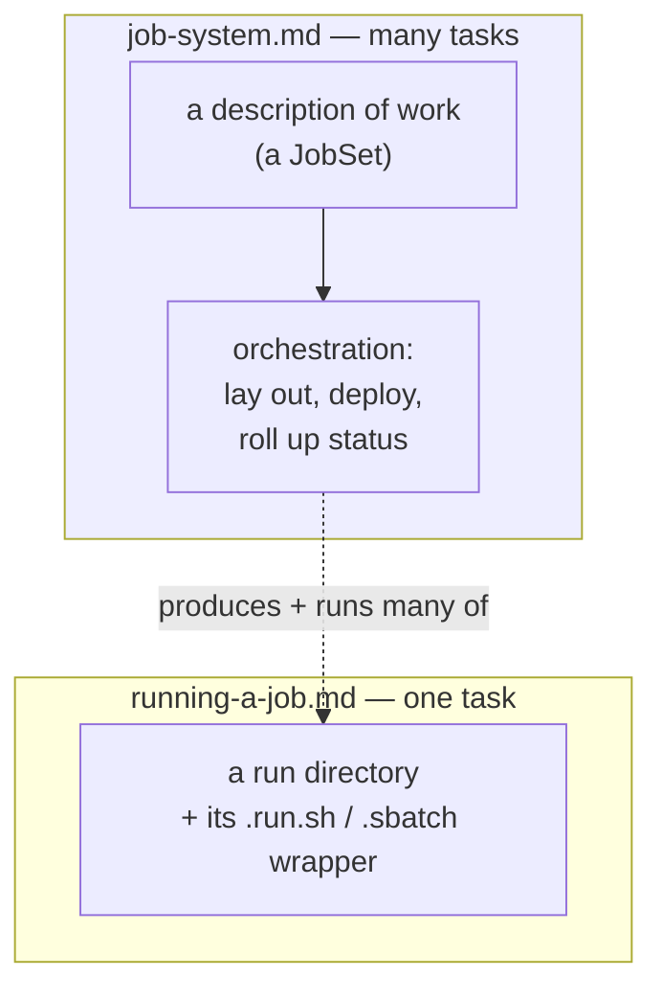

Concretely, three kinds of "many jobs" all reduce to the same object:

- a **staged ladder** — one molecule, relaxed in increasingly tight stages, each
  stage a separate job that you start once you have looked at the one before it;
- a **parameter sweep** — the same calculation run at many resource settings to
  find the fastest (this is what benchmarking is);
- a **device workflow** — the transport composite (shipped 2026-08-29):
  one CITED junction relaxation, five derived stages — the electrodes are
  DERIVED from the junction's own labeled blocks, never separately relaxed
  ([`archive/2026-09-01-transport-design.md`](?doc=archive/2026-09-01-transport-design.md) ruling Q5).

The object they all reduce to is a **`JobSet`** (§ 3).

### A one-paragraph scenario (what a user actually does)

You have a molecule `bdt.xyz` and want a publication-quality relaxed geometry on
your cluster. You run **one** command to produce a *bundle* — a self-contained
directory holding a coarse stage and a tight stage plus a `job-set.json`
describing both. You `scp` the bundle to the cluster, then work **one group at a
time**: `prep task` (lay out both stages' folders and wrappers), `status coarse` (review
its deck and resources), `launch task --group 1` (hand that one job to the scheduler). When it
finishes you **look at it**, then `launch task --group 2 --from 01_coarse/run-0` —
which copies coarse's relaxed coordinates in and submits that. You check
`status` whenever you like. You never wrote a `#SBATCH` header.

### Where it stands today (read this before the details)

> **The job system is shipped on the command line; the web describes,
> prepares and observes.** Everything in this document — the `JobSet` model,
> the `molbuilder jobset` verbs, one-job-at-a-time SLURM submission with
> routing domains, and the whole benchmark workflow — works today from a
> terminal. The web's half is the description (the Task setup tab writes
> `task.json` + the template — [`web/task-setup.md`](?doc=web/task-setup.md)),
> `prep` through the same entry the terminal calls (§ 5.3, *One prep, two
> doors*), and the Results tab; `launch` stays on the terminal **by design**:
> it spends a queue slot, one job per invocation, by hand. The Results tab shows
> `status`'s ladder (§ 5.3); a web plan view was dropped (W14, § 8).

> ### How a ladder advances
>
> **You prepare the groups, launch one, look at what it produced, and launch
> the next.** Nothing starts a stage but a person — there is no flag and no
> field that makes one follow another (§ 2, decision 6).
>
> What a stage continues from is a **real file, copied in at its first
> launch** — by default from the newest attempt of the stage before it, which
> must have finished, or from a run **you name** (§ 5.4). By then it has
> finished and you have read it, so there is nothing to resolve later and
> nothing pointing at a file that does not exist.
> That is a ladder of **independent** stages; in a **linked** one — a
> vibration's `freq`, transport's device and transmission — the first launch
> takes a stage's input from the stages before it, because the calculation
> fixes it; a force-constant stage's deck is written at its prep, at the
> `relax` run it builds on (§ 5.4).
>
> | | |
> |---|---|
> | Who starts stage 2 | **you**, after looking |
> | How stage 1's geometry arrives | a **file copy**, made at stage 2's first launch from stage 1's newest attempt, or the one you name |
> | If stage 1 converged to something wrong | you never launch stage 2 |
>
> The earlier scheduler-chained design is recorded in
> `archive/2026-08-10-stage-chaining.md`.

---

## 2. The design logic — why it is built this way

Six decisions shape everything below. Understanding them makes the rest obvious.

**1. Describe work as data; keep the engine out of it.** A `JobSet` is a plain
data object (a JSON file), not code. Producers turn engine configs *into* a
`JobSet`; the orchestration verbs (`prep`/`launch`/`status`) operate on
the `JobSet` **without knowing or caring which engine it targets**. This is why
one small set of verbs can drive SIESTA ladders and benchmark sweeps alike, and
why adding a new engine later means writing one new *producer*, not a new
orchestrator.

**2. Reuse the single-job wrapper unchanged.** The job system does not invent a
new way to run a job. Each job in a `JobSet` is launched by exactly the
`.run.sh` / `.sbatch` wrapper from
[`running-a-job.md`](?doc=execution/running-a-job.md), built by the same
function. So everything true of a single run — env routing, warm/cold restart,
GPU pinning, the monitor — is automatically true of every job in a batch. The
framework adds *orchestration around* the wrapper, never *inside* it.

**3. The machine's knowledge lives on the machine, not in the user's head
("target isolation").** The bundle you produce on your laptop is
target-agnostic. The cluster-specific facts — which activation command, how many
cores a node has, which partition — are resolved on the **target** at `prep`
time and baked into the scripts there. You do not need to know the cluster's
layout to submit to it.

**4. Fail early, never guess.** A malformed `JobSet` — duplicate job names, an
unknown `kind`, a warm-file condition naming a trait the job never declares, a
missing partition — is rejected at produce/validate time with a clear message,
not discovered halfway through a cluster run. The framework refuses to emit an
incomplete SLURM header rather than submitting something that will bounce.

**5. molbuilder informs; the user decides.** The framework never silently
auto-resumes a failed or interrupted run. `status` tells you which stage is
incomplete and what restart files exist; **you** choose to re-submit. This keeps
a surprising re-run from quietly overwriting hours of results.

**6. The order is a person's, not the data's.** Every job in a `JobSet` is
independent as far as the framework is concerned: **nothing in a `JobSet` says
"start this one after that one."** A *ladder* and a *sweep* differ in how their
directories are named and whether a person is meant to take them in order —
neither waits for the other.

**Why the ordering lives with the person.** Whether stage 2 should start is a
judgement about stage 1's result, and nothing in the data can make it. A stage
is a long job; one that continues by itself can spend a week refining a geometry
you would have rejected in a minute. So the order lives where the judgement
lives — every group may be prepared at once, and one `launch` sends one job.

**What this costs, stated plainly.** A branching graph (a "diamond", for a
two-electrode device) has no representation. If one is ever needed it comes back
as something a person asks for at launch, never as a field a description stores.

---

## 3. The data structure — a `JobSet`, piece by piece

A `JobSet` is the whole description of a batch, saved as `job-set.json`
(`molbuilder/jobset/model.py`, schema `molbuilder/job-set@1`). It is deliberately
small — five concepts:

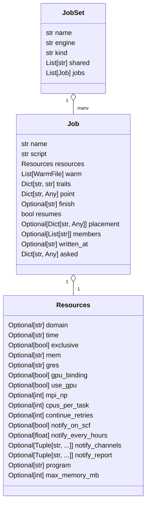

*(The diagram is the dataclasses' fields, regenerated 2026-10-18 — `jobset/model.py`; a job carries every key of `JOB_KEYS` every time, § 6.1, and `Job.from_dict` refuses one that lacks any.)*

**There is no edge anywhere in this picture.** No job names another job. That is
decision #6, and it is the single most important thing about the shape.

Walk through it with the *why* for each piece:

- **`JobSet.kind`** is `"ladder"` or `"sweep"`. **Both are sets of independent
  jobs**; the kind says how their folders are named and whether they have an
  order a *person* should follow — a ladder's stages are meant to be run in
  sequence, a sweep's points are not. It does **not** mean one job waits for
  another: neither does. The kind drives the directory convention
  (`<seq>_<name>` versus `bench/bench-<point>` inside the stage it measures,
  `job-contracts.md` § 6.3) and nothing about scheduling.
- **`JobSet.shared`** lists files that every job needs but that never change
  between jobs — the pseudopotentials and the geometry. (A deck written from
  a sorted copy states its own order record, so none travels beside it:
  `model/overview.md` § 2.2a, I5.) (The monitor travels beside each wrapper
  instead, `run-reports.md` § 2.3, and so does a job's finish.) They
  are **copied** into each job's folder as real files (user, 2026-08-24): a run
  directory holds everything it needs, and a link holds nothing
  ([`project-layout.md § 1.0`](?doc=execution/project-layout.md)).
- **`Job.finish`** names the bundle the wrapper runs after the engine when the
  engine alone leaves no result — a SIESTA force-constant stage's
  `mb_vibration.pyz` (`engines/vibration.md` § 5.5) — copied from the deck's
  spec and born beside the job's deck; absent for every other job and for a
  benchmark trial.
- **`Job.resumes`** says whether a re-run of the job continues from what the
  last one left — the rung's own kind's warm-files fact
  ([`job-contracts.md`](?doc=execution/job-contracts.md) § 4.2a), false for a
  SIESTA force-constant stage — and the wrapper reads it for every text that
  speaks of a retry; absent from `job-set.json` when true.
- **`Job.name`** does double duty: it keys the job's folder *and*
  its scheduler job name (`-J`), so a `squeue` listing reads the way the layout
  does. **`Job.script`** is the input file inside that folder.

  > **The naming splits**: a **stage** is
  > `<seq>_<stage>` (`01_coarse`) because a stage is ordered; a **trial** is
  > `bench-<point>` inside its stage's `bench/` container, named by its
  > settings because a sweep has no order. The full table, for every layer,
  > is [`job-contracts.md`](?doc=execution/job-contracts.md) § 6.3.
- **`Job.resources`** (`Resources`) are the per-job scheduler asks — all optional,
  `None` meaning *unstated*, which nothing fills in: a launch value stated
  nowhere is refused ([`architecture.md`](?doc=execution/architecture.md)
  § 5.2). They use the **scheduler's
  vocabulary** (`mpi_np` for MPI ranks → `-n`; `cpus_per_task` for cores/rank →
  `-c`; `time`, `mem`, `gres`, `exclusive`, `domain`), the same names the
  persisted files and SLURM flags use — the full mapping is pinned in
  [`job-contracts.md § 6.2`](?doc=execution/job-contracts.md). Per-job resources
  matter because a coarse first stage and a tight final stage want very
  different node sizes.
- **`Job.warm`** (a list of `WarmFile`) is what this job would take **from
  whatever run it is continued from** — not from a named job. `name` is a
  concrete filename; `requires_same` names a key both runs must agree on for the
  file to mean anything, looked up in `Job.traits`.

  > **It says WHAT, never FROM WHOM**, and that is the whole design. Which
  > run this job is continued from is decided at its first `launch` — the
  > stage before it, newest, by default, or a run a person names with
  > `--from` (§ 5.4) — so the producer, which runs long before anyone has
  > looked at anything, is not asked to know.
  >
  > `.CG` is why `requires_same` exists: a conjugate-gradient history is
  > meaningless to a Broyden stage, so carrying it blindly corrupts the restart.
  > SIESTA puts its optimizer in `traits`; the framework compares two strings
  > and knows nothing else about either engine.

- **`Job.traits`** are opaque per-job strings a `requires_same` is compared
  against. The framework never interprets them.

Every `JobSet` is checked by **`validate()`** before it is used: the `kind` must
be known, names unique, and every `WarmFile.requires_same` must name a trait the
job actually declares — a condition on a key that is not there is a condition
that can never be tested, so it is refused rather than silently ignored.

### 3.1 A real `job-set.json`, field by field

Descriptions of a format are easy to nod along to and hard to check. Here is an
actual two-stage ladder for benzene-dithiol on gold, with every field annotated:

```jsonc
{
  "schema": "molbuilder/job-set@1",   // versioned: a reader refuses a major it
                                      // does not know, rather than guessing
  "name":   "bdt_au",                 // the calculation's id — also the SIESTA
                                      // SystemLabel every deck shares
  "engine": "siesta",
  "kind":   "ladder",                 // how the folders are named + whether a
                                      // PERSON should run them in order.  Neither
                                      // kind makes one job wait for another.

  "shared": ["C.psml", "H.psml", "S.psml", "Au.psml"],
                                      // copied into every job's folder,
                                      // as real files

  "jobs": [
    {
      "name":   "coarse",             // → folder 01_coarse/ AND squeue -J bdt_au/coarse
      "script": "bdt_au_01_coarse.fdf",  // the deck, in the bundle root.  The
                                      // TOKEN in this filename is where the
                                      // directory's `01` comes from -- it is
                                      // read back off the deck, never counted
                                      // (decision 27).  A ladder job whose
                                      // script carries no token falls back to
                                      // `bench-<name>`, because inventing a
                                      // seq would be guessing at the one
                                      // number that must never be guessed.
      "resources": {                  // EVERY field is always written; the
                                      // count lives in job-contracts.md
                                      // § 6.2 and nowhere else
        "domain":        null,        // nulls included — see the note below
        "time":          "0-04:00:00",
        "exclusive":     null,
        "mem":           null,
        "gres":          null,
        "mpi_np":        8,
        "cpus_per_task": 4
      },
      "warm":   [],                   // takes nothing from an earlier run --
                                      // starts from the .fdf's own coordinates
      "traits": {"optimizer": "CG"}   // opaque; only compared against another
                                      // job's, never interpreted
    },
    {
      "name":   "tight",
      "script": "bdt_au_02_tight.fdf",
      "resources": {
        "domain":        null,
        "time":          "1-00:00:00",
        "exclusive":     null,
        "mem":           null,
        "gres":          "gpu:1",
        "mpi_np":        32,          // 4× the ranks: the tight stage is the
        "cpus_per_task": 4            // expensive one, and per-job resources
      },                              // are the whole reason they are per-job
      "warm": [                       // WHAT it would take from a run it is
                                      // continued from -- never WHICH run.
        { "name": "bdt_au.XV" },                            // relaxed geometry
        { "name": "bdt_au.DM" },                            // density matrix
        { "name": "bdt_au.CG",                              // optimizer history
          "requires_same": "optimizer" }   // ...only if both used the same one
      ],
      "traits": {"optimizer": "CG"}
    }
  ]
}
```

*(Abridged from a dump of that `JobSet`'s `to_dict()`: the key order and the
value forms are the real ones — a time is SLURM's `D-HH:MM:SS` — and a real dump
writes every `Resources` field, null or not; job-contracts § 6.2 counts them.)*

> **`null` is a value here, and it does not mean "zero" or "off".** It means
> **unstated**, and prep never leaves a launch value the job needs unstated: a
> missing rank count, cores per rank or GPU count — and, on a target with a
> scheduler, a missing queue, wall or memory — is refused at prep
> ([`architecture.md` § 5.2](?doc=execution/architecture.md)). What stays `null`
> is what this job does not use. A `mem` of `"0"` is SLURM's *"give me the
> whole node's memory"*. The fields are written out even when null so the file
> shows you the complete set of questions that will be answered, rather than
> hiding the ones nobody answered yet. This is the *assistant, not nanny* rule in
> file form: molbuilder does not quietly pick a node size for you.

**What that file becomes on disk.** `molbuilder jobset prep` reads it and lays
out the tree — drawn, for both shapes, in
[`project-layout.md § 1.1`](?doc=execution/project-layout.md), which owns it.
Every job's folder holds **real copies** of its inputs, never links.

> ⚠ **The root drawn below is the *calculation* directory**
> (`projects/<project>/<topic>/<calculation>/`), not a folder of its own. The
> *bundle* and the calculation are the
> same directory, and **`calculation` is the name that wins** — `task.json` is
> the source and `job-set.json` is derived from it, so naming the folder after
> the derived file names it after something you can delete and regenerate. The
> reasoning is [`project-layout.md § 1.0`](?doc=execution/project-layout.md); the
> `-bundle` spelling is kept in the trees below only because it is what the code
> writes today.


**Nothing in `02_tight/` exists until you prepare it.** `prep task` lays out
each picked group's folders, their wrappers and each stage's `run-0`,
holding the stage's own files; a stage's first `launch` copies in what it
continues from — by default the newest run of the stage before it, which must
have finished, or the run `--from` names (§ 5.4). So tight's `run-0/` may sit
prepared beside coarse's, and receives coarse's files only **after** you have
run coarse, looked at it, and launched tight.

> **A SWEEP's tree differs in two ways**: its folders are named by their
> **settings** rather than by a position (its points have no order, so no
> ordinal), and a point's attempt is a measurement, made once — a trial is
> launched once; measuring it again is the state saved before the
> benchmark's prep, restored, and a prep anew
> ([`project-layout.md § 1.5`](?doc=execution/project-layout.md)). Nothing is
> copied between points.
>
> ```text
> bench-G1K2C4/        ← G<gpus>K<ranks-per-gpu>C<cores-per-rank>,
>                        named by its SETTINGS, not a position;
>                        its deck, wrapper and pseudopotentials are its own
> ```
>
> **The prefix is `bench-`, and a described trial lives in
> its stage's `bench/` container** — `<NN>_<stage>/bench/bench-<point>/`
> ([`job-contracts.md § 6.3`](?doc=execution/job-contracts.md), the
> cross-layer authority). `summarize` maps a trial
> back to its point through the job-set's own data, never by parsing the
> directory name.

**Nothing dangles, because nothing points anywhere**: every file in a job's
folder is its own. **No job's directory reaches into another's.**

What a stage continues from is copied by its first `launch task --group 2` — by
default out of the newest attempt of the stage before it, which must have
finished and which you have already looked at, or out of the one `--from`
names (§ 5.4):

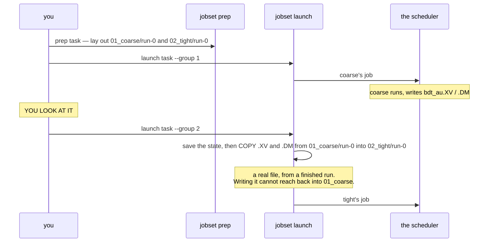

**The copy is the thing a person can check** — it is a real file, present
before the stage starts, from the run `launch` said it took (§ 5.4).

A `job-set.json` is written by `JobSet.to_dict()` and nothing abbreviates it: every job carries every key of `JOB_KEYS` (`name`, `script`, `resources`, `warm`, `traits`, `point`, `finish`, `resumes`, `placement`, `members`, `written_at`, `asked`) and `Job.from_dict` refuses one that lacks any, naming it (`WrittenBefore`). *(An abbreviated "complete" example stood here until 2026-10-18; a file written from it was refused, so it is gone — read a real one, which every `prep` writes.)*

Read it back in plain language: *a SIESTA ladder named `bdt`; four
pseudopotentials are shared by both stages; stage 1 runs on the
`htc` domain for up to 4 hours; stage 2 runs on the `public` domain with 64 GB
of memory, and **if you continue it from something**, it will take that run's `.XV`
coordinates and `.DM` density matrix — plus its `.CG` optimizer history, but
only if that run also used CG.*

**Notice what the file does not say: when stage 2 runs, or after what.** It
cannot. Both jobs are described, neither is scheduled, and the order is
something you carry out one command at a time.

---

## 4. Where `JobSet`s come from — derived at `prep`, from the description

A `JobSet` is never written by hand — and it is never emitted *beside* the
description either. **`prep`, on the target machine, derives it from the
description** (the template + `task.json`, floor 2) as part of its five steps
([`project-layout.md § 2.3.1`](?doc=execution/project-layout.md)): step 2
resolves the description against this machine into a `ParameterSet`
(`molbuilder/resolve.py`) — **always a list**, a production run being the list
with one element and a benchmark the same list with N
([`generator.md § 5`](?doc=execution/generator.md)) — and steps 3–5 render one
deck and wrapper per element and write the plan down. The root `job-set.json`
is the RUN plan, merged per stage and never overwritten; a sweep's own record
lives in the stage's `bench/` container (`job-contracts.md` § 6.1).

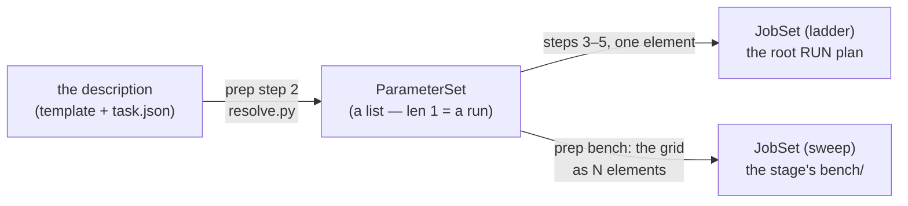

> **This section was titled "the two producers" until 2026-08-12** and walked
> `stages_to_jobset` (the SIESTA ladder) and `sweep_to_jobset` (the benchmark
> grid) as today's builders. Both were **deleted in the 2026-08-12 fold** (plan
> step 6 u5), along with `build_siesta_stage_bundle` and `bench/to_jobset.py`:
> they took an in-memory config assembled from CLI flags and emitted the
> `JobSet` *beside* the description instead of deriving it *from* it — the one
> defect the 2026-08-11 source read named (*every floor writes its artifact
> and reads none*). The engine knowledge they held did not vanish: what a
> SIESTA stage *is* still lives in `molbuilder/siesta/stages.py`, consumed by
> `prep`'s engine seam instead of by a producer.

### 4.1 The SIESTA staged ladder

`molbuilder/siesta/stages.py` holds SIESTA's stage knowledge — the shipped
ladder (`default_siesta_stages`), what a stage's warm restart means, and the
traits a warm condition is compared against — consumed at `prep` through the
engine seam (`jobset/engines.py`): one job per stage of the description's
ladder, script `<label>_<NN>_<stage>.fdf`. An engine config carries no stage
list, so the ladder lives in `task.json`, never in the config
([`engines/stages.md`](?doc=engines/stages.md)
§ 1.1). Three things are *derived*, and each encodes a design decision:

- **A stage that runs out of steps without converging simply stops**, and you
  decide what to do about it — which is what you were doing between stages
  anyway.

  > **PySCF was different while its ladder ran as a loop inside one process**
  > (§ 4.2): its `on_nonconvergence` was ordinary control flow in the emitted
  > script, where SIESTA's stages are separate jobs started by a person and so
  > have no equivalent for it to control.
  >
  > ⚠ **The asymmetry is retired 2026-08-18**
  > ([`stages.md § 1.1a`](?doc=engines/stages.md)): both engines run N decks as
  > N jobs, so what happens after a rung fails to converge is once again the gap
  > between two jobs for both of them.
- **The warm-file declaration is chosen for correctness, not convenience.**
  Each stage declares what it would take from a run it is continued from — and
  **a stage whose description says `restart: clean` declares nothing at all**,
  because it is not continuing from anything. For a continuing stage, `.XV`
  (coordinates) and `.DM` (density matrix) are unconditional; `.CG`
  (conjugate-gradient optimizer state) carries `requires_same: "optimizer"` —
  a CG state is meaningless to a Broyden stage, so carrying it blindly corrupts
  the restart. The comparison is made at the launch that takes the files,
  between **this stage and the attempt it continues from** — by default, or
  named with `--from` — over each one's resolved config.

  > **What changed, and why the old rule could not survive `--from`.** It
  > compared *consecutive* stages in the ladder — which silently assumed the
  > previous rung is what this one continues from. Once you name the source
  > yourself, that assumption is simply false: `launch task --group 2
  > --from 01_coarse/run-2` may continue a stage two rungs back, or an earlier attempt
  > of this same stage. So the comparison moved to the pair that actually
  > matters.
- **Resources are per-stage** — each stage's run card (`execution`) states its
  own over the calculation's, and nothing is filled in
  ([`architecture.md` § 5.2](?doc=execution/architecture.md)) — so a coarse
  stage and a tight stage can be sized differently.

**The shipped default ladder** (the *structure*; the *values* and their
scientific rationale live in [`engines/tuning.md`](?doc=engines/tuning.md)):

| Stage | Enabled by default | Relaxation | Steps |
|---|:--:|---|--:|
| coarse | ✅ | CG | 600 |
| medium | ✅ | Broyden | 200 |
| tight | — | Broyden | 100 |

*(The rows said `stage1/2/3` — positional names the P4 rename retired;
the shipped ladder names its rungs `coarse` / `medium` / `tight`.)*

*(Whether to go on after a stage runs out of steps is a question you answer by
looking at it.)*

The three **strategy presets** flip only the enable flags:
`loose-only` = (✅, —, —), `publishable` = (✅, ✅, —),
`vib-quality` = (✅, ✅, ✅).

**The warm-retry budget now travels the whole way** (fixed 2026-08-07).
`continue_retries` rides `jobset.Resources` on the resolved element — the same
road every machine-side value takes since the fold — and `jobset/prep` hands it
to `write_run_wrapper`, which bakes it into the wrapper's own retry loop
(`?doc=execution/running-a-job.md` § 3.5). It becomes **no `sbatch` flag**,
which is why it is the one row of `job-contracts.md § 6.2`'s translation table
with no SLURM name. *(Until 2026-08-12 this sentence named `stages_to_jobset`
as the carrier and called the field "an ordinary field of the shared schema" —
the producer died in the fold, and the machine facts left floor 2 with it:
the budget is part of the allocation `resolve.py` puts on the element, not of
the template.)*

**The retries happen inside the one job the scheduler ran.** `continue_retries`
is a loop in a single job's wrapper — it is not a between-jobs mechanism, and
`job-contracts.md § 6.2` marks it as the one row of the translation table with
no SLURM name.

> **`on_nonconvergence` is a PySCF field.** `engines/stages.md` § 3 keeps it out
> of the shared stage schema: it controls a loop inside one emitted script, and
> SIESTA has no such loop to control.

### 4.2 The benchmark sweep

`jobset prep bench <stage>` builds a **sweep** — one independent job per point
of a `(GPUs, ranks-per-GPU, cores-per-rank)` grid enumerated from *this*
machine's probed topology (`molbuilder/bench/grid.py::sweep_grid`), handed to
the same five steps as a longer `ParameterSet`, **nothing carried between
points** (they do not depend on each other, and never did — this is why the
sweep was never a reason to keep the edge machinery). Because a sweep is just
another `JobSet`, the same `jobset` verbs run it — benchmarking is not a
separate machine, it is `prep` whose parameters are a set rather than a point
([`project-layout.md § 2.3.1a`](?doc=execution/project-layout.md)). *(This
heading named `bench/to_jobset.py::sweep_to_jobset` as the builder until
2026-08-12 — deleted with the fold, § 4's note.)*

> **Both engines' ladders are the same object** — N decks, N jobs, a person
> looks between the rungs ([`stages.md § 1.1a`](?doc=engines/stages.md)).
> *(PySCF's ran as an in-script loop inside a single `.py` until 2026-08-18 —
> genuinely a different object then: its stages advanced in memory while
> SIESTA's advanced because a person prepared the next one. The loop is
> retired; the history and the reasoning live in § 1.1a.)* The spectra and
> transport producers migrated too (2026-08-21 / 2026-08-29 — `archive/2026-09-01-roadmap.md`'s
> migration box records both).

---

## 5. The workflow — init, prep, launch, summarize, status

**One verb on the host** (where you design the calculation) and **four on the
target** (where it runs). They mirror the design: the host step writes files and
nothing else, and scheduler contact happens only at `launch`.

| where | verb | what it does |
|---|---|---|
| **host** | `init` | write the portable description — § 5.1 |
| target | `prep` | the groups picked: resolve this machine, render each stage's deck and wrapper, open its first run with its own files |
| target | `launch` | send **one** job — a group, or one stage again — `--mode direct` or `--mode submit` |
| target | `summarize` | summarize results that exist: a benchmark's trials into a verdict; a transport calculation's bias points into its I–V record; a SIESTA vibration's force-constant stages into its displacement sweep (`engines/vibration.md` § 5.9). Never a run's own result — every run writes that itself (§ 5.5 there) |
| target | `status` | every stage of the description, where it stands, and the next step, every group's line (*The task*); with a stage, that stage in full |

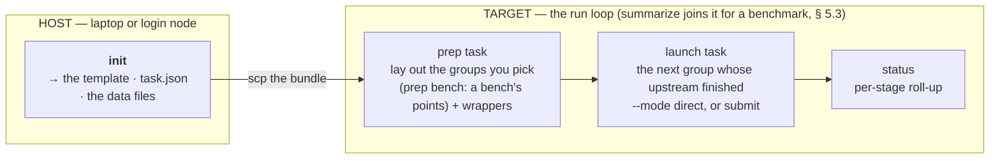

### 5.0 The prep protocol — the agreement, and every checkpoint in order

> **This is the one statement of the protocol.** What follows in § 5 — and the
> documents linked from each row — says how each step works; this section says
> what it is, in order, and who decides what. Both doors run it — the command
> line's `jobset prep` and Task setup's **Prep** (the task's) / **Prep bench** —
> through one entry, `jobset/prep.py::prep_task` (§ 5.3, *One prep, two doors*).

#### Before prep: a described calculation

A calculation is described **once**, and prep only ever reads that description.

| | what happens | what is refused |
|---|---|---|
| **the hand-over** | a parameter tab sends its work to Task setup: the structure pair, the template and `task.1st.json` — a description still missing what only you can say ([`web/handover-procedure.md`](?doc=web/handover-procedure.md)) | — |
| **the description** | Task setup shows what came over and what is still needed; you complete it and save: `task.json` is written beside the template, and `task.1st.json` is removed ([`web/task-setup.md`](?doc=web/task-setup.md) § 2, § 8). From the command line, `jobset init` writes the same pair (§ 5.1) | a folder holding **another** calculation's `task.json` (Task setup § 2); `jobset init` on a folder already described — change it in Task setup or in `task.json` |
| **changing it later** | Task setup opens a described calculation **as it is** — the file is loaded, never merged — and saves what you change, the folder's state saved first, always and said (`checkpoint.save_before`, the function prep calls; [`checkpointing.md`](?doc=execution/checkpointing.md) § 9; Task setup § 8) | what the calculation **is** — its name, engine, structure and label — is read-only there (Task setup § 3); its shape is fixed once it has produced (§ 4 there) |

#### The agreement

1. **You state; molbuilder checks.** Every value a run is launched with — its
   ranks and threads, a GPU run's GPU count (asked of the scheduler; with none,
   the run spreads over the GPUs it is given, [`gpu.md`](?doc=execution/gpu.md)
   § 1.1), and where a `.sbatch` is written its queue, wall and memory — is
   stated by you, in the description or on the command line
   ([`architecture.md`](?doc=execution/architecture.md) § 5.2 lists them). The
   target's record **checks** each one and supplies none.
2. **You choose the machine, once.** A calculation is set to the machine of its
   first prep, and that does not change; preparing it for another machine is a
   new prep from a saved state ([`configuration.md`](?doc=configuration.md)
   M-3). Prep never measures a machine: its record is there, or prep refuses
   and prints the probe that writes it.
3. **Everything is decided before anything is written**. Prep first makes its whole plan — every check, every value,
   the text of every file, every folder and what goes into it — with nothing
   written in the calculation (checkpoints 1–4b; a transport junction's
   record is round-tripped through its codec in a scratch folder outside it,
   [`script-preparation.md`](?doc=execution/script-preparation.md) § 3.0). A
   refusal can only come from there, and it
   writes nothing but its line in the ledger, so there is nothing to put
   back. Then the folder's state is saved (5); then the plan is written, which
   decides nothing and refuses nothing (6). Every refusal says why in your
   words and names what to do.
4. **A launched stage is not prepared again — a redo is a rollback** *(user,
   2026-10-02: "refuse it, redo via rollback")*; a stage prepared and never
   launched is prepared again, its group whole — the rule and its way back
   are *How the checkpoint supports you*'s. So that the states are there, the
   folder's state is saved before every prep and before a group's first
   launch, and each tells you (checkpoint 5; § 6.0, step 4;
   [`checkpointing.md`](?doc=execution/checkpointing.md) § 9 holds the
   moments and the note).
5. **You advance it, a group at a time.** Prep prepares the groups you pick
   (*The task*, `prep task`, 2); `launch` starts one group's job once what it
   builds on has finished, and shows it before sending it; nothing starts a
   stage but you (§ 5.3, *Three ideas*).
6. **Every decision is written down** — each check that refused, each
   question and its answer, what each stage continues from — in the
   calculation's `jobset-decisions.log`.

#### The checkpoints, in order

| # | checkpoint | passes when | otherwise |
|:--:|---|---|---|
| | ***the plan — nothing is written*** | | |
| 1 | **a described calculation** | the folder holds `task.json` and its template — the one template, named for the label | refused: `jobset init` first — or, from one of its stage or attempt folders, the calculation's own folder named |
| 2 | **the groups picked** | the groups shown (*The task*, at the top); the groups picked — `--group N`, repeatable, or the answer to the question — each one the description holds. Each group is one job, its members sharing one allocation ([`project-layout.md`](?doc=execution/project-layout.md) § 1.6.6) — checked with its header at 4b; that no member builds on another is the description's own check, at 3 ([`engines/stages.md`](?doc=engines/stages.md) § 6.6). For `prep bench <stage>`, the stage named, a calculation the benchmark can measure, and no `--from` (a trial starts from its deck: the structure, or a force-constant stage's relaxed geometry, § 5.4) | refused, naming the groups and the line that picks them |
| 2a | **not launched** | the calculation's plan holds no job for the group's stages, or holds them **never launched** — prepared again, the group whole (its rows replaced, its files rendered again, its first runs emptied); for `prep bench`, the stage's bench folder holds no sweep (one door, [`architecture.md`](?doc=execution/architecture.md) § 3.2) | refused: a launched stage is not prepared again — the refusal names the way back (*How the checkpoint supports you*) |
| 3 | **the description's own checks** — the preflight ([`engines/stages.md`](?doc=engines/stages.md) § 6.6), once per prep (`prep.checked`) | no error | refused, with the errors; warnings are shown and carried in the answer |
| 4 | **the machine, and the job's placement** — the record read once per prep (`prep.checked`), each member placed by the one member planner (`prep.plan_stage`) | the calculation's own copy of its machine's record answers — or, at its first prep, the record of the machine you named (`--target`; the machine you are on when none other is on file); it says how a shell enters an environment there; the stage resolves — its parameters and the job they make, once ([`script-preparation.md`](?doc=execution/script-preparation.md) § 3.0, steps 1–2: the record, the description and the template each read once, and every step after reads what was read); every launch value is stated; and a run is **placed** on the queue it names, its fit on the target's record printed — wall, memory, ranks, cores, GPUs — and never refused for it (`placement.placed`, § 6.0, *the placement*; `scheduler.md` R6). A benchmark states its queue, wall and memory before its grid is enumerated; the cells it proposes are those a node of that queue holds, and the cells declared are kept, each with its fit ([`generator.md`](?doc=execution/generator.md) § 4.3a) | refused, naming what is missing: which machine, when several are on file and none is named; the probe that writes a record; the machine the calculation is set to; the setting that does not resolve; the file and key where each value is stated; a queue the record does not list |
| 4a | **a value hand-over** (§ 5.4) — a force-constant stage only: the `relax` run its deck is written at, one `Continuation` | `relax`'s newest attempt, which finished (the status door's answer: exit code 0, and its output saying no stop) — or the `relax` run you name with `--from` ([`engines/vibration.md`](?doc=engines/vibration.md) § 5.2a's table). **Every other stage's hand-over is files, taken at its first launch** (§ 6.0): prep reads no other stage's run | refused, naming what to do: launch it, let it finish, or name another run |
| 4b | **the steps, planned** — the machine's copy, the structure, the decks, the wrappers, the directory ([`script-preparation.md`](?doc=execution/script-preparation.md) § 3) | the structure loads and matches what was described; the data files are there; every deck passes its two gates — **validate** the resolved values, and **check** the text exactly as it will be written, the reader's own section merged in; every wrapper renders; the plan's new row merges; the run and what it receives are known — every member of the groups picked planned into **one plan** by the one member planner (`prep.plan_stage`), in the ladder's order, each seeing what the members before it plan (their rows in `job-set.json`); each job that walks several members, its one request placed on its queue, its fit said, and its header in the plan too (`prep.walk_header_of`) — a group of several, its members sharing one allocation, the walls summed and the largest memory (`prep.group_header`); a run of points, one job walking every point, their walls summed; a benchmark's shelves, each its trials' shared request (`shelves.shelves_of`); a kind's own steps pass (a transport junction composed, a relaxed geometry read) | refused: the first that fails, in its own words |
| | ***the save*** | | |
| 5 | **the save** ([`checkpointing.md`](?doc=execution/checkpointing.md) § 9) | the folder's state is saved, always, once the whole plan stands: a new state when anything changed since the one it stands at — its first when it has none — its note led by the time it was taken (`2026-10-03 14:05:12 · before prep task group 1 (coarse), group 2 (medium)`); nothing new when nothing changed, and the state it stands at is named. Both doors say which | refused when the state cannot be saved: that state is the one a redo restores |
| | ***the writing — nothing is decided*** | | |
| 6 | **the plan written** | the one plan, as it was made — nothing is planned again: every file of the plan; each stage's first run opened ([`project-layout.md`](?doc=execution/project-layout.md) § 1.6.2) with the stage's own files — nothing from another stage's run, which its first launch copies in; at the calculation's first prep, its copy of the machine's record, naming the machine; the pipeline log; `job-set.json` last — the moment the stage is prepared; each job that walks several members, its one header (a group of several's in the calculation's `launch/` folder, a run of points' walk's in its stage's, a benchmark's shelves' in its own), rendered for its one request (placed at 4b); a header this prep does not write, one a prep before left, taken away | — nothing here refuses. An error writing (a full disk) leaves the stage not prepared, and the state saved at 5 is the way back |
| 7 | **the record** | the ledger, after the save — so the state saved holds no line of this prep: the question that picked the groups and its answer, the preflight's notes, the save, the groups prepared, a force-constant stage's `relax` run (a benchmark of one: the relax run its trials are written at), the deck's agreement with its launch, *prepared* with which config files answered (as read at 4) | — |

**What you get back** is the whole of what was found and decided — the table in
§ 5.3, *One prep, two doors*: the terminal prints it, Task setup shows it.

**A preview is the same entry, stopping before the save**: the
plan, shown — the answer a prep gives, said as what it would do: what it found
(the deck's own checks among it), for each stage what its first launch will
take and from which stage (*"at launch: takes <files> from <stage>'s newest
run, which must have finished"*; a force-constant stage, *"at launch: takes
<files> from the `relax` run its deck is written at, <run>"*) — whether the deck agrees with its launch, which config
files answered, every file it would write, the launch values the job would be
launched with (A13, from the text it rendered: the header where a scheduler
runs it, else the run script) — or the refusal prep would give, with what it
found, and nothing saved, written or recorded. Task setup's **Preview** is this, and its
**Prep** runs the entry again with the preview's plan named — its identity,
the plan less the moment it was made (`jobset.planned.Plan.identity`: every
file it would write with its stamps masked — when and by which build it was
written, the rule two decks are compared by — and what each copy or move takes,
by its file's path, size and time when planned): when the plan it makes now
differs — the folder, the machine's record or a library file it takes, or
molbuilder itself, changed between — it refuses, saying to preview again; a
Prep naming no plan is not taken.

#### After prep

`launch` acts on a prepared group — a stage described and not prepared is
refused by name, with its prep and its launch, as `status` says of it; a group
whose upstream has not finished, by what it waits for. It is built as prep
is — a plan, shown, asked, then sent (§ 6.0): it shows the exact command of
everything it will send — for `submit`, the `sbatch` line, the queue and every
value of the header it sends (its `#SBATCH` lines), a wall it restates on the
line; for a run here, the line it runs — and asks before sending it
([`submission.md`](?doc=execution/submission.md) S4); `--yes` skips the
question, never the output. One job per invocation (§ 5.3). Then you look —
`status`, the Results tab — and decide what to launch next.

### 5.1 Describe (host)

**`molbuilder jobset init` writes the portable package** — the template,
`task.json`, and the data files — into the calculation folder. Nothing in it
names a machine, so it means the same thing wherever you copy it
([`project-layout.md § 2.1`](?doc=execution/project-layout.md)).

```bash
molbuilder jobset init --structure BDT-Au/structure/bdt.xyz \
    --bundle BDT-Au/optimization/bdt-relax --engine siesta \
    --calculation optimization --stage-strategy publishable \
    --shape hierarchical --psml-lib pseudopotential
```

Every path is an address from the projects root, so the line works from
anywhere (`job-contracts.md` § 2.5b) — the pseudopotential library too, which
lives in the tree; `init` takes no positionals.
**The engine and the kind are stated, every time** (`--engine`, `--calculation`
— W57, 2026-10-06): a calculation described without one became a SIESTA
optimization, a folder named for a frequency calculation included.

Names and values are validated **here, on your laptop, not on the cluster**
(design decision #4): a stage name outside `[A-Za-z0-9_]+`, a duplicate stage, an
`overrides` key the schema does not know, or a value outside its bounds is
refused with the field named ([`stages.md § 6.6`](?doc=engines/stages.md)).

> **`jobset init` writes the template + `task.json` + data files, floor 2
> only.** The rule and the reasoning are
> [`process/conventions.md § 3`](?doc=process/conventions.md).
>
> **Per-stage resources are not part of describing**: they would put a
> walltime and a queue inside a folder that is supposed to name no machine. An
> allocation is an **input to `prep`**
> ([`project-layout.md § 2.3.1b`](?doc=execution/project-layout.md), M4).

### 5.2 What `prep` lays out on disk

> **The tree below is a ladder's.** A **sweep** differs in two ways: its trials
> live in the measured stage's container as `<NN>_<stage>/bench/bench-<point>/`
> — named by their **settings**, because points have no order — and a trial
> keeps attempts as a stage does: `bench-<point>/run-<n>/` in the hierarchy, the
> filename index in flat ([`project-layout.md § 1.5a`](?doc=execution/project-layout.md)),
> each launched one carrying its `run.json`. Nothing is copied between points;
> they are independent.

`prep` turns the portable bundle into a tree you can run. Two ideas make it
safe and small:

- **Wrappers are written from the real input file, beside it.** Each job's
  `script` gets its `.run.sh` / `.sbatch` built in that job's own folder, by
  the *same* single-job wrapper builder — so a batch job's wrapper is
  byte-identical to a hand-run one (`prep.prep_jobset`).
- **Shared files are copied in, never linked** (user, 2026-08-24): a job's
  folder holds everything it runs from, so a copied tree still runs; the
  price is one copy of the pseudopotentials per folder.

**A job folder holds its own inputs, the shared package among them. Nothing
else.** In particular it holds no link into a sibling's folder:

Each stage folder holds its own deck, wrapper, pseudopotentials and the
bundles that travel beside the deck — `mb_monitor.pyz` always, a finish's,
and beside a PySCF deck the code it imports, `mb_pyscf.pyz` (one list,
`runwrap.bundles_for`) — each a real copy; a `run-<n>/` attempt inside it holds its
`run.json` once launched and copies of what it continues from — the tree is
[`project-layout.md § 1.1`](?doc=execution/project-layout.md)'s.


**Why a copy and not a link.** Stage 2 writes to `bdt.XV` — that very filename.
A link would carry the write back into stage 1's folder and destroy the result
you chose to build on. The copy is made at the stage's first launch, out of a
run that has already finished, so there is never a window where anything points
at a file that does not exist yet.

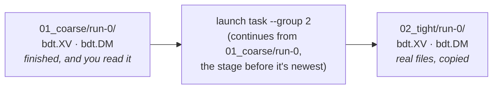

### 5.3 The execution loop — one grammar, one group at a time

> **This section is the authority for what you type.** `project-layout.md` § 1.6
> owns *what happens on disk*; this owns *the commands*.

#### The grammar

```
molbuilder jobset prep task    [--group N ...]  [options]   # the groups picked
molbuilder jobset launch task  [--group N]      [options]   # one group; nothing named, the one that can go
molbuilder jobset launch task  --stage NAME     [options]   # one stage: launched again alone, or a group of one
molbuilder jobset <verb> bench <stage> [<trial>]  [options]
                    │      │       │        │
                    │      │       │        └─ launch bench only: WHICH trial
                    │      │       │           to launch, by its point's NAME
                    │      │       │           (`G1K4C6` — the directory adds
                    │      │       │           the `bench-` prefix, § 6.3).
                    │      │       │           Omitted, the sweep's
                    │      │       │           still-unlaunched trials ride
                    │      │       │           their shelves' grouped jobs
                    │      │       └─ which stage — by its NAME (`tight`) or
                    │      │          its NUMBER with a `#` (`#3` — the NN of
                    │      │          its `03_tight` directory).  Both reach
                    │      │          one resolver (a bare number and the
                    │      │          token are legal stage NAMES, so neither
                    │      │          can double as an ordinal spelling).  On
                    │      │          `task`, `--group N` names a GROUP -- the
                    │      │          answer to the question each verb asks:
                    │      │          repeated for several at prep, one at
                    │      │          launch (one job a launch) -- and
                    │      │          `--stage NAME` one stage: a member
                    │      │          launched again alone, or the first
                    │      │          launch of a group of one.  `--from` /
                    │      │          `--cold` speak for ONE stage (at a
                    │      │          first launch, of an independent
                    │      │          ladder): at launch,
                    │      │          `--stage NAME`, or a `--group N`
                    │      │          holding one stage; at prep, `--from` is
                    │      │          the `relax` run every force-constant
                    │      │          stage it prepares is written at
                    │      └────────── what is being prepared or launched:
                    │                  `task` (the calculation) or `bench`
                    │                  (the measurement of one stage)
                    └───────────────── init · prep · launch · summarize
                                       · status
```

**A name is matched in any case** — `TIGHT` is `tight`, as every stage name
compares ([`engines/stages.md`](?doc=engines/stages.md) § 2). **Quote `#N` in
bash**: an unquoted `#` begins a comment there, so `--stage #3` reaches
molbuilder as `--stage` with no value and is refused — type `'#3'`.

**What molbuilder prints, you can type**: a command it prints
— a deck's header, a *next:* line, a remedy, a refusal's list — names the stage
by its NAME. Never the token: `03_tight` is itself a legal name, of another
stage; never `#N`, which a pasted line would lose to bash. A
deck's header holds only the token, so it prints the name through
`identity.command_stage`; every other line already holds a name. A benchmark
trial's deck names its own launch, `launch bench <stage> <trial>`.

**And every printed command is composed in one place**:
`jobset/commands.py` for what the verbs and their refusals print — the
calculation named by its address from the projects root (`--bundle`, quoted
as a shell needs it) every time, as `checkpoint`'s folder (`-p`) is: a line is
pasted where its reader is, and an omitted `--bundle` means the working folder
([`job-contracts.md`](?doc=execution/job-contracts.md) § 2.5b); a launch's mode stated
unless the calculation is launched on this machine and this machine's
`launch.mode` names one — a calculation set to another machine is launched
there, where this machine's file does not speak — as one line per mode its machine takes — the queue's
only where the machine names one; a refusal
that asks for a stage offering the stages the verb takes (`'#N'` quoted) and
the command for the first — a bench verb's, the stages with a prepared
benchmark, and a calculation that has no benchmark says so before it asks; one
command a line, any prose after `#`; a launch offered again in another mode —
an ask's answer, a refusal for want of a mode or of a header — as the whole
command, its flags as typed that the mode reads (`commands.launch_with`), never
*"the same command with `--mode X`"*, an edit to a line a bare launch, its mode
from config, never had; a name only the person knows (a machine's)
asked for in words, never a `<placeholder>`. A text read later — a deck's
header, a result's remedy — says a launch through `identity.launch_as_typed`,
the same for every engine: as typed from the calculation's folder — it is read
wherever it was copied, so it names no folder — with what the mode means
beside it; a deck's header names its group's first launch and the stage alone
(`identity.deck_launch`). A layer below `jobset` (a machine record's refusal, a
wrapper's banner) cannot import the composer and prints plain text by the same
rules; the way back it names is `identity.way_back_words`'s.

**`#N` is the stage's `seq`, never its row.** With stage 2 disabled the
ladder is `01_coarse` and `03_tight`, so `#3` means *tight* and there is no `#2`
to type — the same number you see in the directory, in the deck's filename, and
in the `seq` column of `status`. That is what
[`engines/stages.md`](?doc=engines/stages.md) R5 is protecting: a
position shifts when the ladder changes, and an assigned ordinal does not.

A **sweep** has no ordinals — its points are independent and have no order — so
its points resolve by name, and a refusal there does not offer you numbers it
does not have.

`init` and `status` take no *kind* — they are about the calculation,
not about one run of it. **The kind is a positional, not a `--bench` flag**, because
`prep bench` and `prep task` are peers: measuring and running are the same act
over different parameters (`project-layout.md § 2.3.1a`).

| | `task` | `bench` | no kind |
|---|---|---|---|
| `prep` | the groups shown, and the ones picked prepared — every one not prepared as described pre-selected; `--group N`, repeated, answers without a terminal (*The task*) | `prep bench <stage>`: the target's record read, the grid enumerated, the trials rendered into the stage's `bench/` | — the kind is required |
| `launch` | one group, or one stage again (*The task*) | `launch bench <stage> [<trial>]`: under `submit`, the whole sweep as one grouped job per resource shelf (`generator.md § 4.3a`); under `direct`, each trial here in turn; a named trial alone | — |
| `summarize` | a transport calculation's bias points into `<label>.transport.json` ([`engines/transport.md`](?doc=engines/transport.md) § 2a.12), and a SIESTA vibration's force-constant stages compared into `<label>.fc-sweep.json` ([`engines/vibration.md`](?doc=engines/vibration.md) § 5.9); any other calculation is refused, naming those two — its outputs *are* the results, read by `status` and the Results tab | the sweep's trials read into `bench-result.json` | — |
| `init` | — | — | the portable package (§ 5.1) |
| `status` | — | — | the whole calculation, or one stage (`status <stage>`) |

Every verb takes the calculation as `--bundle`, or runs from inside its
folder; a positional is always a stage.

#### Three ideas, in plain language

**1. A group at a time.** A ladder is not a pipeline. You prepare its groups,
launch `coarse`, *look* at what it produced, and only then launch `tight` —
which takes `coarse`'s result at that launch. `launch task` sends **one**
job — one group, its stages building on none of each other.

**Why there is no flag for the whole ladder, not even an opt-in one.** The cost
is money and time: a stage is a long job, and a run that continues on its own
can spend a week refining a geometry you would have rejected in a minute. An
opt-in flag does not fix that — it moves the mistake to the moment you type it,
before any stage has run, when you have least information. The judgement belongs
*between* two stages, where the evidence is.

A **sweep** differs in one respect only: its points are independent, so which
one you mean must still be named, but the order you take them in carries no
meaning.

> ### A scheduler is handed ONE job at a time
>
> > *"SLURM should never submit jobs in parallel. Submission is manual and one
> > by one. It is a disaster to do parallel job submission on HPC."*
>
> Two reasons, and the second is scientific:
>
> - **On a shared cluster it is antisocial.** N jobs entering the queue
>   together start together if there is room, and the allocation goes with
>   them.
> - **For a benchmark it is not merely rude, it is invalid.** Points that run
>   concurrently contend for the same cores, memory bandwidth and interconnect,
>   so the sweep measures **contention rather than scaling** — and reports a
>   number that looks fine.
>
> So `--mode submit` hands the scheduler few, deliberate jobs — for a TASK,
> one job per invocation (a stage, or a group of stages); for a BENCH, one grouped
> job per resource shelf (`generator.md § 4.3a`) — never a queue flood. **`--mode direct` is untouched**: it
> runs each job here, one after another — in the background unless
> `--foreground` (§ 6.0) — which is not submission at all. The rule lives in the launch entry (`submit.plan_launch`), not in the
> CLI — a whole ladder is refused there, and a sweep sent to a scheduler
> planned by shelf — so any other caller meets it too.
>
> `launch bench` under `submit` groups the unlaunched trials by resource shelf
> and hands each group over as one job; a named trial goes alone.

**2. What a stage continues from is the stage before it, or what you say**
(the rule: *The task*, *What a stage takes, and when*). Its files are
**copied** into the new run, not linked — the engine writes to those very
filenames, and writing through a link would destroy the result you started
from. `--cold` means *start clean*, which with a folder per run is simply
**skip the copy**; there is nothing to move aside.

**3. `--mode` is the channel, and it is not the layout.** This is the one people
conflate, so it is worth saying flatly:

| | what it decides | where it comes from |
|---|---|---|
| **`--mode direct` / `submit`** | *how the job is launched* — a local `bash`, or the machine's submission system | the machine you are on |
| **`shape: flat` / `hierarchical`** | *how the results are kept on disk* | the **description** (`task.json`), and it is never inferred (`engines/stages.md § 6.7`) |

They are independent, and every combination is ordinary. **A workstation running
`hierarchical` is a normal thing to want** — you get a directory per stage and per
attempt, so an earlier stage's geometry is still openable after a later one has
run. Equally, an HPC job can be `flat`. Nothing in molbuilder infers one from the
other.

> `--mode` falls back to `launch.mode` in `molbuilder.json`: flag,
> then config — and the chain ends there. Unset in both is a **refusal**, not
> a derivation from the detected scheduler: deciding `launch` from detection
> would gate submission on where you happen to be standing, which
> `running-a-job.md` § 5.4 forbids (*the mode, not the detected scheduler,
> gates submission*). The key's contract is
> [`configuration.md` § 4](?doc=configuration.md) and `running-a-job.md` § 5.4.

#### The loop

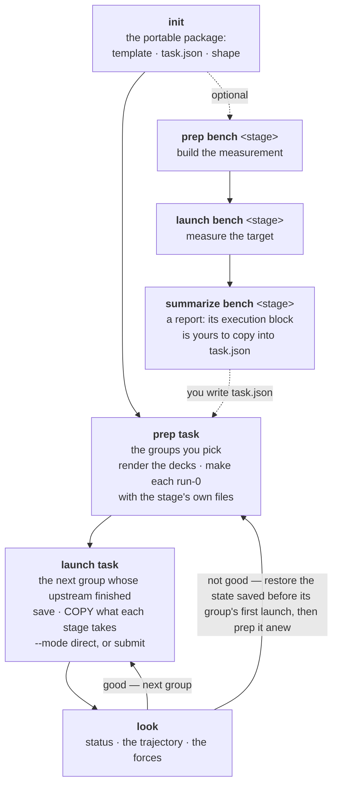

**`prep` prints what it resolved, and `launch` shows what it decides.** `prep`
shows the rendered decks, the jobs and what each stage's first launch will take;
`launch` then shows which run each stage takes and how it ended, what it
copies, and the exact `sbatch` line — the header prep wrote, its wall
restated only when `--time` says so — and asks before anything is sent
([`submission.md`](?doc=execution/submission.md) S4, every door).

#### One prep, two doors

`prep` has two doors — this command, and the Task setup tab's **Prep** (the
task's, over its ladder) / **Prep bench** buttons
([`web/task-setup.md`](?doc=web/task-setup.md) § 11) — and **one entry**,
`jobset/prep.py::prep_task`, which both call once the groups are picked —
the description read and checked once, every member of every group planned
by the one member planner (`prep.plan_stage`) into one plan, each group's own
checks and header its own (`prep.group_header`) — and `prep.prep_bench` for a
benchmark; § 5.0 is the order of their checkpoints. It does the
whole act and returns what it found and decided **as data** (a `PrepAnswer`
per stage),
and it asks nothing: the asking is each door's. The five steps inside it still
say, as each deck renders, what that deck's checks found — on the terminal's
stderr and in the deck's `<deck>.validation.txt` — and the answer carries those
findings too, for the door that has no stderr.
[`architecture.md`](?doc=execution/architecture.md) A12 — one assembly per
route — is this, for the whole verb.

| in the answer | what it is |
|---|---|
| `findings` | the description's preflight notes (`engines/stages.md` § 6.6); an error refuses instead |
| `notes` | what the inputs said: a bench's grid — enumerated, left out, kept |
| `saved` | the folder's state, saved before the five steps wrote (§ 5.0, checkpoint 5): the state saved now, or the one it already stood at, and its note |
| `dirs` | the folders this prep's jobs run in — its stage's, or its trials' |
| `provenance` | which configuration file supplied each setting, as read with the machine's record at checkpoint 4 (`configuration.md` § 2.2) — a preview's too |
| `machine` | the machine it is prepared for: the one named, else the one the calculation's copy of its record names |
| `deck_findings` | what each deck's checks said, one of each (a sweep's trials repeat them) |
| `flat` | a flat run: its wrappers are rendered and there is no attempt to open |
| `attempt` | the first run it opened and what it brought in — the stage's own files |
| `takes` | what the stage's first launch will take, and from which stage — the line both doors print (§ 5.4); nothing is copied at prep |
| `continuation` | a force-constant stage only: the `relax` run its deck is written at — by default or named — what it was (its conclusion, state and convergence); a benchmark of a force-constant stage, the relax run its trials are written at |
| `points` | a transport bias scan's point folders instead — one per point |
| `placement` | a stage prepared for a queue: the queue it was placed on and where each value came from, as its job records it (§ 6.0); `fit`, the fit of what it sends — a run's own, a run of points' walk's; none for a benchmark or a member of a group of several, whose shelves and group say theirs — said and recorded nowhere; and the lines both doors print |
| `stated` | a stage prepared with no header (a machine with no scheduler, `--no-sbatch`): where each value it states came from, the line both doors print in place of a placement |
| `shelves` | a benchmark's: each shelf's name, its header's lines and them in one line, and its fit on the benchmark's queue |
| `resources` · `deck` · `agreement` | what the stage will launch with, its deck, and whether that deck agrees (`launch` refuses a deck rendered for another width); no agreement when the deck makes no claim |
| `pipeline_log` | the step-by-step record of the plan and the writing — always written, whichever door called ([`script-preparation.md`](?doc=execution/script-preparation.md) § 4.5) |
| `group` | a member of a group of several: the group's one job — its number, its members in order, its header in `launch/`, the lines it launches with and them in one line, its fit on its queue, the files the group adds |
| `preview` · `plan_id` · `writes` | a preview's: the plan, named, and every file it would write |

**The save is the entry's own, and it asks nothing** — the one function every
act that changes the folder calls first (`checkpoint.save_before`,
[`checkpointing.md`](?doc=execution/checkpointing.md) § 9). It runs once the
whole plan stands and before anything is written (§ 5.0); a save that fails
refuses the prep, since that state is the one a redo restores. The terminal
prints the state and its note, the tab shows them, and the ledger records it
(`saved`). Everything prep reads of the target is read in the plan, so every
refusal about that machine comes before the save. Every decision the entry makes lands in
`jobset-decisions.log` whichever door called it.

**A refusal carries what the entry had found** (`PrepError`'s `findings` and
`notes`): the preflight's notes and what the inputs said — a bench refused
because *no cell is left* points at its cells left out. A refused prep
wrote nothing (§ 5.0, rule 3), so there is nothing else to show. The command line prints them before the refusal's sentence;
the tab's route returns them beside it. The plain
`ValueError` / `KeyError` the steps raise for what is the person's to fix (a
template naming an item its schema does not declare) are refused the same way
on both doors; a `TypeError` is a bug, and looks like one.

**A bench with no declared axes is the machine's proposal on both doors**
([`generator.md`](?doc=execution/generator.md) § 4.3a: an absent declaration
keeps the machine's enumeration), and the tab offers its bench button whether
or not axes are declared. **Where `prep bench` refuses the
description itself** — a transport calculation, an engine the bench lane does
not speak — one function says so for every door (`prep_inputs.bench_refusal`):
the entry's gate, the bench's assembly before it reads any machine, and the
folder answer, whose `bench_refusal` hides the tab's Measure step.

#### Examples

A two-stage relaxation on a **workstation**, `shape: hierarchical`, its groups
1 and 2:

```bash
molbuilder jobset prep   task --group 1 --group 2             # both: 01_coarse/run-0, 02_tight/run-0
#   tight: at launch, takes coarse's newest run, which must have finished
molbuilder jobset launch task --group 1 --mode direct         # coarse runs here, in the background
molbuilder jobset status                                      # follow it; look before deciding

molbuilder jobset launch task --group 2 --mode direct         # the state saved first, then:
#   tight continues from 01_coarse/run-0 (the stage before it; concluded rc=0 at …; converged): copied <label>.XV, <label>.DM
```

The same calculation on a **cluster** — same words, different channel:

```bash
molbuilder jobset launch task --group 2 --mode submit --dry-run
molbuilder jobset launch task --group 2 --mode submit
```

Changing a stage before it is launched — prepare it again (§ 5.0): its group
is rendered anew. Redoing a launched stage — go back to the state saved before
its group's first launch and prep it anew; that state holds `coarse`'s runs,
and the run you went back from stays in the folder's history
([`checkpointing.md`](?doc=execution/checkpointing.md) § 7.1):

```bash
molbuilder checkpoint list                    # the folder's states, newest first
molbuilder checkpoint restore 4f9ca71         # the one saved before group 2's first launch
molbuilder jobset prep task --group 2         # tight anew
molbuilder jobset launch task --group 2 --cold --mode direct   # here from the structure
```

**And there is no command for the whole ladder unattended, in either shape**
— see the box above on handing a scheduler one job at a time, and
`project-layout.md § 1.6` for why the judgement belongs *between* two stages
rather than in a flag typed before either has run.

#### The read-only verb

```bash
molbuilder jobset status --bundle BDT-Au/optimization/bdt-relax   # every stage, where it stands, which is next
molbuilder jobset status                     # the same, from inside the folder

molbuilder jobset status tight               # ...and ONE stage in full
molbuilder jobset status '#3'                # the same stage, by its number
```

**The table is the description's ladder**: one row per stage
`task.json` names, in its order and with its number, from the moment `init`
writes it — so it lists the stages before anything is prepared, each with its
group, the ones not prepared as described (a force-constant stage waiting for
`relax`, with what for), the prepared ones not launched as the ready door
answers them — **ready to launch**, with what its launch would take, or
**waits for** the stage named (*The task*). A stage removed from the
description after its prep is not listed; its folder is kept, untouched, and a
launched one its row ([`project-layout.md`](?doc=execution/project-layout.md)
§ 4.2). The table
ends with **the next step** — every group, where it stands and the line that
moves it (*The task*, *The next step*). `status
<stage>` asks the same door for the stage it names. The Results tab's ladder is
this same answer ([`web/results.md`](?doc=web/results.md) § 2.4) — its wire form,
`JobSetStatus.to_dict`, the groups `prep task` would offer (`offer`) and the
next step (`steps`) included. A job set with no
description beside it — a hand-built one, a benchmark's sweep — lists its own
jobs; a benchmark's sweep is read against the calculation it measures, from
its bench folder too, and its next step is its own verbs for that stage —
launch the sweep, then read what it measured (§ 7). A folder inside a calculation — a stage's, an attempt's — is answered with
the calculation it belongs to.

The per-stage form answers a different question from the table. The table says
*where is this calculation up to*; `status <stage>` says *what this stage is* —
the deck it runs, what it takes from a run it continues from, the resources it
asks for — and *what happened to it*: which attempt it is on, whether it was
launched and how, what geometry it continued from, and what it left behind:

```text
STAGE 03_tight -- running

  deck            bdt_relax_03_tight.fdf
  declares        bdt_relax.XV, bdt_relax.DM, bdt_relax.CG
  resources       n=32, c=2
  attempt         run-1   (of run-0, run-1)
  launched        submit as job 481923 at 2026-08-10T19:04:08Z
  command         sbatch -J bdt_relax/tight --export ALL,MB_LAUNCHED_BY=jobset-launch bdt_relax_03_tight.sbatch --run 1 -np 32 -omp 2
  continued from  01_coarse/run-0
  warm files      bdt_relax.XV, bdt_relax.DM
  detail          running

Directory: 03_tight/run-1
```

None of that is inferred. It is only answerable because a try is a directory and
a launch is a record (§ 1.5, § 1.6) — before those, *"has this been launched?"*
had no honest answer and *"which try am I looking at?"* had no answer at all.
`continued from` is said every time: a run that started from the structure
reads *nothing -- it started from the structure*, from the launch record's
`continued_from: null` (`checkpointing.md` S3).

- **`status <stage>`** is where a stage's deck, what it carries and its
  resources are read before a launch — the "look before you leap" step. Prep
  also writes the whole table into the folder (`STAGE-PLAN.md`): each stage's
  row with the other members of its job, and what each stage it prepared takes
  at its first launch.
- **`launch`** sends **one** job — what is prepared and not launched: a
  group, as one job, asking which when several can go (`--group N` names it;
  a stage launched again alone, `--stage`) —
  and takes a `--mode` (falling back to
  `launch.mode`; unset in both is a refusal, § 5.3):
  - **`submit`** hands that one job to SLURM — shown first, and asked (S4). One
    `sbatch`, one invocation, no dependency flag, nothing queued behind it.
  - **`direct`** runs that one job **locally** (`bash …run.sh`), in the
    background unless `--foreground` or the question's answer waits for it
    (§ 6.0). This is the workstation path.
  - `--dry-run` prints the exact command it *would* run — or the refusal the
    launch would meet — without launching and writing nothing: the safe way to
    see what will happen (§ 6.0).
- **`status`** reads the run directory (asking `run_status`,
  [`running-a-job.md § 4.2`](?doc=execution/running-a-job.md)) and reports each
  stage of the description — its state, its restart files — and the next
  step, every group's line (*The task*), then stops. It **never
  auto-resumes** (design decision #5): you launch the next group, or a stage
  again, yourself, and it continues from its own latest run.

### 5.4 How a ladder advances

**Two kinds of ladder, one way to run them**. Every ladder runs
the same way — `prep task` its groups, then `launch task`, a group at a time —
and nothing starts a stage but you. What differs is **what a stage
starts from**:

| | **independent stages** | **linked stages** |
|---|---|---|
| what they are | one calculation tuned several ways — an optimization's `coarse → medium → tight` | different jobs, each using another's output — a SIESTA vibration's `relax → freq`; transport's seed and leads → device → transmission |
| the stages | named by you, as many as you like ([`engines/stages.md`](?doc=engines/stages.md) § 2) | the kind's own, each by its role ([`engines/template.md`](?doc=engines/template.md) § 6.4) |
| what a stage starts from | **the stage before it, by default**: medium's first launch takes the newest attempt of the stage before it and copies that run's geometry, its density and — for the same optimiser — its history ([`project-layout.md`](?doc=execution/project-layout.md) § 2.3.4). A stage whose `restart` is `clean`, and the first stage, start from the calculation's structure | the stages before it, by the kind: **transport, files at the first launch** — the device the seed's density and the leads' Hamiltonians, the transmission the device's, each from the newest attempt that ended so and ran the same engine input as the deck that stage renders now ([`engines/transport.md`](?doc=engines/transport.md) § 2a.11); **a force-constant stage, its deck written at prep** from `relax`'s newest attempt, which must have finished — its relaxed coordinates and cell — and that same run's restart files copied at its first launch ([`engines/vibration.md`](?doc=engines/vibration.md) § 5.2a) |
| when the stage before has not finished | the stage is prepared all the same; its **launch** refuses before anything is sent, says why in the status door's words, and names what to do: launch the one before, let it finish, or run it again — or choose: `--from` an earlier run of it that finished, `--cold` the structure (on the flat layout, the stage's run card's `restart: clean`) — a launch says these for one stage, so a member of a group of several is told to give it a group of its own first. One that finished without converging is taken, with a warning; one that failed is refused | transport: the **launch** refuses before anything is sent and names the stage to run first; a force-constant stage: its **prep** refuses — its preview gives the same refusal (§ 5.0) — since its deck needs `relax`'s geometry |
| another source | yours to choose — any attempt by `--from`, none by `--cold`, at the launch | the frequency stage: a `relax` run you name with `--from` **at its prep**, taken as said — no other run, and no `--cold` at its first launch, while the ladder holds a `relax`; or no `relax` at all, the structure stated relaxed (`already_relaxed`) — every case in [`engines/vibration.md`](?doc=engines/vibration.md) § 5.2a's table. The kind's first rung — a vibration's `relax` — builds on the structure: `--from` naming a run of another stage is refused. A transport rung: none — what it takes is its kind's, gathered from the rungs upstream at its first launch; launched again, `--gather` takes them anew, and `--cold` starts it with none of its own files, keeping what it gathered; `--from` is refused, and `--cold` at its first launch |

**What crosses between stages, when a deck is a reordered copy**
*([`model/overview.md`](?doc=model/overview.md) § 2.2a, plan § 5ab R3)*. A stage that takes another's **geometry** — a SIESTA
force-constant stage taking `relax`'s — reads it through the run door
(`runs.steps_of`) and restores it to the person's order through that run's
own order record; its coordinates and cell are taken onto the calculation's
structure, which this prep sorts as every prep does (I3–I5) — never row by
row from one deck's order into another's. A **restart file** — the stage
before's density, geometry or history, continued or gathered — crosses as it
always has: every deck of one calculation is written from its one structure,
pinned by its description's fingerprint ([`engines/stages.md`](?doc=engines/stages.md)
§ 6.3), so writer and reader list the atoms in one order (I6).

**What *finished* means, and how a choice is recorded** *(user: "yes, … but
user can force a structure still")*. The rule is *The task*'s — by default the
newest run of what a stage builds on, which must have finished. **Finished**
is the one status door's answer, as `status` gives it: the run ended on its
own with exit code 0 (molbuilder's conclusion marker, the wrapper's last act —
never the engine's own end mark) and nothing in its output says the engine
stopped ([`architecture.md`](?doc=execution/architecture.md) § 3.2, `usable`;
user, 2026-10-06). Otherwise the refusal says why, in that door's words; a
run that concluded with an error is never taken by default. **The person can
still force one**, two ways, both stated rather than
refused: a run named with `--from` (the tab's *Continue from*) is taken as
said — the verb that takes it (a first launch; a force-constant stage's prep)
states what it sees there, *failed* or *not converged*, and refuses only what
cannot be done: no such run, nothing in it to carry — the
frequency stage's relax run included; and a structure can be stated relaxed
(`already_relaxed`, [`engines/vibration.md`](?doc=engines/vibration.md)
§ 2.2), so the frequency stage takes it as given — the record it carries
(`info.relaxation`) is shown and checked against this calculation, never
required. **What a stage builds on is decided once — at its first launch, or, for a
force-constant stage, at its prep — and recorded where it lands.** A run it
continues from — the stage before it, or a force-constant stage's `relax` — is
one `Continuation`: the run, and what it was, recorded in the ledger
(`continues`). A transport rung's inputs are its kind's gather — each file
and the run it came from, per run — recorded in the ledger (`gathers`).
Nothing picks the source again later unless you ask at a launch (`--from`,
`--gather`): a force-constant stage's deck carries the relaxation it was
measured at (its `vibration` block,
[`engines/vibration.md`](?doc=engines/vibration.md) § 5.3), which its finish and
`summarize` read, and its first launch copies the files of that same run.
`STAGE-PLAN.md` says, under its table, what each stage's first launch will take
— the line both prep doors print — while the table lists what each stage
declares it may take.

**What a run takes from other runs is one hand-over**, whoever decided it
(`materialize.HandOver`): the run that takes; each file, with the run it
comes from; and its record — `.continued-from`, the one run it continues
from, or `.gathered-from`, each input with its run. One function carries
every hand-over out, `materialize.hand_over` — it copies the files and
writes the record:

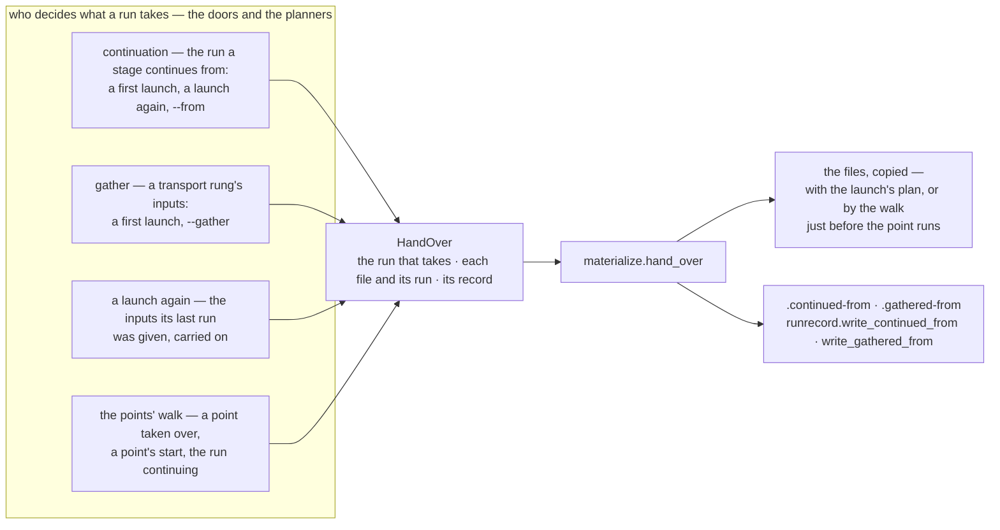

* **When the files are copied**: with the launch's plan, written at the send
  after the yes — except a point's start, which the walk copies just before
  the point runs, since the point before it may finish in the same walk; a
  point whose start cannot be copied is not run. On the flat layout the
  files lie in the folder and nothing is copied.
* **When the record is written**: with the files — and on the flat layout
  with the run's launch record, after the send went, since the flat layout
  opens no run before its launch.
* **How a run is named in a record** — one spelling, written and read one
  way (`runrecord.RunRef`): its folder from the calculation's —
  `01_coarse/run-0`, a point's `04_device/run-0/v0.2` — or, where a stage's
  runs share the calculation's folder, its own name, `H2_01_coarse-run1`,
  which every file of it carries.
* **Who reads the record**: `runrecord.read_continued_from` — `status`'s
  rows for a run's points (and through them the transport record), and a
  launch taking a point over, whose record names the run that computed it
  (one hop); `runrecord.read_gathered_from` — `status`, the transport record
  and the Run panel. A run's own `continued_from` is its `run.json`'s — the
  launch's hand-over, written with it — which the Run panel and a stage's
  `status` row read.

**A stage launched again** — the rule is *What molbuilder does for you*, 3;
here is how it is done. Whether warm continues is `Job.relaunch_continues`:
its kind resumes (the restart-file list's `resumes`,
[`job-contracts.md`](?doc=execution/job-contracts.md) § 4.2a — a
force-constant run's does not, a rerun restarting at `FC.First`,
[`engines/vibration.md`](?doc=engines/vibration.md) § 5.3; nor a PySCF
vibration's) and the stage takes something from a run (`restart: clean`
takes nothing). On the hierarchical layout the next `run-<n>` is opened
through the one opener — warm with the restart files the newest launched run
left, cold with none; a transport rung's gathered inputs are copied from the
run each names, with their record (`.gathered-from`) — warm, a file the stage
carries from its own run stands (a device's `.DM`), and the gather gives the
rest. `--gather` and `--from` are decided at that launch and recorded like a
first launch's, and held to its check that the prepared stage is still what
the description gives (§ 6.0). On the flat layout the run runs again where
the folder's restart files lie — warm, from the last run there, which its
record names; cold, its run script told `--cold --force`, which removes the
restart files lying in the folder before the engine starts (*What molbuilder
does for you*, 3). A warm launch again
continues from one `Continuation` — the run, what it was — carried out as
every hand-over is (above), and recorded in the ledger (`continues`).
**A stage that sweeps the bias** follows this rule at the point: warm, the next
run takes over the points done in the latest one and runs the rest; cold, it
runs every point ([`engines/transport.md`](?doc=engines/transport.md) § 2a.11).

**What an independent stage continues from**, by *The task*'s rule: a
continuing stage — `restart` is `continue` unless its run card says `clean` —
takes the newest run of the stage before it. Its first `launch` reads that
run before sending anything, and refuses one still running, stopped without
its conclusion marker, or failed, naming the commands; one that concluded
without converging is taken, with a warning.
**An explicit choice is taken as said**: `--from <attempt>` at the launch names
any run — `launch` says what it sees there (still running, stopped, failed, not
converged) and refuses only what cannot be done (no such attempt, no restart
files in it) — and `--cold` starts from the calculation's structure. What cannot be taken is
refused **before anything is written** too: a run that is not an attempt of
this calculation, `--from` with `--cold`; `--from` on the flat layout, on a
transport rung or on a bench, and `--cold` there at a first launch (launched
again, `--cold` starts any of them clean) — and the attempt is opened once, with what it carries,
so a refusal leaves an attempt an earlier prep set up as it was. Either way `launch` prints which run
the stage continues from, and the decision ledger records it:

```text
  continues from 01_coarse/run-0 (the stage before it; concluded rc=0 at Thu Sep 24 02:38:51 PM MST 2026; converged): copied H2.XV, H2.DM
```

(The optimiser's `H2.CG` is carried only between stages that use the same
algorithm — the shipped ladder's coarse is CG and its medium Broyden.)

`.continued-from` in the attempt and `continued_from` in its `run.json` keep it
beside the run, and the Results tab's Run panel shows it (*Continued from*). The
flat layout records it too: each run's own
`<basename>-run<N>.continued-from` and `<basename>-run<N>.run.json` name the run
it continues from by what every file of that run carries — `H2_01_coarse-run0`
— since flat keeps no directory per run.
**Both doors offer the same choice**: the terminal's flags, and Task setup's
**Continue from** in the group's tab, which puts it on the launch line and
shows the default — or why launch would refuse it — before anything is sent
([`web/task-setup.md`](?doc=web/task-setup.md) § 11). **In the `flat` layout** every stage shares one folder, so
nothing is copied: the restart files are the folder's, as the last run of
any stage left them (*What molbuilder does for you*, 2) — the same rule
holds all the same: its latest run must have finished, and its first
`launch` says which run that was, by the name every file of it carries
(`coarse's latest run, H2_01_coarse-run1, in this folder`). **Its record
names the run whose restart files it reads** — the last run in the folder,
of any stage, which the folder **records**: `<label>.last-run`, written by
each run's script the moment its engine starts, because from then on the
restart files and the results lying there are that run's
(`runrecord.last_run`; never worked out from when the launch records were
written — a warm retry inside a group's walk is stamped after the member that
runs next) *(user, 2026-10-12: "there should be a record manifest of the last
run so that is the key information what is the last run and the data file is
the result of that last run")*. The folder speaks for that run: the Results
page opens it, and the run door answers it (`runs.speaking`) — and when that
is not the run the rule took, `launch` says so before anything is sent (*the
restart files H2_02_medium-run0 left in this folder (concluded …) — the
last run here; coarse's latest run is H2_01_coarse-run1*) *(user,
2026-10-12)*. A stage launched again warm reads them the same way. There is no attempt there for `--from` to
name, nor an attempt-less start for `--cold` to make: a flat stage starts clean
by its run card's `restart: clean`.

An independent ladder, advancing:

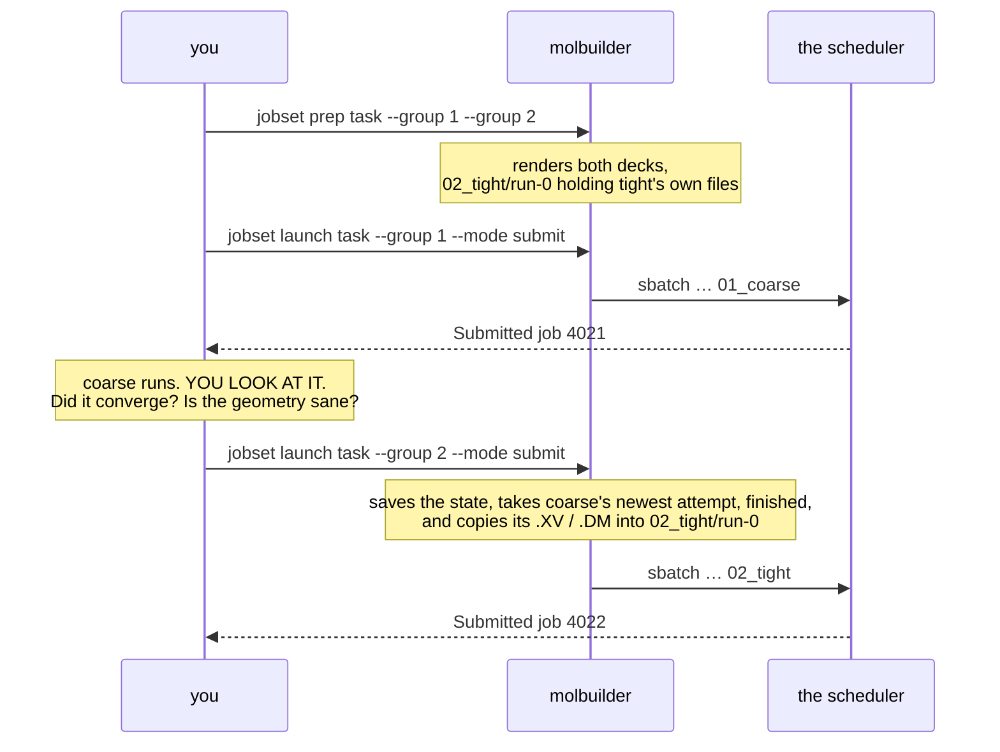

**The gap in the middle of that diagram is the feature.** It is where the
judgement goes that no data structure can hold: *is this result worth building
on?*

### 5.5 Watching a stage while it runs

`status` is a roll-up you pull on demand. To watch a *single* stage live, point
the run viewer (the Results tab, or `molbuilder watch`) at the directory the
engine is running in — `<NN>_<stage>/run-<n>/` in the hierarchy, the calculation
directory itself when flat. It resolves and streams the trajectory exactly as for
a stand-alone job ([`running-a-job.md § 4`](?doc=execution/running-a-job.md)).
Every job also carries **`mb_monitor.pyz`** — the monitor and the framework
readers it reads the run through, one file, written beside the wrapper and
copied into every attempt ([`run-reports.md`](?doc=execution/run-reports.md)
§ 2.3). Its wrapper launches it in the background: it samples CPU, GPU and
memory into the run's `-runN.util.csv`, so how the stage uses what it holds is
visible without waiting for it to finish, and it tells your channels when the
run starts, as it goes, and when it ends (§ 2 there).

> **What you cannot do is checkpoint one stage on its own**, and that is a
> contract rather than a missing feature. **The history is rooted at the
> calculation** ([`project-layout.md § 6`](?doc=execution/project-layout.md),
> [`checkpointing.md`](?doc=execution/checkpointing.md) **L1**) — one repository,
> covering the root and every stage beneath it — because a history rooted inside
> `01_coarse/` cannot restore the pseudopotentials that live one level up, and
> *"go back to coarse and try a different tight"* needs a history containing
> both. Tagging a converged stage is `molbuilder checkpoint tag` at the
> calculation; the tag names a state of the whole folder, which is the only thing
> a restore can put back.

---

## 6. Launching — one entry, here or on a cluster

### 6.0 Plan, show, ask, send, record

`launch` is built as `prep` is (§ 5.0): **one entry decides everything before
anything is sent, and the send decides nothing.**

| # | step | what happens |
|:--:|---|---|
| 1 | **the plan** — nothing is written | **the work** (`submit._the_group`): a prepared group, whole at its first launch, or one stage launched again; a benchmark's pending trials. **Its submissions**, from the submission builders (§ 9.1) — each one scheduler job, or one process here, walking one or more **members**: a run is one member; a group, its stages in the ladder's order ([`project-layout.md`](?doc=execution/project-layout.md) § 1.6.6); a run of points, its points; a benchmark's resource shelf, its pending trials — each sending the one header its prep wrote for it. **Each member**, from the one member planner (`submit._plan_member`): the run it runs in — prep's first run, or the next one — and what it takes (*The task*, *What a stage takes, and when*), with the gates: every upstream it takes from has finished; the prepared stage is still what the description gives — at a first launch and at one that takes inputs anew, prep's member planner run again, quietly (`prep.plan_stage`), and its deck, scripts, header and job compared with the files, stamps masked; the deck agrees with its launch; a trial starts cold. **The placement** — the job's own, recorded at prep: its queue and every value prep stated, none placed or chosen again; a submitted job's wall is the one value a launch may restate (`--time`). The exact lines and scripts to send. Every refusal is a row of *The task*'s table |
| 2 | **show** | the exact command of every submission and every value of the header it sends (S4, [`submission.md`](?doc=execution/submission.md)) |
| 3 | **ask** | one question for the whole plan — a run here asked as a submission is *(user, 2026-10-05)*; `--yes` is the answer given in advance, and with nobody to ask (no terminal) nothing goes and the launch is refused, so a script is never told it went. `--dry-run` stops here and writes nothing, the ledger included — a refused dry run too, as a refused preview (§ 5.0). `--mode ask` puts the plan's lines to the scheduler instead (its kind's ask, [`scheduler.md`](?doc=execution/scheduler.md) § 6a) and writes down what it asked |
| 4 | **send** — nothing is decided | the folder is checked against the one the plan was made from — the plan made again from the folder as it is, and compared line by line: each submission's line and where it runs, each member and what it takes (launched again, how the run it continues ended), every file the send writes or copies and every file read where it lies, each by its size and write time. A member launched, a run ended or a file changed since is refused, saying which and to launch again to see the new plan. **A group's first launch then saves the folder's state** — when and with which note is [`checkpointing.md`](?doc=execution/checkpointing.md) § 9's; the launch's questions and their answers are written after it, so it holds no line of this launch. Then the plan's writes are carried out — each run opened or filled through the one opener, a run opened and not launched emptied whole first ([`project-layout.md`](?doc=execution/project-layout.md) § 1.6.2–1.6.3), with its `.continued-from` / `.gathered-from` (the one hand-over, § 5.4; a flat run's written with its `run.json`); a submission with several members gets its walk script; every script is on disk before anything goes — and each submission goes out, `sbatch` or the process here, through one function, each member's `run.json` written by the one writer |
| 5 | **the record** | the ledger: every refusal, the question and its answer, the save before a group's first launch, what each member took (`continues`, `gathers`), each submission sent and its job id — a run here when it starts — with what the verb was told on each line (the kind, the stage, the mode and where it came from, the queue's source, which config files answered). The entry writes them (`submit.plan_launch`, `send_launch`, `ask_launch`, [`architecture.md`](?doc=execution/architecture.md) § 2.1); the verb writes the refusals it says before it calls the entry — a flag that means nothing for the mode, a stage not prepared |

**A run here starts in the background, unless said** *(user, 2026-10-09:
"add a run in background option for the launch when it is in a direct run …
let it run in the background instead of having to wait for it … check the log
and output later on"; 2026-10-16: "make it default but also explicitly
changable in the question")*. `launch … --mode direct` is planned, shown, asked,
sent and written down by the five steps above, and its process is **started
and left**: its own session, so closing the terminal does not end it, and
nothing attached to it; the send returns once the process exists, the ledger's
`launched` line carrying `background` and its pid. **The question offers the
other way**: *launch in the background? [Y/n/foreground(F)]* — Enter, `y` or
`yes` goes as shown, `n` or `no` sends nothing, `f` or `foreground` runs it in
the foreground and waits for it; under `--foreground` the plan is the
waited-on run and the question
*launch in the foreground? [Y/n/background(B)]*. `--yes` takes the plan as
shown, without the question. The ledger keeps the question as asked — `run
here, in the background` or `in the foreground` — and its answer: `yes`, `no`,
the other way's word, or `yes (--yes)` when `--yes` gave it. **What it says**: shown, *about to start here, in
the background:* or *about to run here, waited on:*; a dry run's line *WOULD
start in the background* or *WOULD run*; sent, the run's line *started in the
background*, its pid, and **how to stop it** — `molbuilder jobs stop <id>`
(§ 6.0a): the run is the leader of its own process group, and a signal to
that group reaches the engine; to the run script alone it would wait for the engine to end, since
bash runs a trap only after the command it waits on. **Nothing it prints is
lost**, because nothing reaches a terminal that is not also in a file: the run
script copies everything it prints — standard output and error — into its
`.runwrap-<time>.log` as its first act, the engine's own output is the run's
`.out`, and a walk sends its own standard error and each member's output to
its log under `launch/` (`runwrap.py`, `submit._walk_script`). The launch
prints, for a run here either way, the folder to read — or the walk's log —
and the way to follow it: the next step of every group (*The task*, *The
next step*), the run's among them; for a benchmark, the `summarize bench`
that reads its trials once they have run. `--foreground` on a queue is
refused, naming why — under `submit` a scheduler's job runs without anyone
waiting on it, under `ask` nothing is sent — and a queue's flag on a run here
(`--time`) likewise, each with the launch
as typed for each mode this machine takes (R-L4; `commands.launch_with`, a run
here's line without a queue's flags, a queue's without `--foreground`).

**A run here, waited on, ends the launch with how it ended** *(user,
2026-10-13: "if you already know a job fails why … do you not report
failure?")*. When the process ends, the launch reads each member's state
through the one status door (`parse.dirs.run_status`; the standard is
[`running-a-job.md`](?doc=execution/running-a-job.md), *The order of
evidence*: **finished**, a run that ended on its own with exit code 0;
**failed**, one that ended with any other, or whose output states a stop) and
prints it in that door's words — the words `jobset status` prints. The launch
exits **0 when every member finished, 1 when any failed**, so a script or a
person that trusts the exit status is told what happened. Left in the
background, the launch exits 0 having said *started*: the run has not ended,
and its state is `jobset status`'s.

**A benchmark's walk.** A benchmark's trials sent together — a resource shelf
on a queue ([`generator.md`](?doc=execution/generator.md) § 4.3a), or its
unlaunched trials run here — go as one submission walking them in order, through
the benchmark's own script (`launch/<name>.run.sh`, written by
`submit._walk_script`): each trial `cd`ed into and its own run script run with its
own counts, timed, under the per-trial bound when one is given
(`--trial-timeout`, here as on a queue); a trial that fails leaves the rest to
run, and the walk exits nonzero when any failed. Stopped by the person —
Ctrl-C at a launch waited on, a lost terminal, `molbuilder jobs stop` of one
left in the background, a cancel — it starts no further trial (one under a
per-trial bound ends at it); what it did not reach is measured again from the
state saved before the benchmark's prep.
**A transport bias sweep is not a benchmark** *(user, 2026-10-05: "bias scan is
its own mechanism — this is parameter sweep, not some … computation resource
experiment")*: it is one calculation swept over a parameter — one run, its
points done or not done, read from each point's own files
([`engines/transport.md`](?doc=engines/transport.md) § 2a.11). What it shares
with a benchmark's walk and a group's is the **walk script** alone — one
generator for every job that runs several members in order — each with its
own settings: a device sweep hands each point the one before's `.TSDE` in its
frame, and a point that does not finish ends its frame's chain — the next
frame starting from the seed, as every frame does (`engines/transport.md`
§ 2a.9); a benchmark, a group and a transmission sweep walk on.

**The placement is decided once, at prep, and recorded**
([`architecture.md`](?doc=execution/architecture.md) § 5.2).
Prep decides each job's queue — `prep --domain`, else the run card's `domain`,
else `allocation.domain` (a benchmark's: `prep --domain`, else
`allocation.domain`) — and its wall, memory, ranks, cores and GPUs, each value
with its source, and **places the whole request of every job it writes a
header for** on the queue it names, printing its fit on the target's record: a
stage's; a group's, its members' walls summed and their largest memory; a run
of points', one job walking every point, their walls summed; a benchmark's
shelf's, its trials' shared request, the benchmark's wall the shelf's
(`shelves.shelf_request`). A GPU run naming a queue with no GPUs, a wall
longer than the queue allows, more memory than its nodes hold is prepared all
the same, the fit naming each limit it is over with its numbers — the
scheduler decides, and its answer is shown (`scheduler.md` R6; checkpoint 4,
`placement.placed`). The answer and its sources are written on the job in
`job-set.json` — its `placement`: the queue it was placed on, bound on the
record (name, partition, qos), and where each value came from, the flag, the
run card or the description
([`job-contracts.md`](?doc=execution/job-contracts.md) § 6.1). The fit is
said and recorded nowhere — it decides nothing: both doors say the placement,
then the fit of the job each header sends — a run's own, a run of points'
walk, each shelf's, a group's after its last member — with every value of
that header (its `#SBATCH` lines). **Every header is prep's**: rendered at prep for the queue it placed,
binding no name a second time — a stage's beside its deck; a
group's, a run of points' walk and a benchmark's shelves in their `launch/`
folder (`prep.walk_header_of`). One request is asked of a queue, by every
caller (`placement.request_of`: a SIESTA run's ranks, a PySCF run's one
process, the cores each runs on, its GPUs, memory and wall). **Launch decides
none of it** *(the user, 2026-10-17: "whether it's direct launch or
submission, all the decision is already done at the prep … Launch means just
run that script")*: it sends the header prep wrote — the question and a dry
run show its every value — places nothing again and chooses no queue. What it
checks is prep's own files: at a first launch it plans the stage again as its
prep did, on the calculation's own files — its description, its template and
its copy of the target's record — and refuses a prep that is no longer what
they give (R-L15, R-L16); every launch, that a deck agrees with the counts it
is launched with (R-L29) and that a trial starts cold. That copy of the
record is the one its first prep took, and no
probe replaces it ([`configuration.md`](?doc=configuration.md) M-3): a
calculation meant for a machine whose record has changed since goes back to
the state saved before its first prep. **A submitted job's wall is the one
value a launch may restate** — `--time`, for a run launched again that ran out
of it — passed on the line in a job's own spelling (`D-HH:MM:SS`,
[`scheduler.md`](?doc=execution/scheduler.md) § 6a) and checked by nothing of
ours: the scheduler answers. `run.json`'s `placed_on` keeps the queue, wall and memory
the run was sent with, and the ledger's lines the flag as typed. **A benchmark
measures on one queue**: the one its prep names (`prep --domain`, else
`allocation.domain`), every trial fit on it alone and its placement
recorded like a run's — measuring another queue is another benchmark. Where
several members go as one job — a group, a run of points, a benchmark's shelf
— launch writes the walk of the members still to run and sends the job's one
header as its prep wrote it: a run of points launched again with points done
walks the rest under the header written for every point.

### 6.0a The jobs launched from this machine — `molbuilder jobs` *(user, 2026-10-16: "can we keep the status of running jobs the same way as we keep status of running server? … a similar way to check jobs submitted/directly launched etc? and we can use similar verb to stop a task if we need to")*

**Every launch leaves an address, the way a server leaves its pidfile**
(`molbuilder serve status`, [`ops/deployment.md`](?doc=ops/deployment.md)).
The one sender (`submit._go`) writes it the moment a submission goes — a run
here once its process exists, a queue job once the scheduler gives its id (a
job whose id `sbatch` did not print gets none) — one file per submission in
molbuilder's state folder, `<state dir>/jobs/`
([`configuration.md`](?doc=configuration.md), the tree), kept there past a
logout as the run is; the ledger's `launched` line names it (`job`). A file
that could not be written is said on the launch's line — beside a queue job's
id, or beside a run left in the background, which is then named by its pid,
`kill -- -<pid>`. **It holds an address, never a state:**

| key | what it is |
|---|---|
| `schema` | `molbuilder/job@1` |
| `id` | what `jobs stop` names: `<host>-<pid>` for a run here; for a queue job its job id, as `squeue` lists it |
| `how` | `here` — waited on or left in the background (`background`) — or `queue` |
| `host` | the node it was launched on: a pid means something only there, and a home folder a cluster's login nodes share holds every node's files |
| `pid` · `started` | a run here: its process, and when the kernel started it with the boot it belongs to (Linux's `/proc`) — together what tells the run from a later process given the same pid. A warm retry re-execs in the same process, so the file stays true |
| `job_id` · `cluster` | a queue job: the scheduler's id, and the cluster it was sent to as the scheduler names it (`ClusterName`) — a home folder two clusters share holds both clusters' jobs |
| `calculation` | the calculation's folder — printed, as every line names it, by its address from the projects root |
| `members` | each member's stage → its run, as a record names a run (`runrecord.RunRef`: its folder, or where its stage's runs share one, its own name), and that run's launch record, which its state is asked through |
| `launched_at` | when it went |

**What it is doing is read fresh, each time** — one fact, one source: a run
here is going while its process is (the same host, pid and start — a machine
with no `/proc` says it cannot tell); a queue job while the scheduler lists
it in a state not ended, said with that state and the scheduler's reason for
it when it gives one (SLURM's `None` is none) — *the scheduler lists it:
PENDING (QOSMaxWallDurationPerJobLimit)*, its
own words, so a job it took and will never start says why
([`scheduler.md`](?doc=execution/scheduler.md) R6); one it lists ended is
said so with its state — *the scheduler lists it ended: FAILED
(NonZeroExitCode)* — until the scheduler forgets it, when the run's own
state says how it ended, the scheduler's word among it (`scheduler.md` R16;
`running-a-job.md` § 4.2: the run door, on this machine, writes a job the
scheduler no longer lists into the run's launch record, so the run's state
says so wherever the folder goes) (its kind's query, run where the calculation's copy of its machine's
record says the command is, asked on its own cluster — another cluster's job
is said *sent to cluster C: ask there*, and a record naming no query
command, a command that does not run here, or a copy that does not read here
says it cannot ask; each keeps the file); each member's own state is its run's, read through its
launch record by the run door — that run, never its stage's newest; where a
stage's runs share a folder, the run its warm retries reached, each retry a
run of its own (`runrecord.retried_to`, [`running-a-job.md`](?doc=execution/running-a-job.md)
§ 3.5) — and for a run of points, a container no one run speaks for, its
stage's row of `jobset status` (`runstatus.job_members`); a run no longer on
disk — a restore went back past it — is said so. Where the two
disagree — the process gone while its run still reads *queued*, stopped
before its monitor began — both are said, and neither overrules the other;
a queue job the scheduler no longer lists is written into its run's launch
record by this very look (`running-a-job.md` § 4.2, *Asked once, written
once*), so the run reads `failed` from then on and the two agree.

**`molbuilder jobs status`** lists every file: its id, how it went, when, the
calculation, and each member with its state in the status door's words —
here, a transmission left in the background, then once it was stopped:

```text
qlabsrv-312877  run here on qlabsrv, in the background, pid 312877 -- its process is going
  launched 2026-10-16T22:06:45+00:00; its calculation:
  molbuilder jobset status --bundle P/transport/S
    transmission  05_transmission/run-0  running
```

```text
qlabsrv-312877  run here on qlabsrv, in the background, pid 312877 -- its process has ended
  launched 2026-10-16T22:06:45+00:00; its calculation:
  molbuilder jobset status --bundle P/transport/S
    transmission  05_transmission/run-0  failed -- stopped before its end: …
  ended -- said once; its address is removed
```

**A job that has ended is shown once — how each member ended — and its file
removed**; its run's folder and the calculation's ledger keep its history. A
run waited on is shown by its own launch, which says how it ended — or,
stopped at its terminal, its stop — and removes its file then. A run here
launched on another host is said so — *on HOST: ask there* — and never
removed or signalled here; a file that does not read is said, with its
path, and kept.

**`molbuilder jobs stop <id>`** — the line a launch prints beside a run it
left in the background — shows what it will stop — the calculation,
its members, the pid or the job id — and asks *stop it? [y/N]*; `--yes`
answers in advance, and with nobody to ask nothing is stopped
([`submission.md`](?doc=execution/submission.md) S4); the question and its
answer are written in the calculation's ledger, a *no* too, as a launch's are.
A run here is checked to be the process launched (host, pid, start), and
checked again once the answer is given: a run left in the
background leads its own process group, and SIGTERM goes to the group, so it
reaches the engine — to the run script alone it would wait for the engine to
end; a run waited on is stopped at its terminal, with Ctrl-C, and `jobs
stop` says so. A queue job: its kind's cancel, from where the record says
the command is. The calculation's ledger records the stop (`stopped`, and
how), and the verb says it: *stopped: SIGTERM to its process group, <pid>* —
or the line it ran, `/usr/bin/scancel 62039301` on SLURM. The run then
reads *failed — stopped before its
end* by its own files ([`running-a-job.md`](?doc=execution/running-a-job.md)
§ 4.2); one stopped before its monitor began reads *queued*, and `jobs
status` says its process is gone. A trial under a benchmark's per-trial bound
ends at its bound.

The address is floor 1's (`molbuilder/joblist.py`, beside `runrecord`: its
writer, its reader, and the signal to a run here, checked first); the
cluster, whether the scheduler lists a job and its cancel are the
scheduler's floor 1 too (`scheduler/queue.py`); the verbs are a surface,
floor 7
([`architecture.md`](?doc=execution/architecture.md) § 2).

### 6.1 On a cluster — SLURM

The wrapper file shapes (`.run.sh` inner + `.sbatch` outer) and the meaning of
each `#SBATCH` line are owned by
[`running-a-job.md § 5.3`](?doc=execution/running-a-job.md) and
[`job-contracts.md § 2.6`](?doc=execution/job-contracts.md). What the **job
system** adds is submission and routing:

- **The two layers.** The outer `.sbatch` is a thin header, in the language of
  the target's scheduler kind ([`scheduler.md`](?doc=execution/scheduler.md)
  § 6a), whose body says once what the scheduler tells the job, in
  molbuilder's names (`MB_JOB_ID`, `MB_NTASKS`, …), then a single line —
  `bash <base>.run.sh "$@"`. The inner `.run.sh` owns activation and launch,
  and reads only molbuilder's names. You submit the outer file; it hands off to
  the inner one. This split means the scheduler header and the run logic
  evolve independently, and the exact same `.run.sh` works with or without a
  scheduler.
- **The `.sbatch` is not always written.** The `.run.sh` is always there; the
  header beside it is withheld only where **the target's record names a
  scheduler with no queue** (`workstation`) — that machine has no queue, so a header for it would be a
  file nobody can submit — or where you asked for none (`prep --no-sbatch`). A
  target with a scheduler gets one, and every value in it is stated: a run
  that names no queue, wall or memory is refused at prep, never given a header
  that picks one ([`architecture.md` § 5.2](?doc=execution/architecture.md)).

  So *"I prepared and got no `.sbatch`"* has two answers: the machine's record
  names a scheduler with no queue (`workstation`), or you said `--no-sbatch`.
- **One `sbatch` per invocation, and the header carries the job.** The
  line names the job (`-J`), restates its wall when the launch says so (`-t`
  from `--time`), and carries the launch claim and the run's arguments;
  every other value — queue, ranks, cores, GPUs, memory, binding — is the
  `#SBATCH` header prep wrote, sent as it stands.
- **One request, one sender.** Every submission — a stage, a benchmark's
  shelf, a bias scan, a transport group — builds its line the same way
  (`submit._sbatch_request`), in the words of the scheduler kind its machine's
  record names, from where the record says its submit command is
  ([`scheduler.md`](?doc=execution/scheduler.md) § 6a); `--mode ask` asks the
  same line with the kind's ask.
- **Every run is handed its own ranks and threads.** Every launch passes each
  run script its `-np` and `-omp` — a run here; a stage sent to the queue,
  after the `.sbatch` name, which forwards them (`bash <base>.run.sh "$@"`);
  each trial of a benchmark's shelf and each point of a bias scan, inside
  their sequencer's script — so a launched run's counts are its own, never
  the submitting shell's `OMP_NUM_THREADS` or what the scheduler tells the
  job (`MB_NTASKS`, `MB_CPUS_PER_TASK`, said by its header)
  ([`running-a-job.md` § 3.2](?doc=execution/running-a-job.md): the flag comes
  first). *(User, 2026-10-05: "Make all calling consistent with —omp
  and settle it".)*
- **Routing domains.** Instead of hard-coding a partition, you name a **domain**
  — in the description (`allocation.domain`, or the run card's `domain`) or
  on `prep --domain`. A domain is a friendly name for a
  `(partition, qos)` pair of the target's record; an unknown name is refused
  at prep with the record's list — and a named one on a machine whose record
  lists no queues at all. What the record says of a named queue is shown
  as the job's fit, never a refusal: the scheduler decides
  ([`scheduler.md`](?doc=execution/scheduler.md) R6).
- **Render every job, then submit them.** A grouped submission (the bench
  sweep, § 7) writes **all** its shelf scripts before it sends the first one,
  and **one scheduler refusal does not cancel the rest**: the shelves are
  independent jobs the queue may run concurrently, so a refusal is recorded
  on that shelf's result and the loop goes on. Its trials keep no launch
  record, so the launched door (`runrecord.launch_record`) leaves them pending and the next `launch` picks
  up exactly them. The command reports what went out and what did not.

  > **Both halves, because one refusal unwinds an interleaved loop**: a Sol
  > bench's refused 4-GPU group left the valid 2-GPU group behind it
  > *neither written nor sent*, and the printed recovery command named a
  > script that had never been written.
  > `--dry-run` still writes nothing at all: it is the launch's plan, shown
  > and dropped (§ 6.0), and the question shows the same plan before the
  > person has said yes.
- **Job names read well.** A job's `-J` is `<calculation>/<job>` —
  `bdt_au/coarse`, `bdt_au/G1K2C4`, `bdt_au/bench-group-cpu-G0K4C1` — on every door,
  so a `squeue` listing tells you which of your calculations each row belongs
  to, not just which stage.

A workstation — a machine whose record says so — simply gets `.run.sh` files
and is run with `--mode direct` (or `launch.mode: direct` set once — the
mode is always stated, never derived).

---

## 7. Benchmarking — measuring the fastest resources

Before you commit a long production run to a node, you want to know: for *this*
calculation on *this* machine, how many GPUs, how many MPI ranks per GPU, and how
many CPU cores per rank actually run it fastest? Guessing wastes allocation. The
benchmark workflow measures it, and it is just the job system pointed at a
resource grid.

Its guiding idea (**target isolation**, design decision #3) survived its
machinery: everything machine-specific is discovered on the target. The
machinery is the ordinary jobset loop since the 2026-08-12 fold — *(this
section walked the shipped-bundle lifecycle — `bench generate`, baked
`prep-bench`/`run-bench` executables, `bench summarize`/`prep-run` — until
U19; those verbs died in step 6 u5, and benchmarking is `prep` whose
parameters are a set, `project-layout.md` § 2.3.1a)*:

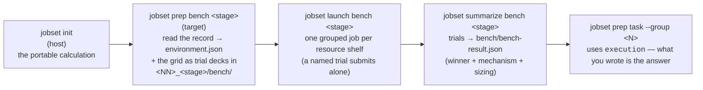

- **Detect the machine → `environment.json`** (`molbuilder/environment@3`): the
  scheduler (its kind, and where its commands are there), the site, the
  topology, and the domains you can actually reach —
  resolved to the **compute node's** real core and GPU counts (read from the
  scheduler via `scontrol show node`, not from whatever login node you happen to
  be on), so the numbers are the ones the job will actually run against. The
  record holds only the machine's **facts** — what was probed, and the
  `env_init` declared in that machine's `molbuilder.json` and copied in by the
  probe there; what you want stays in
  `molbuilder.json` ([`configuration.md` § 4–5](?doc=configuration.md)).
- **Trials are the stage's science, made measurable — by pins, not by
  splicing.** Each trial's deck is **rendered from the description** like any
  deck, with the benchmark's pins laid over the resolved values
  (`template.md § 8.1`: rebuild and render, never splice): SCF capped at 3
  iterations, relaxation steps zeroed (a single point — you are timing an
  iteration, not converging the chemistry), restart forced clean, and a
  **per-trial relabel** so no trial can read or overwrite the real run's warm
  files. **The GPU and the eigensolver are NOT pinned** — they are what the
  description says, because *"use GPU or not is set up only at the Job Prep
  UI"* ([`web/task-setup.md`](?doc=web/task-setup.md) § 6.2), and a benchmark
  measures what was described
  ([`project-layout.md § 2.3.2`](?doc=execution/project-layout.md), corrected
  2026-08-17). *(Until 2026-08-12 this bullet described
  `bench-manifest.json` (`molbuilder/bench-manifest@2`) and its two
  comparable CPU/GPU points — the shipped-bundle machinery deleted in step 6
  u5. Nothing writes or reads a manifest now; the pair-of-points comparison
  went with it, and the sweep is the GPU grid below.)*
- **The `(G, K, c)` grid** — `G` devices, `K` MPI ranks per device, `c`
  cores per rank; each point runs in its own `bench-…/` folder named by its
  coordinate. **What the points ARE is the declaration's question, and
  [`generator.md § 4.3a`](?doc=execution/generator.md) is the owner**:
  declared `bench` entries (`mpi_np`, `gpu_count`, `omp_threads`, and any
  value settings) drive the trials exactly; only an ABSENT declaration
  keeps the machine's own enumeration as the proposal (`K` from the probed
  core ladder, `c` as a starved / one-socket / cross-socket bracket, `G`
  over each rank count's divisors).

  **`G` is there only when the description asks for the GPU** (2026-08-17).
  A CPU-family point holds the device coordinate at `G = 0` — plain ranks,
  no `gres` — so a CPU trial does not queue behind a GPU node it never
  uses; a single-family CPU sweep drops `G` from its coordinates entirely
  (the points are `(K, c)`, the folders `bench-K<k>C<c>/`).

  > **`BlockSize` belongs on this grid too** *(decided 2026-08-11, user; not yet
  > built)*. It is a parallel-efficiency knob whose right value depends on the
  > matrix, the rank count, the interconnect and the node's memory layout at once
  > — so no formula reaches it and **a short test job does**
  > ([`tuning.md § 2.11`](?doc=engines/tuning.md)). It is a fourth axis of exactly
  > the same kind as the three above: powers of two, bounded above by the point
  > where a rank receives no block at all, and reported in `choice` beside the
  > rank and GPU counts so `prep` consumes it the same way. **The name of a trial
  > directory grows with the grid**, which § 6.3's *a sweep has no order, so the
  > name carries what was tried* already anticipates.
- **Measure → `bench-result.json`** (`molbuilder/bench-result@1`): each point is
  parsed for its SCF wall-time **per iteration** (the first inter-iteration
  delta is dropped as warm-up and the rest averaged — under the capped
  3-iteration trial that is iteration 3's one clean sample, the user's
  2026-08-21 economy: the bench reads scaling, not tight rankings), plus a
  utilisation reading and peak memory.
  > **A trial is also asked what it actually ran, and a trial that ran
  > something else cannot win** *(2026-08-13)*. Each point's own artifacts are
  > read back — SIESTA's `* Running on N nodes in parallel.`, its
  > `* ProcessorY, Blocksize:` and `diag: Algorithm` lines, and the wrapper's
  > `ranks / omp` record (the only witness to the thread count) — into the
  > point's `effective` block, and compared against what it was asked for into
  > its `mismatch` block. Both travel in the record. **The reason is that the
  > fallbacks are silent**: an ELPA/GPU build that cannot initialise drops to
  > the CPU solver and says so only in its output, a launcher may hand back
  > fewer ranks than requested, and an `OMP_NUM_THREADS` in the environment
  > overrides the scheduler's `-c`. Without the comparison the row keeps the
  > label it asked for and is ranked against the others as though it measured
  > that configuration. A mismatched point stays in the record and is named in
  > the rationale; it is barred only from winning, and if **every** timed
  > point mismatches there is no winner at all rather than the least-wrong of
  > them -- `choice` then says why (`{"none": ...}`, `project-layout.md`
  > § 2.3's summary). *(This restores, on the current design, the `effective_np` /
  > `effective_omp` / `effective_bs` / `effective_diag` readback that the
  > deleted legacy `bench` module carried.)*

  The **winner is the fastest completed point** that ran what it was asked to
  run. *(It also recommended a memory request — peak × 1.15 — and a walltime —
  per-iteration time × a nominal iteration count × a safety factor — until
  2026-08-24. Both are DELETED: the iteration count was a default in a function
  signature, `summarize` wrote them into `run-config.toml`, and `prep` folded
  them into an allocation that reached `sbatch`. The wall and the memory are
  the person's to state, `submission.md` S1/S2.)* The recorded choice is a
  **report, applied by nobody**: its `execution` block is yours to copy into
  `task.json`, and the next `prep task` reads what you wrote, and nothing else
  (§ 7.1 — there is no second rung). *(Until 2026-10-01 this said "`prep run`
  finds the verdict, asks, and re-resolves" — the asker retired with the fold,
  and the reading of a verdict at prep on 2026-09-02; the W52 review.)*

`molbuilder jobset probe` is the companion that asks a live cluster
(`sinfo`/`sacctmgr`) what it is — the GPU type, the partitions and QoS you can
actually reach, and their wall limits — and writes that to `environment.json`
with `--write`, so every calculation on this machine reads one probed answer
instead of each re-probing its own.

It writes **facts only** — what it measured, and the activation and preamble
that machine's `molbuilder.json` declares, copied in. Which queue a job uses
is that job's own statement ([`architecture.md` § 5.2](?doc=execution/architecture.md));
`molbuilder.json` holds no scheduler settings — the split is
[`configuration.md` § 4–5](?doc=configuration.md) M-1.
*(Until 2026-08-17 this verb proposed a whole `scheduler` config block, defaulting
your partition to the cheapest one it found; a probe choosing on your behalf is
what that rule removes.)*

> **The gap this box used to record is closed** *(2026-08-12)*. It read: *"the
> benchmark already produces a `JobSet` (`bench prep` writes `job-set.json`),
> but it still executes through its original, proven inline-shell sweep rather
> than `jobset launch`; retiring the inline path once it is cluster-validated
> is the open follow-up."* The fold retired the inline path — and `bench prep`
> itself — in step 6 u5: a trial now executes only through `jobset launch
> bench` (since 2026-08-21 as a rider of its resource shelf's grouped job,
> or alone when named; since 2026-10-05, run here, in the benchmark's one
> walk), with its launch recorded in the trial's
> own `run.json`.

---

### 7.1 One analysis, two presentations, nothing in between

**The measurement is composed once and shown twice.** There is no third
implementation and no file between the composer and either reader.

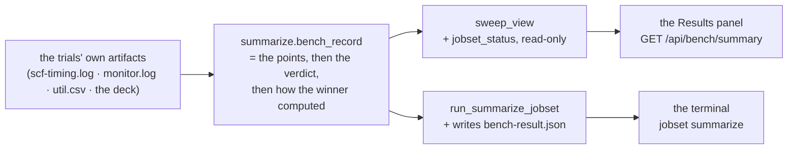

**Both readers ask the same composer**, and the composer is `bench_record`.
Its own docstring is the authority: *"Both readers of a sweep come through
here, and that is the whole point"* — the two paths each used to compose the
record themselves and then differed, only the writing one enriching `choice`
with `_winner_mechanism`, so one sweep gave two verdicts depending on which
door you came through.

**They differ AFTER it, and only in what they do with the record.**
`sweep_view` adds live per-trial status and returns; it opens no saved file,
so the panel recomputes on every request and can show a sweep mid-flight,
which a snapshot cannot. `run_summarize_jobset` writes `bench-result.json`
(for the Bench card) and hands back a report the CLI PRINTS.

| reader | how it gets the summary | writes a file? |
|---|---|---|
| the Results panel | `/api/bench/summary?path=<job-set.json>` → `sweep_view` → `bench_record` | **no** |
| the terminal | `jobset summarize bench <stage>` → `run_summarize_jobset` → `bench_record` | **`bench-result.json`**, then prints the report |

> *This section named `sweep_view` as the composer for BOTH readers and said
> "it writes nothing", until 2026-09-05. `jobset summarize` has never called
> `sweep_view` — that function's only caller is `web/blueprints/bench.py` —
> and the terminal path does write. Stated wrong in the one section written
> to stop this being re-derived.*

**Why this is stated here rather than re-derived.** Answering *"where does
the bench summary come from"* has cost two full re-derivations, each of
which walked the same five modules to reach the same answer. The relation is
three facts — one composer, two presentations, no intermediate file — and
they are cheap to write down and expensive to rediscover.

> **What the terminal used to do, and why it stopped** *(2026-09-04, user
> ruling: "that can be simplified by integrating that into the CLI, which
> basically prints out instead of writing to a text… I don't see the bench
> summary dot text is a necessary function to keep")*. `jobset summarize`
> wrote `bench-recommendation.txt` beside the sweep. Measured across the
> whole project tree: **zero** of them had ever been written. The use it was
> built for — submit a sweep to a cluster, come back to the directory and
> read the answer — is served by asking, which is what a terminal is for.
> A report nothing consumes is a print.

#### The one thing still persisted, and its reader

`bench-result.json` is the sweep's **archival record**: the trials, their
measured numbers, the machine each ran on, and the verdict. It is what
survives if the trials' artifacts are archived or deleted, and it is the
only thing that does.

**Nothing reads it.** It had one reader, `_cli.py::_measured_on`, whose one
caller was `_cli.py::_refuse_if_measured_elsewhere`, whose only caller was a
test — so a green suite proved a rule the product never applied.
`submission.md` § S3 documented that refusal as active. Both functions and
the test are deleted (2026-09-04) and § S3 now says so.

The premise it guarded is gone, and the code says where:
`prep_inputs.prep_run_inputs`' step 2, *"THERE IS NO SECOND RUNG. A benchmark's verdict was folded in here
until 2026-09-02… what the run uses is what that person then wrote in
`execution`."* Nothing carries a verdict into a launch any more, so there is
no boundary left to cross.

So the record is kept for the archival reason and **for that reason alone**;
the dead refusal that pretended to read it is deleted.

**Settled 2026-09-06 (user): keep it — archiving a sweep IS a use.** The
condition this paragraph left open — *"if archiving a sweep is not a use
anybody has, this file is the next thing to retire"* — is answered, and the
answer is no retirement. `bench-result.json` stays for the reason stated
above, and **"nothing reads it" is not a reason to revisit that**: the record
exists to outlive the artifacts it was computed from, so having no live
reader is its normal condition rather than evidence against it. The question
was re-derived once more on 2026-09-06 and brought back as if open, which is
what this whole section exists to prevent.


## 8. Where it stands, and where it is going

### Shipped today (command line)

The `JobSet` model and persistence; the description-to-plan derivation at
`prep` (§ 4 — the `ParameterSet`, one deck and wrapper per element); all five
verbs (`init` / `prep` / `launch` / `summarize` / `status`) in
both `submit` and `direct` modes; SLURM submission with routing domains, **one
job per invocation**; and the full benchmark workflow through the same loop
(§ 7). Saving and re-entering a calculation's states is `molbuilder checkpoint`
([`running-a-job.md § 6`](?doc=execution/running-a-job.md)).

> **No dependency chains** (§ 2, decision 6; § 3's *"there is no edge anywhere
> in this picture"*): one `sbatch` per invocation, sending the job's own header.

### Where the web stands, and what other engines wait on

This is the migration the project is undertaking, planned in
[`plans/plan.md`](?doc=plans/plan.md) (**E7** the cluster half; the web plan view, W14, was dropped on 2026-09-10) — and its first phase shipped:

- **✅ Phase 1 — the browser writes the description** *(shipped; proven end
  to end 2026-08-19)*. The parameter tabs hand over to the shared **Task
  setup** tab, which writes the same template + `task.json` the CLI verb
  writes ([`web/task-setup.md`](?doc=web/task-setup.md),
  [`web/handover-procedure.md`](?doc=web/handover-procedure.md)); the
  target's `prep` derives the `JobSet` from it as ever (§ 4).
- **Phase 2 — web Plan + Status (read-only), still open.** Reusing the
  *already-shipped* run decoder in the browser, with no new parser. **A
  branch control was planned here and is not needed**: the checkpoint rework
  removed the verb, and forking is restore-then-save — both already routed
  and both already in the sidebar panel
  ([`checkpointing.md`](?doc=execution/checkpointing.md) § 7.1).
- **Phases 3–4 — transport and spectra, gated on the cluster milestone.**
  One engine seam each (§ 9), teaching `prep` to render that engine's decks
  from a description, with their tab mirrors — behind the hard gate: prove
  the ladder end-to-end (describe → prep → submit → monitor) **on a real
  cluster** before broadening. *(PySCF was listed here and crossed early: it
  shares the deck pipeline, its seam landed 2026-08-18, and the 2026-08-19
  workstation E2E drove it — see `archive/2026-09-01-roadmap.md`'s migration box.  The
  SPECTRA half opened 2026-08-20 by user ruling, workstation-scoped:
  `docs/archive/2026-08-20-spectra-migration-plan.md` — not a new seam but the PySCF
  seam learning the `vibration` calculation kind, which is why it may
  precede the cluster milestone: it touches no submit-layer code.)* *(Transport
  crossed 2026-08-29 as the composite — and WITHOUT lifting the
  single-parent limit: the citation composes at prep, so the job set still
  carries no edges; a bias scan chains inside ONE submission's walker.)*

Also out of scope for now: **multi-node MPI** (v1 fixes one node), and a
`molbuilder config init --site` command (a site preset ships only as a JSON
example file today).

Run reports — the monitor telling Slack, Discord or molbuilder's own listener
how a run is going — are [`run-reports.md`](?doc=execution/run-reports.md)'s.

The through-line: the CLI framework on this page is the settled foundation, and
the web work is *additive on top of it* — it reuses the same five-step
`prep`, decoders, and wrappers rather than reinventing them.

---

## 9. A developer's map

### 9.1 Prep and launch — one framework, layer by layer

Both verbs are built the same way, and each layer has one role. A **surface**
collects what the person said and prints the answer; **one entry** per verb is
what both surfaces call; **the work** says which members it acts on; **one
member planner** per verb plans a member; a **run filler** fills that member's
run by its layout; for a launch, a **submission builder** says how the
members are sent, asking the member planner for each; then the folder is
**saved, the plan written, the job sent, the records written**. Underneath, the **doors** answer facts and never write. Every layer
above the doors decides; nothing is written until the plan is whole, so a
refusal writes nothing but its line in the ledger.

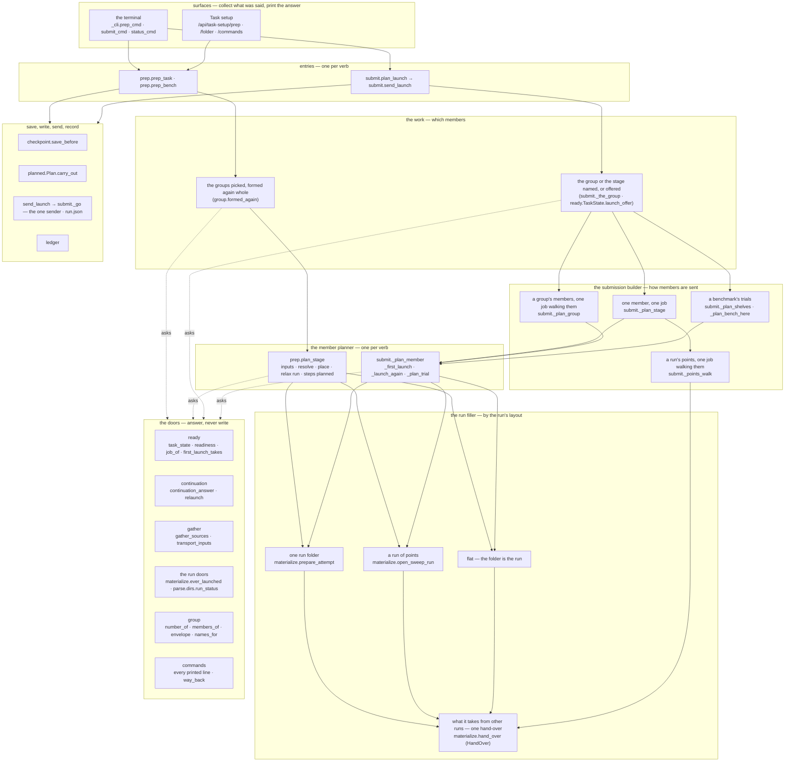

| layer | its role | `prep` | `launch` |
|---|---|---|---|
| surface | collect what was said — the flags, a question's answer — and print the answer; decides nothing | `_cli.prep_cmd`, `POST /api/task-setup/prep` | `_cli.submit_cmd`, the `launch` verb (`_launch_unit` puts the question) |
| entry | the verb's one function, whichever surface called; owns the save and the record | `prep.prep_task` (a task's groups), `prep.prep_bench` (one stage's benchmark) | `submit.plan_launch` (the plan, a refusal written down) → `submit.send_launch` |
| the work | which members: by the description's groups, matched by their members | `_prep_groups`: the groups picked — a pick missing a group a changed job's members are in is refused, naming it (`group.formed_again`); a launched member refused first | `_the_group`: the group named or offered, or one stage launched again; a launched group's members fixed |
| member planner | one member — what it is, what it takes, its checks, its run — planned with nothing written | `prep.plan_stage`: inputs, step 2 resolved, launch values stated and placed, a force-constant stage's `relax` run, the steps planned (`prep_calculation`) | `submit._plan_member`: `_first_launch` (what it builds on, from the ready door; the prepared stage checked against `plan_stage`, quiet) or `_launch_again` (from `_newest_launched`); `_plan_trial` for a benchmark's trial |
| run filler | fill the member's run by its layout | `prep_calculation` opens `run-0` with the stage's own files (`materialize.prepare_attempt`, `open_sweep_run`) — nothing taken from another run | the same openers, then prep's own files back (`_prep_files_back`) and what it takes, each one hand-over carried out by `materialize.hand_over` (§ 5.4): the run it continues from (`prepare_attempt`), a gather (`gather.gather_into`) or the one its last run was given (`_carry_the_gather`); a run of points' takeovers and starts (`_points_walk`); a flat run's record at the send (`_go`) |
| submission builder | how the members are sent — it asks the member planner for each member, then builds the job | — (prep sends nothing; every job's one header is planned with its members — a group's, a run of points' walk's, a benchmark's shelves', `prep.walk_header_of`) | one job (`_plan_stage`, which hands a run of points to `_points_walk`); a group's walk (`_plan_group`); a benchmark's shelves (`_plan_shelves`, `_plan_bench_here`) |
| save, write, send, record | only once the plan is whole | `checkpoint.save_before`, `Plan.carry_out`, `_record_prepared` | `send_launch`: the folder as planned, the save at a group's first launch, `Plan.carry_out`, `_go`, each member's `run.json` |

**The doors** — one answer each, asked by every layer above and by `status`,
the Results tab and Task setup, so no two readers can disagree:

| door | the question it answers | asked by |
|---|---|---|
| `ready.task_state` → `TaskState` | the task read once: every stage's answer and every group's; what `prep task` and `launch task` offer | prep's question, launch's offer, `status`, the folder and commands routes, init's next line |
| `ready.readiness` | one stage: described, prepared (ready, or why not — `blocked`: waits, regrouped, unreadable, again) or launched | `task_state`, the displacement sweep |
| `ready.job_of` | is a stage prepared — its row in `job-set.json` | prep, the gather, the launch verb |
| `ready.first_launch_takes` | what a stage's first launch takes, every kind's refusal with it | the ready door's answer, `_first_launch` |
| `continuation` | which run a stage continues from — by default, named, or launched again (`relaunch`) | the ready door, both planners |
| `gather` | a transport rung's inputs, under three gates | `first_launch_takes`, `_launch_again --gather` |
| `materialize.ever_launched`, `rundir.run_state_of` (`parse.dirs.run_status`), `materialize.latest_attempt`, `runrecord.newest_run` | was a stage launched; how a run stands; a stage's newest run folder; the newest run in a folder — where a stage's runs share it, its newest launched; in a run's own folder, its newest try | every layer |
| `group` | a stage's group (`number_of`), a job's members (`members_of`), what members share (`envelope`), a job's file names (`names_for`) | both verbs, the ready door |
| `commands` | every line a person types, and the one way back (`way_back`, `redo_launched`) | every refusal and answer |

**One `prep task`, through the layers** — two groups picked, the second of
two members:

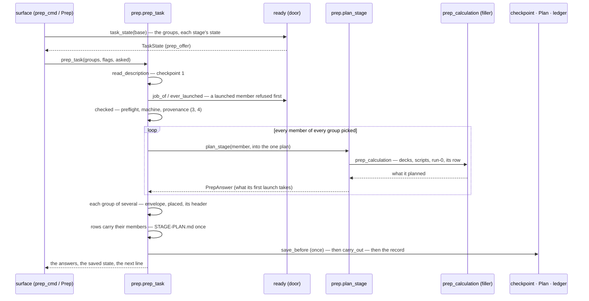

**One `launch task`, through the layers** — a group's first launch:

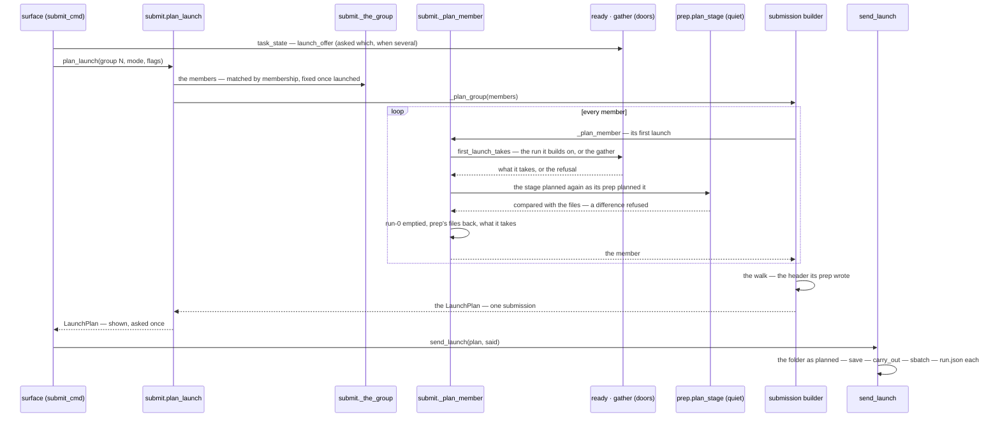

### 9.2 Where each responsibility lives

For someone extending the framework:

| Concern | Module |
|---|---|
| The data model + `job-set.json` read/write + `validate()` | `molbuilder/jobset/model.py` |
| The description + this machine → `ParameterSet` (`prep` step 2; the config ↔ exchange translation boundary) | `molbuilder/resolve.py` |
| SIESTA's stage knowledge — the shipped ladder, the warm-file declaration, the traits — consumed by the engine seam | `molbuilder/siesta/stages.py` |
| The benchmark grid — the `(G × K × c)` enumeration `prep bench` consumes | `molbuilder/bench/grid.py` |
| Lay out the materialized tree — job folders with their copies; a stage's number and folder, read off the disk (`stage_home`); the one opener of every run folder (`open_run`: a stage's attempt, a trial's, a bias point's — each stamped with the containers above it; a submission's `launch/` stamped by `open_container`); what a run takes from other runs, one hand-over (`HandOver`, carried out by `hand_over`, § 5.4) | `molbuilder/jobset/materialize.py` |
| The prep verb's entries, which the command line and the Task setup tab both call (§ 5.3): `prep_task` (a task's groups — read and checked once, every member into one plan, each group's header `group_header`) and `prep_bench` (one stage's benchmark), each → `PrepAnswer`; the description read and checked (`read_description`, `checked`); the one member planner, `plan_stage` (launch asks it too, quiet), handing the steps to `prep_calculation` into a `jobset.planned.Plan` — [`script-preparation.md`](?doc=execution/script-preparation.md) § 3, decided with nothing written; the save (`checkpoint.save_before`), the writing (`Plan.carry_out`), the record; a benchmark prepared (`prepared_already`) and the stages that fix the shape (`prepared_stages`) | `molbuilder/jobset/prep.py` |
| The engine seam — an engine's deck writer, its data files, its warm declaration and traits, its config class (one map for every caller) | `molbuilder/jobset/engines.py` |
| A job's placement — queue, wall, memory, ranks, cores, GPUs with their sources — and its fit, said (§ 6.0); the launch-value check | `molbuilder/jobset/placement.py` |
| A benchmark's shelves — its trials by side and exact ask, widest first (`shelves_of`), and each shelf's one request (`shelf_request`), which prep writes each shelf's header from and launch walks | `molbuilder/jobset/shelves.py` |
| The refusal type every floor raises (`PrepError`), and the person's errors said as one (`user_error_as_prep`) | `molbuilder/jobset/errors.py` |
| A transport rung built from the description as it reads now — its junction composed (`composed_for_prep`), resolved (`resolve_transport`), its structure and electronic state (`transport_parts`), each deck's spec at its point (`transport_spec`, `at_frame`, `at_point`), its pseudopotentials (`provide_pseudos`): prep's conductor writes it, the gather renders it to compare | `molbuilder/jobset/transport_rung.py` |
| The gather door — a transport rung's inputs from the runs upstream, under three gates (`gather_sources`, `transport_inputs`), handed over with their record (`gather_into`, through `materialize.hand_over`) | `molbuilder/jobset/gather.py` |
| The calculation's machine — its record read (`machine_record`), checked (`require_activation`), and set at the first prep (`set_machine`, `configuration.md` M-3) | `molbuilder/jobset/machine.py` |
| A run's own records — `run.json` read and written through `persist`, how a run ended (its conclusion marker), `.continued-from`, `.gathered-from`, a run as they name it (`RunRef`); the newest run in a folder (`newest_run`) and the number a new one takes (`next_run`) | `molbuilder/runrecord.py` |
| What a prep receives, assembled once (A12) — the run's `(allocation, pins, chosen)` and the bench's `(points, pins, translation)`, the bench grid's cell checks, and the notes a person is told; the conductor's own assembly, beside it | `molbuilder/jobset/prep_inputs.py` |
| The human-readable plan table | `molbuilder/jobset/plan.py` |
| The launch verb's one entry — the plan (`plan_launch` → `LaunchPlan`: the work, `_the_group`; the submission builders, `_plan_stage`, `_plan_group`, `_points_walk`, a benchmark's `_plan_shelves` and `_plan_bench_here`; the one member planner, `_plan_member` — `_first_launch`, `_launch_again` — and a trial's, `_plan_trial`; placements; the exact lines), then the send (`send_launch`): the one sender, the one launch request (`_sbatch_request`); a sweep sent to a scheduler goes one job per shelf, never one per trial (§ 6.0) | `molbuilder/jobset/submit.py` |
| Per-stage status roll-up (reuses `run_status`) | `molbuilder/jobset/runstatus.py` |
| What a run continues from — the default, a named run, or why it is refused — as one `Continuation`, the files it carries included; a stage launched again (`relaunch`); the one rule for a run to build on (§ 5.4) | `molbuilder/jobset/continuation.py` |
| A group — its number in `task.json` (`number_of`, `named`): what a stage builds on (`upstream_of`), the defaults (`default_groups`), the check (`check_groups`), what the members share (`SHARED`, `envelope`), a prepared job's members (`members_of`) matched by membership (`same_members`, `regrouped`) and the groups a prep forms again (`formed_again`), the job's files' names (`names_for`; a job already written, `header_of`) | `molbuilder/jobset/group.py` |
| The ready door — the task read once (`task_state` → `TaskState`); each stage's answer (`readiness`: described / prepared — ready to launch, or why not — / launched); prepared, its job (`job_of`); what a first launch takes, every kind's refusal with it (`first_launch_takes`); the groups and the offers `prep task` and `launch task` make (*The task*) | `molbuilder/jobset/ready.py` |
| Every command a verb or a refusal prints for a person to type, and the one way back (`way_back`, `redo_launched`); a launch and the way back as a text read later says them (a deck's header, a run script's banner, a result's remedy) | `molbuilder/jobset/commands.py`; `molbuilder/identity.py::launch_as_typed`, `deck_launch`, `way_back_words` |
| The sweep's reader — trials' artifacts → `bench-result.json` (the pure timing parsers are `molbuilder/bench/result.py`) | `molbuilder/jobset/summarize.py` |
| The decision ledger (`jobset-decisions.log`, one JSON object per decision) | `molbuilder/jobset/ledger.py` |
| The CLI verbs (`molbuilder jobset …`) | `molbuilder/jobset/_cli.py` |
| The jobs launched from this machine — each launch's address, written by the one sender, read fresh (§ 6.0a) | `molbuilder/joblist.py`; the verbs, `molbuilder/jobs_cli.py`; a queue job asked of the scheduler, `molbuilder/scheduler/queue.py`; each member's state, `runstatus.job_members` |
| The `.sbatch` header emission (shared with single-job) | `molbuilder/runwrap.py::render_sbatch` |

**To add a new engine to the job system**, you write **one engine seam** — the
plugin that teaches `prep` step 3 to render that engine's decks from a resolved
config ([`generator.md § 7`](?doc=execution/generator.md)) — and nothing else.
The verbs, the materializer, the submitter, and the status layer are all
engine-agnostic and pick it up for free. That is the whole payoff of decision
#1.
