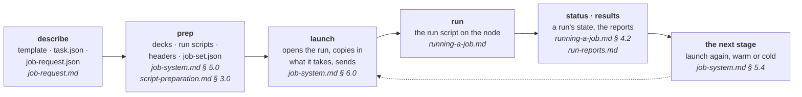
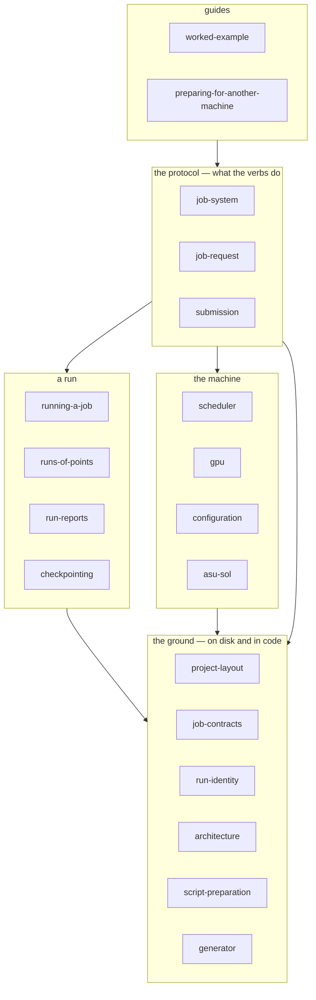

# Execution — from a described calculation to its results

**Role:** overview
**Domain:** execution
**Owns:** the routes into the execution chapters — which chapter answers which
question — and nothing else. Every rule is stated in the chapter that owns it.
**Read with:** [`docs/README.md`](?doc=README.md) — the index of the whole tree.

## The short version

- **Everything is a job set.** One calculation, a ladder of stages and a
  benchmark go through the same verbs — `molbuilder describe`, then
  `molbuilder jobset prep`, `launch` and `status` — and there is no separate
  single-job path ([`job-system.md`](?doc=execution/job-system.md) § 1).
- **The browser describes, prepares and observes; the terminal launches.**
  Task setup's Prep buttons call the same prep the terminal does
  ([`job-system.md`](?doc=execution/job-system.md) § 5.0); launching spends a
  queue slot and stays at the terminal
  ([`web/task-setup.md`](?doc=web/task-setup.md) § 1).
- **Each chapter owns its facts once.** § 1 follows a calculation through its
  steps and names the chapter that owns each step; § 2 finds a chapter by
  question; § 3 lists every chapter with its role.
- **Three kinds of chapter, and this page.** A *contract* states the rules —
  when it and anything else disagree, the contract wins and the other is a
  bug. A *guide* shows how to do something with what exists, pointing at the
  contracts. A *reference* records facts about one machine or one moment. This
  page is an *overview*: it routes and states nothing. What is still to be
  built lives only in [`plans/plan.md`](?doc=plans/plan.md).

---

## 1. A calculation's steps, and the chapter that owns each

| step | what happens | the owner |
|---|---|---|
| describe | the portable description: the template, `task.json`, `job-request.json` — no machine named | [`job-request.md`](?doc=execution/job-request.md), [`engines/stages.md`](?doc=engines/stages.md) |
| prep | checks, then writes every deck, run script and header for the named machine's record; saves the folder's state first | [`job-system.md`](?doc=execution/job-system.md) § 5.0; inside it, [`script-preparation.md`](?doc=execution/script-preparation.md) § 3.0 |
| place | the queue the job names, its fit printed, the header written | [`scheduler.md`](?doc=execution/scheduler.md) R6, § 6a |
| launch | opens the run folder, copies in what the stage takes, sends after one question | [`job-system.md`](?doc=execution/job-system.md) § 6.0; [`submission.md`](?doc=execution/submission.md) S4 |
| run | the run script: environment, counts, the wall, how the run ends | [`running-a-job.md`](?doc=execution/running-a-job.md) |
| a run of many points | one run walking its points (a bias sweep, a vibration's calls) | [`runs-of-points.md`](?doc=execution/runs-of-points.md) |
| watch | the monitor beside the run; its events and reports | [`run-reports.md`](?doc=execution/run-reports.md) |
| status | each stage's and group's state, and the next step | [`job-system.md`](?doc=execution/job-system.md) *The states*, *The next step*; a run's state [`running-a-job.md`](?doc=execution/running-a-job.md) § 4.2 |
| continue | what the next stage takes, launching again, `--from`, `--cold` | [`job-system.md`](?doc=execution/job-system.md) § 5.4 |
| keep and go back | saved states, when molbuilder saves, restoring | [`checkpointing.md`](?doc=execution/checkpointing.md) |

The same calculation, walked from start to end with real commands and output, is
[`worked-example.md`](?doc=execution/worked-example.md).

---

## 2. Find the chapter by question

### For the person running calculations

| You want to… | Open |
|---|---|
| see the whole road once, with real commands | [`worked-example.md`](?doc=execution/worked-example.md) |
| know what each verb does, what it refuses and the way on | [`job-system.md`](?doc=execution/job-system.md) — the verb table § 5.3, the refusals |
| say how and where a calculation runs — its run cards, groups, queue, reports | [`job-request.md`](?doc=execution/job-request.md) |
| run stages that build on each other in one job | [`job-system.md`](?doc=execution/job-system.md) § 6.0, *A sequence of groups*; groups [`job-request.md`](?doc=execution/job-request.md) § 3.3 |
| know why a run is *queued*, *running*, *finished* or *failed* | [`running-a-job.md`](?doc=execution/running-a-job.md) § 4.2 |
| see or stop the jobs launched from this machine | [`job-system.md`](?doc=execution/job-system.md) § 6.0a, `molbuilder jobs` |
| understand a bias sweep's or a vibration's points: *done*, *not run*, *still to run* | [`runs-of-points.md`](?doc=execution/runs-of-points.md) § 4 |
| be told when a run ends or fails | [`run-reports.md`](?doc=execution/run-reports.md) |
| save the folder, see its history, go back | [`checkpointing.md`](?doc=execution/checkpointing.md) § 5, § 7; when molbuilder saves by itself, § 9 |
| prepare here for a cluster | [`preparing-for-another-machine.md`](?doc=execution/preparing-for-another-machine.md) |
| measure which resources run fastest | [`generator.md`](?doc=execution/generator.md) § 4.3a; the verbs [`job-system.md`](?doc=execution/job-system.md) § 7 |
| use a GPU | [`gpu.md`](?doc=execution/gpu.md) |
| know what a queue offers and where a job is placed | [`scheduler.md`](?doc=execution/scheduler.md); ASU Sol's own facts [`asu-sol.md`](?doc=execution/asu-sol.md) |
| set molbuilder's own settings, or read a machine record | [`configuration.md`](?doc=configuration.md) § 4, § 5 |
| find where a file is and who wrote it | [`project-layout.md`](?doc=execution/project-layout.md) § 1.1 (the tree), § 2 (the lifecycle), § 5 (every file and its writer) |
| know why a calculation continues from an earlier one, or does not | [`run-identity.md`](?doc=execution/run-identity.md) |

### For the person changing the code

| You want to… | Open |
|---|---|
| know which layer decides what, and which function to call for a fact | [`architecture.md`](?doc=execution/architecture.md) — the floors § 2, the doors § 3.2 |
| know whether a launch value is stated, defaulted or refused | [`architecture.md`](?doc=execution/architecture.md) § 5.2 |
| add an engine, or change what prep writes | [`script-preparation.md`](?doc=execution/script-preparation.md) § 3.0, § 4 |
| name, find or parse a run file | [`job-contracts.md`](?doc=execution/job-contracts.md) § 2.2a, § 6.3 |
| add or change a persisted file and its schema | [`job-contracts.md`](?doc=execution/job-contracts.md) § 6.1; the generated file list [`project-layout.md`](?doc=execution/project-layout.md) § 5 |
| change what the run script does on the node | [`running-a-job.md`](?doc=execution/running-a-job.md); its blocks [`job-contracts.md`](?doc=execution/job-contracts.md) § 2.6 |
| change a rule of the saved history | [`checkpointing.md`](?doc=execution/checkpointing.md) §§ 11–16 |

---

## 3. Every chapter, its role, what it owns

| chapter | role | owns |
|---|---|---|
| [`job-system.md`](?doc=execution/job-system.md) | contract | the jobset protocol: the words, groups, stage states, prep, the verbs, what a stage takes, launch, sequences, refusals |
| [`job-request.md`](?doc=execution/job-request.md) | contract | `job-request.json`: run settings, the keys, groups and what they share, a launched stage's request, `jobset migrate` |
| [`project-layout.md`](?doc=execution/project-layout.md) | contract | the calculation folder on disk: levels, who creates each folder, record files, the file list, invariants |
| [`job-contracts.md`](?doc=execution/job-contracts.md) | contract | file formats and names: the catalogue, the name grammar, run-script blocks, deck blocks, warm files, the schema registry |
| [`run-identity.md`](?doc=execution/run-identity.md) | contract | the label, the run id, and the restart group |
| [`running-a-job.md`](?doc=execution/running-a-job.md) | contract | the run script at run time, and a run's states |
| [`runs-of-points.md`](?doc=execution/runs-of-points.md) | contract | one run of many points: its words, operations and states |
| [`run-reports.md`](?doc=execution/run-reports.md) | contract | the monitor, its events and reports, the channels |
| [`checkpointing.md`](?doc=execution/checkpointing.md) | guide and contract | saved history: the verbs and panel, when molbuilder saves, the rules |
| [`scheduler.md`](?doc=execution/scheduler.md) | contract | the queue model, the fit, placement, the header and the send line |
| [`submission.md`](?doc=execution/submission.md) | contract | the sending rules: nothing goes unseen, one job at a time |
| [`gpu.md`](?doc=execution/gpu.md) | contract | which GPU questions are molbuilder's, every GPU name, rules G1–G11 |
| [`generator.md`](?doc=execution/generator.md) | contract | the benchmark: `ParameterSet`, the grid, pins, shelves, the winner |
| [`architecture.md`](?doc=execution/architecture.md) | contract | the floors, the doors, the value ladder, rules A1–A18 |
| [`script-preparation.md`](?doc=execution/script-preparation.md) | contract | prep's steps, the engine seam, the pipeline log |
| [`configuration.md`](?doc=configuration.md) | contract | configuration files, `molbuilder.json`, the machine record, M-1…M-6 |
| [`preparing-for-another-machine.md`](?doc=execution/preparing-for-another-machine.md) | guide | prep here, for there: `prep --target` |
| [`worked-example.md`](?doc=execution/worked-example.md) | guide | the one two-stage walk-through |
| [`asu-sol.md`](?doc=execution/asu-sol.md) | reference | a dated snapshot of ASU Sol; the probed record is the live source |

Two neighbours outside this folder hold what a calculation *is*:
[`engines/stages.md`](?doc=engines/stages.md) (a stage, and the description)
and [`engines/template.md`](?doc=engines/template.md) (every parameter and its
layer). The Task setup tab that writes a description is
[`web/task-setup.md`](?doc=web/task-setup.md).

---

## 4. How the chapters lean on each other

**Read the arrows as "is defined in terms of".** A guide uses the protocol;
the protocol says what happens to runs and on which machine; all of them rest on
what is on disk and which code decides it. A chapter that needs a fact from
another links to the owner's section rather than saying it again.
