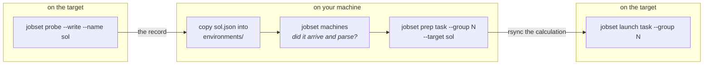

# Preparing for another machine — probe there, prep here, run there

**Role:** guide
**Domain:** execution
**Owns:** the road for preparing a calculation on one machine to run on
another (`prep --target`), what travels with it, and how the choice of machine
is refused when nobody made it (§ 4).
**Read with:** [`configuration.md`](?doc=configuration.md) § 5 — the machine
record (M-1: fact vs preference; M-3: a calculation keeps the record of its
first prep) · [`configuration.md`](?doc=configuration.md) § 4 —
`molbuilder.json` and the environment bootstrap ·
[`job-system.md`](?doc=execution/job-system.md) § 5.0 — prep ·
[`job-system.md`](?doc=execution/job-system.md) § 6.0 — launch ·
[`submission.md`](?doc=execution/submission.md) S4 — what a launch shows and
asks before anything goes ·
[`web/task-setup.md`](?doc=web/task-setup.md) § 6.4 — the machine card

## The short version

The normal case for a cluster: you set a calculation up on your own machine and
it runs on the cluster. Rendering a calculation needs the machine's facts —
its queues, its cores, how a shell enters an environment there — so the cluster
measures itself once (`jobset probe` there), you copy that record here, and
**prep runs here, prepared for the target's record** (`prep --target sol`). You
copy the calculation folder to the cluster and launch it there (§ 1, § 1a).
Everything prep writes comes from the target's record, so nothing in the folder
belongs to the machine it was prepared on (§ 2). Once a record of another
machine is here, a first prep without `--target` asks which machine instead of
guessing — this machine is always one of the choices (§ 4). A calculation keeps
the record of its first prep; when the cluster changes, § 6 is the recipe.

---

## 1. The workflow



1. **Probe on the target.** `jobset probe --write --name sol` measures that
   machine — cores, GPUs, scheduler, the `(partition, qos)` queues the account
   can reach — and writes `~/.config/molbuilder/environments/sol.json`.
2. **Carry the record to your machine**, into the same directory, and confirm it
   with `molbuilder jobset machines`.
3. **Prepare here, for there.** `prep --target sol` reads that record instead of
   the machine you are sitting at, keeps a copy of it as the calculation's own
   `environment.json`, and renders decks, run scripts and headers against the
   target's facts. The calculation is now set to `sol`
   ([`configuration.md`](?doc=configuration.md) M-3).
4. **Send the calculation and launch it there** — `jobset launch task --group N`
   on the target, the one launch door
   ([`running-a-job.md`](?doc=execution/running-a-job.md) § 5.5): started any
   other way, the run script refuses. A run starts once, and to continue is to
   launch again ([`project-layout.md`](?doc=execution/project-layout.md)
   § 1.6.1).

**Why this shape.** A browser or a laptop does not have the cluster's facts.
`--target` supplies them *as a measurement taken on the machine itself*, which is
the only honest source; preparing without it would measure the desk and call it
the cluster. Prep runs wherever you are; what it is prepared *for* is the
record it names.

## 1a. The commands, end to end

**On the target** (a login node is fine — the scheduler is read from its own
tools, not from being on a compute node):

```
molbuilder jobset probe --write --name sol
# -> wrote ~/.config/molbuilder/environments/sol.json
```

The name is yours: it is the file's stem, and what `--target` will say.
`--write` shows what it measured and asks before overwriting an existing record,
difference by difference ([`configuration.md`](?doc=configuration.md) § 5, M-6).

**On your machine**, copy the file into the same directory and confirm:

```
scp cluster:~/.config/molbuilder/environments/sol.json \
    ~/.config/molbuilder/environments/
molbuilder jobset machines
```

`jobset machines` prints every record, its path and when it was measured:

```
  sol                      slurm · 48-152 cores · 251.4-1511.2 GB · a100, a100.20gb, … · 24 domain(s)
    /home/you/.config/molbuilder/environments/sol.json
    measured 2026-10-19T16:34:25+00:00
  (this machine)  [local]  slurm · 48-64 cores · a100 · 2 domain(s)
    /home/you/.config/molbuilder/environment.json
```

It is the step that answers *"did the copy land, and does it parse?"* — a record
that is present but corrupt is **listed and marked**, never skipped, because a
silently dropped record looks exactly like one that was never copied.

**Then prepare, and send it** — from the projects root, so `--bundle` (a path
from the projects root) and rsync's folder are the same path:

```
molbuilder jobset prep task --group 1 --bundle Au-BDT-Au/optimization/Relax --target sol
rsync -a Au-BDT-Au/optimization/Relax/ cluster:~/molbuilder/projects/Au-BDT-Au/optimization/Relax/
```

`launch` is not run here: a job starts where it runs.

**Where the records are.** In the config directory —
[`configuration.md`](?doc=configuration.md) § 2.1c: `$MOLBUILDER_CONFIG_DIR`,
else `$XDG_CONFIG_HOME/molbuilder`, else `~/.config/molbuilder`. With neither
variable set:

| | path |
|---|---|
| this machine's record | `~/.config/molbuilder/environment.json` |
| a named target | `~/.config/molbuilder/environments/<name>.json` |
| the calculation's copy | `<calculation>/environment.json`, written by its first prep |

They are scopes, not copies of one file: `record_scopes()` walks them
calculation → named target → this machine, and the first that answers wins.

## 2. What travels, and what does not

The whole calculation folder travels; what matters in it:

| in the calculation folder | written by | why it travels |
|---|---|---|
| the decks, run scripts and headers | prep | that is the point |
| `task.json`, the template, `job-request.json` | describe / Task setup | the description and how it runs — launch reads the job request for its groups ([`job-request.md`](?doc=execution/job-request.md) § 7) |
| `job-set.json` | prep | what each job is, and where it was placed |
| the pseudopotentials | copied in at prep | the files are the same everywhere; the library path is not ([`project-layout.md`](?doc=execution/project-layout.md) § 2.6) |
| the structure pair | copied in | the same reason |
| `environment.json` | the first prep | the target's facts are a fact of the calculation, not of whoever prepared it |

**The bootstrap and the environment inventory ride that record.** How a shell
enters an environment on the target (`env_init`: its preamble and activation)
and which environments exist there are facts of that machine, on its record
([`configuration.md`](?doc=configuration.md) § 5, M-1). The bootstrap is declared
once, in that machine's own `molbuilder.json`, and `jobset probe --write` copies
it into every record it writes; so probe Sol on Sol, copy `sol.json` here, and
`prep --target sol` bakes Sol's `module load` and `activate` into the run script,
verbatim — not this workstation's. To change it, change that machine's
`molbuilder.json` and probe there again; a record that states none is refused at
prep, saying where to declare it. Which environment you *want* for a category
stays a preference in `molbuilder.json`
([`configuration.md`](?doc=configuration.md) § 4).

**Nothing else prep writes names the machine it was prepared on**: the decks,
run scripts and headers of a prepared calculation carry no absolute path of
this machine — the bootstrap lines are the target's.

## 3. The bootstrap travels on the record

What it means here is § 2, *The bootstrap and the environment inventory ride
that record*; how the bootstrap is declared and
copied is [`configuration.md`](?doc=configuration.md) § 4 and § 5 (M-1).

## 4. Choosing the machine is the user's, always

**A question with several answers is never answered by default.** Being asked
which machine costs one flag; being given the wrong one costs a queue wait, an
allocation, and numbers that look plausible — a benchmark prepared on a
workstation measured against the desk. The rule is `record.machine_for`'s, and
each refusal names the way on:

| # | situation | what prep does |
|---|---|---|
| **C1** | a record of another machine exists — this machine always counts as a choice — and no `--target`, at a calculation's first prep | refuses, naming every record and `--target this` for this machine (`AmbiguousTarget`) |
| **C2** | `--target` names another machine than the one the calculation is set to | refuses (`UnknownTarget.conflict`): to go on, `--target <the machine it is set to>`; to prepare it for the other, the state saved before its first prep and a prep anew ([`configuration.md`](?doc=configuration.md) M-3) |
| **C3** | `--target sol` where `sol.json` exists but cannot be read — malformed, or a schema this molbuilder does not read | refuses (`UnknownTarget.unreadable`): you named it, so an unreadable record is an error, never a miss; the named record is checked whole before any scope is walked |
| **C4** | `--target` names a record that does not exist | refuses (`UnknownTarget`), listing the known ones and how to write the missing one |

- **Only this machine's own record, and no `--target`, proceeds**: there is
  nothing to ask. Any record of another machine makes the question real, even
  when this machine has no record of its own yet (`record.machine_for`).
- **A calculation already prepared needs no `--target`**: its own copy answers,
  and names the machine it is set to — `machine` in its `environment.json`, the
  `--target` name or `this`. A person holding a copied calculation reads there
  what it was prepared for.
- **The calculation's own copy is refused when it cannot answer**: unreadable
  (`UnknownTarget.unreadable_copy` — `jobset migrate` rewrites an older
  molbuilder's copy; otherwise fix it, or go back to the state saved before the
  first prep), or naming no machine (`UnknownTarget.unnamed_copy` — go back to
  that state and prep again, naming the machine).

## 5. What the browser may offer

The Task setup tab offers the same choice under the same rules — its machine
card, the `--target` it puts in the commands it teaches, and what it shows of a
calculation already set to its machine:
[`web/task-setup.md`](?doc=web/task-setup.md) § 6.4.

## 6. When the machine has changed

Nothing expires a record: a cluster that changed its partitions, its machines or
its installed environments since the probe is prepared against the old answer
until it is probed again. The record carries when it was measured
(`detected_at`), and `jobset machines` prints it.

1. **Probe again on the target** — `jobset probe --write --name sol`; it shows
   each difference and asks before overwriting.
2. **Copy the record here again**, and check its date with `jobset machines`.
3. **A calculation not yet prepared** takes the new record at its first prep.
4. **A calculation already prepared keeps the record of its first prep**
   ([`configuration.md`](?doc=configuration.md) M-3). To prepare it against the
   new one, go back to the state saved before its first prep and prep again with
   `--target`. `checkpoint list` shows the folder's states, newest first; the one
   to restore is the oldest whose note reads *before prep …*:

   ```
   molbuilder checkpoint list -p <folder>
   #  87431b7  2026-10-30 19:03:24 · before prep task group 1 (seed, electrode_L, electrode_R), …
   #  fd72434  2026-10-30 19:01:58 · before saving the description
   molbuilder checkpoint restore 87431b7 -p <folder>
   molbuilder jobset prep task --group 1 --bundle <project>/<topic>/<calculation> --target sol
   ```

   `-p` takes the calculation's folder as a path from where you are; `--bundle`
   names it from the projects root.

   Using saved states is [`checkpointing.md`](?doc=execution/checkpointing.md)
   § 5.
