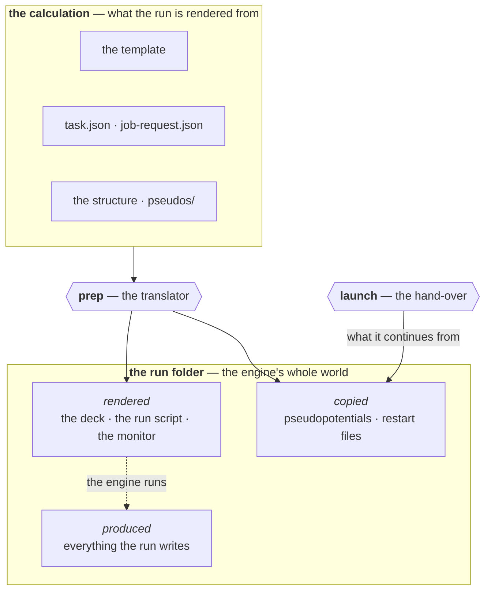
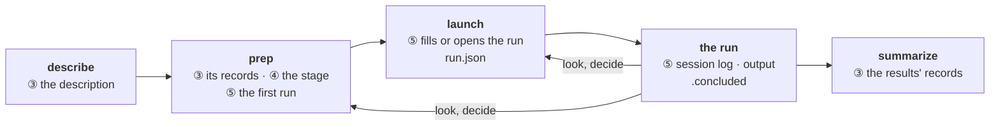

# The project directory — what lives where, and who puts it there

**Role:** contract
**Domain:** execution
**Owns:** the calculation folder on disk — its levels, which act creates and stamps each folder, what a folder is (`calcdir.json`, `calcdirs.where`), one start per run, the run's record files, copy never link, the manifest of every file (§ 5, generated), and the invariants across levels.
**Read with:** [`job-contracts.md`](?doc=execution/job-contracts.md) § 6.3 (every name) · [`job-system.md`](?doc=execution/job-system.md) § 5.0, § 5.4, § 6.0 (what prep and launch decide) · [`running-a-job.md`](?doc=execution/running-a-job.md) § 4.2 (how a run's state is read) · [`runs-of-points.md`](?doc=execution/runs-of-points.md) § 2.4 (a run of points' folders) · [`checkpointing.md`](?doc=execution/checkpointing.md) § 9 (the saved history) · [`configuration.md`](?doc=configuration.md) § 5 (the machine record)

---

## The short version

- **A calculation is one folder you can copy anywhere.** Its description sits at
  the top and names no machine (§ 2.1).
- **`prep` adds a folder per stage and opens the stage's first run in it;
  `launch` fills the run it sends, opens every later run, and records that it
  sent it; the run writes only inside its own folder.** The whole order is one
  table (§ 2).
- **A run is one start.** `run-<n>/` holds one start of its run script. To
  continue is to launch the stage again, which opens `run-<n+1>/` beside it
  (§ 1.6.1). What a run computed is never changed (§ 1.5).
- **Every file goes into a run as a real copy, never a link** (§ 1.6.5).
- **Every folder says what it is**: `task.json` at the calculation,
  `calcdir.json` in every folder below it, read by one door, `calcdirs.where`
  (§ 1.4a).
- **Every file molbuilder writes has one row** in the manifest: who writes it,
  and the one function that reads it (§ 5, generated from the catalogue).

**Reading map.** Code cites these section numbers, so they keep their order.
Read them by what you need:

| you want | read |
|---|---|
| the tree, level by level | § 1.1 — a run of points' branch is [`runs-of-points.md`](?doc=execution/runs-of-points.md) § 2.4 |
| which act puts what where, in order | § 2 (the lifecycle), § 2.6 (each level's writer) |
| the rules you meet as a user | § 1.5 (a run is not changed), § 1.6.1 (one start), § 1.6.5 (copies), § 1.6.6 (a group is one job), § 1.5a (a trial runs once) |
| why it is built this way | § 1.0, § 1.4, § 1.5b, § 1.6, § 3 |
| developer reference | § 1.4a (`calcdir.json`, `where`), § 1.6.2 (the opener), § 1.6.3 (the run's records), § 4 (folder names and the doors that find them), § 5 (the manifest), § 7 (the invariants) |
| a step another chapter decides | § 2.2–§ 2.3.3 are short pointers to it |

---

## 1. One layout: a folder per stage, a folder per run

### 1.0 What the run directory is

> **The run directory hands the engine everything it needs and holds
> everything it produces.** *(the user, 2026-08-11)*

Every file in a run folder got there one of three ways:

| how | examples |
|---|---|
| **rendered** by `prep`, from the template and the description | the deck, the run script, the monitor (`mb_monitor.pyz`) |
| **copied** as it is | the pseudopotentials, the restart files of the run it continues from |
| **produced** by the run | everything the engine, the run script and the monitor write |

**A product has one home: its run.** An input may sit at two levels — the deck
is rendered in the stage's folder and copied into each run — because a second
copy of an input is a convenience. A second copy of a product is a
contradiction: a reader can no longer tell which one says how the run went. So
the progress log `prep` seeds for a viewer goes into the run it opens; a stage
that opens no run keeps no seed.

**The directory wall is where the translation happens.** Above the run folder
is molbuilder's vocabulary: the template, the description, the job request.
Inside it is the engine's: its own keywords, and raw bytes. The engine does not
see the layer above; it opens what is beside it and writes beside it. `prep`
crosses the wall ([`architecture.md`](?doc=execution/architecture.md) § 10
names every translation in the system).



**Once prepared, a run folder needs only the engine's environment and a
shell.** The run script and the monitor are copied into it, not called from
elsewhere, so the run starts the same way on a laptop, a login node or inside
a scheduler's job, and everything it ran from is there to read when something
goes wrong.

**A stage that builds on another takes two things**: its own deck, which `prep`
renders from the description, and the files of the run it continues from, which
its first launch copies in (§ 1.6.5). `prep` copies nothing from another
stage's run.

**molbuilder knows its own files by name.** In a run folder molbuilder's copies
sit beside the engine's output. *Has anything run here?* is answered by setting
aside what molbuilder wrote, which the catalogue lists
([`job-contracts.md`](?doc=execution/job-contracts.md) § 2.2). That list is
what stops a copy being taken for engine output.

**This is the one layout.** `task.json` states it — `"shape": "hierarchical"`,
the one value its reader accepts (`task.of`) — and a description stating any
other is refused by name, its way out to describe the calculation again.
Nothing molbuilder writes keeps a calculation's stages or runs side by side in
one folder.

**Words.** This chapter calls the whole folder *the calculation* and the folder
the engine runs in *the run* (`run-<n>/`; the code says `attempt`). The CLI's
`--bundle` option names a calculation folder
([`job-contracts.md`](?doc=execution/job-contracts.md) § 2.5b).

### 1.1 What it looks like

A two-stage SIESTA relaxation, with the levels above it. The names are the ones
molbuilder writes for a calculation labelled `h2_siesta`:

```
projects/                                   the tree's root (job-contracts.md § 2.5)
└── H2-tests/                               ① PROJECT — the person names it
    ├── README.md                              made with the project, as is every topic
    ├── structure/  pseudopotential/  user/    ② TOPICS — storage, and a free-form one
    ├── spectrum/  transport/                  ② one run topic per calculation kind
    └── optimization/                       ②
        └── h2_siesta/                      ③ CALCULATION — the person names it; task.json makes it one
            ├── h2_siesta.template.toml        every parameter              ┐ the description:
            ├── task.json                      the stages, what varies      │ portable, names
            ├── job-request.json               how and where it runs        │ no machine (§ 2.1)
            ├── h2_siesta.source.xyz  h2_siesta.source.molstruct.json       ┘
            ├── pseudos/  H.psml               the calculation's one copy of each pseudopotential
            ├── environment.json               the machine it is set to — its first prep's
            ├── job-set.json  prepared-with.json  STAGE-PLAN.md  *.pipeline.log    prep's records
            ├── jobset-decisions.log           one line per decision of every verb
            ├── .git/  .binsnapshots/  .gitignore      the saved states (§ 6)
            ├── launch/                        only for a job of several stages: its header, walk, log
            ├── 01_coarse/                  ④ STAGE — prep
            │   ├── h2_siesta_01_coarse.fdf         the deck, rendered for the machine it runs on
            │   ├── h2_siesta_01_coarse.run.sh      its run script (+ .sbatch on a machine with a queue)
            │   ├── h2_siesta_01_coarse.validation.txt   what prep checked before it wrote the deck
            │   ├── mb_monitor.pyz  H.psml          real copies, beside the deck
            │   ├── run-0/                  ⑤ RUN — prep opened it; one start
            │   │   ├── the deck, run script, monitor and H.psml, copied in
            │   │   ├── run.json                    launch: it was sent — how, where, from what
            │   │   ├── h2_siesta_01_coarse.runwrap.log   the run script: its start
            │   │   ├── h2_siesta_01_coarse.out  .monitor.log  .util.csv  .scf-timing.log
            │   │   ├── h2_siesta.XV  h2_siesta.DM  h2_siesta.MD.nc …   SIESTA's own names
            │   │   └── h2_siesta_01_coarse.concluded   the run script's last act
            │   ├── run-1/                  ⑤ launched again: warm from run-0, or cold
            │   └── bench/                     a benchmark of this stage (§ 3)
            │       └── bench-G0N4C1/run-0/       a trial: one run, launched once (§ 1.5a)
            └── 02_tight/                   ④
                ├── h2_siesta_02_tight.fdf  …
                └── run-0/                  ⑤
                    ├── .continued-from             01_coarse/run-1
                    └── h2_siesta.XV  h2_siesta.DM  real copies, taken at its first launch
```

- **Every folder below the calculation carries a `calcdir.json`** saying what
  it is (§ 1.4a); the calculation itself is said by its `task.json`.
- **The tree is a picture.** Every file, with its writer and the one function
  that reads it, is the manifest (§ 5).
- **`<label>` is the `SystemLabel`**, the stem of every file here. It is not the
  run id, which carries the formula and lives in `task.json`
  ([`run-identity.md`](?doc=execution/run-identity.md) § 2.0a).
- **The deck repeats the stage its folder names** — `01_coarse/h2_siesta_01_coarse.fdf`
  — on purpose: a deck copied into the wrong stage folder is wrong on sight
  ([`run-identity.md`](?doc=execution/run-identity.md) § 3.2). Every name's
  rule is [`job-contracts.md`](?doc=execution/job-contracts.md) § 6.3.
- **A run's files carry no counter.** The folder is the run, and it holds one
  start (§ 1.6.1).
- **A run of points** — a bias sweep, a SIESTA vibration — holds a folder per
  point inside its run (`run-1/f001/v0.2/`, `run-1/fc/`), and prep's decks for
  them in folders below the stage. That branch, level by level, is
  [`runs-of-points.md`](?doc=execution/runs-of-points.md) § 2.4.

### 1.2 Every state stays on disk

**History is kept in space, not in time.** After three stages have run, every
stage's and every run's state is on disk at once: stage 1's relaxed geometry is
in `01_coarse/run-0/`, going back to it is reading that folder, and which run
produced a `.XV` is in its run's records (§ 1.6.3). The saved history (§ 6) is
insurance and a place to branch from — never the only way back.

### 1.4 A directory is a container or a run, never both

Every directory in this tree is one of two things:

- a **container** — it holds setup and other directories: decks, run scripts,
  the description, the shared files. All text or small.
- a **run** — one start of a run script. It holds what that start produced, and
  nothing else holds that.

The calculation, a stage, a benchmark and a trial are containers. The leaves are
runs: a stage's `run-<n>/`, or, where the stage runs per point, each point's
folder in it; and a trial's `run-0/`. Two folders are neither: the engine's
scratch of a run (a device run's `tsgf/`) and a transmission point's `shared/`
(§ 1.4a).

**This is what keeps everything downstream simple.** Setup is text, so git
holds it. Only a run holds anything big. No directory mixes the two.

**A calculation folder is one calculation**: one `task.json`, one template. A
folder holding two templates, or one under another name, is refused by name
(`template_file.of`).

### 1.4a How a directory says which one it is

**Whether a folder is a container or a run cannot be told from its name.** A
stage folder is a container; a `run-<n>/` is a run where its stage runs once and
a container where its stage runs per point; a folder a person made with one deck
in it looks like a run. So molbuilder does not guess.

> **A directory states its place. Nothing infers it.**

This is affordable because every directory in the tree is made by Python
(invariant 6a): the code that makes a folder knows what it is making, and stamps
it then.

#### Who answers, per level

| the directory | what answers | container or run |
|---|---|---|
| the **calculation** | its `task.json` | a container, always |
| **every folder below it that molbuilder made** | its `calcdir.json`, written by the code that made the folder | its `role`, stated |
| anything else | nothing | unknown — read alone, and said so |

- **The root is the root because its description is here** (invariant 2). The
  description is read through its one door, `task.of`, by the run door
  ([`architecture.md`](?doc=execution/architecture.md) § 3.2); `calcdirs` asks
  only whether it is there (`calcdirs.described`).
- **The root needs no record**: `task.json` already says the folder is a
  calculation, and a second declaration would be a second home for one fact.

#### The record — two fields

```json
{ "schema": "molbuilder/calcdir@1",
  "role":   "run",
  "of":     "../.." }
```

- **`role`** is `container`, `run`, `scratch` or `shared`: § 1.4's two words,
  and the two folders that are neither — a device run's `tsgf/`, the engine's
  scratch of the run above it
  ([`engines/transport.md`](?doc=engines/transport.md) § 2a.11), and a
  transmission point's `shared/`, the energies it shares with the finished
  calculation its calculation reuses, copied from the point that computed them
  and read with the point above it
  ([`engines/transport.md`](?doc=engines/transport.md) § 2a.16).
- **`of`** is the way to the calculation's folder, always relative. That
  survives renaming or moving a whole calculation. Copy a run out on its own and
  `of` leads nowhere; *this run's calculation is not here* is then the honest
  answer, where a search would adopt whatever it found.

**Everything else is read off the folder's place.** Given the root, what a
folder is, and the stage, run, trial and point it sits in, are read off its path
in the names the layout gives its folders: `<NN>_<stage>`
(`identity.parse_token`), `run-<n>` (`paths.attempt_index`), `bench-<point>`
(`paths.trial_point`), and the benchmark's and the launch folder's fixed names.
Storing any of them would give one fact two homes. Only container-or-run is
stored, because only the code that made the folder knew it: whether a rung runs
per point is the description's, which this floor does not read.

#### Where am I — one answer, with its context

*(The user, 2026-10-20: "a folder could be a run dir, but its calculation
information is in parent … shall we give this with a context?")* **One door
answers where a folder is: `calcdirs.where(folder)` → `Where`.** Every reader
asks it: what a folder is with its description (`runs.place_of`, the run
door's), the Results tab (`place`, [`web/results.md`](?doc=web/results.md)
§ 2.3), the checkpoint panel (*is this a calculation's folder*), and a
benchmark's summary and verbs (*whose benchmark is this*,
`materialize.bench_owner`, `bench_stage_of`).

| field | what it says |
|---|---|
| `root` | the calculation's folder — the one `task.json` is in, or the one the folder's record names; `None` for a folder no calculation claims |
| `what` | what the folder is (the table below); `None` for a folder no calculation claims |
| `role` | its record's: `container`, `run`, `scratch` or `shared`; `None` at the root, which holds no record |
| `stage` | the stage it sits in, by its token — `01_coarse` |
| `run` | the run's index — `0` of `run-0` |
| `trial` | the benchmark trial's point — `G1N4C6` of `bench-G1N4C6` |
| `point` | a point's folder, as its path below the run or the stage — `v0.2`, `f001/v0.2` |
| `run_folder` | the run's own `run-<n>/` the folder lies in — itself for a run, the one above a point's folder or a scratch folder: where the run's launch record lies |

**What a folder is, read at its place.** The last column is the same level's
name in [`runs-of-points.md`](?doc=execution/runs-of-points.md) § 2.4, which
gives each level's door.

| the folder | `what` | its role, as its creator stamps it | the run-of-points level |
|---|---|---|---|
| the root — `task.json` is here | `calculation` | none: a container | — |
| `<NN>_<stage>/` | `stage` | container | stage folder |
| `run-<n>/`, below a stage or a trial | `attempt` | run — a container when its stage runs per point | run |
| below a run of points — `f001/`, `v0.2/`, `f001/v0.2/`; `relax/`, `fc/`, `optical/f003/` | `point` | run; a container where it holds points — a frame's folder above its voltages, a vibration's `optical/` | point · frame folder · container · planned point |
| below a stage, the folder prep renders a point's deck into | `point` | container | prepared folder |
| a device run's `tsgf/` | `scratch` | scratch — read alone, no run asked of it | scratch |
| a transmission point's `shared/` | `shared` | shared — read with the point above it (`calcdirs.read_with`) | shared |
| `<NN>_<stage>/bench/` | `benchmark` | container | — |
| `bench-<point>/`, in a benchmark | `trial` | container, holding its one run | — |
| `pseudos/`, a `launch/` | `support` | container | launch folder |

**A folder states its place, or it has none.** It is placed when it says so —
the root by its description, any other folder by its record — and nothing above
a folder is searched for. One with neither, such as a folder a person made
inside a run, answers an empty `Where` and is read alone.

**What a folder is decides everything asked of it** — its place, its role and
its calculation kind's record
([`architecture.md`](?doc=execution/architecture.md) § 3.3), never the shape of
its name. What each folder is asked, and what it opens, is one table, the
directory door's ([`model/parse.md`](?doc=model/parse.md) § 5.2): a run is asked
its state and its records; a run of points' root is read as its run of points
(its state, its points, the point it is at); the way up from a point to its run
is this record, so the job, the monitor and the kind's steps ask
`calcdirs.where` too; a calculation's root, its ladder; the engine's scratch,
nothing.

#### Absence narrows the answer; it does not refuse the directory

**A directory with no record is still readable — it is read alone.** What is in
a folder never needed a record to be read; the record adds only what a single
folder cannot see: which calculation it belongs to, which stage, what its
siblings are.

| what the directory says | what a reader may answer |
|---|---|
| `calcdir.json`, or `task.json` at a root | everything: its role, its calculation, its stage, its siblings, the ladder it sits in |
| nothing, but a run left evidence — a deck, an output, a conclusion marker | what is here: the files, which have parsers, which one to open, how the run ended. **Nothing above it**, and the reader says so |
| nothing, and no evidence a run happened | the files, and no run state at all |

**The third row is a rule of its own**: *running* rests on evidence that a run
started, and an empty folder is not that — otherwise a `pseudos/` folder or an
empty `__pycache__` reads as a calculation in progress.

**The missing relation is said, never guessed around.** A reader that finds no
record says *this directory is not marked as part of a calculation, so only what
is in it can be shown* — a sentence a person can act on by preparing the
calculation again.

### 1.5 A run is immutable

**What a run computed is never changed.** After its launch has ended, a run
folder receives only these, and none changes what it computed:

- its launch record's `ended`: the answer about its job, written once
  (`runrecord.record_ended`, § 1.6.3);
- an older molbuilder's names for its files, named anew once by
  `jobset migrate`, every byte kept (§ 1.6.1);
- readings kept beside a file on a person's word: a data file's digest,
  `molbuilder runtime-info`'s sidecar, the parse log (§ 5.3);
- an engine's scratch taken away on a person's word (`jobset scratch --empty`,
  § 5.4; [`job-system.md`](?doc=execution/job-system.md) § 5.3) — scratch is no
  result.

**Launching a stage again opens the next run beside the last**, carrying what
it takes from it and leaving it exactly as it was (§ 1.6.1). A change to a
launched stage is not a run: a change of how it runs prepares it again, its deck
the same calculation ([`job-request.md`](?doc=execution/job-request.md) § 5); a
change of what it computes takes its way back through the saved history
([`job-system.md`](?doc=execution/job-system.md), *How the checkpoint supports
you*).

**Two things follow on disk:**

- **Warm restart is explicit.** *Continue* means *copy from a named run* —
  visible on disk (`.continued-from`), never implied by what is lying around.
- **The saved history can be append-only.** No result of a run changes, so a
  save stores only what appeared since the last one
  ([`checkpointing.md`](?doc=execution/checkpointing.md) § 3). The engine's
  scratch is the one exception, and it is no result.

Immutability is a contract, not a file permission — and it is checkable: a run
that was saved must never differ afterwards from its recorded checksums
(invariant 8a).

#### Where a run happens

**Inside the run folder.** Prep creates it and fills it with the stage's own
files (§ 1.6.2); the stage's first launch adds what it takes from earlier runs
before it sends anything. By the time the run script starts, the run holds
every input.

**The run script is started in its run folder, and never changes directory.**
A stage launched alone is started in its run folder — run here by `jobset
launch`, or sent to a scheduler from that folder. A walk — a group of stages, a
run of points, a benchmark's trials — is sent from the folder holding its
`launch/`, and runs each member's script in that member's own run. No run
script contains a `cd`. Everything the script and the
engine write — the output, the monitor's files, the conclusion marker — lands
in the run ([`running-a-job.md`](?doc=execution/running-a-job.md) § 2.2a).

#### 1.5a A trial is a stage, for this purpose

**A benchmark trial keeps a run as a stage does**: `bench-<point>/run-0/`,
opened at the benchmark's prep, with its own launch record.

**A trial is launched once.** `launch bench` passes over a trial launched
before, and refuses one you name (`submit._plan_trial`). To measure it again,
restore the state saved before the benchmark's prep and prepare it anew
([`job-system.md`](?doc=execution/job-system.md) § 5.0). So a trial has one
run, and `summarize` reads that one.

**Every reader asks one function where a stage or a trial runs**:
`materialize.latest_attempt(container)` — its newest run, `None` while none is
opened, which a reader that needs a run says as *not prepared*. A reader that
composes the path itself goes wrong silently: a walk that `cd`s one level above
its run script finds nothing to run, and a launch record written outside the
run is read by nothing.

#### 1.5b Two levels, two reasons

**A folder exists for a reason, and there are exactly two:**

| a new… | exists because | so it holds |
|---|---|---|
| **stage folder** — `02_tight/` | **the science changed** — a threshold, a tolerance, a method | its own rendered deck and run script |
| **run folder** — `run-1/` | **you launched the stage again** — warm from the run before, or cold with `--cold`; or a transport calculation copied it in whole from a finished one it reuses ([`engines/transport.md`](?doc=engines/transport.md) § 2a.16) | what that start produced |

You can read a calculation folder and know what happened without opening a
file: a new stage name means somebody changed the science; a new `run-` number
means somebody launched the same calculation again, and its `.continued-from`
says from what (none: it started cold).

**Every run of a stage runs the same calculation.** Different science is a
stage. What may differ between two runs' decks is their run settings' lines,
after the stage's group was prepared again for its job request
([`job-request.md`](?doc=execution/job-request.md) § 5, § 6). That is why each
run takes a copy of the stage's one deck and none is rendered per run.

**The case that looks like it needs a third level does not.** *"Coarse hit its
step limit and I want to keep going, but with a tighter force tolerance"* is a
new stage that continues from a named run:

```bash
molbuilder jobset launch task --group 2 --from 01_coarse/run-0
```

The tolerance changed, so it is a stage; it continues, so its first launch names
the run it takes from. No per-run override, no extra field in `run.json`, no
third level of parameter merging: a run carrying its own parameter changes would
need a place to record them, a merge order and a way to reproduce it from the
description — three new things to keep true, to save one folder.

**Continuing is one act at two levels.** Across stages it lands in
`02_tight/run-0/`; within a stage it lands in `01_coarse/run-1/`. Same
decision, same `.continued-from`, different depth.

### 1.6 Stages do not chain

**A stage that builds on another is launched only after that one has run.**
Nothing links coarse to tight: no scheduler dependency, no queued follow-on, no
automatic hand-off of files. Prep writes every stage's deck when you prepare its
group; when coarse finishes you look at what it produced, decide, and launch
tight, whose first launch copies in the files of the run it takes
([`job-system.md`](?doc=execution/job-system.md) § 5.4).

**The reason is scientific.** Whether stage 2 should start depends on what
stage 1 actually produced, and that is a judgement. A stage is often a long job:
a chain that continues on its own can spend a week computing from a geometry you
would have rejected in a minute.

> **The decision to continue is the user's, made after looking. molbuilder's
> job is to make continuing correct once that decision is taken.**

**Or made before, by naming the groups** *(the user, 2026-10-20)*: a sequence of
groups is one job that launches each named group when the one before has
finished ([`job-system.md`](?doc=execution/job-system.md) § 6.0, *A sequence of
groups*). Nothing chains by itself: every group is named, and each group's launch
inside the job is the launch the person would type, with every gate it has.

#### 1.6.1 A run is one start

*(The user, 2026-10-31: "automatic retry is a residue of flat dir design.
explicitly remove this. retry need re-run. period.")*

| | a run (`attempt` in the code) |
|---|---|
| is | one launch of a stage or a trial: one start of its run script — the engine runs once there, and the run concludes once |
| named | `run-<n>/`; every file molbuilder names in it is named once, with no counter, on the stage's stem or, for a file of the calculation as a whole, on its label (§ 5.3) |
| numbered by | the next unused `n` (§ 4.3) |
| opened by | `prep` for a stage's first; `launch` for each one after (§ 1.6.2) |

A run of points — a bias sweep's, a SIESTA vibration's — is one run too: its
points are folders inside it, each point started once in its run
([`runs-of-points.md`](?doc=execution/runs-of-points.md) § 2.4).

**To continue is to launch again.** A run whose SCF did not converge, whose
relaxation used up its steps, or that stopped at its wall ends there — failed, or
finished not converged. The next `jobset launch` of its stage opens
`run-<n+1>/` beside it — what lands there is § 1.6.5, *Launching again, on
disk*. Nothing on the compute node starts the engine a second time.

**The chain between runs is in each run's own records, never in a name**
(§ 1.6.3): `.continued-from` names the one run it continues from, `run.json`'s
`continued_from` says the same, and `.gathered-from` names the run each gathered
input came from. A cold launch writes none of them. A run of points' points say
theirs in their own folders.

**A second start in a run folder is refused.** The run script takes no run
number and sweeps nothing: it holds what prep and launch put in its folder.
Started in a folder that already holds a start — its session log — it refuses,
naming `jobset launch`, which opens the next run. A job its scheduler requeues
meets that refusal when it starts again, and ends without running. The script's
gates are [`running-a-job.md`](?doc=execution/running-a-job.md) § 5.5.

**Runs written before this rule are not read.** Their files carry the try's
number (`<stem>-run<N><role>`), and the run door reads such a run *unreadable*,
naming `jobset migrate` (`runs.older_run`). `jobset migrate` names a run that
started once anew, every byte kept, and leaves one that started more than once
as it is, said with its reason
([`job-request.md`](?doc=execution/job-request.md) § 8).

#### 1.6.2 Who makes the run directory

**Python, never the run script.** By the time anything runs, the run folder
exists and holds its inputs; the run script activates the environment and runs
the engine as its child
([`running-a-job.md`](?doc=execution/running-a-job.md) § 2.2a).

**Prep opens a stage's first run.** For a stage never launched it opens
`run-0/` — creates it and stamps it (§ 1.4a), or, when the stage is prepared
again, empties the one there whole (§ 1.6.3) — and copies in the deck, the run
script, `mb_monitor.pyz` and the job's other bundles, and the pseudopotentials.
Prep opens no run for a launched stage (one prepared again for its job request,
[`job-request.md`](?doc=execution/job-request.md) § 5), nor for a stage a
transport calculation copies in whole from a finished one it reuses — whose runs
are those copies, each under its own name
([`engines/transport.md`](?doc=engines/transport.md) § 2a.16).

**Launch fills the run it sends, and opens every later one** — after the yes, at
the send, never on a dry run ([`job-system.md`](?doc=execution/job-system.md)
§ 6.0):

- **a stage's first launch** empties the run prep opened and fills it again —
  the stage's files, the progress logs prep moved into it as they lie — then
  adds what the run takes: the restart files of the run it continues from, or a
  transport rung's gathered inputs;
- **a launch again** opens `run-<n+1>/` beside the stage's newest run and fills
  it the same way, warm or cold;
- **a run a refused send opened** is never launched, so whatever fills it next
  empties it first.

**One opener makes every run folder**: `materialize.open_run`. It makes a
stage's run (through `materialize.prepare_attempt`), a point's folder inside a
run of points (through `materialize.open_sweep_run`) and a benchmark trial's
run, together with every container above it that does not exist yet — the
stage, a benchmark's `bench/`, a run of points' `run-<n>/` — stamping each
(§ 1.4a, invariant 6b). Its siblings stamp the rest: `naming.open_container`
for a `launch/`, `pseudos/` and the folder prep renders a point's deck into, by
the prep or the send that first writes there; `materialize.open_scratch` for a
device run's `tsgf/`; `transport.reuse` for a transmission point's `shared/`, role
`shared`, as it copies the point in; and a point a run's own job plans — a vibration's optical
call — is opened in the job by its planner's step, through the opener's
travelling core (`calcdirs.record`, `jobset.planned.bring`;
[`runs-of-points.md`](?doc=execution/runs-of-points.md) § 3).

**What goes in follows one path each.** `materialize.bring_files` copies in
what a run runs from — the stage's deck, scripts and bundles. What a run takes
from other runs is one hand-over, its files and its record together
(`materialize.hand_over`, [`job-system.md`](?doc=execution/job-system.md)
§ 5.4). The run script is told the run's own label — a trial's is the trial's.

#### 1.6.3 The launch record and the conclusion marker — `run.json`, and the other files

*Has this been launched?* has no honest answer from the folder alone: a queued
job has produced nothing yet, so *no output* and *not started* look the same.
Nor does *launched* say *over*: a launched run may still be running, may have
ended on its own (converged or not — both are conclusions), or may have been
stopped by force. A run's own small records answer each question:

| file | written by | when | it says | absent means |
|---|---|---|---|---|
| `run.json` (`molbuilder/run-launch@1`) | `launch` (`runrecord.write_launch`) | once the send succeeds | it was launched, and how (the list below) | not launched — a refused or failed send records nothing |
| `<base>.runwrap.log`, the session log | the run script | as its start goes ahead, once its gates let it through | its start, and everything the script says | not started; a folder holding one refuses a second start (§ 1.6.1) |
| `<base>.concluded` | the run script, its last act; or its exit trap, when the script fails on its own before it | as the run ends on its own | the exit code and the time, and the words of a step of ours that stopped it | still running, or stopped by force — the files cannot tell which |
| `.continued-from` | `launch`, by its one hand-over (`runrecord.write_continued_from`); a planner's step, for each point it plans | with the files it takes | the one run it continues from, as a path from the calculation's folder (`runrecord.RunRef`) | the run starts from the structure, or from what it gathered |
| `.gathered-from` *(transport)* | `launch`, by its one hand-over | a rung's first launch, a `--gather`, or a launch again keeping what its last run was given | each gathered input, and the run it came from | it gathered nothing |
| `.copied-from` *(transport)* | prep, copying a group in from a finished calculation it reuses; a rung of points' first launch, in each point it takes over | as the copy is made | the finished calculation's run or point this is a copy of | not a copy |

- **`run.json` is written once the send succeeds** — the scheduler took the
  job, or the process here started — and never at completion: written when the
  job finished, it would leave a running run reading as never launched, a window
  to send it twice. It holds the mode, the command, the job's id, when, where it
  was sent with what wall and memory, the scheduler it was sent to and where that
  writes the job's error file (`scheduler` — what the run door reads for how the
  scheduler ended the job), what it continued from, the sequence whose job sent
  it, and `ended`; every key is written every time, its `null` stated (a run here
  has no `placed_on` and no `scheduler`).
- **`ended` is the answer about how the job went, written once** by the first
  reader on the machine that holds the job, for a run with no marker: a sent
  job's scheduler no longer listing it, or listing it ended; a run here, its
  process gone (`runrecord.record_ended`;
  [`running-a-job.md`](?doc=execution/running-a-job.md) § 4.2, *Asked once,
  written once*).
- **A `run.json` that does not read** — not JSON, or not a
  `molbuilder/run-launch` record — is an error naming the file, never
  *launched* or *not launched*: status says so on its row, and prep and launch
  refuse (`runrecord.launch_record`, the one door). `run.json` and the
  `.…-from` records are written through `persist`, whole or absent; the session
  log and the marker are the run script's own.
- **An error is a conclusion.** An engine that exits nonzero still reaches the
  marker, which carries that code; so does a script that stopped before its
  engine, through its exit trap. **A forced stop leaves no marker, by
  construction**: the script's one handler for each stopping signal writes none,
  and a kill nothing can catch leaves nothing. How the run script behaves at its
  end is [`running-a-job.md`](?doc=execution/running-a-job.md) § 3 (after a
  failure § 3.5, at the wall § 3.6).
- **`.continued-from` carries the provenance** because `run.json` cannot exist
  before the launch — its presence marks the run launched — and a point of a run
  of points has none of its own. `run.json`'s `continued_from` is the launch's
  own hand-over, written with it.

> **The marker answers a process question, never a chemistry one.** *Did the run
> script get to its end* is what the marker knows; *did the SCF converge* stays
> with the engine's own output and its one reader
> ([`model/parse.md`](?doc=model/parse.md) § 2b). A marker with `rc=0` beside a
> non-converged `.out` is a run that ended without converging: two facts, two
> files.

**A run opened and never launched is emptied whole, and filled again.** A
stage's `run-0/` that prep opened, or a run a launch opened whose send was
refused: whatever fills it next takes out every file and folder put there before
(`materialize.empty_run`), then fills it as that act says. Nothing left from an
earlier fill — an `.XV` the engine would find and warm-start from — reaches the
run.

**What a run folder holds, moment by moment.** How each state is read from
these files, and in what order of evidence, is
[`running-a-job.md`](?doc=execution/running-a-job.md) § 4.2.

| moment | the run folder holds | its state |
|---|---|---|
| prepared | `calcdir.json`; copies of the deck, the run script (and its `.sbatch` on a machine with a queue), `mb_monitor.pyz` and the job's other bundles, the pseudopotentials; the progress-log seed | `pending` |
| the send | + what it takes: restart files and `.continued-from`, or a rung's inputs and `.gathered-from` | `pending` |
| launched | + `run.json` | `queued` |
| started | + the session log | `running` |
| running | + the output, the engine's own files, the monitor's pair | `running` |
| concluded | + `<base>.concluded` | `finished` (exit code 0) or `failed` |
| stopped by force | as *running*, with no marker; the scheduler's line in the job's error file, `run.json`'s `ended`, or the monitor's closing record says it ended | `failed`, by that evidence |

**Who reads them.** `launch` reads `run.json` to open the next run rather than
run in a launched one; `run_status` builds a run's state on the marker through
the one door that says whether a run ended on its own (`runrecord.ending`); the
run record reads them as its launch and its exit
([`model/parse.md`](?doc=model/parse.md) § 5d.2).

#### 1.6.5 Continuing from an earlier run is a copy, not a link

**Every file goes into a run as a real file, never a link** *(the user,
2026-08-24)*. Two reasons:

- **A link holds nothing once the folder moves.** A calculation is synced to a
  cluster and back; a link would dangle on the other side.
- **The engine writes to the files it continues from.** SIESTA rewrites `.XV`
  and `.DM` as it runs; through a link it would overwrite the result you chose
  to build on.

| what | how it gets into the run | when |
|---|---|---|
| the deck, the run script, the monitor and other bundles, the pseudopotentials | copied from the stage's folder (`materialize.bring_files`) | by prep into the first run; by the launch that fills or opens a run |
| what the run continues from | copied from the run it names (`materialize.hand_over`) | by the launch, before it sends anything |
| everything the run writes | made in place — it is the working folder | as it runs |

**The run you continue from has already finished** — that is what you just
looked at, or, in a sequence of groups, what the job's group before it just
finished. Its files are on disk when the next stage is launched, so they are
copied then and there:

```
02_tight/run-0/h2_siesta.XV    a real copy of 01_coarse/run-1/h2_siesta.XV
```

Nothing has to point at a file that does not exist yet, so there are no
dangling links to resolve and nothing to swap at run time — problems that arise
only when a chain is submitted at once.

**Which run you continue from is never a guess.** Continuing from
`01_coarse/run-0` and from `01_coarse/run-2` are different scientific choices.
Which one a first launch takes by default, and how you name another (`--from`),
is [`job-system.md`](?doc=execution/job-system.md) § 5.4; the launch says which
run it copies from, and `.continued-from` keeps it.

**Launching again, on disk.** The next `run-<n>` is opened beside the stage's
newest run. Warm, the restart files that run left are copied in, with its
`.continued-from`; `--cold`, or a stage that takes nothing from its own runs,
copies nothing — the run script takes no `--cold`, since a fresh run is empty
unless something is copied in. A transport rung's gathered inputs are copied
with their `.gathered-from` either way, unless the launch gathers them anew
(`--gather`). Each is one hand-over. When each applies is
[`job-system.md`](?doc=execution/job-system.md) § 5.4.

**And across calculations.** A transport calculation that reuses a finished one
copies in, at its prep, every run of each group it reuses — each under its own
name, the engine's scratch left behind, `.copied-from` naming the run it is a
copy of — and a rung of points takes the finished calculation's converged points
over at its first launch
([`engines/transport.md`](?doc=engines/transport.md) § 2a.16).

#### 1.6.6 A group is one job, its runs side by side

**A stage starts because a person prepared it and launched it.** A `JobSet`
carries no scheduler dependency and no instruction to take a file from another
job.

**Stages that take nothing from each other may share one job: their group**
([`job-request.md`](?doc=execution/job-request.md) § 3.3). On disk a group is
nothing new: each member is prepared as it would be alone — its own run, deck,
run script and launch record — and the group's one job keeps its header, its
walk and its log in the calculation's `launch/` (§ 5.5). The walk runs each
member's script in that member's own run, one after another; one that fails
does not stop the others.

**A group's members share one job and what it was granted**, so they state the
same queue, counts and GPU use, and prep refuses a member that differs, naming
each value; the job's wall is the members' walls summed, and its memory the
largest of theirs (`group.envelope`). The full rule, and how prep forms a job
again when its members change — its old header in `launch/` removed — are
[`job-request.md`](?doc=execution/job-request.md) § 3.3. Stages that build on
each other are separate groups, linked into one job only as a sequence of groups
([`job-system.md`](?doc=execution/job-system.md) § 6.0).

---

## 2. Who does what, and when

**Every file in the calculation folder is put there by one act, at one moment**;
a restore returns the whole folder to a saved state (row 16). In order:

| | moment | who | where | what lands there |
|---|---|---|---|---|
| 1 | a project is made | the browser's Projects sidebar (`projects.populate_project_skeleton`) | ①, ② | the project, a `README.md`, and every topic folder with its own |
| 2 | a calculation is described | `molbuilder describe`, the Transport tab's describe door; or the browser's hand-over, then Task setup's Save | ③ | the template, the structure pair, `task.json`, `job-request.json` (`task.1st.json` while a hand-over waits for its stages); with `describe --psml-lib`, each `<species>.psml` loose at the root |
| 3 | every save: before a Save with something to save, a prep that writes and a group's first launch; and yours | `checkpoint.save_before`; `molbuilder checkpoint init` / `save`, the checkpoint panel | ③ | `.git/`, `.binsnapshots/`, `.gitignore` — a new state only when the folder changed since the last |
| 4 | the first prep | `prep` | ③ | `environment.json` — the machine record, copied once |
| 5 | every prep | `prep` | ③; ④'s `launch/` for a run of points | `job-set.json`, `prepared-with.json`, `STAGE-PLAN.md`, the pipeline log; `pseudos/` — the root's pseudopotentials moved in, the missing ones copied from the library; a transport junction's records; the header of a group's or a sequence of groups' job in ③'s `launch/`, of a run of points' walk in its stage's |
| 6 | every prep | `prep` | ④ | the stage folder: its deck, check, run script, bundles and pseudopotential copies; a run of points' prepared folders |
| 7 | every prep, for a stage never launched | `prep` | ⑤ | `run-0/` opened and filled with copies of the stage's files |
| 8 | `prep bench <stage>` | `prep` | the stage's `bench/` | the benchmark's own `job-set.json` and `STAGE-PLAN.md`; each trial's deck and run script, in `bench-<point>/run-0/`; its shelves' headers in its `launch/` |
| 9 | the send, after the yes | `launch` | ⑤; the `launch/` of its walk (③, ④ or `bench/`) | the first run filled again, or `run-<n+1>/` opened; what it takes; a run of points' index; a walk's script, and a sequence's launch record in ③'s `launch/` |
| 10 | the send succeeded | `launch` | ⑤ | `run.json` |
| 11 | the start goes ahead | the run script | ⑤ | the session log |
| 12 | the run runs | the engine, the run script, the monitor | ⑤ | the output, the engine's own files, the monitor's pair, the notification record |
| 13 | the script ends on its own | the run script | ⑤ | `<base>.concluded` |
| 14 | a job found gone with no marker | the first reader on its machine | ⑤ | `run.json`'s `ended` |
| 15 | `jobset summarize` | `summarize` | ③, `bench/` | a transport or force-constant sweep's records; `bench-result.json` |
| 16 | a person asks | `jobset migrate`, `molbuilder runtime-info`, the Results tab, `jobset scratch --empty`, `molbuilder checkpoint restore` | anywhere | files named anew, readings kept beside a file, scratch removed; with a restore, the whole folder returned to a saved state ([`checkpointing.md`](?doc=execution/checkpointing.md) § 7) |
| 17 | every verb, as it decides | the verb (`jobset.ledger.record`) | ③ | one line per decision in `jobset-decisions.log` |

Notes on the rows:

- **Row 3** — a prep with nothing to write and a Save with nothing to save take
  no state; every group's first launch saves first, wherever it runs — inside a
  sequence of groups' job too, on its node. Which acts save, and why a run takes
  no save at its end, is
  [`checkpointing.md`](?doc=execution/checkpointing.md) § 9.
- **Row 4** — `environment.json` is written once and never overwritten by a
  later prep: it names the machine the calculation is set to
  ([`configuration.md`](?doc=configuration.md) § 5, M-3).
- **Rows 5–8** — what prep does inside, step by step, is
  [`script-preparation.md`](?doc=execution/script-preparation.md) § 3.0; the
  protocol you see (checks, preview, save, what it writes) is
  [`job-system.md`](?doc=execution/job-system.md) § 5.0. `prepared-with.json` is
  prep's (`jobset.prepared_with.record`): what each stage was prepared with,
  which `status` compares with its records now.
- **Rows 9–10** — the launch protocol (plan, show, ask, send, record) is
  [`job-system.md`](?doc=execution/job-system.md) § 6.0; what fills a run is
  § 1.6.2.
- **Rows 11–14** — a run's records are § 1.6.3; how its state is read is
  [`running-a-job.md`](?doc=execution/running-a-job.md) § 4.2.



### 2.1 The portable folder — what `describe` writes, and what stays outside it

**A described calculation is its template and its `task.json`, with the job
request and the structure beside them**, and none of them names a machine. The
split between the files is the reason the folder is portable at all:

| file | holds | why it is a file of its own |
|---|---|---|
| `<label>.template.toml` | every parameter, with the value in force unless a stage changes it | what the calculation *is*; made from the catalogue, so each parameter exists in one place |
| `task.json` | what changes — the stages, what each one varies, the structure it is of | what the calculation *does*; kept out of the template, so one template serves every stage ([`engines/stages.md`](?doc=engines/stages.md) § 6) |
| `job-request.json` | how and where each stage runs — its run card, its group, the queue, wall and memory asked, a benchmark's plan, the reports | a request may change while what is computed may not ([`job-request.md`](?doc=execution/job-request.md) § 1); a queue's name in it is the person's ask, checked against the target's record at prep |
| `<label>.source.xyz` + `<label>.source.molstruct.json` | the structure, with its cell and its region labels | the description refers to it; `.source` is a name no engine output can take ([`job-contracts.md`](?doc=execution/job-contracts.md) § 6.3) |
| `environment.json` | the machine's record, as the first prep copied it | the one file that says where the calculation runs rather than what was asked — so the others can name no machine ([`configuration.md`](?doc=configuration.md) § 5) |

A verb reads a described calculation through one door, `calculation.open(base)`,
once, passed whole ([`architecture.md`](?doc=execution/architecture.md) § 3.2,
rule A16).

**What the machine knows stays outside the description**: how a shell enters an
environment there, its queues, its cores and GPUs are the machine's record,
written by `jobset probe` on that machine and copied to wherever you prepare
for it. `prep` reads the record of the machine it prepares for — this machine's,
or a named target's (`prep --target`) — and copies it into the calculation as
`environment.json` at the first prep
([`configuration.md`](?doc=configuration.md) § 5, M-3).

**Two kinds of file in the calculation are deliberately not portable**:
`environment.json`, and a benchmark's files in a stage's `bench/` — each a
measurement of one machine. Copy the folder to another cluster and they describe
the old one, which `environment.json` itself says (it names the machine the
calculation is set to).

> **A description that carries no machine knowledge can be prepared for any
> machine. Decks rendered for one machine's record run only there.**

**Getting it back is copying the folder back.** Everything a run produces is
written inside the calculation, and so is the saved history (`.git/`,
`.binsnapshots/`) and a benchmark's verdict. There is no reconciliation step:
work on one copy at a time, as with any folder.

### 2.2 Why the deck is rendered at prep, for its machine

Some of what goes inside a deck depends on how it will be launched: the rank
count the deck records and the block-size window it allows, and the GPU line
written from the run's GPU request — the request that also picks the
environment the run script activates. A deck rendered before the launch is
known has guessed. So the calculation carries the template, and `prep` renders
the deck for the machine that will run it — here or for a named target
(`prep --target`) — from the description, the job request and that machine's
record. Where each launch value is fixed, and what is refused when nobody stated
it, is [`architecture.md`](?doc=execution/architecture.md) § 5.2.

### 2.3 `prep` is the hub

You come back to `prep` for every new piece of work — a benchmark, a stage's
first run, a change of how a stage runs — and `launch` for every run after it.
The verbs and what each decides are
[`job-system.md`](?doc=execution/job-system.md) § 5.0 (prep), § 5.4 (what a
stage takes) and § 6.0 (launch).

#### 2.3.1 What `prep` does

`prep` runs the same steps in the same order whatever it is asked — the
machine, the parameters, the structure, the decks, the run scripts, the folders
— each planned before anything is written, then all written at once. The steps,
and why their order is forced, are
[`script-preparation.md`](?doc=execution/script-preparation.md) § 3.0. Its first
step reads the machine's record and never probes; with no record it refuses and
names `jobset probe` ([`configuration.md`](?doc=configuration.md) § 5, M-3).
What this chapter holds is the last step's product: the folders, § 1 and § 2.

#### 2.3.1a Benchmarking is `prep` with a set

A benchmark is `prep` whose parameters are a set rather than a point: one deck
per trial, rendered into the stage's `bench/` (§ 3). Everything else — the
machine, the activation, the folders — is `prep` doing what it does for a real
run ([`generator.md`](?doc=execution/generator.md) § 2, § 4.3a).

#### 2.3.1b Capability and allocation

Two different things are called "resources": what a machine has, and what one
run asks of it. Their rules live in [`configuration.md`](?doc=configuration.md)
§ 5, *Capability and allocation*. **The ids below are this chapter's, kept
because code cites them; configuration's M-1…M-6 (with a hyphen) are another
set**, and each row names the one it equals:

| id | the rule, in one line | equals |
|---|---|---|
| **D1** · capability | what a machine has — cores, GPUs, the scheduler, the queues you can reach, how a shell enters an environment; the same for every calculation there | configuration § 5, *Capability and allocation* |
| **D2** · allocation | what one run asks the scheduler for: the queue, the wall and the memory — `job-request.json`'s `allocation` block, which also says whether a GPU ask carries its binding. Ranks, cores per rank and GPUs are not in it: they are the launch's shape, the run card's `execution` | configuration § 5; [`job-request.md`](?doc=execution/job-request.md) § 3.1, § 3.2 |
| **D3** · the machine record | `environment.json` (`molbuilder/environment@3`): the probed answer, kept per machine and copied into the calculation at its first prep | configuration M-2, M-3 |
| **D4** · the machine config | `molbuilder.json`: what you want — how a launch is sent, which environments to use; no value of a job, and of a machine's facts only `env_init` | configuration § 4 |
| **M1** | capability is read at prep from the record of the machine prepared for, never probed by a reader | configuration M-3 (and M-4) |
| **M2** | a machine reports what exists; only the person says what a run uses | configuration M-1 |
| **M2a** | a machine's facts are recorded by the probe on that machine, and the record is copied to where you prepare; prep says how a run's ask fits it, never a veto | configuration M-1; [`scheduler.md`](?doc=execution/scheduler.md) R6 |
| **M3** | what came from the machine and what was stated are both recoverable from the folder: the record's `source` says probed or declared, and the deck's provenance block says who set each value | configuration M-1; [`job-contracts.md`](?doc=execution/job-contracts.md) § 3.2 |
| **M4** | the ask is an input to prep, not a decision at the send | configuration § 5, *Capability and allocation*; [`architecture.md`](?doc=execution/architecture.md) § 5.2 |
| **M5** | `launch` decides nothing: it sends what prep wrote, one job | configuration § 5, *Capability and allocation*; [`job-system.md`](?doc=execution/job-system.md) § 6.0 |
| **M6** | a workstation records its capability in the same shape as a cluster | configuration M-2 |

How a benchmark's sweep sits inside them is
[`generator.md`](?doc=execution/generator.md) § 4.1.

#### 2.3.2 A benchmark: measure before you commit

`jobset prep bench <stage>` writes the stage's `bench/`: a trial per point of
its grid, each relabelled so its restart files are keyed away from the real
run's, and each forced cold (§ 3.2). `jobset launch bench <stage>` runs the
trials; `jobset summarize bench <stage>` writes `bench-result.json` beside them
and prints the report. The report is a recommendation, not a decision: it says
what was measured — which configuration won, its ranks, threads, GPU request and
solver — proposes no wall and no memory, and nothing applies it. A person reads
it and writes the run card. The grid, the shelves, the winner and the record are
[`generator.md`](?doc=execution/generator.md) § 4.3a and § 4.4b; the verbs,
[`job-system.md`](?doc=execution/job-system.md) § 7.

#### 2.3.3 The real run

A stage's run uses what `job-request.json` states — never a benchmark's result,
which steers nothing — and a launch value stated nowhere is refused at prep,
naming where to state it ([`architecture.md`](?doc=execution/architecture.md)
§ 5.2).

#### 2.3.4 Continuing from an earlier run — what lands in the new run

**A stage does not connect to the one before it; its first launch is handed
files.** Which run by default, what `--from` and `--cold` change, and when
launch refuses are [`job-system.md`](?doc=execution/job-system.md) § 5.4; the
whole walk — prepare, launch coarse, look, launch tight — is
[`worked-example.md`](?doc=execution/worked-example.md) § 8.

**A SIESTA stage that continues takes three files**, copied into its new run at
the launch, before the send. The rule — and a calculation's own list, which wins
— is [`job-contracts.md`](?doc=execution/job-contracts.md) § 4.2a:

| file | what it carries | copied when |
|---|---|---|
| `<label>.XV` | the relaxed coordinates and the cell | the stage continues — its `restart` is `continue` — unless the calculation's restart-file list withholds it |
| `<label>.DM` | the converged density matrix, so the first SCF starts warm | the same as `.XV` |
| `<label>.CG` | the optimiser's own history | the same, and **only between stages that use the same optimiser** — a CG history means nothing to Broyden |

A stage whose `restart` is `clean` takes none of them: its deck reads no prior
state. A device's `.TSDE` is carried the same way when it continues (§ 5.4).
**SIESTA's history is not carried**: `.MD.nc`, `.MD`, `.MDE` and `.ANI` hold the
steps of the run they lie in, and no hand-over copies one
([`job-contracts.md`](?doc=execution/job-contracts.md) § 2.2).

**Nothing after the copy has to be told.** SIESTA looks for restart files under
its `SystemLabel`, and every stage of one calculation shares that label
([`run-identity.md`](?doc=execution/run-identity.md) § 3.2; a transport lead's
stage is on its own stem,
[`job-contracts.md`](?doc=execution/job-contracts.md) § 2.1). *Continuing is
what the engine does when it finds state under the name it was given;*
molbuilder puts the right file in the right place under the right name.

**Launching a stage again is the same act one level down**: its next run takes
the restart files of its own newest launched run (§ 1.6.5).

### 2.6 Who owns each level of the tree

| level | folder | named by | made by | holds | `what` · role (§ 1.4a) |
|---|---|---|---|---|---|
| ① **project** | `<project>/` | the person | the Projects sidebar, with every topic | its topics | — |
| ② **topic** | `<topic>/` | one of the canonical topics ([`job-contracts.md`](?doc=execution/job-contracts.md) § 2.5) | made with its project | calculations (a run topic), files (a storage topic), anything (`user`) | — |
| ③ **calculation** | `<calculation>/` | the person, `[A-Za-z0-9_-]+` | the first write of its description | the description and job request, the structure pair, `pseudos/`, prep's and summarize's records, `launch/`, the saved states, its stages | `calculation` · none, a container |
| ④ **stage** | `<NN>_<stage>/` | the stage's token (§ 4.1) | `prep` | its deck, run script and bundles, its runs, `bench/`, a run of points' prepared folders | `stage` · container |
| ⑤ **run** | `run-<n>/` | the next unused number (§ 4.3) | `prep` opens a stage's first; `launch` each one after | one start: copies of the stage's files, what it takes, everything it produces; a run of points' points | `attempt` · run, or container for a run of points |
| — benchmark | `bench/`, in the stage it measures | its fixed name | `prep bench <stage>` | the benchmark's `job-set.json` and `STAGE-PLAN.md`, its trials, its `launch/`, `bench-result.json` | `benchmark` · container |
| — trial | `bench-<point>/` | its settings (§ 4.4) | `prep bench <stage>` | its one run, `run-0/` (§ 1.5a) | `trial` · container |

The benchmark and the trial carry no circled number: they are containers nested
in a stage (④), not levels of the tree.

> **The description is written at ③ and names no machine. `prep` writes ③'s
> plan records, every stage folder ④ and a never-launched stage's first run ⑤.
> `launch` fills the run it sends, opens every later run and writes its
> `run.json`. The run — the engine, its run script and its monitor — writes the
> folder it was started in, once.**

> **Every directory in this tree is made by Python, and every file put in one is
> a real file, never a link** (invariant 6a).

**Storage topics are flat and shared.** `structure/` and `pseudopotential/` hold
files, not calculations. A calculation copies the pseudopotentials it needs into
its own `pseudos/`, so it stays whole when moved to a cluster.

**The copy is `prep`'s**, because `prep` is the step that decides the
calculation's shared files, so the browser and `molbuilder describe` end with
the same folder: it moves pseudopotentials left at the root into `pseudos/`
(`siesta.seam.pseudo_dir`). Which files it uses and where it looks for the
missing ones are [`job-contracts.md`](?doc=execution/job-contracts.md) § 2.5a.
A species found in neither stops `prep` by name before a deck is written: SIESTA
opens `<species>.psml` only in the folder it runs in.

---

## 3. A benchmark nests in the stage it measures

A benchmark measures which resources run one stage's science fastest on one
machine — the best rank count depends on the mesh, the basis and the block size
([`engines/tuning.md`](?doc=engines/tuning.md) § 2.11) — so it lives inside the
stage it measures, and the next stage continues from the real run, never from a
trial. How a stage and a trial differ, and how a benchmark is measured, are
[`generator.md`](?doc=execution/generator.md) § 4.3a.

**On disk**, `<NN>_<stage>/bench/` holds:

- the benchmark's own `job-set.json` and `STAGE-PLAN.md`;
- a folder per trial, `bench-<point>/`, each holding its one run, `run-0/`, with
  its deck and run script (§ 1.5a);
- its `launch/`, with the shelves' headers, walks and logs;
- `bench-result.json`, once summarized (§ 5.5).

### 3.2 A trial's deck is the stage's science, made measurable

A trial's deck is the stage's, rendered with the benchmark's pins over it — the
SCF capped, no relaxation steps, a clean start, `scf_must_converge` false so a
capped SCF ends as the measurement it is (`template.TRIAL_PINS`) — and
relabelled `<label>-<point>` (`paths.trial_label`), so it can neither read nor
overwrite the stage's restart files. The pins, and why they make the nesting
safe, are [`generator.md`](?doc=execution/generator.md) § 4.2 and § 4.3a.

---

## 4. Naming, and why the two levels name differently

Every naming rule is [`job-contracts.md`](?doc=execution/job-contracts.md)
§ 6.3, which wins if anything here disagrees, and a run file's name is composed
and parsed by `runfiles`
([`job-contracts.md`](?doc=execution/job-contracts.md) § 2.2a). This section
keeps the folder rules this chapter owns.

> **Ordered levels carry position; unordered levels carry settings.** A stage
> folder is `01_coarse` because stages form a sequence somebody designed: its
> number orders a listing in the order the work happens. A run is `run-0`,
> unpadded, because it counts launches that happened. A trial is
> `bench-G1N4C6` because a sweep has no order: its name says what was tried,
> which is what lets `summarize` map a folder back to its point. Whatever names
> a folder knows which kind of level it names, because a set of jobs is ordered
> or it is not.

### 4.1 A stage is identified by its name; its folder carries a number

A stage has one identifier: its `name`, what the person typed, unique in the
calculation. Its folder is `<NN>_<name>`; the number orders a listing and is read
back off the folder name — the description does not carry it, and nothing needs
it to identify a stage. A sweep's trial has no number at all.

### 4.2 Numbers are assigned once — stages append

**A stage's number is never changed, so a stage can only be added at the end.**
Once stage 2 has run, *insert something between 1 and 2* is not an insertion: it
is a new stage that runs from where stage 2 left off, and numbering it `03` is
the truth. Before anything is produced, reordering is free.

**One door numbers them** (`naming.stage_home`): a stage that has files keeps the
number its folder carries (`paths.stages_in`); a stage that has none takes its
place in the description when no folder holds that number, else the next number
after every one in use. So with nothing produced the numbers are the
description's order; a stage removed after its prep leaves every later stage
where it was; a stage added after production takes the next number however early
it sits in the description. Every reader asks the door — prep, `#N`, status,
launch, continuation, the transport rungs, the Task setup plan.

**Gaps are honest.** A stage is in the description or it is not. Removing one
that left files leaves them where they are and its number taken: `tight` stays
`03_tight`, and a stage added later takes `04`. Nothing lists, prepares, launches
or continues from a stage the description no longer holds; to have it back,
restore the state saved before it was removed
([`checkpointing.md`](?doc=execution/checkpointing.md) § 7). Renaming a stage
that has run makes a different stage, which takes the next number
([`engines/stages.md`](?doc=engines/stages.md) § 7.3).

### 4.3 A run is numbered, and the number is not padded

`run-0`, `run-1`, `run-2`: the next unused number, assigned in Python by the one
opener (§ 1.6.2), never reused and never reset. `run-` is a reserved prefix and
its members are numbers; no `run-latest` pointer exists — you name the run you
continue from, or the launch says which one it takes.

### 4.4 Trials name themselves by their settings

A trial's folder is `bench-G<gpus>N<ranks>C<cores-per-rank>` — `N` the ranks in
all, `G0` a CPU trial — with any value axes appended. The token is built by
`resolve.point_token` alone; its rules (no inner separator, a string value names
itself, a label past 48 characters refused because SIESTA cuts label-derived
names near 50) are [`job-contracts.md`](?doc=execution/job-contracts.md) § 6.3.

### 4.5 Every name that is composed is also found — one module, `paths`

> **For every name it composes, the framework owns the search.** A door that can
> build `<NN>_<stage>/bench` also answers *where are the benchmarks in this
> calculation*, so no caller spells a pattern.

A caller that globs for one of molbuilder's names is a second home for the
layout rule, and two such sites drift apart. So every folder name has its door;
a file's name, the files in a folder and a run's files are `runfiles` and the run
door ([`architecture.md`](?doc=execution/architecture.md) § 3.2):

| question | door |
|---|---|
| where is this folder in its calculation? | `calcdirs.where` (§ 1.4a) |
| where does this stage live? | `naming.stage_home` — its token's folder, `<NN>_<stage>/` |
| which stage folders exist? | `paths.stages_in` |
| where does a benchmark live? | `paths.bench_container`, `bench_containers_in` |
| where does a trial run? | `paths.trial_name`, `trial_point`; `naming.trial_dir`; its run, `materialize.latest_attempt` (§ 1.5a) |
| what is a trial's label? | `paths.trial_label` |
| which runs exist? | `paths.attempt_name`, `attempt_dir`, `attempt_index`, `attempts_in`; `materialize.latest_attempt`, `newest_launched`, `resolve_attempt`; the run a path a record names lies in, `paths.run_folder_of` |
| a run of points' folders | `calcdirs.RunPlace` ([`runs-of-points.md`](?doc=execution/runs-of-points.md) § 2.4) |

**What `paths` must never do**: read `task.json` — it is stdlib-only and travels
beside a job (`mb_vibration.pyz`), so callers pass what they read from the
description; and answer a question about content — *how is the run doing* is
`parse.dirs.job.run_status`
([`running-a-job.md`](?doc=execution/running-a-job.md) § 4.2).

**What is not ours has no door.** An engine's output depends on its version and
its options, so `runfiles` stops where molbuilder's own writing stops, and
`find_by_role` refuses a role outside it. SIESTA's restart files and scratch are
found by the engine vocabulary (`warmfiles.warm_list`, `warmfiles.is_scratch`;
[`job-contracts.md`](?doc=execution/job-contracts.md) § 4.2a). How a violation
is caught — the path-finder survey, `tools/classify_path_finders.py --check`,
run at each milestone review — is
[`process/code-audit.md`](?doc=process/code-audit.md) § 1c.

---

## 5. The manifest — every file in a calculation, who writes it, and the one door that reads it

**The rule.** Every file molbuilder writes into a calculation folder has one row
here — its name, where it sits, what it is for, who writes it and when, and
**its door: the one function every reader asks for it.** A reader asks the door;
spelling the name again, globbing for it or reading it raw is a second reader of
one fact ([`architecture.md`](?doc=execution/architecture.md) § 3.2, rule A14;
§ 4.5). A door of *none* means a person reads the file and no code does.

**One source.** The rows of § 5.1–§ 5.3, § 5.5 and § 5.6 are `runfiles.WRITTEN`'s
— the catalogue of every file molbuilder writes into a calculation folder
([`job-contracts.md`](?doc=execution/job-contracts.md) § 2.2) — rendered here by
`python -m tools.manifest`: **a row is edited in the catalogue, never in this
document** *(user, 2026-10-04)*; `python -m tools.manifest --check` fails when
the two differ. The same rows answer the Task setup card and the Results tab's
file card ([`web/results.md`](?doc=web/results.md) § 3b). § 5.4 is not ours to
catalogue — an engine's output set is the engine's — and is written by hand.

**Names.** A run file is `<label>[_<stage>]<role>`, composed by
`runfiles.compose` and read back by `runfiles.parse` with its run's label
([`job-contracts.md`](?doc=execution/job-contracts.md) § 2.2a). `<label>` is
`task.label` (the `SystemLabel` / `JOB`); `<base>` is `<label>_<NN>_<stage>`, the
deck's stem; `<El>` an element.

**Kinds** — what losing the file costs: **source**, nothing else can rebuild it;
**input**, copied in as it was; **derived**, rendered by `prep`, again while its
stage is never launched and for a launched one's change of its job request
([`job-request.md`](?doc=execution/job-request.md) § 5); **record**, what a verb
or a run said about itself; **result**, what a run produced.

### 5.1 The calculation root

An atom-order record lives in its deck's ATOM-METADATA block and in a remapped
pair's sidecar, never in a file of its own
([`model/overview.md`](?doc=model/overview.md) § 2.2a).

<!-- manifest:calculation -->
| file | what it is for | written by | the door | kind |
|---|---|---|---|---|
| `<label>.template.toml` | every parameter, with the value it was given | `molbuilder describe` and the Transport tab's describe door (`describe.write_description`); the hand-over, which the browser writes; `jobset migrate` -- each naming it with `template_file.template_path` | `template_file.of` | source |
| `<label>.source.xyz` | the structure the calculation is of | the hand-over and `molbuilder describe` (`StructureCodec.source_files`) | `jobset.rung.structure_for` | input |
| `<label>.source.molstruct.json` | its cell and its region labels | the hand-over and `molbuilder describe` (`StructureCodec.source_files`) | `jobset.rung.structure_for` | input |
| `<label>.transport.json` *(transport)* | the transport results, summarised by `summarize task` from the transmission points that ran | `jobset summarize task` (`transport.record.write_record`) | `parse.sidecars.transport.TransportRecordFileParser` | result |
| `<label>.transport.nc` *(transport)* | the transport results as data on their grid -- every point's raw outputs beside what is derived from them, a frame set's definition beside every frame's values (NetCDF-4) | `jobset summarize task` (`transport.datafile.write_data_file`) | `transport.datafile.read_data_file` | result |
| `<label>.fc-sweep.json` *(SIESTA, vibration)* — only: two or more force-constant stages | the force-constant stages compared, when the ladder has two or more (a displacement sweep), by `summarize task`: each stage and what it varied, every mode's frequency per stage, the force-constant changes, and where each stage's files are | `jobset summarize task` (`spectra.displacement_sweep.write_sweep`) | `parse.sidecars.fc_sweep.FcSweepRecordFileParser` | result |
| `<base>.<engine>.hierarchical.pipeline.log` | what each step of a prep received, decided and produced | every prep, from either door, beside its `STAGE-PLAN.md` (`pipeline_log.PipelineLog`) | none | record |
| `task.json` | the description: what varies, the stages, the layout, the structure | `molbuilder describe` and the Transport tab's describe door (`describe.write_description`); Task setup's Save; `jobset migrate` | `task.of` | source |
| `job-request.json` | the job request: the queue, wall and memory asked, the run cards, each stage's group, a benchmark's plan, the reports | `molbuilder describe` and the Transport tab's describe door (`describe.write_description`); Task setup's Save; `jobset migrate` | `job_request.of` | source |
| `<kept>.pre-<rule>` — only: a calculation migrated | a record as it was before `jobset migrate` rewrote it | `jobset migrate`, beside the record it rewrote | none | record |
| `task.1st.json` | a hand-over waiting for its stages; Save removes it | the hand-over route, which the browser writes | `web.blueprints.build.api_task_setup_folder` | record |
| `warm-files.toml` — only: a person writes one | this calculation's own restart-file list | a person, from molbuilder's list for the engine | `warmfiles.warm_list` | source |
| `environment.json` | the machine record this calculation is set to — its first prep's | the first prep (`jobset.machine.set_machine`) | `scheduler.record.machine_for` | record |
| `job-set.json` | the plan: one job per prepared stage, merged per stage — and a benchmark's own, in its container | prep (`jobset.model.JobSet.write`) | `jobset.model.JobSet.of` | derived |
| `prepared-with.json` | what each prepared stage was prepared with — its settings, points and run card, merged per stage — which `status` compares with its records now | prep (`jobset.prepared_with.record`) | `jobset.prepared_with.changes` | record |
| `STAGE-PLAN.md` | the plan in reading order | prep (`jobset.prep.prep_jobset`), whole at each prep | none | derived |
| `jobset-decisions.log` | one line per decision of every verb | every verb (`jobset.ledger.record`) | none | record |
| `<species>.psml` *(SIESTA)* | a pseudopotential: the calculation's one copy in `pseudos/`, and a real copy beside every deck — SIESTA opens only its working directory | `molbuilder describe --psml-lib`, loose at the calculation root; the first prep moves them into `pseudos/` (`siesta.seam.pseudo_dir`), and `materialize` copies one beside each deck | `pseudos.psml_sources` | input |
| `junction.xyz` *(transport)* | the composed junction | the prep that composes the junction, or records an older one's order (`transport.compose.write_compose_record`) | `transport.compose.recorded_junction` | derived |
| `junction.molstruct.json` *(transport)* | its cell, its region labels and the citation's record | the prep that composes the junction, or records an older one's order (`transport.compose.write_compose_record`) | `transport.compose.recorded_junction` | derived |
| `junction.cited.fdf` *(transport)* — only: a run is cited | the deck the junction was cited from, as it was | the prep that composes the junction, or records an older one's order (`transport.compose.write_compose_record`) | `transport.compose.load_compose_record` | derived |
| `slot-provenance.json` *(transport)* | where each part of the junction came from, with hashes | the prep that composes the junction, or records an older one's order (`transport.compose.write_compose_record`) | `transport.compose.read_provenance` | record |
| `.gitignore` | which files the saved states keep by content in `.binsnapshots/` rather than in git, and the engines' scratch, which they keep nowhere | `checkpoint.Repo` -- `checkpoint init` and `save`, the panel, and `save_before` before every prep that writes, Save and a group's first launch | `checkpoint.Repo` | record |
| `.git/` | the folder's saved states | `checkpoint.Repo` -- `checkpoint init` and `save`, the panel, and `save_before` before every prep that writes, Save and a group's first launch | `checkpoint.Repo` | record |
| `.binsnapshots/` | the big files of each saved state, by content | `checkpoint.Repo` -- `checkpoint init` and `save`, the panel, and `save_before` before every prep that writes, Save and a group's first launch | `checkpoint.Repo` | record |
<!-- /manifest -->

### 5.2 A stage

`<NN>_<stage>/`, a container.

<!-- manifest:stage -->
| file | what it is for | written by | the door | kind |
|---|---|---|---|---|
| `<base>.fdf` *(SIESTA)* | the SIESTA deck — every keyword this rung runs with | prep (`script_emit.prepare_deck`), in the stage's folder; a copy in each run | `runfiles.find_by_role` | derived |
| `<base>.py` *(PySCF)* | the PySCF script this rung runs | prep (`script_emit.prepare_deck`), in the stage's folder; a copy in each run | `runfiles.find_by_role` | derived |
| `<base>.validation.txt` | what the generator checked before it wrote the deck | prep (`script_emit.write_validation_report`), beside the deck | `runs.Run.report` | record |
| `<base>.run.sh` | the run script — activates the environment, tees the output, catches a kill | prep (`runwrap.write_run_wrapper`), beside its deck; a copy in each run | none | derived |
| `<base>.sbatch` — only: a machine with a queue | the queue header — `sbatch` reads it | prep (`runwrap.write_run_wrapper`), beside the run script; a copy in each run | none | derived |
| `coordinates.fdf` *(SIESTA, vibration)* | the coordinate rows of one SIESTA call, which the deck beside it reads as its AtomicCoordinatesAndAtomicSpecies block -- the structure's beside each phase's deck, a call's own in its folder | prep, beside each phase's deck (`siesta.deck_lines.coordinates_text`); the run's own python for each call (`spectra.siesta_vibration`, the plan verb) | `parse.fdf.read_deck` | derived |
| `calcdir.json` | what this folder is in its calculation — a container, a run, a run's scratch folder, or a transmission point's shared energies — and where the calculation is | the code that makes the folder: prep and launch (`materialize.open_run` -- a stage's run, a bias point's, a benchmark trial's, and the containers above each -- `naming.open_container`, a submission's `launch/`, `pseudos/` and a point's folder below its stage, and `materialize.open_scratch`, a device run's `tsgf/`; and `transport.reuse`, a transmission point's `shared/`) | `calcdirs.where` | record |
| `mb_monitor.pyz` | the monitor, and the readers it runs on — one file | prep, beside each run script (`runwrap.write_run_wrapper`); a copy in each run | none | derived |
| `mb_vibration.pyz` *(SIESTA, vibration)* | the SIESTA vibration's own steps -- each call's `plan` and `record` and the run's `finish-run`: the coordinates, the index, the modes from `.FC`, the result and the optical calls' data file (`engines/vibration.md` § 5.11 § 3) | prep, in each phase's folder beside its run script (`runwrap.write_run_wrapper`); a copy in each call | none | derived |
| `mb_pyscf.pyz` *(PySCF)* | molbuilder's own code the PySCF script runs, which it imports from here -- the core count, the progress-log writer, the structure codec, the relaxation, a vibration's rules | prep, beside the PySCF script (`runwrap.write_run_wrapper`); a copy in each run | none | derived |
| `makov_payne_correction.py` *(SIESTA)* — only: a charged, isolated deck | the energy correction a charged, isolated deck asks a person to run afterwards | prep (`siesta.makov_payne.emit_correction_script`); a copy in each run | none | derived |
<!-- /manifest -->

### 5.3 A run

`<NN>_<stage>/run-<n>/` — prep opens the first, launch each one after it — with
a copy of each stage file it reads.

<!-- manifest:run -->
| file | what it is for | written by | the door | kind |
|---|---|---|---|---|
| `<label>_initial.xyz` *(PySCF)* | the input geometry, echoed back before anything ran | the PySCF deck | none | result |
| `<label>_initial.molstruct.json` *(PySCF)* | the input geometry's cell and labels | the PySCF deck | none | result |
| `<label>_optimized.molstruct.json` *(PySCF)* | the relaxed geometry's cell and labels -- the sidecar of the restart file `_optimized.xyz` | the PySCF deck | none | result |
| `<label>.constraints.txt` *(PySCF)* — only: atoms are held | which atoms are held still, in geomeTRIC's own format | the PySCF deck | none | derived |
| `<base>.points.json` *(SIESTA, vibration, transport)* — only: a run of points: a SIESTA vibration, a device or transmission rung over several frames or voltages | the run's index: every point, what it needs and must hold, whether it was taken over, and how each ended as the job saw it -- one per run | launch, for the points it opens (`submit._points_walk`); each point's report steps (`mb_monitor.pyz point`); a planner's own step for the points it plans (`spectra.siesta_vibration`) | `runpoints.read_index` | record |
| `<label>.spectra.json` *(vibration)* | the spectrum this run computed: frequencies, the strengths the engine computes, thermochemistry | the run itself: the PySCF deck, or a SIESTA vibration's job, after the force constants and at its end (`mb_vibration.pyz`) | `parse.sidecars.spectra.SpectraSidecarFileParser` | result |
| `<label>.spectra.nc` *(vibration)* | the spectrum as data on its grids -- the structure, the modes, the thermochemistry, every variable stating itself (NetCDF-4); the JSON's sha256 beside | the run itself, with the JSON (`sidecars.spectra.write_spectra_payload`) | `spectra.datafile.read_spectra_data` | result |
| `<label>.optical.nc` *(SIESTA, vibration)* — only: Raman asked, and a mode picked for it | the optical calls as data on their grids -- each frame's eps2 over the photon energies, its mode, side and geometry, its SCF facts, and the settings the calls read (NetCDF-4) | the run's own record steps -- the force constants', every frame pending, then each optical call's -- and its finish (`spectra.siesta_vibration`, `spectra.optical_data.write_optical_data`) | `spectra.optical_data.read_optical_data` | result |
| `<base>.molwatch.log` | the run as it happens — coordinates, energy and forces, one block per step | prep seeds the first run's, in its folder; PySCF's deck writes each step into its run's own, SIESTA never does | `parse.engines.molwatch.MolwatchLogFileParser` | record |
| `<base>.out` *(SIESTA)* | the run's output as the engine printed it | the run script, from the engine's stdout | `parse.engines._run_ending.ending_of` | result |
| `<base>.pyscf.log` *(PySCF)* | the same, for PySCF — it writes here and not to .out | the run script, from the engine's stdout | `parse.engines._run_ending.ending_of` | result |
| `<base>.log` *(PySCF)* | PySCF's own log | the PySCF deck | `parse.dirs.record.run_record` | result |
| `<base>_geom_optim.xyz` *(PySCF)* | geomeTRIC's trajectory: each accepted step's geometry, multi-frame XYZ — the name the deck's prefix for geomeTRIC is derived from; geomeTRIC writes no log file of its own here, PySCF handing it a logging setup that prints to the screen | geomeTRIC, under the prefix the deck hands it | none | result |
| `<base>.runwrap.log` | the run script's own session log — one per run | the run script, once the launch-door gate lets its start through | `wrapper_log.log_of_run` | record |
| `<base>.monitor.log` | the monitor's rolling status | the monitor | `parse.instruments.monitor.MonitorLogFileParser` | record |
| `<base>.util.csv` | processor and memory samples taken while it ran | the monitor | `parse.instruments.util_csv.UtilCsvFileParser` | record |
| `<base>.scf-timing.log` *(SIESTA)* — only: the engine printed an SCF iteration | wall time per SCF iteration — on a TranSIESTA device, both its SCF loops (SIESTA's, then TranSIESTA's) | the run script's tee of the output's SCF lines | `parse.instruments.scf_timing_rows.timing_of` | record |
| `<base>.parse.log` — only: `MOLBUILDER_PARSE_LOG` set | molbuilder's log of reading the run's output | molbuilder's parser, reading the output (`parse._log.ParseLogger`) | none | record |
| `<base>.molwatch.parse.log` — only: `MOLBUILDER_PARSE_LOG` set | the same, for the trajectory log | molbuilder's parser, reading the trajectory log (`parse._log.ParseLogger`) | none | record |
| `<label>.<tbt>.digest.nc` *(transport)* — only: its data file read | a transmission point's data file, read once: its device DOS per orbital averaged over the k-points, what the file states of its geometry and electrodes, and TBtrans's own k-averaged quantities -- every variable with its units (NetCDF-4) | the SIESTA family's parser (`parse.engines.tbtrans_nc`), on the person's word: the Results tab's DOS tab, `jobset summarize task` | `parse.engines.tbtrans_nc.kept` | derived |
| `<base>.concluded` | the marker the run script writes when the job ends | the run script, its last act; or its exit trap, when the script fails on its own before it | `runrecord.ending` | record |
| `<base>.runtime_info.json` — only: a person runs `molbuilder runtime-info` | what a file of the run says about the run, as `molbuilder runtime-info` read it | `molbuilder runtime-info`, beside the file it reads | none | record |
| `run.json` | the launch record: how, where and when the run was sent, and what it continued from | launch (`runrecord.write_launch`) | `runrecord.launch_record` | record |
| `notified.json` | the run's notification record: every event sent for the run -- start, a step, the periodic report, its wall near, a milestone, a failed part and its reason, finish -- and when | `mb_monitor.pyz notify` (a run of points' start, milestones, failed parts and finish, sent by its points' report steps, `runrecord.note_notified`); a member monitor, for every event it sends (`monitor`) | `runrecord.read_notified` | record |
| `.continued-from` — only: it continues from an earlier run | the run this one continues from -- a stage's run, a run of points, a point's start (a walked point's, a planned point's), a taken-over point's computing run (one hop) | launch, by its one hand-over (`materialize.hand_over`, through `runrecord.write_continued_from`) -- with the files it takes; a planner's own step for each point it plans | `runrecord.read_continued_from` | record |
| `.gathered-from` *(transport)* | what a rung took, from which upstream run | launch, by its one hand-over (`materialize.hand_over`, through `runrecord.write_gathered_from`) -- a rung's first launch or a `--gather` (`transport.gather.transport_inputs`), or a launch again keeping what its last run was given | `runrecord.read_gathered_from` | record |
| `.copied-from` *(transport)* — only: a transport calculation that reuses a finished one | the finished calculation's run, or point, this one is a copy of, tree-relative | prep, copying a group in from the finished calculation it reuses (`transport.reuse.copy_in`), before the run's launch record; a rung of points' first launch, in each point it takes over (`transport.reuse.take_into`) and each point's `shared/`, written last (`transport.reuse.shared_into`) -- through `runrecord.write_copied_from` | `runrecord.read_copied_from` | record |
| `<scheduler>.<jobid>.out` — only: launched to a queue | the scheduler's own stdout for the job | the scheduler, as the run's header asks (its kind's `stdout`, `scheduler/kinds.toml`) | none | record |
| `<scheduler>.<jobid>.err` — only: launched to a queue | the scheduler's own stderr for the job | the scheduler, as the run's header asks (its kind's `stderr`, `scheduler/kinds.toml`) | none | record |
| `.mb-rank-launch-<pid>.sh` — only: a GPU run | the per-rank GPU launcher | the run script, removed when it exits | none | transient |
<!-- /manifest -->

### 5.4 What the engines write

None of these is ours to name. SIESTA names its files by `SystemLabel`, so they
carry no stage — one set in each run, its history among them. PySCF writes
nothing its deck does not name (§ 5.3).

| | SIESTA's files | the door |
|---|---|---|
| **read** | `<label>.XV` | the registry's `SiestaXVFileParser` (`read_xv_with_cell`) — the Results tab, the transport citation, `xv2xyz` |
| | `<label>.xyz` | `StructureCodec.load`, the box from the run's own deck (`runs.declared`, [`model/structure-periodicity.md`](?doc=model/structure-periodicity.md) § 6.0) |
| | `fdf.<stamp>.log` | the run record's setup, paired with the `.out` by its stamp (`parse.dirs.record`) |
| | `<label>.ORB_INDX` | the transport record's PDOS, at the device point the transmission gathered (`transport.record`, through the run door's `Run.on_label`) |
| | `<label>.FC` *(vibration)* | the force constants, read by the job's finish (`parse.engines.siesta_fc`; [`engines/vibration.md`](?doc=engines/vibration.md) § 5.5) |
| | `<label>.EPSIMG` *(an optical call)* | the call's dielectric function, read by the job's Raman step (`parse.engines.siesta_epsimg`; [`engines/vibration.md`](?doc=engines/vibration.md) § 5.11) |
| | every row of `siesta/warm-files.toml` — `.XV`, `.DM`, `.LWF`, `.ZM`, `.BONDS`, `.PARTIAL`, `.EIG`, `.HSX`, `.WFSX`, `.STRUCT_NEXT_ITER`; `.CG`; `.TSHS`, `.TSDE`; `.FC`, `.FCC`; `.EPSIMG` | for presence: which engine a folder holds (`parse.contract.engine_of`), and the run script's restart line |
| **carried** | `.XV`, `.DM`; `.CG` between stages of one optimiser; a device's `.TSDE` when it continues | `warmfiles.warm_list` (§ 2.3.4) |
| **the run's history** | `<label>.MD.nc`, `.MD`, `.MDE`, `.ANI` — SIESTA's own names, the run's alone: no hand-over copies a history into a new run | the registry's readers, with the run's output |
| **read by nothing** | `0_NORMAL_EXIT` (on purpose: `runrecord.ending` reads the marker), `MESSAGES`, `<El>.ion`, `CLOCK`, `FORCE_STRESS`, `BASIS_ENTHALPY`, `BASIS_HARRIS_ENTHALPY`, `OUTVARS.yml`, `PARALLEL_DIST`, `NON_TRIMMED_KP_LIST`; `<label>.alloc`, `.bib`, `.BASIS_ENTHALPY`, `.BONDS_FINAL`, `.FA`, `.FAC`, `.KP`, `.MD_CAR`, `.STRUCT_OUT`; `<El>.ion.nc`, `<El>.ion.xml` | — |
| **TranSIESTA, TBtrans** | an electrode rung's `<electrode stem>.TSHS` and the device's `<label>.TS.HSX`, gathered into the rungs after them (`transport.stages`) — never carried by a continuation; the device's `<label>.TSDE`, handed along a bias sweep from point to point (the transport section's `along`); a transmission point's `<label>.TBT.nc` and its k-averaged text files (`.TBT.AVTRANS_<pair>`, `.AVTEIG_<pair>`, `.AVDOS`, `.AVADOS_<lead>`, `.AVBDOS_<lead>`) | the SIESTA family's parser ([`model/parse.md`](?doc=model/parse.md) § 5e), for `transport.record` — a spin-polarized point's `.TBT_UP.` / `.TBT_DN.` files too |
| **the engine's scratch** | the device's leads' surface Green's functions, `<NN>_device/run-<n>/tsgf/<label>.<v>.TSGFL` and `.TSGFR` — recomputed by every run, emptied by the walk as each round begins and when it ends; an optical call's `<label>.contrib.EPSIMG`, beside the call's own files. Each is never carried and never taken over, in neither store of the saved history, and removed by a restore ([`checkpointing.md`](?doc=execution/checkpointing.md) § 11, S1) | `warmfiles.is_scratch`, the one answer; `materialize.scratch_in` and `runstatus.scratch_answer` — `jobset scratch`, which lists them and with `--empty` removes what no running run keeps; `transport.gf_files.status_line`, the device row of `jobset status` ([`job-contracts.md`](?doc=execution/job-contracts.md) § 4.2a, [`engines/transport.md`](?doc=engines/transport.md) § 2a.11) |

### 5.5 Benchmarks and launch groups

A stage's benchmark is a container, `<NN>_<stage>/bench/`, holding the
benchmark's own `job-set.json` and `STAGE-PLAN.md` (§ 5.1's rows) and a folder
per trial, `bench-<point>/`, whose run is kept as a stage's (§ 1.5a). A trial's
files are § 5.2's and § 5.3's, named on its own label, `<label>-<point>`. What is
the benchmark's alone:

<!-- manifest:bench -->
| file | what it is for | written by | the door | kind |
|---|---|---|---|---|
| `bench-result.json` | every trial's timing and the winner — the benchmark's archival trace | `jobset summarize` (`run_summarize_jobset`) | none | record |
<!-- /manifest -->

A grouped launch keeps its machinery in a `launch/` folder, apart from every run
it starts: the calculation's `launch/` for a group of stages and for a sequence
of groups, the stage's `launch/` for a run of points' walk, and the benchmark's
`launch/` for its trials. `run.json`'s command names the walk relative to that
folder; a run a sequence's group sent records the sequence's job.

<!-- manifest:launch -->
| file | what it is for | written by | the door | kind |
|---|---|---|---|---|
| `<group>.run.sh` | a launch group's sequencer: a benchmark's trials, a run of points' walk (a vibration's calls, a bias sweep's points), a task's stages sharing one job, or a task's groups launched one after another in one job, in order | launch (`jobset/submit.py`), written again at each launch | none | derived |
| `<group>.sbatch` — only: a machine whose scheduler has a queue, no `--no-sbatch` | its queue header — a task's group's, a run of points' walk's, a benchmark's shelf's, a sequence of groups' | prep (`prep.walk_header_of`), written again at each prep; launch sends it | none | derived |
| `<scheduler>.<jobid>.out` — only: launched to a queue | the scheduler's own stdout for the job | the scheduler, as the group's header asks (its kind's `stdout`, `scheduler/kinds.toml`) | none | record |
| `<scheduler>.<jobid>.err` — only: launched to a queue | the scheduler's own stderr for the job | the scheduler, as the group's header asks (its kind's `stderr`, `scheduler/kinds.toml`) | none | record |
| `<group>.log` | every member's output, in order | the group's sequencer, as it runs | none | record |
| `<group>.launch.json` | a sequence of groups' launch record: its groups and their stages, how its one job was sent, its id -- what each run it sends records of that job | launch (`jobset/sequence.py`), before the job goes; its id once the scheduler gives it | `jobset.sequence.read_record` | record |
<!-- /manifest -->

### 5.6 Files that exist only while they are written

Each is removed when its write ends; only a kill in between leaves one.

<!-- manifest:transient -->
| file | what it is for | written by | the door | kind |
|---|---|---|---|---|
| `<label>.<tbt>.digest.nc.reading` *(transport)* — only: while its data file is read | the claim of a data file's reading under way: who reads, since when, how far -- one reading of a file at a time | the SIESTA family's parser, removed when its reading ends | `parse.engines.tbtrans_nc.kept_state` | transient |
| `<random>.tmp` | a file being written; it replaces its target when the write ends | `persist` and the codec, writing whole or not at all | none | transient |
| `<random>.lock` | a sidecar's lock | `sidecars.molstruct.with_lock` | none | transient |
<!-- /manifest -->

---

## 6. Where the saved history sits

**One saved history per calculation, at the calculation (③)** — `.git/` and
`.binsnapshots/` at its root, covering every folder beneath it, for the reasons
[`checkpointing.md`](?doc=execution/checkpointing.md) § 11, L1 gives. A save
sorts every file into git or the archive by its size, wherever it lies, so a
stage's results and a benchmark trial's are saved alike, and an engine's scratch
is in neither store (S1, S1b there). It is insurance and a place to branch from:
every state is on disk anyway (§ 1.2). When molbuilder saves, and how to use the
history, are [`checkpointing.md`](?doc=execution/checkpointing.md) § 9 and § 5.

---

## 7. The invariants

Each is written so a test can assert it. Rules about a single history live in
[`checkpointing.md`](?doc=execution/checkpointing.md) and are cited, not
repeated.

**Naming and identity**

1. **Every segment from the projects root to a calculation matches
   `[A-Za-z0-9_-]+`**, and a topic is one of the topics
   ([`job-contracts.md`](?doc=execution/job-contracts.md) § 2.5).
2. **A calculation folder is named by the person; its `task.json` says it is a
   calculation and which one**
   ([`job-contracts.md`](?doc=execution/job-contracts.md) § 6.3). Files are
   named on the label, never on the id.
3. **Who names a file decides whether it carries the stage**
   ([`job-contracts.md`](?doc=execution/job-contracts.md) § 6.3): the engine's
   files (`<label>.XV`, `.DM`, `.CG`) are bare, so a restart file copied into
   the next stage's run is the file its engine looks for there; molbuilder's
   files carry `<label>_<NN>_<stage>`, and the repetition is the mix-up check.
4. **A stage's number is assigned once and never reassigned**; stages append
   (§ 4.2). It is read back off the folder name and stored nowhere else (§ 4.1).
4a. **No directory in this tree points at a file that does not exist yet.**
   Everything a run continues from is a real file copied in before it starts
   (§ 1.6.5).
4b. **A run's number is the next unused, never reused, and nothing resets it**
   (§ 4.3).
5. **A trial never shares the calculation's identity.** Its deck is relabelled
   and starts clean, so it can neither read nor overwrite a stage's state
   (§ 3.2).

**Ownership**

6. **Each act writes only where § 2 says** (§ 2.6): the description is written
   at ③; `prep` writes ③'s plan records, the headers in a `launch/`, the stage
   folders ④ and a never-launched stage's first run ⑤; `launch` writes into the
   run it sends and opens, its walk's script in a `launch/`, and a sequence's
   launch record; every save — before a Save with something to save, a prep
   that writes or a group's first launch, and the person's own — writes the
   history at ③, and a restore returns the whole folder to a saved state; every verb appends its decisions to `jobset-decisions.log`; the
   run writes only the folder it was started in.
6a. **Every directory in this tree is made by Python, and every file put in one
   is a real file.** The run script activates an environment and runs the engine
   as its child in the folder it was handed; it creates no directory and
   arranges no file — but for its own output's names, the one thing only the run
   can name: its stdout through the tee (`<base>.out`, `<base>.scf-timing.log`).
   SIESTA's own files, its history among them, keep SIESTA's names
   ([`job-contracts.md`](?doc=execution/job-contracts.md) § 2.2, § 2.6).
   *Test:* the SIESTA run script is held by the road — the catalogue rows
   (`tests/data/the_catalogue.toml`) launch it and need the run's files where
   launch ran it; the PySCF run script is rendered and its text holds no `cd`
   (`tests/test_warm_file_inventory.py`).
6b. **Every directory made below the calculation root carries a
   `calcdir.json`, and the root carries `task.json`** (§ 1.4a) — stamped by the
   one opener (§ 1.6.2), its siblings (`naming.open_container`,
   `materialize.open_scratch`), `transport.reuse` for a transmission point's
   `shared/` and, for a stage copied in whole from a finished calculation, by the
   copy (`naming.stamp_containers`). So container, run,
   scratch or shared is answerable for every folder the tree makes, without
   reading a name. A folder carrying neither is not refused; it is read alone.
   *Test:* a calculation prepared, its first stage's benchmark too, and every
   folder prep made asked where it is through the Results tab's door
   (`tests/test_results_blueprint.py`); a transport calculation's points, in the
   run and below the stage (`tests/test_transport_on_a_real_junction_e2e.py`).
7. **A shared file's source exists once, at ③** (`pseudos/`), and each stage and
   run receives a real copy of it (§ 1.6.5).
8. **Every directory is a container or a run, never both** (§ 1.4) — but the
   engine's scratch and a point's `shared/`, which are neither (§ 1.4a). A run's
   output stays inside it.
8a. **A run is immutable.** Once its launch has ended, what it wrote never
   changes, and once saved it never differs from its recorded checksums but for
   what § 1.5 names ([`checkpointing.md`](?doc=execution/checkpointing.md) § 11,
   I2).
9. **The description and its job request are the only sources at ③**; no prep,
   launch or run writes them — only the person's acts do: `describe`, Task
   setup's Save, `jobset migrate`
   ([`checkpointing.md`](?doc=execution/checkpointing.md) § 11, S4).

**Composition**

10. **A calculation folder carries no machine knowledge** — no activation, no
    queue list, no topology; those are the machine's record. A job's own ask
    (`allocation`, the run card) is not machine knowledge: each target's record
    checks it ([`architecture.md`](?doc=execution/architecture.md) § 5.2). The
    deliberate exceptions are `environment.json` and a benchmark's files
    (§ 2.1).
11. **A parameter difference is a different calculation, a stage; a resource or
    run-setting difference is a different launch**
    ([`job-request.md`](?doc=execution/job-request.md) § 5, § 6). Neither
    mechanism does the other's job.
12. **Preparing again changes nothing that did not change.** A group prepared,
    never launched, and prepared again from the same description, job request
    and machine record renders the same files but for their stamps — when and
    by which build each was written (`deck_record.without_stamps`) — so `prep`
    says *nothing to write* and writes nothing (`prep.as_written`). *Test:*
    `tests/data/prep_protocol.toml`, the cases *a group prepared, never
    launched, and already as this prep would prepare it has nothing to write*
    (a ladder's and a SIESTA vibration's).
13. **Restart files flow down the stage axis only, and never on their own.** A
    run continues from a run of its own stage or of an earlier one — the one its
    launch takes by default or the one the person names — never from a trial,
    and only at a launch the person asked for, at once or as a named sequence of
    groups (§ 1.6).

**History**

14. **One history per calculation**, rooted at ③ (§ 6).
15. **Every big regular file is in git or in the archive, never both, never
    neither** — but an engine's scratch, which is in neither and which a restore
    removes ([`checkpointing.md`](?doc=execution/checkpointing.md) § 11, S1;
    `warmfiles.is_scratch`).
16. **The saved history reaches every depth.** A save sorts each file by its
    size wherever it lies; a benchmark trial's `.DM` is archived like any other
    ([`checkpointing.md`](?doc=execution/checkpointing.md) § 11, S1b).
17. **A save stores only what is new**; content already archived is referenced,
    not stored again ([`checkpointing.md`](?doc=execution/checkpointing.md) § 3).

---

## 8. What is not settled

1. **Must every stage be measured?** Measuring each of five stages costs five
   sweeps; in practice a person measures one representative stage and writes
   its result into the run card the others use. The layout allows both, and
   nothing records *"resources measured on 02_tight"* on another stage.
