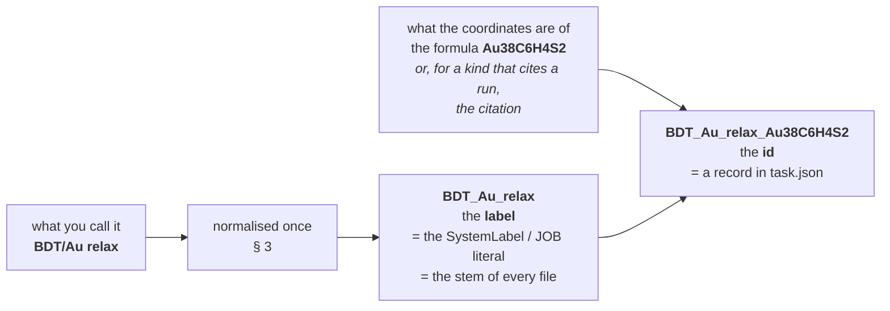

# Run identity — the name that decides whether a calculation continues

**Role:** contract
**Domain:** execution
**Owns:** the label (what the typed name becomes, and the three normalisation rules), the run id (the label plus the formula, or plus the citation) and what it is tied to, and each engine's restart group — the one `restart` field and the two silent failures it prevents.
**Read with:** [`job-contracts.md`](?doc=execution/job-contracts.md) § 6.3 (every name made from the label) and § 4.2a (the warm files) · [`job-system.md`](?doc=execution/job-system.md) § 5.4 (what a stage takes, launching again) · [`project-layout.md`](?doc=execution/project-layout.md) § 1.1 (the folder tree) · [`engines/stages.md`](?doc=engines/stages.md) § 6 (the description the id is written in)

---

## The short version

A calculation continues because the **engine** finds files named on the
label it was given, and its deck tells it to read them. molbuilder makes
the label right, puts the files where the engine looks, and writes the deck's
restart keywords from one field. So:

- **The label** is the name you typed, normalised once (§ 3, rules 1–3). It is
  the `SystemLabel` / `JOB` literal and the stem of every file (§ 2.0a).
- **The id** is the label plus the structure's formula — or, for a kind that
  cites a finished run, plus the citation. It is a record in `task.json`,
  never a filename (§ 2, § 2.0a).
- **What the id is tied to** is only which atoms the coordinates belong to;
  everything a stage tunes is left out (§ 2.1).
- **`restart`** — `continue` or `clean` — is the one field that sets an
  engine's whole restart group (§ 4). `continue` is the default.
- **What the id cannot catch** is refused or said, each by its owner (§ 5);
  what it cannot separate is § 6a.

---

## 1. Why identity is the mechanism

Every deck declares its label in one literal — SIESTA's `SystemLabel`,
PySCF's `JOB = "…"` — and every restart file is named on that literal:
`<label>.XV`, `<label>.DM`, `<label>.chk`. Every stage
of one calculation shares it
([`job-contracts.md`](?doc=execution/job-contracts.md) § 2.1, rule 2).

So **continuing is not something molbuilder does.** It is what the engine
does when it finds restart files named on the label it was given and its
restart parameters say to load them (§ 4). molbuilder's part is to make the
label right, and to put the files in the run before it starts (the launch
copies them in, [`project-layout.md`](?doc=execution/project-layout.md)
§ 1.6.5).

Two failures follow from getting the label wrong, and both are refused (§ 5):

- **two calculations under one label in one folder** — the second would
  warm-start from the first's geometry, and its MODE line would truthfully say
  `CONTINUES` ([`job-contracts.md`](?doc=execution/job-contracts.md) § 4.4);
- **a label edited between runs** — the restart files no longer match, and a
  run that should continue starts cold.

---

## 2. The rule

> **The id is built from inputs, never from anything a run produced.**

It must be known before the calculation runs: half of it is the stem of every
file in the folder, and a name cannot wait for a result. An id that depended
on a result would change the moment a stage succeeded, and orphan the state it
exists to continue from. So: no coordinates, no energies, no convergence
status, nothing read back off a `.XV`.

The id is **readable, not cryptographic**: a name you recognise in a listing
and an id you can read in a description are worth more day to day than one
token that resolves every ambiguity. Its two halves land in two places:



**The label is where this contract stops.** What is attached to it — the
stage token, the role — is
[`job-contracts.md`](?doc=execution/job-contracts.md) § 2.2a's grammar,
composed by `runfiles` and never by hand (rule **A14**); read its *"Which
door to call"* before writing code that names a file.

**A kind that cites a finished run takes the citation as the second half.**
A transport calculation's coordinates are the junction it cites, so its id is
the label plus that citation, normalised the same way — `e2e-walk2` citing
`AuBDTAu/optimization/min_force_relax/01_fine/run-0` has the id
`e2e-walk2_AuBDTAu_optimization_min_force_relax_01_fine_run-0`
(`Task._check_id`; the kind table says which kinds cite,
[`engines/transport.md`](?doc=engines/transport.md) § 3.1). An id that named
no input would be the same for every junction.

### 2.0 The formula, and the one rule it needs

**Element symbols in alphabetical order, each followed by its count, and a
count of one written as nothing**: `Au38C6H4S2`, `H2O`, `CO2`. It is
`Structure.formula`, the same string `Structure.summary()` prints.

*Decided 2026-08-08 (user).* Any convention would do, so the deciding
argument was that this one already existed in the code. Alphabetical rather
than the chemists' carbon-first habit (`C6H4Au38S2`): that habit costs a
special case in a rule that otherwise has none, and the id is a name to
recognise, not a formula to publish.

### 2.0a The label is on disk; the id is on the record

> **Decided 2026-08-09 (user).** *"From dir to the .fdf/script name, we all
> derive consistently from SystemLabel … from there, the SystemLabel becomes
> one consistent scheme, and other information is simply attached to it."*

| | is | lands in |
|---|---|---|
| **label** | the name you typed, normalised (§ 3) | the `SystemLabel` / `JOB` line inside the deck, and the stem of every file beside it |
| **id** | `<label>_<formula>` (or `<label>_<citation>`, § 2) | the `run` block of `task.json` |

**What the code does.** `task.json` stores the name as typed (`run.name`) and
the id (`run.id`). The label is not stored: every read derives it from
`run.name` through the one normaliser (`Task.label`, `identity.normalise_id`)
and checks the stored id against what the name and the formula give
(`Task._check_id`). The id is made in one place, `task.derive_run`, which
calls `identity.run_id(label, formula)`.

A real calculation, from typed name to file names:

| step | value |
|---|---|
| the folder you made | `projects/my-project/spectrum/pyscf_held_ir/` |
| the name you typed (`run.name`) | `pyscf-held-ir` |
| the label | `pyscf-held-ir` — the `JOB` literal |
| the id (`run.id`) | `pyscf-held-ir_H2O` |
| the files | `pyscf-held-ir_01_freq.py`, `pyscf-held-ir_01_freq.run.sh`, `pyscf-held-ir.template.toml`, `pyscf-held-ir.source.xyz` ([`job-contracts.md`](?doc=execution/job-contracts.md) § 6.3) |

The folder and the label differ here, and that is allowed: the folder is
named by you, the label by the normaliser (§ 3.0).

**The label is the `SystemLabel` / `JOB` literal; there is no second name on
disk.** `SystemLabel` is not a copy kept in step with the label — it *is*
the label, and it is the only half the engine ever sees. SIESTA names every
file it writes on the deck's `SystemLabel`, whatever the deck's filename: a
deck called `clean.fdf` whose label says `siesta` writes `siesta.XV`.
Anything that derives a name from a filename has the dependency backwards. This is also why the id cannot be the name on disk: putting the
formula in a filename without putting it in the literal would change the
listing and nothing about what SIESTA loads.

**What the split costs, and what answers it.** On the label alone, two
calculations of different molecules under one typed name share a stem. The
formula therefore moves from the name to the record, and a folder holds one
calculation — a second is refused there, its run id compared (§ 5, first
row).

**The timestamp is recorded, not part of the id.** `task.json` says when the
description was written (`run.created`); putting it in the id would make every
regeneration a new identity, and so a cold start.

**Two starts of one calculation are told apart by their folders**, not by the
id: each launch is a run folder of its own, `run-<n>/`
([`project-layout.md`](?doc=execution/project-layout.md) § 1.6.1).

### 2.1 What the identity is tied to — as little as possible

Overstating the pin is not a safe error: every extra thing in it is a case
where someone tunes something reasonable and loses a geometry they should have
kept. A run's result is a set of coordinates, and **coordinates cannot be in
the identity** — bind them in and the pin changes every time a stage succeeds.
What is left is what those coordinates are *of*:

| considered | in the pin? | why |
|---|:--:|---|
| the molecule — its formula (§ 2.0) | **yes** | a `.XV` is positions for *these* atoms |
| the positions | no | they are the output |
| the cell | no | § 5 says what answers a changed cell |
| basis, XC | no | the geometry stays valid; a `.DM` of the wrong shape the engine reports |
| charge and spin | no — a stage cannot change them | see below |
| mesh, tolerances, force, steps, algorithm | no | exactly what a description's stages vary |
| ranks, threads, GPU | no | how fast it ran says nothing about whether it may be continued |

- **The cell:** a `.XV` carries its own cell, so on a continue the saved cell
  wins and the deck's is not read. That is a fact to say, not a difference to
  pin.
- **Charge and spin** belong to the calculation; a stage override of either is
  refused (ES1,
  [`science/chemistry-correctness.md`](?doc=science/chemistry-correctness.md)
  § 2a). A `.DM` or `.chk` is a density for one electronic state, and a
  density for another is exactly what the engine does not catch — it runs,
  from the wrong start. Changing the template's spin between continuations is
  the same hazard one level up, and nothing pins it.

The id is deliberately blind to the row *mesh, tolerances, force, steps,
algorithm* — that blindness is what makes several stages one calculation.
A differing atom *count* the engine already refuses; the id is there for what
the engine cannot see. Being tied to the id means *a different formula is
written in `task.json` and said by the surface*, not a different filename
(§ 2.0a).

---

## 3. Normalisation, and the three rules

What you type becomes the **label**; the label becomes the `SystemLabel` and
the stem of every file: `<label>.XV`, `<label>.DM`, `<label>_02_tight.fdf`.
A name with a space or a slash breaks a shell line, a glob or a scheduler
argument, so **what you type is never used raw.**

**The allowed set is the basename rule's**: one token of `[A-Za-z0-9_-]`
([`job-contracts.md`](?doc=execution/job-contracts.md) § 2.1, rule 2). The
project tree uses the same set per segment
([`job-contracts.md`](?doc=execution/job-contracts.md) § 2.5).

**The transform, in order** (`identity.normalise_id`, the one place it
happens):

1. every character outside `[A-Za-z0-9_-]` becomes `_`;
2. a run of two or more separators (`-` or `_`) collapses to one `_`;
3. leading and trailing separators are trimmed;
4. the length is checked against the cap.

*A run collapses; a lone separator does not.* `BDT-Au` keeps its hyphen —
it is in the set and you typed it on purpose — while `BDT  --  Au` is a run
of six separator characters and becomes one `_`.

**The cap is derived, not chosen.** The longest file name the calculation
will have — `<label>_<NN>_<stage><role>`, with its longest stage token and the
longest role — must fit the filesystem's 255-byte name limit. The longest role
is asked of the file catalogue (`runfiles.longest_tail`); when the stages are
not known yet, a 32-byte budget stands in for `_<NN>_<stage>`
(`identity.MAX_LABEL_BYTES`), and once they are, the real longest token
counts (`identity._cap_for`). A transport lead's longer label
(`<label>_L-electrode`) is budgeted too. The cap is checked where the label is
made, because rule 3 refuses rather than truncates.

**The id's two halves are normalised apart.** `identity.run_id` normalises
the label against the cap above and the formula (or citation) on its own,
through the same alphabet. Normalising the joined string would apply a
filename's limit to a string that is never a filename, and a refusal would
blame the half that fitted.

**Case is kept; nothing is lowercased.** For the id the reason is absolute:
in a formula the case *is* the element — lowercasing `Co` (cobalt) gives the
same token as `CO` (carbon monoxide). For the label, lowercasing would make it
the one name in the system that forbids capitals. Case-insensitive
filesystems are answered where two names really meet: **stage names** are
compared with their case folded, so `Tight` and `tight` are one stage
(`identity.stage_key`, the description's duplicate check,
[`engines/stages.md`](?doc=engines/stages.md) § 2).

**The same set is git-ref-safe.** `[A-Za-z0-9_-]` holds none of the
characters a git ref forbids, so the checkpoint history needs no second
sanitiser for a calculation's or a stage's name.

**Three rules keep normalisation from surprising anyone:**

1. **It happens once, in one function, and the result is checked on every
   read.** `identity.normalise_id` is the only transform: the validators that
   spell the set — `projects._NAME_PATTERN`, `checkpoint._CALC_NAME_RE`,
   `config/siesta.py::_validate_basename` (both engines' configs) and the
   `runfiles` grammar — refuse, they never normalise. The id
   it makes is stored in `task.json`; every read derives the label again from
   the stored name through the same function and refuses a description whose
   name, formula and id disagree (`Task._check_id`) — which of the three was
   edited is not something a reader may guess.
2. **The result is shown, never hidden — on every surface, the terminal
   included.** Task setup shows the name and the id, read-only, before you
   save; `molbuilder describe` prints the label it described (`Described
   '<label>' in <folder>`; for a transport calculation, the name it was
   given). A surface that hid it would hide the thing that
   decides whether the next run continues.
3. **A normalisation that loses the name is refused, not patched** — never a
   digit appended and carried on. Two cases refuse:
   - **a letter or a digit would be replaced.** Replacing a *separator* — a
     space, a `/`, a `.` — is expected and silent. A character outside
     `[A-Za-z0-9_-]` that is nonetheless alphanumeric is a letter or digit of
     some alphabet, and the label cannot carry it: `Über` is refused rather
     than becoming `ber`.
   - **nothing is left, or the result is over the cap.** `///` reduces to
     nothing; a 300-character name exceeds what `<label>_<NN>_<stage><role>` may
     occupy. A truncated label would be a different calculation wearing the
     same name.
   - **an engine would cut it.** An engine that cuts the names of the files it
     writes states the longest label it keeps whole (the engine table's
     `longest_label`, [`architecture.md`](?doc=execution/architecture.md)
     § 3.3): SIESTA's 48 — two benchmark trials whose labels differed only
     past its cut were written to one stem (2026-08-24). A label, or a trial's
     label, past it is refused at prep in that engine's words; an engine that
     states none cuts nothing, and only the cap above binds it.

Each refusal says what failed — the letter or digit, nothing left, or the
length against the cap — and cites § 3; a description whose name, formula and
id disagree is refused citing § 2.0a and § 3, rule 1 (`Task._check_id`).

### 3.0 The calculation folder is not named by the label

The folder that holds a calculation — the third level of
`projects/<project>/<topic>/<calculation>/` — is **the name you type for the
folder**, and `task.json` inside it is what says which calculation it is
([`project-layout.md`](?doc=execution/project-layout.md) § 1.4a). The label and the id name its files and its
record, never the folder. The tree and who creates each level are
[`project-layout.md`](?doc=execution/project-layout.md) § 1.1; the
folder names' forms are
[`job-contracts.md`](?doc=execution/job-contracts.md) § 6.3, *Directories*.

*Decided 2026-08-07 (user).* The same system studied two ways in one topic
— `bdt-relax-pbe/` and `bdt-relax-blyp/` — derives one id, because the id
does not encode the functional or the basis; with the folder named by the id,
one of them would have needed a fake label. The cost is stated plainly: an
`ls` of a topic does not tell you what each calculation computes, and the
surfaces that list calculations read `task.json` for that.

### 3.1 Normalisation, worked

Each row shows one rule at work. It is copied row for row into
`tests/data/run_identity.toml`, which runs each through `identity.run_id`:
a rule that changes changes its row in both.

| what you type | label | which rule fired |
|---|---|---|
| `BDT/Au relax` | `BDT_Au_relax` | `/` and the space are outside the set → `_`; case is kept |
| `BDT  --  Au` | `BDT_Au` | a run of six separator characters collapses to one `_` |
| `_relax_` | `relax` | leading and trailing separators trimmed |
| `Relax.v2` | `Relax_v2` | the dot is outside the label's set |
| `BDT-Au` | `BDT-Au` | hyphens are kept: in the set, and a lone one is not a run |
| `Über` | **refused** | `Ü` is a letter, not a separator (rule 3) |
| `///` | **refused** | reduces to nothing (rule 3) |
| a 300-character name | **refused** | over the derived cap (rule 3) |

The formula needs no normalising: `Structure.formula` only ever produces
element symbols and digits.

### 3.2 One label, and everywhere it lands

One token names every file of a calculation, on disk and to the engine. For
the real calculation `h2_siesta` (id `h2_siesta_H2`):

```text
projects/my-project/optimization/h2_siesta/           ← the folder you named
├── task.json                     ← run.name, run.id = h2_siesta_H2
└── 01_coarse/
    ├── h2_siesta_01_coarse.fdf   ┐ named by MOLBUILDER:
    └── run-1/                    │ the label and the stage
        ├── h2_siesta_01_coarse.out ┘
        ├── h2_siesta.XV          ┐ named by the ENGINE:
        └── h2_siesta.DM          ┘ the label alone
```

**The formula is in one place, and it is not a filename** — `task.json` holds
the id; the files hold the label.

**What molbuilder names carries the stage; what the engine names carries the
label alone.** SIESTA looks for `<SystemLabel>.XV` and nothing else, so the
next stage finds the previous stage's state with no renaming once its launch
has copied it in. molbuilder spends its own names on a cross-check: the stage
folder and the deck inside it both say the stage, so a deck swapped by a bad
copy is wrong on sight. The rule is
[`job-contracts.md`](?doc=execution/job-contracts.md) § 6.3, *Files*.

**The history names the folder, a third name.** A saved state's
`Calculation:` trailer is the calculation folder's name, read from the
directory, not the label and not the id (`checkpointing.md` **L3**). All
three share one character set, so none needs a second sanitiser.

**A collision is narrower than it sounds, and molbuilder does not go looking
for one.** Two calculations interfere only when they share a **folder**, not
when they derive the same id: the same id under `optimization/` and
`spectrum/`, or in `bdt-relax-pbe/` and `bdt-relax-blyp/`, never meets.

> *Decided 2026-08-08 (user): this is not a file manager.* Where a
> calculation goes is yours to choose. What molbuilder owes is about the
> folder it was pointed at: it holds one calculation, and a second is refused
> there (§ 5, first row).

---

## 4. Every engine has an internal identity, and parameters bound to it

The id is half of a warm start. **Every engine has its own notion of "which
job is this, and may I continue it", and a set of parameters tied to that
notion.** A design that names only the filename has described none of it.

| | what it settles | SIESTA | PySCF |
|---|---|---|---|
| **the engine's job identity** | which prior state belongs to this run | the `SystemLabel` literal | the `JOB = "…"` literal |
| **the parameters bound to it** | whether that state is honoured when found | `DM.UseSaveDM`, `MD.UseSaveXV`, `MD.UseSaveCG` | the read branches the generated script carries |

- **SIESTA** reads a `.DM` it finds *unless* told `.false.`, and a `.XV` or
  `.CG` only when told `.true.` (`Src/read_options.F90`,
  `Src/struct_init.F`). So every deck writes each member its run has a use
  for, with its answer — `MD.UseSaveCG` in a CG relaxation alone, the one
  branch where SIESTA reads it (`siesta/input.py::_restart_keys`).
- **PySCF**'s script takes the SCF initial guess from `<JOB>.chk` when that
  file exists and is not empty, and `<JOB>_optimized.xyz` replaces the
  literal geometry (the code is
  [`job-contracts.md`](?doc=execution/job-contracts.md) § 4.2).

The identity is the same *idea* in both columns and a different
*mechanism*; the bound parameters are a declared keyword family in one and
generated control flow in the other. Neither is a filesystem fact, and
neither is the scheduler's business.

**So they are one named group per engine, and the group is the generator's:**

1. **An engine declares its group** — its identity literal, the parameters
   bound to it, and the restart files they govern
   (`identity.RestartGroup`: `config/siesta.py::SIESTA_RESTART_GROUP`,
   `config/pyscf.py::PYSCF_RESTART_GROUP`; the files in each engine's
   `warm-files.toml`, [`job-contracts.md`](?doc=execution/job-contracts.md)
   § 4.2a). *A new engine that cannot fill this in is a new engine whose
   restart behaviour nobody has thought about yet.*
2. **You say one thing; the generator sets the group.** `restart` is one
   field — `continue` or `clean` — and the renderer expands it into that
   engine's group: SIESTA's keywords, the catalogue's
   `[item.restart].expands`, written together; PySCF's read branches,
   generated or left out. The members are not settable one by one, so no
   description can carry them separately and disagree with itself
   (`identity.continues` is the one reading of the field).
3. **`continue` is the default, and nothing computes it.** A stage launched
   after the one it builds on is launched by somebody who looked at that run,
   so it continues from it: its launch copies in the restart files of the run
   it continues from ([`job-system.md`](?doc=execution/job-system.md) § 5.4,
   [`project-layout.md`](?doc=execution/project-layout.md) § 1.6.5), and
   `continue` lets its deck read them. Saying `clean` overrides the default:
   the stage declares no restart files, so its launch copies none, and its
   deck says `.false.` to every member of the group.
   - **Nothing has to detect anything.** *Is there prior state?* is answered
     by the engine, at run time: SIESTA with `MD.UseSaveXV` and no `.XV` uses
     the deck's coordinates; PySCF's script guards each read on the file. So
     `continue` means *this deck may read what was handed to it*, and a run
     handed nothing needs no special case.
   - **A rung's position does not answer it.** The shipped ladders set no
     `restart`. A rule like *first stage clean, the rest continue* would
     discard a result the moment a ladder was run again in a folder holding
     one.
   - **Keeping an old state is a separate tool and decision**: `molbuilder
     checkpoint save` ([`checkpointing.md`](?doc=execution/checkpointing.md)
     § 5). A run that starts over is a new run folder, and
     `jobset launch --cold` copies nothing into it, so nothing is removed.
4. **What `continue` implies is a short declared set, and what a stage needs
   beyond it is declared data too — never engine knowledge in a producer.**
   `restart: continue` means the files the engine's `warm-files.toml` marks
   `carry` for that kind — for a SIESTA relaxation `.XV`, `.DM` and `.CG`,
   because that is what continuing a relaxation *is*
   ([`job-contracts.md`](?doc=execution/job-contracts.md) § 4.2a). What a
   stage needs from *other* stages is its kind's own graph — a transport
   device's electrode `.TSHS` files, a transmission's device `.TS.HSX` —
   gathered at its first launch
   ([`job-contracts.md`](?doc=execution/job-contracts.md) § 2.1, *What a stage
   needs*; [`engines/transport.md`](?doc=engines/transport.md) § 6.1). Neither
   is a field a description sets, and neither is checked by the run script.

**Why rule 2 is not tidiness — the silent pair.** The two ways the group can
be wrong are both silent, and opposite:

- **honoured with nothing to load** — the parameter is on, no prior state
  exists, and the engine starts cold while the deck says it continued;
- **present but not honoured** — the files are right there, the parameter is
  off, and the stage starts from scratch looking as if it continued.

One field cannot produce either. The same reason makes the restart files
follow the field: a `clean` stage is handed none, so none sit unread beside
it.

---

## 5. What the id cannot catch, and what answers it

An identity that tried to prevent every wrong continuation would have to pin
everything, and § 2.1 is why that is worse. These are the real cases; most
are closed by the layout — one calculation per folder, one folder per run,
every file a run takes handed over and recorded:

| case | why the id cannot fix it | what answers it |
|---|---|---|
| two calculations under one label in one folder | since § 2.0a the formula is not in the stem | **refused** — see below |
| a label edited between runs | the label is the half the engine sees | **refused** — see below |
| files left in a run folder from an earlier fill | the id names files; it cannot say which fill wrote them | **closed by the layout** — [`project-layout.md`](?doc=execution/project-layout.md) § 1.6.3 |
| the structure moved under a saved description | the description holds a reference and a witness | **refused at prep** — [`job-system.md`](?doc=execution/job-system.md) § 5.0 |
| prior state that matches: the run continues | nothing is wrong; you should still know | **said twice** — see below |
| a changed cell | the cell is derived, and derived values are not in the id | **nothing says it** — see below |

- **One folder, one calculation.** `molbuilder describe` and the Transport
  tab's describe door refuse a folder that already holds a description
  (`describe.refuse_described`), and Task setup's Save refuses a description
  whose run id differs from the folder's.
- **A label edit.** The label is half of the run id, so Save refuses the
  change in a described folder, and a `task.json` edited by hand whose name
  and id disagree is refused on every read (`Task._check_id`, § 3 rule 1).
- **Said twice, at two moments.** `launch` shows which run each stage
  continues from and every file it copies, asks once, and records it
  (`.continued-from`, `run.json`'s `continued_from`;
  [`job-system.md`](?doc=execution/job-system.md) § 5.4) — before anything is
  sent, while the choice is open. The run script's MODE line says what lies
  in the run as it starts — `CONTINUES (engine will load <files>)`
  ([`job-contracts.md`](?doc=execution/job-contracts.md) § 4.4). Neither
  replaces the other, and neither may contradict the other. molbuilder
  informs; you decide to continue.
- **A changed cell.** A `.XV` carries its own cell and frame, so on a
  continue it wins: widening the vacuum after a stage ran changes the next
  stage's deck and nothing about its run. A launched stage is not prepared
  again for a changed cell
  ([`job-request.md`](?doc=execution/job-request.md) § 5), so its own runs
  never meet it; the case is a stage that continues from an earlier one and
  was prepared after the cell changed — its first launch copies the earlier
  run's `.XV`, and the cell that runs is that run's.

---

## 6. Making a stage again

What prep does with a stage that is already prepared or launched — its group
prepared again whole while never launched; once launched, prepared again only
for a changed job request, else refused naming the way back through the saved
state — is one of prep's checks,
[`job-system.md`](?doc=execution/job-system.md) § 5.0 (the request rule,
[`job-request.md`](?doc=execution/job-request.md) § 5). Running a stage again
is launching it again, § 5.4 there.

**Never rename.** A run's files keep the names its engine and molbuilder gave
them, in a folder of their own, and the next run continues from them by
copying them in under the same names
([`project-layout.md`](?doc=execution/project-layout.md) § 1.6.5). A name made
unique to avoid a clash would leave the engine nothing to read.

---

## 6a. What the id does not separate

The id is a starting point, agreed as one. It does not separate:

- **two isomers** — they share a formula, so two isomers under one label are
  one id; one folder still holds one calculation (§ 5);
- **the order species are declared in** — and a `.XV` read against a
  different species order lands every coordinate on the wrong atom. Settings
  that change it (`species_order`, which orders SIESTA's
  `ChemicalSpeciesLabel` block) are therefore identity-sensitive: change them
  only in a calculation that does not continue from a run written before;
- **a composite's parts** — a junction's id names its citation (§ 2), not
  its molecule and electrodes.

---

## 7. What this contract does not own

- **The run's file names, the warm-file vocabulary and the MODE lines** —
  [`job-contracts.md`](?doc=execution/job-contracts.md) § 6.3, § 4.2a and
  § 4.4. This document adds no file.
- **The folder tree and who creates each level** —
  [`project-layout.md`](?doc=execution/project-layout.md) § 1.1.
- **What a stage takes at its launch, and launching again** —
  [`job-system.md`](?doc=execution/job-system.md) § 5.4.
- **How the run script runs the engine** —
  [`running-a-job.md`](?doc=execution/running-a-job.md) § 3.
- **What a stage is, and the description the id is written in** —
  [`engines/stages.md`](?doc=engines/stages.md).
