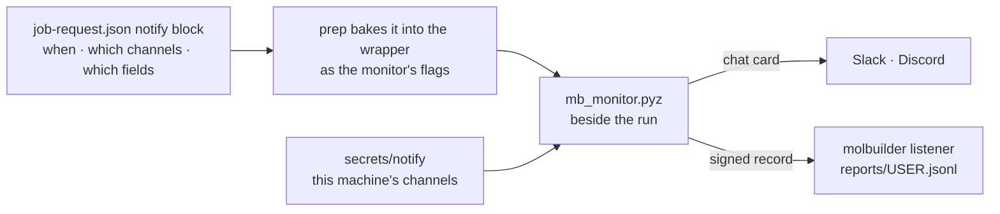
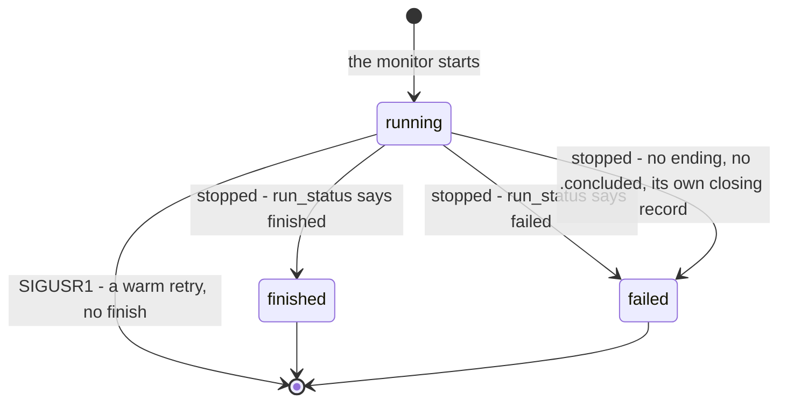

# Run reports — how a job tells you it is going

**Role:** contract
**Domain:** execution
**Companions:**
[`running-a-job.md`](?doc=execution/running-a-job.md) § 4.1 — the wrapper's
instruments, of which the monitor is one; § 4.2 — how a run directory's state
is read; § 3.5 — the warm retries;
[`job-contracts.md`](?doc=execution/job-contracts.md) § 2.1 — the monitor's
place in a run directory and the boundary it may not cross; § 2.6 — the
wrapper, and its `_mb_ending`;
[`project-layout.md`](?doc=execution/project-layout.md) § 1.6 — a run and its
tries, the launch record, the conclusion marker;
[`job-request.md`](?doc=execution/job-request.md) § 3.5 — the `notify` block;
[`web/task-setup.md`](?doc=web/task-setup.md) § 9b — the card that writes it;
[`web/this-machine.md`](?doc=web/this-machine.md) — the tab that sets up the
channels;
[`ops/access-control.md`](?doc=ops/access-control.md) § 8 — the gates the
listener sits behind.

A run takes hours or days on a machine you are not sitting at. The monitor —
`mb_monitor.pyz`, backgrounded by the wrapper beside every run — watches it,
and this is the rule for how it tells you what it sees.

**The sentence the whole design follows:**

> **When** to speak, and **which channels**, belongs to the calculation.
> **What a channel actually is** — an address, and usually a secret — belongs
> to the machine. They are never written in the same file.



---

## 1. Why the split is the whole thing

A calculation's folder **travels** — its description and its job request with
it. It goes to a cluster, into a citation's composed copy, into a colleague's
copy of your project. That is what a description is for.

A webhook URL does not travel — it is a fact about one person's Slack, and for
Slack and Discord it *is* the credential, with no separate token beside it.
Anything that travels must therefore not carry it.

| | lives in | travels? |
|---|---|---|
| **the policy** — when to speak, which channels **by name**, which fields | `job-request.json`'s `notify` block ([`job-request.md`](?doc=execution/job-request.md) § 3.5) | **yes**, and safely: *"every six hours, to `slack`"* is true wherever the file is opened |
| **the channels** — what each name resolves to: the address, and the secret | the user's own file, `<config dir>/secrets/notify`, mode `0600` (§ 3) | **no**, ever |

**A name travels; what it points at does not** — and that is what lets a
job request say where its reports go at all. `"slack"` is a label the person
chose on their own machine: not a credential, it grants nothing, and on a
machine that has no channel by that name it resolves to nothing and says so in
the monitor log. It fits the line [`task-setup.md`](?doc=web/task-setup.md)
§ 6.1 draws for every setting — a job request holds what a person decides,
never what a machine found — and adds one: never a secret.

> **On the directory.** Secrets live in `config_dir()`'s `secrets/`, which
> honours `$MOLBUILDER_CONFIG_DIR` and `$XDG_CONFIG_HOME`
> ([`configuration.md`](?doc=configuration.md) § 2.1c). The monitor reads this
> file **on a compute node**, and on an HPC login node `$HOME` is NFS-mounted
> and often snapshotted: `XDG_CONFIG_HOME=/scratch/$USER` is how a person keeps
> a token off it. A path fixed to `$HOME` would have no such escape.

---

## 2. When it speaks

**No `notify` block is no notification** (user, 2026-09-26: *"when no set up
for notification that means no notification"*) — nothing is sent, the start
and the end included. A calculation with a `notify` block speaks on seven
occasions: the two it ticks, which combine; its wall near; its start and its
end; and, for a run of points that reports as one run, a phase that ended
with the run going on, and a part that failed with the run going on (§ 2.9).

| occasion | `event` | set by | sent |
|---|---|---|---|
| **it started** | `start` | a `notify` block | once, when the monitor starts watching a run — a run of points: once per run, sent by the step that starts its first point — a vibration's plan step of its first call (`mb_monitor.pyz notify start`, [`engines/vibration.md`](?doc=engines/vibration.md) § 5.11 § 7a), a transport sweep's report step of the first point to start (`mb_monitor.pyz point started`, [`engines/transport.md`](?doc=engines/transport.md) § 2a.11); its points' member monitors send none |
| **a step finished** — its SCF converged | `scf_converged` | `notify.on_scf_converged` | on the first wake after a step that moves the geometry finishes (§ 2.2) — never a force-constant displacement; one message per wake, however many finished since the last |
| **every N hours** | `periodic` | `notify.every_hours` — a number of hours; `null` is never | N hours after the last message; the first, N hours after the start |
| **its wall is near** | `wall_near` | a `notify` block, on a job sent with a wall | once: for a run of points, when the calls left need more than the wall leaves at the pace its finished calls measured (§ 2.8); else when the time the job has left falls below the longest step it has taken (§ 2.2) — the step it is in may not finish (§ 2.1b) |
| **a phase ended, and the run goes on** | `milestone` | a `notify` block, on a run of points that reports as one run | at once, by the record step of the call that ends the phase, when the run still has calls to run: the phase's outcome in words (§ 2.9) — a phase whose end is the run's is said by the `finish` |
| **a part failed, and the run goes on** | `part_failed` | a `notify` block, on a run of points that reports as one run | at once, by the record step of a call that ended without being done, when the run still has calls to run: which call, and why (§ 2.9) — a failure that ends the run is said by the `finish` |
| **it ended** | `finish` | a `notify` block | when the wrapper stops the monitor at the job's end (SIGTERM — also what a scheduler's walltime or cancel sends), or the watched PID goes — a run in phases: by the record step that completes its index (`notify finish`), with the run's state, and the outcome of the phase its last call ended (§ 2.9) |

Every message carries the same report (§ 4.1a): the state and where the run is
— in its structure where one is declared (§ 2.8) — SCF phase and iteration, energy, each residual against its criterion, the
largest force against its tolerance, the step, the rate, TBtrans's account
of its loop (a transmission's, [`model/parse.md`](?doc=model/parse.md) § 5d.5)
— and at the end how each SCF phase converged and how the process exited.

- **Nothing else is sent.** Between the start and the end a message goes out
  only on the two occasions the calculation ticked, once when its wall is
  near (§ 2.1b), and — for a run of points — when a phase ends or a part
  fails with the run going on (§ 2.9). Every wake's reading is in
  the monitor log (§ 2.5); the channels hear what the policy asks for.
- **Every message restarts the N-hour clock** — a step's, the wall's
  warning, a milestone, a part's failure — and a step and a period due on the
  same wake are one message, the step's. A run of points' calls count it
  from the last event the run's record holds (§ 2.4).
- **The start and the end are not ticks**: a calculation that reports at all
  reports them — they bracket every report, and a run that finishes at 3 am
  saying so is the reason the hook exists.
- **The monitor judges no stall** (user, 2026-09-26). A step can take hours,
  and nothing in the output tells a slow one from a stuck one; how the run uses
  what it holds is in the utilisation record (§ 2.1a), for the person to read.
- **A warm retry is not an ending.** The wrapper stops this run's monitor with
  SIGUSR1 and re-runs itself in the same run as its next try
  ([`running-a-job.md`](?doc=execution/running-a-job.md) § 3.5). No `finish`
  is sent; the next try's own monitor sends its own `start`, and its
  `elapsed_s` and N-hour clock begin again.

### 2.1 Looking often and speaking rarely are different numbers

The monitor wakes every `MB_MONITOR_INTERVAL` seconds (default **10**). Each
wake reads the run (§ 2.3) and samples what it uses (§ 2.1a), and both records
are **change-gated**, so a fast wake costs no volume:

| record | a line is written when |
|---|---|
| the monitor log's `[STATUS]` | the run advanced — a new SCF row, the row's iteration, the phase or the step moved, TBtrans's account of its loop moved (its set-up stated, a progress line, a pass begun or completed, its currents), or the words of where a device's set-up is moved (`model/parse.md` § 2b, `doing`: a lead's cell checked, its surface Green's function begun, sized, written or found, the charge distribution at the switch), or a part of the output began (§ 2.8: its opening line read, the SCF's last row unchanged) — or its energy or state changed |
| a `util.csv` row | CPU %, memory, or a GPU's use or memory moved by ≥ 10 % of its last written value, or 300 s passed since the last row (`--util-keepalive`), so the plotted series keeps anchor points |

**Notifying is separate and rare**: § 2's occasions, never one per wake.
A notifier fired on every changed sample would message a running job's
channels every few seconds.

### 2.1a A percentage is a fraction of what the job HOLDS

**Never of the node.** A report answers one question — *is this calculation
using what it was given?* — so every number is the job's own:

> cpu % = Δ(CPU time the job used) / (Δ wall time × cores the job holds)

100 % means the calculation is using every core it holds. Cores it did not ask
for are not its business: a node-wide reading measures the cluster, not the
job. **Worked example:** 48 busy ranks on a 128-core node cannot read above
48/128 = 37.5 % node-wide, so a job at 86 % of what it holds reads 32 %
(0.86 × 37.5 %) and looks idle — and a job that looks starved argues for a
bigger machine, which is the longer queue this practice exists to avoid.

**What the job holds depends on how it was started**, and is fixed once, when
the monitor starts — a basis that changed mid-series would change what every
number means:

| started | whose CPU time and memory | the cores it holds | memory stated against |
|---|---|---|---|
| inside a scheduler's job (`MB_JOB_ID` set, by the job's header — `--mode submit`; [`scheduler.md`](?doc=execution/scheduler.md) § 6a) | its cgroup | the affinity mask, else `MB_CPUS_ON_NODE`, else `MB_CPUS_PER_TASK` | the limit the kernel enforces on the job's cgroup, and the kernel's own peak where it keeps one |
| outside one — a run here, `--mode direct` | its process tree: the wrapper and every descendant, the monitor excepted; memory as proportional set size (PSS), so ranks mapping one library count it once | the cores its launch uses, which the wrapper passes as `--cores`: ranks × threads for a hybrid build, ranks for pure MPI, threads for OpenMP-only, 1 for serial | nothing — a process tree has no limit: *limit not stated* |

A run started outside a scheduler has no cgroup of its own: the one its process
sits in is the launching session's — a login scope, the web server's service —
shared with everything else there. So its process tree is the job. Memory is
reported in GB, beside the limit where there is one; never as a share of the
node.

**A GPU is sampled only for a run that uses one** — the wrapper's `--gpu`, from
the `use_gpu` it launches with ([`job-contracts.md`](?doc=execution/job-contracts.md)
§ 6.2). A CPU run on a GPU node holds no GPU, and what the node's GPUs do is
somebody else's.

Each run states its basis on the monitor log's `[UTIL-BASIS]` line (§ 2.5) —
the cores and which source gave them, where CPU time and memory were read, the
peak and the limit. Read it before comparing two runs: cgroup v1 and v2 spell
their files differently, and where no cgroup is readable the numbers fall back
to the node and say so.

### 2.1b The time the job has left, counted from its own record

**A job sent with a wall counts down to it** — the wall it was sent with,
from the run's launch record (`run.json`'s `placed_on.time`: the header's, or
a launch's `--time`, which the scheduler takes over the header's,
[`scheduler.md`](?doc=execution/scheduler.md) R9), from **the job's start**,
which its header states once for everything the job runs
(`MB_JOB_STARTED`, the epoch second): a walk's later member and a warm retry
count from the job's start, never their own. No scheduler is asked: the
count is the same in a job that cannot reach its scheduler's commands. The
launch record is read on each wake until it is there — the sender writes it
as the scheduler answers, and a job can start first. Each `[STATUS]` line
says the count — *wall 4h: 21m left* — and a run here says none: its launch
record names no queue and so no wall, though its engine is told the wall
its own job states ([`running-a-job.md`](?doc=execution/running-a-job.md)
§ 3.6). A record or a wall that does not read, or a header that
states no start (one written before it did), is said once in a `[WALL]`
line, and nothing is counted. **A run of points' points**: a member's
monitor — a vibration's call, a transport sweep's point (§ 2.4) — reads the
run's one launch record through `--launched-in` and counts as the run's; a
point, one SCF or one transmission, states no steps: what warns for a member
is its run's pace, below.

**It warns once, and only where it can say why**: for a run of points whose
index states its calls (§ 2.8), when the calls left need more than the wall
leaves at the pace its finished calls measured — *6h left; 120 optical calls
left at 2h each (1 done) need about 10d -- the run may not finish before the
wall* (the rule agreed with the user on 2026-10-26, [`plans/plan.md`](?doc=plans/plan.md)
§ 1af); otherwise when the time left falls below the longest step the run has
taken so far (§ 2.2: a geometry move, a displacement, a PySCF step), the step
it is in may not finish before the wall. The monitor writes one `[WALL]` record — *21m left; the longest of 3
steps so far took 46m -- the step underway may not finish before the wall* —
and, with a `notify` block, sends `wall_near`. A
step's length runs from one step finishing to the next, the first from the
monitor's start. A run
that states no steps (a single point, a transmission) is counted down and
never warned: nothing in it says how long its next part takes. It stops
nothing and asks nothing: what to do with the warning is the person's. The
engine itself stops before the wall where it can
([`running-a-job.md`](?doc=execution/running-a-job.md) § 3.6), so the
warning is the cue for a run whose step is longer than its slack.

### 2.2 A converged SCF is read from the step advancing

A step is over when the engine begins the next one, and the engine says so in
its own words. The output's parser reads that line (§ 2.3); the monitor counts
the finished steps and sends `scf_converged` when the count grows **and the
step moves the geometry**.

| run | what a step is | the line that marks it | `scf_converged` messages |
|---|---|---|---|
| SIESTA relaxation | a geometry move | `Begin CG opt. move = N` (or `Broyden`, `FIRE`; `Src/state_init.F`, `siesta_grammar.STEP_BEGIN`) — N moves are done | one per finished move |
| SIESTA force constants | a displacement | `Begin FC step = N` | none: a displacement moves no geometry. How many are done and their pace are the periodic report's (§ 2.8); the force constants' outcome is a milestone where the run goes on, else the `finish` (§ 2.9) |
| SIESTA single point — every SIESTA rung of a transport calculation is one | none: it prints `Single-point calculation` | — | none; the `finish` message is the whole report |
| TBtrans | none: it runs no SCF — what it states instead is its k-point × energy loop, run once per spin channel: each pass begun, its progress every `TBT.Progress` per cent, the time it completed in — which every message says in words (`model/parse.md` § 5d.5: *unpolarized (1 of 1): 10.01 % done, about 6d left (TBtrans's estimate)*), its pass underway's `done_pct` and `eta_s` among the fields (§ 4.1a) | — | none |
| PySCF optimization | a geometry step | a step block in the progress log (`.molwatch.log`), written when the step ends | one per finished step, the first included |
| PySCF vibration | a geometry step of the relaxation it runs first — none when the geometry is stated relaxed; the Hessian after it states no step | a step block in the progress log | one per finished relaxation step |

The last step's end is always in the `finish` message.

**Only a step that moves the geometry is a message** *(the design agreed with
the user, 2026-10-26, [`plans/plan.md`](?doc=plans/plan.md) § 1af)*. A
geometry move's outcome — its energy, and the largest force against its
tolerance — is something the person judges as the run goes. A
displacement's is not: it moves one atom away from one geometry and back,
and the person judges the displacements together, once the force constants
are built. Which steps move the geometry is declared where the steps are
read:

- **SIESTA**: the grammar's `siesta_grammar.MOVES_GEOMETRY`, over the
  step's own words — an optimizer's `opt. move` (Broyden, FIRE, CG). Not an
  `FC step`; not a `Server step`, whose geometry a driver outside SIESTA
  sets; and not an `MD step`, which no kind of molbuilder's runs and which
  SIESTA numbers from `MD.InitialTimeStep`, 1 by default, so "N are done"
  would run one ahead (`Src/state_init.F`, `Src/siesta_init.F`).
- **PySCF**: every step block of the progress log is a geometry step,
  `molwatch_grammar.STEPS_MOVE_GEOMETRY`.

The reading pass states it as `step_moves` (`model/parse.md` § 5d.5).
Every step still counts toward the pace and the wall (§ 2.1b, § 2.8): a
displacement takes time like a move.

**Why a finished step means a converged SCF.** Each geometry step solves the
Kohn–Sham equations self-consistently, and its forces mean something only once
that SCF has met its criteria (§ 2.7). Under SIESTA's default
`SCF.MustConverge true`, an SCF that reaches its cycle cap stops the run, so a
step that finishes had converged. A deck that sets it false lets a step finish
on an unconverged density: the message still goes, and its residuals, printed
against their criteria, show it.

**Why no convergence phrase is read.** No output marker decides that the run
is over: `siesta: Final energy` prints before the end, and sampling that
stopped there would leave a job holding its CPUs and GPUs unwatched. *When* it
ended is the watched PID's answer, or the wrapper's signal; *how* it ended is
`run_status`'s, asked once the PID has said it is over (§ 2.3). Reading the
output to report progress is the monitor's job; reading it to decide the run
is over is not.

### 2.3 What it reads, and through what — the framework's own readers, shipped beside it

**The monitor has no reader of its own.** Every fact it reports is read by the
reader the rest of molbuilder reads that file with, and those readers travel
with the job in **one file**, `mb_monitor.pyz` (`runwrap.MONITOR_BUNDLE`) — a
Python zip application of the modules `runwrap.MONITOR_COMPANIONS` names, each
unchanged, run by the job's own python: **the activated env's own,
`$_mb_py`** ([`running-a-job.md`](?doc=execution/running-a-job.md) § 2.2a).
It needs nothing beyond the standard library because it is the
instrument that reports a failure: it must load when the env's own packages
do not — a broken numpy is reported by it, never hidden by it. `prep` writes it beside the wrapper and
`materialize` copies it into every run. What may travel is
[`configuration.md`](?doc=configuration.md) § 2.3's rule, *stdlib-only AND
travels*; the trajectory log's vocabulary the grammar reads is its own
standard-library module (`trajectory_log/keys.py`), never the log's writer,
which needs numpy and ships with PySCF decks and the vibration finish, never
with the monitor. One file, because a
directory of shipped modules reads as a directory of decks.

| it reports | read by | travels as |
|---|---|---|
| which files are this run's | `runfiles` — the stem, each file's role, the try's number | `runfiles.py` · `identity.py` |
| where the run is now: the SCF phase and iteration, the energy, each residual beside the criterion the run states, a NEGF loop's charge, a TranSIESTA device's set-up until its first SCF row, a part of the output that begins with a line of its own, by name (`part`, from `siesta_grammar.PARTS`, § 2.8) (the reading pass's `doing`, `parse/engines/transiesta.py`'s words and the parts table's — what the run door's *running* says too), the step the engine began in its own words and how many are done, the largest force beside its tolerance, and TBtrans's account of its loop — the passes it makes, the one underway's per cent done and the time TBtrans says it has left, each completed pass's time | the output's ONE parser's reading pass, fed the file as it grows and chosen by the file's role: a SIESTA-family `.out` — SIESTA's, TranSIESTA's or TBtrans's — by `SiestaReader`, a PySCF run's progress log by `MolwatchReader` ([`model/parse.md`](?doc=model/parse.md) § 5d.5); the Results tab builds its frames from the same pass; TBtrans's loop said in words by `tbtrans.loop_words`, the run record's and the transport report's sentence too | `siesta_reader.py` · `siesta_grammar.py` · `molwatch_reader.py` · `molwatch_grammar.py` · `_section_rules.py` · `constants.py` (the Hartree and force factors a residual is converted with) · `tbtrans.py` · `transiesta.py` |
| SCF iterations so far, and seconds per iteration, in the current SCF phase | the timing rule, `scf_timing_rows.timing_of`, over the run's stamped SCF rows: a SIESTA run's `.scf-timing.log`, a PySCF run's progress log, whose deck stamps each `scf_history` row ([`model/parse.md`](?doc=model/parse.md) § 5c) — the rule the Results tab states them by | `scf_timing_rows.py` · `molwatch_grammar.py` |
| how it ended: `state`, `detail`, each SCF phase's convergence, whether a relaxation relaxed, the exit code | `run_status` over this run's files (`parse/dirs/job.py`) — the Results tab's own answer, with its own order of evidence ([`running-a-job.md`](?doc=execution/running-a-job.md) § 4.2), built on the one door that says whether the run ended on its own (`runrecord.ending`); a SIESTA run's stderr from the session log whose first section is the run (`wrapper_log`) | `job.py` · `_run_ending.py` · `end_lines.py` · `wrapper_log.py` · `runrecord.py` |
| which fields a report may carry, and how a card says each | the one declaration, `report_fields` (§ 4.1a): `ReportField.said`, the span rule's `span_words` and a share's `pct_words` | `report_fields.py` |
| which fields a card shows for an event, in what order, for each receiver | the layout file, through its reader `report_cards` (§ 4.1c) | `report_cards.py` · `report-cards.json`, the bundle's one data member |
| a member's run (§ 2.8): its count, its own point, its points' starts and ends | the run's index, read by its one reader and the one done rule — a vibration's `vibration_phases.read_index`, `rows_of`, `summary`, the record step's own; a transport sweep's `transport.points_index.read_index`, `rows_of`, `summary`, the report steps' own — the kind's found through `monitor.RUN_INDEXES` | `vibration_phases.py` · `points_index.py` |
| where the channels are | `config_dir` (§ 1) | `config_dir.py` |
| the wall it was sent with (§ 2.1b) | the run's launch record, `runrecord.launch_record` — `placed_on.time`, read by `runrecord.sent_wall_s` through the wall's one parser, `scheduler.quantities.parse_walltime`, which travels with it | `runrecord.py` |
| when the job started (§ 2.1b) | its header's `MB_JOB_STARTED`, written by `runwrap.render_sbatch`, its name `runtime_info.JOB_STARTED_VAR` -- the job's clock's names, `MB_WALL_S` and `MB_WALL_SLACK_S` beside it | `mb_monitor.py` |

**What stays the monitor's is what no file states**: the watched PID — *when*
the run ended — the machine and its utilisation, when to tell someone, and the
envelope each channel reads.

**Every engine, named, never pathed.** The wrapper starts it from its shared
part, SIESTA's and PySCF's alike, and tells it which run it watches — the
label, the stage token, the try's number — never a path: it names every file
through `runfiles`.

**Its words are the framework's.** `state` is `running` while the watched PID
lives; at the end it is `run_status`'s `finished` or `failed`, with its
`detail`. A job the scheduler or a signal killed leaves no ending in its output
and no `.concluded`; what it does leave is the monitor's closing record,
`[MONITOR] job ended`, written before the monitor asks — and `run_status` reads
that record as `failed`, *stopped before its end: no ending in its output and
no exit recorded*. So the monitor's `finish` and the Results tab say the same
thing, from the same files — but for the scheduler's own word on how it
ended the job, which the Results tab reads first and the monitor, which
carries no scheduler, does not ask: there its `finish` says *stopped before
its end*, and the Results tab *stopped by the scheduler: <its words>*
(§ 2.4).

**The wrapper asks the same framework.** Its failure hint and its warm retries
ask `_run_ending` through `mb_monitor.pyz ending`
([`job-contracts.md`](?doc=execution/job-contracts.md) § 2.6, which owns
`_mb_ending`).

### 2.4 One monitor per run — the lifecycle

```mermaid
sequenceDiagram
    participant W as wrapper
    participant M as monitor
    participant E as engine
    participant C as channels
    W->>M: start in the background at nice 19, watching the wrapper's own PID
    M->>M: log MACHINE and MONITOR start
    M-->>C: start
    W->>E: launch
    loop every MB_MONITOR_INTERVAL seconds
        M->>E: read what the output gained, sample CPU, GPU and memory
        M-->>C: scf_converged or periodic, when the policy says so; wall_near, once
    end
    E-->>W: exits with its return code
    alt a warm retry
        W->>M: SIGUSR1
        M->>M: log MONITOR stopped, ask run_status, then STATUS, UTIL-SUMMARY, UTIL-BASIS - no finish
        W->>W: exec itself with --continue --run N+1, which starts its own monitor
    else the job ends
        W->>W: write -runN.concluded with the return code, on its main line
        W->>M: SIGTERM from its EXIT trap, then wait up to 10 s
        M->>M: log MONITOR job ended, ask run_status, then STATUS, UTIL-SUMMARY, UTIL-BASIS
        M-->>C: finish
    end
```

A **forced stop** — walltime, `scancel`, a kill — never reaches the main line,
so no `.concluded` is written. The monitor gets SIGTERM from the wrapper's
signal trap or the scheduler, or sees the watched PID go; it logs
`[MONITOR] job ended`, and `run_status`, reading that record, says *failed —
stopped before its end*. **A signal is not a certainty**: on Sol's job
65999920 (2026-10-18) the scheduler stopped the job at its wall and neither
the wrapper's trap nor the monitor recorded it — why is not known. So the
scheduler's own line in the job's error file is read first
([`scheduler.md`](?doc=execution/scheduler.md) R16): `run_status` says
*failed — stopped by the scheduler: <its words>*, and the monitor's countdown
(§ 2.1b) said beforehand how much time was left — and warned, where a step
the run took was longer than that. A lost node takes the
monitor with it: then, with no scheduler line either, no file says the run
is over, and it reads `running`.

The **report's `state`** is the monitor's view of one run:



A run directory's own state — `pending`, `queued`, `running`, `failed`,
`finished` — is [`running-a-job.md`](?doc=execution/running-a-job.md) § 4.2's.
A report never says `pending` or `queued`: a monitor exists only while its run
runs.

**A run of points reports as one run** — a SIESTA vibration's calls
([`engines/vibration.md`](?doc=engines/vibration.md) § 5.11 § 7a) and a
transport sweep's points, frames × voltages
([`engines/transport.md`](?doc=engines/transport.md) § 2a.11): each point's
run script starts its own monitor as a
**member** (`--member --launched-in <run>`), which watches that point, sends
`scf_converged`, `periodic` and `wall_near` by the policy, counts its clock
from the run's own record, and sends neither `start` nor `finish`; the run's
`start` is sent once by the step before its first point's engine — a
vibration's plan step, a transport point's report step — a `milestone` or a
`part_failed` by the step after a point's engine (§ 2.9), and its `finish` by
the step after the run's last point, each through the bundle's `notify` verb
(`mb_monitor.pyz notify <event> --label <label> --stage <stage> --dir <run>`,
no try's number: the run's folder holds no try of its own), which reads the
policy from the environment the run script exports (`MB_NOTIFY_CHANNELS`,
`MB_NOTIFY_REPORT`), skips a `start` already sent and a `part_failed` of a
reason already reported (§ 2.9), and writes the run's notification record,
`notified.json`, and its lines into the run's `<stem>-run0.monitor.log`
(§ 2.5). Every event carries the run's count, read from the run's index
after the step that sends it wrote it — the `start`'s, the run's points
before any has ended, those taken over among them done — and, once a point
has started, the run's clock (§ 2.8). A transport sweep's points are walked by one
job; a walk stopped by the person, or killed, sends no `finish`, and the run
door reads the run failed — as a vibration's — and nor does a walk one of
whose points ended before its first report step, the index never seeing it
end (`engines/transport.md` § 2a.11).

### 2.5 What it writes

| file | written by | when | read by | absent means |
|---|---|---|---|---|
| `<stem>-runN.monitor.log` | the monitor — and, at a run of points' root, `<stem>-run0.monitor.log` by the `notify` verb, the run's own events (§ 2.4) | appended from its start to its closing lines | a person; `parse/instruments/monitor.py` ([`model/parse.md`](?doc=model/parse.md) § 5c.1); `run_status`, its closing record ([`running-a-job.md`](?doc=execution/running-a-job.md) § 4.2) | the monitor never started — the wrapper's log says why (*monitor: not started …*) — or it died loading: its `starting` line and the error, no `started` (§ 2.6) |
| `<stem>-runN.util.csv` | the monitor | a header and a first row at start, then change-gated rows (§ 2.1) | the bench summary; `utilisation` (§ 5c.1 there) | nothing was sampled |
| `notified.json` beside the run's launch record | every monitor, for each event it sends; and, for a run of points, the `notify` verb. A call's member monitor and its record step can write at one moment, both in the call's job on one node, so each read-and-append is one step under a lock on the folder (`runrecord.note_notified`); a filesystem that refuses locks gets the event written unlocked | each event said for the run, with its time, and a failed part's reason (`runrecord.read_notified`) — said, whether or not a channel took it: with no channel set up the event is still recorded | the member monitors (a `wall_near` already sent is not sent again; the N-hour clock from the last event); the `notify` verb (a `start`, or a `part_failed` of a reason already reported, is not sent again, § 2.9) | no event said for the run |
| `<state dir>/reports/<user>.jsonl` | the listener, on the server | one line per accepted report | `jq`, pandas (§ 4.1a) | no report reached the listener |

`<stem>` is `<label>_<stage>` and N the try's number
([`job-contracts.md`](?doc=execution/job-contracts.md) § 2.2). `util.csv`'s
columns are `epoch, iso, cpu_pct, mem_gb`, then `gpu<i>_sm, gpu<i>_memutil,
gpu<i>_vram_gb` per GPU sampled.

**The monitor log**, one line per record, `[<time>] [<TAG>] …`:

| tag | when | says |
|---|---|---|
| `[MACHINE]` | first | `node= cores= mem_gb= gpu=` — the node the job landed on (`scheduler.md` R12) |
| `[MONITOR] start` | at start | the interval, the watched PID, and the first reading |
| `[STATUS]` | when the run advanced (§ 2.1), and once at the end | the summary line (§ 4.1a), the time left before the job's wall among it (§ 2.1b) |
| `[WALL]` | once, when a run of points' calls left need more than the wall leaves at its pace, or else the time left falls below the longest step so far; or once, when the wall cannot be counted (§ 2.1b) | the time left, the calls left, the pace and how many have finished — or the longest step and how many have finished; or why nothing is counted |
| `[NOTIFY]` | on each event, and on any channel problem | `(stub) <event>: <summary>` — the record of every event; or why a channel is skipped or not set up; or a send that failed, by the channel's name and what failed — `channel 'slack': finish not delivered -- the connection was refused` — never the address (§ 3) |
| `[MONITOR] job ended` · `[MONITOR] stopped` | the first closing line | why it stopped: `stopped by SIGTERM` or `watched pid N gone` — the closing record `run_status` reads, then the `finish` event; or a warm retry — not an ending, and no `finish`. Its time is the run's end, `ended_at` to the monitor-log reader (`parse/instruments/monitor.py`), which the next launch compares a warm file's write time with (`running-a-job.md` § 3.6) |
| `[UTIL-SUMMARY]` | at the end | the CPU mean (min–max) and each GPU's SM mean; for a GPU run, a verdict from the busiest GPU's mean: ≥ 85 % *GPU-bound*, ≤ 60 % *host/CPU-bound*, otherwise *mixed* |
| `[UTIL-BASIS]` | at the end | what every percentage is a fraction of (§ 2.1a) |

A relaxation's log, shortened:

```text
[2026-09-26T10:00:01-0700] [MACHINE] node=sg013 cores=128 mem_gb=503.2 gpu=none
[2026-09-26T10:00:01-0700] [MONITOR] start (interval=10s watch_pid=41822) running | the run 0s
[2026-09-26T10:00:01-0700] [NOTIFY] (stub) start: running | the run 0s
[2026-09-26T10:25:41-0700] [STATUS] running | periodic SCF iteration 14 | 14 SCF rows | E -1740.201113 eV | dDmax 0.00231 (tol 0.0001) | dHmax 0.0412 eV (tol 0.001) | CG opt. move 0 | 12.80 s/iter | the run 26m
[2026-09-26T16:02:17-0700] [MONITOR] job ended (stopped by SIGTERM); final notify + exit
[2026-09-26T16:02:17-0700] [STATUS] finished (job_completed) | periodic SCF iteration 9 | 1203 SCF rows | E -1740.213457 eV | dDmax 7.9e-05 (tol 0.0001) | dHmax 0.00088 eV (tol 0.001) | max force 0.0381 eV/Ang (tol 0.04) | CG opt. move 41 | 12.60 s/iter | each CG opt. move takes 9m (41 done) | converged: periodic yes | geometry relaxed | exit rc=0 | the run 6h
[2026-09-26T16:02:17-0700] [UTIL-SUMMARY] cpu mean=86% (12-99)
[2026-09-26T16:02:17-0700] [UTIL-BASIS] cpu% of 48 core(s) [affinity]; cpu time [cgroup-v2]; mem [cgroup-v2]; limit 180 GB
[2026-09-26T16:02:18-0700] [NOTIFY] (stub) finish: finished (job_completed) | … | exit rc=0 | the run 6h
```

### 2.6 The command line, the environment and the signals

The wrapper renders one line, the same for every engine
(`runwrap._monitor_block`), from the job's `jobset.Resources`
([`job-contracts.md`](?doc=execution/job-contracts.md) § 6.2):

```bash
nice -n 19 "$_mb_py" mb_monitor.pyz --label "<label>" --stage "<stage>" --run "$_run_n" \
    --util --cores "<cores>" [--gpu] --interval "${MB_MONITOR_INTERVAL:-10}" \
    [--notify-on-scf] [--notify-every-hours N] [--notify-channels "a,b"] \
    [--notify-report "f1,f2"] --watch-pid $$ >/dev/null 2>>"$_runwrap_log" &
```

**Its start and its own errors go to the run's session log**
(`<base>.runwrap-<stamp>.log`), its stdout nowhere. The monitor opens its
`.monitor.log` only once it has loaded, so the bundle's entry says the load
itself, in the session log's own line format (`wrapper_log.LOG_LINE`):

```
[23:41:35-0700] [INFO ] monitor: starting mb_monitor.pyz on python 3.12.14 (/…/envs/molbuilder-siesta/bin/python3)
[23:41:35-0700] [INFO ] monitor: mb_monitor.pyz started
```

— the first before it imports the monitor, the second once it has. **A
monitor that died loading says so**: `starting`, then one `ERROR` line naming
the exception and its traceback, which names the file that failed, and no
`started` — a shipped file reaching into molbuilder, or into a package the
job's env lacks:

```
[23:41:35-0700] [INFO ] monitor: starting mb_monitor.pyz on python 3.12.14 (/…/envs/molbuilder-siesta/bin/python3)
[23:41:35-0700] [ERROR] monitor: mb_monitor.pyz did not load -- ModuleNotFoundError: No module named 'molbuilder'
Traceback (most recent call last):
  …
```

A `starting` with neither a `started` nor an `ERROR` is a monitor stopped
while it was still loading — a run that ended within the monitor's first
fraction of a second (its load takes about 0.2 s), stopped by the wrapper's
exit trap. Until 2026-09-27 the entry caught that error and
exited without a word (and before that its stderr went to `/dev/null`), so the
session log said `monitor: pid=N` and then nothing. The entry is written in the
Python every interpreter can parse, so it can say this on any python that
runs it. The ending door (`mb_monitor.pyz ending …`,
[`job-contracts.md`](?doc=execution/job-contracts.md) § 2.6) answers 2,
*cannot read*, for a bundle that does not load. The wrapper asks the bundle
once, before its first question (`mb_monitor.pyz loads`), so that error prints
once and the wrapper says the ending cannot be read. Neither verb prints a
start pair, because the wrapper waits on their answers and reads their exit
status.
Nothing else reaches stderr in a healthy run.

| flag | from | meaning |
|---|---|---|
| `--label` · `--stage` · `--run` | the deck's label, its stage token, the try the wrapper was given (`--run N`) | which try, all three required; every file named through `runfiles` |
| `--watch-pid` | `$$`, the wrapper's own PID | stop when it goes; `0` watches none |
| `--member` · `--launched-in <run>` | a run of points' point — a vibration's call, a transport sweep's point (`runwrap._monitor_block`, the point's `member`) | this monitor is one point's of a run that reports as one run: no `start`, no `finish`, its clock the run's record's (§ 2.4) |
| `--dir` | not passed: the wrapper starts it in the run's directory | the run's directory, for `molbuilder monitor` pointed at a run from elsewhere |
| `--util` | always | sample into `util.csv` |
| `--cores` | the wrapper's launch (§ 2.1a) | the cpu % denominator of a run started directly |
| `--gpu` | `use_gpu` | sample the GPUs, and judge them on `[UTIL-SUMMARY]` |
| `--interval` | `MB_MONITOR_INTERVAL`, default 10 | seconds between wakes |
| `--util-keepalive` | default 300 | a `util.csv` row at least this often |
| `--nice` | default 19 | the monitor lowers its own priority |
| `--notify-on-scf` | `notify.on_scf_converged` | send `scf_converged` |
| `--notify-every-hours N` | `notify.every_hours` | send `periodic`; `0` is never |
| `--notify-channels` | `notify.channels` | absent (no `notify` block): nothing is sent; `*`: every channel on this machine; `""`: none; `a,b`: those (§ 3.0) |
| `--notify-report` | `notify.report` | the fields a chat card shows; absent: all; `""`: none ([`job-request.md`](?doc=execution/job-request.md) § 3.5). A name that is not a field is dropped, not fatal |

The bundle's second verb, `mb_monitor.pyz ending OUTPUT [--stderr FILE]
[QUESTION [ARG]]`, is `_run_ending`'s door, which the wrapper asks
([`job-contracts.md`](?doc=execution/job-contracts.md) § 2.6).
`molbuilder monitor` runs the same monitor from the package, for a job you
point it at.

| environment | read by | effect |
|---|---|---|
| `MB_MONITOR` | the wrapper | `0` starts no monitor |
| `MB_MONITOR_INTERVAL` | the wrapper | seconds between wakes |
| `MB_NOTIFY_URL` · `MB_NOTIFY_KEY` | the monitor | report to this one URL instead of the channel file (§ 3) |
| `MB_NOTIFY_CHANNELS` · `MB_NOTIFY_REPORT` | the `notify` verb | the policy a run of points' run script exports for the events its steps send — `start`, `milestone`, `part_failed`, `finish` (§ 2.4) |
| `MOLBUILDER_CONFIG_DIR` · `XDG_CONFIG_HOME` | the monitor | where `secrets/notify` is (§ 1) |
| `MB_JOB_ID` | the monitor | inside a scheduler's job (§ 2.1a); the report's `job` — the scheduler's id, said in molbuilder's name by the job's header ([`scheduler.md`](?doc=execution/scheduler.md) § 6a) |
| `MB_CPUS_ON_NODE` · `MB_CPUS_PER_TASK` | the monitor | the cores held when no affinity mask answers, as the job's header says them |

| signal | sent by | the monitor |
|---|---|---|
| SIGTERM | the wrapper's EXIT trap at the job's end; a scheduler's walltime or cancel | stops: closing lines, then `finish` |
| SIGUSR1 | the wrapper, before a warm retry | stops: closing lines, no `finish`. Wrong when a scheduler is set to send USR1 itself (Slurm's `--signal=USR1`): the monitor would close quietly |
| — the watched PID gone | — | as SIGTERM |

### 2.7 The science the report states

**An SCF loop** solves the Kohn–Sham equations by iteration: from a density,
build the Hamiltonian, solve it, form a new density, mix, repeat. It has
converged when successive iterations stop changing, measured by residuals,
each against a criterion the run itself states — which the report prints
beside it:

| engine | residual | what changes between two iterations | its criterion, as the output states it |
|---|---|---|---|
| SIESTA | `dDmax` | the largest change of any density-matrix element (dimensionless) | `redata: DM tolerance for SCF`; required when `redata: Require DM convergence for SCF = T` |
| SIESTA | `dHmax` | the largest change of any Hamiltonian matrix element (eV) | `redata: Hamiltonian tolerance for SCF` (eV); required likewise |
| TranSIESTA, NEGF loop | `dQ` | the device's charge error: the electrons in the open-boundary density minus the neutral count | TranSIESTA's `SCF charge tolerance`; required when it echoes `SCF converge charge T` |
| PySCF | dE · \|g\| · ddm | the total-energy change (eV); the orbital-gradient norm — the energy's change per orbital rotation, an energy (eV), not a force; the density-matrix change | PySCF's `conv_tol`, stated in Hartree while the values are in eV; the monitor states PySCF's tolerances in eV beside the values, as `parse.md` § 4a says (the Hartree value converted once by the grammar) |

**A step and an iteration are different clocks.** A geometry step is one SCF —
many iterations — plus a force evaluation and a move. `n_iters` counts
iterations, `geom_step` counts steps, and the seconds per iteration exclude a
step's boundary, where the forces are computed and the atoms moved
([`model/parse.md`](?doc=model/parse.md) § 5c).

**Why every count and rate is the current SCF phase's.** A TranSIESTA device
first converges an ordinary periodic SCF — diagonalisation with k-points — as
its starting density, then the NEGF loop, where each iteration integrates
Green's functions over an energy contour. The two cost differently per
iteration, so an average over both predicts neither phase's remaining time.

**The force against its tolerance.** A relaxation stops when the largest force
on any free atom falls below `redata: Force tolerance` (eV/Å); the report
states both. **And the held atoms' when it is the larger** *(the user,
2026-10-17; plan F14)*: SIESTA states the largest force over every atom beside
the free atoms' after every step, and when the held atoms carry the larger
the status line says it after the tolerance, *max force 0.0028 eV/Ang (tol
0.01); 0.015 eV/Ang on the held atoms*, and the report carries it,
`max_force_held`. **A TranSIESTA device computes no forces**: it says so in its
output (`model/parse.md` § 5d.5), and its status line says *TranSIESTA does not
compute forces in this run (it says they are wrong), and so not the stress
either* where the force would be, with no number.

### 2.8 Where the run is — read from its declared structure *(the user, 2026-10-28; built 2.48.0)*

*(The user, 2026-10-28, of a Raman call's `periodic` card that said
`periodic SCF iteration 6 | 6 SCF rows | … | 5.43 s/iter | wall 12h: 7h left |
elapsed 2h` while SIESTA had been in its optical calculation for two hours:
"the monitor should be more context aware"; "more structure/parser framework
driven, instead of explicit patch of code to handle individual cases".)*

That card was wrong in three ways, each a structure the monitor did not
read: the SCF had converged two hours before, and its last row was said as
the row in flight, because the reading pass knows no part of a SIESTA run
after the SCF; `elapsed 2h` was the call's clock and `7h left` the job's,
neither named; and nothing said that the run was in its optical phase, on
the first of 121 calls.

**The line says where the run is in its structure, and each structure is
declared where its other readers read it** — never a case the monitor knows
by name. A new part of an engine's output is a row of its grammar; a new run
of points is its index's reader; a new clock or count is a report field.

| the structure | declared in | what the line says from it |
|---|---|---|
| **the parts of an engine's output** — the SCF, a TranSIESTA device's set-up, SIESTA's optical calculation; each begins with a line the engine prints, and some print nothing more until they end | the engine's grammar: the SCF and a TranSIESTA device's set-up are read by their own rows (`siesta_grammar.scf_row`, the `ts:` facts); every part that begins with a line of its own is a row of one table, `siesta_grammar.PARTS` — the part, the line that begins it, its words, and its note: what is true of its output while it runs (the optical calculation's, *it prints nothing until it ends*, `Src/optical.F`). The reading pass reads the table by one rule (`_section_rules`, as its other rules); the latest part begun is underway (`SiestaReader.part`), until the SCF's next row speaks again or the run ends | the part underway in the reading pass's one sentence, and since when — *SIESTA's optical calculation -- it prints nothing until it ends (since 20:02)* (`doing`, [`model/parse.md`](?doc=model/parse.md) § 2b). *Since* is when the monitor first read the part underway, within one wake |
| **which part a fact belongs to** | each report field's declaration (`report_fields.FIELDS`, § 4.1a): its `part` — `scf` for the SCF's iterations and rate, `run` for the rest; the residuals are the SCF's | a part's facts said together: the part underway's as they stand, a part that has ended as ended — *its SCF converged in 6 iterations (33s), dDmax 5e-06 (tol 1e-05)* — never a finished SCF's last row as the row in flight; on a card, a field whose part has ended (`ReportField.ended`) is left off the grid for the summary line, the record carrying the part underway (§ 4.1a) |
| **a run of points' position** — a vibration run's calls ([`engines/vibration.md`](?doc=engines/vibration.md) § 5.11 § 7a) | the run's index (`<label>_01_freq-run0.phases.json` at the run's root — one per run, named for its first try whichever try a call is on, a call retried in place included), read through its one reader and the one done rule — `vibration_phases.read_index`, `rows_of`, `summary`: the rows and words the run's own record step reads — which travel in the monitor's bundle; read again only when the index changes | a member monitor (§ 2.4) says its run's count and its own call, its own call running — its monitor is its witness, where the index says a call not ended pending — *the run: relax done · fc done · optical 0 of 121 \| this call: frame 0, the equilibrium* |
| **a transport sweep's position** — a device or transmission run's points ([`engines/transport.md`](?doc=engines/transport.md) § 2a.11) | the run's index (`<label>_<NN>_<stage>-run0.points.json` at the run's root — one per run, named for its first try), which launch writes — every point, its frame, voltage and what makes it done — and each point's report steps stamp; read through its one reader and the one done rule — `transport.points_index.read_index`, `rows_of`, `summary` — which travel in the monitor's bundle; read again only when the index changes. The kind's index is found by the readers the monitor carries (`monitor.RUN_INDEXES`), each asked for its file in the run's folder | the same as a vibration's — *the run: 7 of 12 points done, 1 failed (3 frames × 4 voltages) \| this point: frame index 1 (of 3) · 0.4 V* — the pace over the points this run computed |
| **the clocks** — the run's and, for a member, its call's | the run's start — a member's, its run's first call's start in the index (the calls this run computed, not those taken over; a call retried in place keeps its first try's start), else this monitor's own start — and a member's call, from its own monitor's start; each a report field (§ 4.1a); the job's wall as § 2.1b counts it. The run's finish, which its walk sends once (§ 2.4), says the run's clock from the same index | each named — *the run 5h · this call 2h*, the wall beside them, *wall 12h: 7h left*; a run that is no member says *the run* alone |

**The pace and what is left** — read from the same structures, over the
run's **units of work**: the engine's steps (§ 2.2: a geometry move, a
displacement, a PySCF step), or a run of points' calls, each with its start
and end in the index. Once a unit of the phase underway has finished, the
line says how long the finished ones took — a run of points' calls this run
computed, as its clock counts them, never one taken over from an earlier
run — and, where the structure states how many there are (a run's index
does; an engine's steps are counted as they come), how many are left — the
calls not yet ended, a call that ended without being done not being walked
again ([`engines/vibration.md`](?doc=engines/vibration.md) § 5.11 § 3) —
and the time they need at that pace, beside the wall's time left: *each optical call takes 2h (1 done) -- the 120 left
need about 10d at that pace*. It is arithmetic on what
the run measured: it judges nothing, warns once (`wall_near`, below), and
stops nothing (§ 5). The events a run of points sends at a phase's end and
at a part's failure are § 2.9's. A pace is one phase's: a
force-constant call and an optical call cost differently, as two SCF phases
do (§ 2.7).

**A part the grammar does not declare is not guessed.** Its lines leave the
line where it was — the SCF's last row, said as it stands — and an engine
part met in the field becomes a row of its grammar's table.

**The summary line, in order** (`JobStatus.as_text`, § 4.1a): the state;
where the run is in its run of points; the part underway and since when;
the SCF's facts — as they stand while it is underway, as ended once another
part is; the energy, the largest force and the step; TBtrans's loop; the pace
and what is left, once a unit has finished; at the end how each phase
converged and the exit; the clocks; the wall —

```text
running | the run: fc done · optical 0 of 121 | this call: frame 0, the equilibrium | SIESTA's optical calculation -- it prints nothing until it ends (since 20:02) | its SCF converged in 6 iterations (33s), dDmax 5e-06 (tol 1e-05), dHmax 0.000449 eV (tol 0.001) | E -1211078.894214 eV | max force 0.3789 eV/Ang; 0.4714 eV/Ang on the held atoms | the run 5h · this call 2h | wall 12h: 7h left
```

### 2.9 A run of points' milestones and failed parts *(the design agreed with the user, 2026-10-26; built 2.50.0)*

*(The user, 2026-10-26: "the report should report the progress and/or the
periodic update, as the monitor is designed for. i am asking you to do a
logical design rather than aligning with what happens to be the case".)*

**A unit of work is reported when its outcome is something the person can
judge or act on** — a geometry move's largest force against its tolerance
(§ 2.2), a phase's outcome, a part that failed. Any other unit is said only
by its count and pace, in the periodic report (§ 2.8).

**Which runs.** A run of points that reports as one run (§ 2.4): a SIESTA
vibration's calls ([`engines/vibration.md`](?doc=engines/vibration.md)
§ 5.11 § 7a), and a transport sweep's points — a device or a transmission
run of frames × voltages ([`engines/transport.md`](?doc=engines/transport.md)
§ 2a.11) *(R-e's transport half, the user, 2026-10-29)*. After each point's
engine a step of its run script writes how the point ended into the run's
index and reads the index: a vibration's record step (`mb_vibration.pyz
record`), a transport point's report step (`mb_monitor.pyz point ended`) —
which **never fails its point**: a report it cannot make is logged in the
point's session log, and the point's ending is its engine's. A transport
calculation's single runs — the seed, each lead — report alone, their
`start` and `finish` their whole report.

**When.** A point's step first writes how the point ended into the
index. It then asks the walk's own question: does the run still have points
to run? A point still to run is listed, not ended, and every point it needs
ended as the walk needs it — a vibration call the phases before its own,
each holding a call done (`vibration_phases.still_to_run`); a device point the point it
starts from — the closest voltage before it in its frame, where the walk runs
it — whose run **finished** — ended with exit 0, converged or not: *a voltage
that does not finish ends the chain that starts from it*
(`engines/transport.md` § 2a.9), and one that finished unconverged hands
its state on, though not done — and so on up its chain; a transmission
point none (`transport.points_index.still_to_run`).

| the point | points left to run | sent |
|---|---|---|
| not done, by the one done rule (`vibration_phases.rows_of`, `transport.points_index.rows_of`) — and, on a transport sweep, not the last of its round | yes | `part_failed`: the point, and why it is not done — once per reason (below) |
| a vibration's call, done, the last of its phase to end | yes | `milestone`: the phase's outcome |
| a transport sweep's point, done or not, the last of its **round** — the voltage's points at every frame, none of them still to run *(the user, 2026-10-26: "one voltage across every frame would be a transport milestone")* | yes | `milestone`: the round's outcome, each frame's point in it |
| any other | yes | nothing — the count is the periodic report's |
| any | none | the `finish` (§ 2): the run's state by the one rule over the index — a vibration's finished when every call is done; a transport sweep's by the status door's rule, finished when every point's run finished, converged or not (`continuation.points_verdict`, `_run_ending.points_state`), a point the walk never ran — a vibration's call, a transport point — stamped so in the index first and counted failed, as the status door lists a point the ended walk never reached (`vibration_phases.close`, `points_index.close`) — the first point not done, in the order `status` lists them, and how many, and the outcome of the phase or the round this point ended |

**What a milestone says** — the phase's outcome, from the record the step
has just written and nothing else:

| the phase | its outcome | read from |
|---|---|---|
| the relaxation (`relax`) | whether it converged, in how many moves, and the largest force on the free atoms against its tolerance — *the relaxation converged in 41 moves: the largest force on the free atoms 0.0381 eV/Ang (tol 0.04)*. The record is of the call's newest output, so a relaxation the wrapper retried in place (`running-a-job.md` § 3.5) counts its last try's moves, and says *in 12 moves of its last try*; one continued from an earlier run's geometry ([`engines/vibration.md`](?doc=engines/vibration.md) § 5.11 § 6) counts the moves since, and says *in 9 moves continuing freq/run-1/relax* | the relaxation record the step writes into the index (`parse.contract.relaxation_of_output`, [`model/parse.md`](?doc=model/parse.md) § 5b.1) |
| the force constants (`fc`) | how many modes, and how many of them imaginary; the largest force on the free atoms at the reference geometry against the tolerance, and whether that makes it a stationary point at this level of theory, as the result states it; how many optical calls were planned — *the force constants: 60 modes, none imaginary; at the reference geometry the largest force on the free atoms 0.38 eV/Ang (tol 0.04) -- not a stationary point at this level of theory; 121 optical calls planned* (frame 0 and each mode's two sides). This is the moment the person may stop a Raman phase that would be wasted | the analysis the step writes the result from (`result_of`): its modes, its `relaxation` block's verdict ([`engines/vibration.md`](?doc=engines/vibration.md) § 2.2), and the calls `_plan_optical` planned |
| the optical calls (`optical`) | — the last phase: its end is the run's end, which the `finish` says | — |
| a device round | each frame's point at the voltage: converged, and in how many NEGF iterations — the reading pass's count of its last SCF — or not done and why, or not run and why — *0.2 V -- frame index 0 (of 3): converged in 41 NEGF iterations; frame index 1 (of 3): not done -- finished, not converged (SCF NO); frame index 2 (of 3): converged in 44 NEGF iterations*; a run of one frame says the voltage and its point alone | the point's output, read by the reading pass that travels with the monitor (`siesta_reader`), and its row in the index |
| a transmission round | each frame's conductance at E_F, G/G₀ = T(E_F) — the record's own rule (`transport.conductance.at_fermi`), on the point's k-averaged transmission per spin channel, a polarized point's two channels averaged, (T↑ + T↓)/2, as the record states it (`engines/transport.md` § 2a.12) — and, where every frame's point is done and the frames state their weights, the frames' average at the voltage — *0.2 V -- G/G0: frame index 0 (of 3) 0.02134, frame index 1 (of 3) 0.01987, frame index 2 (of 3) 0.02311; the frames' average 0.02145* | the values the record reads: TBtrans's k-averaged text files (`tbtrans.averaged_files`, `read_averaged`, which travel) — the point's own and, for a point that shares energies with a finished point, its `shared/`'s, joined by the record's one join (`energies.joined`, which travels; `engines/transport.md` § 2a.16) — each printed energy put on the point's grid, the energies its data file holds, within half the printed last decimal (`tbtrans.PRINTED_HALF_DECIMAL_EV`); and the leads' pair, the spin, the weights and each point's grid launch wrote into the index |
| the last round | — its end is the run's end, which the `finish` says, with the round's outcome | — |

A relaxation is done whether or not it converged (done is finished,
[`engines/vibration.md`](?doc=engines/vibration.md) § 5.11 § 5), so the force
constants run after it either way. The milestone says which it was; what to
do about it is the person's.

**What a part's failure says**: the point, by its words (`Call.words`,
`transport.stages.Point.words`), and why it is not done, by the one rule's
words — the exit, what the record step could not do, or
`_run_ending.not_done_why` — *mode 7 (4271 cm⁻¹), +δQ: not done -- exit 1*;
*frame index 1 (of 3) · 0.4 V: not done -- finished, not converged (SCF
NO)*. A failed `finish` names the first call not done in the same
words, and how many are not done when more than one is — *…: not done --
exit 1; 9 of 121 calls not done*.

**A failure is said once per reason.** Calls of one run often fail alike:
once the wall is reached every call started after it stops at once, and a
file every call needs, missing, fails each the same way. A failure's
**reason** is the call's exit where it was not 0 (*exit 1*), else what the
record step could not do (*the optical calls' record was not written*), else
the rule's words (*finished without CO2.EPSIMG*) — never an error's own
text, which can name the call's own files. A `part_failed` whose reason the
run has already reported is not sent again; the `notify` verb asks the run's
notification record, where each failure's reason is kept (§ 2.5). **The
run's count says how many calls failed** in every report and on every
surface that shows it — *optical 60 of 121 (40 failed)*, a call that ended
without being done counted there and never among the calls still to run
*(the user, 2026-10-29)* — and the `finish` names the first call not done and
how many are. So a run speaks of its failures as one run, never as one
message per call, and its count says how many there are.

**The card.** The title; the summary line — the state `running`, the outcome
or the failure in its parentheses, then the run's count; and the run's clock
(`elapsed_s`), as the layout gives it (§ 4.1c):

```text
running (the relaxation converged in 41 moves: the largest force on the free atoms 0.0381 eV/Ang (tol 0.04)) | the run: relax done · fc pending · optical: after fc | the run 6h
```

**Sent whatever the ticks**, as the wall's warning is: a calculation with a
`notify` block hears them, and one without hears nothing. Each is written
into the run's notification record (§ 2.5). A member monitor counts its
N-hour clock from the run's last word: from the record when it starts, and
from the record again before it sends a `periodic` — a milestone its own
call's record step sent while it still watched restarts the clock too
(§ 2).

**It decides nothing and stops nothing** (§ 5). The outcome is stated
against the person's own tolerance; a relaxation that did not converge, an
imaginary mode or a failed call is said, and what to do with it is theirs.

---

## 3. Where it speaks

One mechanism: a `POST` with a short timeout (2 s), each channel guarded on
its own. **A failure costs the run nothing** — an unreachable server must never
cost the run anything — **and is said in the monitor log**: the channel's name,
the event, and what failed, from the failure's own parts — the service's HTTP
status, the host not found, the connection refused, a timeout, a TLS handshake
— by one composer (`monitor.delivery_failure`), **never the address**, which a
failure's own text quotes and which for Slack and Discord is the credential.

`<config dir>/secrets/notify` is a JSON object of **named channels**:

```json
{
  "channels": {
    "slack":       { "url": "https://hooks.slack.com/services/…" },
    "my-listener": { "url": "https://molbuilder.example.edu:8888/api/<segment>",
                     "key": "…" }
  }
}
```

| field | required | meaning |
|---|---|---|
| `url` | yes | where the report is POSTed. For Slack and Discord **the URL is the credential**: there is no separate secret, and holding the string is the whole authorization |
| `key` | for a molbuilder listener | signs the body and **never travels** (§ 4.1); never sent to Slack or Discord |
| `kind` | no | `molbuilder`, `slack` or `discord` — which envelope the destination reads (§ 4.1b). Absent, it is read off the URL's host; a misspelt one is said in the log and the host decides |
| `headers` | no | extra HTTP headers, for a generic endpoint that has no other way to be told who is calling |

A name is the person's own label — letters, digits, `-` and `_`, up to 64 — so
it is written into a job request and read back without quoting. Nothing
generates one and nothing has a special meaning.

**Two ways to hold a credential, because only one server is ours.** A third
party that can be handed nothing but a URL keeps its secret in the URL; our own
listener can be handed a key, so it takes one that never travels.

**An address is one the monitor can send to safely** — one rule,
`monitor.address_refusal`, asked by the This machine tab's save and by the
monitor reading this file: it reads as `scheme://host/…` with no space or
control character; it is `https://`, or `http://` for a molbuilder listener on
a host you trust — its reports are signed and its key never travels; and a
Slack or Discord address, which is the credential, is `https://` only, since
over `http://` it would travel unencrypted. A save refuses an address that
fails; the monitor skips such a channel and says its fault in the log. **Neither
quotes the address back.** `MB_NOTIFY_URL` is held to the same rule.

**Absent is off; broken is said, in the monitor log** — the wrapper
backgrounds the monitor with its stdout discarded and its stderr kept for a
failure to start, so a notification problem is written where a person reads
the run's own state:

- **No file**: no notifier, and the run proceeds exactly as for everyone who
  has never set this up.
- **A malformed file**, or the previous single-destination shape: not an error
  — refusing to watch a job because a notification could not be configured
  would be the tail wagging the dog — but said.
- **One bad channel does not cost the others**: a file with three channels and
  a typo in the second reports on the first and the third, and the log names
  the second. Refusing the file whole would turn one mistake into total
  silence.

**`MB_NOTIFY_URL` overrides the file**, to test a destination once without
editing anything; set `MB_NOTIFY_KEY` with it when that URL is a molbuilder
listener, which refuses an unsigned report with a `404` — said in the monitor
log as a failed delivery.
It names no channel, so § 3.0's selection does not apply: a run whose
job request says `channels: []` still posts there — setting it is the act of
asking for this one report.

### 3.0 Which channels one run uses

The job request names them, every block every time
([`job-request.md`](?doc=execution/job-request.md) § 3.5):

| `notify.channels` in `job-request.json` | the run reports to |
|---|---|
| no `notify` block | **nothing** — nothing is set up |
| `["*"]` | **every channel on this machine** — it travels as `--notify-channels "*"`, resolved on the machine that runs the job |
| `["slack", "my-listener"]` | those, and only those |
| `[]` | **nothing.** Not an error: reports off for this calculation, on a machine where they are otherwise set up |

*Every channel* was the key left out until 2026-10-06 (plan W57 D6), the same
bytes as a block that never said; a block that leaves the key out is refused
by name, and one written before is rewritten by `molbuilder jobset migrate`.
An unticked list read as *all of them* would send a report to a channel the
person just unticked, which is why `[]` and `["*"]` are two states.

**A named channel this machine does not have is skipped, and said in the
monitor log.** That is the travelling case: a job request written at a desk,
opened on a cluster. It cannot be an error — the run is not wrong — and it must
not be silent, because silence here is indistinguishable from working. **A
machine with no channels file at all is said the same way**, once per run
(`[NOTIFY] no channels set up on this machine (<path>): nothing is sent …`):
channels live on the machine that runs the job, where its monitor reads
them — its own This machine tab, or the file copied there — never on the
machine the calculation was prepared on *(measured 2026-10-19: a transport
ladder prepared at a desk with channels and run on Sol with none reported
nothing, and its monitor logs said nothing)*.

### 3.1 Setting the channels up

A person should not have to get the file right from memory: a wrong
directory, bad JSON and a wrong mode all fail silently, because absent and
malformed both mean *no notifier*. So the **This machine** tab
([`this-machine.md`](?doc=web/this-machine.md)) writes it, through signed-in
routes under `/api/notify/` ([`web-api.md`](?doc=web/web-api.md) § 4) — a
blueprint apart from the public listener (§ 4). The tab owns the page; this
section owns what a save does to the file.

**§ 1's split holds.** The policy and the channel names go into
`job-request.json`; the addresses and keys into this file, on the machine they
belong to. The Task-setup card writes the job request's `notify` and nothing else — it sets policy and never
sees a key ([`task-setup.md`](?doc=web/task-setup.md) § 9b).

| rule | why |
|---|---|
| **The file is written here**, on the machine molbuilder runs on (user, 2026-09-01), by `auth_setup.write_secret_file` — mode set before the first byte — at `config_dir()`, the function the monitor reads through | the page and the monitor cannot name different directories |
| **A save updates one channel, never the file**: keyed by name across channels, and within one the fields the page manages go over what the channel already holds | the key the page clears after each save, and a `headers` block it has no input for, survive — a lost key is refused by the listener with a `404`, which only a run's monitor log would say |
| **Remove** is the only way a channel goes | removal is an act, never a side effect of a save |
| a save clears the previous format's top-level `url`, `key` and `headers`, by name | once the file has `channels` nothing reads them, and a credential nothing reads is one nobody will rotate |
| **nothing reads a secret back**: a stored key reports only *present* or *absent*, and every address is masked ([`this-machine.md`](?doc=web/this-machine.md) § 2) | for Slack and Discord the URL is the credential |
| **a key is shown once**, when it is issued (§ 4.3) | issuing a secret and displaying a stored one are different acts |
| **nothing quotes an address back**: a refused save says the address rule's fault (`monitor.address_refusal`), a failed **Test** what failed (`monitor.delivery_failure`), a skipped channel its fault — never the address | an address can be the credential, and an exception's own text quotes the address it was sent to |
| **Test** sends one report through the monitor's own producer (§ 4.1b) and says whether it landed | the only check of the whole path — the file, the URL, the route segment, the signature, egress and TLS |

**The remote case is the user's to carry.** A bundle prepared here and run on
another machine
([`preparing-for-another-machine.md`](?doc=execution/preparing-for-another-machine.md)
§ 1) reads its channels *there*. The wrapper carries no secret, and putting the
file on that machine is the user's job by design; a surface may say what the
monitor will look for and where ([`this-machine.md`](?doc=web/this-machine.md)
§ 3.1), and does not generate a file for a machine it cannot see. The
**names** are what Task setup offers, so a job request can be written against
channels that exist only on the far machine.

**Whose file is it?** `config_dir()` belongs to the OS account the server runs
as, while a molbuilder login is a person. molbuilder does not manage that
mapping — `access-control.md` § 8 rule 3, *identity is borrowed, never stored*,
applied to the filesystem.

---

## 4. The listener

molbuilder's own receiving end is **one route**, `POST /api/<segment>`. It
appends one line to a record file, answers `{"ok": true}`, and does nothing
else: no `GET`, no echo, nothing stored readable through it — reading is a
signed-in browser's job on the ordinary tabs.

**Append-only is the security model, not a detail.** § 5's rule — *the monitor
observes and notifies, never decides* — holds one hop out: a message that
arrives becomes a line in a file. It is not parsed into application state,
touches no project, and cannot start, stop, retry or alter a job.

### 4.1 Four gates, and the question each one answers

| | the gate | the question it answers |
|---|---|---|
| **1** | the route exists only when `<config dir>/secrets/notify_keys` exists, names a route and holds keys (§ 4.3) | *has anyone enabled this?* |
| **2** | its path is a **per-deployment random segment**, never a fixed word | *where is it?* |
| **3** | the body carries an **HMAC-SHA256 signature**; the key never travels | *may this sender write?* |
| **4** | anything that fails answers a **plain `404`** | *— nothing. That is the point.* |

Gate 3 is the control. Gates 1, 2 and 4 keep a stranger from learning whether
gate 3 is even there.

**The signature**, computed at both ends by one function, `monitor.sign_report`
— the monitor's own, which the listener imports — with the standard library,
the only library the monitor may use, since it runs where molbuilder is not
installed:

| header | value |
|---|---|
| `X-Molbuilder-Timestamp` | the sender's clock, whole seconds since the epoch |
| `X-Molbuilder-Signature` | hex HMAC-SHA256 of `timestamp + "." + body`, keyed by the user's key |

A report is accepted when its timestamp is within **15 minutes** of the
server's clock and one of the server's keys produces its signature.

| choice | why |
|---|---|
| **a generated segment**, not a renamed word | a clever word is committed to a public repository, and fixed strings are how wordlists get written. `notify-token` generates the segment as it generates a key, and it enters no source file, document or example (`access-control.md` § 8 rule 7). The path is not a secret — it is in every access log — merely unguessable |
| **a signature, not a bearer token** | a token is on the wire in every report, so one capture is a credential forever and for any body. A signature proves the same knowledge while the key stays on the cluster, and is valid for one exact body |
| **the timestamp inside the signed material** | beside it, it could be rewritten freely; inside, it bounds how long a captured report replays — and a replay only duplicates a line in a capped log. Fifteen minutes, because a compute node's clock is not ours to trust closely, and a run that reports late is not lying |
| **every failure is `404`** | a `401` says *something is here and you got it wrong*. The router's own `404` makes a wrong signature indistinguishable from an unregistered path (`access-control.md` § 8 rule 2), and is still `4xx` to the rate limiter |
| **one key per user; the sender never says who it is** | the server tries every key, without an early exit, and the one that verifies is the identity: no key writes into another user's record, and one can be revoked alone |

**The rest of the narrow surface:** JSON only; a body cap of 8 KB, checked
before parsing; a fixed field set (§ 4.1a) — anything else dropped, nested
values dropped, strings cut at 500 characters, because the record is rendered
in a browser; a user id limited to what is safe as a **filename** (letters,
digits, `. _ @ + -`), since that is what it becomes; and a **volume cap of 60
reports a minute per key**, a rolling window. The cap is not about disk: the
record rotates at 1 MB × 5, so an unbounded flood would silently push a run's
real reports out of it.

### 4.1a Where the results go, and what one line holds

**`<state dir>/reports/<user>.jsonl`** — `$XDG_STATE_HOME/molbuilder/reports/`,
default `~/.local/state/molbuilder/` ([`configuration.md`](?doc=configuration.md)
§ 2.1d). **`reports/`, not `logs/`**: `logs/` is molbuilder's own operational
output, read when something is wrong and deleted when it is fixed; these are
measurements from calculations — kept, grepped a year later, plotted. One file
per user, **JSON Lines**, so `jq` and pandas read it with no parser of ours; it
takes the umask like any other file of yours, and rotates at 1 MB × 5.

**Every line stands on its own** — which calculation, on which machine, sent
when — because somebody parses it later with no session to ask:

```json
{"run": "bdt_au_01_coarse", "job": "62238108", "host": "sg013",
 "sent_at": 1790449541.2, "event": "scf_converged",
 "text": "running | periodic SCF iteration 17 | 212 SCF rows | E -1740.209935 eV | dDmax 8.1e-05 (tol 0.0001) | dHmax 0.00094 eV (tol 0.001) | max force 0.1234 eV/Ang (tol 0.04) | CG opt. move 3 | 12.80 s/iter | each CG opt. move takes 29m (3 done) | the run 2h",
 "state": "running", "elapsed_s": 5400.0, "n_iters": 212,
 "energy": -1740.209935, "geom_step": 3, "max_force": 0.1234, "per_iter_s": 12.8,
 "units_done": 3, "unit_s": 1740.0,
 "v": 1, "user": "jdoe@asu.edu", "received_at": 1790449541.6}
```

| key | set by | meaning |
|---|---|---|
| `run` | the monitor | the run's stem, `<label>_<stage>` — the label and the stage token (`run-identity.md` § 2), as `runfiles` composes it; the try's number is left out |
| `job` | the monitor | `MB_JOB_ID`, the scheduler's id for the job; absent outside a scheduler |
| `host` | the monitor | the node's own name |
| `sent_at` | the monitor | the sender's clock, epoch seconds |
| `event` | the monitor | `start`, `scf_converged`, `periodic`, `wall_near`, `milestone`, `part_failed` or `finish` (§ 2); `test` from the setup page's button (§ 4.1b) |
| `state` | the monitor | `running`, then `finished` or `failed` (§ 2.3) |
| `text` | the monitor | the summary line: the state and its detail, then every fact below that the run has stated, in words and units — what a chat card shows |
| `call_unit` | the monitor | what one point of a run of points is called in its kind's word — `call` for a vibration's, `point` for a transport sweep's, each stated in its index's module (`vibration_phases.UNIT`, `points_index.UNIT`), which the monitor reads (`RUN_INDEXES`, § 2.8) — which a card's `call_elapsed_s` label says (`report_cards`); absent for a run that is no member |
| `part` | the monitor | the part of the run underway, as the reading pass names it (§ 2.8) — absent while the SCF speaks and once the run has ended; a card's grid leaves a field whose part has ended for the summary line |
| `elapsed_s` … `eta_s` | the monitor | the report fields, below |
| `v` | the listener | the record's shape, `1`, so a reader a year from now does not infer it from which keys happen to be present |
| `user` | the listener | **stamped from the key that verified**, never read from the payload — there is no user field to send |
| `received_at` | the listener | our clock. **Both** clocks, because when they disagree that is itself worth seeing |

**The report fields** — one declaration, `molbuilder/report_fields.py`, which
the job request, the wrapper, the monitor, the listener and the Task-setup
card all read; each is read by § 2.3's readers:

| field | unit | what it is | runs that state it |
|---|---|---|---|
| `elapsed_s` | s — a length of time, said in words on a card (`6h`, `ui-contract.md` § 4) | the run's clock: wall time since its monitor started — a member's, since its run's first call this run computed started (§ 2.8) | every run |
| `call_elapsed_s` | s, a length of time | a member's own point's clock, since its monitor started (§ 2.8) — its card's label names it in the kind's word, *this call* for a vibration's, *this point* for a transport sweep's (`report_cards`, the report's `call_unit`) | `vibration` and `transport` on SIESTA: a run of points' call or point |
| `units_done` | — | the run's units of work finished: an engine's steps, or the phase underway's calls — a transport sweep's points — a run of points computed, those its pace is the mean of (§ 2.8) | `optimization`, `vibration`, `transport` |
| `units_left` | — | what the walk will still run, where the run's index states how many there are: the phase underway's calls not yet ended; a transport sweep's points not yet ended, never one after a point of its frame whose run did not finish (`points_index.still_to_run`) | `vibration`, `transport` on SIESTA |
| `unit_s` | s, a length of time | the mean a finished unit took | `optimization`, `vibration`, `transport` |
| `left_at_pace_s` | s, a length of time | the time the calls or points left need at that mean | `vibration`, `transport` on SIESTA |
| `n_iters` | — | SCF iterations so far in the current phase: SIESTA's timing rows, a PySCF run's SCF history across its finished steps — part `scf` (§ 2.8) | every run |
| `energy` | eV | the latest SCF energy: E_KS of SIESTA's last SCF row, or a PySCF step's energy | every run |
| `geom_step` | — | the step the engine began, in its own numbering — a relaxation's move, a force-constant run's displacement | `optimization`, `vibration` |
| `max_force` | eV/Å | the largest force component on a free atom — one the run does not hold (SIESTA's `Max … constrained`); its tolerance is in `text`; absent for a TranSIESTA device, which computes none — `text` says so | every run |
| `max_force_held` | eV/Å | the largest force component over every atom, stated only when it is larger than `max_force` — a held atom carries it | SIESTA |
| `per_iter_s` | s | seconds per SCF iteration in the current phase, a step's boundary excluded — part `scf` (§ 2.8) | every run whose SCF rows are stamped: SIESTA's wrapper tee, a PySCF deck's progress log |
| `done_pct` | % — a share as the engine printed it, said `40 %` on a card | the share of the spin pass underway the engine says is done — TBtrans's `Calculated N %`, its first estimate `0`; absent between passes and once the last completed — which pass it is, `text` says | `transport`: the transmission rung |
| `eta_s` | s — a length of time, said in words on a card (`6d`) | the time the engine says the pass underway has left, as of its latest progress line — TBtrans's `ETA in S s` | `transport`: the transmission rung |

**A field the run has not stated is never a value**: it is `null` on the wire,
and absent from the stored line and from a chat card — so a reader can tell
*unknown* from *zero*.

### 4.1b One report, three envelopes

**The record above is the REPORT; a request is that report in the envelope its
destination reads.** One producer builds every request,
`monitor.webhook_request(dest, report, items)` — the monitor's notifier and the
This machine tab's **Test** both — so the button that proves the path *is* the
path.

| `kind` | body | headers |
|---|---|---|
| `molbuilder` | the § 4.1a record, whole | `Content-Type`, `User-Agent`, the channel's own `headers`, and with a `key` the two signature headers (§ 4.1) |
| `slack` | `{"text": <title>, "attachments": [{"color", "title", "text": <summary>, "fallback", "fields"}]}` — up to 10 fields, Slack's own ceiling (§ 4.1c `limit`) | `Content-Type`, `User-Agent` |
| `discord` | `{"embeds": [{"title", "description": <summary>, "color", "fields"}]}` — up to 25 fields, Discord's own ceiling (§ 4.1c `limit`) | `Content-Type`, `User-Agent` |

**A chat card is one picture in two vocabularies** (user, 2026-09-02): the
title is the run, its job id and its state — `bdt_au_01_coarse · 62238108 —
running`; the summary line is its text; its colour is the state's — running
blue, finished green, failed red (the layout file's colours, § 4.1c); and its fields are the report fields
`notify.report` selected ([`job-request.md`](?doc=execution/job-request.md) § 3.5), in the
order and up to the count the receiver's layout gives the event (§ 4.1c), each
as its declaration says it (`ReportField.said`) — with its unit; a length of
time in words (`6h`, `span_words`); a share as the engine printed it, its
trailing zeros dropped (`10.01 %`, `pct_words`) — an unstated one left out. **Discord ignores a bare `text`**:
Execute Webhook refuses (`400`) a body carrying none of `content`, `embeds`,
`components`, `file` or `poll`, so its card is an embed.

| rule | why |
|---|---|
| **every request carries a `User-Agent`**, `molbuilder (https://github.com/qqing/molbuilder, 1.0)` | Discord's edge answers the default `Python-urllib/3.x` with `403` (Cloudflare 1010) before the request reaches Discord, so a live webhook and a deleted one look the same. With a real one, a wrong URL answers `{"message": "Unknown Webhook", "code": 10015}` — a sentence a person can act on |
| **a `key` is never sent to Slack or Discord** | their URL is the credential (§ 3); a signature header means nothing to the receiver and everything to us |
| **which kind is declared**, and the host only supplies a default: `hooks.slack.com` → `slack`; `discord.com` (and `www.`, `ptb.`, `canary.discord.com`) or `discordapp.com` → `discord`; anything else → `molbuilder` | a webhook reached through a proxy or a relay is still expressible — a rule read from a string stops holding when the string changes |

### 4.1c The card's layout is data, per receiver *(user, 2026-10-19)*

> *"a target receiver aware config file (maybe in toml or json) driven
> model"* — *"a nice and visually clean way to present the intermediate
> status"*

**One layout file says how the one picture is laid out for each receiver.**
A receiver is a `kind` of § 4.1b (`slack`, `discord`) or `web`, the This
machine tab. The file is `molbuilder/data/report-cards.json`, schema
`molbuilder/report-cards@1`, a JSON file. Its reader is `report_cards.py`,
standard library alone, run beside the job on the job's python (§ 2.3), and
the file travels
in the monitor's bundle as its one data member, beside the reader. The reader
finds the file by the import's two ways (§ 2.3): inside the package, in
`molbuilder/data/`; beside the job, beside itself in the bundle — read through
`__loader__.get_data`, which serves a zip member and a file alike. The server
reads the same shipped file for the tab.

**A copy replaces it whole**: `<config dir>/report-cards.json`
([`configuration.md`](?doc=configuration.md) § 3.1, `report_cards.layout_path()`).
The config dir, not `$MOLBUILDER_DATA_DIR` (`data/README.md`), because the
config dir travels with the monitor (`config_dir.py`) and the data dir does
not. The monitor reads the copy on the machine that runs the job; the tab and
the Test button read the server's. Each is the person's own file, never written
by molbuilder, not a secret, any mode. A file that does not read is refused by
its reason: the monitor at its start, in its log's line (§ 2.6), and the monitor
stops there; the reports route and the Test button in their answer.

```json
{"schema": "molbuilder/report-cards@1",
 "colors": {"running": "#3498DB", "finished": "#2ECC71", "failed": "#E74C3C",
            "test": "#95A5A6", "other": "#95A5A6"},
 "receivers": {
   "slack":   {"inline": true, "limit": 10, "summary": true,
               "order": {"start": [], "scf_converged": [...], "periodic": [...],
                         "wall_near": [...], "milestone": [...],
                         "part_failed": [...], "finish": [...], "test": []}},
   "discord": {"inline": true, "limit": 25, "summary": true, "order": {...}},
   "web":     {"inline": true, "limit": 0,  "summary": true, "order": {...}}}}
```

| key | what it decides |
|---|---|
| `colors` | the card's bar, by the report's `state`, as `#RRGGBB`; `other` for a state the table does not name. The reader gives the number; each wire spells it (Slack `#RRGGBB`, Discord the number, the tab from the number) |
| `receivers.<kind>` | one entry per receiver; a receiver with no entry is refused at load, by name |
| `inline` | `true` sets the fields side by side — Slack's `short`, two to a line; Discord's `inline`, up to three; the tab's grid, three (the two webhooks' own documents) — `false` puts each on its own line |
| `limit` | how many fields at most; `0` is no limit. A wire's own ceiling (§ 4.1b: Slack 10, Discord 25) is the most a receiver may say, and a larger one is refused at load |
| `summary` | whether the summary line (`text`) is shown under the title |
| `order.<event>` | **the fields, in the order the card shows them, for that event** — the seven of § 2 and `test`, the setup page's button (§ 4.1a); each a report field's name (§ 4.1a); `[]` is the title and the summary line alone |

**What stays the code's.** The title: the run, its job and its state, always
(§ 4.1b). A card's fields are the receiver's order for the report's event,
narrowed by the calculation's `notify.report` — the person's ceiling, never a
floor ([`job-request.md`](?doc=execution/job-request.md) § 3.5) — then by what the run
stated (an absent field stays absent) and by the part underway (a field whose
part has ended — the SCF's rate once SIESTA's optical calculation has begun —
is the summary line's, said there as ended, § 2.8; `ReportField.ended`), then
cut at the receiver's limit. The
order is the layout's, so two people who ticked the same boxes get the same
card. A report whose event the receiver's order has no row for — one that
names none — is laid out in the declaration's order, whole.

**A ticked field the layout leaves off one event is shown at the others.**
The layout says what a *start* card is for and what a *finish* card is for.
The refusal at save ([`job-request.md`](?doc=execution/job-request.md) § 3.5) is for a field no run of the calculation can ever
state; a field left off every event's order is refused at load, by name, for
the same reason — a tick nobody can ever see. A field named by the layout that
no declaration knows (`report_fields.py`) is refused at load, by name — the
file cannot invent one. Each field is said as its declaration says it
(`ReportField.said`).

**The one producer stays one** (§ 4.1b): the Test button's card and a run's
card are laid out by the same shipped file, unless a copy on one machine
replaces it — the person's choice, on that machine.

**What the shipped layout chooses** — the intermediate status read at a
glance. A *start* card and a *test* card are the title and the summary line,
with no field grid: the summary says where the run is and its wall, and a
test report states no field. A *scf_converged* or *periodic* card shows the
clocks and the pace first (`elapsed_s`, `call_elapsed_s`, `units_done`,
`units_left`, `unit_s`, `left_at_pace_s`), then the SCF's rate (`n_iters`,
`per_iter_s`), then the result
(`energy`, `max_force`, `max_force_held`, `geom_step`), then a loop's progress
(`done_pct`, `eta_s`). A *wall_near* card shows the time (`elapsed_s`,
`call_elapsed_s`, `left_at_pace_s`, `units_left`, `unit_s`, `eta_s`,
`done_pct`) before the result. A *milestone* or *part_failed* card is the
title, the summary line — the outcome or the failure, and the run's count
(§ 2.9) — and the run's clock (`elapsed_s`). A *finish* card shows the result
first. That is Discord's and the web's order. Slack's swaps `n_iters` and
`per_iter_s` and puts `geom_step` before `energy`. The web receiver shows every field the run stated,
with no limit.

### 4.2 What someone probing this actually gets

Read downwards: each row assumes everything above it already went the
attacker's way.

| what they try | what they get | why |
|---|---|---|
| sweeps `/api/notify`, `/webhook`, `/api/hooks`, a wordlist | `404`, every one | there is no route at any fixed path; the only one sits at a segment that was never committed anywhere. `test_notify_listener.py::test_the_wrong_segment_is_a_plain_404` asks the running app the obvious words |
| guesses the segment | `404` | the space is far too large to walk, and every attempt is `4xx` and rate-limited |
| **reads the real URL** — an access log, a leaked destination file, over your shoulder | `404` on every request | the URL is an address. Without the key nothing can be signed, and the `404` will not even confirm they found the right place |
| captures a report in flight | one signature, useless | TLS is in front; and a signature covers **one body**. They cannot alter a field, cannot mint a new report, and a replay only adds a duplicate line to a capped, rotating log |
| **steals the cluster's `notify` file** | writes reports as that one user | bounded by append-only: no project is touched, no job starts, stops or changes. Revocation is one line out of the server's key file and disturbs nobody else |
| **steals the server's key file** | forges reports as **any** user | the one attack this does not stop — see below |
| **floods the route with a VALID key** | 60 a minute, then `404` | `rate_limit.py` bounds failures only, and its total-request threshold ships disabled — so this is the listener's own per-key cap (§ 4.1). Without it a flood would rotate a run's real reports out of the record |
| floods the route | rate-limited, and the disk holds | every failure is `4xx` and counted; the log is capped and rotates, so a flood cannot fill the disk the app runs on |

**The honest gap.** HMAC is symmetric: both machines hold the same key, so
reading the server's key file is enough to forge. Ed25519 would close it — the
cluster holding a private key and the server only a public one. **It is not
used** (user, 2026-08-27): it defends only the server's own key file, and
whoever can read that can read a great deal else; on the wire HMAC is
sufficient, behind a generated route, a per-key volume cap, `0600` files and an
append-only, size-capped record. Its costs, for whoever weighs this again: a
pure-Python signer is not constant-time, and it is cryptographic code this
project would own forever.

### 4.3 The two files, and issuing them

| | file | shape | mode | written by |
|---|---|---|---|---|
| the server | `<config dir>/secrets/notify_keys` | `{"route": "<segment>", "keys": {"<user>": "<key>"}}` | `0600` | `notify-token`, or the This machine tab |
| the cluster | `<config dir>/secrets/notify` | `{"channels": {"<name>": {"url": …, "key": …}}}` (§ 3) | `0600` | the person, from what `notify-token` prints — or the This machine tab, on its own machine |

**`molbuilder.json` needs nothing: the key file is the switch.** The listener
is registered when that file exists, names a route and holds keys, and not
otherwise — `access-control.md` § 8 rule 1, *the safe state is the one you get
by doing nothing*. The file carries its own route, so the route has one home.

`molbuilder notify-token <user>` issues a key through the same door the tab
uses (`auth_setup.issue_notify_key`):

| argument | meaning |
|---|---|
| `<user>` | whose key; it becomes the record's filename, so letters, digits and `. _ @ + -` |
| `--host URL` | the server as the job will reach it; used only to print the cluster's file |
| `--channel NAME` | the channel name the printed file uses, default `molbuilder` — what a job request ticks, so re-issuing under the same name changes no job request |
| `--replace` | re-issue for a user who has a key; the old one stops working at once |
| `--route SEGMENT` | adopt a segment already live elsewhere. One that differs from the file's **moves the route**, and the command says so: every key issued under the old segment stops working |

**The route is read from the file.** The first key generates the segment; every
later key joins it, so everybody already set up keeps working:

```console
$ molbuilder notify-token alice --host https://molbuilder.example.edu:8888
  first key here, so the route segment was generated: <segment>
  every later key joins it automatically -- there is nothing to pass.

$ molbuilder notify-token bob   --host https://molbuilder.example.edu:8888
  joined the route already in that file (<segment>), so everybody
  already set up keeps working.
```

**The key is printed once, and that is a deliberate exception.** `auth-setup`
never prints a secret, because a session key never leaves the server that made
it. This one has to reach a second machine, and molbuilder has no channel that
could carry it there without showing it to you.

### 4.4 Restarting the server changes nothing

`serve` **reads** the key file; it never generates a key and never rotates one.
A notify key has a counterpart on a cluster molbuilder cannot reach: a key
minted at startup would leave every running job signing with the old one,
refused — said only in each run's monitor log, which nobody reads while the
reports are simply not arriving (§ 3). The session
key is the contrast: it lives on one machine, so `serve` makes it on first run,
and losing it only asks people to sign in again.

**The one exception: restart after the first key.** `web/app.py` registers the
listener once, when the app is built, and only if the file names a route and
holds keys. On a server already running when the very first key is issued, the
route does not exist yet: every report gets a `404` — costing the run nothing,
said in its monitor log — and
the reports are simply absent. Later keys need no restart — they join the
registered route. `notify-token` says so, and the This machine tab shows the
difference as `configured` versus `live`.

**Rotation is an act, never a side effect:** re-issue with `--replace` — the
route is read from the file and stays — then copy the new channel file to the
cluster (`access-control.md` § 8 rule 8):

```console
$ molbuilder notify-token alice --replace --host https://molbuilder.example.edu:8888
```

---

## 5. The boundary

> **The monitor observes and notifies. It never decides, and never mutates the
> calculation.**

That is `job-contracts.md`'s rule for the monitor (§ 2.1 there), and everything
here inherits it. A notification is a message about a run, never an input to
one. Nothing in this path can start, stop, retry or alter a job — which also
bounds the damage if a destination is ever compromised: the worst it buys is
noise. The bundle the monitor travels in also answers the wrapper's question
of how a run ended (`mb_monitor.pyz ending`); that is a reader the wrapper
asks, and what the wrapper then does is the wrapper's
([`running-a-job.md`](?doc=execution/running-a-job.md) § 3.5).

---

## 6. Where each piece lives

| the question | the answer |
|---|---|
| when should this calculation speak, to whom, with what | `job_request.Notify` — `job-request.json`'s `notify` block ([`job-request.md`](?doc=execution/job-request.md) § 3.5) |
| how it reaches the wrapper | `jobset.Resources` ([`job-contracts.md`](?doc=execution/job-contracts.md) § 6.2) |
| how it reaches the monitor | the flags on the `mb_monitor.pyz` line (§ 2.6), rendered by `runwrap._monitor_block` |
| which run it watches | `--label` / `--stage` / `--run`; every file named through `runfiles` (§ 2.3) |
| what it reads, and with what | the framework's own readers in `mb_monitor.pyz` — `runwrap.MONITOR_COMPANIONS` (§ 2.3) |
| when to fire | `monitor.run_monitor` (§ 2); for a run of points, its start, milestones, failed parts and finish by its steps — a vibration's (`spectra.siesta_vibration.plan_call`, `record_call`), a transport sweep's report steps (`monitor._point_main`, `mb_monitor.pyz point`) — through `mb_monitor.pyz notify` (§ 2.4, § 2.9) |
| what the summary line says | `monitor.JobStatus.as_text` (§ 4.1a), from the run's declared structure (§ 2.8) |
| which fields a report may carry | `molbuilder/report_fields.py` (§ 4.1a) |
| what a channel name resolves to | `monitor.load_channels` → `<config dir>/secrets/notify` (§ 3) |
| whether an address may be a channel's | `monitor.address_refusal` — the This machine tab's save and the monitor's reading alike (§ 3) |
| what a failed send says | `monitor.delivery_failure` — the monitor log and the tab's **Test** alike, never the address (§ 3) |
| which channels one run uses | `monitor.channels_for`, from `--notify-channels` (§ 3.0) |
| what identifies a report | `monitor.run_identity` — the stem, job id, host (§ 4.1a) |
| the envelope each channel reads | `monitor.webhook_request` (§ 4.1b) |
| how a report is signed | `monitor.sign_report`, which the listener imports and checks with — HMAC-SHA256, standard library only (§ 4.1) |
| overriding the channels once | `MB_NOTIFY_URL` + `MB_NOTIFY_KEY` (§ 3) |
| the card that sets **when** and ticks the names | the Task-setup tab, [`task-setup.md`](?doc=web/task-setup.md) § 9b |
| the tab that sets **what a name is** | *This machine*, [`this-machine.md`](?doc=web/this-machine.md) |
| the receiving end | `web/blueprints/notify.py`, registered by `web/app.py` only when the key file names a route (§ 4.3) |
| where results land | `$XDG_STATE_HOME/molbuilder/reports/<user>.jsonl` (§ 4.1a) |
| issuing a key, and the route segment | `molbuilder notify-token` (§ 4.3) |
| who may rotate a key | a person, never `serve` (§ 4.4) |
