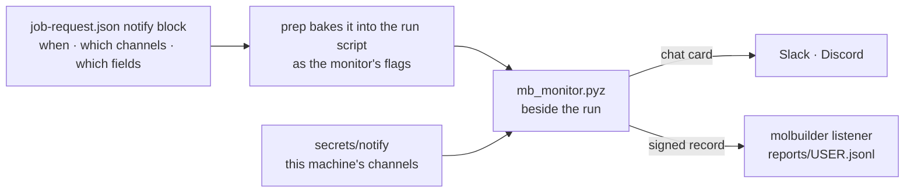
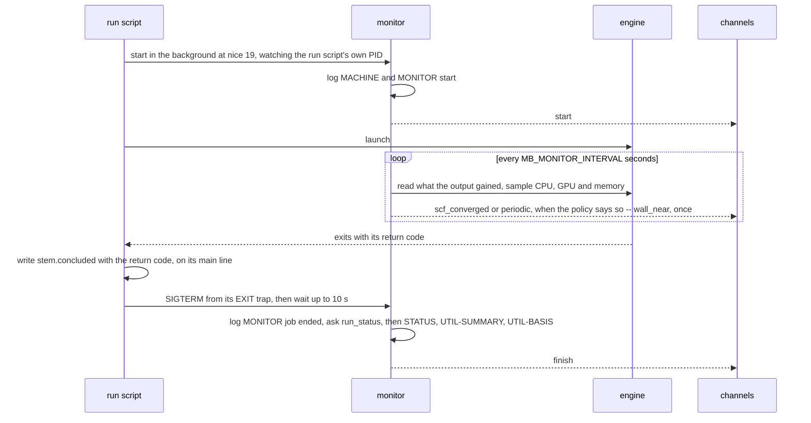
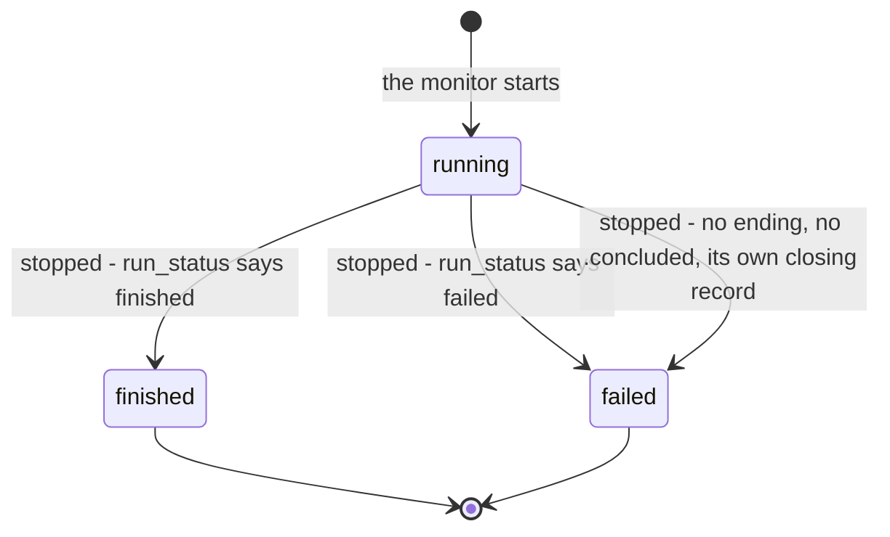
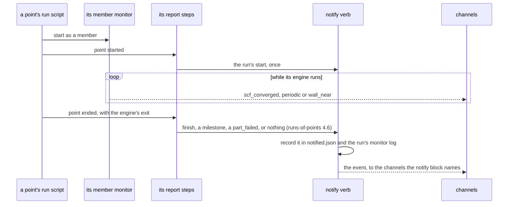

# Run reports — how a job tells you it is going

**Role:** contract
**Domain:** execution
**Owns:** the monitor beside every run — what it reads, what it writes, what it says and when it speaks — the notification events and who sends each, the channels file, the report record and its chat cards, and the listener that receives reports.
**Read with:** [`running-a-job.md`](?doc=execution/running-a-job.md) § 4.1 (the run script's instruments) and § 4.2 (a run's states) · [`runs-of-points.md`](?doc=execution/runs-of-points.md) § 3, § 4 (a run of points' operations and send rule) · [`job-request.md`](?doc=execution/job-request.md) § 3.5 (the `notify` block) · [`job-contracts.md`](?doc=execution/job-contracts.md) § 2.1 (the monitor's place in a run folder) · [`web/task-setup.md`](?doc=web/task-setup.md) § 9b and [`web/this-machine.md`](?doc=web/this-machine.md) (the cards that write the policy and the channels) · [`ops/access-control.md`](?doc=ops/access-control.md) § 8 (the gates the listener sits behind)

## The short version

A run takes hours or days on a machine you are not sitting at. The **monitor** — `mb_monitor.pyz`, started by
the run script beside every run — watches it, and this chapter is the rule for how it tells you what it sees.

- **When to speak and to which channels belongs to the calculation** (its `notify` block); **what a channel is**
  — an address, often a secret — **belongs to the machine** (`secrets/notify`). They are never in one file (§ 1).
- **Seven events**: `start`, `scf_converged`, `periodic`, `wall_near`, `milestone`, `part_failed`, `finish`. The
  table in § 2 says who says each, and when. Every event said is recorded with the run; **which channels hear it
  is the `notify` block's** — with none, no channel hears anything.
- The monitor reads the run with the framework's own readers, shipped beside it (§ 2.3), and writes its log and
  its utilisation record (§ 2.5). It says where the run is in its declared structure (§ 2.8).
- **A run of points reports as one run**: its points' report steps send its start, milestones, failed parts and
  finish (§ 2.4, § 2.9).
- Every message is one report (§ 4.1a), in the envelope its channel reads (§ 4.1b), laid out per receiver
  (§ 4.1c). molbuilder's own listener is one signed, append-only route (§ 4).
- **The monitor observes and notifies; it never decides** (§ 5).

| you want | read |
|---|---|
| to set reports up, and know what you will hear | § 1, § 2, § 3, § 3.0, § 3.1 |
| why it speaks as it does | § 2.1, § 2.1a, § 2.2, § 2.7, § 2.8, § 2.9, § 4.1 |
| developer reference | § 2.3, § 2.5, § 2.6, § 4.1a – § 4.1c, § 4.3, § 6 |

---

## 1. Why the split is the whole thing

> **The sentence the whole design follows:** **when** to speak, and **which channels**, belongs to the
> calculation. **What a channel actually is** — an address, and usually a secret — belongs to the machine.
> They are never written in the same file.



A calculation's folder **travels** — its description and its job request with it. It goes to a cluster, into
a citation's composed copy, into a colleague's copy of your project. That is what a description is for.

A webhook URL does not travel — it is a fact about one person's Slack, and for Slack and Discord it *is* the
credential, with no separate token beside it. Anything that travels must therefore not carry it.

| | lives in | travels? |
|---|---|---|
| **the policy** — when to speak, which channels **by name**, which fields | `job-request.json`'s `notify` block ([`job-request.md`](?doc=execution/job-request.md) § 3.5) | **yes**, and safely: *"every six hours, to `slack`"* is true wherever the file is opened |
| **the channels** — what each name resolves to: the address, and the secret | the person's own file, `<config dir>/secrets/notify`, mode `0600` (§ 3) | **no**, ever |

**A name travels; what it points at does not** — and that is what lets a job request say where its reports go
at all. `"slack"` is a label the person chose on their own machine: not a credential, it grants nothing, and on
a machine that has no channel by that name it resolves to nothing and says so in the monitor log. It fits the
line [`web/task-setup.md`](?doc=web/task-setup.md) § 6.1 draws for every setting — a job request holds what a
person decides, never what a machine found — and adds one: never a secret.

> **On the directory.** Secrets live in `config_dir()`'s `secrets/`, which honours `$MOLBUILDER_CONFIG_DIR` and
> `$XDG_CONFIG_HOME` ([`configuration.md`](?doc=configuration.md) § 2.1c). The monitor reads this file **on a
> compute node**, and on a cluster's login node `$HOME` is NFS-mounted and often snapshotted:
> `XDG_CONFIG_HOME=/scratch/$USER` is how a person keeps a token off it. A path fixed to `$HOME` would have no
> such escape.

---

## 2. When it speaks

Every run's monitor says `start`, `wall_near` and `finish`, and a run of points' report steps say its `start`,
`milestone`, `part_failed` and `finish`, whatever the calculation's policy; `scf_converged` and `periodic` are said
only when its `notify` block ticks them. **Every event said is recorded** with the run — in its notification
record `notified.json` and as a `[NOTIFY]` line of its monitor log (§ 2.5). **Which channels hear an event is
the `notify` block's** (§ 3.0). **No `notify` block is no notification** *(user, 2026-09-26: "when no set up
for notification that means no notification")*: no channel hears anything, the start and the end included —
a run with no block still records its `start` and `finish` beside it.

| event | the occasion | said by | when | said |
|---|---|---|---|---|
| `start` | it started | the run's monitor | once, as it starts watching the run | always |
| | — a run of points | the report step `point started` of the first point to start | once per run; its member monitors say none | always |
| `scf_converged` | a step finished, its SCF converged | the run's monitor, or a point's member monitor | the first wake after a step that **moves the geometry** finishes (§ 2.2); one per wake | when `notify.on_scf_converged` |
| `periodic` | every N hours | the run's monitor, or a member monitor | N hours after the last event; the first, N hours after the start | when `notify.every_hours` (`null`: never) |
| `wall_near` | its wall is near | the run's monitor, or a member monitor | once, on a job sent with a wall, when the warning of § 2.1b is due | always |
| `milestone` | a round ended, and the run goes on | the report step `point ended`, through the `notify` verb | the point that ends its round, while points are left to run | always, on a run of points |
| `part_failed` | a point short of done, and the run goes on | `point ended`, through `notify` | a point short of done while its round goes on, once per reason | always, on a run of points |
| `finish` | it ended | the run's monitor | as it stops: SIGTERM from the run script's exit trap (also what a scheduler's wall or cancel sends), or the watched PID gone | always |
| | — a run of points | `point ended` of the point that leaves none to run | once its index is closed and its kind's finish step has run | always |

When a run of points' events are said, and each one's words, are
[`runs-of-points.md`](?doc=execution/runs-of-points.md) § 4.6 and § 2.9 here; *short of done* is
[`runs-of-points.md`](?doc=execution/runs-of-points.md) § 1.3's.

- **Nothing else is said.** Between the start and the end an event is said only on the two occasions the
  calculation ticked, once when its wall is near, and — for a run of points — when a round ends or a part fails
  with the run going on. Every wake's reading is in the monitor log; the channels hear what the policy asks for.
- **Every event restarts the N-hour clock** — a step's, the wall's warning, a milestone, a part's failure —
  and a step and a period due on the same wake are one event, the step's. A run of points' member monitors
  count it from the last event the run's record holds (§ 2.4).
- **The start and the end are not ticks**: a calculation whose channels hear anything hears them — they bracket
  every report, and a run that finishes at 3 am saying so is the reason the hook exists.
- **The monitor judges no stall** *(user, 2026-09-26)*. A step can take hours, and nothing in the output tells a
  slow one from a stuck one; how the run uses what it holds is in the utilisation record (§ 2.1a), for the
  person to read.

Every event carries the same report (§ 4.1a): the state and where the run is — in its structure, where one is
declared (§ 2.8) — the SCF phase and iteration, the energy, each residual against its criterion, the largest
force against its tolerance, the step, the rate, TBtrans's account of its loop
([`model/parse.md`](?doc=model/parse.md) § 5d.5), and at the end how each SCF phase converged and how the process
exited.

### 2.1 Looking often and speaking rarely are different numbers

The monitor wakes every `MB_MONITOR_INTERVAL` seconds (default **10**). Each wake reads the run (§ 2.3) and
samples what it uses (§ 2.1a), and both records are **change-gated**, so a fast wake costs no volume:

| record | a line is written when |
|---|---|
| the monitor log's `[STATUS]` | the run advanced (below), or its energy or state changed |
| a `util.csv` row | CPU %, memory, or a GPU's use or memory moved by ≥ 10 % of its last written value, or 300 s passed since the last row (`--util-keepalive`), so the plotted series keeps anchor points |

*The run advanced*: a new SCF row; the phase or the step moved; TBtrans's loop moved (its set-up stated, a progress
line, a pass begun or completed, its currents); the words of where a device's set-up is moved
([`model/parse.md`](?doc=model/parse.md) § 2b, `doing`); or a part of the output began (§ 2.8).

**Notifying is separate and rare**: § 2's occasions, never one per wake. A notifier fired on every changed
sample would message a running job's channels every few seconds.

### 2.1a A percentage is a fraction of what the job HOLDS

**Never of the node.** A report answers one question — *is this calculation using what it was given?* — so every
number is the job's own:

> cpu % = Δ(CPU time the job used) / (Δ wall time × cores the job holds)

100 % means the calculation is using every core it holds. Cores it did not ask for are not its business: a
node-wide reading measures the cluster, not the job. **Worked example:** 48 busy ranks on a 128-core node cannot
read above 48/128 = 37.5 % node-wide, so a job at 86 % of what it holds reads 32 % (0.86 × 37.5 %) and looks idle
— and a job that looks starved argues for a bigger machine, which is the longer queue this practice exists to
avoid.

**What the job holds depends on how it was started**, and is fixed once, when the monitor starts — a basis that
changed mid-series would change what every number means:

| started | whose CPU time and memory | the cores it holds | memory stated against |
|---|---|---|---|
| inside a scheduler's job (`MB_JOB_ID` set by the job's header — `--mode submit`; [`scheduler.md`](?doc=execution/scheduler.md) § 6a) | its cgroup | the affinity mask, else `MB_CPUS_ON_NODE`, else `MB_CPUS_PER_TASK` | the limit the kernel enforces on the job's cgroup, and the kernel's own peak where it keeps one |
| outside one — a run here, `--mode direct` | its process tree: the run script and every descendant, the monitor excepted; memory as proportional set size (PSS), so ranks mapping one library count it once | the cores its launch uses, which the run script passes as `--cores`: ranks × threads for a hybrid build, ranks for pure MPI, threads for OpenMP-only, 1 for serial | nothing — a process tree has no limit: *limit not stated* |

A run started outside a scheduler has no cgroup of its own: the one its process sits in is the launching
session's — a login scope, the web server's service — shared with everything else there. So its process tree is
the job. Memory is reported in GB, beside the limit where there is one; never as a share of the node.

**A GPU is sampled only for a run that uses one** — the run script's `--gpu`, from the `use_gpu` it launches with
([`job-contracts.md`](?doc=execution/job-contracts.md) § 6.2). A CPU run on a GPU node holds no GPU, and what the
node's GPUs do is somebody else's.

Each run states its basis on the monitor log's `[UTIL-BASIS]` line (§ 2.5) — the cores and which source gave
them, where CPU time and memory were read, the peak and the limit. Read it before comparing two runs: cgroup v1
and v2 spell their files differently, and where no cgroup is readable the numbers fall back to the node and say
so.

### 2.1b The time the job has left, counted from its own record

**A job sent with a wall counts down to it**: the wall it was sent with, from the run's launch record
(`run.json`'s `placed_on.time` — the header's, or a launch's `--time`, which the scheduler takes over the
header's, [`scheduler.md`](?doc=execution/scheduler.md) R9), counted from **the job's start**, which its header
states once for everything the job runs (`MB_JOB_STARTED`, an epoch second). A walk's later member counts from
the job's start, never its own.

- **No scheduler is asked**: the count is the same in a job that cannot reach its scheduler's commands. The
  launch record is read on each wake until it is there — the sender writes it as the scheduler answers, and a job
  can start first.
- **Each `[STATUS]` line says the count** — *wall 4h: 21m left*. A run here says none: its launch record names no
  queue and so no wall, though its engine is told the wall its own job states
  ([`running-a-job.md`](?doc=execution/running-a-job.md) § 3.6).
- A record or a wall that does not read, or a header that states no start, is said once in a `[WALL]` line, and
  nothing is counted.
- **A run of points' member monitor** finds its run by its folder's record (`calcdirs.where`), reads the run's one
  launch record there and counts as the run's. A point — one SCF, one transmission — states no steps, so what warns
  for a member is its run's pace.

**It warns once, and only where it can say why.** For a run of points whose index states its points, when the
points left need more than the wall leaves at the pace its finished points measured
([`runs-of-points.md`](?doc=execution/runs-of-points.md) § 4.7) — *6h left before the time limit; the 120 optical calls
left need about 10d at 2h each (1 done) -- the run may not finish before it*. Otherwise, when the time left falls
below the longest step the run has taken so far (§ 2.2: a geometry move, a displacement, a PySCF step): *21m left;
the longest of 3 steps so far took 46m -- the step underway may not finish before the wall*. A step's length runs
from one step finishing to the next, the first from the monitor's start. The monitor writes one `[WALL]` record
and says `wall_near`, which the channels the `notify` block names hear.

A run that states no steps (a single point, a transmission) is counted down and never warned: nothing in it says
how long its next part takes. The warning stops nothing and asks nothing. The engine itself stops before the wall
where it can ([`running-a-job.md`](?doc=execution/running-a-job.md) § 3.6), so the warning is the cue for a run
whose step is longer than its slack.

### 2.2 A converged SCF is read from the step advancing

A step is over when the engine begins the next one, and the engine says so in its own words. The output's parser
reads that line (§ 2.3); the monitor counts the finished steps and sends `scf_converged` when the count grows
**and the step moves the geometry**.

| run | what a step is | the line that marks it | `scf_converged` messages |
|---|---|---|---|
| SIESTA relaxation | a geometry move | `Begin CG opt. move = N` (or `Broyden`, `FIRE`; `siesta_grammar.STEP_BEGIN`) — N moves are done | one per finished move |
| SIESTA force constants | a displacement | `Begin FC step = N` | none: a displacement moves no geometry; how many are done and their pace are the periodic report's (§ 2.8) |
| SIESTA single point — every SIESTA rung of a transport calculation | none: it prints `Single-point calculation` | — | none; the `finish` is the whole report |
| TBtrans | none: it runs no SCF — its k-point × energy loop instead, one pass per spin channel, said in words (*unpolarized (1 of 1): 10.01 % done, about 6d left (TBtrans's estimate)*, [`model/parse.md`](?doc=model/parse.md) § 5d.5) | — | none |
| PySCF optimization | a geometry step | a step block in the progress log (`.molwatch.log`), written when the step ends | one per finished step, the first included |
| PySCF vibration | a step of the relaxation it runs first — none when the geometry is stated relaxed; the Hessian after it states no step | a step block in the progress log | one per finished relaxation step |

The last step's end is always in the `finish` message.

**Only a step that moves the geometry is a message** *(the design agreed with the user, 2026-10-26)*. A geometry
move's outcome — its energy, and the largest force against its tolerance — is something the person judges as the
run goes. A displacement's is not: it moves one atom away from one geometry and back, and the person judges the
displacements together, once the force constants are built. Which steps move the geometry is declared where the
steps are read:

- **SIESTA**: the grammar's `siesta_grammar.MOVES_GEOMETRY`, over the step's own words — an optimizer's `opt.
  move` (Broyden, FIRE, CG). Not an `FC step`; not a `Server step`, whose geometry a driver outside SIESTA sets;
  and not an `MD step`, which no kind of molbuilder's runs and which SIESTA numbers from `MD.InitialTimeStep`, 1 by
  default, so "N are done" would run one ahead.
- **PySCF**: every step block of the progress log is a geometry step, `molwatch_grammar.STEPS_MOVE_GEOMETRY`.

The reading pass states it as `step_moves` ([`model/parse.md`](?doc=model/parse.md) § 5d.5). Every step still
counts toward the pace and the wall (§ 2.1b, § 2.8): a displacement takes time like a move.

**Why a finished step means a converged SCF.** Each geometry step solves the Kohn–Sham equations
self-consistently, and its forces mean something only once that SCF has met its criteria (§ 2.7). Under SIESTA's
default `SCF.MustConverge true`, an SCF that reaches its cycle cap stops the run, so a step that finishes had
converged. A deck that sets it false lets a step finish on an unconverged density: the message still goes, and its
residuals, printed against their criteria, show it.

**Why no convergence phrase is read.** No output marker decides that the run is over: `siesta: Final energy`
prints before the end, and sampling that stopped there would leave a job holding its CPUs and GPUs unwatched.
*When* it ended is the watched PID's answer, or the run script's signal; *how* it ended is `run_status`'s, asked
once the PID has said it is over (§ 2.3). Reading the output to report progress is the monitor's job; reading it
to decide the run is over is not.

### 2.3 What it reads, and through what — the framework's own readers, shipped beside it

**The monitor has no reader of its own.** Every fact it reports is read by the reader the rest of molbuilder
reads that file with, and those readers travel with the job in **one file**, `mb_monitor.pyz`
(`runfiles.MONITOR_BUNDLE`) — a Python zip application of the modules `runwrap.monitor_companions` names, each its
own file unchanged, run by the job's own python, `$_mb_py`
([`running-a-job.md`](?doc=execution/running-a-job.md) § 2.2a).

- **Standard library only**, because it is the instrument that reports a failure: it must load when the
  environment's own packages do not — a broken numpy is reported by it, never hidden by it. What may travel is
  [`configuration.md`](?doc=configuration.md) § 2.3's rule, *stdlib-only AND travels*. The trajectory log's
  vocabulary the grammar reads is its own standard-library module (`trajectory_log/keys.py`), never the log's
  writer, which needs numpy and ships with PySCF decks and the vibration finish, never with the monitor.
- **One file**, because a directory of shipped modules reads as a directory of decks. `prep` writes it beside the
  run script, and `materialize` copies it into every run.

| it reports | read by | travels as |
|---|---|---|
| which files are this run's | `runfiles` — the stem, each file's role | `runfiles.py` · `identity.py` |
| where the run is now (see below the table) | the output's ONE parser's reading pass, fed the file as it grows and chosen by the file's role: a SIESTA-family `.out` by `SiestaReader`, a PySCF run's progress log by `MolwatchReader` ([`model/parse.md`](?doc=model/parse.md) § 5d.5) | `siesta_reader.py` · `siesta_grammar.py` · `molwatch_reader.py` · `molwatch_grammar.py` · `_section_rules.py` · `keys.py` · `constants.py` · `tbtrans.py` · `transiesta.py` · `engine_atom_index.py` · `fdf.py` |
| SCF iterations so far, and seconds per iteration, in the current SCF phase | the timing rule, `scf_timing_rows.timing_of`, over the run's stamped SCF rows: a SIESTA run's `.scf-timing.log`, a PySCF run's progress log ([`model/parse.md`](?doc=model/parse.md) § 5c) | `scf_timing_rows.py` · `molwatch_grammar.py` |
| how it ended: `state`, `detail`, each SCF phase's convergence, whether a relaxation relaxed, the exit code | `run_status` over this run's files (`parse/dirs/job.py`) — the Results tab's own answer, by its order of evidence ([`running-a-job.md`](?doc=execution/running-a-job.md) § 4.2), and *unreadable*, with why, if that read fails: the monitor never stops the job and never calls a run that ended running; a SIESTA run's stderr from the session log (`wrapper_log`) | `job.py` · `_run_ending.py` · `end_lines.py` · `wrapper_log.py` · `monitor_log.py` · `runrecord.py` |
| which fields a report may carry, and how a card says each | the one declaration, `report_fields` (§ 4.1a): `ReportField.said`, `span_words`, `pct_words` | `report_fields.py` |
| which fields a card shows for an event, in what order, for each receiver | the layout file, through its reader `report_cards` (§ 4.1c) | `report_cards.py` · `report-cards.json`, the bundle's one data member |
| a member's run: its count, its own point, its points' starts and ends | the run's index ([`runs-of-points.md`](?doc=execution/runs-of-points.md) § 2.3), through its one reader and rules (below) | `runpoints.py` · `calcdirs.py` · `paths.py` · `vibration_phases.py` · `run_words.py` |
| a run of points' report steps: a point's verdict, a round's outcome | the status door's verdict reader (`_run_ending.verdict_of`), and the round's outcome the index names (§ 2.9) | `_run_ending.py` · `run_words.py` · `conductance.py` · `energies.py` · `deck_record.py` |
| the run's notification record | `runrecord.read_notified`, `note_notified`, written through the one JSON writer | `runrecord.py` · `persist.py` |
| where the channels are | `config_dir` (§ 1) | `config_dir.py` |
| the deck as its engine reads it, for the run script's record of what the engine will read ([`running-a-job.md`](?doc=execution/running-a-job.md) § 1, step 16) | the keyword reader the engine's record names (`keyword_reader` — SIESTA's `parse.fdf:KEYWORDS`), its `read_deck` — a block read from a file beside the deck inlined | `fdf.py` · `units.py` |
| the wall it was sent with (§ 2.1b) | the launch record (`runrecord.launch_record`), its `placed_on.time` read by `runrecord.sent_wall_s` through the wall's one parser, `scheduler.quantities.parse_walltime` | `runrecord.py` · `quantities.py` |
| when the job started (§ 2.1b) | the header's `MB_JOB_STARTED`, its name `runtime_info.JOB_STARTED_VAR` — the job's clock's names, `MB_WALL_S` and `MB_WALL_SLACK_S` beside it | `runtime_info.py` |

**A member's run** is found by the point's folder's record (`calcdirs.where`), read by `runpoints.read_index`,
`rows_of` and `still_to_run`, and counted in the kind's words (`runpoints.count`).

**Where the run is now** is the reading pass's: the SCF phase and iteration, the energy, each residual beside the
criterion the run states, a NEGF loop's charge, a TranSIESTA device's set-up until its first SCF row (the
reading pass's `doing`, in `parse/engines/transiesta.py`'s words — what the run door's *running* says too), a part
of the output that begins with a line of its own (`siesta_grammar.PARTS`, § 2.8), the step the engine began in
its own words and how many are done, the largest force beside its tolerance, and TBtrans's account of its loop —
its passes, the one underway's per cent done and the time TBtrans says it has left, each completed pass's time
(`tbtrans.loop_words`, the run record's and the transport report's sentence too). The Results tab builds its
frames from the same pass. A file whose reading pass refuses a line — a stated atom-index map that does not read
([`model/overview.md`](?doc=model/overview.md) § 2.2b) — states nothing that wake and is read afresh at the next;
the monitor never stops on it.

**What stays the monitor's is what no file states**: the watched PID — *when* the run ended — the machine and its
utilisation, when to tell someone, and the envelope each channel reads.

**Every engine, named, never pathed.** The run script starts it from its shared part, SIESTA's and PySCF's alike,
and tells it which run it watches — the label and the stage token — never a path: it names every file through
`runfiles`, in the folder it is started in.

**Its words are the framework's.** `state` is `running` while the watched PID lives; at the end it is
`run_status`'s `finished` or `failed`, with its `detail`. A job the scheduler or a signal killed leaves no ending
in its output and no `.concluded`; what it does leave is the monitor's closing record, `[MONITOR] job ended`,
written before the monitor asks — and `run_status` reads that record as `failed`, *stopped before its end: no
ending in its output and no exit recorded*. So the monitor's `finish` and the Results tab say the same thing from
the same files — but for the scheduler's own word on how it ended the job, which the Results tab reads first and
the monitor, which carries no scheduler, does not ask: there its `finish` says *stopped before its end*, and the
Results tab *stopped by the scheduler: &lt;its words&gt;*.

**The run script asks the same framework**: how a failed run ended is `_run_ending`, asked through `mb_monitor.pyz
ending`, and what the engine will read is the deck's reader, asked through `mb_monitor.pyz deck` (§ 2.6;
[`running-a-job.md`](?doc=execution/running-a-job.md) § 3.5, § 1 step 16).

### 2.4 One monitor per run — the lifecycle



- **A start that ends before its engine** for any reason but a signal — an activation that failed, a step that
  failed under `set -e` — never reaches the main line's marker: its exit trap writes `<stem>.concluded`, *stopped
  before its end*, before it stops the monitor, as the main line writes its own first
  ([`project-layout.md`](?doc=execution/project-layout.md) § 1.6.3).
- **A forced stop** — the wall, `scancel`, a kill, a lost terminal — writes no `.concluded`. The monitor gets
  SIGTERM from the run script's signal handler or the scheduler, or sees the watched PID go; it logs `[MONITOR]
  job ended`, and its `finish` says *failed — stopped before its end*. A signal is not a certainty, which is why
  the run's state asks the scheduler's own line first
  ([`running-a-job.md`](?doc=execution/running-a-job.md) § 4.2, *The order of evidence*); the countdown (§ 2.1b)
  said beforehand how much time was left.
- **A lost node takes the monitor with it**: with no closing record and no scheduler line, the folder alone says
  nothing more until the run's wall passes (`running-a-job.md` § 4.2, *Past its wall*).

The **report's `state`** is the monitor's view of one run:



A run directory's own states are [`running-a-job.md`](?doc=execution/running-a-job.md) § 4.2's. A report never
says `pending` or `queued`: a monitor exists only while its run runs.

**A run of points reports as one run** — a SIESTA vibration's calls
([`engines/vibration.md`](?doc=engines/vibration.md) § 5.11 § 7a) and a transport sweep's points, frames × voltages
([`engines/transport.md`](?doc=engines/transport.md) § 2a.11). Two kinds of sender share its events:

- **Each point's member monitor.** Each point's run script starts its own monitor as a **member** (`--member`),
  which finds its run by its folder's record (`calcdirs.where`), watches that point, sends `scf_converged`,
  `periodic` and `wall_near` by the policy, counts its clock from the run's own record, and sends neither `start`
  nor `finish`.
- **The points' report steps** — `point started` before each engine and `point ended` after it
  ([`runs-of-points.md`](?doc=execution/runs-of-points.md) § 3, ops 9 and 10). They send the run's `start` once,
  a `milestone` or a `part_failed` as the run's send rule says
  ([`runs-of-points.md`](?doc=execution/runs-of-points.md) § 4.6), and, once no point is left to run, the run's
  `finish`. Each goes through the bundle's `notify` verb (`mb_monitor.pyz notify <event> --label <label> --stage
  <stage> --dir <run>`), which reads the policy from the environment the run script exports
  (`MB_NOTIFY_CHANNELS`, `MB_NOTIFY_REPORT`), skips a `start` already sent and a `part_failed` of a reason
  already reported, and writes the run's `notified.json` and its lines into the `<stem>.monitor.log` at the run's
  root (§ 2.5).



Every event carries the run's count, read from the run's index after the step that sends it wrote it — the
`start`'s, the run's points before any has ended, those taken over among them done — and, once a point has
started, the run's clock (§ 2.8). A run of points is walked by one job: a walk stopped by the person, or killed,
sends no `finish`, and the run door reads the run failed; so does a walk one of whose points ended before its
first report step, the index never seeing it end.

### 2.5 What it writes

| file | written by | when | read by | absent means |
|---|---|---|---|---|
| `<stem>.monitor.log` | the monitor; at a run of points' root, the `notify` verb too | from its start to its closing lines | a person; `parse/instruments/monitor.py` ([`model/parse.md`](?doc=model/parse.md) § 5c.1); `run_status`, its closing record ([`running-a-job.md`](?doc=execution/running-a-job.md) § 4.2) | the monitor never started, or died loading (below) |
| `<stem>.util.csv` | the monitor | a header and a first row at start, then change-gated rows (§ 2.1) | the bench summary; `utilisation` ([`model/parse.md`](?doc=model/parse.md) § 5c.1) | nothing was sampled |
| `notified.json`, beside the run's launch record | every monitor; for a run of points, the `notify` verb | each event said for the run, with its time, and a failed part's reason | the member monitors; the `notify` verb (below) | no event said for the run |
| `<state dir>/reports/<user>.jsonl` | the listener, on the server | one line per accepted report | `jq`, pandas (§ 4.1a) | no report reached the listener |

- **A monitor log that is not there**: the monitor never started — the session log says why (*monitor: not started
  …*) — or it died loading: the session log's `starting` line and the error, no `started` (§ 2.6).
- **`notified.json`** records each event as said, whether or not a channel took it. The member monitors read it so a
  `wall_near` already said is not said again, and to count the N-hour clock from the run's last event; the `notify`
  verb reads it so a `start`, or a `part_failed` of a reason already reported, is not said again.

A point's member monitor and its report step can write `notified.json` at one moment, both in the point's job on
one node, so each read-and-append is one step under a lock on the folder (`runrecord.note_notified`); a filesystem
that refuses locks gets the event written unlocked. `<stem>` is `<label>_<stage>`, every file of the run named
once on it ([`job-contracts.md`](?doc=execution/job-contracts.md) § 2.2a). `util.csv`'s columns are `epoch, iso,
cpu_pct, mem_gb`, then `gpu<i>_sm, gpu<i>_memutil, gpu<i>_vram_gb` per GPU sampled.

**The monitor log**, one line per record, `[<time>] [<TAG>] …`:

| tag | when | says |
|---|---|---|
| `[MACHINE]` | first | `node= cores= mem_gb= gpu=` — the node the job landed on ([`scheduler.md`](?doc=execution/scheduler.md) R12) |
| `[MONITOR] start` | at start | the interval, the watched PID, and the first reading |
| `[STATUS]` | when the run advanced (§ 2.1), and once at the end | the summary line (§ 4.1a), the time left before the job's wall among it (§ 2.1b) |
| `[WALL]` | once, when the warning of § 2.1b is due; or once, when the wall cannot be counted | the time left, and the points left with the time they need at the pace — or the longest step and how many have finished; or why nothing is counted |
| `[NOTIFY]` | on each event, and on any channel problem | `(stub) <event>: <summary>`, the record of every event; or a channel's problem (below) |
| `[MONITOR] job ended` | the first closing line | why it stopped: `stopped by SIGTERM` or `watched pid N gone` (below) |
| `[UTIL-SUMMARY]` | at the end | the CPU mean (min–max) and each GPU's SM mean; for a GPU run, a verdict from the busiest GPU's mean: ≥ 85 % *GPU-bound*, ≤ 60 % *host/CPU-bound*, otherwise *mixed* |
| `[UTIL-BASIS]` | at the end | what every percentage is a fraction of (§ 2.1a) |

- **A channel's problem** on a `[NOTIFY]` line: why a channel is skipped or not set up, or a send that failed, by the
  channel's name and what failed — `channel 'slack': finish not delivered -- the connection was refused` — never
  the address (§ 3).
- **`[MONITOR] job ended`** is the closing record `run_status` reads; the `finish` event follows it. Its time is the
  run's end (`ended_at` to the monitor-log reader), which the next launch compares a warm file's write time with
  ([`running-a-job.md`](?doc=execution/running-a-job.md) § 3.6).

A relaxation's log, shortened:

```text
[2026-09-26T10:00:01-0700] [MACHINE] node=sg013 cores=128 mem_gb=503.2 gpu=none
[2026-09-26T10:00:01-0700] [MONITOR] start (interval=10s watch_pid=41822) running | the run 0s
[2026-09-26T10:00:01-0700] [NOTIFY] (stub) start: running | the run 0s
[2026-09-26T10:25:41-0700] [STATUS] running | periodic SCF iteration 14 | 14 SCF rows | E -1740.201113 eV | dDmax 0.00231 (tol 0.0001) | dHmax 0.0412 eV (tol 0.001) | CG opt. move 0 | 12.80 s/iter | the run 26m
[2026-09-26T16:02:17-0700] [MONITOR] job ended (stopped by SIGTERM); final notify + exit
[2026-09-26T16:02:17-0700] [STATUS] finished (ended, exit 0) | periodic SCF iteration 9 | 1203 SCF rows | E -1740.213457 eV | dDmax 7.9e-05 (tol 0.0001) | dHmax 0.00088 eV (tol 0.001) | max force 0.0381 eV/Ang (tol 0.04) | CG opt. move 41 | 12.60 s/iter | each CG opt. move takes 9m (41 done) | converged: periodic yes | geometry relaxed | exit rc=0 | the run 6h
[2026-09-26T16:02:17-0700] [UTIL-SUMMARY] cpu mean=86% (12-99)
[2026-09-26T16:02:17-0700] [UTIL-BASIS] cpu% of 48 core(s) [affinity]; cpu time [cgroup-v2]; mem [cgroup-v2]; limit 180 GB
[2026-09-26T16:02:18-0700] [NOTIFY] (stub) finish: finished (ended, exit 0) | … | exit rc=0 | the run 6h
```

### 2.6 The command line, the environment and the signals

The run script renders one line, the same for every engine (`runwrap._monitor_block`), from the job's
`jobset.Resources` ([`job-contracts.md`](?doc=execution/job-contracts.md) § 6.2):

```bash
nice -n 19 "$_mb_py" mb_monitor.pyz --label "<label>" --stage "<stage>" \
    --util --cores "<cores>" [--gpu] --interval "${MB_MONITOR_INTERVAL:-10}" \
    [--notify-on-scf] [--notify-every-hours N] [--notify-channels "a,b"] \
    [--notify-report "f1,f2"] --watch-pid $$ >/dev/null 2>>"$_runwrap_log" &
```

**Its start and its own errors go to the run's session log** (`<stem>.runwrap.log`), its stdout nowhere. The
monitor opens its `.monitor.log` only once it has loaded, so the bundle's entry says the load itself, in the
session log's own line format (`wrapper_log.LOG_LINE`):

```
[23:41:35-0700] [INFO ] monitor: starting mb_monitor.pyz on python 3.12.14 (/…/envs/molbuilder-siesta/bin/python3)
[23:41:35-0700] [INFO ] monitor: mb_monitor.pyz started
```

— the first before it imports the monitor, the second once it has. **A monitor that died loading says so**:
`starting`, then one `ERROR` line naming the exception, and its traceback, which names the file that failed, and
no `started` — a shipped file reaching into molbuilder, or into a package the job's environment lacks:

```
[23:41:35-0700] [INFO ] monitor: starting mb_monitor.pyz on python 3.12.14 (/…/envs/molbuilder-siesta/bin/python3)
[23:41:35-0700] [ERROR] monitor: mb_monitor.pyz did not load -- ModuleNotFoundError: No module named 'molbuilder'
Traceback (most recent call last):
  …
```

A `starting` with neither a `started` nor an `ERROR` is a monitor stopped while still loading — a run that ended
within the monitor's first fraction of a second (its load takes about 0.2 s), stopped by the run script's exit
trap. The entry is written in the Python every interpreter can parse, so it can say this on any python that runs
it. Nothing else reaches stderr in a healthy run.

| flag | from | meaning |
|---|---|---|
| `--label` · `--stage` | the deck's label and its stage token | which run, both required; every file named through `runfiles` |
| `--watch-pid` | `$$`, the run script's own PID | stop when it goes; `0` watches none |
| `--member` | every point of a run of points (`runwrap._monitor_block`, rendered for a `runwrap.PointOfRun`) | this monitor is one point's of a run that reports as one run: its run found by its folder's record (`calcdirs.where`, `monitor._run_of`), no `start`, no `finish`, its clock the run's record's (§ 2.4) |
| `--dir` | not passed: the run script starts it in the run's folder | the run's folder, for `molbuilder monitor` pointed at a run from elsewhere |
| `--util` | always | sample into `util.csv` |
| `--cores` | the run script's launch (§ 2.1a) | the cpu % denominator of a run started directly |
| `--gpu` | `use_gpu` | sample the GPUs, and judge them on `[UTIL-SUMMARY]` |
| `--interval` | `MB_MONITOR_INTERVAL`, default 10 | seconds between wakes |
| `--util-keepalive` | default 300 | a `util.csv` row at least this often |
| `--nice` | default 19 | the monitor lowers its own priority |
| `--notify-on-scf` | `notify.on_scf_converged` | send `scf_converged` |
| `--notify-every-hours N` | `notify.every_hours` | send `periodic`; `0` is never |
| `--notify-channels` | `notify.channels` | absent (no `notify` block): nothing is sent; `*`: every channel on this machine; `""`: none; `a,b`: those (§ 3.0) |
| `--notify-report` | `notify.report` | the fields a chat card shows; absent: all; `""`: none ([`job-request.md`](?doc=execution/job-request.md) § 3.5). A name that is not a field is dropped, not fatal |

**The bundle's other verbs** print no start pair, because their caller waits on their answer
(`monitor.BUNDLE_VERBS`):

| verb | for | |
|---|---|---|
| `mb_monitor.pyz ending OUTPUT [--stderr FILE] [QUESTION]` | the run script, asking how a failed run ended — `_run_ending`'s door: the ending in words, `out-of-time` (exit 0 yes, 1 no) or `advice` (words, exit 1 for none) | answers 2, *cannot read*, for a bundle that does not load; the run script asks it once, before its first question, so that error prints once ([`running-a-job.md`](?doc=execution/running-a-job.md) § 3.5) |
| `mb_monitor.pyz deck READER DECK` | the run script's record of what the engine will read — the deck's lines as the engine parses them, by `READER`, the keyword reader the engine's record names (`keyword_reader`) | 1, saying why, for a deck that does not read ([`running-a-job.md`](?doc=execution/running-a-job.md) § 1 step 16) |
| `point started\|ended --label --stage --deck [--exit --output] [--bundle --before --after --finish]` | a point's report steps | [`runs-of-points.md`](?doc=execution/runs-of-points.md) § 3, ops 9 and 10 |
| `notify <event> --label --stage --dir <run> [--state --detail --reason]` | one event for a run of points | § 2.4 |

`molbuilder monitor` runs the same monitor from the package, for a job you point it at.

| environment | read by | effect |
|---|---|---|
| `MB_MONITOR` | the run script | `0` starts no monitor |
| `MB_MONITOR_INTERVAL` | the run script | seconds between wakes |
| `MB_NOTIFY_URL` · `MB_NOTIFY_KEY` | the monitor | report to this one URL instead of the channel file (§ 3) |
| `MB_NOTIFY_CHANNELS` · `MB_NOTIFY_REPORT` | the `notify` verb | the policy a run of points' run script exports for the events its report steps send — `start`, `milestone`, `part_failed`, `finish` (§ 2.4) |
| `MOLBUILDER_CONFIG_DIR` · `XDG_CONFIG_HOME` | the monitor | where `secrets/notify` is (§ 1) |
| `MB_JOB_ID` | the monitor | inside a scheduler's job (§ 2.1a); the report's `job` — the scheduler's id, said in molbuilder's name by the job's header ([`scheduler.md`](?doc=execution/scheduler.md) § 6a) |
| `MB_CPUS_ON_NODE` · `MB_CPUS_PER_TASK` | the monitor | the cores held when no affinity mask answers, as the job's header says them |

| signal | sent by | the monitor |
|---|---|---|
| SIGTERM | the run script's EXIT trap at the job's end; a scheduler's wall or cancel | stops: closing lines, then `finish` |
| — the watched PID gone | — | as SIGTERM |

### 2.7 The science the report states

**An SCF loop** solves the Kohn–Sham equations by iteration: from a density, build the Hamiltonian, solve it, form
a new density, mix, repeat. It has converged when successive iterations stop changing, measured by residuals, each
against a criterion the run itself states — which the report prints beside it:

| engine | residual | what changes between two iterations | its criterion, as the output states it |
|---|---|---|---|
| SIESTA | `dDmax` | the largest change of any density-matrix element (dimensionless) | `redata: DM tolerance for SCF`; required when `redata: Require DM convergence for SCF = T` |
| SIESTA | `dHmax` | the largest change of any Hamiltonian matrix element (eV) | `redata: Hamiltonian tolerance for SCF` (eV); required likewise |
| TranSIESTA, NEGF loop | `dQ` | the device's charge error: the electrons in the open-boundary density minus the neutral count | TranSIESTA's `SCF charge tolerance`; required when it echoes `SCF converge charge T` |
| PySCF | dE · \|g\| · ddm | the total-energy change (eV); the orbital-gradient norm — the energy's change per orbital rotation, an energy (eV), not a force; the density-matrix change | PySCF's `conv_tol`, stated in Hartree while the values are in eV; the monitor states PySCF's tolerances in eV beside the values ([`model/parse.md`](?doc=model/parse.md) § 4a; the Hartree value converted once by the grammar) |

**A step and an iteration are different clocks.** A geometry step is one SCF — many iterations — plus a force
evaluation and a move. `n_iters` counts iterations, `geom_step` counts steps, and the seconds per iteration exclude
a step's boundary, where the forces are computed and the atoms moved
([`model/parse.md`](?doc=model/parse.md) § 5c).

**Why every count and rate is the current SCF phase's.** A TranSIESTA device first converges an ordinary periodic
SCF — diagonalisation with k-points — as its starting density, then the NEGF loop, where each iteration integrates
Green's functions over an energy contour. The two cost differently per iteration, so an average over both predicts
neither phase's remaining time.

**The force against its tolerance.** A relaxation stops when the largest force on any free atom falls below
`redata: Force tolerance` (eV/Å); the report states both. **And the held atoms' when it is the larger** *(the
user, 2026-10-17)*: SIESTA states the largest force over every atom beside the free atoms' after every step, and
when the held atoms carry the larger the status line says it after the tolerance, *max force 0.0028 eV/Ang (tol
0.01); 0.015 eV/Ang on the held atoms*, and the report carries it, `max_force_held`. **A TranSIESTA device
computes no forces**: it says so in its output ([`model/parse.md`](?doc=model/parse.md) § 5d.5), and its status
line says *TranSIESTA does not compute forces in this run (it says they are wrong), and so not the stress either*
where the force would be, with no number.

### 2.8 Where the run is — read from its declared structure

*(The user, 2026-10-28, of a Raman call's card that called a converged SCF's last row the row in flight while
SIESTA had been in its optical calculation for two hours: "the monitor should be more context aware"; "more
structure/parser framework driven, instead of explicit patch of code to handle individual cases".)*

**The line says where the run is in its structure, and each structure is declared where its other readers read
it** — never a case the monitor knows by name. A new part of an engine's output is a row of its grammar; a new
run of points is its kind's record and declaration ([`runs-of-points.md`](?doc=execution/runs-of-points.md) § 7);
a new clock or count is a report field.

| the structure | declared in | what the line says from it |
|---|---|---|
| **the parts of an engine's output** — the SCF, a TranSIESTA device's set-up, SIESTA's optical calculation | the engine's grammar (below) | the part underway in the reading pass's one sentence, and since when — *SIESTA's optical calculation -- it prints nothing until it ends (since 20:02)* ([`model/parse.md`](?doc=model/parse.md) § 2b, `doing`) |
| **which part a fact belongs to** | each report field's `part` (`report_fields.FIELDS`, § 4.1a): `scf` for the SCF's iterations and rate, `run` for the rest | a part's facts said together: the part underway's as they stand, a part that has ended as ended — *its SCF converged in 6 iterations (33s), dDmax 5e-06 (tol 1e-05)* — never a finished SCF's last row as the row in flight |
| **a run of points' position** | the run's index ([`runs-of-points.md`](?doc=execution/runs-of-points.md) § 2.3) | a member monitor says its run's count and its own point, in the kind's words (below) |
| **the clocks** — the run's and, for a member, its point's | the run's start and the point's own monitor start; each a report field (§ 4.1a); the job's wall as § 2.1b counts it | each named — *the run 5h · this call 2h*, the wall beside them, *wall 12h: 7h left*; a run that is no member says *the run* alone |

- **The parts of an engine's output.** The SCF and a TranSIESTA device's set-up are read by their own rows
  (`siesta_grammar.scf_row`, the `ts:` facts). Every part that begins with a line of its own is a row of one
  table, `siesta_grammar.PARTS` — the part, the line that begins it, its words, and its note: what is true of
  its output while it runs (the optical calculation's, *it prints nothing until it ends*, `Src/optical.F`). The
  reading pass reads the table by one rule (`_section_rules`); the latest part begun is underway
  (`SiestaReader.part`) until the SCF's next row speaks again or the run ends. *Since* is when the monitor first
  read the part underway, within one wake. On a card, a field whose part has ended (`ReportField.ended`) is left
  off the grid for the summary line.
- **A run of points' position.** The index — every point, what it needs and must hold, which launch writes and
  each point's report steps stamp — is found by the point's folder's record (`calcdirs.where`) and read through
  its one reader and rules (`runpoints.read_index`, `rows_of`, `still_to_run`) and the count's words the index
  names (`runpoints.count`), all of which travel in the monitor's bundle; it is read again only when it changes.
  *the run: relax done · fc done · optical 0 of 121 done | this call: the equilibrium*; *the run: 7 of 12 points
  done, 1 failed (3 frames × 4 voltages) | this point: frame 2 of 3 · 0.4 V*. A point's *not run* is
  counted only once the walk has ended ([`runs-of-points.md`](?doc=execution/runs-of-points.md) § 4.5), so a
  member's line, its own point running, never says it.
- **The clocks.** A member's run clock starts at its run's first point's start in the index — the points this run
  computed, not those taken over — else at this monitor's own start; its point's clock at its own monitor's
  start. The run's finish, which its last point's report step sends, says the run's clock from the same index.

**The pace and what is left.** Once a unit of the phase underway has finished — an engine's step (§ 2.2), or a run
of points' point — the line says how long the finished ones took and, where the structure states how many there
are, the time the rest need at that pace, beside the wall's time left. For a run of points the rule — which points
count, which are left, how it is said — is [`runs-of-points.md`](?doc=execution/runs-of-points.md) § 4.7; an
engine's steps are counted as they come, *each CG opt. move takes 9m (41 done)* (§ 2.5). It is arithmetic on what
the run measured: it judges nothing, warns once (`wall_near`, § 2.1b) and stops nothing (§ 5).

**A part the grammar does not declare is not guessed.** Its lines leave the line where it was — the SCF's last
row, said as it stands — and an engine part met in the field becomes a row of its grammar's table.

**The summary line, in order** (`JobStatus.as_text`, § 4.1a): the state; where the run is in its run of points;
the part underway and since when; the SCF's facts — as they stand while it is underway, as ended once another part
is; the energy, the largest force and the step; TBtrans's loop; the pace and what is left, once a unit has
finished; at the end how each phase converged and the exit; the clocks; the wall —

```text
running | the run: fc done · optical 0 of 121 done | this call: the equilibrium | SIESTA's optical calculation -- it prints nothing until it ends (since 20:02) | its SCF converged in 6 iterations (33s), dDmax 5e-06 (tol 1e-05), dHmax 0.000449 eV (tol 0.001) | E -1211078.894214 eV | max force 0.3789 eV/Ang; 0.4714 eV/Ang on the held atoms | the run 5h · this call 2h | wall 12h: 7h left
```

### 2.9 A run of points' milestones and failed parts

*(The user, 2026-10-26: "the report should report the progress and/or the periodic update, as the monitor is
designed for. i am asking you to do a logical design rather than aligning with what happens to be the case".)*

**A unit of work is reported when its outcome is something the person can judge or act on** — a geometry move's
largest force against its tolerance (§ 2.2), a round's outcome, a part that failed. Any other unit is said only by
its count and pace, in the periodic report (§ 2.8).

**Which runs.** A run of points that reports as one run (§ 2.4): a SIESTA vibration's calls
([`engines/vibration.md`](?doc=engines/vibration.md) § 5.11 § 7a), and a transport sweep's points — a device or a
transmission run of frames × voltages ([`engines/transport.md`](?doc=engines/transport.md) § 2a.11). A transport
calculation's single runs — the seed, each lead — report alone, their `start` and `finish` their whole report.

**When each is said** is the run of points' send rule, `runpoints.said`
([`runs-of-points.md`](?doc=execution/runs-of-points.md) § 4.6): after a point's report step has stamped how it
ended and run its kind's step, the run's `finish` when no point is left to run (§ 4.3 there), a `milestone` when
the point ends its round, a `part_failed` when it is short of done — once per reason — and nothing otherwise. The report
step **never fails its point** for its own sake: a report it cannot make is logged in the point's session log.
This section is what each says.

**What a milestone says** — the round's outcome, by the kind table's `outcome` part over the round's points: a
vibration's, each call's own outcome as its record step wrote it into the index (`runpoints.outcomes`); a transport
sweep's, read from each point's own files (`transport.run_words.round_outcome`) — from the records the steps have
just written and nothing else. Where the kind says none, *&lt;words&gt;: done*, or the point's own state word
and why — *&lt;words&gt;: failed -- &lt;why&gt;*, *&lt;words&gt;: not done -- &lt;why&gt;*:

| the round | its outcome | read from |
|---|---|---|
| the relaxation (`relax`) | whether it converged, in how many moves, and the largest force on the free atoms against its tolerance (below) | the relaxation record the step writes into the index (`parse.contract.relaxation_of_output`, [`model/parse.md`](?doc=model/parse.md) § 5b.1) |
| the force constants (`fc`) | how many modes, how many imaginary; the largest force on the free atoms at the reference geometry against the tolerance, and whether that makes it a stationary point at this level of theory; how many optical calls were planned (below) | the analysis the step writes the result from (`result_of`): its modes, its `relaxation` block's verdict ([`engines/vibration.md`](?doc=engines/vibration.md) § 2.2), and the calls `_plan_optical` planned |
| a device round | each frame's point at the voltage: converged, and in how many NEGF iterations — or not done and why, or not run and why (below) | the point's output, read by the reading pass that travels with the monitor (`siesta_reader`), and its row in the index |
| a transmission round | each frame's conductance at E_F, G/G₀ = T(E_F), and, where every frame's point is done and the frames state their weights, the frames' average at the voltage (below) | TBtrans's k-averaged text files (below) |
| the last round — the optical calls, a sweep's last voltage | its end is the run's end, which the `finish` says, with the round's outcome | — |

- **The relaxation**: *the relaxation converged in 41 moves: the largest force on the free atoms 0.0381 eV/Ang
  (tol 0.04)*. One continued from an earlier run's geometry counts the moves since — *in 9 moves continuing
  freq/run-1/relax*.
- **The force constants**, said in full: *the force constants: 60 modes, none imaginary; at the reference geometry
  the largest force on the free atoms 0.38 eV/Ang (tol 0.04) -- not a stationary point at this level of theory;
  121 optical calls planned* (frame 0 and each mode's two sides). This is the moment the person may stop a Raman
  phase that would be wasted.
- **A device round**: *0.2 V -- frame 1 of 3: converged in 41 NEGF iterations; frame 2 of 3: not
  done -- finished, not converged (SCF NO); frame 3 of 3: converged in 44 NEGF iterations*. A run of one
  frame says the voltage and its point alone.
- **A transmission round**: *0.2 V -- G/G0: frame 1 of 3 0.02134, frame 2 of 3 0.01987, frame
  index 2 (of 3) 0.02311; the frames' average 0.02145*. The conductance is the record's own rule
  (`transport.conductance.at_fermi`) on the point's k-averaged transmission per spin channel, a polarized point's
  two channels averaged, (T↑ + T↓)/2 ([`engines/transport.md`](?doc=engines/transport.md) § 2a.12). It is read from
  TBtrans's k-averaged text files (`tbtrans.averaged_files`, `read_averaged`, which travel) — the point's own and,
  for a point that shares energies with a finished point, its `shared/`'s, joined by the record's one join
  (`energies.joined`; [`engines/transport.md`](?doc=engines/transport.md) § 2a.16) — each printed energy put on the
  point's grid within half the printed last decimal (`tbtrans.PRINTED_HALF_DECIMAL_EV`); the leads' pair, the spin,
  the weights and each point's grid come from the index.

A relaxation is done whether or not it converged (done is finished for it,
[`engines/vibration.md`](?doc=engines/vibration.md) § 5.11 § 5), so the force constants run after it either way.
The milestone says which it was; what to do about it is the person's.

**What a part's failure says**: the point, by its words (`Call.words`, `transport.stages.Point.words`), and why
it is short of done, its own state's word and the one rule's why — the exit, what its own step could not do, or
`_run_ending.not_done_why` — *mode 7 (4271 cm⁻¹), +δQ: failed -- exit 1*; *frame 2 of 3 · 0.4 V: not done
-- finished, not converged (SCF NO)*. A failure is said once per reason
([`runs-of-points.md`](?doc=execution/runs-of-points.md) § 4.6).

**What a failed `finish` says**: the run's state and its words — the first point short of done, in the listing
order, in its own state's word — *&lt;words&gt;: failed -- &lt;why&gt;*, *&lt;words&gt;: not done --
&lt;why&gt;* for one that ran to its end, or *&lt;words&gt;: not run -- &lt;why&gt;* for one its walk never
started — and how many when more than one: *…: failed -- exit 1; 9 of 121 calls short of done*
([`runs-of-points.md`](?doc=execution/runs-of-points.md) § 4.4). **Every report's count says how many points
failed and how many are not run** *(the user, 2026-10-29)* — *optical 60 of 121 done (40 failed)*, *optical 5 of 7
done (1 failed, 1 not run)* — in the count's words, [`runs-of-points.md`](?doc=execution/runs-of-points.md) § 1.4.

**The card.** The title — the run, its job and its state, then *— a point short of done* for a `part_failed` and *— a
round ended* for a `milestone` (`monitor.EVENT_TITLE`); the summary line — the state `running`, the outcome or the
failure in its parentheses, then the run's count; and the run's clock (`elapsed_s`), as the layout gives it
(§ 4.1c):

```text
running (the relaxation converged in 41 moves: the largest force on the free atoms 0.0381 eV/Ang (tol 0.04)) | the run: relax done · fc queued · optical: after fc | the run 6h
```

**Said whatever the ticks**, as the wall's warning is, and written into the run's notification record (§ 2.5);
a calculation's channels hear them where its `notify` block names any. A member monitor counts its
N-hour clock from the run's last word: from the record when it starts, and from the record again before it sends a
`periodic` — so a milestone its own point's report step sent while it still watched restarts the clock too.

**It decides nothing and stops nothing** (§ 5). The outcome is stated against the person's own tolerance; a
relaxation that did not converge, an imaginary mode or a failed call is said, and what to do with it is theirs.

---

## 3. Where it speaks

One mechanism: a `POST` with a short timeout (2 s), each channel guarded on its own. **A failure costs the run
nothing** — an unreachable server must never cost the run anything — **and is said in the monitor log**: the
channel's name, the event, and what failed, from the failure's own parts — the service's HTTP status, the host not
found, the connection refused, a timeout, a TLS handshake — by one composer (`monitor.delivery_failure`), **never
the address**, which a failure's own text quotes and which for Slack and Discord is the credential.

`<config dir>/secrets/notify` is a JSON object of **named channels**:

```json
{
  "channels": {
    "slack":       { "url": "https://hooks.slack.com/services/…" },
    "my-listener": { "url": "https://molbuilder.example.edu:8888/api/<segment>",
                     "key": "…" }
  }
}
```

| field | required | meaning |
|---|---|---|
| `url` | yes | where the report is POSTed. For Slack and Discord **the URL is the credential**: there is no separate secret, and holding the string is the whole authorization |
| `key` | for a molbuilder listener | signs the body and **never travels** (§ 4.1); never sent to Slack or Discord |
| `kind` | no | `molbuilder`, `slack` or `discord` — which envelope the destination reads (§ 4.1b). Absent, it is read off the URL's host; a misspelt one is said in the log and the host decides |
| `headers` | no | extra HTTP headers, for a generic endpoint that has no other way to be told who is calling |

A name is the person's own label — letters, digits, `-` and `_`, up to 64 — so it is written into a job request
and read back without quoting. Nothing generates one and nothing has a special meaning.

**Two ways to hold a credential, because only one server is ours.** A third party that can be handed nothing but a
URL keeps its secret in the URL; our own listener can be handed a key, so it takes one that never travels.

**An address is one the monitor can send to safely** — one rule, `monitor.address_refusal`, asked by the This
machine tab's save and by the monitor reading this file: it reads as `scheme://host/…` with no space or control
character; it is `https://`, or `http://` for a molbuilder listener on a host you trust — its reports are signed
and its key never travels; and a Slack or Discord address, which is the credential, is `https://` only, since over
`http://` it would travel unencrypted. A save refuses an address that fails; the monitor skips such a channel and
says its fault in the log. **Neither quotes the address back.** `MB_NOTIFY_URL` is held to the same rule.

**Absent is off; broken is said, in the monitor log** — the run script backgrounds the monitor with its stdout
discarded and its stderr kept for a failure to start, so a notification problem is written where a person reads
the run's own state:

- **No file**: no notifier, and the run proceeds exactly as for everyone who has never set this up.
- **A malformed file**, or the previous single-destination shape: not an error — refusing to watch a job because a
  notification could not be configured would be the tail wagging the dog — but said.
- **One bad channel does not cost the others**: a file with three channels and a typo in the second reports on the
  first and the third, and the log names the second. Refusing the file whole would turn one mistake into total
  silence.

**`MB_NOTIFY_URL` overrides the file**, to test a destination once without editing anything; set `MB_NOTIFY_KEY`
with it when that URL is a molbuilder listener, which refuses an unsigned report with a `404` — said in the monitor
log as a failed delivery. It names no channel, so § 3.0's selection does not apply: a run whose job request says
`channels: []` still posts there — setting it is the act of asking for this one report.

### 3.0 Which channels one run uses

The job request names them, every block every time ([`job-request.md`](?doc=execution/job-request.md) § 3.5):

| `notify.channels` in `job-request.json` | the run reports to |
|---|---|
| no `notify` block | **nothing** — no channel; the events are still recorded with the run (§ 2) |
| `["*"]` | **every channel on this machine** — it travels as `--notify-channels "*"`, resolved on the machine that runs the job |
| `["slack", "my-listener"]` | those, and only those |
| `[]` | **nothing.** Not an error: reports off for this calculation, on a machine where they are otherwise set up |

A block states all four of its keys, so *every channel* is written `["*"]`, never a key left out; a block that
leaves one out is refused by name ([`job-request.md`](?doc=execution/job-request.md) § 3.5). An unticked list read
as *all of them* would send a report to a channel the person just unticked, which is why `[]` and `["*"]` are two
states.

**A named channel this machine does not have is skipped, and said in the monitor log.** That is the travelling
case: a job request written at a desk, opened on a cluster. It cannot be an error — the run is not wrong — and it
must not be silent, because silence here is indistinguishable from working. **A machine with no channels file at
all is said the same way**, once per run (`[NOTIFY] no channels set up on this machine (<path>): nothing is sent
…`): channels live on the machine that runs the job, where its monitor reads them — its own This machine tab, or
the file copied there — never on the machine the calculation was prepared on. A transport ladder prepared at a
desk with channels and run on a cluster with none would otherwise report nothing, and say nothing about it.

### 3.1 Setting the channels up

A person should not have to get the file right from memory: a wrong directory, bad JSON and a wrong mode all fail
silently, because absent and malformed both mean *no notifier*. So the **This machine** tab
([`web/this-machine.md`](?doc=web/this-machine.md)) writes it, through signed-in routes under `/api/notify/`
([`web/web-api.md`](?doc=web/web-api.md) § 4) — a blueprint apart from the public listener (§ 4). The tab owns the
page; this section owns what a save does to the file.

**§ 1's split holds.** The policy and the channel names go into `job-request.json`; the addresses and keys into
this file, on the machine they belong to. The Task-setup card writes the job request's `notify` and nothing else —
it sets policy and never sees a key ([`web/task-setup.md`](?doc=web/task-setup.md) § 9b).

| rule | why |
|---|---|
| **The file is written here**, on the machine molbuilder runs on *(user, 2026-09-01)*, by `auth_setup.write_secret_file` — mode set before the first byte — at `config_dir()`, the function the monitor reads through | the page and the monitor cannot name different directories |
| **A save updates one channel, never the file**: keyed by name across channels, and within one the fields the page manages go over what the channel already holds | the key the page clears after each save, and a `headers` block it has no input for, survive — a lost key is refused by the listener with a `404`, which only a run's monitor log would say |
| **Remove** is the only way a channel goes | removal is an act, never a side effect of a save |
| a save clears the previous format's top-level `url`, `key` and `headers`, by name | once the file has `channels` nothing reads them, and a credential nothing reads is one nobody will rotate |
| **nothing reads a secret back**: a stored key reports only *present* or *absent*, and every address is masked ([`web/this-machine.md`](?doc=web/this-machine.md) § 2) | for Slack and Discord the URL is the credential |
| **a key is shown once**, when it is issued (§ 4.3) | issuing a secret and displaying a stored one are different acts |
| **nothing quotes an address back**: a refused save says the address rule's fault (`monitor.address_refusal`), a failed **Test** what failed (`monitor.delivery_failure`), a skipped channel its fault — never the address | an address can be the credential, and an exception's own text quotes the address it was sent to |
| **Test** sends one report through the monitor's own producer (§ 4.1b) and says whether it landed | the only check of the whole path — the file, the URL, the route segment, the signature, egress and TLS |

**The remote case is the person's to carry.** A calculation prepared here and run on another machine
([`preparing-for-another-machine.md`](?doc=execution/preparing-for-another-machine.md) § 1) reads its channels
*there*. The run script carries no secret, and putting the file on that machine is the person's job by design; a
surface may say what the monitor will look for and where ([`web/this-machine.md`](?doc=web/this-machine.md)
§ 3.1), and does not generate a file for a machine it cannot see. The **names** are what Task setup offers, so a
job request can be written against channels that exist only on the far machine.

**Whose file is it?** `config_dir()` belongs to the OS account the server runs as, while a molbuilder login is a
person. molbuilder does not manage that mapping — [`ops/access-control.md`](?doc=ops/access-control.md) § 8 rule
3, *identity is borrowed, never stored*, applied to the filesystem.

---

## 4. The listener

molbuilder's own receiving end is **one route**, `POST /api/<segment>`. It appends one line to a record file,
answers `{"ok": true}`, and does nothing else: no `GET`, no echo, nothing stored readable through it — reading is a
signed-in browser's job on the ordinary tabs.

**Append-only is the security model, not a detail.** § 5's rule — *the monitor observes and notifies, never
decides* — holds one hop out: a message that arrives becomes a line in a file. It is not parsed into application
state, touches no project, and cannot start, stop, retry or alter a job.

### 4.1 Four gates, and the question each one answers

| | the gate | the question it answers |
|---|---|---|
| **1** | the route exists only when `<config dir>/secrets/notify_keys` exists, names a route and holds keys (§ 4.3) | *has anyone enabled this?* |
| **2** | its path is a **per-deployment random segment**, never a fixed word | *where is it?* |
| **3** | the body carries an **HMAC-SHA256 signature**; the key never travels | *may this sender write?* |
| **4** | anything that fails answers a **plain `404`** | *— nothing. That is the point.* |

Gate 3 is the control. Gates 1, 2 and 4 keep a stranger from learning whether gate 3 is even there.

**The signature**, computed at both ends by one function, `monitor.sign_report` — the monitor's own, which the
listener imports — with the standard library, the only library the monitor may use, since it runs where
molbuilder is not installed:

| header | value |
|---|---|
| `X-Molbuilder-Timestamp` | the sender's clock, whole seconds since the epoch |
| `X-Molbuilder-Signature` | hex HMAC-SHA256 of `timestamp + "." + body`, keyed by the user's key |

A report is accepted when its timestamp is within **15 minutes** of the server's clock and one of the server's
keys produces its signature.

| choice | why |
|---|---|
| **a generated segment**, not a renamed word | a clever word is committed to a public repository, and fixed strings are how wordlists get written; the segment enters no source file, document or example ([`ops/access-control.md`](?doc=ops/access-control.md) § 8 rule 7) |
| **a signature, not a bearer token** | a token is on the wire in every report, so one capture is a credential forever and for any body. A signature proves the same knowledge while the key stays on the cluster, and is valid for one exact body |
| **the path is not a secret** | it is in every access log — merely unguessable |
| **the timestamp inside the signed material** | beside it, it could be rewritten freely; inside, it bounds how long a captured report replays — and a replay only duplicates a line in a capped log |
| **every failure is `404`** | a `401` says *something is here and you got it wrong*; the router's own `404` makes a wrong signature look like an unregistered path ([`ops/access-control.md`](?doc=ops/access-control.md) § 8 rule 2) |
| **one key per user; the sender never says who it is** | the server tries every key, without an early exit, and the one that verifies is the identity: no key writes into another user's record, and one can be revoked alone |

`notify-token` generates the segment as it generates a key. The skew is fifteen minutes because a compute node's
clock is not ours to trust closely, and a run that reports late is not lying. A `404` is still `4xx` to the rate
limiter.

**The rest of the narrow surface:** JSON only; a body cap of 8 KB, checked before parsing; a fixed field set
(§ 4.1a) — anything else dropped, nested values dropped, strings cut at 500 characters, because the record is
rendered in a browser; a user id limited to what is safe as a **filename** (letters, digits, `. _ @ + -`), since
that is what it becomes; and a **volume cap of 60 reports a minute per key**, a rolling window. The cap is not
about disk: the record rotates at 1 MB × 5, so an unbounded flood would silently push a run's real reports out of
it.

### 4.1a Where the results go, and what one line holds

**`<state dir>/reports/<user>.jsonl`** — `$XDG_STATE_HOME/molbuilder/reports/`, default
`~/.local/state/molbuilder/` ([`configuration.md`](?doc=configuration.md) § 2.1d). **`reports/`, not `logs/`**:
`logs/` is molbuilder's own operational output, read when something is wrong and deleted when it is fixed; these
are measurements from calculations — kept, grepped a year later, plotted. One file per user, **JSON Lines**, so
`jq` and pandas read it with no parser of ours; it takes the umask like any other file of yours, and rotates at
1 MB × 5.

**Every line stands on its own** — which calculation, on which machine, sent when — because somebody parses it
later with no session to ask:

```json
{"run": "bdt_au_01_coarse", "job": "62238108", "host": "sg013",
 "sent_at": 1790449541.2, "event": "scf_converged",
 "text": "running | periodic SCF iteration 17 | 212 SCF rows | E -1740.209935 eV | dDmax 8.1e-05 (tol 0.0001) | dHmax 0.00094 eV (tol 0.001) | max force 0.1234 eV/Ang (tol 0.04) | CG opt. move 3 | 12.80 s/iter | each CG opt. move takes 29m (3 done) | the run 2h",
 "state": "running", "elapsed_s": 5400.0, "n_iters": 212,
 "energy": -1740.209935, "geom_step": 3, "max_force": 0.1234, "per_iter_s": 12.8,
 "units_done": 3, "unit_s": 1740.0,
 "v": 1, "user": "jdoe@asu.edu", "received_at": 1790449541.6}
```

| key | set by | meaning |
|---|---|---|
| `run` | the monitor | the run's stem, `<label>_<stage>` — the label and the stage token ([`run-identity.md`](?doc=execution/run-identity.md) § 2), as `runfiles` composes it |
| `job` | the monitor | `MB_JOB_ID`, the scheduler's id for the job; absent outside a scheduler |
| `host` | the monitor | the node's own name |
| `sent_at` | the monitor | the sender's clock, epoch seconds |
| `event` | the monitor | `start`, `scf_converged`, `periodic`, `wall_near`, `milestone`, `part_failed` or `finish` (§ 2); `test` from the setup page's button (§ 4.1b) |
| `state` | the monitor | `running`, then `finished` or `failed` (§ 2.3) |
| `text` | the monitor | the summary line: the state and its detail, then every fact below that the run has stated, in words and units — what a chat card shows |
| `call_unit` | the monitor | a point's name in its kind's word — `call` (a vibration), `point` (a transport sweep) — the label a card puts on `call_elapsed_s`; absent for a run that is no member |
| `part` | the monitor | the part of the run underway, as the reading pass names it (§ 2.8) — absent while the SCF speaks and once the run has ended |
| `elapsed_s` … `eta_s` | the monitor | the report fields, below |
| `v` | the listener | the record's shape, `1`, so a reader a year from now does not infer it from which keys happen to be present |
| `user` | the listener | **stamped from the key that verified**, never read from the payload — there is no user field to send |
| `received_at` | the listener | our clock. **Both** clocks, because when they disagree that is itself worth seeing |

`call_unit` is the kind table's `unit`, copied into the run's index
([`runs-of-points.md`](?doc=execution/runs-of-points.md) § 2.1).

**The report fields** — one declaration, `molbuilder/report_fields.py`, which the job request, the run script, the
monitor, the listener and the Task-setup card all read; each is read by § 2.3's readers:

| field | unit | what it is | runs that state it |
|---|---|---|---|
| `elapsed_s` | s — a length of time, said in words on a card (`6h`, [`web/ui-contract.md`](?doc=web/ui-contract.md) § 4) | the run's clock: wall time since its monitor started — a member's, since its run's first point this run computed started (§ 2.8) | every run |
| `call_elapsed_s` | s, a length of time | a member's own point's clock, since its monitor started — its card's label in the kind's word, *this call* or *this point* (`report_cards`, the report's `call_unit`) | every run of points — today `vibration` and `transport` on SIESTA |
| `units_done` | — | the run's units of work finished: an engine's steps, or the phase underway's points a run of points computed — those its pace is the mean of (§ 2.8) | every run |
| `units_left` | — | the phase underway's points still to run, where the run's index states how many there are ([`runs-of-points.md`](?doc=execution/runs-of-points.md) § 4.3) | every run of points |
| `unit_s` | s, a length of time | the mean a finished unit took | every run |
| `left_at_pace_s` | s, a length of time | the time the points left need at that mean | every run of points |
| `n_iters` | — | SCF iterations so far in the current phase: SIESTA's timing rows, a PySCF run's SCF history across its finished steps — part `scf` (§ 2.8) | every run |
| `energy` | eV | the latest SCF energy: E_KS of SIESTA's last SCF row, or a PySCF step's energy | every run |
| `geom_step` | — | the step the engine began, in its own numbering — a relaxation's move, a force-constant run's displacement | `optimization`, `vibration` |
| `max_force` | eV/Å | the largest force component on a free atom — one the run does not hold (SIESTA's `Max … constrained`); its tolerance is in `text`; absent for a TranSIESTA device, which computes none — `text` says so | every run |
| `max_force_held` | eV/Å | the largest force component over every atom, stated only when it is larger than `max_force` — a held atom carries it | SIESTA |
| `per_iter_s` | s | seconds per SCF iteration in the current phase, a step's boundary excluded — part `scf` (§ 2.8) | every run whose SCF rows are stamped: SIESTA's tee, a PySCF deck's progress log |
| `done_pct` | % — a share as the engine printed it, said `40 %` on a card | the share of the spin pass underway the engine says is done — TBtrans's `Calculated N %`, its first estimate `0`; absent between passes and once the last completed — which pass it is, `text` says | `transport`: the transmission rung |
| `eta_s` | s — a length of time, said in words on a card (`6d`) | the time the engine says the pass underway has left, as of its latest progress line — TBtrans's `ETA in S s` | `transport`: the transmission rung |

**Which runs state a field is the record's where a record holds it.** A field that exists because a run is a run of
points — `call_elapsed_s`, `units_left`, `left_at_pace_s` — is stated by every pair the kind table gives a run of
points (`kind_table.run_of_points`; [`runs-of-points.md`](?doc=execution/runs-of-points.md) § 2.1); every other field's
runs are the declaration's own list of kinds and engines, each name checked against the two tables once, where a
field is first asked on this machine, a name neither holds refused naming the field ([`architecture.md`](?doc=execution/architecture.md)
§ 3.3). Only this machine asks which runs state a field — the Task-setup card and the job request; the job, which
holds no table, never does.

**A field the run has not stated is never a value**: it is `null` on the wire, and absent from the stored line and
from a chat card — so a reader can tell *unknown* from *zero*.

### 4.1b One report, three envelopes

**The record above is the REPORT; a request is that report in the envelope its destination reads.** One producer
builds every request, `monitor.webhook_request(dest, report, items)` — the monitor's notifier and the This machine
tab's **Test** both — so the button that proves the path *is* the path.

| `kind` | body | headers |
|---|---|---|
| `molbuilder` | the § 4.1a record, whole | `Content-Type`, `User-Agent`, the channel's own `headers`, and with a `key` the two signature headers (§ 4.1) |
| `slack` | `{"text": <title>, "attachments": [{"color", "title", "text": <summary>, "fallback", "fields"}]}` — up to 10 fields, Slack's own ceiling (§ 4.1c `limit`) | `Content-Type`, `User-Agent` |
| `discord` | `{"embeds": [{"title", "description": <summary>, "color", "fields"}]}` — up to 25 fields, Discord's own ceiling (§ 4.1c `limit`) | `Content-Type`, `User-Agent` |

**A chat card is one picture in two vocabularies** *(user, 2026-09-02)*: the title is the run, its job id and its
state — `bdt_au_01_coarse · 62238108 — running`; the summary line is its text; its colour is the state's — running
blue, finished green, failed red (the layout file's colours, § 4.1c); and its fields are the report fields
`notify.report` selected ([`job-request.md`](?doc=execution/job-request.md) § 3.5), in the order and up to the
count the receiver's layout gives the event (§ 4.1c), each as its declaration says it (`ReportField.said`) — with
its unit; a length of time in words (`6h`, `span_words`); a share as the engine printed it, its trailing zeros
dropped (`10.01 %`, `pct_words`) — an unstated one left out. **Discord ignores a bare `text`**: Execute Webhook
refuses (`400`) a body carrying none of `content`, `embeds`, `components`, `file` or `poll`, so its card is an
embed.

| rule | why |
|---|---|
| **every request carries a `User-Agent`**, `molbuilder (https://github.com/qqing/molbuilder, 1.0)` | Discord's edge answers the default `Python-urllib/3.x` with `403` (Cloudflare 1010), so a live webhook and a deleted one look the same; with a real one, a wrong URL answers `Unknown Webhook` (code 10015) |
| **a `key` is never sent to Slack or Discord** | their URL is the credential (§ 3); a signature header means nothing to the receiver and everything to us |
| **which kind is declared**, and the host only supplies a default: `hooks.slack.com` → `slack`; `discord.com` (and `www.`, `ptb.`, `canary.discord.com`) or `discordapp.com` → `discord`; anything else → `molbuilder` | a webhook reached through a proxy or a relay is still expressible — a rule read from a string stops holding when the string changes |

### 4.1c The card's layout is data, per receiver

*(User, 2026-10-19: "a target receiver aware config file (maybe in toml or json) driven model" — "a nice and
visually clean way to present the intermediate status".)*

**One layout file says how the one picture is laid out for each receiver.** A receiver is a `kind` of § 4.1b
(`slack`, `discord`) or `web`, the This machine tab. The file is `molbuilder/data/report-cards.json`, schema
`molbuilder/report-cards@1`. Its reader is `report_cards.py`, standard library alone, run beside the job on the
job's python (§ 2.3), and the file travels in the monitor's bundle as its one data member, beside the reader. The
reader finds the file by the import's two ways: inside the package, in `molbuilder/data/`; beside the job, beside
itself in the bundle — read through `__loader__.get_data`, which serves a zip member and a file alike. The server
reads the same shipped file for the tab.

**A copy replaces it whole**: `<config dir>/report-cards.json` ([`configuration.md`](?doc=configuration.md) § 3.1,
`report_cards.layout_path()`). The config dir, because it travels with the
monitor (`config_dir.py`). The monitor reads the copy on the machine that runs the job;
the tab and the Test button read the server's. Each is the person's own file, never written by molbuilder, not a
secret, any mode. A file that does not read is refused by its reason: the monitor at its start, in its log's line
(§ 2.6), and the monitor stops there; the reports route and the Test button in their answer.

```json
{"schema": "molbuilder/report-cards@1",
 "colors": {"running": "#3498DB", "finished": "#2ECC71", "failed": "#E74C3C",
            "test": "#95A5A6", "other": "#95A5A6"},
 "receivers": {
   "slack":   {"inline": true, "limit": 10, "summary": true,
               "order": {"start": [], "scf_converged": [...], "periodic": [...],
                         "wall_near": [...], "milestone": [...],
                         "part_failed": [...], "finish": [...], "test": []}},
   "discord": {"inline": true, "limit": 25, "summary": true, "order": {...}},
   "web":     {"inline": true, "limit": 0,  "summary": true, "order": {...}}}}
```

| key | what it decides |
|---|---|
| `colors` | the card's bar, by the report's `state`, as `#RRGGBB`; `other` for a state the table does not name. The reader gives the number; each wire spells it (Slack `#RRGGBB`, Discord the number, the tab from the number) |
| `receivers.<kind>` | one entry per receiver; a receiver with no entry is refused at load, by name |
| `inline` | `true` sets the fields side by side — Slack's `short`, two to a line; Discord's `inline`, up to three; the tab's grid, three — `false` puts each on its own line |
| `limit` | how many fields at most; `0` is no limit. A wire's own ceiling (§ 4.1b: Slack 10, Discord 25) is the most a receiver may say, and a larger one is refused at load |
| `summary` | whether the summary line (`text`) is shown under the title |
| `order.<event>` | **the fields, in the order the card shows them, for that event** — the seven of § 2 and `test`, the setup page's button (§ 4.1a); each a report field's name; `[]` is the title and the summary line alone |

**What stays the code's.** The title: the run, its job and its state, always (§ 4.1b). A card's fields are the
receiver's order for the report's event, narrowed by the calculation's `notify.report` — the person's ceiling,
never a floor ([`job-request.md`](?doc=execution/job-request.md) § 3.5) — then by what the run stated (an absent
field stays absent) and by the part underway (a field whose part has ended — the SCF's rate once SIESTA's optical
calculation has begun — is the summary line's, said there as ended, § 2.8; `ReportField.ended`), then cut at the
receiver's limit. The order is the layout's, so two people who ticked the same boxes get the same card. A report
whose event the receiver's order has no row for is laid out in the declaration's order, whole.

**A ticked field the layout leaves off one event is shown at the others.** The layout says what a *start* card is
for and what a *finish* card is for. The refusal at save ([`job-request.md`](?doc=execution/job-request.md) § 3.5)
is for a field no run of the calculation can ever state; a field left off every event's order is refused at load,
by name, for the same reason — a tick nobody can ever see. A field named by the layout that no declaration knows
(`report_fields.py`) is refused at load, by name — the file cannot invent one.

**The one producer stays one** (§ 4.1b): the Test button's card and a run's card are laid out by the same shipped
file, unless a copy on one machine replaces it — the person's choice, on that machine.

**What the shipped layout chooses** — the intermediate status read at a glance:

- A *start* card and a *test* card are the title and the summary line, with no field grid: the summary says where
  the run is and its wall, and a test report states no field.
- A *scf_converged* or *periodic* card shows the clocks and the pace first (`elapsed_s`, `call_elapsed_s`,
  `units_done`, `units_left`, `unit_s`, `left_at_pace_s`), then the SCF's rate (`n_iters`, `per_iter_s`), then the
  result (`energy`, `max_force`, `max_force_held`, `geom_step`), then a loop's progress (`done_pct`, `eta_s`).
- A *wall_near* card shows the time (`elapsed_s`, `call_elapsed_s`, `left_at_pace_s`, `units_left`, `unit_s`,
  `eta_s`, `done_pct`) before the result.
- A *milestone* or *part_failed* card is the title, the summary line — the outcome or the failure, and the run's
  count (§ 2.9) — and the run's clock (`elapsed_s`).
- A *finish* card shows the result first.

That is Discord's and the web's order. Slack's swaps `n_iters` and `per_iter_s` and puts `geom_step` before
`energy`. The web receiver shows every field the run stated, with no limit.

### 4.2 What someone probing this actually gets

Read downwards: each row assumes everything above it already went the attacker's way.

| what they try | what they get | why |
|---|---|---|
| sweeps `/api/notify`, `/webhook`, `/api/hooks`, a wordlist | `404`, every one | there is no route at any fixed path; the only one sits at a segment that was never committed anywhere. `test_notify_listener.py::test_the_wrong_segment_is_a_plain_404` asks the running app the obvious words |
| guesses the segment | `404` | the space is far too large to walk, and every attempt is `4xx` and rate-limited |
| **reads the real URL** — an access log, a leaked destination file, over your shoulder | `404` on every request | the URL is an address. Without the key nothing can be signed, and the `404` will not even confirm they found the right place |
| captures a report in flight | one signature, useless | TLS is in front; and a signature covers **one body**. They cannot alter a field, cannot mint a new report, and a replay only adds a duplicate line to a capped, rotating log |
| **steals the cluster's `notify` file** | writes reports as that one user | bounded by append-only: no project is touched, no job starts, stops or changes. Revocation is one line out of the server's key file and disturbs nobody else |
| **steals the server's key file** | forges reports as **any** user | the one attack this does not stop — see below |
| **floods the route with a VALID key** | 60 a minute, then `404` | `rate_limit.py` bounds failures only, and its total-request threshold ships disabled — so this is the listener's own per-key cap (§ 4.1). Without it a flood would rotate a run's real reports out of the record |
| floods the route | rate-limited, and the disk holds | every failure is `4xx` and counted; the log is capped and rotates, so a flood cannot fill the disk the app runs on |

**The honest gap.** HMAC is symmetric: both machines hold the same key, so reading the server's key file is enough
to forge. Ed25519 would close it — the cluster holding a private key and the server only a public one. **It is not
used** *(user, 2026-08-27)*: it defends only the server's own key file, and whoever can read that can read a great
deal else; on the wire HMAC is sufficient, behind a generated route, a per-key volume cap, `0600` files and an
append-only, size-capped record. Its costs, for whoever weighs this again: a pure-Python signer is not
constant-time, and it is cryptographic code this project would own forever.

### 4.3 The two files, and issuing them

| | file | shape | mode | written by |
|---|---|---|---|---|
| the server | `<config dir>/secrets/notify_keys` | `{"route": "<segment>", "keys": {"<user>": "<key>"}}` | `0600` | `notify-token`, or the This machine tab |
| the cluster | `<config dir>/secrets/notify` | `{"channels": {"<name>": {"url": …, "key": …}}}` (§ 3) | `0600` | the person, from what `notify-token` prints — or the This machine tab, on its own machine |

**`molbuilder.json` needs nothing: the key file is the switch.** The listener is registered when that file exists,
names a route and holds keys, and not otherwise — [`ops/access-control.md`](?doc=ops/access-control.md) § 8 rule 1,
*the safe state is the one you get by doing nothing*. The file carries its own route, so the route has one home.

`molbuilder notify-token <user>` issues a key through the same door the tab uses (`auth_setup.issue_notify_key`):

| argument | meaning |
|---|---|
| `<user>` | whose key; it becomes the record's filename, so letters, digits and `. _ @ + -` |
| `--host URL` | the server as the job will reach it; used only to print the cluster's file |
| `--channel NAME` | the channel name the printed file uses, default `molbuilder` — what a job request ticks, so re-issuing under the same name changes no job request |
| `--replace` | re-issue for a user who has a key; the old one stops working at once |
| `--route SEGMENT` | adopt a segment already live elsewhere. One that differs from the file's **moves the route**, and the command says so: every key issued under the old segment stops working |

**The route is read from the file.** The first key generates the segment; every later key joins it, so everybody
already set up keeps working:

```console
$ molbuilder notify-token alice --host https://molbuilder.example.edu:8888
  first key here, so the route segment was generated: <segment>
  every later key joins it automatically -- there is nothing to pass.

$ molbuilder notify-token bob   --host https://molbuilder.example.edu:8888
  joined the route already in that file (<segment>), so everybody
  already set up keeps working.
```

**The key is printed once, and that is a deliberate exception.** `auth-setup` never prints a secret, because a
session key never leaves the server that made it. This one has to reach a second machine, and molbuilder has no
channel that could carry it there without showing it to you.

### 4.4 Restarting the server changes nothing

`serve` **reads** the key file; it never generates a key and never rotates one. A notify key has a counterpart on a
cluster molbuilder cannot reach: a key minted at startup would leave every running job signing with the old one,
refused — said only in each run's monitor log, which nobody reads while the reports are simply not arriving (§ 3).
The session key is the contrast: it lives on one machine, so `serve` makes it on first run, and losing it only asks
people to sign in again.

**The one exception: restart after the first key.** `web/app.py` registers the listener once, when the app is
built, and only if the file names a route and holds keys. On a server already running when the very first key is
issued, the route does not exist yet: every report gets a `404` — costing the run nothing, said in its monitor log
— and the reports are simply absent. Later keys need no restart — they join the registered route. `notify-token`
says so, and the This machine tab shows the difference as `configured` versus `live`.

**Rotation is an act, never a side effect:** re-issue with `--replace` — the route is read from the file and stays
— then copy the new channel file to the cluster ([`ops/access-control.md`](?doc=ops/access-control.md) § 8 rule 8):

```console
$ molbuilder notify-token alice --replace --host https://molbuilder.example.edu:8888
```

---

## 5. The boundary

> **The monitor observes and notifies. It never decides, and never mutates the calculation.**

This is the rule, and its one home; every reader, sender and writer in this chapter keeps it.

- **It observes**: it reads the run's own files through the framework's readers (§ 2.3), and samples what the job
  uses (§ 2.1a).
- **It notifies**: it says events (§ 2), records them with the run, and sends them to the channels the policy
  names (§ 3).
- **It never decides**: it judges no stall (§ 2), stops nothing, retries nothing, and asks `run_status` how a run
  ended rather than ruling on it (§ 2.3).
- **It never mutates the calculation**: it writes only its own files — its log, its utilisation record and the
  run's notification record (§ 2.5).

A notification is a message about a run, never an input to one. Nothing in this path can start, stop, retry or
alter a job — which also bounds the damage if a destination is ever compromised: the worst it buys is noise. The
bundle the monitor travels in carries other verbs, which are not the monitor (`monitor.BUNDLE_VERBS`): `ending`, a
reader the run script asks how a run ended, what the run script then does being its own
([`running-a-job.md`](?doc=execution/running-a-job.md) § 3.5); `deck`, the deck as its engine reads it, for the run
script's record of what the engine will read; and a run of points' own steps — a point's report steps (`point`) and
the run's events they send (`notify`) ([`runs-of-points.md`](?doc=execution/runs-of-points.md) § 3, ops 9 and 10,
§ 4.6).

---

## 6. Where each piece lives

| the question | the answer |
|---|---|
| which events this calculation's channels hear, which channels, with which fields | `job_request.Notify` — `job-request.json`'s `notify` block ([`job-request.md`](?doc=execution/job-request.md) § 3.5) |
| how it reaches the run script | `jobset.Resources` ([`job-contracts.md`](?doc=execution/job-contracts.md) § 6.2) |
| how it reaches the monitor | the flags on the `mb_monitor.pyz` line (§ 2.6), rendered by `runwrap._monitor_block` |
| which run it watches | `--label` / `--stage`; every file named through `runfiles` (§ 2.3) |
| what it reads, and with what | the framework's own readers in `mb_monitor.pyz` — `runwrap.monitor_companions` (§ 2.3) |
| when to fire | `monitor.run_monitor` (§ 2); for a run of points, its start, milestones, failed parts and finish by its points' report steps (`monitor._point_main`: `mb_monitor.pyz point started`, `point ended`) through `mb_monitor.pyz notify` (§ 2.4, § 2.9) |
| a run of points' index, and the rule each event is judged by | `runpoints` ([`runs-of-points.md`](?doc=execution/runs-of-points.md) § 2.3, § 4) — `rows_of`, `still_to_run`, `close`, `run_state`, `said`, `reason` |
| what the summary line says | `monitor.JobStatus.as_text` (§ 4.1a), from the run's declared structure (§ 2.8) |
| which fields a report may carry | `molbuilder/report_fields.py` (§ 4.1a) |
| what a channel name resolves to | `monitor.load_channels` → `<config dir>/secrets/notify` (§ 3) |
| whether an address may be a channel's | `monitor.address_refusal` — the This machine tab's save and the monitor's reading alike (§ 3) |
| what a failed send says | `monitor.delivery_failure` — the monitor log and the tab's **Test** alike, never the address (§ 3) |
| which channels one run uses | `monitor.channels_for`, from `--notify-channels` (§ 3.0) |
| what identifies a report | `monitor.run_identity` — the stem, job id, host (§ 4.1a) |
| the envelope each channel reads | `monitor.webhook_request` (§ 4.1b) |
| how a report is signed | `monitor.sign_report`, which the listener imports and checks with — HMAC-SHA256, standard library only (§ 4.1) |
| overriding the channels once | `MB_NOTIFY_URL` + `MB_NOTIFY_KEY` (§ 3) |
| the card that sets **when** and ticks the names | the Task-setup tab, [`web/task-setup.md`](?doc=web/task-setup.md) § 9b |
| the tab that sets **what a name is** | *This machine*, [`web/this-machine.md`](?doc=web/this-machine.md) |
| the receiving end | `web/blueprints/notify.py`, registered by `web/app.py` only when the key file names a route (§ 4.3) |
| where results land | `$XDG_STATE_HOME/molbuilder/reports/<user>.jsonl` (§ 4.1a) |
| issuing a key, and the route segment | `molbuilder notify-token` (§ 4.3) |
| who may rotate a key | a person, never `serve` (§ 4.4) |
