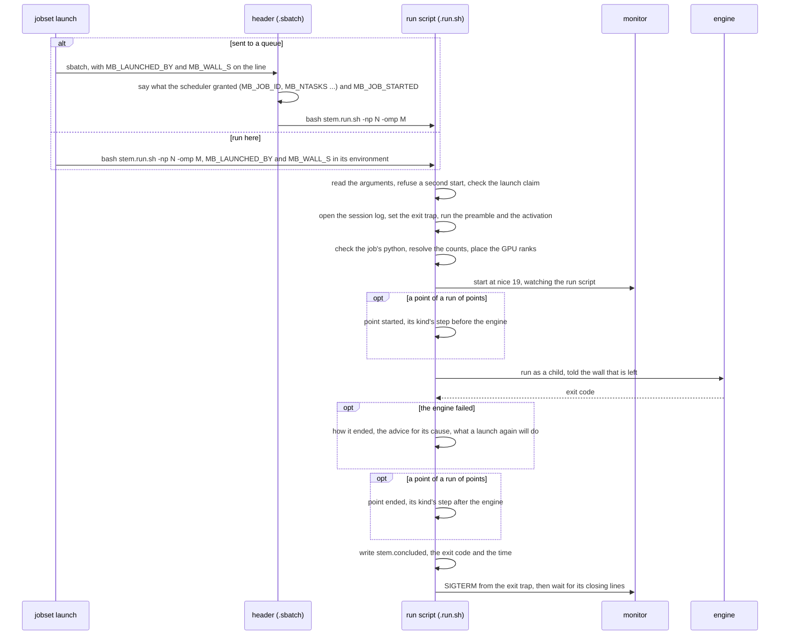
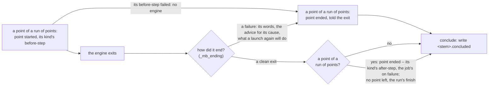
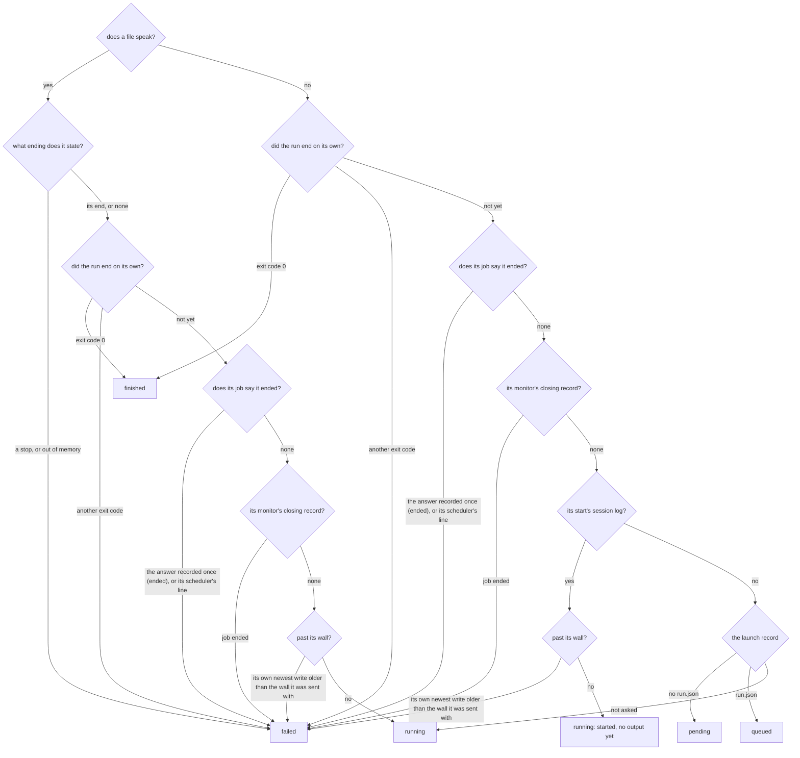
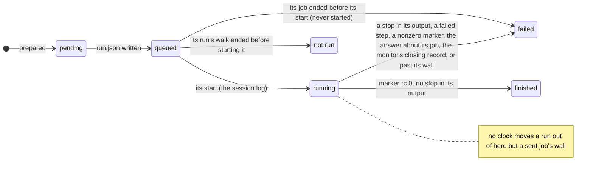
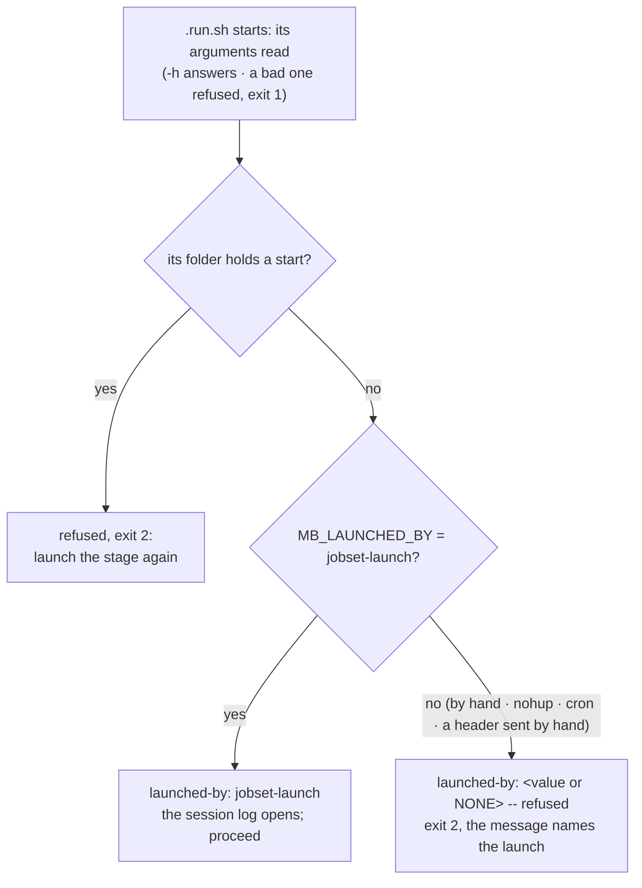

# Running a job — the run script at run time

**Role:** contract
**Domain:** execution
**Owns:** what a generated run script does on the node, from its start to its conclusion — the standalone rule, detection, env routing, counts and threads, GPU placement, the wall, how a run ends, its flags and the launch-door gate — and a run's states: the order of evidence and what *finished* means (§ 4.2).
**Read with:** [`job-contracts.md`](?doc=execution/job-contracts.md) § 2.6 (the blocks a run script is made of) · [`job-system.md`](?doc=execution/job-system.md) § 6.0 (the launch that starts it) · [`project-layout.md`](?doc=execution/project-layout.md) § 1.6 (a run on disk) · [`scheduler.md`](?doc=execution/scheduler.md) § 6a (its header and send line) · [`run-reports.md`](?doc=execution/run-reports.md) (the monitor beside it) · [`runs-of-points.md`](?doc=execution/runs-of-points.md) (a run of many engine runs) · [`configuration.md`](?doc=configuration.md) § 5 (the machine record it is written for)

## The short version

- `jobset prep` writes a **run script**, `<stem>.run.sh`, beside each deck, for the machine that will run it, and — where that machine has a queue — a scheduler header `<stem>.sbatch` that starts it. `jobset launch` starts it, here or through the queue ([`job-system.md`](?doc=execution/job-system.md) § 6.0); nothing else does (§ 5.5).
- It is **self-contained**: everything about the machine is baked in at prep, and on the node it reads only what the scheduler granted and the hardware (§ 2, § 2.1).
- In order, it reads its arguments, refuses a folder that already holds a start, checks the launch's claim, enters its environment, resolves its counts (§ 3.1, § 3.2), places GPU ranks (§ 3.3), starts the monitor, tells the engine its wall (§ 3.6), runs the engine as its child, says how a failure ended and what a launch again will do (§ 3.5), and writes the conclusion marker as its last act. § 1 shows the whole sequence.
- **A run is one start.** To continue, launch the stage again; it opens the next `run-<n>/` (§ 3.4).
- How a run directory reads afterwards — `pending`, `queued`, `running`, `finished`, `failed`, `not run`, `unreadable` — and what *finished* means is § 4.2, the one home of a run's states.

| you want | read |
|---|---|
| what happens when a run starts, step by step | § 1 |
| the rules for you: flags, a failed run, the wall, a run's state | § 3.4, § 3.5, § 3.6, § 4.2 |
| why it is built this way | § 2 – § 2.2a, § 3.1a |
| developer reference: routing, GPU mechanics, the readers | § 2.3, § 3.3, § 4.0, § 4.1, § 4.2 *The call*, *Which engine ran* |
| configuration, the header, checkpoints (moved; numbered pointers kept) | § 5, § 6 |

---

## 1. A run script, from its start to its conclusion



Each step, in the order the rendered script runs it (`runwrap.render_run_wrapper`). What each block of the
script *is* is [`job-contracts.md`](?doc=execution/job-contracts.md) § 2.6; what it *does* is here, in the
section named in the last column.

| # | step | what the run script does | rule |
|---|---|---|---|
| 1 | arguments | reads them once, before anything is written; `-h` answers and exits; an argument it does not take, or a count that is not a positive integer, is refused (exit 1) | § 3.4 |
| 2 | the job's clock | keeps `MB_JOB_STARTED` as the header said it, or sets it to now; exports the wall slack, `MB_WALL_SLACK_S` | § 3.6 |
| 3 | one start per run | a folder that already holds a session log refuses this start (exit 2), naming the launch that opens the next run | § 3.4 |
| 4 | the launch-door gate | `MB_LAUNCHED_BY` must be `jobset-launch`; anything else is refused (exit 2) | § 5.5 |
| 5 | the session log | opens `<stem>.runwrap.log`, its stdout and stderr teed into it, and prints `launched-by: jobset-launch` | § 4.1 |
| 6 | the exit trap | sets one EXIT trap and one handler for every signal that stops a run; logs its start (time, host, user, folder, arguments) and what the scheduler told the job | § 2.0a |
| 7 | the environment | checks each file the preamble sources, then runs the target record's preamble and activation verbatim, with `set +u` around them; sets the job's python, `$_mb_py`, and logs it; logs the node's physical cores and sockets | § 2.0a, § 2.2, § 5.2 |
| 8 | the job's python | checks that `CONDA_PREFIX` names its environment and `$_mb_py` is there; otherwise it concludes `no env python (<path>)` | § 2.2a |
| 9 | the counts | resolves the rank and thread counts (flag, then environment, then the stated value); one that is not a positive integer stops the start, concluding `a count that is not a positive integer (<flag>)` | § 3.1, § 3.2 |
| 10 | threads, GPUs, memory | exports the thread count; where the engine runs ranks, pins BLAS to one thread, balances the ranks over the GPUs of a job that uses one, starting MPS where ranks share a GPU, and prints the occupancy notice; sets the memory cap the run states, unless its engine's deck applies it | § 3.1a, § 3.2, § 3.3 |
| 11 | the banner | where the engine runs a program, asks it what it was built with and picks `mpirun` or the program alone — a deck that is a script runs on the job's python; prints the banner (§ 4.1), its held atoms as prep read them from the deck's own record | § 2.3, § 4.1 |
| 12 | the resolved launch, and a dry run | logs the resolved command, the launch mode and the counts (`resolved launch :`); `--dry-run` then prints them with each count's source and exits 0, nothing started | § 3.4 |
| 13 | the monitor | starts `mb_monitor.pyz` at `nice 19`, watching the run script's own PID (`MB_MONITOR=0`: none) | [`run-reports.md`](?doc=execution/run-reports.md) § 2.4, § 2.6 |
| 14 | can the job finish itself | *(a job with a finish)* checks that the finish bundle loads on the job's python; otherwise it concludes `finish cannot load (<bundle>)` | § 2.2a |
| 15 | point started | *(a point of a run of points)* stamps its start and runs its kind's step before the engine | [`runs-of-points.md`](?doc=execution/runs-of-points.md) § 3, op. 9 |
| 16 | what the engine will read | where the deck states keywords the engine reads, writes into the log a row for each catalogue item this rung reads that writes a keyword into its deck — carried by the calculation's kind and read by its stage — or, for a point of a run of points that plays one role, by that role: a SIESTA vibration's force-constant call lists the force constants' settings, never the relaxation's (`template.reads`, the one rule: a TBtrans step lists TBtrans's settings, never a relaxation's) — with its default, then the deck as the engine will read it, read by the bundle beside it with the engine's keyword reader (`mb_monitor.pyz deck READER DECK`) | [`job-contracts.md`](?doc=execution/job-contracts.md) § 2.6 |
| 17 | the wall | counts what is left of the job's wall and tells the engine on its own channel | § 3.6 |
| 18 | the engine | runs it as a child, its stdout written to the output — where the file catalogue cuts a file from the output (the timing log's row's `cut_from`: a SIESTA output), its SCF rows stamped and teed into `<stem>.scf-timing.log` too — its exit code captured; logs the engine's wall time (`benchmark:`) | § 2.0a, § 4.1 |
| 19 | after a failure | says how it ended, the advice for its cause where the output's family keeps some (SIESTA's `propor` hint), and what a launch again will do | § 3.5 |
| 20 | point ended | *(a point of a run of points)* stamps its end, runs its kind's step after the engine, and — no point left — the run's finish | [`runs-of-points.md`](?doc=execution/runs-of-points.md) § 3, op. 10 |
| 21 | the conclusion | writes `<stem>.concluded`, `rc=<code> at <date>`, its last act on the main line, and exits with the engine's code | § 4.2 |
| 22 | the exit trap runs | a failure of the script's own that wrote no marker concludes here, `stopped before its end`; then it stops the monitor (waiting up to 10 s), removes the rank helper and stops the MPS daemon it started | § 2.0a |

**One run script, every engine.** Which of these steps a run takes is a fact of its engine's record
([`architecture.md`](?doc=execution/architecture.md) § 3.3), of a catalogue item's declaration (`launch`,
`limit_applied_by`; [`engines/template.md`](?doc=engines/template.md) § 5), of its output's file catalogue row (its
columns `reads` — `stops`, `scf_rows` — and `stderr_apart`), of the timing log's row's `cut_from`, and of its job —
never the engine's name: an engine that runs one process has no ranks to place (steps 9 and 10 resolve its
threads alone); one whose deck is a script — PySCF's — has no program to probe and runs `"$_mb_py" <deck>`, its
deck sizing its own BLAS and threads ([`engines/pyscf.md`](?doc=engines/pyscf.md) § 3); a setting the deck applies
itself — PySCF's memory cap and wall — says so in its catalogue item's `limit_applied_by` (§ 3.2, § 3.6); one whose deck states no keywords echoes none (step 16); a job with no finish skips step 14, and a run
that is no point steps 15 and 20. A dry run passes steps 3 to 5 without writing anything and stops at step 12. A job that runs several members — a
group, a run of points, a benchmark's shelf — sends or starts a walk script, which starts each member's run
script in turn, with that member's counts ([`job-system.md`](?doc=execution/job-system.md) § 6.0); each run
script then runs these steps in its own folder.

A real start, from the session log of a SIESTA run started here (shortened; a 2.63.0 run — since 2.64.0
every banner label is padded to the longest one the banner prints, so the colons stand one column further right):

```text
launched-by: jobset-launch
[09:58:41-0700] [STAGE] ===== molbuilder run script start =====
[09:58:41-0700] [INFO ] argv:       H2_01_coarse.run.sh -np 1 -omp 1
[09:58:41-0700] [STAGE] running baked preamble
[09:58:41-0700] [STAGE] conda activate molbuilder-siesta
[09:58:41-0700] [INFO ] job python: /home/qqing/miniconda3/envs/molbuilder-siesta/bin/python3
molbuilder: detected phys_cores=20, n_sockets=2, cores_per_socket=10
===== molbuilder run script: SIESTA =====
  SIESTA binary  : /home/qqing/miniconda3/envs/molbuilder-siesta/bin/siesta
  SIESTA version : 5.4.2
  Build paral.   : MPI
  Launch mode    : pure MPI (1 ranks; OMP setting irrelevant to this binary)
  Ranks          : 1 (from -np flag)
  Threading      : OMP_NUM_THREADS=1 (from -omp flag), OPENBLAS=1, MKL=1
  Mode           : a clean start (no restart file here)
  Held atoms     : none held -- every atom free
  Command        :  mpirun -np 1  siesta H2_01_coarse.fdf > H2_01_coarse.out
  Time limit     : 1800s from the job's start; SIESTA stops 600s before it (running-a-job.md 3.6)
[09:58:43-0700] [INFO ] monitor: mb_monitor.pyz started
[09:58:43-0700] [INFO ] time limit: 1798s left of 1800s; SIESTA stops 600s before it (running-a-job.md 3.6)
[09:59:08-0700] [INFO ] benchmark: SIESTA wall 24.9s, 54 SCF rows in H2_01_coarse.scf-timing.log
SIESTA completed:  mpirun -np 1  siesta H2_01_coarse.fdf > H2_01_coarse.out
```

and its `H2_01_coarse.concluded`: `rc=0 at Mon Nov  2 09:59:08 AM MST 2026`. A PySCF run's banner, from the same
road (shortened) — one process, a script deck on its environment's python:

```text
===== molbuilder run script: PySCF =====
  Launch mode : a script deck on the job's python (2 OpenMP threads)
  Threading   : OMP_NUM_THREADS=2 (from -omp flag)
  Mode        : a clean start (no restart file here)
  Held atoms  : none held -- every atom free
  Command     : /home/qqing/miniconda3/envs/molbuilder-pySCF/bin/python3 H2_01_coarse.py > H2_01_coarse.pyscf.log 2>&1
  Time limit  : 1800s from the job's start; PySCF stops 600s before it (running-a-job.md 3.6)
```

---

## 2. The standalone contract — a run script that runs anywhere

**A run script is self-contained at run time**: it reads no configuration, probes no toolchain and has no
fallback path. Everything about the machine is **baked in** when prep writes it, so the compute node needs
nothing but the files in the run's folder. That is what lets you `scp -r` a calculation to a cluster, or hand
it to a colleague, and have it run the same.

Its own files — its session log, the output, the monitor's pair, the SCF timing log, the conclusion marker —
are named once each on the stage's stem by `runfiles`, with no counter: a run folder holds one start
([`project-layout.md`](?doc=execution/project-layout.md) § 1.6.1; the names are
[`job-contracts.md`](?doc=execution/job-contracts.md) § 6.3). The one check every job makes after it enters
its environment — that the environment's own python is there — is § 2.2a.

### 2.0a Where it runs, and what that decides

Every rule here follows from one fact: **`<stem>.run.sh` runs unattended, in a non-interactive shell that reads
no rc file.** Nothing loads a module or activates an environment for it; it does that itself. Sent to a queue,
the scheduler starts it on a compute node, another machine than the one you sent it from. Run here, `jobset
launch` starts it with `bash`. Nobody is watching either way.

**Both starts pass the launching shell's variables on**: here, the whole environment; to a queue, SLURM's
`--export ALL,…` on the send line ([`scheduler.md`](?doc=execution/scheduler.md) § 6a). A job's size comes from
what prep wrote and from the counts `jobset launch` hands it, `-np` and `-omp`, which win. Without a flag — a
dry run a person starts — the run script honours `MB_NP` and a bare `OMP_NUM_THREADS` ahead of the scheduler's
grant (§ 3.1, § 3.2). The banner and `--dry-run` name where each count came from, and so does the refusal of a
count that is not a positive integer.

What follows, each checked in the rendered script:

| the situation demands | the run script does |
|---|---|
| nothing is on `PATH` before it acts | runs the target's preamble and activation, baked verbatim |
| a preamble may source a file this machine lacks | checks each absolute path the preamble sources before it runs; a missing one stops the script (exit 78), naming the file and the record it came from |
| conda's `activate.d` hooks read unset variables | `set +u` around the preamble and activation **only**, restored right after |
| `--help` must answer without a working environment | reads its arguments before any of the bootstrap |
| the scheduler stops it with `SIGTERM` at the wall — or Ctrl-C, a lost terminal, a limit reached | one handler for every signal that stops a run (below) |
| one cleanup, whatever ended the script | one EXIT trap (below) |
| the engine's exit code must be inspectable | the engine is **run as a child, not `exec`'d**; `set +e` around it, `${PIPESTATUS[0]}` captured |
| a run must be watchable while it runs | the engine's stdout reaches its output as it prints, never swallowed; the script's own stdout and stderr are teed into the session log |
| the engine's environment has no molbuilder in it | the monitor travels as one file, `mb_monitor.pyz`, run on the job's python (§ 2.2a; [`run-reports.md`](?doc=execution/run-reports.md) § 2.3) |

**The signals and the exit trap:**

- **The signals that stop a run** — `HUP INT QUIT ALRM TERM XCPU XFSZ VTALRM PROF` (`runwrap._STOPPING_SIGNALS`)
  — share one handler: it logs the signal, cleans up and exits 128 + the signal's number (143 for `TERM`). It
  writes no conclusion marker: a forced stop is told by its scheduler and its monitor (§ 4.2).
- **A `PIPE`** from its log's tee marks the run stopped by a signal and is ignored from then on; **`USR1` and
  `USR2`** are logged as warnings, and the run goes on.
- **A `KILL` cannot be caught**: the run ends with no marker and no word of its own, and its scheduler's line or
  its process gone says it ended (§ 4.2, *Asked once, written once*).
- **The one EXIT trap** runs however the script ends. A failure of the script's own before its marker (under
  `set -e`) writes the marker with the exit code, `stopped before its end`; then the trap stops the monitor and
  waits up to 10 s for its closing lines, removes the GPU rank helper and stops the MPS daemon this run started.

> **`set -e` stays on across the preamble, and that is deliberate.**
> A failed `module load` means the job is about to run in the wrong environment — on a cluster's hours,
> unattended, producing results nobody asked for and nobody is reading. Dying at the failed line is the cheap
> outcome; going on is the expensive one.
>
> **Do not "fix" this by making the preamble tolerant.** The instinct comes from interactive shells, where a
> preamble that does not apply to the machine in front of you should not stop you working. This script has no
> such user: it is on a node, on a clock, spending the cluster's hours. Same line of shell, opposite correct
> behaviour, because the environment is different.

### 2.1 Detection — reading external state

"Detection" means reading state that is *not* in the run's folder. There are five kinds, and the contract
governs **when** each may be read:

| code | external state | example |
|---|---|---|
| **T** | conda **T**ool availability | is `siesta` on `PATH` in the environment? |
| **M** | HPC **M**odules | `module load mamba` |
| **C** | **C**onfiguration | the target's record (its `env_init`, copied from that machine's `molbuilder.json`) and `molbuilder.json`'s `envs` |
| **A** | what the scheduler **a**llotted the job — its grant | `MB_NTASKS` (the ranks the scheduler granted, in molbuilder's name), `CUDA_VISIBLE_DEVICES` |
| **H** | **H**ardware topology | physical core count, the NUMA node a GPU sits on |

The rule, at the two moments that matter:

- **At prep**, T, M and C are resolved and **baked** into the run script as literals.
- **At run time, on the node**, reading T, M or C is **forbidden**. Only **A** (the scheduler's grant) and
  **H** (the local hardware) may be read, and only to *tune* the launch (rank counts, GPU pinning) or to log —
  never to decide whether the job can run.

So at run time the script never runs `which conda`, never reads `molbuilder.json` and never uses `conda run`.
It runs the activation **verbatim** (`conda activate <env>` or `source activate <env>`), then launches the
engine. What it asks on the node about its own environment — whether the activation gave it its environment's
python (§ 2.2a) and its program (§ 2.2) — is a check of what it was given, not a choice; and its program's build
is asked what it was compiled with only to choose `mpirun` or the program alone (§ 2.3;
[`job-contracts.md`](?doc=execution/job-contracts.md) § 2.1).

### 2.2 What prep bakes in, and what it says

- **The activation — declared, never detected.** Prep writes the target record's `env_init` into the run
  script (§ 5.2): its preamble, then its activation of the routed environment. On a workstation that is
  typically `source "<base>/etc/profile.d/conda.sh"` then `conda activate`; the hook line is baked because a
  non-interactive `bash job.run.sh` never sources `~/.bashrc`, so `conda activate` would otherwise be
  undefined. On a cluster it is typically `module load mamba/latest` then `source activate`, because a login
  node's modules are not the compute node's.
- **What is missing is said, never installed.** A job that uses a GPU on a target whose record lists no GPU build
  of SIESTA is said at prep, with the command that installs it, and prepared as asked
  ([`gpu.md`](?doc=execution/gpu.md) G6); the run script then stops at its activation. On the node, the run
  script checks what only the node can check: its environment's python (§ 2.2a), and that its program is on
  `PATH` (otherwise it concludes `<program> not on PATH`).
- **What does not hold together is refused, naming the way out** — an engine record that runs ranks and names
  no program (when the table loads), a job's program its engine's record does not name, an environment category
  no environment is registered for (`diagnostics.DEFAULT_ENV_NAMES`, overridable in `molbuilder.json`'s `envs`,
  or `--env`), a deck that is not its engine's (`runfiles.deck_role`), and a deck whose atom record does not
  read.

### 2.2a What the run script may do — bash is a bootstrap, not a program

> **The run script makes the environment right, runs the engine as its child, and reports on the run it
> started — its output, its monitor, how it ended. It creates no directory and arranges no file: that is
> Python's, on the host, before the run script is started.**

**Why bash at all:**

- **Activation changes the shell's own environment.** `conda activate` and `module load` change `PATH` and
  more *in the calling process*. A Python child cannot do that for its parent, so this has to be shell.
- **The launcher must be the shell's direct child.** `mpirun` and `srun` inherit the activated environment and
  sit in the process tree where signals and the scheduler's accounting expect them.
- **The shell must outlive the engine.** The engine runs as a child (§ 2.0a), so the run script can read its
  exit code, say how the run ended and what a launch again will do (§ 3.5), run a point's report steps around
  its engine where the run is a run of points — which run the kind's own steps, such as a SIESTA vibration's
  record step that derives the modes ([`runs-of-points.md`](?doc=execution/runs-of-points.md) § 3, ops 9 and
  10) — and write the conclusion marker as its last act
  ([`project-layout.md`](?doc=execution/project-layout.md) § 1.6.3).

Everything else — which directory to run in, creating it, arranging files, recording the launch — is
**decision and arrangement**, and none of it needs the activated environment. It is Python's.

**The test, when adding to a run script:** *does this need the activated shell, or this run's own ending?* If
it computes, decides or arranges anything else, it belongs upstream. One question is asked on the node because
only the node can answer it: for a job with a finish, whether the finish loads on the job's python
([`engines/vibration.md`](?doc=engines/vibration.md) § 5.5). How the run ended, the script asks the framework's
reader rather than grepping (§ 3.5), and it decides nothing from the answer.

**Nothing arrives at a run folder needing to be resolved.** What a stage continues from is a **real file,
copied in at launch** from the run it takes ([`project-layout.md`](?doc=execution/project-layout.md) § 1.6.5;
the warm files are [`job-contracts.md`](?doc=execution/job-contracts.md) § 4.2a) — present and local before the
run script starts. There is nothing for bash to dereference, localise or wait for.

**This is forced, not a style.** Two facts make the compute node the wrong place for logic:

- **molbuilder is not importable there.** It is never pip-installed into an engine's environment, so `import
  molbuilder` fails on the job's python. One job runs molbuilder itself on the node: a sequence of groups,
  whose job launches each of its groups in turn, the first included, with `-m molbuilder jobset launch …
  --in-sequence`, from the folder
  molbuilder's package is in, which the node must see. It enters molbuilder's own environment the way a run
  script enters its engine's — the record's preamble and activation (`runwrap.env_bootstrap`), then that
  environment's own python, checked before the first group
  ([`job-system.md`](?doc=execution/job-system.md) § 6.0, *A sequence of groups*). Every other walk runs run
  scripts with `bash`, and a scheduler header runs no Python.
- **The job's python is its environment's own, for every engine.** Right after the activation the run script
  sets `$_mb_py` to `$CONDA_PREFIX/bin/python3` — never the first `python3` on `PATH`, which a site's
  activation can leave ahead of the environment's (`source activate` under a mamba 2.x module does, on Sol) —
  and logs it (`job python:`). Every python the job runs is that one: the monitor, the ending reader, a
  finish, a PySCF deck. Before anything starts, every job checks that `CONDA_PREFIX` names its environment and
  that this python is there; otherwise it stops, saying which, its conclusion `no env python (<path>)`
  (`parse.dirs.job.NO_ENV_PYTHON`). Every environment recipe pins python into its environment
  (`envs/recipes.py`).

  Logic that runs there is shell, or a shipped bundle run on `$_mb_py`, or broken. Three bundles ship beside a
  job (`runfiles.MONITOR_BUNDLE`, `VIBRATION_BUNDLE`, `PYSCF_BUNDLE`): `mb_monitor.pyz`, beside every job — the
  monitor, the reader the run script asks how the run ended (§ 3.5), the deck as its engine reads it (§ 1 step
  16) and a point's report steps;
  `mb_vibration.pyz`, beside a SIESTA vibration's points; and `mb_pyscf.pyz`, which a PySCF deck imports. What
  each carries, and the rule for joining one (*stdlib-only AND travels*), is
  [`configuration.md`](?doc=configuration.md) § 2.3. None is a pattern to copy for anything that could run on the
  host instead.

**No generated run script contains a `cd`**, for any engine: the caller decides the directory, and the layout
layer — `jobset/materialize.py::prepare_attempt` — makes and fills it
([`project-layout.md`](?doc=execution/project-layout.md) § 1.6, invariant 6a). Sent to a queue, the job starts
in the folder it was sent from; run here, `jobset launch` starts it in the run's folder.

### 2.3 Env routing

The run script enters the environment its **engine's record** names, chosen at prep from the engine prep hands
it — never from the deck's name ([`architecture.md`](?doc=execution/architecture.md) § 3.3; `runwrap`,
`diagnostics.Capabilities.env_for_category`):

- **The record's `environment`** — SIESTA's `siesta` category, `molbuilder-siesta`; PySCF's `pyscf`,
  `molbuilder-pySCF`.
- **The program, where the record names one** — SIESTA's `siesta`, or the job's own (`Job.program`: a
  transmission's `tbtrans`). How it is launched is decided on the node by what the build says it was compiled
  with (`<program> --version`'s `Parallelisations` line): an MPI build runs under `mpirun -np N`; an
  OpenMP-only build and a serial build run alone; a probe that says nothing runs under `mpirun`, the safe
  default for an MPI-compiled binary. The banner says which (`Launch mode`). **A record that names no program**
  — PySCF's, whose deck is a script — runs the deck as `"$_mb_py" <deck>`, on the environment's own python
  (§ 2.2a).
- **A job that uses a GPU → the record's `gpu_environment`**, where it names one: SIESTA's `siesta-gpu`,
  `molbuilder-siesta-gpu`. The route follows the job's GPU request — its run card's `use_gpu`, read through the
  one door `jobset.model.gpu_request` — never the deck: the deck renders `Diag.ELPA.GPU` from the same value and
  is not read again for it ([`gpu.md`](?doc=execution/gpu.md) G7). A record that names none stays in its
  `environment`: PySCF's GPU is a device its deck checks at its start (G8). **CPU-ELPA does not re-route**: the
  packaged SIESTA carries ELPA through ELSI and runs both stages on CPU
  ([`engines/siesta.md`](?doc=engines/siesta.md) § 7.2). The two environments differ by **provenance** — one
  installs from packages anywhere, the other is built from source — so routing CPU-ELPA to the source build
  would refuse a runnable calculation wherever compiling is not allowed. A job that uses a GPU on a target whose
  record lists no GPU build is said at prep (§ 2.2) and stops at its activation.

**`prep --env NAME` forces one environment for every job and wins over the route** — a GPU job's included; it is
not checked against the target's record, so prep says no missing GPU build for it. The names are overridable per
category in `molbuilder.json`'s `envs`; the categories and their defaults (`diagnostics.DEFAULT_ENV_NAMES`) are
[`configuration.md`](?doc=configuration.md) § 4's. molbuilder's own environment is always `molbuilder`.

---

## 3. Runtime resource resolution

Only the **launch** is put together at run time, from the scheduler's grant and the hardware (A and H, § 2.1).
Everything else is baked — the rank and thread counts included, as the run stated them. The flags `jobset
launch` hands a run script win; the environment is read only where no flag is given.

### 3.1 MPI ranks (an engine that runs ranks)

The rank count `N` is resolved by precedence, **highest wins**:

```
-np / --np flag   >   MB_NP   >   MB_NTASKS   >   the stated value, baked at prep
```

- **The baked value is the one the run stated** — the run card's `mpi_np`, or prep's `--np`. A run that states
  none is **refused at prep**, naming both places ([`architecture.md`](?doc=execution/architecture.md) § 5.2,
  which owns the rule). The run script has no default of its own, and neither has the header *(user,
  2026-10-02: "explicit job config is the only way allowed")*.
- **`MB_NTASKS`** is the ranks the scheduler granted, said in molbuilder's name by the job's header
  (SLURM's `SLURM_NTASKS`, [`scheduler.md`](?doc=execution/scheduler.md) § 6a). The header asks for the stated
  count, so the two agree by construction.
- **Nothing lowers it.** No atom count, species count or core count caps a stated rank count *(the user,
  2026-09-03: "Whether mpi is too big for a system is none of your business.")*. What the run script owes
  you instead is the objective number, orbitals per rank (§ 3.1a).
- **A machine's facts come from its record, never from a probe on the fly** — this machine's included. Its
  cores, GPUs and queues are read from the target's record ([`configuration.md`](?doc=configuration.md) § 5),
  so every number in a run script traces to a file you can look at. The record checks a stated count (does
  it fit, [`scheduler.md`](?doc=execution/scheduler.md) R6); it never supplies one.

An engine that runs one process — PySCF, its record's `one_process` — states no rank count: prep refuses one
(`placement.launch_refusal`), and its run script accepts `-np`, says that anything but 1 is ignored, and runs
OpenMP alone.

### 3.1a What the run script says instead — occupancy, as a notice

**SIESTA distributes ORBITALS across ranks**, not atoms, so the number that says whether the ranks have
anything to hold is

```
n_orbitals / mpi_np        # want > 1
```

At or below one, ranks are idle by arithmetic, and the run script says so at run time — against the rank count
**actually resolved**, so an `-np` given at launch counts:

```
molbuilder: NOTE -- 200 ranks for ~100 orbitals is <= 1 orbital per rank.
  Your CPUs are not going to be fully used.  This is a notice, not a limit -- the run proceeds.
```

Both numbers are shown so the claim can be checked rather than taken as a verdict, and **nothing is refused or
lowered**.

The orbital count is an **estimate and says so**: the deck's own, its BENCH-MARKS block's `n_orbitals_est`
([`job-contracts.md`](?doc=execution/job-contracts.md) § 3.3) — `10 × n_atoms`, the rough double-zeta-polarised
figure the `BlockSize` bound uses — read at prep by the block's reader (`deck_record.read_bench_marks_block`).
One estimate in one place, or the deck and the notice would disagree. The true count needs every species' basis
and is known only once SIESTA starts. A deck whose block states none gets **no notice at all** rather than one
built on an invented number.

> #### What `propor: IMAX = 0` depends on — and why no rank count is refused
>
> *(User ruling, 2026-09-03: "we had that problem because of a psml related issue, not a size issue.")*
>
> | | |
> |---|---|
> | **where it is raised** | `propor` (`Src/propor.f`), called only from `matel_table.F90`, which deduplicates the **radial-function tables** across MPI ranks — not in any BLACS distribution |
> | **when** | the table handed to it is all zeros |
> | **its two causes, in the order to check them** | 1. a **defective or XC-mismatched pseudopotential** — commoner and cheaper to check ([`science/pseudopotentials.md`](?doc=science/pseudopotentials.md); `molbuilder pseudo check`); 2. the **rank count** against the species count and radial-table size |
> | **not a cause** | `BlockSize` — the crash is identical at 1, 2 and 4 (`mpi_np` = 15, hemeC-dithiol); the atom count, a proxy that a few-species system exceeds safely and a many-species one crashes below; the spin — `propor` takes no spin argument |
>
> So nothing lowers or refuses a rank count, and no species-aware bound stands in: whether a rank count suits
> a system is the user's judgement. The run script prints these two causes, in this order, when `propor`
> stops a run (§ 3.5). `BlockSize`'s bound is a different correction — **orbitals** over ranks, for matrix
> distribution ([`engines/tuning.md`](?doc=engines/tuning.md) § 2.11).

### 3.2 OMP threads and BLAS

```
-omp / -t flag   >   OMP_NUM_THREADS   >   MB_CPUS_PER_TASK   >   the stated value, baked at prep
```

- A run `jobset launch` starts always carries the flag, its own `-omp`; the rest of the order is for a run
  script started without one (a dry run). **A bare `OMP_NUM_THREADS` in that shell is honoured**, ahead of the
  scheduler's grant, as OpenMP tools conventionally do.
- The two variables are one list, `runtime_info.THREAD_SOURCES`; `MB_CPUS_PER_TASK` is the cores per rank the
  scheduler granted, said in molbuilder's name by the job's header. The run script's chain is built from that
  list, and so is a PySCF script's own when it runs without its run script — which ends on the node's
  physical cores instead ([`engines/pyscf.md`](?doc=engines/pyscf.md) § 3).
- **The stated value** is the run card's cores per rank — SIESTA's `omp_threads`, PySCF's `threads` — or
  prep's `--cpus-per-task`; a run that states none is **refused at prep**, like a rank count. *(Mainline
  SIESTA is not reliably OpenMP-aware, so `omp_threads = 1` is the usual statement for a CPU build — a
  statement, made on the run card.)*
- The resolved count is exported as `OMP_NUM_THREADS`, so the run script and the engine cannot disagree; the
  banner says where it came from (`Threading : OMP_NUM_THREADS=N (from …)`).
- **BLAS is pinned to one thread where the engine runs ranks** (`MKL_NUM_THREADS=1`, `OPENBLAS_NUM_THREADS=1`), so MPI ranks ×
  BLAS threads never oversubscribe the cores; a script deck of one process sizes its own. A job whose ranks are
  placed on GPUs also binds the OpenMP threads (`OMP_PROC_BIND=close`, `OMP_PLACES=cores`), which `mpirun
  --bind-to core` alone does not.

**A memory cap per rank**, where the run states `max_memory_mb` (prep's `--max-memory-mb`): before the program
it starts — SIESTA's, TBtrans — the run script sets `ulimit -v` to it, a soft guard against a runaway memory
allocation, ignored where the shell cannot set it; an engine whose deck applies it itself — the item's
`limit_applied_by` says `deck` ([`engines/template.md`](?doc=engines/template.md) § 5): PySCF's, as
`mol.max_memory` — gets none. It is not the memory the job asks the scheduler for (§ 5.3.1).

### 3.3 GPU mode: load balance, MPS and placement

When the job uses a GPU — its run card's `use_gpu` (a SIESTA deck renders it as ELPA on the GPU) — and its
engine runs ranks, the run script does more at launch (all in `molbuilder/runwrap.py`); an engine that runs one process
has no ranks to place, and its deck uses the device itself.
*This section is the mechanics; what offloads, why ranks share a device, what the sources recommend and how to
design a benchmark around it is [`engines/tuning.md`](?doc=engines/tuning.md) § 2.12.*

- **Load balance.** It counts the GPUs the job was given (`CUDA_VISIBLE_DEVICES` first, else `nvidia-smi -L`),
  sets `ranks_per_gpu = mpi_np / ngpu` (at least 1) and prints a `GPU load-balance` line. **The rank and
  thread counts are the stated ones**, resolved as on CPU (§ 3.1, § 3.2).
- **NVIDIA MPS** — the Multi-Process Service, which lets several MPI ranks share one GPU at once. **One
  decision**: on only when (a) `nvidia-cuda-mps-control` is on `PATH`, (b) you did not opt out (`--no-mps`, or
  `MOLBUILDER_USE_MPS` set to anything but `1`), and (c) the job sees at least one GPU and more ranks than GPUs — the moment sharing
  actually happens. The banner and the dry run say the decision — on where the daemon started (in a dry run,
  would start), off otherwise, a start that timed out among them — and the log says why it is off. The
  per-job daemon is torn down by the one EXIT trap. `--mps` and `--no-mps` allow or forbid MPS and nothing
  else.
- **Where each rank runs.** A generated helper gives each rank a GPU (`CUDA_VISIBLE_DEVICES`), block by block
  (`rank × GPUs / ranks`), and, when the rank's cpuset spans more than one socket, pins it with `numactl` to
  the NUMA nodes of its GPU's socket that it owns — **the helper finds that mapping itself, per rank, at run
  time** (nvidia-smi and sysfs). `MB_NO_SOCKET_PIN=1` turns the socket pinning off.
  - **Off a scheduler**, OpenMPI binds each rank to cores of its own (`--bind-to core --map-by
    package:PE=<cores per rank>`), spreading the ranks over the sockets. A single-GPU job is also wrapped
    whole in `numactl`, on the NUMA node GPU 0 sits on — looked up at run time from its PCI bus id and sysfs,
    `MOLBUILDER_GPU_NUMA` overriding — which sets its memory there but does not hold its ranks: OpenMPI's map
    overrides it (measured with OpenMPI 5.0.10), so a single GPU's second rank runs on the far socket.
  - **Under a scheduler** (`MB_JOB_ID` set) the wrap and that binding are cleared, and OpenMPI places the
    ranks inside the cores the scheduler gave the job.
  - **A rank whose cores lie on another socket than its GPU is warned about, never refused** — the helper
    says so in the run's log, and the run goes on paying the traffic *(the user, 2026-10-17)*.

### 3.4 The flags a run script takes

| flag | taken by | effect |
|---|---|---|
| `-np` / `--np N` | every run script | the rank count, where the engine runs ranks; an engine that runs one process accepts it and says anything but 1 is ignored |
| `-omp` / `--omp N`, `-t` / `--threads N` | every run script | the thread count |
| `--mps` / `--no-mps` | a job that uses a GPU, its engine running ranks | allow or forbid MPS; it starts only where ranks outnumber GPUs (§ 3.3) |
| `--dry-run` | every run script | print, then exit 0: the resolved launch command, each count's source, the environment and — where ranks are placed on GPUs — the rank → GPU / NUMA map |
| `-h` / `--help` | every run script | usage |

- **Any other argument is refused** (exit 1), and so is a count that is not a positive integer, before
  anything is written.
- **`jobset launch` hands the counts**, `-np` and `-omp`, and nothing else (`submit._counts_of`); the header
  forwards `"$@"` to the run script, so the line launch sends the job with reaches it.
- **The run script takes no run number and starts once.** What it starts from is what launch put in its
  folder: warm, the restart files launch copied in; cold (`jobset launch --cold`), none
  ([`job-system.md`](?doc=execution/job-system.md) § 5.4). Started in a folder that already holds a start —
  its session log — it refuses (exit 2): *this run already holds a start (<stem>.runwrap.log): a run is one
  start; to continue it, launch the stage again …* — the launch named, which opens the next run
  ([`project-layout.md`](?doc=execution/project-layout.md) § 1.6.1). A benchmark trial's refusal
  says instead that a trial measures its point once.
- **Run by a person**, a run script answers `-h` and `--dry-run`, which start nothing; a start is its
  launch's (§ 5.5).

### 3.5 A run that did not finish what it set out to do — how it ends, and how it is continued

A run is one start ([`project-layout.md`](?doc=execution/project-layout.md) § 1.6.1): the engine runs once in
its folder, and the run concludes once. How a SIESTA run that did not get there ends:

| the run | SIESTA shows it by | it ends |
|---|---|---|
| its SCF did not converge, and SIESTA stopped on it | `SCF_NOT_CONV: … (required)`, then a nonzero exit (`SCF.MustConverge`: SIESTA's default; false in a benchmark trial's deck) | **failed** |
| a relaxation used all its steps, unconverged | exit 0, and `outcoor: Final (unrelaxed) atomic coordinates` (a converged one prints `Relaxed…`) | **finished, not converged** — its convergence column says `geometry NO` (§ 4.2) |
| it stopped at its wall (§ 3.6) | `OUT_OF_TIME: Time is up.`, after saving `.DM` and `.XV` | **failed** (stopped), its restart files saved |
| it crashed | a fatal line — `propor`'s `IMAX = 0`, any abort, a tolerated non-convergence followed by one | **failed** |

**In every case you continue it by launching the stage again** — `jobset launch`, which opens the next
`run-<n>/` warm from this run's restart files, or cold with `--cold`
([`job-system.md`](?doc=execution/job-system.md) § 5.4, `Job.relaunch_continues`). Nothing on the compute node
starts the engine a second time.

**After a failure the run script says three things**, on its stderr and in the session log:

1. **How it ended**, asked of the framework's reader, never grepped, whatever the engine: `_mb_ending` runs
   `"$_mb_py" mb_monitor.pyz ending` over the output — read by the reader its role names — and the session log,
   which holds the engine's stderr where it is kept apart from the output (SIESTA's: its `die` flushes stdout
   on node 0 alone, so another rank may say why it died only there). The cause is the first fatal line; the
   markers are the engine family's table (SIESTA's `parse/engines/siesta_grammar.py`), and the run script
   types none.
2. **The advice for that cause**, asked only of an output whose family keeps advice (`_mb_ending advice`;
   the output's row's `stops`): for SIESTA's `propor: IMAX = 0`, the two causes in the order to check them (§ 3.1a) and how to prepare the stage again at another rank
   count — words the family's table keeps beside its marker (`siesta_grammar.ADVICE`).
3. **What a launch again will do**, from the facts the launch itself decides by, which prep bakes in — whether
   the stage continues (`Job.relaunch_continues`: its kind resumes, `warm-files.toml`'s `resumes`, and it takes
   something from a run; [`job-contracts.md`](?doc=execution/job-contracts.md) § 4.2a) and the deck's own
   restart answer:

   | the run | the line says |
   |---|---|
   | a stage that continues | *launch the stage again to continue warm from the files this run saved -- or, to change a setting, …* |
   | its deck reads no prior state (`restart: clean`) | a launch again starts over from its own coordinates |
   | its kind does not resume (a PySCF vibration) | a launch again starts this run over from its deck, nothing of it copied in — this kind of run does not resume |
   | its stage takes nothing from a run | the same, *this stage carries nothing from one run to the next* |
   | a point of a run of points | *this point failed: a launch again takes the run's points done over and* continues this one from its own last state, or runs it again from its start — its relaunch ([`runs-of-points.md`](?doc=execution/runs-of-points.md) § 1.2) |
   | a benchmark trial | a trial measures its point once, and its benchmark's launch does not start it again (`submit._plan_trial`) |

   A stop at the wall — asked as such, `_mb_ending out-of-time`, never by the engine's own words for it, and
   only of an output whose family names one (its row's `stops`: a SIESTA output's) — says *stopped at its
   wall* in place of *what a launch again will do* (§ 3.6).

**When the ending cannot be read**, no hint is printed and the log says so once. **The one ask**: the run script
asks the bundle once, before its first question, whether the ending can be read here (`_mb_ending_able`), and
keeps the words for the failure's line *(user, 2026-09-28: "ask the bundle once")*:

| the bundle | the answer | what the log says |
|---|---|---|
| not beside the job | cannot read (exit 2) | *the ending cannot be read here …: no failure hint* |
| beside it, but it does not load on the job's python | cannot read; its load error — one `ERROR` line and the traceback — printed once | the same; the monitor's own start said why first ([`run-reports.md`](?doc=execution/run-reports.md) § 2.6) |
| loads, but the output does not read | cannot read; why, on stderr | the same |
| an output not there | read as one that states no ending, its stderr read for why | — |



### 3.6 A run ends itself before the wall, and a file written as a job died is said

**The wall a job was sent with reaches its engine** *(the user, 2026-10-19: "this should be now mandatory for
all engines … fed to the engine through their proper channel/parameter")*. The launch tells each run its wall
in seconds, `MB_WALL_S`, and the run script counts it from the start `MB_JOB_STARTED` holds:

| launched | `MB_WALL_S` — told by `jobset launch` | `MB_JOB_STARTED` — counted from |
|---|---|---|
| one run, to a queue | on the send line, beside the launch claim: the header's wall, or the launch's `--time` | the job's start, as its header says it |
| a walk, to a queue — a group, a run of points, a benchmark's shelf | the same line: the job's one wall, for every member | the job's start |
| a sequence of groups, to a queue | the same line: the job's one wall, for every run of every group | the job's start |
| one run, here | in its environment: the wall its own job states, or nothing | its run script's own start |
| a walk, here | on each member's line of the walk script: that member's own wall, or nothing | each member's own start — or the walk's, for points that share one wall |
| a sequence of groups, here | each group's launch tells its runs as above | each run script's own start |

- **To a queue**, the wall on the line is read off the header prep wrote, by its kind's spelling
  (`Kind.directive_value`), or is the launch's `--time` — the value `run.json`'s `placed_on.time` records
  (`submit._sbatch_request`; the line is [`scheduler.md`](?doc=execution/scheduler.md) § 6a). The monitor counts
  down from the same start ([`run-reports.md`](?doc=execution/run-reports.md) § 2.1b).
- **A walk's one wall** is its header's: a group's and a run of points' members' walls summed (`group.envelope`);
  a run whose points share the stage's one wall (a vibration's calls) that wall; a shelf's the benchmark's own.
  A later member counts what the members before it left.
- **A sequence of groups' one wall** is every group's wall summed (`group.sequence_request`,
  [`job-system.md`](?doc=execution/job-system.md) § 6.0); each group's launch inside the job tells its runs
  nothing of their own (`submit._own_walls`), so a later group counts what the groups before it left.
- **Here**, a run is told the wall its own job states (`Resources.time`, stated at prep; `submit._go`), and a walk
  puts each member's on its line (`submit._walk_script`). For a run whose points share one wall, the walk script
  exports `MB_JOB_STARTED` once, so its calls count from one start.

From the two, the run script counts what is left when it starts the engine, and hands the engine that and the
calculation's **wall slack** — the catalogue's `wall_slack` item on the run card, in seconds, default 600 —
through the engine's own channel. The engine stops once less than the slack is left:

| engine | the channel | what the engine does |
|---|---|---|
| SIESTA, TranSIESTA | `-fdf MaxWalltime=<left>:s -fdf MaxWalltime.Slack=<slack>:s` on the command line, beside the deck | saves its density and geometry, and **dies with `OUT_OF_TIME: Time is up.`**; the run reads `failed`, the wall its cause |
| TBtrans | none: it checks no clock | runs to the wall |
| PySCF | the deck reads `MB_WALL_S`, `MB_JOB_STARTED` and `MB_WALL_SLACK_S` from its environment | a relaxation stops at the first step past its deadline and ends normally with `# relaxed: no`; a vibration stops with an error naming the wall, and the run reads `failed` |

- **SIESTA's words** are the ones the catalogue's `wall_slack` item gives the program
  ([`engines/template.md`](?doc=engines/template.md) § 5) — never a line in the deck, which prep wrote before the
  launch stated the wall ([`engines/siesta.md`](?doc=engines/siesta.md) § 8.9). SIESTA checks the clock after
  every SCF iteration and geometry step; its stop is `siesta_grammar.OUT_OF_TIME_MARKER`.
- **TBtrans**: the item names no words for it.
- **PySCF** ([`engines/pyscf.md`](?doc=engines/pyscf.md) § 3.9): a relaxation keeps the geometry it reached; a
  vibration stops when its spectrum would be written past the deadline.

A run with no wall stated — a run here whose job states none — hands the engine nothing and runs until it is
done. The monitor's `[WALL]` warning ([`run-reports.md`](?doc=execution/run-reports.md) § 2.1b) stays for a job
sent to a queue: it is the cue for a job whose engine could not stop itself in time, a step longer than the
slack.

**What you see of the wall**, word for word — a job sent with 4 hours and the default slack:

| where | the line | when |
|---|---|---|
| the run script's banner, in the session log | `Time limit : 14400s from the job's start; SIESTA stops 600s before it (running-a-job.md 3.6)` — the label padded, as every banner label is, to the longest the banner prints | every run |
| the session log | `time limit: 14382s left of 14400s; SIESTA stops 600s before it (running-a-job.md 3.6)` | a time limit told, to an engine that stops before it, as the engine starts |
| SIESTA's output | `OUT_OF_TIME: Time is up.` | SIESTA stopped itself at its wall |
| the session log | `stopped at its time limit: …` and what a launch again will do (§ 3.5) | that stop |
| the run's state (`jobset status`, the Results tab) | *failed* — `stopped before its end: OUT_OF_TIME: Time is up.` | that stop |
| the Results tab's *Reason* | `its wall (MaxWalltime): the engine stopped and saved its restart state` (the output family's words for the cause, `_run_ending.cause_words`) | that stop |
| a PySCF relaxation's output | `WARNING: stopped before the time limit (the job's time limit less its slack): the geometry reached is kept; launch this stage again to continue from it`, then `# relaxed: no` in its trajectory log | the first step past the deadline |
| a PySCF vibration's output | `RuntimeError: stopped before the time limit (the job's time limit less its slack) before the spectrum was written: launch this stage again` | a displaced SCF due past the deadline |
| the monitor log | `[WALL] 21m left; the longest of 3 steps so far took 46m -- the step underway may not finish before the wall` | once, in a job sent to a queue |

A program the item gives no words reads no wall: a TBtrans banner says `… TBtrans checks no clock and runs to it
(running-a-job.md 3.6)`. A deck that is a script reads it from its environment, and its banner says the engine
stops before it — `… PySCF stops 600s before it …`. A run told no wall says
`Time limit : none stated -- runs until done`. The clause after *stopped at its time limit:* is § 3.5's
line for that run: a single run whose kind
resumes continues warm from the files it saved; a point of a run of points — a vibration's call, a transport
point — is run again as its run's relaunch says (a vibration's relaxation continues warm from its own last run;
its other calls and a transport point start over — [`engines/vibration.md`](?doc=engines/vibration.md) § 5.11
§ 6, [`engines/transport.md`](?doc=engines/transport.md) § 2a.11); a kind whose runs do not resume starts over
from its first step.

**Why this is mandatory.** A scheduler's kill lands at a second of its own choosing, and SIESTA writes its
density in place after every iteration (`m_iodm.F90`: open, write, close, no rename): a kill inside that write
leaves a file of the right shape with mixed numbers, which SIESTA then reads back and reports success. Measured
on Sol: the third launch of a 312-atom relaxation started from such a file at +4,251,896 eV with a density
residual of 694, and spent 37 SCF iterations climbing back to the energy the run already had.

**A warm file written as the job ended is said at the launch that takes it** (`materialize.written_as_ended`).
Every launch that continues a stage from a run's files — the stage's own last run, the stage before it at a
first launch, a run named with `--from` — compares each file with the second that run ended. The run's end is
its monitor log's closing record, the `[MONITOR] job ended` line
([`run-reports.md`](?doc=execution/run-reports.md) § 2.5), which the monitor writes on the signal that stops it —
the scheduler's at the wall or a cancel, or the run script's own at its exit — within a fifth of a second. A
file whose write time is in that second or after it is named. A run that finished is not compared: its engine
ended on its own, so a file from its last second is whole. The inputs a transport rung gathers are not compared
either: a gather takes only runs that finished. A run whose monitor wrote no closing record — the node lost,
the monitor killed outright — has no end to compare with, and nothing is said.

The launch names the file in its preview and in its line once sent, and the ledger's `continues` entry records
it (`written_as_ended`); `status` and the browser, which say what a launch would take, do not compare. A
group launched inside a sequence of groups' job prints these lines in the job's output. A stage launched again
after its job was killed at the wall:

```text
  coarse: WOULD launch it again into run-1: it continues from 01_coarse/run-0 (its own latest run; …): would copy H2.XV, H2.DM -- WARNING: written as the job ended (13:58:12; the job ended 13:58:11), it may be incomplete; a start from it may need more iterations or fail; `--cold` starts without it
```

— once sent, *copied* in place of *would copy*. A fact shown, never a veto: the launch goes as asked, and you
decide.

---

## 4. Watching a run, and reading it back

### 4.0 Which question, which reader

| the question | the reader | owned by |
|---|---|---|
| how is it going, right now? | the monitor, beside the job | [`run-reports.md`](?doc=execution/run-reports.md) § 2 |
| how is it doing — how did it end? | `parse.dirs.job.run_status` | § 4.2 |
| which engine ran? | for a folder of a calculation, its description (the run door, `runs.engine_at`); `parse.contract.engine_of` for a folder read on its own | § 4.2, *Which engine ran* |
| what ran, with what, and how did it go? | the run record, `runs.folder_answer(dir)["record"]` | [`model/parse.md`](?doc=model/parse.md) § 5d |
| which file should a viewer open? | the run door, `runs.openable` — none in a folder no calculation claims | [`model/parse.md`](?doc=model/parse.md) § 5.2 |

### 4.1 The run script's own instruments

| instrument | file | engines | written | read by |
|---|---|---|---|---|
| **session log** — the run script's stdout and stderr | `<stem>.runwrap.log` | both | once the launch-door gate lets a start through (§ 5.5) | a person; the run record; `_mb_ending` (§ 3.5) |
| **banner** — what the run is about to do (below) | the session log | both | before the engine starts | a person; the run record |
| **the engine's stdout** | `<stem>.out` · `<stem>.pyscf.log` | SIESTA · PySCF | as it prints | `run_status` (§ 4.2); the viewers |
| **monitor** — utilisation every 10 s, progress, notifications | `<stem>.monitor.log` · `<stem>.util.csv` | both | start to end | a person; the run record; `run_status` (its closing record) — [`run-reports.md`](?doc=execution/run-reports.md) § 2.5 |
| **SCF timing** — every SCF row of both phases (`scf:`, `ts-scf:`), stamped | `<stem>.scf-timing.log` | where the file catalogue cuts the file from the run's output (its row's `cut_from`): SIESTA's (a PySCF deck stamps its own, in its progress log) | as rows print | the timing instrument ([`model/parse.md`](?doc=model/parse.md) § 5c) |
| **failure hint** — how the run ended, where its output and log are, and the reader's advice for its cause (SIESTA's `propor`: the causes, § 3.1a) | the session log | both | on a nonzero exit | a person |
| **conclusion marker** — the exit code and the time | `<stem>.concluded` | both | the run script's last act, or its exit trap's; never on a signal | `run_status`, the launch gate, the run record ([`project-layout.md`](?doc=execution/project-layout.md) § 1.6.3) |

The banner names the host, the folder, the environment, the program and its version, the launch mode, threading,
what the run starts from (the restart files launch copied in, and whether its deck reads them), the atoms its deck
holds (as prep read them from the deck's own record, [`job-contracts.md`](?doc=execution/job-contracts.md) § 3.4), the command and the wall; for a job whose ranks are placed on GPUs, its GPU resources. The session log holds the engine's stderr
where it is kept apart from the output (SIESTA's), the start lines, the banner, the engine's wall time on its `benchmark:`
line and the monitor's start (*starting*, then *started* or the error that stopped it). The conclusion marker is
written on the main line after a point's `point ended`, when the run is a point; it reads `rc=<code> at <date>`,
and adds why where a step of ours, not the engine, ended the run: `no env python (<path>)` (§ 2.2a);
`<program> not on PATH` (§ 2.2); `a count that is not a positive integer (<flag>)`, a count from the environment
(§ 3.4); `finish cannot load (<bundle>)` (§ 2.2a); `finish failed (<bundle> <verb>)`, a point's own step before or after its engine
([`runs-of-points.md`](?doc=execution/runs-of-points.md) § 3); `stopped before its end`, a failure of the
script's own before its engine, other than a signal (§ 2.0a).

**The monitor** is `mb_monitor.pyz`, one file beside every deck, reading the run with the framework's own
readers; what it reads, when it speaks, what its percentages are fractions of and its switches are
[`run-reports.md`](?doc=execution/run-reports.md) § 2's. **It is told *when* the run ended and never reads that
from the output** — the watched PID goes, or the run script's exit trap stops it — and *how* it ended is
`run_status`'s answer ([`run-reports.md`](?doc=execution/run-reports.md) § 2.2, *Why no convergence phrase is
read*).

### 4.2 Reading a run directory back — `run_status` and `engine_of`

**This section is the one home of a run's states**: what each state means, the evidence each is read from, the
order that evidence is asked in, what *finished* means, and each surface's words. Every reader asks it — `jobset
status`, a launch again, every hand-over, the Results tab, the monitor's closing line — through one door,
`parse.dirs.job.run_status`. A file's own ending is [`model/parse.md`](?doc=model/parse.md) § 2b's; a point of a
run of points and a run of points as a whole are judged by
[`runs-of-points.md`](?doc=execution/runs-of-points.md) § 4.

#### The states

| state | what it means |
|---|---|
| `pending` | opened, not launched: no launch record (`run.json`) — prep's first run, or one a refused send opened |
| `queued` | launched, its start not yet begun: waiting in its queue, or a run here not yet started |
| `running` | its start began (its session log), and nothing says it is over |
| `finished` | it ended on its own with exit code 0, and its output states no stop (*What finished means*, below) |
| `failed` | it ended on its own with another code, its output states a stop, or its job says it ended without concluding |
| `not run` | a point of a run of points that its ended walk never started — never *failed*: it did not run ([`runs-of-points.md`](?doc=execution/runs-of-points.md) § 4.5) |
| `unreadable` | its launch record does not read, or its files carry a try's number as an older molbuilder named them (`runs.older_run`, naming `jobset migrate`): its state cannot be told, the file is named, and nothing follows it |

The set is closed (`job.RUN_STATES`). Each state's **detail** is one line for a person:

- **`pending`** — *prepared, not launched (no launch record)*; on a ladder row, a run a launch opened and whose
  send was refused reads *opened by a launch whose send was refused -- not launched; its next launch fills it anew*
  (`continuation.REFUSED_OPEN`).
- **`queued`** — *queued as job N*, or *launched (direct), not started yet*. On the Results tab's ladder row,
  where this machine sent the job, its **standing** too — the scheduler asked on the cluster the job went to
  (its address on this machine's jobs list, `joblist.address_of`, `asked_here`; the kind's `standing` query,
  [`scheduler.md`](?doc=execution/scheduler.md) § 6a; `runs.standing_of`): *PENDING (Priority) · expected to
  start 2026-10-19T14:02:00 · priority 1234*. From any other machine the row says *ask on &lt;machine&gt;*.
- **`running`** — *running*; *started, no output yet*; *no result file yet*; *the engine's output ended; the
  job has not concluded*; *the engine ended; the job's finish is deriving the result*. Where the output states
  where the run is, in the reading pass's words ([`model/parse.md`](?doc=model/parse.md) § 2b, `doing`):
  *running · negf SCF iteration 12*, or a device's set-up, *running · computing the R lead's surface Green's
  function (estimated 49.170 GB)* — the monitor's words too. A sent run's bare *running* says how long since
  the job last wrote, in the one rule a run says a length of time by ([`web/ui-contract.md`](?doc=web/ui-contract.md) § 4), *running · last wrote 2h ago*. A requeued job past the wall rule's bound, on the
  machine it was sent to: *the scheduler lists it: PENDING (Requeue)*.
- **`finished`** — *ended, exit 0*; *concluded (rc=0 at …)*.
- **`failed`** — one of:
  - *stopped by the scheduler: &lt;its words&gt; (&lt;its file&gt;)*
  - *stopped before its end: &lt;the line that stopped it&gt;* · *out of memory: &lt;its line&gt;*
  - *concluded (rc=1 at …)* · *concluded (rc=1 at …) before any output* — the marker's own words where it
    carries them: *no env python (…)*, *a count that is not a positive integer (-np)*, *finish cannot load (…)*,
    *stopped before its end*
  - *the engine's output ended, but the job exited with an error (rc=1 at …)*
  - *the engine ended, but its step after the engine failed (&lt;the marker&gt;); the session log says why*
  - *the engine ended and the job's finish began, but the job stopped before it concluded*
  - *the engine's output ended, but the job stopped before it concluded -- no exit recorded*
  - *stopped before its end: no ending in its output and no exit recorded* — the monitor's closing record
  - *stopped before its end: the scheduler no longer listed job N (asked on &lt;machine&gt; at &lt;when&gt;); no
    exit recorded* · *the scheduler listed job N ended: &lt;its words&gt; (asked on … at …)*
  - *stopped before its end: its process on &lt;machine&gt; ended without recording how (asked at …)*
  - *never started: its process on &lt;machine&gt; ended (asked at …)*, or *… the scheduler no longer listed job
    N …* — a run whose job ended before its start began
  - *stopped before its end: nothing was written for longer than its wall (&lt;wall&gt;; last write &lt;when&gt;),
    so the job is over; how it ended was not recorded*
- **`not run`** — *its run ended without starting it*; why the walk passed it by is its run's rows'
  (*it builds on &lt;words&gt;, which failed*, or *the walk ended before it reached this point* —
  [`runs-of-points.md`](?doc=execution/runs-of-points.md) § 4.5).

**Convergence never decides the state** (P-S2): an unconverged SCF is a fact beside it, in `endings`. A run
SIESTA *stopped* because its SCF had to converge is `failed` by the stop; a capped benchmark trial that ran to
its end is `finished`.

#### What *finished* means

**Finished is a run that ended on its own with exit code 0, and whose output states no stop.** Whether it ended
on its own is one door's answer, `runrecord.ending`
([`architecture.md`](?doc=execution/architecture.md) § 3.2): molbuilder's conclusion marker, the run's one
([`project-layout.md`](?doc=execution/project-layout.md) § 1.6.3). Nothing else answers — SIESTA's own
`0_NORMAL_EXIT` says the engine ended, not the job. **Failed** is a run that ended on its own with any other
code, or whose output states a stop.

This is the answer `status`, every hand-over and every launch use. A stage builds by default on the newest
*finished* run of what it takes, and a run that concluded with an error is never taken by default; naming one
with `--from` takes it as said ([`job-system.md`](?doc=execution/job-system.md) § 5.4).

**An output that states its end is not a run that ended.** The job may still be on its way out — a finish
deriving its result, the run script's last lines — so it reads `running` until it concludes, and `failed` once
its job says it ended without concluding (below). For a point with a step after its engine
([`runs-of-points.md`](?doc=execution/runs-of-points.md) § 3, op. 10;
[`engines/vibration.md`](?doc=engines/vibration.md) § 5.5): its `point ended` runs its kind's after-step — and,
no call left, the run's finish — and only then does the point conclude. A marker naming a failed step reads
`failed`; with no marker yet, the session log saying the step began (`finish started:`,
`wrapper_log.FINISH_STARTED`, logged by `point ended`; a before-step never logs it) reads `running` — *the engine
ended; the job's finish is deriving the result* — and `failed` once its job or its monitor says the job went.

#### The order of evidence



*Its end* is `>> End of run`, a PySCF deck's end line or a `# concluded:` footer; *a stop* is a fatal marker, a
Python traceback, an `# error:` footer or an out-of-memory line ([`model/parse.md`](?doc=model/parse.md) § 2b) —
for a SIESTA run in its output, or in the stderr its session log kept, where a rank other than 0 may say why it
died. The detail quotes the line.

- **An output that states a stop decides first**: `failed`, whatever followed — an engine that stopped is a
  failure whatever its exit code.
- **Then the conclusion marker**, wherever it is there: the run ended on its own — a marker that names a failed
  step after the engine's end reads `failed`; otherwise its exit code decides.
- **Then its job's word**, for a run that has not concluded. First the answer written once into its launch
  record (*Asked once, written once*, below), wherever the folder is copied. Then, for a job sent to a queue,
  **the scheduler's own line** in the job's error file — the file the launch record names
  (`scheduler.stderr`), else the run's own folder under the catalogue's name, `slurm.<id>.err` — read by its
  kind's reader ([`scheduler.md`](?doc=execution/scheduler.md) R16): *failed — stopped by the scheduler:
  CANCELLED AT 2026-10-18T01:19:15 DUE TO TIME LIMIT (slurm.65999920.err)*. It is asked before the monitor's
  closing record because it does not depend on a signal reaching anything: on Sol's job 65999920 neither the
  run script's trap nor the monitor recorded the SIGTERM at its wall, and only the scheduler's line said the
  job was over.
- **Then the monitor's closing record**, `[MONITOR] job ended` in the run's `<stem>.monitor.log`
  ([`run-reports.md`](?doc=execution/run-reports.md) § 2.5): the process went, and nothing recorded an exit.
- **Then the wall** (*Past its wall*, below).
- **Otherwise it is running.** *Silence is not death*: a healthy SIESTA SCF step can print nothing for over
  twelve minutes, and a job the scheduler kills leaves no trace in its output, so a file with no ending is
  `running` however long it has been quiet *(user, 2026-09-26: "It shows what it is")*. A stop that nothing
  records — a lost node, a disk that filled under every writer at once — would read `running` from the folder
  alone; the next two rules are what end that.

**A run of points' point** asks all of this with its run's one launch record, from the run's folder where the
record lies and the scheduler's file is named from (`rundir.run_state_of`, given the run's folder — the one door
every reader of a point's state asks). So a sweep the scheduler stopped reads `failed` at the point it stopped
while running, and `not run` at every point its walk never began
([`runs-of-points.md`](?doc=execution/runs-of-points.md) § 4.5).

#### Which file speaks

An engine's captured stdout (`.out`, `.pyscf.log`) speaks, because it exists only once the process started; a
progress log (`.molwatch.log`) speaks only once its footer concludes, because prep seeds it before the engine
starts. Each is read by its role's scan for ending markers, `_run_ending.ending_of`
([`model/parse.md`](?doc=model/parse.md) § 5.4), and the one that speaks is the run's `active_source`
([`model/parse.md`](?doc=model/parse.md) § 5.1). A run holds one set of its files
([`project-layout.md`](?doc=execution/project-layout.md) § 1.6.1), so no time picks one — a copied or restored
folder reorders times — and no time says *whether* the run is alive, but for the one bound a sent job's own
wall gives (*Past its wall*).

#### Asked once, written once

*(User, 2026-10-19: "if the machine knows a way to probe status of a job, put it down with a status record so it
does not have to be repeated; if not, just check time stamp".)*

- **A sent job.** Where this machine sent the job — its address on this machine's jobs list
  ([`job-system.md`](?doc=execution/job-system.md) § 6.0a; `joblist.address_of`, `asked_here`, the one rule
  `molbuilder jobs` asks by) — every reader of a sent run that still reads live — `status`, a launch again, the
  Results tab, a transport calculation citing the run — asks the scheduler on the cluster it went to whether it still lists the job (the kind's
  `listed` query, [`scheduler.md`](?doc=execution/scheduler.md) § 6a). A job it no longer lists, or lists
  ended, is **written into the run's launch record** by that first look (`ended`: the machine asked, when, and
  the scheduler's words — `runrecord.record_ended`,
  [`project-layout.md`](?doc=execution/project-layout.md) § 1.6.3), and the run reads `failed` from then on,
  wherever the folder is copied. A job whose cluster was not read when it went is not asked, since another
  cluster sharing this home could answer for an id not its own; a run sent from another machine is not asked
  and reads as its folder says. A job the scheduler still lists is left as it reads, and nothing is written.
- **A run here** — started by this machine, its process on this machine's jobs list — is asked the same way,
  by its process (`joblist.going_of`: its pid and its start). A process gone with no marker written is
  recorded once (`ended`, asked on this machine), and the run reads `failed` from then on: a kill no shell can
  catch, a machine restarted. A run whose start never began reads *never started* — a stage its group's walk
  never reached. A run waited on is read by its own launch, whose address goes only once the launch has said how
  it ended ([`job-system.md`](?doc=execution/job-system.md) § 6.0a).
- **Once.** The question is asked only while the record holds no answer, so the folder is concluded once
  (`runs.concluded`, the door every reader of a run's state asks). `molbuilder jobs status` removes an ended
  job's address only after its members' look, which writes it, and one answer serves both
  (`joblist.asked_lately`). On a server the scheduler is asked at most once per ten seconds per job, however
  many points or members share it. An answer that cannot be written — a full disk — is said on the run's line,
  never a crash.

#### Past its wall

A sent job cannot run longer than the wall it was sent with (`run.json`'s `placed_on.time`), and every file it
writes is written while it runs. So a run whose **newest own write** is older than that wall is over, whichever
machine reads the folder and whether or not its scheduler can be asked: *failed — stopped before its end:
nothing was written for longer than its wall (1-00:00:00; last write 2026-10-19T16:53:10Z), so the job is over;
how it ended was not recorded*.

- **The job's own writes** are its outputs, the engine's files and its run script's and monitor's logs — the
  files of this run's label (`runfiles.parse`, `split_stem`) whose catalogue row a run writes, the progress log
  the run writes into, and the engine's own files the catalogue has no row for. Never molbuilder's records of
  it (`run.json`, `.continued-from`, `.gathered-from`) or the ledger, nor what prep and launch put in the run:
  its deck, run script, header, report.
- **A run whose start has not begun** — no session log — is not asked: a job still waiting in its queue writes
  nothing.
- **A requeued job** (a lost node; SLURM's `JobRequeue`) keeps its id and waits again with its first start's
  files in the folder — the one case the folder cannot tell. On the machine it was sent to, the scheduler is
  asked, and a job it still lists reads `running — the scheduler lists it: PENDING (…)`; from any other machine
  the wall rule stands. When it starts again, its run script finds the folder holds a start and refuses
  (§ 3.4): the job ends without running, and you launch the stage again (§ 3.5).
- **Before the wall**, the run stays `running`, and its row says how long since the job last wrote — stalled
  or slow is yours to read; molbuilder states the fact.

Launching it again is yours to decide: `jobset launch` does it as asked, warm or `--cold`, however the last run
ended ([`job-system.md`](?doc=execution/job-system.md) § 5.4).

#### Before the first output

A launched run reads `queued` until its start begins — its session log — and `running` (*started, no output
yet*) from then on. A run that ends before any output reads `failed`, told by the first of these that speaks:

1. **its marker** — the exit trap writes one when the script fails on its own (an activation that failed, a
   step that exited: *stopped before its end*); a job with no python of its environment, or one that cannot run
   its finish, says so in its own (*no env python*, *finish cannot load*);
2. **the answer about its job** — its recorded answer or its scheduler's line; for a run here, its process
   gone, recorded once — a job that ended before its start began reads *never started*;
3. **its monitor's closing record**;
4. **its wall passed** with nothing written.

A point its walk never began reads `not run` instead; an engine that merely died still reaches the run script's
marker and reads `failed`.



#### The words on each surface

| surface | its words | read from |
|---|---|---|
| a file — `run_state` ([`model/parse.md`](?doc=model/parse.md) § 2b) | `running` · `ended` · `stopped` · `out_of_memory` · `unknown` | the file's markers |
| a run directory — `run_status` | the states above | the order of evidence |
| the Run panel ([`web/results.md`](?doc=web/results.md) § 3a) | `run_status`'s | the same |
| a ladder row — `jobset status`, the Results ladder ([`web/results.md`](?doc=web/results.md) § 2.4) | `run_status`'s, and the stage's own words (below) | `jobset/runstatus.py` |
| the trajectory badge ([`web/trajectory.md`](?doc=web/trajectory.md) § 4) | Running · Finished · Stopped | the open file's `run_state`: `ended` → Finished; `stopped`, `out_of_memory` → Stopped; else Running |
| the monitor's closing line ([`run-reports.md`](?doc=execution/run-reports.md) § 2.3) | `finished` · `failed` | `run_status`, asked after it writes its closing record |

A ladder row adds the stage's own words ([`job-system.md`](?doc=execution/job-system.md), *Changed since
prepared*): `missing` (its folder is not on disk) and `unreadable` (its launch record does not read); for a stage
prepared, not launched, the ready door's *ready to launch* — *(prepared by molbuilder X.Y.Z)* when another
molbuilder prepared it — or *waits for*, and *changed since prepared* with each value that differs; for one not
prepared, `described` or *waits before it can be prepared*.

The badge reads a **file** and the panel the **run**, so they can differ: an `.out` that ends `>> End of run`
reads Finished while the run, its run script's last lines or its finish still to come, reads `running`.

#### Worked examples

The run `01_coarse/run-0/` of `bdt`, as prep left it
([`project-layout.md`](?doc=execution/project-layout.md) § 1.6.3), then as the run goes:

| it also holds | `state` — `detail` |
|---|---|
| nothing more | `pending` — prepared, not launched (no launch record) |
| `run.json`, `"job_id": "481923"` | `queued` — queued as job 481923 |
| `bdt_01_coarse.out`, no `>> End of run`, quiet for 40 minutes | `running` — running |
| the `.out` ends `>> End of run`; `bdt_01_coarse.concluded` reads `rc=0 at …` | `finished` — ended, exit 0 |
| the `.out` stopped on `SCF_NOT_CONV … (required)`; the `.concluded` reads `rc=1 at …` | `failed` — stopped before its end: `SCF_NOT_CONV … (required)` |
| killed at its wall: no ending in the `.out`, no `.concluded`; SLURM's `*** JOB 65999920 ON scc006 CANCELLED AT 2026-10-18T01:19:15 DUE TO TIME LIMIT ***` in `slurm.65999920.err`, which `run.json`'s `scheduler.stderr` names | `failed` — stopped by the scheduler: CANCELLED AT 2026-10-18T01:19:15 DUE TO TIME LIMIT (slurm.65999920.err) |
| stopped with no scheduler line, its monitor's closing record there | `failed` — stopped before its end: no ending in its output and no exit recorded |
| no `.out` (SIESTA died before its first line); the `.concluded` reads `rc=1 at …` | `failed` — concluded (rc=1 at …) before any output |
| the `.concluded` is there and does not read | `failed` — concluded (rc=? (bdt_01_coarse.concluded does not read: …)): the run concluded with an exit code no one can tell (`runrecord.ending`) |

In each failed case, launching it again, warm or `--cold`, is yours (§ 3.5).

#### The call

```python
run_status(run_dir, basename, *, launch=<not asked>, launched_in=None) -> RunStatus   # parse/dirs/job.py
```

| argument | meaning |
|---|---|
| `run_dir` | the run's folder (`run-<n>/`) |
| `basename` | the run's stem, `<label>_<token>` (`runfiles.RunNames.stem`): every file of the run is named on it |
| `launch` | the launch record, `launch_record(dir)` (`runrecord.py`) — the `run.json` dict, or `None`; one that does not read is an error naming the file, never an answer; left out, *not asked* |
| `launched_in` | the folder the launch record lies in when it is not `run_dir` — a run of points' one record, in the run's folder, answering for each point (`rundir.run_state_of` passes it; the scheduler's file is named from there) |

| field | holds |
|---|---|
| `state` | one of `job.RUN_STATES` (*The states*) |
| `detail` | one line for a person |
| `last_change_at` | the speaking file's mtime, ISO-8601 UTC — shown, never judged |
| `active_source` | the speaking file's name, or `None` |
| `concluded` | the conclusion marker's text, `rc=0 at …` |
| `by_wall` | `failed` by the wall alone (*Past its wall*) — what `runs.concluded` asks the scheduler about where it can |
| `endings` | each output file's ending and its SCF phases' convergence — read by the run record and the monitor, so nothing scans twice |
| `speakers` | the run's own outputs that may speak — its stdout, and its progress log once its footer concludes — read together by `verdict` |
| `started` | whether its start began (its session log): what tells a point its walk never reached from one that ran (`runs._as_a_point`, `continuation.point_rows`) |

`/api/results/dir` serves the first four ([`web/results.md`](?doc=web/results.md) § 2.3).

| caller | `launch` | `basename` |
|---|---|---|
| `jobset/runstatus.py` — `jobset status`, the bench summary, the Results ladder | the run's, through `runs.concluded` (`state_of`: the run door, and its job asked once where this machine holds it) — a run's, each point's for a run of points, or a trial's | the stage's stem |
| the run door, `runs.folder_answer` — `/api/results/dir`, the run record; `runstatus.run_answer` — the viewers | the run's, through the same door | the stem of the run the folder speaks for ([`architecture.md`](?doc=execution/architecture.md) § 3.2) |
| a transport calculation's citation, `transport.compose` — the Transport tab, describe, prep | the cited run's, through the same door | the cited run's stem ([`engines/transport.md`](?doc=engines/transport.md) § 3.1) |
| the monitor's closing line | not asked | its run's stem |

`run_status` has no answer *there is no run here*: asked without `launch`, a folder with nothing written reads
`running — no result file yet`. So the directory door asks what a folder is first, and asks a container
nothing ([`project-layout.md`](?doc=execution/project-layout.md) § 1.4a).

#### Which engine ran — `engine_of`

`parse.contract.engine_of(run_dir)` answers `"siesta"`, `"pyscf"` or `"unknown"`, and this section owns the
rule.

**The engine is DECLARED when the script is generated**, because that is the only moment it is known for
certain, and a run folder gets copied away from everything that knew. Two kinds of evidence exist, and they are
not a precedence list:

| tier | evidence | where it is written |
|---|---|---|
| **declaration** | the PROVENANCE `engine` key of any deck or run script | [`job-contracts.md`](?doc=execution/job-contracts.md) § 3.2 |
| **declaration** | the `.molwatch.log` `# engine:` header | [`engines/pyscf.md`](?doc=engines/pyscf.md) § 4 |
| *fallback* | which files are present | only when nothing declared |

- **The declarations are weighed TOGETHER.** One distinct answer among them is the answer. Two is a run that
  contradicts itself, and that is `"unknown"` — the same rule and reason as `contract_of`
  ([`model/parse.md`](?doc=model/parse.md) § 5b): a folder that says two things cannot be made to say one by
  picking, and an answer that might be the other engine's is worth less than none. No order is used, because a
  first-hit list lets one stale `.run.sh` outrank two agreeing declarations.
- **The sniff is asked only when nothing declared**, for a folder molbuilder did not write, and never
  overrules a declaration: files outlive the run that wrote them, so a stale `.fdf` beside a freshly prepared
  PySCF deck is litter, not a second opinion. **It reads what ran — the outputs and the warm files — never a
  deck**: a deck alone says nothing of a run, so a folder holding only a hand-made deck answers `"unknown"`.
- For a folder of a calculation, a run's or not, the run door answers the engine from its description
  (`runs.engine_at`, which the directory door, [`model/parse.md`](?doc=model/parse.md) § 5.0, the trajectory
  route and a run's view, its relaxation record's engine, ask); `engine_of` answers for a folder read on its own.

---

## 5. What reaches the run script from outside — configuration, header, launch

The run script reads no configuration on the node (§ 2.1). What reaches it was decided before it started:

| what | where it is decided | its home |
|---|---|---|
| what `molbuilder.json` may hold — every key, an unknown top-level key refused with the known sections named, a key starting with `_` a comment | this machine's config | [`configuration.md`](?doc=configuration.md) § 4 |
| how a shell enters an environment, baked into the run script | the target's record | § 5.2 |
| the scheduler header and the line that sends it | prep, and the scheduler kind | § 5.3 |
| memory and wall | the job's own statements | § 5.3.1 |
| `launch.mode` and `envs` | this machine's config | § 5.4 |
| who may start a run | `jobset launch` alone | § 5.5 |

### 5.2 The activation — a fact of the machine, baked verbatim

How a shell enters an environment on a machine — the `preamble` (`module load mamba/latest`, or sourcing
conda's hook) and the `activation` (`source activate` or `conda activate`) — is **a fact of that machine**,
carried by its record as `env_init` ([`configuration.md`](?doc=configuration.md) § 5, M-1). Every run script is
rendered with the TARGET's two, this machine included (§ 2.2), and runs them verbatim.

- `activation` is `"source activate"` or `"conda activate"`, and has **no default**: a target whose record
  carries none is refused at prep, saying where to declare it.
- `preamble` is any shell, run before the activation; each absolute path it sources is checked on the node
  first (§ 2.0a).
- Where the two are declared — that machine's own `molbuilder.json`, asked by `envs init-config` at install —
  and how they reach a record (`jobset probe --write` copies them, asking about each difference) is
  [`configuration.md`](?doc=configuration.md) § 4 and [`ops/installation.md`](?doc=ops/installation.md) § 2.1.

### 5.3 The `.sbatch` header

The header — what it carries, when prep withholds it (a machine with no queue, `workstation`, or `prep
--no-sbatch`, when only the run script is written and it runs here) and the line `jobset launch` sends it with — is
[`scheduler.md`](?doc=execution/scheduler.md) § 6a. Its body says what the scheduler granted in molbuilder's names
(`MB_JOB_ID`, `MB_NTASKS`, …) and `MB_JOB_STARTED`, then runs `bash <stem>.run.sh "$@"`; the run script reads
only those names, so it is one file with or without a scheduler.

#### 5.3.1 Memory and wall — stated, never filled

A job's memory and wall are its own statements, and prep refuses one stated nowhere on a target with a queue —
no model, no default, never the scheduler's own default. A memory of `0` asks for all of the node's; a whole-node
job's header asks for the node and all its memory, never a memory beside it ([`scheduler.md`](?doc=execution/scheduler.md) § 6a). Where each is stated, in order, is
[`architecture.md`](?doc=execution/architecture.md) § 5.2; what a run of a stage measured is shown beside the
ask and fills nothing ([`job-request.md`](?doc=execution/job-request.md) § 3.1a).

### 5.4 `launch` and `envs`

`launch.mode` — how `jobset launch` sends a job when no `--mode` is given (`direct` or `submit`; any other value
and any other key refused by name, `runtime_config.get_launch_mode`) — and `envs`, the environment name per
category (§ 2.3), are [`configuration.md`](?doc=configuration.md) § 4's.

### 5.5 The launch-door gate — who may start a run, and how the run proves it

**Only `jobset launch` starts a run.** A run's records — the launch record, the folder `run-<n>/` it opens, the
address it keeps — are its launch's, and every reader of a run (status, the monitor, Results, the next stage's
warm start) reads them; a start made without them would be one no reader could place. How the launch decides,
shows, asks and sends is [`job-system.md`](?doc=execution/job-system.md) § 6.0; this section is how the run
script holds it to that.

**The launch stamps its claim**, `MB_LAUNCHED_BY=jobset-launch`: into the child's environment for a run here
(inheritance survives backgrounding), and **explicitly on the line** for a job sent to a queue — SLURM's
`--export ALL,MB_LAUNCHED_BY=jobset-launch,MB_WALL_S=<seconds>`
([`scheduler.md`](?doc=execution/scheduler.md) § 6a), which beats any site's export policy.

**Every run script gates on that claim** before doing any work — once it has read its arguments and found its
folder holds no start:



- **The gate asks nothing and takes no override.** A start without the claim is refused, at a terminal or not:
  *ERROR: &lt;stem&gt;.run.sh was not started by its launch: a run is started by '&lt;the launch&gt;', which writes
  its records; no other start is taken (job-contracts.md 2.6)*, then `launched-by: NONE -- refused at the
  launch-door gate`, exit 2
  *(the user's reason, 2026-11-01: a script started by hand has no context — no launch record, nothing to read
  what it leaves — and molbuilder cannot assume the state of a folder it did not open)*. Nothing can ever sit
  waiting on a prompt, because the gate never asks.
- **The verdict is in the job's own output**: sent to a queue, the `launched-by:` line lands in the job's
  `.out`; run here, on the terminal or in the walk's log. A start the gate lets through opens the run's
  session log after it, so the line is there too. A refused start writes no session log, since it started
  nothing, and the folder stays free for the start it was opened for.
- **A help request** (`-h`) answers before the gate, with none of the bootstrap run — asking what a script does
  needs neither a claim nor a working activation. **A dry run** (`--dry-run`) starts nothing and passes.
- **To drive the engine yourself**, the deck's own header prints its plain line (`mpirun -np … siesta <
  <label>.fdf`, `python <label>.py`) — perfectly good, and a calculation molbuilder neither started nor reads.

---

## 6. Saving a calculation — `molbuilder checkpoint`

How to save a calculation's folder and come back to it — the verbs, the run-history panel, reading one old
file, and the one rule (use the verbs, not bare git) — is
[`checkpointing.md`](?doc=execution/checkpointing.md) § 5 and § 7.1; when molbuilder saves on its own — before a
prep (a benchmark's included), before a group's first launch and before Task setup's Save, never at a run's end —
is its § 9.
