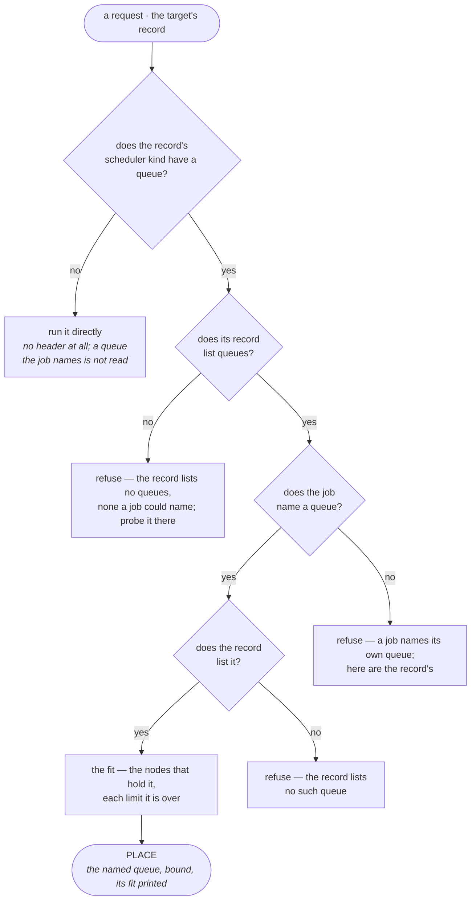
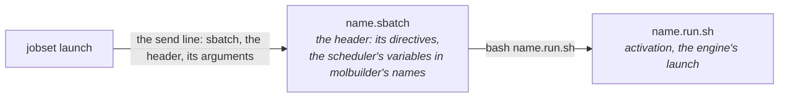

# The scheduler — what a machine offers, where a job is placed, and what is sent

**Role:** contract
**Domain:** execution
**Owns:** the machine record's queue model (domains, their machines and
ceilings), the fit, placement (R6), the header and the line that sends it
(§ 6a), the scheduler kinds (`scheduler/kinds.toml`), and what molbuilder reads
back from a scheduler (R16).
**Read with:** [`configuration.md`](?doc=configuration.md) § 5 — the machine
record's file, M-1 … M-6 · [`architecture.md`](?doc=execution/architecture.md)
§ 5.2 — where each launch value is stated, or refused at prep ·
[`job-system.md`](?doc=execution/job-system.md) § 6.0 — the launch protocol ·
[`running-a-job.md`](?doc=execution/running-a-job.md) § 3 — the run script at
run time · [`gpu.md`](?doc=execution/gpu.md) — the GPU decision ·
[`submission.md`](?doc=execution/submission.md) S4 — nothing goes out unseen ·
[`asu-sol.md`](?doc=execution/asu-sol.md) — the cluster it was drawn against

## The short version

`jobset probe` measures a machine into its record (`environment.json`): its
scheduler kind and, for a kind with a queue, every queue the account may use,
each with its wall, its caps and every machine it draws from (§ 2, § 4). A job
names its queue and states its wall, memory, ranks, cores and GPUs. **At prep**
the job is placed on the queue it names and its fit — how the request sits on
that queue's machines — is printed, never used to refuse it: the scheduler
decides, and its answer is shown (R6). Prep renders the placement once as the
`#SBATCH` header; **launch sends that header** on one line, restating at most a
wall (R9, § 6a). Everything said to a scheduler is its kind's, one block of
`kinds.toml` (§ 6a).

**Reading map.** *For the person:* the rules R0 – R16 (§ 3, one line each
below), the header and the send line (§ 6a). *How it works:* § 1 – § 2, the
decision graph (§ 5). *Developer reference:* the vocabulary (§ 4), the modules
(§ 6), the kinds' protocol (§ 6a), a caller's view (§ 7).

| rule | keyword | one line |
|---|---|---|
| **R0** | queue ≠ machine | a partition is a QUEUE holding many machine kinds; `node_types` lists them, any single figure over them is an opinion |
| **R1** | one placement | ONE decision, made at prep, rendered once — the header; the line a launch sends carries no resource but a wall the launch restates |
| **R2** | the fit is total | every limit of one job the record declares is read into the fit — a declared field nobody reads is the error |
| **R2a** | GPUs: counted, no card | a GPU request fits the nodes that carry at least the number asked, whatever their card; the ask is `gpu:N` |
| **R3** | silence is not a limit | a limit the record does not state is not counted against a request |
| **R4** | numbers, not "no" | the fit names the nodes that hold the request, of how many, and each limit it is over, with its numbers |
| **R5** | header stands alone | a header naming a queue states the wall stated for the run, never one filled in |
| **R6** | shown, never a veto | prep refuses no request for what the record says of its queue: it prepares it and prints the fit; the scheduler decides |
| **R7** | ask what you know | unasked constraints are `None`, and `None` is never counted |
| **R8** | fact vs statement | what a queue ALLOWS is the record's; which queue a job USES is the job's own statement |
| **R9** | placed once | launch sends prep's header as it stands; a calculation meant for a changed record goes back to the state before its first prep |
| **R10** | name what holds it | the fit names the machines that hold the request, not only those that do not |
| **R11** | compare KINDS | comparability is the node's kind (cores, device model, memory ≈ 10 GB) — never its hostname, never the allocation |
| **R12** | sent ≠ landed | `run.json` records where a job was SENT; the monitor's first `[MACHINE]` line what it LANDED on |
| **R13** | two ceilings | hardware (each machine) and policy (`MaxTRESPerJob`, `MaxCPUsPerNode`) are both read into the fit |
| **R14** | some limits count JOBS | a QoS's cap on submitted jobs per user is read, and a benchmark that exceeds it is told at prep |
| **R15** | a scheduler is a kind | every command, directive, output-file placeholder and job variable is its kind's, in `scheduler/kinds.toml` (§ 6a) |
| **R16** | the scheduler's word on an ending | how the scheduler ended a job is read in its own words — from the job's error file, else its jobs list, written once into the launch record |

---

## 0. What this chapter owns

**Owns only what the SCHEDULER decides, and shows it before it is asked.** The
fit says, from the record, what `sbatch` will decide — a wall past the queue's
limit, more cores or memory than its machines have, GPUs on a queue that has
none, more devices than a node offers, a policy cap — so the person sees it
while changing the ask is free. *(User, 2026-08-30: "what i care most is if the
sbatch schedule goes through — those are road blockers.")* It does **not** model
whether the *calculation* will fit once it lands: a system too large for the GPU
it landed on is a run-time result the person deals with. A device's memory is
accordingly no column of the record: the probe cannot read it.

**Does not own:**

- the machine record's file, its scopes and the fact/preference split —
  [`configuration.md`](?doc=configuration.md) § 5 (M-1 … M-6);
- which machine a calculation is prepared for —
  [`preparing-for-another-machine.md`](?doc=execution/preparing-for-another-machine.md);
- where each launch value is stated, and what is refused when it is stated
  nowhere — [`architecture.md`](?doc=execution/architecture.md) § 5.2;
- what the run script does with the values it is given —
  [`running-a-job.md`](?doc=execution/running-a-job.md) § 3.

## 1. Why one subsystem

Placement touches four things: what a machine offers (the record), whether a
request fits it (the fit), which queue it goes to (placement) and the words the
scheduler is sent (the header and the line). When those are decided in more
than one place they disagree: a CPU branch and a GPU branch choose queues by
different rules, or one half of a submission names a queue while the other
states a wall that queue does not allow. So each has one home, here — one
record reader, one fit, one placement, one emitter and one sender — and each
rule below is enforced by one module (§ 6).

## 2. What the record declares, and what reads each

A **domain** is one `(partition, qos)` pair the account may submit to (§ 4).
Every limit it declares has a reader — R2's rule — and the record says plainly
what it did not ask:

| field | what it says | read by |
|---|---|---|
| `max_time` | the pair's wall | the fit (R4); the header's wall is the job's own (R5) |
| `node_types` | every distinct machine: its node count, cores, memory and GPUs | the fit, machine by machine (R0, R3); the queue table |
| `max_cores`, `max_mem_gb` | the widest machine's cores, the largest machine's memory | the fit, for a record that lists no machines (R3) |
| `gpu` | gres type → per-node count (`{"a100": 4}`) | the fit, through `Domain.devices` (R2a) |
| `max_cpus_per_job`, `max_cpus_per_node` | the QoS's `MaxTRESPerJob` `cpu` term; the partition's `MaxCPUsPerNode` | the fit (R13) |
| `max_submit_jobs` | the QoS's `MaxSubmitJobsPerUser` | a benchmark's prep (R14) |
| `default_mem_per_core_gb` | what the scheduler grants per core when a job states no memory | no fit — it is no limit, and a job always states its memory ([`architecture.md`](?doc=execution/architecture.md) § 5.2); served in the machines list |
| `extra` | columns a probe saw and this reader does not interpret | said, never compared (R2) |

**The two memory facts are different facts.** `max_mem_gb` is what a node
*has*; `default_mem_per_core_gb` is what the scheduler *grants* a job that asks
no memory. The code that reads one never reads the other.

**Tri-state, for the policy fields.** `max_cpus_per_job`, `max_cpus_per_node`,
`max_submit_jobs` and `default_mem_per_core_gb`: a number states the value;
`null` means *asked, and the scheduler states none*; the key absent means
*never asked*. R3 forbids reading an unstated limit as a bar, and equally a
never-asked one as permission.

## 3. The rules

**R0 — A partition is a QUEUE, not a machine type.** ASU Sol's `htc`, as its
record states it (probed 2026-10-19), is 69 nodes of 48 cores with GPUs, 4 of
64 and 2 of 96 with GPUs, and 137 of 128 cores, 134 of them with no GPU at all;
`public` and `general` hold the same kind of mixture, and what separates the
three is the **wall** — `htc` 4 h, `public` 7 d, `general` 14 d. Others
(`highmem`, `gaudi`, `arm`, `fpga`) are one machine class each.

So **the machines are the measurement, and any single figure over them is an
opinion.** A domain carries `node_types` — every distinct machine, with its node
count, cores, memory and the GPUs each node carries — and the person reads it;
the fit reads it machine by machine (R3). Two consequences: hardware cannot be
chosen by choosing a partition (that is `--gres` or `--constraint`); and a
device is a property of a *machine*, not of a queue — `htc` offers A100s and it
offers 128-core nodes, but never both at once.

**What a person is shown: the ranges, the machines by size, and the fit.** A
queue holding several machines has a **range** of cores and memory; a queue of
one machine shows one number. The range's low end is not a floor on the ask: a
`-c 4` job gets four cores on a 48-core node. The machines are grouped by
**size** — what a person picking a machine chooses between — with the cards at
each size beside them. This is prep's queue table (`placement.queue_table`),
printed when a run names no queue:

```
     name         partition/qos           max time    cores         memory  gpu
  1  htc          htc/public                    4h   48-128  501-1511.2 GB  a100.40gb x4, a100 x4, h100 x8, a30 x3, l40 x4, h200 x1, h200.35gb x4, gpu x1, a100.20gb x16
       -  128 cores  x137 node(s)  503.2-1511.2 GB  a30, gpu, h200, h200.35gb
       -   96 cores  x2 node(s)  1007.4 GB  h100
       -   64 cores  x4 node(s)  503.5 GB  a100.40gb
       -   48 cores  x69 node(s)  501-503.5 GB  a100, a100.20gb, a30, h100, l40
     64 cores fits 143 of 212 nodes of htc (67%): 64 cores · 503.5 GB; 96 cores · 1007.4 GB; 128 cores · 503.2-1511.2 GB
```

**The range alone misleads, so the fit rides with it.** Reading `48-128` you
would take 128 for the rare extreme; on `htc` it is 137 of 212 nodes, the common
machine. Node counts are still only a proxy for **wait**: what a queue costs
today is `--mode ask`, which asks the scheduler (§ 6a).

**R1 — A placement is decided once, at prep, and rendered once.** The header
carries it, in the target's kind's language (`scheduler.emit`, § 6a); the line a
launch sends carries that header and no resource of its own but a wall the
launch restates (`commands.LAUNCH_FLAGS`, `submit._sbatch_request`). There is
one rendering, so there is nothing to disagree about.

**R2 — The fit is total over the declared limits.** Every limit of one job that
`Domain` declares — `max_time`, the policy caps (R13), and `node_types`, each
machine's cores, memory and GPUs — is read into the fit (§ 2). The cap on how
many jobs one user may have submitted is a limit of a SET of jobs, read by a
benchmark's prep (R14). A new declared limit arrives with its reading or it does
not arrive.

**`extra` is the one exception, and what it holds is said.** It keeps columns a
probe saw and this reader does not interpret — *a reader owns only the keys it
checks* — so a column an operator writes survives. But a misspelling would then
be indistinguishable from a deliberate extra (`max_tme` lands in `extra`, and
`max_time` reads as unstated), so the machine's summary line names them
*(user, 2026-09-06)*:

```
sol   slurm · 48 cores · 1 domain(s) · ?? not understood: gpu_parition
```

Nothing is refused and nothing is dropped; a typo stops being invisible. The
line is built by `record.known_machines`, which both `jobset machines` and
`GET /api/task-setup/machines` read, so they cannot disagree about a machine.

**One unit, so the memory limit can be compared.** The record states gigabytes
as a number; a job states memory as SLURM text (`"390G"`). `parse_mem_gb` is the
one conversion, and `--mem=0` maps to *no stated limit* rather than zero,
because in SLURM it means all the node's memory.

**R2a — GPUs: counted, and no card.** *(User, 2026-10-01: "the only thing you
check is the gpu dependent task is scheduled to the group/domain that actually
claimed to have it, and has the capacity as requested (gpu_number). that's it";
"we never claimed any card type".)* A GPU request fits the nodes that carry at
least the number asked, whatever their card — every card a node carries counted
together, from the `gpu` the probe writes for each machine type. A queue whose
record lists no GPUs has no node that holds it; a queue that lists GPUs without
saying how many is not counted against the number (R3). **molbuilder names no
card**: a GPU ask is `--gres=gpu:N`; the card the probe records stays a fact on
the record — `jobset machines` shows it — and nothing compares it.

**R3 — An unstated limit is not counted.** A domain that does not state a
ceiling is not claiming a small one, and a ceiling that cannot be parsed is not
one. A machine the record lists without a field holds the request as far as the
record says. **Machine by machine**: the scheduler places a job only on a node
that holds all of it at once, so the fit asks each machine type whether one node
holds the whole request — cores, memory, GPUs — and counts the nodes that do. On
Sol's `public`, 64 cores fit the 107 standard nodes and none of the 52 with
A100s, so a 64-rank GPU job fits no node there, though the queue has 128-core
nodes and it has GPUs. A record that lists no machines is read by its
`max_cores` and `max_mem_gb`.

**R4 — The fit names the numbers**, never *"does not fit"*:

- *"900 GB fits 3 of 212 nodes of htc (1%): 96 cores · 1007.4 GB; 128 cores ·
  1511.2 GB"*
- *"2000 GB fits no node of htc -- 2000 GB is over htc's largest machine
  (1511.2 GB)"*
- *"4 cores · 38m fits all 212 nodes of htc-debug -- 38m is over htc-debug's
  wall (00:15:00)"*

The machines that hold it are named one per size, as the queue table groups
them, with the cards at each size when it asks GPUs; a share is never rounded to
none or all (*"<1%"*, *">99%"*); every limit it is over is named. The record is
on disk, so a person is never sent to `scontrol` for its numbers.

**R5 — A header must be submittable on its own.** If it names a queue it states
the wall stated for the run — a wall stated nowhere is refused at prep, never
filled in ([`architecture.md`](?doc=execution/architecture.md) § 5.2). Whether
the queue takes that wall is the fit's to say and the scheduler's to decide.

**R6 — Shown, never a veto** *(the user, 2026-10-17: "the information on each
domain is displayed correctly to the user, do not refuse user's choice, user
knows best and when denied, the output gives the reason")*. Prep refuses no
request for what the target's record says of the queue it names: it prepares
the job and prints the fit beside its placement — each limit it is over, with
its numbers. **The scheduler decides, and its answer is shown**: at submit its
refusal in its own words; with `--mode ask` before anything is sent; and a job
it takes but holds shows its reason in `molbuilder jobs status`
([`job-system.md`](?doc=execution/job-system.md) § 6.0a). The record's figures
are measurements of a mixture of machines; the scheduler is the authority on
what it takes.

**What prep still refuses is a statement missing, or contradicting the
record**: a queue stated nowhere, or one the record does not list; a wall or
memory stated nowhere ([`architecture.md`](?doc=execution/architecture.md)
§ 5.2); a GPU run with no count, or a count with no GPU
([`gpu.md`](?doc=execution/gpu.md) G5); a run on a kind with a queue whose
record lists no domains, since it names no queue a run could name. A machine
whose kind has no queue has nothing to send to: prep writes no header, and the
job runs directly (§ 6a). How placement is made and recorded is § 5.

**R7 — Callers ask what they know.** Prep knows what a job states — its cores
and devices and, where it writes a header, its wall and memory — and fits a run
on the queue it names with all of them; a benchmark's grid asks each cell's
shape of the one queue the benchmark names; the Task setup card shows the
queue's wall and its machines' memory beside the fields being typed, and its
Preview is prep's, the fit of the whole request
([`task-setup.md`](?doc=web/task-setup.md) § 6.2). An unasked constraint is
`None`, and `None` is never counted. So one fit serves every caller.

**R8 — Measurements from the record, the queue from the job.** What a queue
*allows* is a measurement, read from `environment.json`
([`configuration.md`](?doc=configuration.md) § 5, M-1). Which queue a job *uses*
is the job's own statement — `allocation.domain`, the run card's `domain`,
`prep --domain` ([`job-request.md`](?doc=execution/job-request.md) § 3.1,
§ 3.2a) — and never a default from any file. Which queue to spend a day of wall
in is a judgement about priority, contention and what else is running — none of
it on the record, all of it the person's.

- **A run on a scheduler that names no queue is refused at prep**, its
  refusal listing the record's queues with the job's fit on each
  (`placement.queue_table`) — the listing asks the one fit the placement asks,
  so it cannot say a queue holds the job where prep's own line says it does
  not.
- **Launch sends to that queue and names none of its own** (R9).
- **A page that offers queues proposes no value.** Choosing a queue on the Task
  setup card fills neither the wall nor the memory: its wall and its machines'
  memory are shown beside the fields, its Preview gives the fit, and an empty
  field stays empty until it is stated — a value the page proposed would become
  "stated" at the next Save, a number nobody chose.
- **A benchmark measures on one queue** — the one its prep names (`prep
  --domain`, else `allocation.domain`); measuring another queue is another
  benchmark *(the user, 2026-10-17)*.

**R9 — Placed once, at prep** *(the user, 2026-10-17: "whether it's direct
launch or submission, all the decision is already done at the prep … It is none
of molbuilder's business at the launch time to decide what is allowed to
launch")*. What prep placed on the target's record is what launch sends: launch
sends the header prep wrote, walks no graph, fits nothing and plans nothing
again; every launch checks that a benchmark trial starts cold
(`job-system.md` R-L29). The calculation's copy of the target's record is the
one its first prep took, and no probe replaces it
([`configuration.md`](?doc=configuration.md) M-3): a calculation meant for a
machine whose record has changed goes back to the state saved before its first
prep.

- **The one value a launch may restate** is a submitted job's wall
  (`launch --time`), passed on the line in a job's own spelling
  (`D-HH:MM:SS`, § 6a) and checked by nothing of ours: the scheduler answers it.
- **What the launch records of the request is read off the header it sends** —
  its wall and memory, each by its directive's own spelling in the kind's
  language (`kinds.Kind.directive_value`), the wall the launch's `--time` where
  it restates one — never worked out again from the plan. `run.json`'s
  `placed_on` and the `MB_WALL_S` the job is told are that header's
  ([`running-a-job.md`](?doc=execution/running-a-job.md) § 3.6).

**R10 — The fit names what holds the request.** Not only *"fits no node"* but
which machines would hold what: *"64 cores · 1 GPU fits no node of public -- no
one machine of public holds all of it: the 48-core machines have 48 cores; the
128-core machines have no GPU"* — each kind of lack once, with the range the
machines lacking it have; a size whose machines do not all lack it is named by
the ones that do, with their memory and cards (*"the 128-core · 503.2 GB
machines"*), so every clause is true of every machine it names. R4 names the
numbers; R10 names the way out.

**R11 — Comparability is a property of the MACHINE, never of the domain.** It
is R0 applied to measurement. A domain is a queue holding many machines, so
*"were these two runs on comparable hardware?"* has no answer at the domain
level: on Sol, `public` alone spans 48 – 128 cores and three device types. What
a measurement may be compared with is decided by the **kind of node** it ran on
— which R12 records:

| | comparability | provenance |
|---|---|---|
| **the node's KIND** — its physical core count, memory, device model | **this decides it** | |
| **the node's NAME** — `sol-g042` | never | which box, for tracing a bad one |

- **Not the name.** The scheduler spreads a sweep's jobs over whatever is free,
  so two trials almost always run on different boxes; comparing names would
  warn on every sweep.
- **Not the allocation.** The node's size is `os.cpu_count()`; what this job was
  given is the affinity mask, which `monitor._alloc_cores` answers on purpose —
  a run reports how well it used what it was given
  ([`run-reports.md`](?doc=execution/run-reports.md) § 2.1a). Reading the
  allocation as the machine would make a rank-scaling sweep — 48 against 64
  against 128 — report a different machine per trial.
- **The same kind tolerates the jitter identical boxes have.** A kind is
  *(cores, device models, memory to the nearest 10 GB)*: Sol's identical
  128-core nodes report 503.2, 503.4 and 503.5 GB, while the tiers that differ
  (≈ 500, ≈ 1000, ≈ 1500 GB) are hundreds of GB apart.

No code refuses on comparability: a benchmark's verdict reaches no run by itself
([`architecture.md`](?doc=execution/architecture.md) § 5.2), and the benchmark
summary states each trial's machine
([`generator.md`](?doc=execution/generator.md) § 4.4b).

**R12 — Where it was SENT and what it LANDED ON are two facts, recorded by two
writers**, because they are known at different moments:

| fact | known when | written by | into |
|---|---|---|---|
| **sent to** — domain, partition, qos, and the wall and memory it was sent with (R9) | the scheduler accepts the job | `submit` | the run's `run.json`, `placed_on` |
| **landed on** — node name, cores, memory, device model | the job starts running | the **monitor**, on the compute node | the monitor log's **`[MACHINE]` line**, its first |

- **Its own line, at the start.** The machine is known the moment the monitor
  starts, so a run that dies still says where it died; the closing
  `[UTIL-BASIS]` line answers a different question — what the job was given —
  and a monitor killed with its allocation never writes it.
- **No device count.** Inside a scheduled job `nvidia-smi` shows only the
  devices the job was granted, so the count is the allocation's; the **model**
  survives that filter, and the model is what comparability needs.

**R13 — What the hardware can do and what policy lets you ask for are two
ceilings, and both are read into the fit.** Each machine's cores are a fact
about silicon; a scheduler also declares per-job caps no hardware overrides — a
QoS's `MaxTRESPerJob=cpu=N`, a partition's `MaxCPUsPerNode`. A request over a
policy cap is over it on every machine, and the fit says so. The probe asks for
both (`sacctmgr show qos` with `MaxTRES`; `scontrol show partition`) and writes
them tri-state (§ 2). **A field the probe did not request is not an absence the
record may report as silence.** Sol's record states no policy cap on any queue,
`lightwork` included ([`asu-sol.md`](?doc=execution/asu-sol.md) § 3).

**R14 — Some limits count the SET of jobs; they are read too, and a benchmark
that exceeds one is told at prep.** A QoS's `MaxSubmitJobsPerUser` caps how many
jobs one user may have submitted at once, so whether an ask fits depends on what
is already queued. A benchmark submits one job per shelf by construction, so it
is the one limit a benchmark reliably meets. Prep says the arithmetic where the
grid can still change — *htc-debug takes 2 submitted job(s) per user, and this
benchmark is 6 shelf job(s): with nothing of yours already queued there, 2 go and
4 come back QOSMaxSubmitJobPerUserLimit -- fewer if you already hold some* — and
refuses nothing: a refused shelf's trials stay pending, and launching the
benchmark again sends exactly them
([`generator.md`](?doc=execution/generator.md) § 4.3a).

**R15 — A scheduler is a kind.** Every command, directive, output-file
placeholder and job variable a scheduler has is its kind's, one block of
`scheduler/kinds.toml` read by one reader; the machine's record names the kind
and where its commands are there. The protocol is § 6a.

**R16 — How the scheduler ended a job is the scheduler's word, read where the
run is** *(the user, 2026-10-18: "… it can correctly decode the scheduler's
message")*. A job the scheduler stops — its wall reached, a cancel — may never
reach the run script's own conclusion, and molbuilder's instruments may not see the
signal. What the scheduler did write is one line in the job's own error file,
the file the header names (§ 6a):

```
[2026-10-18T01:19:15.046] error: *** JOB 65999920 ON scc006 CANCELLED AT 2026-10-18T01:19:15 DUE TO TIME LIMIT ***
```

- **Each kind with a queue has a reader of that file for one job**
  (`queue._READERS`): SLURM's finds the line framed `*** JOB <id> ON <node> …
  ***` for the job's own id and gives the words inside it as written —
  `CANCELLED AT 2026-10-18T01:19:15 DUE TO TIME LIMIT`. Nothing past the frame is
  assumed; a file holding no such line says nothing.
- **The file lies where the run's launch record says**
  ([`job-contracts.md`](?doc=execution/job-contracts.md) § 6.1, the launch
  record's `scheduler`), so the answer is the same on the cluster and on a
  machine the run was copied to. The run door asks it beside the conclusion
  marker and the monitor's closing record
  ([`running-a-job.md`](?doc=execution/running-a-job.md) § 4.2).
- **Where the file holds no line**, the scheduler's answer to the kind's
  `listed` query — asked by the run door on the cluster the job was sent to,
  from the machine that sent it ([`job-system.md`](?doc=execution/job-system.md)
  § 6.0a) — is written once into the run's launch record (`ended`) and read
  there after, on every machine.

## 4. The vocabulary

- **Machine** — one host or cluster, as measured: its scheduler (the kind, and
  where its commands are there, § 6a), topology, site, and its domains.
  Persisted as `environment.json` ([`configuration.md`](?doc=configuration.md)
  § 5).
- **Domain** — one reachable `(partition, qos)` pair and what it allows (§ 2).
  *A fact, never a preference — it says "you may submit here, for this long",
  never "submit here".*
  - The probe records **every pair** the account's associations allow
    (`sacctmgr show assoc`, its partition and QoS columns; an association naming
    no partition holds on every one), each with its own wall — a partition the
    account holds three QoS on is three domains.
  - **Its name**, the one a job request uses, is the partition's for one pair —
    the one whose QoS is `public`, else the one named like the partition — and
    `<partition>-<qos>` for every other (`probe.derive_domains`): on Sol `htc` is
    (htc, public) and `htc-debug` is (htc, debug). The header is written from
    the pair, never from the name.
  - When the account's QoS list cannot be read, each partition is one domain
    with `qos: null`, its header carries no QoS line, and the probe's note says
    so.
  - A uniform cluster declares one entry in `node_types`.
- **Device** — one kind of accelerator a domain's nodes offer: a type and a
  per-node count. The interpreted form of the `gpu` column, read once behind
  `Domain.devices`. *A count the record does not state is `None`, never zero:
  R3 applies to devices too.*
- **Request** — what one job asks for: ranks, cores per rank, GPUs, memory,
  wall. Fields the caller does not know are `None` (R7).
- **Fit** — how a request sits on a domain's machines: the nodes that hold the
  whole of it, of how many, the machine types that do, and each limit it is
  over, with its numbers (R2 – R4, R10). One reading (`fit.fit`) and one
  rendering (`Fit.line`), read by prep, the benchmark grid, the queue table and
  the Task setup card; it refuses nothing (R6).
- **Placement** — a request bound to the domain it names, and its fit (R1).
- **Directives** — a placement rendered for the scheduler: the header's
  directive lines in its kind's language (R1, § 6a).
- **Workstation** — a machine whose scheduler kind has no queue. Not an error
  state: it yields no header, and the job runs directly.

## 5. Placement — the decision graph

Placement is one walk, so the CPU side and the GPU side cannot be written
separately and disagree. Every branch is a rule of § 3:



**A named queue is placed, and its fit said.** `place(..., named=)` binds the
queue the job names and asks the fit of it (`scheduler/place.py`): a request
over every machine there is placed all the same, the fit saying so (R6). **The
refusals are statements missing or contradicting the record** — a record that
lists no queues (`placement.no_queues_said`, naming the probe that renews it);
no queue named, or one the record does not list, each naming the record's
queues. `place` answers `None` for a machine with no queues and no queue named.

### 5.1 What is placed, and what is recorded

**The walk is prep's, once, for every job it writes a header for**
([`job-system.md`](?doc=execution/job-system.md) § 5.0):

- **Where the queue comes from** — `prep --domain`, else the run card's
  `domain`, else `allocation.domain`; a benchmark's: `prep --domain`, else
  `allocation.domain`.
- **The whole request of each job is placed** — one request per job, asked of
  the queue by every caller (`placement.request_of`: a SIESTA run's ranks, a
  PySCF run's one process, the cores each runs on, its GPUs, memory and wall):

  | job | its request |
  |---|---|
  | a stage | its own (`placement.placed`) |
  | a group | its members' shared request — walls summed, the largest memory ([`job-request.md`](?doc=execution/job-request.md) § 3.3) |
  | a run of points | one job walking every point — their walls summed, or the stage's one wall where its points share it |
  | a benchmark's shelf | its trials' shared request, the benchmark's wall the shelf's (`shelves.shelf_request`), each trial on the benchmark's one queue (`prep_inputs.bench_inputs`) |
  | a sequence of groups | its one request ([`job-system.md`](?doc=execution/job-system.md) § 6.0, *A sequence of groups*) |

- **What is recorded** — on the job in `job-set.json`, its `placement`: the
  queue it was placed on, bound on the record (name, partition, qos), and where
  each value came from — the flag, the run card or the allocation
  ([`job-contracts.md`](?doc=execution/job-contracts.md) § 6.1).
- **The fit is printed and recorded nowhere** — it decides nothing. Both doors
  (the terminal and Task setup's Prep) print the placement, then the fit of the
  job each header sends, with every value of that header.
- **Every header is prep's** — rendered at prep for the queue it placed
  (`prep.walk_header_of` for a job of several members): a stage's beside its
  deck; a group's, a run of points' walk and a benchmark's shelves in their
  `launch/` folder.
- **Launch decides none of it** (R9): it sends the header prep wrote; a stage
  changed since its prep is said so by `status`.

## 6. The modules

```
scheduler/
  record.py      Environment (the machine) · Domain · Topology · Site ·
                 Scheduler; read/write; scopes; named targets; a calculation's
                 own copy (calculation_environment); discovery (_DISCOVERY)
  probe.py       parsers of the scheduler's answers (sinfo / scontrol / sacctmgr)
  quantities.py  a wall and a memory, each way they are written:
                 parse_walltime · slurm_time · parse_mem_gb · canonical_*
  fit.py         fit(domain, request) -> Fit
  place.py       place(routing, request, *, named) -> Placement
  emit.py        Directives(...).header_lines(kind)
  kinds.toml     each scheduler kind: its operations, its header's language,
                 its output files' placeholder, what it tells a running job
  kinds.py       kind(name) -> Kind, the one reader of kinds.toml
  queue.py       a sent job asked after, stopped, and how the scheduler
                 ended it, each answer read by its kind's reader
```

The package is named for what it does, not for SLURM: `emit.py` renders a
kind's header language and spells no scheduler of its own.

**Each rule, and the module that holds it:**

| rule | enforced in |
|---|---|
| R0, R3, § 2 | `record.Domain` (`node_types`, `devices`), `probe.derive_domains` |
| R1, R5 | `emit.Directives`, `runwrap.render_sbatch` |
| R2, R2a, R4, R7, R10, R13 | `fit.fit`, `Fit.line` |
| R2 — *what is not understood* | `record.known_machines` |
| R6, R8, § 5 | `place.place`, `jobset/placement.py` (`placed`, `queue_table`, `no_queues_said`) |
| R9 | `jobset/submit.py` (`_sbatch_request`, `_go`), `kinds.Kind.directive_value` |
| R11, R12 | the monitor's `[MACHINE]` line; `run.json` `placed_on` (`submit`) |
| R14 | `prep_inputs` (a benchmark's prep) |
| R15, § 6a | `kinds.toml`, `kinds.py` |
| R16 | `queue._READERS`, the run door ([`running-a-job.md`](?doc=execution/running-a-job.md) § 4.2) |

**Tests.** The fit, case by case: `tests/data/the_fit.toml` driven by
`tests/test_the_fit.py`. What survives the reader and what is said:
`tests/test_routing_domains.py` —
`test_an_unknown_column_survives_the_type`,
`test_a_column_the_reader_does_not_understand_is_SAID`.

## 6a. The header and the send line — the scheduler kinds

*(The user, 2026-10-17: "we just need a configure file to say what are the
parameters, what are the format we need to put in there … unified layer, unified
API, unified protocol".)*

**Everything molbuilder says to a scheduler is a kind's, and a kind is data**:
`molbuilder/scheduler/kinds.toml`, one block per kind, read by one reader
(`scheduler/kinds.py`, `kind(name)`). No other module spells a scheduler — no
command, no directive, no environment variable. The files molbuilder names are
the file catalogue's (`runfiles`), one name for every kind: the header's own
`<name>.sbatch`, and the scheduler's output `{scheduler}.{jobid}.out` / `.err`,
its placeholder the kind's (SLURM's `slurm.%j.out`).

### Two layers: the header, and the run script it starts



- **The outer `.sbatch` is a thin header**, in the target's kind's language: its
  directives, then the variables the scheduler tells the job said once in
  molbuilder's names (`MB_JOB_ID`, `MB_NTASKS`, …), when the job started
  (`MB_JOB_STARTED`), and one line that starts the inner script.
- **The inner `.run.sh` owns activation and the engine's launch**, and reads only
  molbuilder's names — so the same run script works with or without a
  scheduler, and the header and the run logic change independently. What the
  run script does at run time is
  [`running-a-job.md`](?doc=execution/running-a-job.md) § 3; its blocks are
  [`job-contracts.md`](?doc=execution/job-contracts.md) § 2.6.
- **For a job of several members** — a group, a run of points, a benchmark's
  shelf, a sequence — the header lies in the `launch/` folder of the folder it
  is sent from (the calculation's for a group, the stage's for a run of points)
  and starts the walk script launch writes there, each member's counts in it.

A group's header, as prep writes it:

```bash
#!/bin/bash
# === molbuilder scheduler header (scheduler: slurm) ===
# Generated by prep from the job's own stated values.
# …
#SBATCH -J h_tr_group-01_seed-02_electrode_L-03_electrode_R
#SBATCH -N 1
#SBATCH -n 2
#SBATCH -c 1
#SBATCH -t 0-03:00:00
#SBATCH -p cpu
#SBATCH -q public
#SBATCH --mem=8G
#SBATCH -o launch/slurm.%j.out
#SBATCH -e launch/slurm.%j.err

# What SLURM tells this job, in molbuilder's own names (scheduler/kinds.toml) --
# read by everything this script starts.
if [ -n "${SLURM_JOB_ID:-}" ]; then export MB_JOB_ID="$SLURM_JOB_ID"; fi
# … one line each for MB_NTASKS, MB_CPUS_PER_TASK, MB_CPUS_ON_NODE, MB_JOB_GPUS, MB_JOB_NODELIST
export MB_JOB_STARTED="$(date +%s)"

bash launch/h_tr_group-01_seed-02_electrode_L-03_electrode_R.run.sh "$@"
```

### Every value in it is stated

The header carries a fixed name (`-J`), one node (`-N 1`), the scheduler's two
output files, and the job's own stated values: ranks (`-n`), cores per rank
(`-c`), wall (`-t`), memory (`--mem`), the queue's partition and QoS (`-p`, `-q`)
bound on the target's record, and for a GPU job its count (`--gres=gpu:N`) with
the binding unless the calculation turned it off
([`gpu.md`](?doc=execution/gpu.md) G9). Where each value is stated, and the
refusal of one stated nowhere, is
[`architecture.md`](?doc=execution/architecture.md) § 5.2. There is no
scheduler configuration to fall back on: a `scheduler` block in `molbuilder.json`
is refused by name ([`configuration.md`](?doc=configuration.md) § 4). A value is
written in a job's own spelling — a wall `D-HH:MM:SS`, memory `120G` — which is
what SLURM reads; a GPU ask is its count.

### When there is no header

The `.run.sh` is always written. The `.sbatch` beside it is withheld in two
cases, and launch's refusal names which, each with its way on:

1. **the target's record names a kind with no queue** (`workstation`) — a header
   would be a file nobody can submit; the job is run with `--mode direct`;
2. **you asked for none** — `prep --no-sbatch`; then no queue, wall or memory is
   asked for, and the job runs here.

A target with a queue otherwise always gets one. So *"I prepared and got no
`.sbatch`"* has those two answers. The launch mode itself is always stated,
never derived from the scheduler — `--mode`, or `launch.mode` set once
([`configuration.md`](?doc=configuration.md) § 4).

### The send line

**One line per job, and the header carries the job.** Every submission — a
stage, a group, a run of points, a benchmark's shelf, a sequence — builds its
line the same way (`submit._sbatch_request`), in the words of the kind its
machine's record names, from where the record says its submit command is:

```
sbatch -J <label>/<job> [-t <wall>] --export ALL,MB_LAUNCHED_BY=jobset-launch,MB_WALL_S=<seconds> <header> <args>
```

- **`-J <label>/<job>`** — the calculation's label and the job's name
  (`bdt_au/coarse`, `bdt_au/bench-group-cpu-G0N4C1`; `submit._scheduler_job_name`,
  [`job-contracts.md`](?doc=execution/job-contracts.md) § 6.3), so a `squeue`
  listing tells you which calculation each row belongs to. It is the name the
  queue shows: an option on the line takes precedence over the header's own
  `-J`, which is the header file's stem.
- **`-t <wall>`** — only when the launch restates a submitted job's wall
  (`launch --time`, R9).
- **`MB_LAUNCHED_BY=jobset-launch`** — the launch claim the run script's gate
  checks ([`running-a-job.md`](?doc=execution/running-a-job.md) § 5.5).
- **`MB_WALL_S`** — the wall the job is sent with, in seconds: the header's, or
  the launch's `--time`, the value `run.json`'s `placed_on.time` records, one
  wall for every member of a walk. Which run is told which wall, and what the run
  script hands the engine, is
  [`running-a-job.md`](?doc=execution/running-a-job.md) § 3.6.
- **every other value** — queue, ranks, cores, GPUs, memory, binding — is the
  header prep wrote, sent as it stands. Each run is handed its own ranks and
  threads by launch, never the submitting shell's
  ([`running-a-job.md`](?doc=execution/running-a-job.md) § 3.2).

**Every script is written before the first job goes**, so a scheduler's refusal
costs one submission, never the scripts of those behind it. One job goes at a
time, each shown before it is sent
([`submission.md`](?doc=execution/submission.md) S4); a benchmark's shelves are
sent one after another, a refused one leaving the rest to go
([`generator.md`](?doc=execution/generator.md) § 4.3a).

### What a kind states

| a kind states | SLURM's | asked by |
|---|---|---|
| **how a job is sent** | `{submit} -J {job} [-t {wall}] --export ALL,MB_LAUNCHED_BY=jobset-launch,MB_WALL_S={wall_s} {header} {args}` | `submit._sbatch_request` |
| **how it is asked about without being sent** | the same line, `--test-only` after the command | `submit._ask` (`--mode ask`); its answer read by `jobset.ask._ANSWER_READERS` |
| **the id it answers a send with** | `Submitted batch job (\d+)` | `submit._go` |
| **whether a sent job is still listed** | `{query} --noheader --jobs={id} --format=%T\|%r` | `scheduler.queue` — see the list below |
| **a queued job's standing** | `{query} --noheader --jobs={id} --format=%T\|%r\|%S\|%Q` | `runs.standing_of` |
| **how a job is stopped** | `{cancel} {id}` | `molbuilder jobs stop` |
| **which cluster answers** | `{cluster} show config` | `scheduler.queue` (a job's address) |
| **how it says it ended a job** | in the job's error file: `*** JOB <id> ON <node> <its words> ***` (R16) | the run door, through `queue._READERS` |
| **the header's language** | `#SBATCH` and one directive per value — the list below | `scheduler.emit`, `runwrap.render_sbatch`; `Directives.lines_of`; `Kind.directive_value` |
| **its output files' placeholder** | `%j`, the job's id | the header's `stdout`, `stderr` |
| **the value a launch may restate** | the wall, `-t {wall}` | `commands.LAUNCH_FLAGS` |
| **what it tells a running job** | `MB_JOB_ID` = `SLURM_JOB_ID`, `MB_NTASKS` = `SLURM_NTASKS`, `MB_CPUS_PER_TASK` = `SLURM_CPUS_PER_TASK`, `MB_CPUS_ON_NODE` = `SLURM_CPUS_ON_NODE`, `MB_JOB_GPUS` = `SLURM_JOB_GPUS`, `MB_JOB_NODELIST` = `SLURM_JOB_NODELIST` | the header (`Kind.job_lines`) |

Notes on the table:

- **The header's language, SLURM's** — name `-J {name}` · one node `-N 1` ·
  ranks `-n {ranks}` · cores per rank `-c {cores}` · wall `-t {wall}` · queue
  `-p {partition}` and `-q {qos}` · GPUs `--gres=gpu:{gpus}`, bound
  `--gres-flags=enforce-binding` · memory `--mem={memory}` · the whole node
  `--exclusive --mem=0` · its output `-o {where}{file}` and `-e {where}{file}`.

- **Asking after a sent job.** The `listed` query — its state and the
  scheduler's reason — is asked by `molbuilder jobs status` and by the run door
  for a sent run that still reads live (`runs.concluded`), which writes a job no
  longer listed into the run's launch record. One answer serves both, asked at
  most once per ten seconds per job (`joblist.asked_lately`), and only on the
  cluster the job was sent to, as its address records (`joblist.asked_here`; a
  job whose cluster was not read when it went is not asked). Its **standing** is
  asked by the same rule; anywhere else the status row says *ask on
  &lt;machine&gt;*.
- **The whole node** (`--exclusive --mem=0`) is part of the language for a GPU
  job whose resources say so; nothing molbuilder writes asks for it
  ([`gpu.md`](?doc=execution/gpu.md) § 1.2).
- **What the job is told** — the header says each variable once in molbuilder's
  name, for everything it starts: the run script, a walk, the monitor, the
  engine; they read only molbuilder's names. Beside them, every kind's job is
  told when it started (`MB_JOB_STARTED`), which each run's monitor counts the
  wall down from ([`run-reports.md`](?doc=execution/run-reports.md) § 2.1b).

**`workstation` is a kind too**: no queue, nothing sent, no header, nothing the
scheduler tells a run — a run here has no `MB_JOB_ID`, and is told only its wall,
by the launch. A reader asks the kind what it does, never compares the word.

### The record names its kind

**The machine's record names its kind and where its commands are there**
([`configuration.md`](?doc=configuration.md) § 5, M-2):
`scheduler: {kind, submit, query, cancel, cluster}`, written by `jobset probe` on
that machine — the first kind whose submit command is on PATH there, each command
where PATH finds it — or declared to it (`--scheduler` names the kind,
`--set scheduler.submit=PATH` where a command is, a site's own wrapper among
them). A kind with a queue names its submit command, and a kind with none names
no command; the probe refuses either otherwise, saying the way out. **The
language is never copied into a record**: it is the kind's, one for every machine
of that kind, so two records cannot disagree about SLURM.

**Every step asks its kind through the record**: prep writing the header and
reading it back; launch writing the line with the submit command as the
calculation's copy of the record names it — a full path as the probe found it, a
command as declared, or, in a copy `jobset migrate` rewrote, the kind's own name,
run from PATH — never one molbuilder looks up itself; ask mode; the jobs list,
asking the scheduler the job's calculation's copy names.

**What stays code is discovery and the reading of a scheduler's answers, a reader
per kind**, keyed by its name — each parses a tool's output, which no format
states:

- the probe reading the machine out of the scheduler's own tools — a compute
  node's shape, the default partition, whether it runs inside one of its jobs,
  the queues and their limits (`sinfo`, `scontrol`, `sacctmgr`;
  `record._DISCOVERY`);
- ask mode reading its start-time answer (`jobset.ask._ANSWER_READERS`);
- the jobs list reading whether it still lists a job, in what state and why, and
  which cluster it serves; the run door reading how it ended a job
  (`queue._READERS`, R16).

Discovery alone looks a command up on PATH. Two readers of SLURM's ways stand
where `kinds.toml` is not read: the monitor, beside the job, reading the job's
cgroup in SLURM's nesting (`monitor._job_cgroup`), and the environment builder
clearing SLURM's variables from a build (`envs/builds.py`).

**Adding a scheduler is a block in the file and its readers**; nothing else
changes.

## 7. What a caller sees

```python
req = Request(ranks=64, cpus_per_task=1, gpus=2,
              mem_gb=390, walltime_s=38 * 60)

placement = place(routing, req, named="htc")
#   -> htc/public          the queue the job names, bound, with its fit:
#      placement.fit.line  "64 cores · 390 GB · 2 GPUs · 38m fits 9 of 212
#                           nodes of htc (4%): 64 cores · 503.5 GB ·
#                           a100.40gb; 96 cores · 1007.4 GB · h100; ..."
#                           -- or each limit it is over, with its numbers
#                           (R4); never a refusal (R6)
#   -> Unplaceable, only when the job names no queue on a machine that
#      has queues, one its record does not list, or one on a machine
#      whose record lists none

d = Directives(partition=placement.partition, qos=placement.qos,
               walltime="0-00:38:00", ntasks=64, cpus_per_task=1,
               gpus=2, mem="390G")
d.header_lines(record.kind)   # what the .sbatch carries, wall included (R5),
#   in the target's kind's language (§ 6a) -- at prep; the one rendering
#   (R1): launch sends this header
```

**The job names its queue; `place` chooses none** — the job request's
allocation, its run card or `prep --domain` names it — and its fit is said:
naming a queue none of whose machines hold the job earns R4's numbers beside the
placement, and the scheduler's answer when it is sent — never a refusal of ours
(R6).
