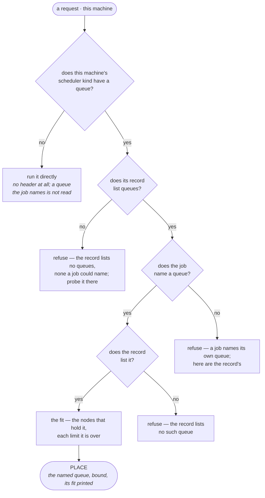

# The scheduler subsystem — what a machine offers, and what a job may ask of it

**Role:** contract
**Domain:** execution

**Companions:**
[`execution/job-system.md`](?doc=execution/job-system.md) § 6 — submission and
routing as the job system sees them (its design decision #4, a header
complete before it is sent, is R5 here);
[`execution/running-a-job.md`](?doc=execution/running-a-job.md) § 3.1, § 5.3 —
what each `#SBATCH` line *means*, which stays there;
[`configuration.md`](?doc=configuration.md) § 5 — **M-1**, the fact/preference
split this subsystem must not blur;
[`execution/preparing-for-another-machine.md`](?doc=execution/preparing-for-another-machine.md)
— which machine a `prep` is *for*, and how a record gets here.

## The short version

**A machine is measured into a record (`probe` → `environment.json`);
a job states a request, its queue included; the fit says how the request sits
on that queue's machines; placement binds the queue the job names — all of it
at prep; the placement renders the `#SBATCH` header, and launch sends that
header. The record is shown, never a veto: the scheduler decides, and its
answer is shown (R6).**  Nothing here chooses a queue for a job that names
none: it is refused at prep
([`architecture.md`](?doc=execution/architecture.md) § 5.2, 2026-10-02). Package: `molbuilder.scheduler`
(`record` · `probe` · `fit` · `place` · `emit`, § 6).

The rules, one line each — full statement in § 3:

| rule | keyword | one line |
|---|---|---|
| **R0** | queue ≠ machine | a partition is a QUEUE holding many machine kinds; `node_types` lists them, any single figure over them is an opinion |
| **R1** | one placement | ONE decision, made at prep, rendered once — the header; the line a launch sends carries no resource but a wall the launch restates |
| **R2** | the fit is total | every limit of one job the record declares is read into the fit — a declared field nobody reads is the error |
| **R2a** | GPUs: counted, no card | a GPU request fits the nodes that carry at least the number asked, whatever their card; molbuilder names no card — the ask is `gpu:N` |
| **R3** | silence is not a limit | a limit the record does not state is not counted against a request |
| **R4** | numbers, not "no" | the fit names the numbers: the nodes that hold the request, of how many, and each limit it is over ("38m is over debug's wall (00:15:00)") |
| **R5** | header stands alone | a header naming a queue states the wall stated for the run, never one filled in |
| **R6** | shown, never a veto | prep refuses no request for what the record says of its queue: it prepares it and prints the fit; the scheduler decides, and its answer is shown |
| **R7** | ask what you know | unasked constraints are `None`, and `None` is never counted |
| **R8** | fact vs statement | what a queue ALLOWS is the record's; which queue a job USES is the job's own statement |
| **R9** | placed once | what prep placed is what launch sends: prep's header, checked only against prep's own files; a calculation meant for a changed record goes back to the state before its first prep |
| **R10** | name what holds it | the fit names the machines that hold the request, not only those that do not |
| **R11** | compare KINDS | comparability = the node's kind (cores, device model, mem ≈10 GB) — never its hostname, never the allocation |
| **R12** | sent ≠ landed | `run.json` records where it was SENT; the monitor's first `[MACHINE]` line records what it LANDED on |
| **R13** | two ceilings | hardware (each machine) and policy (`MaxTRESPerJob`, `MaxCPUsPerNode`) are both read into the fit |
| **R14** | some limits count JOBS | a QoS also caps how many jobs one user may have submitted (`MaxSubmitJobsPerUser`); it is read, and a benchmark that exceeds it is told **at prep** |
| **R15** | a scheduler is a kind | every command, directive, output-file placeholder and job variable a scheduler has is its kind's, in one file (`scheduler/kinds.toml`); the machine's record names the kind and where its commands are there (§ 6a) |
| **R16** | the scheduler's word on an ending | a job the scheduler ended says so in the scheduler's own words — the line it writes in the job's error file, read by its kind's reader and asked by the run door, on the cluster and wherever the run is copied |

**How you use it:** the decision graph is § 5, the shape § 6, the scheduler
kinds § 6a,
and § 7 shows the caller's view (`Request` → `place` → `fit` → `Directives`)
in a few lines. §§ 1–2 are the evidence record — the two Sol failures this
subsystem exists to prevent — read them for *why*, never for *how*.

---

Scheduling work was spread across five modules — `environment.py`,
`scheduler_probe.py`, `jobset/submit.py`, `runwrap.py`, `runtime_config.py` —
carrying roughly 450 mentions of partitions, queues, ceilings and directives
between them. This document says what that subsystem *is*, so the pieces have
one home and one set of rules instead of one treatment per place someone
noticed a problem.

> **`Domain.gpu` has one shape, the probe's** — gres type → per-node count —
> read through one door (§ 4, *Device*). *(Hand-declared rows describing one
> device with named keys were read too until 2026-10-02.)*

---

## 0. What this document owns

**Owns:** how a request fits a queue's machines; which queue a request is
placed in; and the directives that placement produces. The vocabulary below
(*machine*, *domain*, *request*, *fit*, *placement*) is defined here.

**Owns only what the SCHEDULER decides, and shows it before it is asked.**
The fit says, from the record, what `sbatch` will decide — a wall past the
queue's limit, more cores or memory than its machines have, GPUs on a queue
that has none, more devices than a node offers, a policy cap — so the person
sees it while changing the ask is free. It does **not** model whether the
*calculation* will fit once it lands: a job whose system is too large for the
GPU it landed on is a runtime failure the person deals with. *(User,
2026-08-30: "what i care most is if the sbatch schedule goes through — those
are road blockers.")* A device's memory is accordingly no column at all: the
probe cannot read it (`sinfo` reports none). *(`Device.mem_gb`, declarable by hand, stood until 2026-10-02 —
W54 R22.)*

**Does not own:** the meaning of an individual `#SBATCH` line
(`running-a-job.md` § 5.3), the on-disk shape of `environment.json`
(`configuration.md` § 5), which machine a bundle is prepared for
(`preparing-for-another-machine.md`), or the schedule of the work
(`plans/plan.md`, rule R3).

---

## 1. Why a subsystem, and not five modules that cooperate

Two failures on ASU Sol, three days apart, were the same defect seen twice.

**2026-08-23, a grouped benchmark was refused by the scheduler.**
`QOSMaxWallDurationPerJobLimit`. Sol records domains cheapest-ceiling-first,
so the first GPU-capable row is `htc/debug` at 15 minutes. The GPU branch of
routing took that first row without regard to duration, asked afterwards
whether it fit, got "no", and returned "no preference" — which meant *the
rendered header's directives stand*, and the header named that same row. A
38-minute job went into a 15-minute ceiling while `htc/public` (4 h) and
`general` (14 d) sat further down the same menu. The CPU branch, four lines
below, had always walked the menu for a row that fits.

**The same day, by hand.** `sbatch <trial>.sbatch` died the same way, for the
opposite reason: the header named a queue and stated **no** wall at all, so
SLURM applied the partition default — longer than the QOS it had just named
permits. `jobset launch` never saw it, because it passes `-t` on the command
line where flags win. The trap was armed only for a human.

Neither is a coding slip. They are what happens when **five things that are
one thing** have no home:

| responsibility | where it lived |
|---|---|
| describe a machine (probe → record) | `scheduler_probe.py` + `environment.py` |
| read records (scopes, named targets) | `environment.py` |
| **decide whether a request fits a queue** | nowhere — see § 2 |
| **choose a queue for a request** | inside `jobset/submit.py`, the *bench submission* module |
| **emit directives** | **two emitters**: `runwrap.py` (the header) and `jobset/submit.py` (the flags) |

Placement living inside bench-submission is why the CPU and GPU branches were
written separately and disagreed. Two emitters is why one half of a placement
could name `debug` while the other asked for 38 minutes.

And both have one answer once the subsystem has a home: a header complete
before it is sent (R5), and the request's fit on the queue it names said from
the record before the person sends it (R4, R6).

---

## 2. The check that was missing

`Domain` has carried four constraints since it was written. What compared a
**request** against them, before 2026-08-23:

| constraint | who checked it | when |
|---|---|---|
| `gpu` | the GPU row selector | prep and launch |
| `max_cores` | one call site, prep's per-family cap | prep only |
| `max_time` | nothing | never |
| `max_mem_gb` | **nothing. Declared, serialised, round-tripped, read by no code at all.** | never |

Four facts, four treatments, three moments, one never implemented. That is not
four bugs. It is one missing function.

> **A field the record carries and no code reads is the signature of this
> defect.** `max_mem_gb` was not forgotten by accident — there was no place
> where *"does this fit?"* was a question anybody had to answer, so nothing
> ever pulled it into use. When the subsystem exists, adding a column to the
> record and not comparing it becomes visible: § 3's R2 makes the fit total.

---

## 3. The rules

**R0 — A partition is a QUEUE, not a machine type.** It is the premise the
rest of the core rules rest on. ASU Sol's `htc`, as its record was probed on
2026-10-17, is 69 nodes of 48 cores with GPUs, 4 of 64 and 2 of 96 with GPUs,
and 137 of 128 cores, 134 of them with no GPU at all; `general` and `public`
hold the same kind of mixture, and what separates the three is the **wall
clock** — 4 h, 7 d, 14 d. Four others (`highmem`, `gaudi`, `arm`, `fpga`)
genuinely *are* hardware classes.

So **the machines are the measurement, and any single figure over them is an
opinion.** A domain carries `node_types` — every distinct machine, with its
node count, cores, memory and the GPUs each node carries — and the person
reads it; the fit reads it machine by machine (R3). `max_cores` and
`max_mem_gb` are the largest machine's, for a record that lists no
machines.

> **Two consequences worth stating.** Hardware cannot be chosen by choosing a
> partition; that is `--gres` or `--constraint`. And a device is a property of
> a *machine*, not of a queue: `htc` offers A100s and it offers 128-core
> nodes, but never both at once — which no single figure could have said.

**What a person is shown: the ranges, and the node count.** Each machine has
its own core count and memory, so a queue holding several has a **range**
across them; `htc` is `48-128` cores and `501-1511.2 GB`, and a queue of one
machine shows one number rather than `128-128`.

> **The low end is not a floor on the ask.** A `-c 4` job gets four cores on a
> 48-core node; you can always ask for less than a machine has. Naming it a
> *minimum* would say the opposite, which is why it is not called that.

**The machines are grouped by SIZE, not by the row `sinfo` printed.** The
freshly probed `htc` has **fourteen** gres groups — nine of them 48-core rows
differing only in which card they carry — and one line each ran the menu to 68
lines, which is the opposite of showing what exists. Size is what a person
picking a machine chooses between; the cards available *at* each size ride
along, because that is the pairing no single figure could state:

```
     name         partition/qos           max time    cores         memory  gpu
  1  htc          htc/public                    4h   48-128  501-1511.2 GB  a100.40gb x4, a100 x4, h100 x8, a30 x3, l40 x4, h200 x1, h200.35gb x4, gpu x1, a100.20gb x16
       -  128 cores  x137 node(s)  503.2-1511.2 GB  a30, gpu, h200, h200.35gb
       -   96 cores  x2 node(s)  1007.4 GB  h100
       -   64 cores  x4 node(s)  503.5 GB  a100.40gb
       -   48 cores  x69 node(s)  501-503.5 GB  a100, a100.20gb, a30, h100, l40
     64 cores fits 143 of 212 nodes of htc (67%): 64 cores · 503.5 GB; 96 cores · 1007.4 GB; 128 cores · 503.2-1511.2 GB
```

> **Read the last two columns together.** On `htc` you can have 128 cores or
> you can have an A100 — never both. That is a fact about *machines*, and no
> queue-level figure can carry it.

**The range alone misleads, so the fit rides with it** — the nodes that hold
the request, of how many (R4). Reading
`48-128` you would take 128 for the rare extreme. On `htc` it is **137 of 212
nodes** — the common machine, with the 48-core GPU nodes in the minority — so a
large CPU ask there costs almost nothing in scheduling, the opposite of what
the range implies. The same 64-core ask lands on 70% of `general` and 67% of
`htc`, and neither figure is a field: both fall out of the machines.

> Node counts are still only a proxy for **wait**. What a queue costs *today*
> is `--mode ask` (`running-a-job.md`), which asks the scheduler.

**R1 — A placement is decided once, at prep, and rendered once.** The
header carries it, in the target's kind's language (`scheduler.emit`, § 6a);
the line a launch sends carries that header and no resource of its own but a
wall the launch restates (`commands.LAUNCH_FLAGS`, `submit._sbatch_request`). There is one rendering,
so there is nothing to disagree about.

**R2 — The fit is total over the named limits.** Every limit of one job
that `Domain` *declares* — `max_time`, the policy caps (R13), and
`node_types`, each machine's cores, memory and GPUs — is read into the fit;
the cap on how many jobs one user may have submitted is a limit of a SET of
jobs, read by the benchmark at prep (R14). A new declared limit arrives with
its reading or it does not arrive: a field the record carries and nothing
reads is the error § 2 records.

`extra` is the deliberate exception and the only one: it holds columns a probe
saw and this reader does not interpret, and `Domain`'s own rule governs it —
*"a reader owns only the keys it checks."* Keeping an uninterpreted column is
honest; **silently failing to compare a declared one is the defect.** The
difference is whether the field has a name in the type.

**And what was kept uninterpreted is SAID** *(user, 2026-09-06)*. Keeping the
column is right and refusing it is not available — a retired key an operator
still writes, or a column of their own, must survive (R10; pinned by
`test_declared_rows_keep_the_operators_own_columns`). But that leaves a
**misspelling indistinguishable from a deliberate extra**: `max_tme` lands in
`extra` exactly as `node_type` does, `max_time` then reads as unstated, and
the fit says nothing of a wall the queue will refuse. This section predicts
it below: *"a value that changes where a job lands is a field, or it is a bug
waiting for someone to misspell it."*

So `known_machines()` names them — `?? not understood: <columns>` in the
machine's summary line:

```
sol   slurm · 48 cores · 1 domain(s) · ?? not understood: gpu_parition
```

Nothing is refused and nothing is dropped; a typo simply stops being
invisible. Built there rather than in either surface because that list has
**two readers**, `jobset machines` and `GET /api/task-setup/machines`, and
they must not be able to disagree about a machine.

> **Memory needed one unit before R2 could hold for it,** and got one in
> phase 3. The record states gigabytes as a number; a job states memory as
> SLURM text (`"390G"`), and nothing converted between them — which is the
> whole reason `max_mem_gb` was read by no code at all. A limit that cannot be
> expressed in the same unit as the ask is a limit that will never be checked.
> `parse_mem_gb` is that conversion, and `--mem=0` maps to *no stated limit*
> rather than zero, because in SLURM it means **all** the node's memory.

**R3 — An unstated limit is not counted.** A domain that does not state a
ceiling is not claiming a small one, and a ceiling that cannot be parsed is
not one. A machine the record lists without a field — its memory unstated —
holds the request as far as the record says.

**Machine by machine.** SLURM places a job only on a node that holds all of
it at once — its cores, its memory, its GPUs — and waits for one. So the fit
asks each machine type whether one node holds the whole request, and counts
the nodes that do: on Sol's `public`, 64 cores fit the 107 standard nodes and
none of the 52 with A100s, so a 64-rank GPU job fits no node there, though
the queue has 128-core nodes and it has GPUs. A record that lists no machines
is read by its `max_cores` and `max_mem_gb`, the largest machine's.

**R2a — GPUs: counted, and no card.** *(User, 2026-10-01: "the only thing
you check is the gpu dependent task is scheduled to the group/domain that
actually claimed to have it, and has the capacity as requested (gpu_number).
that's it"; "we never claimed any card type".)* A GPU request fits the nodes
that carry at least the number asked, whatever their card — every card a
node carries counted together, as the scheduler counts a GPU ask that names
none, from the `gpu` the probe writes for each machine type, one per `sinfo`
row, from what the scheduler reports; a queue whose
record lists no GPUs has no node that holds it. That is the whole of the GPU
reading, made in `fit`. A queue that lists GPUs without saying how many is not
counted against the number (R3).

**molbuilder names no card.** A GPU ask is `--gres=gpu:N`; which card a node
carries is the machine's business, and its scheduler places the job on one that
has GPUs. The card the probe records stays a fact on the record — `jobset
machines` shows it — and nothing compares it.


**R4 — The fit names the numbers.** *"900 GB fits 3 of 212 nodes of htc
(1%): 96 cores · 1007.4 GB; 128 cores · 1511.2 GB"*, *"2000 GB fits no node of
htc -- 2000 GB is over htc's largest machine (1511.2 GB)"*, *"4 cores · 38m
fits all 212 nodes of debug -- 38m is over debug's wall (00:15:00)"* — never
*"does not fit"*. The machines that hold it are named one per size, as the
queue table groups them (R0), with the cards at each size when it asks GPUs;
a share is never rounded to none or all (*"<1%"*, *">99%"*); and every limit
it is over is named — on a queue that lists no GPUs, its cores and memory
past every machine as well. We hold the record; sending a person to `scontrol` for
numbers already on disk is the failure this subsystem exists to end.

**R5 — A header must be submittable on its own.** If it names a queue it
states the wall stated for the run; an unstated one is refused at prep, never
filled in ([`submission.md`](?doc=execution/submission.md) S2). Whether the
queue takes that wall is the fit's to say and the scheduler's to decide.

**R6 — Shown, never a veto** *(the user, 2026-10-17: "the information on
each domain is displayed correctly to the user, do not refuse user's choice,
user knows best and when denied, the output gives the reason")*. Prep refuses
no request for what the target's record says of the queue it names: it
prepares the job and prints the fit beside its placement — each limit it is
over, with its numbers. **The scheduler decides, and its answer is shown**:
at submit its refusal in its own words, `--mode ask` before anything is sent,
and a job it takes but holds shows its reason in `molbuilder jobs status`
([`job-system.md`](?doc=execution/job-system.md) § 6.0a). The record's
figures are measurements of a mixture of machines; the scheduler is the
authority on what it takes.

**What prep still refuses is a statement missing or contradicting another**:
a queue stated nowhere, or one the record does not list; a wall or memory
stated nowhere ([`submission.md`](?doc=execution/submission.md) S1, S2); a
GPU run with no count, or a count with no GPU ([`gpu.md`](?doc=execution/gpu.md)
G5); a deck that disagrees with its header. A machine whose record's
scheduler kind has no queue has nothing to send to: prep writes no header,
and the job runs directly; a kind with a queue whose record lists no domains
names no queue a run could name, and its run is refused at prep.

**R7 — Callers ask what they know.** `prep` knows what a job states — its
cores and devices, and where it writes a header the wall and memory it is
refused without ([`submission.md`](?doc=execution/submission.md) S1, S2) — and
fits a run on the queue it names with all of them
([`job-system.md`](?doc=execution/job-system.md) § 5.0, checkpoint 4); the
benchmark grid asks each cell's shape of the one queue the benchmark names;
the Task setup card shows the queue's wall and its machines' memory beside
the fields being typed, and its Preview is prep's, the fit of the whole
request ([`task-setup.md`](?doc=web/task-setup.md) § 6.2). An unasked
constraint is `None`, and `None` is never counted. This is what lets one fit
serve every caller without each growing its own variant.

**R8 — Measurements from the record, the queue from the job.** M-1
(`configuration.md` § 5) is not relaxed here. What a queue *allows* is a
measurement and is read from `environment.json`. Which queue a job *uses* is
the job's own statement — `allocation.domain`, the run card's `domain`,
`--domain` — and never a default from any file. This subsystem reads both
and mixes neither.

**R9 — Placed once, at prep** *(the user, 2026-10-17: "whether it's direct
launch or submission, all the decision is already done at the prep … It is
none of molbuilder's business at the launch time to decide what is allowed to
launch")*. What prep placed on the target's record is what launch sends:
launch sends the header prep wrote, walks no graph and fits nothing. What it
checks is prep's own files — at a first launch, prep's own planning asked
again on the calculation's own files (its description, its template and its
copy of the target's record), refusing a prep that is no longer what they
give; every launch, that a deck agrees with its launch's counts
(`job-system.md` § 6.0, R-L15, R-L16, R-L29). That copy is the one its first prep
took, and no probe replaces it (`configuration.md` M-3): a calculation meant
for a machine whose record has changed since goes back to the state saved
before its first prep. The one value a launch may restate is a submitted
job's wall (`--time`), passed on the line in a job's own spelling
(`D-HH:MM:SS`, § 6a) and checked by nothing of ours; the scheduler answers
it.

**R10 — The fit names what holds the request.** Not only *"fits no node"* but
which machines would hold what: *"64 cores · 1 GPU fits no node of public --
no one machine of public holds all of it: the 48-core machines have 48 cores;
the 128-core machines have no GPU"*, each kind of lack once, with the range
the machines lacking it have; a size whose machines do not all lack it is
named by the ones that do, with their memory and cards (*"the 128-core ·
503.2 GB machines"*), so every clause is true of every machine it names. The fit reads each
machine, so it says. R4 says name the numbers; this says name the way out.

**R13 — What the hardware can do and what policy lets you ask for are two
ceilings, and both are read into the fit.** Each machine's cores are a fact
about silicon. A scheduler also *declares* per-job caps that no amount of
hardware overrides: a QOS `MaxTRESPerJob=cpu=N`, a partition's
`MaxCPUsPerNode`. **A hardware ceiling cannot stand in for a policy one**: a
request over a policy cap is over it on every machine, and the fit says so.

> **The record measured the first and never asked for the second**, which is
> how `lightwork` came to carry `max_cores: 128` beside a long-standing note
> that it *"caps at 8 cores"*, with nothing able to say whether both were true.
> Both numbers sat in output the probe already ran: the QOS cap in
> `sacctmgr show qos` (fetched with `format=Name,MaxWall,Flags` — `MaxTRES` was
> never asked for) and `MaxCPUsPerNode` in `scontrol show partition` (parsed
> for `DefMemPerCPU` alone). **A field you did not request is not an absence
> the record may report as silence** — R3's *unstated limit never bars* is
> about what the scheduler does not say, never about what we did not ask.
>
> **Built 2026-08-27, answered 2026-08-28**: the probe asks for both
> (`MaxTRES` in the format list; `MaxCPUsPerNode` from the block already
> fetched), they ride the row as `max_cpus_per_job` / `max_cpus_per_node`
> — written as `null` when asked-and-uncapped, absent only when never
> asked — and the fit reads the ask against every ceiling it holds.
> **Sol's answer: no policy cap anywhere** —
> `lightwork` included; its only policy split from `public` is the
> 1-day wall.

**R14 — Some limits are about the SET, not the job. They are read too, and a
sweep that exceeds one is told before it is sent.** Added 2026-08-30.

R13's two ceilings cap **one job**, and both are answerable from the job alone.
A QoS also states `MaxSubmitJobsPerUser` — how many jobs one user may have
submitted at once — and that is a different kind of question: whether an ask
fits depends on **what is already queued**. A benchmark sweep submits many jobs
at once *by construction*, so it is the one limit a sweep reliably meets.

> **R13's rule landed a third time, one column over.** *A field you did not
> request is not an absence the record may report as silence.* The probe fetched
> `sacctmgr show qos` with `format=Name,MaxWall,MaxTRES,Flags`;
> `MaxSubmitJobsPerUser` was in that very table and was never asked for. So
> `Domain` had no job-count field at all, and nothing anywhere in the codebase
> could have named the limit.
>
> **What that cost, 2026-08-30.** A six-shelf bench sweep went to Sol's `debug`,
> which allows **two** submitted jobs per user. Two were accepted; four came
> back `QOSMaxSubmitJobPerUserLimit`. The preview had listed all six and asked
> *submit this?*, and every check it could run had passed — because the limit
> that decided the outcome was not among the facts the record holds.
>
> **And the preview named no domain**, only `-p htc -q debug`. On Sol `debug`
> *is* (htc, debug) while `htc` is (htc, public) — two domains, one partition —
> so the flags read as *htc* to anyone scanning them, and the run was believed
> to have gone to the wrong queue entirely. It had not; the 15-minute walltime
> in every line was `debug`'s own. **A rendering that cannot be read back to the
> decision is not a display of the decision.**
>
> **A note, not a refusal.** A refused shelf already costs nothing: its trials
> keep no launch record, so the launched door (`runrecord.launch_record`) leaves them pending and re-running
> the launch picks up exactly them. What was missing was not enforcement, it was
> being told — so prep states the arithmetic (*debug takes 2; this benchmark
> is 6 shelf jobs; 4 come back*) where the grid can still change, and the
> choice stays the person's.
>
> **Tri-state, like R13's fields.** A number caps; `null` means *asked, and this
> QoS states none*; the key absent means *never asked* — a record older than
> this change. R3 forbids reading an unstated limit as a bar, and it equally
> forbids reading a never-asked one as permission.

**R16 — How the scheduler ended a job is the scheduler's word, read where
the run is** *(the user, 2026-10-18: "the parser's status probe/detection/
investigation may need to be further extended to add a "plugin layer" when
submission mode is there and it can correctly decode the scheduler's
message")*. A job the scheduler stops — its wall reached, a cancel — never
reaches the wrapper's conclusion, and what molbuilder's own instruments say
of it depends on its signal reaching them: on Sol's job 65999920 (2026-10-18)
neither the wrapper's trap nor the monitor recorded the SIGTERM at its wall,
and the run read *running*. What the scheduler did write is one line in the
job's own error file, the file the header names (§ 6a):

```
[2026-10-18T01:19:15.046] error: *** JOB 65999920 ON scc006 CANCELLED AT 2026-10-18T01:19:15 DUE TO TIME LIMIT ***
```

**Each kind with a queue has a reader of that file for one job** (§ 6a,
`queue._READERS`): SLURM's finds the line framed `*** JOB <id> ON <node> …
***` for the job's own id and gives the words inside it as the scheduler
wrote them — `CANCELLED AT 2026-10-18T01:19:15 DUE TO TIME LIMIT`. Nothing
past that frame is assumed: a cancel, a preemption or a node's loss reads in
the scheduler's own words, and a file holding no such line for the job says
nothing. **The file lies where the run's launch record says**
([`job-contracts.md`](?doc=execution/job-contracts.md), the run launch
record's `scheduler`), so the answer is the same on the cluster and on a
machine the run was copied to — a run is its directory. The run door asks it
beside the conclusion marker and the monitor's closing record
([`running-a-job.md`](?doc=execution/running-a-job.md) § 4.2).

**R11 — Comparability is a property of the MACHINE, never of the domain.**
Added 2026-08-27, and it is R0 applied to measurement. A domain is a queue
holding many machines, so *"were these two runs on comparable hardware?"* has
no answer at the domain level: on Sol, `public` alone spans 48–128 cores and
three device types, and `htc` spans fourteen node groups. **A domain-level node
type is an opinion about a mixture** — which is why the scalar `node_type` is
retired here rather than repaired. What a measurement may be compared with, or
carried to, is decided by the **kind of node** it actually ran on.

> **The kind, not the box, and not the allocation.** Both confusions are easy
> to make and each one silently ruins the rule:
>
> | | comparability | provenance |
> |---|---|---|
> | **the node's KIND** — its physical core count, memory, device model | **this decides it** | |
> | **the node's NAME** — `sol-g042` | never | which box, for tracing a bad one |
>
> * **Not the name.** SLURM spreads an array over whatever is free, so two
>   trials of one sweep almost always run on different boxes. Comparing names
>   would report *"different machines"* for every sweep ever run, which is a
>   warning that means nothing.
> * **Not the allocation.** The node's size is `os.cpu_count()`; what this job
>   was given is the affinity mask, and `monitor._alloc_cores` deliberately
>   answers the second (§ 2.12 — a run reports how well it used *what it was
>   given*). Reading the allocation as the machine would make a **rank-scaling
>   sweep** — 48 against 64 against 128 — report a different machine per trial,
>   breaking precisely the sweep this rule exists to serve.
>
> **Two nodes of the same kind are the same machine here.** That is what makes
> the comparison useful: it fires when a GPU node is compared against a
> standard one, and stays quiet when six trials land on six identical boxes.
>
> **And "the same kind" tolerates the jitter identical boxes really have.**
> Kind is *(cores, device models, memory to the nearest 10 GB)*. The rounding
> is not a nicety: Sol's identical 128-core standard nodes report MemTotal as
> 503.2, 503.4 and 503.5 GB — BIOS and firmware reserve slightly different
> slices — so exact matching would call three of the same box three different
> machines, and every sweep would carry a hardware warning that means nothing.
> The tiers that actually differ (≈500 vs ≈1000 vs ≈1500 vs ≈2000 GB on Sol)
> are hundreds of GB apart and survive any reasonable rounding.

> **This retired a check that had never fired.** `submission.md` S3 used to refuse
> carry a benchmark across a node-type boundary, and it read the domain's
> declared `node_type`. The probe never wrote that field: all nine Sol domains
> record `node_type: null` and 1–14 `node_types`. So the refusal returned early,
> in silence, on the only cluster we use. `submission.md` § 4 names the pattern
> *"a field the record carries and no code reads"*; this was its mirror — code
> reading a field nothing writes — and a scalar over a mixture is why nothing
> could honestly write it.

**R12 — Where it was SENT and what it LANDED ON are two facts, recorded by two
writers.** They are known at different moments, which is what forces the split
rather than any preference:

| fact | known when | written by | into |
|---|---|---|---|
| **sent to** — domain, partition, qos | `sbatch` is accepted | `submit` | the attempt's `run.json` |
| **landed on** — node name, cores, memory, device model | the job starts running | the **monitor**, on the compute node | the monitor log's **`[MACHINE]` line**, first thing |

A queued job has no node yet, so `run.json` cannot carry one; the monitor is
already running where the answer is.

> **Why its own line, and why at the start** *(decided 2026-08-27, building
> P1)*. The alternative was riding on `[UTIL-BASIS]`, which already says what
> every percentage is a fraction of. Three reasons against:
>
> * `[UTIL-BASIS]` is written when the job **ends**. A monitor killed with its
>   allocation — wall clock reached, node reclaimed — never gets there. The
>   machine is known the moment the monitor starts, so it is written then, and
>   a run that dies still says where it died.
> * One line, one meaning. `[UTIL-BASIS]` answers *what was this job given*;
>   `[MACHINE]` answers *what kind of node was under it*. Those differ by
>   design (a `-c 48` job on a 128-core node), and a reader who finds them on
>   one line will eventually read one as the other.
> * A fixed first line is the cheapest thing a reader can find.
>
> **And the device COUNT is deliberately absent.** Inside a scheduled job,
> `nvidia-smi` shows only the devices the job was granted — the count is the
> *allocation's*, not the node's. The **model** survives that filter, and the
> model is what comparability needs (an A100 is not an H100). A trial granted
> no device on a GPU node honestly reports none visible: it ran as a CPU
> trial, whatever the node had idle.

---

## 4. The vocabulary

- **Machine** — one host or cluster, as measured: its scheduler (the kind,
  and where its commands are there, § 6a), topology, site, and its domains.
  Persisted as `environment.json` (`configuration.md` § 5).
- **Domain** — one reachable `(partition, qos)` pair and what it allows:
  `max_time`, the policy caps, `gpu`. *A fact, never a preference — it says
  "you may submit here, for this long", never "submit here".* `node_types`
  describes the machines it draws from — every distinct one, with its count,
  cores, memory and GPUs (R0) — and is what the fit reads
  (R3) and the only place a machine can be named (R11); `max_cores` and
  `max_mem_gb` are the largest machine's. `extra` holds columns this reader
  does not interpret (R2).

  > **The scalar `node_type` was retired 2026-08-27** and is not read anywhere.
  > It said a queue had one machine type, which R0 measured to be false; a
  > cluster that genuinely is uniform declares one entry in `node_types` and
  > needs no second spelling of it.
- **Device** — one kind of accelerator the nodes of a domain offer: a type and
  a per-node count. The **interpreted** form of the `gpu` column, which the
  probe writes as gres type to count (`{"a100": 4}`), and the only form any
  caller sees: the record reads the column once, behind `Domain.devices`, and
  hands out devices. *A count the record does not state is `None`, never zero:
  R3 applies to devices too.* *(A second spelling, one device described by
  hand — `{"type": "a100", "per_node": 4, "mem_gb": 80}` — was read too until
  2026-10-02. Nothing molbuilder writes produces it, and a record is a
  measurement, not a hand-written file (`configuration.md` § 5); W54 R22.)*
- *(`gpu_partition` — where a GPU job went when that differed from the
  queue's partition — was a declared field from phase 3 until 2026-10-02,
  when it was removed: the probe never wrote it, a GPU job goes to the queue
  it names, and which queues have GPUs is the `gpu` column's (user: "gpu
  detection is done independently from this"). Its lesson stands: a value
  that changes where a job lands is a field, or it is a bug waiting for
  someone to misspell it.)*
- **Request** — what one job asks for: ranks, cpus-per-task, GPUs, memory,
  wall. Fields the caller does not know are `None` (R7).
- **Fit** — how a request sits on a domain's machines: the nodes that hold
  the whole of it, of how many, the machine types that do, and each limit it
  is over, with its numbers (R2–R4, R10). One reading (`fit.fit`) and one
  rendering (`Fit.line`), read by prep, the benchmark grid, the queue table
  and the Task setup card; it refuses nothing (R6).
- **Placement** — a request bound to the domain it names, and its fit. The
  single decision R1 refers to.
- **Directives** — a placement rendered for the scheduler: the header's
  directive lines in its kind's language (SLURM's `#SBATCH`, § 6a), the one
  rendering (R1).

A **workstation** is a machine whose scheduler kind has no queue (§ 6a). It is
not an error state: it yields no header at all, and the job runs directly.

---

## 5. The decision graph

Placement is one walk, not a pile of conditions. Every branch below is a rule
from § 3; drawing it is what stops the CPU side and the GPU side being written
separately and disagreeing, which is § 1's first failure.



**A named queue is placed, and its fit said.** `place(..., named=)` binds the
queue the job names and asks the fit of it (`scheduler/place.py`): a request
over every machine there is placed all the same, the fit saying so, and the
scheduler decides (R6). **The refusals are statements missing or
contradicting the record** — a scheduler whose record lists no queues, none a
job could name (`placement.no_queues_said`, naming the probe that renews
it); no queue named, or one the record does not list, each naming the
record's queues. `place` itself answers the same way for a caller that hands
it no queues: `None` when none is named, a refusal when one is.

### 5.1 The walk is prep's

The graph is walked once, when the work is built: each run on the queue it
names (`placement.placed`), each benchmark trial on its benchmark's one queue
(`prep_inputs.bench_inputs`), and each job that walks several members — a
group, a run of points, a benchmark's shelf — with its one request
(`prep.walk_header_of`). Launch sends the header the walk produced (R9).

---

## 6. The shape

```
scheduler/
  record.py   Machine · Domain · Topology · Site · Scheduler; read/write;
              scopes; named targets; discovery (_DISCOVERY) -> a record
  probe.py    parsers of the scheduler's answers (sinfo / scontrol / sacctmgr)
  fit.py      fit(domain, request) -> Fit                 # R2-R4, R7, R10
  place.py    place(routing, request, *, named) -> Placement  # R6
  emit.py     Directives(...).header_lines(kind)                # R1, R5
  kinds.toml  each scheduler kind: its operations, its header's language,
              its output files' placeholder, what it tells a
              running job                                       # § 6a
  queue.py    a sent job asked after, stopped, and how the scheduler
              ended it, each answer read by its kind's reader  # § 6a, R16
  kinds.py    kind(name) -> Kind, the one reader of kinds.toml  # § 6a
```

Honestly graded, these are not equally forced:

- **`fit.py`, `place.py`, `emit.py` are forced by measured defects** — the
  four-treatments table in § 2, the two divergent branches, the two emitters.
  Each has a failure on Sol behind it.
- **`record.py` and `probe.py` are relocations.** They work today. They move
  because the three above need a home to be *in*, and leaving the data model
  in a general-purpose `environment.py` is what let the check drift away from
  the record it checks.

`emit.py` renders a kind's header language (§ 6a) and spells no scheduler of
its own; a workstation's kind writes no header. Naming the package for SLURM
would bake one kind into the boundary and be wrong the first time anything
else appears.

---

## 6a. The scheduler kinds — one file, one protocol *(the user, 2026-10-17: "we just need a configure file to say what are the parameters, what are the format we need to put in there … unified layer, unified API, unified protocol")*

**Everything molbuilder says to a scheduler is a kind's, and a kind is
data**: `molbuilder/scheduler/kinds.toml`, one block per kind, read by one
reader (`scheduler/kinds.py`, `kind(name)`). No other module spells a
scheduler — no command, no directive, no environment variable. The files
molbuilder names are the file catalogue's (`runfiles`), one name for every
kind: the header's own `<name>.sbatch`, and the scheduler's output
`{scheduler}.{jobid}.out`, its placeholder the kind's.

| a kind states | SLURM's | asked by |
|---|---|---|
| **how a job is sent** — its name, a wall the launch restates, molbuilder's launch claim, the header, the run's arguments | `{submit} -J {job} [-t {wall}] --export ALL,MB_LAUNCHED_BY=jobset-launch {header} {args}` | `submit._sbatch_request`, the one line |
| **how it is asked about without being sent** | the same line, `--test-only` after the command | `submit._ask` (`--mode ask`); its answer read by the kind's reader (`jobset.ask._ANSWER_READERS`) |
| **the id it answers a send with** | `Submitted batch job (\d+)` | `submit._go` |
| **how a sent job is asked after, and stopped** | `{query} --noheader --jobs={id} --format=%T|%r` — its state, and the scheduler's reason for it · `{cancel} {id}` | `scheduler.queue` (`molbuilder jobs status`, `jobs stop`); each answer read by the kind's reader (`queue._READERS`) |
| **which cluster answers** | `{cluster} show config` | `scheduler.queue` (a job's address); read by the kind's reader |
| **how it says it ended a job** | in the job's error file (`stderr`, its placeholder filled with the job's id): `*** JOB <id> ON <node> <its words> ***` (R16) | the run door (`running-a-job.md` § 4.2), through the kind's reader (`queue._READERS`), the file named by the run's launch record |
| **the header's language** — its prefix, and one directive per value | `#SBATCH` · name `-J {name}` · nodes `-N 1` · ranks `-n {ranks}` · cores per rank `-c {cores}` · wall `-t {wall}` · queue `-p {partition}` `-q {qos}` · GPUs `--gres=gpu:{gpus}`, bound `--gres-flags=enforce-binding` · memory `--mem={memory}` · the whole node `--exclusive` `--mem=0` · its output `-o {where}{file}` `-e {where}{file}` | `scheduler.emit`, `runwrap.render_sbatch` (prep's header); `Directives.lines_of` (what prep and launch print of it) |
| **the placeholder its output files are named with** | `%j`, the job's id: the file catalogue names them `{scheduler}.{jobid}.out` and `.err` (`runfiles.SCHEDULER_STDOUT`), one name for every kind — SLURM's `slurm.%j.out` | the header's `stdout`, `stderr` |
| **the value a launch may restate** | the wall, `-t {wall}` | `commands.LAUNCH_FLAGS` |
| **what it tells a running job** | molbuilder's name = its variable: `MB_JOB_ID` = `SLURM_JOB_ID`, `MB_NTASKS` = `SLURM_NTASKS`, `MB_CPUS_PER_TASK` = `SLURM_CPUS_PER_TASK`, `MB_CPUS_ON_NODE` = `SLURM_CPUS_ON_NODE`, `MB_JOB_GPUS` = `SLURM_JOB_GPUS`, `MB_JOB_NODELIST` = `SLURM_JOB_NODELIST` | the header, which says each once in molbuilder's name for everything it starts — the run script, a walk, the monitor, the engine; they read only molbuilder's names, so the run script is one file with or without a scheduler (`architecture.md` § 9). Beside them the header says, in every kind's job, when the job started (`MB_JOB_STARTED`), which each run's monitor counts the wall down from ([`run-reports.md`](?doc=execution/run-reports.md) § 2.1b) |

`workstation` is a kind too: no queue, nothing sent, no header, nothing told
to a run — a run here has no `MB_JOB_ID`. A reader asks the kind what it
does, never compares the word.

A value is filled in a job's own spelling of it (`task.py`: a wall
`D-HH:MM:SS`, memory `120G`), which is the spelling SLURM reads; a GPU ask
is its count.

**The machine's record names its kind and where its commands are there**
([`configuration.md`](?doc=configuration.md) § 5, M-2):
`scheduler: {kind, submit, query, cancel, cluster}`, written by `jobset probe`
on that machine — the first kind whose submit command is on PATH there, each
command where PATH finds it; or declared to it (`--scheduler` names the kind,
`--set scheduler.submit=PATH` where a command is, a site's own wrapper among
them). A kind with a queue names its submit command, and a kind with none
names no command; the probe refuses either, saying the way out. **The language
is never copied into a record**: it is the kind's, one for every machine of
that kind, so two records cannot disagree about SLURM.

**Every step asks its kind through the record**: prep writing the header and
reading it back; launch writing the line with the submit command as the
calculation's copy of the record names it — a full path as the probe found
it, a command as declared, or, in a copy `jobset migrate` rewrote, the
kind's own name, run from PATH — never one molbuilder looks up itself; ask
mode — whether there is a scheduler to ask is the record's kind; the jobs
list, asking the scheduler the job's calculation's copy names.

**What stays code is discovery and the reading of a scheduler's answers, a
reader per kind** keyed by its name: the probe reading the machine out of the
scheduler's own tools — a compute node's shape, the default partition,
whether it runs inside one of its jobs, the queues and their limits (`sinfo`,
`scontrol`, `sacctmgr`; `record._DISCOVERY`) — ask mode reading its
start-time answer (`jobset.ask._ANSWER_READERS`), and the jobs list reading
whether it still lists a job, in what state and why, and which cluster it
serves, and the run door reading how it ended a job from the job's own error
file (`queue._READERS`, R16).
Each parses a tool's output, which no format states. Discovery alone looks a
command up on PATH, and runs the record's own where it has one (`scontrol`,
the `cluster` command). Two readers of SLURM's ways stand where this file is
not read: the monitor, beside the job, reading a job's cgroup in SLURM's
nesting (`monitor._job_cgroup`), and the environment builder clearing
SLURM's variables from a build (`envs/builds.py`).

**Adding a scheduler is a block in the file and its readers**; nothing else
changes.

---

## 7. What a caller sees

```python
req = Request(ranks=64, cpus_per_task=1, gpus=2,
              mem_gb=390, walltime_s=38 * 60)

placement = place(routing, req, named="htc")
#   -> htc/public          the queue the job names, bound, with its fit:
#      placement.fit.line  "64 cores · 390 GB · 2 GPUs · 38m fits 9 of 212
#                           nodes of htc (4%): 64 cores · 503.5 GB ·
#                           a100.40gb; 96 cores · 1007.4 GB · h100; ..."
#                           -- or each limit it is over, with its numbers
#                           (R4); never a refusal (R6)
#   -> Unplaceable, only when the job names no queue on a machine that
#      has queues, one its record does not list, or one on a machine
#      whose record lists none

d = Directives(partition=placement.partition, qos=placement.qos,
               walltime="0-00:38:00", ntasks=64, cpus_per_task=1,
               gpus=2, mem="390G")
d.header_lines(record.kind)   # what the .sbatch carries, wall included (R5),
#   in the target's kind's language (§ 6a) -- at prep; the one rendering
#   (R1): launch sends this header
```

**The job names its queue; `place` chooses none** — the description, the
run card or `prep --domain` names it — and **its fit is said**: naming a queue
none of whose machines hold the job earns R4's numbers beside the placement,
and the scheduler's answer when it is sent — never a refusal of ours (R6).
