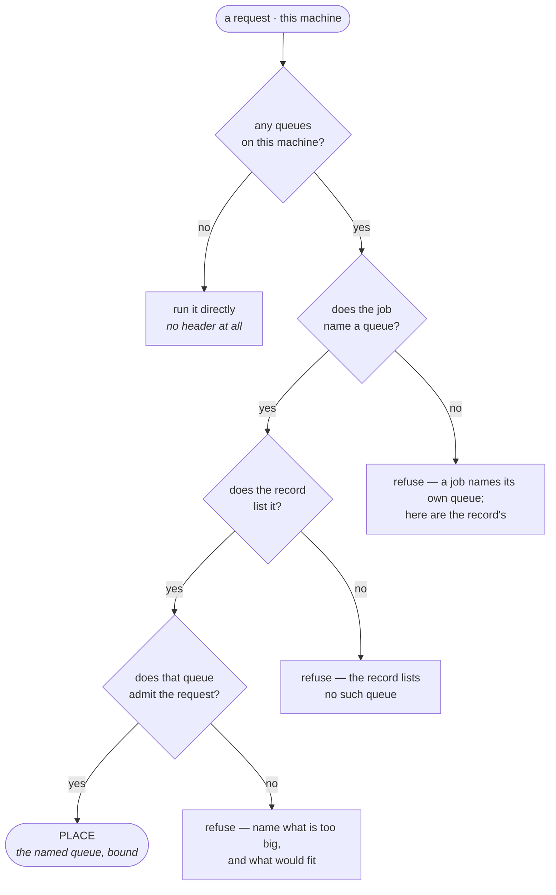

# The scheduler subsystem — what a machine offers, and what a job may ask of it

**Role:** contract
**Domain:** execution

**Companions:**
[`execution/job-system.md`](?doc=execution/job-system.md) § 6 — submission and
routing as the job system sees them (**this document is the mechanism its
design decision #4 always needed**);
[`execution/running-a-job.md`](?doc=execution/running-a-job.md) § 3.1, § 5.3 —
what each `#SBATCH` line *means*, which stays there;
[`configuration.md`](?doc=configuration.md) § 5 — **M-1**, the fact/preference
split this subsystem must not blur;
[`execution/preparing-for-another-machine.md`](?doc=execution/preparing-for-another-machine.md)
— which machine a `prep` is *for*, and how a record gets here.

## The short version

**A machine is measured into a record (`probe` → `environment.json`);
a job states a request, its queue included; admission compares them;
placement binds the queue the job names — all of it at prep; the placement
renders the `#SBATCH` header, and launch sends that header.**  Nothing here chooses a queue
for a job that names none: it is refused at prep
([`architecture.md`](?doc=execution/architecture.md) § 5.2, 2026-10-02). Package: `molbuilder.scheduler`
(`record` · `probe` · `admit` · `place` · `emit`, § 6). All built; live
since 2026-08-23.

The rules, one line each — full statement in § 3:

| rule | keyword | one line |
|---|---|---|
| **R0** | queue ≠ machine | a partition is a QUEUE holding many machine kinds; `node_types` lists them, any single figure over them is an opinion |
| **R1** | one placement | ONE decision, made at prep, rendered once — the header; the `sbatch` line carries no resource but a wall the launch restates |
| **R2** | total admission | every limit the record declares is compared — a declared field nobody checks is the defect |
| **R2a** | GPUs: there, and enough | a GPU job goes only to a queue whose record lists GPUs, where one node holds at least the number asked; molbuilder names no card — the ask is `gpu:N`, and which card a node carries is that machine's business |
| **R3** | silence permits | an unstated limit never bars; the core/device ceiling is the WIDEST machine that offers what was asked — for a GPU job, the widest that has GPUs |
| **R4** | numbers, not "no" | a refusal names the numbers ("38 min > debug's 00:15:00") |
| **R5** | header stands alone | a header naming a queue states a wall that queue accepts |
| **R6** | refuse early | when the record already says no, refuse before the scheduler does |
| **R7** | ask what you know | unasked constraints are `None`, and `None` never refuses |
| **R8** | fact vs statement | what a queue ALLOWS is the record's; which queue a job USES is the job's own statement |
| **R9** | admitted once | what prep admitted is what launch sends: prep's header, checked only against prep's own files; a calculation meant for a changed record goes back to the state before its first prep |
| **R10** | name the way out | a refusal says what WOULD fit, not only what doesn't |
| **R11** | compare KINDS | comparability = the node's kind (cores, device model, mem ≈10 GB) — never its hostname, never the allocation |
| **R12** | sent ≠ landed | `run.json` records where it was SENT; the monitor's first `[MACHINE]` line records what it LANDED on |
| **R13** | two ceilings | hardware (widest machine) and policy (`MaxTRESPerJob`, `MaxCPUsPerNode`) are both read; the smaller governs |
| **R14** | some limits count JOBS | a QoS also caps how many jobs one user may have submitted (`MaxSubmitJobsPerUser`); it is read, and a benchmark that exceeds it is told **at prep** |
| **R15** | a scheduler is a kind | every command, directive, file name and job variable a scheduler has is its kind's, in one file (`scheduler/kinds.toml`); the machine's record names the kind and where its commands are there (§ 6a) |

**How you use it:** the decision graph is § 5, the shape § 6, the scheduler
kinds § 6a,
and § 7 shows the caller's view (`Request` → `place` → `Directives`) in
ten lines. §§ 1–2 are the evidence record — the two Sol failures this
subsystem exists to prevent — read them for *why*, never for *how*.

---

Scheduling work was spread across five modules — `environment.py`,
`scheduler_probe.py`, `jobset/submit.py`, `runwrap.py`, `runtime_config.py` —
carrying roughly 450 mentions of partitions, queues, ceilings and directives
between them. This document says what that subsystem *is*, so the pieces have
one home and one set of rules instead of one treatment per place someone
noticed a problem.

> **`Domain.gpu` has one shape, the probe's** — gres type → per-node count —
> read through one door (§ 4, *Device*). *(Hand-declared rows describing one
> device with named keys were read too until 2026-10-02.)*

---

## 0. What this document owns

**Owns:** whether a request fits a queue; which queue a request is placed in;
and the directives that placement produces. The vocabulary below (*machine*,
*domain*, *request*, *placement*) is defined here.

**Owns only what the SCHEDULER would refuse.** Admission exists to catch, from
the record, the asks `sbatch` will bounce — a wall past the queue's limit, more
cores than any machine there has, GPUs on a queue that has none, more devices
than a node offers, a policy cap. It does **not** model whether the
*calculation* will fit once it lands: a job whose system is too large for the
GPU it landed on is a runtime failure the person deals with, and pulling it in
here would make submission answer a question it cannot answer and cannot own.
*(User, 2026-08-30: "what i care most is if the sbatch schedule goes through —
those are road blockers.")* A device's memory is accordingly no column at
all: the probe cannot read it (`sinfo` reports none), and nothing would admit
against it. *(`Device.mem_gb`, declarable by hand, stood until 2026-10-02 —
W54 R22.)*

**Does not own:** the meaning of an individual `#SBATCH` line
(`running-a-job.md` § 5.3), the on-disk shape of `environment.json`
(`configuration.md` § 5), which machine a bundle is prepared for
(`preparing-for-another-machine.md`), or the schedule of the work
(`plans/plan.md`, rule R3).

---

## 1. Why a subsystem, and not five modules that cooperate

Two failures on ASU Sol, three days apart, were the same defect seen twice.

**2026-08-23, a grouped benchmark was refused by the scheduler.**
`QOSMaxWallDurationPerJobLimit`. Sol records domains cheapest-ceiling-first,
so the first GPU-capable row is `htc/debug` at 15 minutes. The GPU branch of
routing took that first row without regard to duration, asked afterwards
whether it fit, got "no", and returned "no preference" — which meant *the
rendered header's directives stand*, and the header named that same row. A
38-minute job went into a 15-minute ceiling while `htc/public` (4 h) and
`general` (14 d) sat further down the same menu. The CPU branch, four lines
below, had always walked the menu for a row that fits.

**The same day, by hand.** `sbatch <trial>.sbatch` died the same way, for the
opposite reason: the header named a queue and stated **no** wall at all, so
SLURM applied the partition default — longer than the QOS it had just named
permits. `jobset launch` never saw it, because it passes `-t` on the command
line where flags win. The trap was armed only for a human.

Neither is a coding slip. They are what happens when **five things that are
one thing** have no home:

| responsibility | where it lived |
|---|---|
| describe a machine (probe → record) | `scheduler_probe.py` + `environment.py` |
| read records (scopes, named targets) | `environment.py` |
| **decide whether a request fits a queue** | nowhere — see § 2 |
| **choose a queue for a request** | inside `jobset/submit.py`, the *bench submission* module |
| **emit directives** | **two emitters**: `runwrap.py` (the header) and `jobset/submit.py` (the flags) |

Placement living inside bench-submission is why the CPU and GPU branches were
written separately and disagreed. Two emitters is why one half of a placement
could name `debug` while the other asked for 38 minutes.

And the rule was already written. `job-system.md` § 6 says the framework
*"refuses to emit a header it knows will be rejected (design decision #4)"*.
The rule existed; nothing was in a position to enforce it.

---

## 2. The check that was missing

`Domain` has carried four constraints since it was written. What compared a
**request** against them, before 2026-08-23:

| constraint | who checked it | when |
|---|---|---|
| `gpu` | the GPU row selector | prep and launch |
| `max_cores` | one call site, prep's per-family cap | prep only |
| `max_time` | nothing | never |
| `max_mem_gb` | **nothing. Declared, serialised, round-tripped, read by no code at all.** | never |

Four facts, four treatments, three moments, one never implemented. That is not
four bugs. It is one missing function.

> **A field the record carries and no code reads is the signature of this
> defect.** `max_mem_gb` was not forgotten by accident — there was no place
> where *"does this fit?"* was a question anybody had to answer, so nothing
> ever pulled it into use. When the subsystem exists, adding a column to the
> record and not comparing it becomes visible: § 3's R2 makes admission total.

---

## 3. The rules

**R0 — A partition is a QUEUE, not a machine type.** Added 2026-08-27, and
it is the premise the rest of the core rules rest on. ASU Sol's `htc` is 51
nodes of 48 cores with A100s, 3 of 64 with MIG slices, and 134 of 128 with no
device at all; `general` and `public` hold the same mixture, and what
separates the three is the **wall clock** — 4 h, 7 d, 14 d. Four others
(`highmem`, `gaudi`, `arm`, `fpga`) genuinely *are* hardware classes.

So **the machines are the measurement, and any single figure over them is an
opinion.** A domain carries `node_types` — every distinct machine, with its
count, memory and devices — and the person reads it. `max_cores` remains as
the **widest** of them, which is the only core figure a refusal can honestly
use — see R3's corollary.

> **Two consequences worth stating.** Hardware cannot be chosen by choosing a
> partition; that is `--gres` or `--constraint`. And a device is a property of
> a *machine*, not of a queue: `htc` offers A100s and it offers 128-core
> nodes, but never both at once — which no single figure could have said.

**What a person is shown: the maximum core range, and the node count.** Each
machine has a maximum — its own core count — so a queue holding several has a
**range** across them; `htc` is `48-128`, and a queue of one machine shows one
number rather than `128-128`.

> **The low end is not a floor on the ask.** A `-c 4` job gets four cores on a
> 48-core node; you can always ask for less than a machine has. Naming it a
> *minimum* would say the opposite, which is why it is not called that.

**The machines are grouped by SIZE, not by the row `sinfo` printed.** The
freshly probed `htc` has **fourteen** gres groups — nine of them 48-core rows
differing only in which card they carry — and one line each ran the menu to 68
lines, which is the opposite of showing what exists. Size is what a person
picking a machine chooses between; the cards available *at* each size ride
along, because that is the pairing no single figure could state:

```
  1  htc   htc/public   4h   48-128   501 GB   a100 x4, h100 x8, l40 x4, …
       -  128 cores  x137 node(s)  503.2-1511.2 GB  a30, gpu, h200, h200.35gb
       -   96 cores  x2 node(s)    1007.4 GB        h100
       -   64 cores  x4 node(s)    503.5 GB         a100.40gb
       -   48 cores  x69 node(s)   501-503.5 GB     a100, a100.20gb, a30, h100, l40
          64 cores fits 143 of 212 nodes here (67%)
```

> **Read the last two columns together.** On `htc` you can have 128 cores or
> you can have an A100 — never both. That is a fact about *machines*, and no
> queue-level figure can carry it.

**The range alone misleads, so the fitting node count rides with it.** Reading
`48-128` you would take 128 for the rare extreme. On `htc` it is **134 of 188
nodes** — the common machine, with the 48-core GPU nodes in the minority — so a
large CPU ask there costs almost nothing in scheduling, the opposite of what
the range implies. The same 64-core ask lands on 94% of `general` and 72% of
`htc`, and neither figure is a field: both fall out of the machines.

> Node counts are still only a proxy for **wait**. What a queue costs *today*
> is `--mode ask` (`running-a-job.md`), which asks the scheduler.

**R1 — A placement is decided once, at prep, and rendered once.** The
`#SBATCH` header carries it (`scheduler.emit`); the `sbatch` line sends that
header and carries no resource of its own but a wall the launch restates
(`commands.LAUNCH_FLAGS`, `submit._sbatch_request`). There is one rendering,
so there is nothing to disagree about.

**R2 — Admission is total over the named limits.** Every limit `Domain`
*declares* — `max_time`, `max_cores`, `max_mem_gb`, `gpu`, `node_types` — is
compared against the request. `node_types` is read by `_widest_node`, which is
what keeps it a limit rather than a display: it arrived with its comparison
(2026-08-27), which is what this rule asks of a new field. A new declared limit arrives with its comparison or it
does not arrive; that is what stops another `max_mem_gb`.

`extra` is the deliberate exception and the only one: it holds columns a probe
saw and this reader does not interpret, and `Domain`'s own rule governs it —
*"a reader owns only the keys it checks."* Keeping an uninterpreted column is
honest; **silently failing to compare a declared one is the defect.** The
difference is whether the field has a name in the type.

**And what was kept uninterpreted is SAID** *(user, 2026-09-06)*. Keeping the
column is right and refusing it is not available — a retired key an operator
still writes, or a column of their own, must survive (R10; pinned by
`test_declared_rows_keep_the_operators_own_columns`). But that leaves a
**misspelling indistinguishable from a deliberate extra**: `max_tme` lands in
`extra` exactly as `node_type` does, `max_time` then reads as unstated, and
a job asking more wall than the queue allows is admitted — R3, silence never
bars — and the scheduler, not molbuilder, is the one that finds out. This section predicts
it below: *"a value that changes where a job lands is a field, or it is a bug
waiting for someone to misspell it."*

So `known_machines()` names them — `?? not understood: <columns>` in the
machine's summary line:

```
sol   slurm · 48 cores · 1 domain(s) · ?? not understood: gpu_parition
```

Nothing is refused and nothing is dropped; a typo simply stops being
invisible. Built there rather than in either surface because that list has
**two readers**, `jobset machines` and `GET /api/task-setup/machines`, and
they must not be able to disagree about a machine.

> **Memory needed one unit before R2 could hold for it,** and got one in
> phase 3. The record states gigabytes as a number; a job states memory as
> SLURM text (`"390G"`), and nothing converted between them — which is the
> whole reason `max_mem_gb` was read by no code at all. A limit that cannot be
> expressed in the same unit as the ask is a limit that will never be checked.
> `parse_mem_gb` is that conversion, and `--mem=0` maps to *no stated limit*
> rather than zero, because in SLURM it means **all** the node's memory.

**R3 — An unstated limit never bars.** A domain that does not state a ceiling
is not claiming a small one; a ceiling that cannot be parsed is not a
refusal. Silence is permission — the opposite reading would make a
partially-probed cluster unusable.

> **The corollary that was violated for months.** *Refuse only what the record
> positively rules out* — so a core ceiling must be the **widest** machine,
> because SLURM will not place a job on a node too small; it waits for one
> that fits. `max_cores` was a MINIMUM across GPU groups for a gpu-capable
> partition and a MAXIMUM across all groups for a cpu-only one, and admission
> compared both as one number. The floor reading refused a declared 64-rank
> CPU trial on a partition whose CPU nodes have 128 cores. Fixed 2026-08-27 by
> R0: keep the machines, and derive the ceiling from them.
>
> **And the corollary has a second half, found the same day by taking its own
> argument one step further.** *"SLURM will not place a job on a node too
> small"* is exactly as true of **devices**: a job asking for an A100 can only
> land on a node that has one. So the honest ceiling is the widest machine
> **among those offering what was asked for**, not the widest overall.
>
> On Sol's `public` those differ sharply — 128 cores across its 107 standard
> nodes, **48** across the 52 carrying A100s. A 64-rank GPU trial is admitted
> against the 128 and is then unplaceable, which R0 predicted in words —
> *"`htc` offers A100s and it offers 128-core nodes, but never both at once"* —
> while admission went on asking the queue for one figure. **A benchmark's GPU
> side is where this bites first**, because a sweep's rank axis is normally
> sized against the CPU side. Built the same day: `admits`
> narrows the ceiling to device-bearing machines when the request names a
> device, and stands aside — never bars — when the machine list does not say
> which nodes hold them.
>
> **Silence still wins over the narrowing, and that is not a detail.** A queue
> that never said *which* of its machines hold devices has said nothing, so the
> wider ceiling stands — the widest listed machine, else `max_cores`. Reading
> the empty list as *no machine carries a device* would make asking for a GPU
> **loosen** the ceiling instead of tightening it, and every record written
> before `node_types` existed (2026-08-27) carries only `max_cores`.
>
> *(A third half narrowed the ceiling to the machines carrying one named
> CARD, 2026-08-30 to 2026-10-01. It is gone with R2a's card comparison:
> molbuilder names no card.)*

**R2a — GPUs: the queue has them, and enough of them.** *(User, 2026-10-01:
"the only thing you check is the gpu dependent task is scheduled to the
group/domain that actually claimed to have it, and has the capacity as
requested (gpu_number). that's it"; "we never claimed any card type".)* A GPU
job goes only to a queue whose record lists GPUs — the `gpu` column the probe
writes from what the scheduler reports — and is admitted
there only when one node offers at least the number asked: the most any node
of that queue holds, whatever its card. That is the whole of the GPU check,
and it is made in `admits`, which every admission asks. A queue that lists
GPUs without saying how many is never refused on the number (R3).

**molbuilder names no card.** A GPU ask is `--gres=gpu:N`; which card a node
carries is the machine's business, and its scheduler places the job on one that
has GPUs. The card the probe records stays a fact on the record — `jobset
machines` shows it — and nothing compares it.


**R4 — A refusal names the numbers.** *"needs 38 min but debug allows
00:15:00"*, not *"does not fit"*. We hold the record; sending a user to read
`scontrol` for numbers already on disk is the failure this subsystem exists to
end.

**R5 — A header must be submittable on its own.** If it names a queue it
states a wall that queue accepts — the wall stated for the run; an unstated
one is refused at prep, never filled in ([`submission.md`](?doc=execution/submission.md)
S2). *(Until 2026-10-02 the queue's own ceiling was the value when nothing
else supplied one.)*

**R6 — Refuse before submitting, when the record already says so.** The
existing `job-system.md` § 6 rule, now with somewhere to live: at prep, before
anything is written. A machine whose record lists **no** domains has no
scheduler to send to: prep writes no header, and the job runs directly.

**R7 — Callers ask what they know.** `prep` knows what a job states — its
cores and devices, and where it writes a header the wall and memory it is
refused without ([`submission.md`](?doc=execution/submission.md) S1, S2) — and
admits a run on the queue it names with all of them
([`job-system.md`](?doc=execution/job-system.md) § 5.0, checkpoint 4); the
benchmark grid asks each cell's shape of the one queue the benchmark names;
a caller asking about *capability* asks about nothing else. An unasked
constraint is `None`, and `None` is never a refusal. This is what lets one
admission function serve every caller without each growing its own variant.

**R8 — Measurements from the record, the queue from the job.** M-1
(`configuration.md` § 5) is not relaxed here. What a queue *allows* is a
measurement and is read from `environment.json`. Which queue a job *uses* is
the job's own statement — `allocation.domain`, the run card's `domain`,
`--domain` — and never a default from any file. This subsystem reads both
and mixes neither.

**R9 — Admitted once, at prep** *(the user, 2026-10-17: "whether it's direct
launch or submission, all the decision is already done at the prep … It is
none of molbuilder's business at the launch time to decide what is allowed to
launch")*. What prep admitted on the target's record is what launch sends:
launch sends the header prep wrote, walks no graph and admits nothing. What it
checks is prep's own files — at a first launch, prep's own planning asked
again on the calculation's own files (its description, its template and its
copy of the target's record), refusing a prep that is no longer what they
give; every launch, that a deck agrees with its launch's counts
(`job-system.md` § 6.0, R-L15, R-L16, R-L29). That copy is the one its first prep
took, and no probe replaces it (`configuration.md` M-3): a calculation meant
for a machine whose record has changed since goes back to the state saved
before its first prep. The one value a launch may restate is a submitted
job's wall (`--time`), passed to `sbatch` as typed; the scheduler answers it.

**R10 — A refusal names what *would* fit.** Not *"64 cores is too many"* but
*"this queue holds 48; the largest rank count that fits is 48"*. The graph in
§ 5 knows which limit bound, so it knows what to suggest, and a refusal that
stops at "no" leaves the user guessing at the number we are already holding.
R4 says name the numbers; this says name the way out.

**R13 — What the hardware can do and what policy lets you ask for are two
ceilings. Both are read; the smaller governs.** Added 2026-08-27. `max_cores`
is derived from `node_types` — the **widest machine** (R3's corollary) — and
that is a fact about silicon. A scheduler also *declares* per-job caps that no
amount of hardware overrides: a QOS `MaxTRESPerJob=cpu=N`, a partition's
`MaxCPUsPerNode`. **A hardware ceiling cannot stand in for a policy one**, and
R3 then reads the missing policy limit as permission.

> **The record measured the first and never asked for the second**, which is
> how `lightwork` came to carry `max_cores: 128` beside a long-standing note
> that it *"caps at 8 cores"*, with nothing able to say whether both were true.
> Both numbers sat in output the probe already ran: the QOS cap in
> `sacctmgr show qos` (fetched with `format=Name,MaxWall,Flags` — `MaxTRES` was
> never asked for) and `MaxCPUsPerNode` in `scontrol show partition` (parsed
> for `DefMemPerCPU` alone). **A field you did not request is not an absence
> the record may report as silence** — R3's *unstated limit never bars* is
> about what the scheduler does not say, never about what we did not ask.
>
> **Built 2026-08-27, answered 2026-08-28**: the probe asks for both
> (`MaxTRES` in the format list; `MaxCPUsPerNode` from the block already
> fetched), they ride the row as `max_cpus_per_job` / `max_cpus_per_node`
> — written as `null` when asked-and-uncapped, absent only when never
> asked — and `admits` compares the ask against every ceiling it holds;
> the smaller governs. **Sol's answer: no policy cap anywhere** —
> `lightwork` included; its only policy split from `public` is the
> 1-day wall.

**R14 — Some limits are about the SET, not the job. They are read too, and a
sweep that exceeds one is told before it is sent.** Added 2026-08-30.

R13's two ceilings cap **one job**, and both are answerable from the job alone.
A QoS also states `MaxSubmitJobsPerUser` — how many jobs one user may have
submitted at once — and that is a different kind of question: whether an ask
fits depends on **what is already queued**. A benchmark sweep submits many jobs
at once *by construction*, so it is the one limit a sweep reliably meets.

> **R13's rule landed a third time, one column over.** *A field you did not
> request is not an absence the record may report as silence.* The probe fetched
> `sacctmgr show qos` with `format=Name,MaxWall,MaxTRES,Flags`;
> `MaxSubmitJobsPerUser` was in that very table and was never asked for. So
> `Domain` had no job-count field at all, and nothing anywhere in the codebase
> could have named the limit.
>
> **What that cost, 2026-08-30.** A six-shelf bench sweep went to Sol's `debug`,
> which allows **two** submitted jobs per user. Two were accepted; four came
> back `QOSMaxSubmitJobPerUserLimit`. The preview had listed all six and asked
> *submit this?*, and every check it could run had passed — because the limit
> that decided the outcome was not among the facts the record holds.
>
> **And the preview named no domain**, only `-p htc -q debug`. On Sol `debug`
> *is* (htc, debug) while `htc` is (htc, public) — two domains, one partition —
> so the flags read as *htc* to anyone scanning them, and the run was believed
> to have gone to the wrong queue entirely. It had not; the 15-minute walltime
> in every line was `debug`'s own. **A rendering that cannot be read back to the
> decision is not a display of the decision.**
>
> **A note, not a refusal.** A refused shelf already costs nothing: its trials
> keep no launch record, so the launched door (`runrecord.launch_record`) leaves them pending and re-running
> the launch picks up exactly them. What was missing was not enforcement, it was
> being told — so prep states the arithmetic (*debug takes 2; this benchmark
> is 6 shelf jobs; 4 come back*) where the grid can still change, and the
> choice stays the person's.
>
> **Tri-state, like R13's fields.** A number caps; `null` means *asked, and this
> QoS states none*; the key absent means *never asked* — a record older than
> this change. R3 forbids reading an unstated limit as a bar, and it equally
> forbids reading a never-asked one as permission.

**R11 — Comparability is a property of the MACHINE, never of the domain.**
Added 2026-08-27, and it is R0 applied to measurement. A domain is a queue
holding many machines, so *"were these two runs on comparable hardware?"* has
no answer at the domain level: on Sol, `public` alone spans 48–128 cores and
three device types, and `htc` spans fourteen node groups. **A domain-level node
type is an opinion about a mixture** — which is why the scalar `node_type` is
retired here rather than repaired. What a measurement may be compared with, or
carried to, is decided by the **kind of node** it actually ran on.

> **The kind, not the box, and not the allocation.** Both confusions are easy
> to make and each one silently ruins the rule:
>
> | | comparability | provenance |
> |---|---|---|
> | **the node's KIND** — its physical core count, memory, device model | **this decides it** | |
> | **the node's NAME** — `sol-g042` | never | which box, for tracing a bad one |
>
> * **Not the name.** SLURM spreads an array over whatever is free, so two
>   trials of one sweep almost always run on different boxes. Comparing names
>   would report *"different machines"* for every sweep ever run, which is a
>   warning that means nothing.
> * **Not the allocation.** The node's size is `os.cpu_count()`; what this job
>   was given is the affinity mask, and `monitor._alloc_cores` deliberately
>   answers the second (§ 2.12 — a run reports how well it used *what it was
>   given*). Reading the allocation as the machine would make a **rank-scaling
>   sweep** — 48 against 64 against 128 — report a different machine per trial,
>   breaking precisely the sweep this rule exists to serve.
>
> **Two nodes of the same kind are the same machine here.** That is what makes
> the comparison useful: it fires when a GPU node is compared against a
> standard one, and stays quiet when six trials land on six identical boxes.
>
> **And "the same kind" tolerates the jitter identical boxes really have.**
> Kind is *(cores, device models, memory to the nearest 10 GB)*. The rounding
> is not a nicety: Sol's identical 128-core standard nodes report MemTotal as
> 503.2, 503.4 and 503.5 GB — BIOS and firmware reserve slightly different
> slices — so exact matching would call three of the same box three different
> machines, and every sweep would carry a hardware warning that means nothing.
> The tiers that actually differ (≈500 vs ≈1000 vs ≈1500 vs ≈2000 GB on Sol)
> are hundreds of GB apart and survive any reasonable rounding.

> **This retired a check that had never fired.** `submission.md` S3 used to refuse
> carry a benchmark across a node-type boundary, and it read the domain's
> declared `node_type`. The probe never wrote that field: all nine Sol domains
> record `node_type: null` and 1–14 `node_types`. So the refusal returned early,
> in silence, on the only cluster we use. `submission.md` § 4 names the pattern
> *"a field the record carries and no code reads"*; this was its mirror — code
> reading a field nothing writes — and a scalar over a mixture is why nothing
> could honestly write it.

**R12 — Where it was SENT and what it LANDED ON are two facts, recorded by two
writers.** They are known at different moments, which is what forces the split
rather than any preference:

| fact | known when | written by | into |
|---|---|---|---|
| **sent to** — domain, partition, qos | `sbatch` is accepted | `submit` | the attempt's `run.json` |
| **landed on** — node name, cores, memory, device model | the job starts running | the **monitor**, on the compute node | the monitor log's **`[MACHINE]` line**, first thing |

A queued job has no node yet, so `run.json` cannot carry one; the monitor is
already running where the answer is.

> **Why its own line, and why at the start** *(decided 2026-08-27, building
> P1)*. The alternative was riding on `[UTIL-BASIS]`, which already says what
> every percentage is a fraction of. Three reasons against:
>
> * `[UTIL-BASIS]` is written when the job **ends**. A monitor killed with its
>   allocation — wall clock reached, node reclaimed — never gets there. The
>   machine is known the moment the monitor starts, so it is written then, and
>   a run that dies still says where it died.
> * One line, one meaning. `[UTIL-BASIS]` answers *what was this job given*;
>   `[MACHINE]` answers *what kind of node was under it*. Those differ by
>   design (a `-c 48` job on a 128-core node), and a reader who finds them on
>   one line will eventually read one as the other.
> * A fixed first line is the cheapest thing a reader can find.
>
> **And the device COUNT is deliberately absent.** Inside a scheduled job,
> `nvidia-smi` shows only the devices the job was granted — the count is the
> *allocation's*, not the node's. The **model** survives that filter, and the
> model is what comparability needs (an A100 is not an H100). A trial granted
> no device on a GPU node honestly reports none visible: it ran as a CPU
> trial, whatever the node had idle.

---

## 4. The vocabulary

- **Machine** — one host or cluster, as measured: its scheduler (the kind,
  and where its commands are there, § 6a), topology, site, and its domains.
  Persisted as `environment.json` (`configuration.md` § 5).
- **Domain** — one reachable `(partition, qos)` pair and what it allows:
  `max_time`, `max_cores`, `max_mem_gb`, `gpu`. *A fact, never a preference —
  it says "you may submit here, for this long", never "submit here".*
  `node_types` describes the machines it draws from — every distinct one, with
  its count, cores, memory and devices (R0). It constrains no *admission*;
  `max_cores` is the widest of them and does that job (R3's corollary). What it
  is for is R11: it is the only place a machine can be named. `extra` holds
  columns this reader does not interpret (R2).

  > **The scalar `node_type` was retired 2026-08-27** and is not read anywhere.
  > It said a queue had one machine type, which R0 measured to be false; a
  > cluster that genuinely is uniform declares one entry in `node_types` and
  > needs no second spelling of it.
- **Device** — one kind of accelerator the nodes of a domain offer: a type and
  a per-node count. The **interpreted** form of the `gpu` column, which the
  probe writes as gres type to count (`{"a100": 4}`), and the only form any
  caller sees: the record reads the column once, behind `Domain.devices`, and
  hands out devices. *A count the record does not state is `None`, never zero:
  R3 applies to devices too.* *(A second spelling, one device described by
  hand — `{"type": "a100", "per_node": 4, "mem_gb": 80}` — was read too until
  2026-10-02. Nothing molbuilder writes produces it, and a record is a
  measurement, not a hand-written file (`configuration.md` § 5); W54 R22.)*
- *(`gpu_partition` — where a GPU job went when that differed from the
  queue's partition — was a declared field from phase 3 until 2026-10-02,
  when it was removed: the probe never wrote it, a GPU job goes to the queue
  it names, and which queues have GPUs is the `gpu` column's (user: "gpu
  detection is done independently from this"). Its lesson stands: a value
  that changes where a job lands is a field, or it is a bug waiting for
  someone to misspell it.)*
- **Request** — what one job asks for: ranks, cpus-per-task, GPUs, memory,
  wall, exclusivity. Fields the caller does not know are `None` (R7).
- **Placement** — a request bound to a domain, with the reasoning that chose
  it. The single decision R1 refers to.
- **Directives** — a placement rendered for the scheduler: the header's
  `#SBATCH` lines, the one rendering (R1).

A **workstation** is a machine with no domains. It is not an error state: it
yields no header at all, and the job runs directly.

---

## 5. The decision graph

Placement is one walk, not a pile of conditions. Every branch below is a rule
from § 3; drawing it is what stops the CPU side and the GPU side being written
separately and disagreeing, which is § 1's first failure.



**A named queue is checked like any other.** The `--domain` branch reaches the
same admission test — your choice is honoured as a *choice*, not as permission
to skip the check: `place(..., named=)` asks `admits` of the named domain and
refuses it by name like any other (`scheduler/place.py`).

**Refusals are the graph's real output.** Three of the five leaves refuse, and
each refuses differently, because the reason is the useful part (R4, R10).

### 5.1 The walk is prep's

The graph is walked once, when the work is built: each run on the queue it
names (`placement.admitted`), each benchmark trial on its benchmark's one queue
(`prep_inputs.bench_inputs`), and each job that walks several members — a
group, a run of points, a benchmark's shelf — with its one request
(`prep.walk_header_of`). Launch sends the header the walk produced (R9).

---

## 6. The shape

```
scheduler/
  record.py   Machine · Domain · Topology · Site; read/write; scopes; named targets
  probe.py    detection (sinfo / scontrol / lscpu) -> a record
  admit.py    admits(domain, request) -> [reasons]        # R2, R3, R4, R7
  place.py    place(routing, request, *, named) -> Placement  # R6
  emit.py     Directives(...).header_lines()                    # R1, R5
  kinds.toml  each scheduler kind: its operations, its header's language,
              its files, what it tells a running job            # § 6a
  kinds.py    kind(name) -> Kind, the one reader of kinds.toml  # § 6a
```

Honestly graded, these are not equally forced:

- **`admit.py`, `place.py`, `emit.py` are forced by measured defects** — the
  four-treatments table in § 2, the two divergent branches, the two emitters.
  Each has a failure on Sol behind it.
- **`record.py` and `probe.py` are relocations.** They work today. They move
  because the three above need a home to be *in*, and leaving the data model
  in a general-purpose `environment.py` is what let the check drift away from
  the record it checks.

`emit.py` renders a kind's header language (§ 6a) and spells no scheduler of
its own; a workstation's kind writes no header. Naming the package for SLURM
would bake one kind into the boundary and be wrong the first time anything
else appears.

---

## 6a. The scheduler kinds — one file, one protocol *(the user, 2026-10-17: "we just need a configure file to say what are the parameters, what are the format we need to put in there … unified layer, unified API, unified protocol")*

*(Designed with the user 2026-10-17; built with plan row SK — until then
the SLURM row's facts are spelled in the modules this table names.)*

**Everything molbuilder says to a scheduler is a kind's, and a kind is
data**: `molbuilder/scheduler/kinds.toml`, one block per kind, read by one
reader (`scheduler/kinds.py`, `kind(name)`). No other module spells a
scheduler — no command, no directive, no file name, no environment variable.

| a kind states | SLURM's | asked by |
|---|---|---|
| **how a job is sent** — its name, a wall the launch restates, molbuilder's launch claim, the header, the run's arguments | `{submit} -J {job} [-t {wall}] --export ALL,MB_LAUNCHED_BY=jobset-launch {header} {args}` | `submit._sbatch_request`, the one line |
| **how it is asked about without being sent** | the same line, `--test-only` after the command | `submit._ask` (`--mode ask`) |
| **the id it answers a send with** | `Submitted batch job (\d+)` | `submit._go` |
| **how a sent job is asked after, and stopped** | `{query} --noheader --jobs={id}` · `{cancel} {id}` | `scheduler.queue` (`molbuilder jobs status`, `jobs stop`) |
| **which cluster answered** | `{cluster} show config`, its `ClusterName` | `scheduler.queue` (a job's address) |
| **the header's language** — its prefix, and one directive per value | `#SBATCH` · name `-J {name}` · nodes `-N 1` · ranks `-n {ranks}` · cores per rank `-c {cores}` · wall `-t {wall}` · queue `-p {partition}` `-q {qos}` · GPUs `--gres=gpu:{gpus}`, bound `--gres-flags=enforce-binding` · memory `--mem={mem}` · the whole node `--exclusive` `--mem=0` · its output `-o {where}slurm.%j.out` `-e {where}slurm.%j.err` | `scheduler.emit` (prep's header); `Directives.lines_of` (what prep and launch print of it) |
| **the value a launch may restate** | the wall, `-t {wall}` | `commands.LAUNCH_FLAGS` |
| **its own output files** | `slurm.{jobid}.out`, `slurm.{jobid}.err` | `runfiles.WRITTEN` |
| **what it tells a running job** | `SLURM_JOB_ID`, `SLURM_NTASKS`, `SLURM_CPUS_PER_TASK`, `SLURM_CPUS_ON_NODE`, `SLURM_ARRAY_TASK_ID` | the run script, written at prep, which says each once in molbuilder's own name (`MB_JOB_ID`, …) for everything it starts — the monitor, a walk |

`workstation` is a kind too: no queue, nothing sent, no header. A reader asks
the kind what it does, never compares the word.

**The machine's record names its kind and where its commands are there**
([`configuration.md`](?doc=configuration.md) § 5, M-2):
`scheduler: {kind, submit, query, cancel, cluster}`, written by `jobset probe`
on that machine — the commands found there, or declared to it (`--scheduler`;
`--set scheduler.submit=PATH` for a site's own wrapper). **The language is
never copied into a record**: it is the kind's, one for every machine of that
kind, so two records cannot disagree about SLURM.

**Every step asks its kind through the record**: prep writing the header;
launch writing the line; ask mode — whether there is a scheduler to ask is the
record's kind, never this computer's `PATH`; the jobs list; the run script and
what it starts.

**What stays code is discovery, a reader per kind**: the probe reading a
scheduler's queues and limits out of its own tools (`sinfo`, `scontrol`,
`sacctmgr`), and ask mode reading its start-time answer. Each parses a tool's
output, which no format states, and each is keyed by the kind's name.

**Adding a scheduler is a block in the file and its discovery reader**;
nothing else changes.

---

## 7. What a caller sees

```python
req = Request(ranks=64, cpus_per_task=1, gpus=2,
              mem_gb=390, walltime_s=38 * 60)

placement = place(routing, req, named="htc")
#   -> htc/public          the queue the job names, admitted on its row
#   -> Unplaceable(reasons=[...]) when it cannot take the job, or the job
#      names none on a machine that has queues (R6), each reason naming
#      its numbers (R4)

d = Directives(partition=placement.partition, qos=placement.qos,
               walltime="0-00:38:00", ntasks=64, cpus_per_task=1,
               gres="gpu:2", mem="390G")
d.header_lines()    # what the .sbatch carries, wall included (R5) -- at prep
#   the one rendering (R1): launch sends this header
```

**The job names its queue; `place` chooses none** — the
description, the run card or `prep --domain` names it, and it is still
**admitted**: naming a queue that cannot hold the job earns R4's refusal, not
silent acceptance — the user's explicit choice is honoured as a choice, not as
permission to skip the check.
