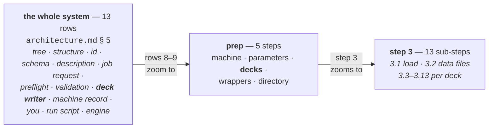
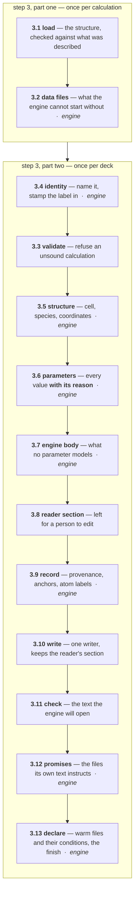
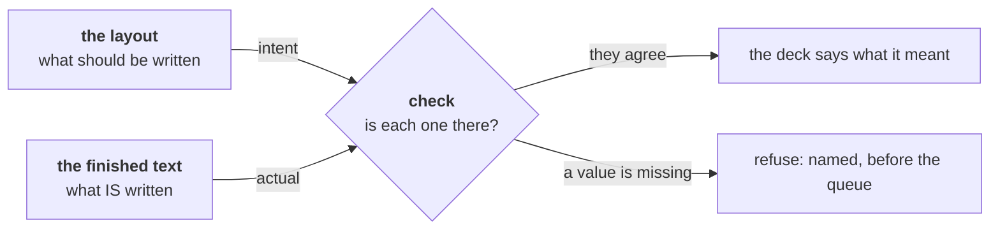
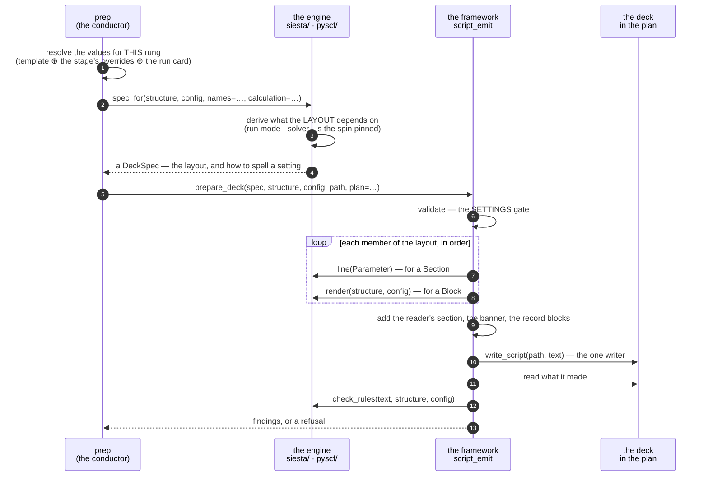
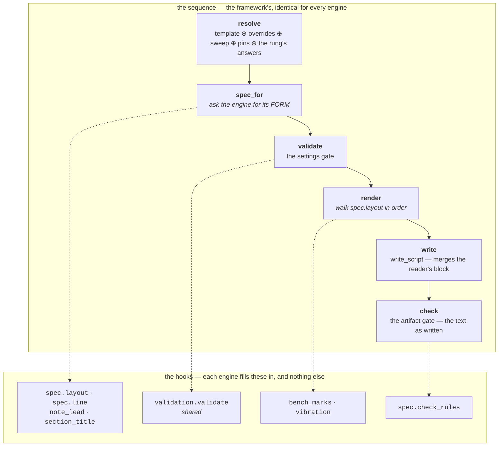

# The preparation layer — prep's steps and the engine seam

**Role:** contract
**Domain:** execution
**Owns:** prep's steps, from a described calculation to a folder you can launch
(§ 3.0 — the one home), and why their order is forced (§ 3.1); the rules inside
step 3 (§ 3.2); the engine seam — the questions an engine answers (§ 4), its two
doors (§ 4.2), the `DeckSpec` form and the two gates (§ 4.3); the one pipeline
every deck writer is on (§ 4.4); the pipeline log (§ 4.5); which floor each step
runs on (§ 5); the rules W1–W13.
**Read with:**
[`architecture.md`](?doc=execution/architecture.md) (the floors, § 2; the value ladder, § 5.2) ·
[`job-system.md`](?doc=execution/job-system.md) § 5.0 (prep as a person sees it: checks, preview, save) ·
[`generator.md`](?doc=execution/generator.md) (the `ParameterSet` and the benchmark) ·
[`engines/template.md`](?doc=engines/template.md) (the catalogue items the parameters step reads) ·
[`project-layout.md`](?doc=execution/project-layout.md) (the folder step 5 builds)

## The short version

- **Prep runs five steps** — machine, parameters, decks, wrappers, directory — and writes nothing until all pass (§ 3.0).
- **A kind adds optional steps** to that table; it never brings a second sequence (§ 3.0).
- **Step 3 has thirteen named sub-steps**: two once per calculation, eleven once per deck (§ 3).
- **Every adjacent pair is a data dependency** — no deck before the machine and the rank count (§ 3.1).
- **An engine answers questions indexed by the step that asks**, so a gap is a blank row (§ 4).
- **Two gates**: *validate* reads the settings; *check* reads the text the engine will open (§ 4.3).
- **Every value reaches a deck with its reason** (W2), and **every prep leaves a log** (§ 4.5).

**Reading map.** The order of things: § 3, § 3.0, § 3.1, § 5. For an engine
author: § 4 (the checklist), § 4.2, § 4.2a, § 4.2a1, § 4.3. Reference: § 3.2,
§ 4.2b, § 4.4, § 4.5. Where code lives (the floors) is
[`architecture.md`](?doc=execution/architecture.md) § 2 — § 2 here only links.

---

## 1. Three questions

Preparation has three structural questions:

| | question | answered by |
|---|---|---|
| **space** | where may code look? | **the floors** — [`architecture.md`](?doc=execution/architecture.md) § 2 (§ 2 here) |
| **time** | when does each thing happen? | **one sequence, three resolutions** — § 3 |
| **the seam** | what does an engine supply? | **the questions in § 4's table** |

Three things that look like layers are not. **The five axes**
([`architecture.md`](?doc=execution/architecture.md) § 0) answer *what varies*.
**The nine vocabularies** (§ 10 there) answer *what things are called*. **The
four routes** — describe, prep, launch, status — are the ways in. None says
where code lives.

**No engine is bent to another.** SIESTA cannot start without a pseudopotential
for every element; PySCF ships its basis sets inside the library and needs no
data file. SIESTA's deck is a list of keywords read in any order; PySCF's is a
program that runs top to bottom. Those differences belong to the engines. What
is shared is **which questions are asked, and in what order** — so *"what does
this engine still owe?"* is answered by reading down a list.

---

## 2. SPACE — the floors

### 2.1 The seven floors

The floors, the modules on each and what each must never do are
[`architecture.md`](?doc=execution/architecture.md) § 2 and § 2.1 — the one
diagram and the one list. The rule this layer leans on: **a floor may call down
and return up, and may never reach across**; any floor may reach straight to
floor 1.

### 2.2 Import depth (L1 / L2 / L3) is a different axis

L1/L2/L3 is **import depth** between top-level packages
([`architecture.md`](?doc=architecture.md) § 3, the root reuse map); the floors
are **roles** inside the execution domain. They overlap without matching —
`jobset` is one import tier (L2) and spans floors 1 and 3–7
([`architecture.md`](?doc=execution/architecture.md) § 1). **No test enforces
either**: review keeps both, against their two lists (rule A7,
[`process/code-audit.md`](?doc=process/code-audit.md) § 1c (e)).

**The description is a leaf.** Floor 2's description (`task`, `job_request`,
`template_file`) is import depth L1: every surface can read a description
without pulling in the engines. What a template *says* — the catalogue and the
template format — is floor 1's `template`, which imports no engine either.

### 2.3 Two placements worth stating outright

**`runwrap` is on floor 3, with the other renderers.** It turns decided values
into text, exactly as an engine's deck writer does. So floor 5 has one job —
*start a program* — and prep walks the floors without going backwards (§ 5).

**`prep` is not a floor; it is the conductor.** It walks floors 1 → 4 in order
and owns no decision of its own
([`architecture.md`](?doc=execution/architecture.md) § 2.2).

> **W1 · The conductor may call, but it may never decide.** Every decision
> belongs to a floor; the rule, its reason and who may import the conductor are
> [`architecture.md`](?doc=execution/architecture.md) § 2.2 (rule A7 there).

---

## 3. TIME — one sequence, three resolutions

The decision chain, prep's five steps and the inside of step 3 are one time
axis, zoomed three times:



Each box is the one above it, opened up:



**Each sub-step has a name, and the name is what to use.** The numbers are
labels the code prints — `# 3.10 write`, `STEP 3.3 · VALIDATE`, `STEP 3.11 ·
CHECK` — not an order: **identity (3.4) runs before validate (3.3)**, as the
diagram draws. Prose that says "3.9" instead of "the record" is prose a new
reader has to decode. The table is in the order the sub-steps run:

| | name | what it does |
|:--:|---|---|
| 3.1 | **load** | read the structure; check it still matches what was described |
| 3.2 | **data files** | put in what the engine cannot start without — pseudopotentials |
| 3.4 | **identity** | name the deck's files (`RunNames`); a benchmark trial's identity line carries its own label (`relabel`) |
| 3.3 | **validate** | refuse an unsound calculation before writing a line of it |
| 3.5 | **structure** | cell, species, coordinates, frozen atoms, region labels |
| 3.6 | **parameters** | every resolved value, each written with its reason |
| 3.7 | **engine body** | what no parameter models — a run loop, a post-processing template |
| 3.8 | **reader section** | the one block a person is meant to edit (`USER-CUSTOM`) |
| 3.9 | **record** | provenance, benchmark anchors, atom labels, behind a do-not-edit banner |
| 3.10 | **write** | one writer, which keeps whatever the reader put in their section |
| 3.11 | **check** | read what the writer made — **the exact text the engine will open**, the reader's section merged in — and refuse if it is wrong |
| 3.12 | **promises** | the files the deck's own text instructs someone to run |
| 3.13 | **declare** | the job: what it may reuse from an earlier run, the facts those warm files are conditioned on, and the bundle that finishes its run, where the engine alone leaves no result |

**Load** and **data files** run once per calculation; **identity** through
**declare** run once per deck. A ladder of two stages runs the tail twice; a
benchmark of nine trials runs it nine times — a benchmark is prep whose
parameters are a set rather than a point
([`generator.md`](?doc=execution/generator.md) § 2).

### 3.0 One table of steps, planned before anything is written

**The steps are one table, and a kind adds steps to it — it never runs a second
sequence** *(user, 2026-10-03: "we need a framework and template (or config
data/instruction) driven approach such that the current prep can be used for the
transport preparation too. the added transport steps can be designed as an
optional step for transport operation but it would be in the same framework of
prep")*. Each step reads what the steps before it decided and adds its own
answer to the plan; **nothing is written until the last step has passed**. Which
optional steps a calculation runs is declared by its kind, as data — never a
branch of the conductor.

This is the one statement of prep's steps. The protocol a person sees around
them — the agreement, the checks, the preview, the save, what a refusal writes —
is [`job-system.md`](?doc=execution/job-system.md) § 5.0.

| step | every calculation | an optional step, declared by the kind |
|---|---|---|
| **1 · machine** | the target's record read and checked (a) | — |
| **2 · parameters** | each element resolved; a run placed on its queue (b) | a benchmark — **grid** (b) |
| **3 · structure** (*load*) | the structure loaded and checked against what was described | transport — **compose**, **electronic state** (below) |
| **3 · decks** (*data files* … *declare*) | the data files copied; each deck rendered, validated — the data files judged there — merged with the reader's section and checked (c) | transport — **points** (below) |
| **4 · wrappers** | `.run.sh` and, where the target has a queue, `.sbatch` | — |
| **5 · directory** | the plan's row, `STAGE-PLAN.md`, the run to open (d) | a SIESTA vibration — a folder per phase (d) |
| ***the writing*** | the folder's state saved, then the plan written (e) | — |

- **(a)** The record is read once (`machine_for`), its activation checked, and
  which config files answered noted (`config_provenance`); at the calculation's
  first prep it is copied in as `environment.json`.
- **(b)** `resolve` turns the description into a `ParameterSet` — a run is one
  element, a benchmark's grid N, its points from the stated axes
  ([`generator.md`](?doc=execution/generator.md) § 4.3a). A
  run is placed on the queue it names, with the request it resolved to
  (`placement.placed`), recorded on its job, its fit said.
- **(c)** The very text that will be written: the reader's own section is
  merged as it stands on disk.
- **(d)** What the run receives is the stage's own files; what its first launch
  will take is said — the run it continues from and a transport rung's gather
  are copied by that launch ([`job-system.md`](?doc=execution/job-system.md)
  § 6.0). A SIESTA vibration gets one folder per phase with its deck, and the
  stage's first run opened with the calls it always holds
  ([`engines/vibration.md`](?doc=engines/vibration.md) § 5.11).
- **(e)** Every file of the plan written in the order it was planned
  (`Plan.carry_out`): each member's decks, run scripts, run folder and pipeline
  log, then its row in `job-set.json` — a member without its row has not been
  prepared; then what each stage was prepared with (`prepared-with.json`,
  which `status` compares with the records later) and `STAGE-PLAN.md`.

**The transport steps:**

- **compose** — the junction and its leads, every rung's structure, composed
  and round-tripped through the record's codec in a scratch folder outside the
  calculation, removed at once — so this prep renders from the record every
  later one reads — and the record's text kept in the plan
  (`gather.composed_for_prep`);
- **electronic state** — decided once on the junction and carried into every
  rung;
- **points** — one deck per bias point, each in its own folder with its own
  run script, its runs the stage's `run-<n>/<point>`;
- **gather** — each rung's inputs from the runs upstream — is its first
  launch's, not prep's ([`engines/transport.md`](?doc=engines/transport.md)
  § 6.1).

**What a kind declares is one record, its rung** (`jobset/prep.py`, `Rung`,
built by the builder its part in the kind table names, `rung` —
[`architecture.md`](?doc=execution/architecture.md) § 3.3). It is the structure
step's answer, which every step after it reads:

- the structure the decks describe, and the program each deck is
  (`render_kind`);
- the config each element renders from — a lead's own label, the junction's
  electronic state folded in (`configure`);
- what else the engine's `spec_for` is told — a vibration's block and its
  phase's part, the cell; the junction's state (`spec_extra`);
- the folders that hold a deck beside the stage's own — a scan's points — each
  with its own run script (`points`, `at_point`, `struct_at`, `wrapper_at`);
- where the data files come from when the engine's library is not their source
  — the citation (`provide_data`);
- what the rung writes beside a deck before the deck is checked — a vibration
  phase's `coordinates.fdf` (`beside`);
- what its job carries forward and runs — a transport rung's restart files, the
  transmission's program (`job_facts`).

A kind with no entry is a calculation of its described structure, one deck per
element. The conductor reads the record and never asks which kind it is in.

**The pipeline log is the plan's own account** (§ 4.5): every step adds its
lines as it decides, and the log is written with the rest of the plan — for
every prep, from either door.

### 3.1 Why each order is forced

Every adjacent pair is a data dependency, not a convention:

| this must precede this | because |
|---|---|
| 1 → 2 | step 2 places a run on a queue of the record and says its fit; a benchmark's cells are fit on the same |
| **step 2 → identity** | the stage token and the trial coordinate that name a file come from the resolved set |
| **load → data files** | the structure's elements say which data files are needed |
| **validate → structure** | refuse an unsound calculation before writing a line of it |
| **data files → write** | the settings gate reads the copies the data files put in the plan, and its refusal arrives before a folder is half-built |
| **structure → parameters** | forced by the language when the deck is a program that runs top to bottom, as PySCF's is; the same convention when it is a keyword list, as SIESTA's is |
| **write → promises** | the promise is made by the text that was just written |
| **write → step 4** | the run script is written beside the finished deck, the environment and the counts handed to it — a deck's comment never stands in for a launch value (A3) |
| **declare → step 4** | the `.sbatch` header carries the job's own resources |
| 4 → 5 | the tree copies what was rendered |

**load → data files is the pair that reads backwards until you see why.**
*Which* pseudopotentials to copy is answered by the structure's element list,
and there is no other honest source: a list recorded in the description would
be a second answer to *which elements is this a calculation of*, free to
disagree with the first.

**There are two gates, and they are separate on purpose** — **validate** (3.3)
reads the resolved settings before anything is written; **check** (3.11) reads
the deck's text exactly as the engine will open it. § 4.3 has the full
comparison, once.

**Validate runs per deck, not per calculation**: a ladder's rungs are different
configurations, and `tight` can be unsound while `coarse` is fine. Its rules are
[`science/validation.md`](?doc=science/validation.md)'s — decision-chain row 7,
owned outside this stack and called from inside it. Everything upstream of the
final deck — the description, the form, the resolved values — is already gated
by that framework and by the form's own checks, and **this layer does not
re-check them**.

**Check reads what the writer made, as the plan holds it.** The text handed to
**write** is not what the engine opens: `write_script` merges the reader's own
section from what is already there, so the assembled text is an intermediate and
the writer's output is the artifact. Check reads that output — the text the
file will hold, decided before anything is written (§ 3.0). A block the deck
reads from a file beside it is inlined first (`parse.fdf.read_deck`), so check
sees what the engine sees. It reuses the existing machinery — the `Issue` type,
its severity model and `report()` — so a refusal here reads like every other
refusal in the tree.

### 3.2 The three rules inside step 3

> **W2 · A value is written together with the reason it holds, and the reason is
> read from where the value came from.** One act, not a value plus a habit of
> typing a comment near it. The catalogue carries each parameter's default,
> range, and the note saying why this project chose what it chose.

> **W3 · Nothing reaches a deck until the last thing that can refuse has
> refused.** A missing pseudopotential costs one second to find at prep, where
> the settings gate refuses it before anything is written
> ([`science/pseudopotentials.md`](?doc=science/pseudopotentials.md) § 1, the
> one door; the data-files step copies what is there, *2.69.64*); on the
> cluster it costs a queue wait plus MPI startup — and in
> between sits a folder half-built, which reads to its owner as a folder that
> worked.

> **W4 · One deck is written by one writer, and the writer keeps what the reader
> put in their own section.** Rendering produces text; writing merges that text
> over what is on disk. Any route that reaches for a plain write destroys a
> person's edits.

**Why W2 matters.** A comment typed by hand beside a value is indistinguishable
from a heading or an example — and when the value moves, the comment does not.
Under W2 a note and its value come from one declaration, so they cannot drift;
§ 6 shows one in a real deck.

---

## 4. THE SEAM — the questions an engine answers

**An engine adds records and a seam, and no shared code branches on its name**
([`architecture.md`](?doc=execution/architecture.md) § 3.3, rule A18). Its
records are its rows in the catalogue — every parameter it models, in the one
shared file ([`engines/template.md`](?doc=engines/template.md); an item's
`engines` key says which engine it is for) — its record in the engine table,
and its rows in the file catalogue. Its seam is **an answer to each question
below** — the code half, stated as data rather than as a branch
(`jobset/engines.py`'s `EngineSeam`, built in the engine's own package — `siesta/seam.py`, `pyscf/seam.py` — and named by the engine record's `seam`). Indexed by *when it is asked*, a gap is a
blank row: this table is an engine author's checklist.

| step | the question | the member | may it answer "nothing"? |
|:--:|---|---|:--:|
| **describe** | what must be settled before a calculation is written — the findings the hand-over shows beside their fields, and the sentence it refuses in while one is an error: SIESTA's pseudopotentials, the files already in the folder counted as at 3.2 ([`web/handover-procedure.md`](?doc=web/handover-procedure.md) § 2.2) | `describe_findings` | **yes** |
| **2** | the class the values rebuild into | *the engine record's* — `config` (`engine_table.config_class`) | no |
| **3.2** data files | what the engine cannot start without | `provide_data` | **yes** |
| **3.2** data files | which of those are the shared package every job copies | `shared_package` | **yes** |
| **3.4** identity | the deck's type suffix | `suffix` | no |
| **3.4** identity | how the label is written in | `relabel` | no |
| **3.3** validate | whether this resolved config is sound | *shared* — `validation.validate` | no |
| **3.5** structure | the structure block | `spec.layout` — a `Block` | no |
| **3.6** parameters | which items, in what order, and how each is spelled | `spec.layout` + `spec.line` | no |
| **3.7** engine body | what no parameter models | `spec.layout` — a `Block` | **yes** |
| **3.9** record | the values only this engine can supply for two blocks — the benchmark anchors, and a SIESTA force-constant deck's VIBRATION block, whose values prep builds ([`engines/vibration.md`](?doc=engines/vibration.md) § 5.3) | `spec.bench_marks` · `spec.vibration` | **yes** |
| **3.11** check | what a finished deck of this engine must satisfy | `spec.check_rules` | **yes** |
| **3.12** promises | files its own text instructs | `sibling_artifacts` | **yes** |
| **3.13** declare | what may be reused from an earlier run | `warm_for` | no |
| **3.13** declare | the facts its warm files are conditioned on — SIESTA's optimizer, so a `.CG` is handed only to a stage that runs the same one; PySCF's none | `traits_for` | no |
| **3.13** declare | the bundle that finishes this deck's run, when the engine alone leaves no result — prep puts it on the job (`Job.finish`) ([`engines/vibration.md`](?doc=engines/vibration.md) § 5.11) | `spec.finish` | **yes** |

**Everything marked `spec.` arrives through ONE seam member** — `spec_for`,
*(structure, config, names=…, calculation=…) → `DeckSpec`* — because they are
all the engine describing its deck. The rest are per-job facts the conductor
needs before or after the deck exists. **The kind is a render argument**
(`calculation=`): the seam stays one per engine, and a kind's own module writes
what is kind-specific (§ 4.4).

**Fourteen of the questions are inside step 3, one is at step 2, and one is
asked before prep at all** — by the hand-over, which writes the calculation
(`describe_findings` declares its `step`). **Step 3 is the engine's step; steps
1, 4 and 5 are the framework's alone.** An engine author reads one section.

### 4.1 What the table makes visible

**Three rows say `spec.layout`, and that is the shape of a deck.** Structure,
parameters and free-form body are not three doors an engine opens in turn —
they are members of ONE ordered table, because a deck interleaves them: a cell
sits between two runs of settings, a run loop after a third. A framework that
appended its free-form parts after the sections could describe neither engine's
deck. **There is one walk, and it is private** (`script_emit._render_sections`):
no engine has a door to start a second walk from inside a `Block`, so every
section the layout names is one the framework renders and the check compares.

**The record row is the engine's VALUES, not its blocks.** Provenance, bench
marks, atom metadata and the banner are assembled in one place by the
framework; the engine says only what a row of them should contain.

**Three rows to look at hardest**, because each names a way a deck can be wrong
that no other step can see:

- **The shared package.** Which data files every job copies is the engine's
  answer, not a glob — a SIESTA fact stated in shared code would ship a second
  engine's data files as none.
- **Check** is the only step that reads a PRODUCED artifact, so it alone can
  see a writer bug (§ 4.3).
- **Data files** and **promises** are the two rows an engine most often answers
  *nothing* to — PySCF answers `provide_data`, `shared_package` and
  `sibling_artifacts` with nothing — and W5 is why that answer is written down.

> **The test of the seam:** if a new engine needs a branch on its name inside
> `resolve`, `materialize` or `submit`, the seam has leaked, and the leak is the
> bug — not the engine.

> **W5 · "Nothing" is an answer, and it is recorded.** An engine that needs no
> data file says so; it does not stay silent and let the reader guess whether
> the step was considered or forgotten. The pipeline log writes it as
> `nothing (W5)` (§ 4.5).

### 4.2 The API, concretely

§ 4 says *what* an engine is asked. This says *in what form*: two doors and no
more.

**Door 1 — the layout, as data.** The engine declares one ordered table of what
its deck contains. A member is either a **`Section`** — a run of catalogue
items, with a **name** and, where it has one, a **note** that sits between its
heading and its values — or a **`Block`**, the text no parameter models. SIESTA's
optimization deck, as the pipeline log lists it:

```
  out  layout                 15 members (9 Section, 6 Block)
       Block    'system, structure and constraints'  (free text, W11)
       Section  'Basis & grid'  mesh_cutoff, basis_size, pao_energy_shift
       Section  'Exchange-correlation'  xc_functional, xc_authors
       Block    'dispersion template'  (free text, W11)
       Section  'SCF'  solution_method, mixing_weight, pulay_history, dm_tolerance, h_tolerance
       …
```

**This is engine knowledge, and it belongs to the engine** — as a table, not as
control flow. The catalogue's `group` cannot serve here: its vocabulary is the
*form's* (`setup` · `stage` · `profile` · `budget` · `staging` · `output`), and
one group cuts across several deck sections — `stage` alone holds
`PAO.BasisSize`, `MeshCutoff` and `DM.Tolerance`, which land in three places in
a deck. **A section's note is why every section keeps its name**: no section
suppresses its heading to make room for prose.

**Door 2 — the syntax.** Three callables, because a deck is written in an
engine's punctuation as well as its keywords:

```
def line(param: Parameter) -> str | None     # the parameter itself
def section_title(title: str) -> str         # how a heading is a comment
def note_lead(param: Parameter) -> tuple     # what heads a parameter's note
```

Only `line` has no default. SIESTA overrides `note_lead` — it heads every note
with the keyword it is about, because its notes run long; PySCF's statement sits
under a short note and needs no signpost. **Neither engine overrides
`section_title`** — both write headings as `#` comments, the default. It stays a
slot because the comment character is an engine's syntax and the next engine may
not spell it that way; it is unexercised, not proven.

The framework walks the layout, turns each item name into a `Parameter` through
the one door — `script_emit.parameter(name, engine, config=cfg)` — and hands it
over. The engine returns `SolutionMethod    diagon`, or `mf.max_cycle = 40`, or
`None`. **`None` is how a conditional keyword is expressed**: `MD.Steps` under
`relax_type = "none"` simply is not written. No predicate table, no `if` in the
framework.

> **This door is what makes W2 structural.** The engine is handed a
> `Parameter`, and the framework writes `param.note()` above whatever the engine
> returns. **A value cannot reach a deck without its reason**, because the
> engine never sees a bare value to write.

#### The membership rule

> **W9 · What the layout CONTAINS is settled when the spec is built; what each
> member SAYS is settled when the framework walks it.**

A section that appears only for some calculations is **left out of the layout**
for the others. `spec_for` is handed `(structure, config)`, so it can answer
that — a single-point run has no geometry section. What it must not do is hide
the section inside a block and decide there: then the layout is a function
again and § 4.3's *"a form can be read"* is false.

**The cost is one rule.** Values the *membership* depends on — which run mode,
which solver, whether the spin is pinned — are derived before the layout
exists. Each is a function of `(structure, config)` alone. Values a *member's
text* depends on are worked out while the deck is written. Both live in one
place:

> **W10 · An engine keeps ONE per-render context — *what this deck derived* —
> and every reader takes it whole.** The layout reads it to decide membership,
> the syntax door reads it to spell a derived value, the record blocks read it
> to quote one. A second channel is a second answer. The context rides on the
> form (`DeckSpec.derived`), and the pipeline log lists it.

### 4.2a What the framework owns

The framework runs **validate** through **check**, and the engine sees only its
two doors; the rows are in the order the sub-steps run:

| sub-step | who | how |
|:--:|---|---|
| 3.4 **identity** | engine, as data | `suffix` · `relabel` — a deck is named by the calculation's label; a benchmark trial's identity line carries the trial's label |
| 3.3 **validate** | **shared** | `validation.validate(struct, cfg, calculation=spec.calculation)` — on the subject the spec names (`validate_subject`), inside `render_deck` |
| 3.5 **structure** | engine | a `Block` in `spec.layout` — door 1 |
| 3.6 **parameters** | **shared walk**, engine syntax | `Section`s in `spec.layout` + `spec.line` — doors 1 and 2 |
| 3.7 **engine body** | engine | a `Block` in `spec.layout` — door 1 |
| 3.8 **reader section** | **shared** | `emit_user_custom_placeholder` |
| 3.9 **record** | **shared**; the engine supplies only the VALUES | `spec.bench_marks`, `spec.vibration` |
| 3.10 **write** | **shared** | `write_script` — merges the reader's block |
| 3.11 **check** | **shared** rules + `spec.check_rules` | `check_deck` — reads the deck as written |

`script_emit.prepare_deck` runs **validate → render → write → check** for one
deck, and is what prep calls; the conductor owns what surrounds it — naming the
file and stamping the identity before, keeping the deck's promises and declaring
the job after.

**A derived value still arrives with its declaration.** `parameter()` takes its
value from `config`, from a rendered deck, or from an explicit `value=`. That
third source keeps W2 reaching a number no config field holds, so it carries its
range and its note like any other. Without it every derived value would fall to
a `Block`, and W2 would stop applying where the reasoning is hardest to
reconstruct.

### 4.2a1 What is fixed, and what is the engine's to choose

**Fixed — the framework does it, identically, for every engine:**

- the order (`prepare_deck`: validate → render → write → check);
- the walk down `spec.layout`, turning each `Section` item into a `Parameter`
  through the one door and writing `param.note()` above whatever the engine
  returns;
- the reader's `USER-CUSTOM` block, the do-not-edit banner and the record
  blocks;
- `write_script`, the one writer of a deck — and of a run script — into the
  plan.

**Yours — declared, not branched:**

- what is in the layout and in what order, and whether a part is a `Section`
  or a `Block`;
- how one setting is spelled (`line`), what heads a note (`note_lead`) and how
  a heading is written (`section_title`);
- the values your benchmark anchors carry (`bench_marks`);
- what a finished deck of yours must satisfy (`check_rules`);
- everything inside a `Block`.

What you declare is also **all the pipeline log can say about you** — it reads
the spec, and an engine never writes to it (§ 4.5).

> **W11 · A `Block` is free text, and freedom is exactly what it costs.** The
> framework cannot see inside one. A keyword written there gets **no note from
> the catalogue** (W2 does not reach it) and is **invisible to the check gate**
> (it contributes no line to compare). The price is worth paying only where the
> value genuinely is not a catalogue item.

**Where SIESTA stands:** every catalogue item whose keyword reaches its deck
goes through door 1 but two, and both are the contract working — `SystemLabel`
belongs to the **identity** sub-step (3.4), a different question from parameters
(3.6); and `restart` expands one field into three keys
(`DM.UseSaveDM`, `MD.UseSaveXV`, `MD.UseSaveCG`) from its own declaration.

### 4.2b The record the run leaves behind

The parameters step emits its values **twice**: once for a person, as the value
with its reason in the deck, and once for a machine — a record of what the
engine is set to, written into the run log before any work starts. It answers
the three questions asked when a result looks wrong:

| column | question |
|---|---|
| **catalogue** | what does this project recommend? — tells you whether a value was chosen or merely inherited |
| **this run** | what did the description resolve to? |
| **engine** | what does the engine actually hold? |

**The third column is read back, never echoed.** PySCF's script reads its own
`mol` and `mf` after setup, so a value that silently failed to apply shows up as
a disagreement between the last two columns.

**The record is one block both engines write**, the `effective-parameters`
fence (`deck_record.BLOCK_PARAMETERS`): a column line, then one row per
catalogue item, `[item, default, asked, used]` (`script_emit.parameter_row`),
so one reader serves either engine. **Where the engines differ, they differ
honestly.** PySCF's script fills the columns from what it asked and what it
read back.
SIESTA is a separate process that has not started when its run script writes
the block, so *what the engine holds* is not knowable there: its rows carry
each catalogue item the rung reads that writes a keyword
(`script_emit.declarations`, by `template.reads`) with its catalogue default
only, and then the deck as the engine's keyword reader reads it — comments and
blank lines stripped, a
block read from a file beside it inlined, read at launch so a hand-edited deck
is recorded as the engine will see it (`runwrap._effective_parameters_block`).

> **W8 · The record covers every parameter the rung reads, and it is generated.** Values a
> person changed, values left at the default, and values that never reach the
> engine. The item list comes from the catalogue and each read-back path from
> that item's own `anchor`, so a new parameter joins the record with no edit
> anywhere. A hand-kept list would answer *what somebody remembered to add*.

### 4.3 The spec, the two gates, and what crosses the seam

**A `DeckSpec` is a form the engine fills in, not a name and not an id.** Two
decks of the same engine with the same settings have identical specs; a deck's
identity is the `SystemLabel` / `JOB` literal, which
[`run-identity.md`](?doc=execution/run-identity.md) owns. Its slots
(`script_emit.DeckSpec`):

| slot | what the engine is saying |
|---|---|
| `engine` | whose catalogue rows and notes to read |
| `layout` | **which settings, in what order** — and where the free-form parts sit among them (door 1) |
| `line` | **how this engine spells one setting** (door 2) |
| `note_lead` · `section_title` | how a note and a heading are written in this syntax (door 2) |
| `calculation` | **which kind this deck is** — the settings gate composes the kind's science from it |
| `validate_subject` | what the settings gate judges, when it is not the structure as it arrived — SIESTA's placed copy, its cell and the k-point meshes the deck writes |
| `derived` | W10's context — facts computed once and read by later readers, never re-derived |
| `bench_marks` | the values only this engine can supply for the benchmark anchors |
| `vibration` | a SIESTA force-constant deck's VIBRATION block payload; `None` for every other deck |
| `engine_frame` | the frame the deck's atoms were placed with, computed once and read by both the coordinate block and the ENGINE-OFFSET record |
| `check_rules` | what a finished deck of this engine must satisfy |
| `finish` | the bundle the job runs after its engine to finish the calculation; `None` when the engine's own run leaves the result |
| `created_by` | the producer recorded in ATOM-METADATA |

> **Why a form and not a function.** A function can only be *called*; a form can
> be **read**. That is what makes *"every value the layout said to write is in
> the finished file"* answerable — the framework knows what was supposed to be
> there without trusting the writer.

#### The two gates ask different questions, and neither can do the other's job

| | **validate** | **check** |
|---|---|---|
| asks | *is this a sound calculation?* | *does this deck say what it was meant to say?* |
| reads | the resolved settings and the structure | **the writer's output** — the text the file will hold |
| when | before a line of text exists | after the writer has made the deck's text, before anything is on disk |
| catches | an unsound calculation (below) | a deck that does not say what it meant (below) |
| whose | the existing validation framework, shared with the form's preflight | the engine's `check_rules` plus the shared rules |

- **Validate catches** a restricted treatment with unpaired electrons, a
  missing pseudopotential, a vacuum too thin.
- **Check catches** a generated program that does not parse; an identity that
  is not the one stamped; a keyword written twice, where libfdf silently takes
  the first; and **a line the layout said to write that is not in the file,
  verbatim** — a dropped setting and a mangled value both.

Every other validator takes `(structure, config)` and runs before the deck
exists, so **none of them can see a writer bug**. That is why check reads the
artifact, on the one route that writes a deck, prep. Both halves of the verdict
are written beside the deck as its `.validation.txt`.

#### Why the check needs something besides the file

**Reading the file alone cannot tell you what is missing from it.** A deck with
a setting left out looks exactly like a deck that never meant to carry it. Only
the layout knows which:



**This is the only sub-step that compares two sources**, and comparison is what
catches a writer bug — a section dropped, a branch that never fired, an escape
mangled — because a writer bug leaves no trace in what it failed to write.
**Nothing crosses the seam to make this possible**: the framework already knows
what should be written — it walks the layout to write it — so it keeps that list
as it goes (`RenderedDeck.emitted`) and asks the text the same question
afterwards. A list the *engine* kept would say what the engine believed, and the
gate exists because a writer can be wrong.

#### The sequence, and what is passed at each step



**Read the arrows: the engine is never the caller.** It answers twice — *what
is in this deck?* and *how is one setting spelled?* — and decides nothing about
order. The deck is in prep's plan here, and reaches the disk with everything
else once the whole plan stands (§ 3.0).

**What crosses the seam is the engine's FORM**, and the framework does the rest.
Handed text, the conductor would have to perform the write and the check itself,
and the order of step 3 would be written once per route, free to drift. Handed
the form, the framework owns the order and can re-derive what the deck was meant
to contain. **The one cost**: a form exists before rendering, so a body that
renders late cannot hand values to the record blocks by closing over its own
locals — which is what W10's context is for. SIESTA derives its parallel facts
while writing (a set `BlockSize` carried verbatim), and the provenance and
bench-marks rows quote them afterwards.

---

### 4.4 The pipeline, and where each engine plugs into it

§ 4 says what an engine is asked. This says it as a **structure**: one top-down
sequence, and for each step the hook an engine fills in. Code that does the same
job in a different order cannot be compared, only read.



> **W12 · One sequence, and an engine substitutes steps in it — it never
> brings its own sequence.** A step that does not apply to some engine is a
> hook that answers *nothing* (W5), not a step that engine is excused from.
> Two engines that each run their own order cannot be compared, and a rule
> proved of one says nothing about the other.

**Every deck writer is on this sequence**, through its engine's `spec_for` and
`prepare_deck`:

| writer | its modules | how its deck is laid out |
|---|---|---|
| **SIESTA** | `siesta/input.py` (`spec_for`), `siesta/layout.py` | Sections for every catalogue item but the two above (§ 4.2a1), Blocks for the structure and the free text |
| **SIESTA, a vibration** | `siesta/vibration_deck.py`, through SIESTA's `spec_for` with `calculation="vibration"` | the optimisation deck's sections; the geometry section left out, since a force-constant run moves nothing |
| **SIESTA, a transport rung** | `transport/deck.py`, through SIESTA's `spec_for` with `calculation="transport"` | every `TS.*` / `TBT.*` value a Section, walked with its note ([`engines/transport.md`](?doc=engines/transport.md) § 6.1b); the electrode declarations a Block, derived from the region labels |
| **PySCF** | `pyscf/input.py` (`spec_for`), `pyscf/layout.py` | Sections and Blocks, in the program's order |
| **PySCF, a vibration** | `pyscf/vibration_deck.py`, through PySCF's `spec_for` with `calculation="vibration"` | **one Block** — its reader's section and its values' reasons are written by the block's own emitters, so they are kept by review and its render tests rather than by the framework walk |

Every one carries a `USER-CUSTOM` block and a provenance record.

> **A writer names nothing by hand.** The deck's own filename, and every name the
> deck writes *into itself* for its outputs, come from `runfiles`
> ([`job-contracts.md`](?doc=execution/job-contracts.md) § 2.2a, rule **A14**).
> A generated deck names its outputs from its own `JOB` / `SystemLabel` at run
> time, so the writer emits only the part *after* the label — `runfiles.tail`,
> cut from a real `compose` result so it cannot disagree with one.

### 4.5 The pipeline log — reading the run back afterwards

Every record beside a calculation answers a different question.
`STAGE-PLAN.md` says what the plan *is*; `jobset-decisions.log` says which
decisions a verb took; the deck's own `PROVENANCE` block says what the writer
assumed. **The pipeline log answers the one asked most: where did this value
come from** — through which step, out of which file, folded with what. That is
what you need when one rung of a ladder converges and the next does not.

**Every prep writes it, from either door** — the command line and Task setup
alike.

> **W13 · The log observes the pipeline; it is never a step in it.** Every
> generated artifact is **byte-identical** to what a prep without the log
> would write. A record that perturbs what it records is worse than no record.
>
> So no engine may write to it. There is ONE writer (`molbuilder/pipeline_log.py`)
> and exactly two callers: the framework (`script_emit`), for what happens
> inside a deck, and the conductor (`jobset/prep`), for everything around it —
> written from what the steps already return. A third module reaching the log is
> review's to refuse ([`process/code-audit.md`](?doc=process/code-audit.md)
> § 1c); what a test holds is the file each engine's prep leaves, every line of
> it in the one format below (`tests/test_pipeline_log.py`).

**Where it lands.** In this prep's record folder, beside its `STAGE-PLAN.md`:
the calculation's folder for a run, the stage's `bench/` container for a
benchmark (`prep.Resolved.log_path`). The calculation's folder is what is still
there when a job misbehaves on a cluster hours later.

**What it is called.** `<label>_<token>.<engine>.hierarchical.pipeline.log` — a
row of the file catalogue (`runfiles.ROLE_PIPELINE_LOG`, named by
`pipeline_log.log_name`; [`job-contracts.md`](?doc=execution/job-contracts.md)
§ 6.3). The stem is the deck's own — a transport lead's on its own label
([`job-contracts.md`](?doc=execution/job-contracts.md) § 2.1 rule 2). **The token
is load-bearing**: every stage's pipeline log lies in the calculation's folder, and a
name per calculation would mix `tight`'s account with `coarse`'s. The engine
follows so the file still says what it is once copied off the machine.

**Each prep adds its own section.** A prep's lines open with a banner —
`PREP  <label> · stage <token> · <engine> · <time>` — and are appended to the
stage's log, so a stage prepared again keeps every earlier prep's account above
the new one.

**What it contains.** A banner per step, events indented under it, and every
line saying what it is in its first column — `in` received, `⊕` decided, `out`
produced. Searching one column gives one answer across the whole file: every
value with its source, or every input the run read. From a real two-atom SIESTA
prep:

```
═══════════════════════════════════════════════════════════════════════
  STEP 2 · RESOLVE — the values for this rung
═══════════════════════════════════════════════════════════════════════
  in   h2_siesta.template.toml 88 fields
  in   stage                  coarse
  in   the ask                domain=cpu, time=0-01:00:00, mem=4G, mpi_np=1, cpus_per_task=1

───────────────────────────────────────────────────────────────────────
  h2_siesta — what this rung decided
───────────────────────────────────────────────────────────────────────
  ⊕    mpi_np                 1                       <- a prep flag
  ⊕    omp_threads            1                       <- a prep flag
  ⊕    write_coor_step        True                    <- the rung
  …

───────────────────────────────────────────────────────────────────────
  h2_siesta — the rest, as the template and the catalogue declare
───────────────────────────────────────────────────────────────────────
  ⊕    basis_size             DZP                     <- the template · not chosen
  …
  ⊕    mesh_cutoff            300.0                   <- the template · not chosen
  …
  ⊕    psml_lib               my-project/psml <- the template · you set this
  …
```

(`…` marks rows left out here.)

The steps it heads, in order: `STEP 1 · MACHINE`, `STEP 2 · RESOLVE`, then per
deck `STEP 3 · DECK` with `3.4 · SPEC_FOR` (the form the engine handed over),
`3.3 · VALIDATE`, `3.6 · RENDER`, the deck's derived context (W10), `3.10 ·
WRITE`, `3.11 · CHECK` and what the deck's text promises; then `FLOOR 3 · THE
JOB-SET`, `STEP 4 · WRAPPERS` and `STEP 5 · RUN DIRECTORY`.

Three things carry its weight:

* **Every value is written with the source it came from**, not just the number
  it ended up being — in the one vocabulary every reader uses (`template.SAID`:
  *a prep flag*, *the stage's run card*, *the template · not chosen*, …;
  [`engines/template.md`](?doc=engines/template.md) § 5.4). A log that prints
  only the answer is a dump; *where the answer came from* is the difference
  between reading a file and re-running prep with a debugger.
* **It states what each `Block` produced** — the visibility W11 says the check
  gate cannot give. Hundreds of a SIESTA deck's lines come out of blocks, and
  nothing else says what is in them.
* **It writes down the answers that are *nothing***: the `DeckSpec` slots
  `bench_marks`, `check_rules` and `validate_subject` are each logged as
  `answered` or `nothing (W5)`, and an engine's seam member that answers
  nothing — `sibling_artifacts` — as `nothing (W5)`, never left blank.

**A refused prep writes no log.** The log is the plan's own account, written
with the rest of the plan once every step has passed (§ 3.0), and a refusal
writes nothing but its line in the ledger
([`job-system.md`](?doc=execution/job-system.md) § 5.0). The refusal's sentence
says which step refused and why; a hook that raised says whose it was in the
error it raises (`issues.calling`).

## 5. Where space and time meet

The rule that binds the two axes:

> **W6 · Step *N* runs on floor *F(N)*, and *F* never goes backwards.**

| step | floor | what it produces |
|---|---|---|
| 1 · resolve the machine | **1** · names & plain facts | the record read; `environment.json` at the calculation's first prep |
| 2 · resolve the parameters | **2** → **3** | nothing on disk — a `ParameterSet`, in memory |
| 3 · render the decks | **3** · plan & render | the decks, in the stage's own folder |
| 4 · render the wrappers | **3** · plan & render | `.run.sh` · `.sbatch`, beside them |
| 5 · build the run directory | **4** · layout | the run folder, and the copies in it |
| *(launch — not a prep step)* | **5** · launch | `run.json` |

> **W7 · Floor 3 returns text. It does not touch the disk.**
> `script_emit.render_deck` hands back a string — the deck's text, from the
> `DeckSpec`; `prepare_deck` passes it to `write_script`, which puts it in the
> conductor's plan, and the conductor writes the plan once every step has passed
> (§ 3.0). That keeps *"one deck, one writer"* true however many engines exist.
> **Step 4 follows it too**: `runwrap.render_wrappers` returns the texts a run
> needs — the run script, the `.sbatch` when the machine has a queue, the monitor
> a job carries — and `write_run_wrapper` puts them in the plan through the same
> one writer, so *"what would a run of this deck look like?"* can be asked
> without producing files.

- **Step 2 writes nothing at all.** It is the one step that crosses two floors
  and the only one whose product is an object rather than a file. Floor 3's
  planning half must never write a file
  ([`generator.md`](?doc=execution/generator.md) § 6.1), and W7 extends that to
  its rendering half. That is what makes a benchmark the same code as a run:
  nothing is committed to disk when the list turns out to have nine elements
  instead of one.
- **Step 5 copies; it never renders.** The run folder receives copies of what
  steps 3 and 4 wrote in the stage's folder. The files a run continues from
  arrive at its first launch — copied, never linked
  ([`project-layout.md`](?doc=execution/project-layout.md) § 1.6.5).

## 6. A worked example, as an engine author sees it

The person's walk through the same calculation is
[`worked-example.md`](?doc=execution/worked-example.md). This is what the steps
and the seam do for one real SIESTA deck — a two-atom relaxation, stage
`coarse`, in `optimization/h2_siesta/`:

- **Step 1** reads the machine's record, and at the calculation's first prep
  copies it in as `environment.json`. It is not overwritten, so every stage
  resolves against one answer ([`configuration.md`](?doc=configuration.md) § 5,
  M-3).
- **Step 2** resolves the template against the stage, the run card and the prep
  flags — the log's `STEP 2` above.
- **Load** reads the structure and checks it against what the description
  witnessed; **data files** reads its elements and puts `H.psml` into the
  calculation's `pseudos/`, which the settings gate judges at each deck.
  SIESTA answers this question; PySCF would answer *nothing*.
- **identity** through **declare** run once for the deck: `spec_for` hands over
  the 15-member layout, the framework validates, walks it, writes and checks;
  the conductor then keeps the deck's promises and declares the job.

The reason-reading of the **parameters** step is visible in the file:

```
# MD.MaxForceTol
# The relaxation declares success when the largest force on any
# unconstrained atom falls below this, in eV/Å.
…
# SIESTA's own default is 0.04 eV/Å -- the 'publishable' row above.
# This catalogue starts at 0.02 on an optimization, twice as tight,
…
MD.MaxForceTol 0.02 eV/Ang
```

The note says why the catalogue chose its value; the line says what this stage
asked for. Under W2 the two cannot drift, because both come from one
declaration.

**Steps 4 and 5** leave the stage's folder and its first run:

```
h2_siesta/
  environment.json                 ← the machine's record, copied in at step 1
  pseudos/                         ← the data-files step: one folder for the calculation
  01_coarse/
    calcdir.json                   ← the folder's record: a stage's folder
    h2_siesta_01_coarse.fdf        ← step 3
    h2_siesta_01_coarse.validation.txt ← step 3: both gates' findings
    h2_siesta_01_coarse.run.sh     ← step 4, beside it
    h2_siesta_01_coarse.sbatch     ← step 4, where the target has a queue
    H.psml  mb_monitor.pyz
    run-0/                         ← step 5: copies of the above
  h2_siesta_01_coarse.siesta.hierarchical.pipeline.log
  STAGE-PLAN.md  job-set.json  prepared-with.json
```

**Where a second engine differs, and where it does not.** PySCF answers
*nothing* at 3.2, writes a Python program instead of a keyword list at 3.5–3.7,
and declares no bench anchors at 3.9. Steps 1, 2, 4 and 5 are the same code, and
its stage folder has the same layout — without `pseudos/`, and with its
`mb_pyscf.pyz` bundle beside the script (`h2_pyscf/01_coarse/` in the same
project).
