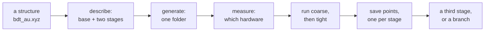
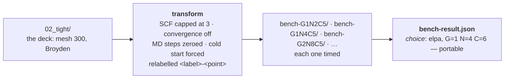
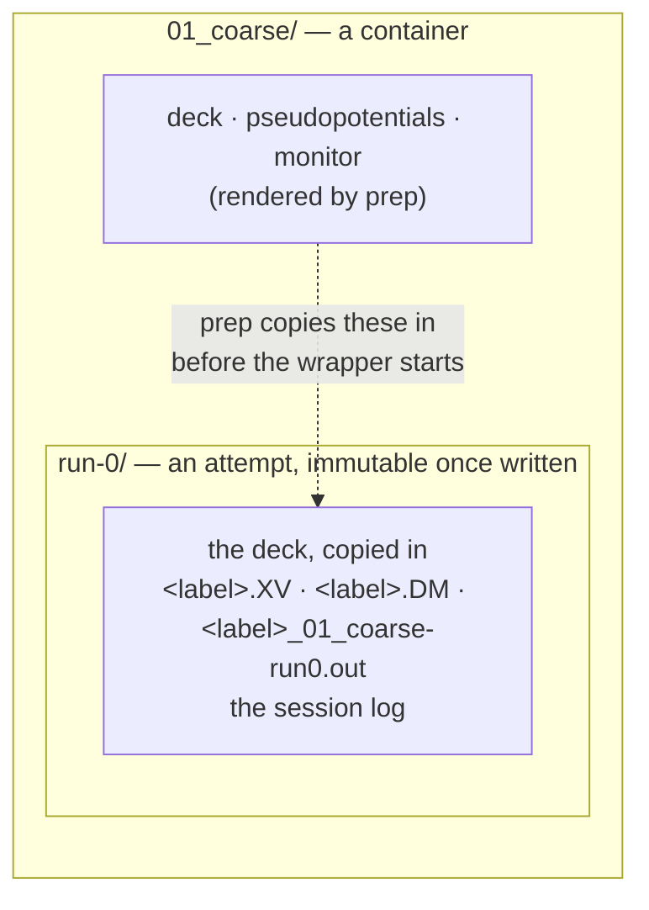
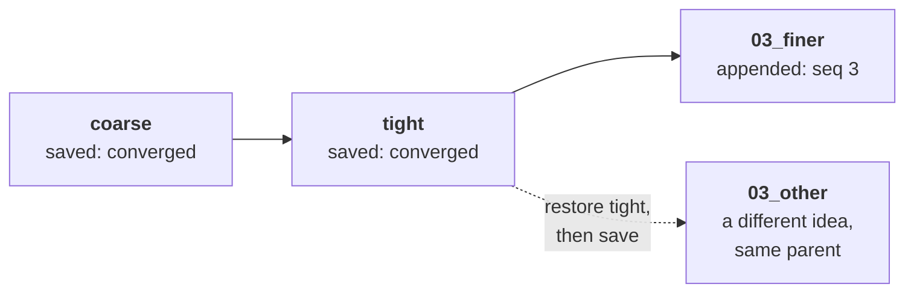

# One calculation, end to end — a worked example

**Role:** guide
**Domain:** execution
**Companions:** [`execution/project-layout.md`](?doc=execution/project-layout.md)
— the tree this walks through; [`engines/stages.md`](?doc=engines/stages.md) —
what a stage is; [`execution/job-system.md`](?doc=execution/job-system.md) —
the commands; [`execution/checkpointing.md`](?doc=execution/checkpointing.md)
— what the history guarantees. Open work lives in
[`plans/plan.md`](?doc=plans/plan.md).

This is the whole design followed once, with a real molecule, in the order a
person would actually do it — to show how the pieces fit when nobody is
looking at them one at a time. Each step names the document that owns it.

---

## 1. What we are doing

A benzene-dithiol molecule bonded to a gold surface. We want a **relaxed
geometry good enough to publish**, and we do not want to spend a week of cluster
time finding out that the settings were wrong.

So, the way a careful person works:

1. relax it **loosely** first — cheap, fast, gets the gross geometry right;
2. then **tightly** — expensive, and only worth doing from a good starting point;
3. before the expensive one, **measure** what hardware configuration runs it
   fastest;
4. keep a **save point** at each converged step, so a later idea can start from
   one instead of from scratch.



---

## 2. Getting the structure into the tree

The description **points at** a structure; it does not contain one
(`engines/stages.md § 6.3`). So the geometry has to be somewhere with a path
before anything else can name it.

```
projects/BDT-Au/structure/bdt_au.xyz
                          bdt_au.molstruct.json     ← regions, frozen atoms
```

The Molbuilder tab's **Save to project** writes the pair through the server's
one codec into the folder you picked, and the hand-over later writes the
calculation's own copy beside the description (as `<label>.source.xyz` — the
reserved name no engine output can take, `job-contracts.md § 6.3`).

---

## 3. Describing the calculation

Two tabs share the work, and the split is the design (*the browser
describes*): the **Structure-optimization tab** collects the physics —
every parameter, stated once — and **Send to Task setup** writes the
hand-over into the calculation folder you picked; the **Task setup tab**
then asks what only it may ask — the shape, the stages, what varies — and
its save writes the real `task.json` and its `job-request.json`.

|  | **base** | **01 coarse** | **02 tight** |
|---|---|---|---|
| mesh cutoff | 300 Ry | **150** | 300 |
| force tolerance | 0.01 eV/Å | **0.04** | 0.01 |
| relaxation | Broyden | **CG** | Broyden |
| everything else (35 fields) | shared | — | — |

*(No `restart` row: the shipped ladders set none — a rung's position says
nothing about whether there is anything to continue from, and `continue` is
the default (`run-identity.md § 4`). Set it per stage only when you mean to
override that.)*

Two things are worth noticing.

**Only what differs is written down.** A stage is a name and an overlay
(`engines/stages.md § 2`); the other thirty-five settings are stated once. That
is what stops the second stage quietly running different physics because someone
edited one copy and not the other.

**The name appears as you type, and it splits in two.** From "BDT/Au relax" plus
the formula:

```
label   BDT_Au_relax              ← the SystemLabel in every deck, and the
                                     stem of every file the runs write
id      BDT_Au_relax_Au38C6H4S2   ← recorded in task.json; never a filename
```

The **label** is what makes the tight stage able to pick up the coarse stage's
geometry at all — SIESTA looks for `<SystemLabel>.XV` and finds what coarse left.
The **id** is how molbuilder knows *which calculation* that state belongs to, and
it is a record rather than a name (`execution/run-identity.md § 2.0a`). **Neither
of them names the folder** — you type that when you generate (§ 4).

---

## 4. Generating

The Task setup tab's **Save to this folder** writes the description — and,
before it writes, saves the folder's state, so what you are about to change
can be brought back (`checkpointing.md` § 9):

```
projects/BDT-Au/optimization/bdt-relax/    ← the folder name is yours to pick
├── BDT_Au_relax.template.toml      every parameter of the calculation —
│                                  the hardware's named, not answered
├── task.json                      what each stage tunes, and the id —
│                                  BDT_Au_relax_Au38C6H4S2
├── job-request.json               each stage's run card and group, the
│                                  bench plan
├── BDT_Au_relax.source.xyz          the structure pair, from the hand-over
└── BDT_Au_relax.source.molstruct.json
```

*(No pseudopotentials yet, and no monitor: `prep` copies those from the
library on the machine that runs the job — `project-layout.md § 2.6`.)*

**Nothing here names a machine** — no walltime, no partition, no activation
command, no rank count. Copy this folder to any cluster and it still describes
the same calculation. There are no stage directories yet either; those appear
when you prep a stage's group on the machine that will run it.

**A template, not finished decks.** The browser writes the science backbone and
`task.json`; the actual `.fdf` for each stage is rendered later, on the machine
that will run it. That is not deferral for its own sake: **a deck carries values
that depend on how it will be launched** — a block size derived from the rank
count and the GPU, written *inside* the deck, and an eigensolver choice that
changes both the deck and which environment the wrapper activates. **A parameter
that depends on the launch cannot be decided before the launch is known**, so a
deck finished on a laptop is guessing at both (`project-layout.md § 2.2`).

**One basename everywhere.** Every deck says `SystemLabel BDT_Au_relax` — the
label, not the id. That is not cosmetic: it is why a later stage can pick up an
earlier one's `.XV`, and it is why the formula stays out of the filename (§ 3).

> ### Which shape this walkthrough follows
>
> **From here on this walk uses the hierarchical shape** — a directory per stage,
> a subdirectory per attempt. It is the clearer one to read, because every state
> the calculation passed through stays visible on disk.
>
> **Both ship, and the page ASKS — there is no default** (it decides where
> results land, so it is never guessed). Which one is a field in the
> description you wrote in § 3
> ([`project-layout.md`](?doc=execution/project-layout.md) § 1). The same two
> stages, flat:
>
> ```text
> bdt-relax/
> ├── BDT_Au_relax_01_coarse.fdf        stages told apart by the suffix
> ├── BDT_Au_relax_02_tight.fdf
> ├── BDT_Au_relax_01_coarse-run0.out  attempts by an output index
> ├── BDT_Au_relax.XV             ← SHARED and unsuffixed: this is what lets
> ├── BDT_Au_relax.DM                tight find coarse's geometry — and what
> └── Au.psml  S.psml  C.psml  H.psml   overwrites it
> ```
>
> **Everything this walkthrough says still happens** — the same stages, the same
> measuring, the same continuing, the same checkpoints. What changes is what is
> left on disk afterwards, and § 7 is where that difference stops being cosmetic.

**`prep` prepares the groups you name, each group one job** — `jobset prep
task --group <N>` — and renders each deck on the target, allocation in hand
([`job-system.md`](?doc=execution/job-system.md), *The task*). And read the
relationship the right way round: **`prep` is the framework and benchmarking
is one thing you prep** (`project-layout.md § 2.3.1a`).

---

## 5. Measuring before spending

The tight stage is the expensive one. Before committing a week to it, find out
what hardware configuration actually runs *this system at these settings*
fastest.



What comes out is the *mechanism*: **`choice`** — which engine build, how many
ranks on how many GPUs — and it transfers to another cluster unchanged.

**It names no wall and no memory.** A wall or a memory sized from a timing run
is a guess about a run that has not happened, and a guess that reaches the
scheduler is the number the job runs under. The wall and the memory are stated
by the person, and unstated is refused at prep
([`submission.md`](?doc=execution/submission.md) S1, S2).

The trials live **under the stage they measure**, in their own container:

```
02_tight/
├── bench/                    a self-contained benchmark bundle
│   ├── bench-result.json     ← the answer; a few kilobytes of text
│   └── bench-G1N4C5/         ← a trial: its deck, BDT_Au_relax-G1N4C5
│       └── run-0/            ← the trial's attempt, a throwaway run
└── run-0/                    ← the real run, later
```

*The trial prefix is `bench-`
([`job-contracts.md § 6.3`](?doc=execution/job-contracts.md), the cross-layer
authority).*

**Why under the stage, and not once per project.** The best rank count depends on
the science: mesh cutoff changes the grid, basis size changes the matrix, and
`BlockSize` is bounded by the orbital count over the rank count — so a bigger
basis moves it. Coarse and tight can genuinely want different hardware.

**Why the trials cannot hurt the real run.** The benchmark relabels each
trial's deck to `<label>-<point>` (`paths.trial_label`) and forces a cold
start. So a three-iteration timing run cannot read — or overwrite — the
density matrix the real run depends on. That relabelling is exactly what lets
a trial live inside a stage's directory.

**The connection is the command.** `jobset prep bench <stage>` renders the
trials into that stage's own `bench/` container and lays the sweep's record
beside them, so *which stage this benchmark measures* is structural, not a
hand-composed pairing.

**The measured answer reaches the next `prep`, not the description**: a rank
count is a machine fact the description never carries (`engines/template.md`
§ 7). `summarize bench` prints the verdict, and no code reads it: you read the
winner and write it into `job-request.json`'s `execution`, and that is what
`prep task --group <N>` uses.

---

## 6. The official run

Two steps, and the split is the point. **Prepare** it in the tab — the run folder
is made, the deck and pseudopotentials copied in, nothing carried because coarse
starts from the structure. It tells you what it did. Then, on the machine that
will run it:

```
molbuilder jobset launch task --group 1 --mode direct    # in the background; --foreground waits
```

**Why the terminal for this half.** The browser writes a package that names no
machine; everything that depends on *which* machine — the rank count, the
eigensolver, the queue, the activation command — is resolved here, where the
answers exist (`project-layout.md § 2.1`).



The run directory holds everything it runs from — copied, never linked
(`jobset/materialize.py` `bring_files`; `project-layout.md` § 1.0), and
**Python decides the directory**: the wrapper activates and execs, and changes
no directory (`project-layout.md` invariant 6a;
[`running-a-job.md`](?doc=execution/running-a-job.md) § 2.2a).

It converges. **Now you look at it** — the trajectory, the final forces, whether
the geometry is sane — and only then launch tight.

That pause is the design, not a missing feature. A stage is a long job; a chain
that continued on its own could spend a week refining a geometry you would have
thrown away in a minute. So **stages are not chained**: each group is launched
when you say, after you have seen the last (`project-layout.md § 1.6`). A whole
ladder runs unattended only as a sequence of groups you name at one launch,
each group launched in turn inside one job (`job-system.md` § 6.0).

Which makes the hand-off simple. **At tight's first launch**, coarse's `.XV`
is on disk — you just looked at it — and it is **copied** into tight's run
directory, from coarse's newest run, which must have finished, or from the
run `--from` names:

```
02_tight/run-0/<label>.XV   a real copy of 01_coarse/run-0/<label>.XV
```

Copied and not linked, because tight writes to that same filename and would
otherwise overwrite coarse's result. And **you may say which run** it comes
from: continuing from `run-0` and continuing from `run-2` are different
scientific choices.

```bash
molbuilder jobset launch task --group 2 --from 01_coarse/run-0 --mode direct   # or --cold; or --mode submit
```

`job-system.md` § 5.3 is the authority for the commands; `launch --mode`
falls back to `launch.mode` in `molbuilder.json`, and unset in both is refused, never
derived from the detected scheduler.

**A ladder's stage directories are `01_coarse/`, `02_tight/`**, while a
benchmark's trials keep a settings-based name.

**If you have to re-run a stage**, you do not overwrite anything — each launch
again gets `run-1`, then `run-2`, continuing from its own latest run or
starting over as its kind says, `--cold` starting it over. `run-0` is
byte-identical afterwards. There is no `--force`, because there is nothing to
reset.

---

## 7. Save points, and changing your mind

**A save is always an explicit act, and always said** — and the acts that
change the folder make it. Every `prep`, a group's first `launch` and Task
setup's Save save the folder first, each with a note that says when the
state was taken and what is about to change (`checkpointing.md` § 9):

```
2026-10-03 14:05:12 · before launch task group 2 (tight)
```

A stage finishes, and you may save it too, with a note of your own —
`molbuilder checkpoint save -m "…"`:

```
coarse converged, 41 steps

Calculation: bdt-relax
Manifest-SHA256: 9f2c…
```

The note says **how it went**; the two trailers are added for you — the folder
this history belongs to, and the fingerprint of the archive this state points at
(`checkpointing.md` **L3**). Tags are yours: nothing tags a state on your
behalf (**L4**).

**What is stored where.** Every file of the folder is saved but an engine's
scratch: the files under the size limit — decks, wrappers, `task.json`,
`bench-result.json` — in git, the large ones — `01_coarse/run-0/<label>.DM`
and its siblings — in the archive beside it, by path, with checksums
(`checkpointing.md` § 3, S1).

> ### The same checkpoint means two different things
>
> This is the one place the shape choice (§ 4) stops being cosmetic, and it is
> worth stopping on because it changes what a mistake costs.
>
> In the **hierarchical** walk above, `01_coarse/run-0/` is still sitting on
> disk. The checkpoint is a convenience — somewhere to branch from, a way to see
> what changed. Skip one and you have a thinner history beside a folder that
> still holds everything.
>
> In the **flat** shape there is one `<label>.XV` and one `<label>.DM`, and the tight
> stage **overwrote** them. The coarse geometry is not on disk anywhere. So:
>
> | | hierarchical | flat |
> |---|---|---|
> | after tight runs, coarse's geometry is | on disk, openable | **only in the checkpoint** |
> | a checkpoint is | insurance | **the mechanism** |
> | a missed checkpoint is | a thinner history | **a state that no longer exists anywhere** |
>
> That is why `checkpointing.md` is a contract with invariants rather than a
> description of a feature, and why the save before each act that changes the
> folder is not housekeeping in the flat shape — it is **the save point**
> ([`checkpointing.md`](?doc=execution/checkpointing.md) § 8).
>
> It also changes what *restore* means to you. In the hierarchy you can open an
> old attempt and copy something out of it. In flat there is nothing to open:
> **restore is a rewind, not a fetch** — it puts the whole folder back to an
> earlier moment, and anything newer that was not checkpointed goes with it.

Two weeks later you want a third stage — finer k-grid, from tight's result.



**Stages append; they never renumber.** Once tight has run, "insert something
between coarse and tight" is not an insertion — it is a new stage that happens to
be coarser, and it runs from where tight left off. Numbering it `03` is the
truth. That also means an attempt's outputs stay attached to the stage that
produced them, forever.

**A branch is restore, then save.** The history of a calculation folder is one
history however many levels its runs sit at — its root carries `task.json`,
which says its subdirectories are one calculation — so trying a different idea
from tight is restoring tight's state and saving what you change from there.

---

## 8. What the walk shows

The parts that hold when followed end to end: one description producing
several decks with one basename; the benchmark nesting under the stage it
measures without being able to damage it; attempts that cannot overwrite each
other; a hand-off between stages that is a copy made at the launch, from a
run you have seen finish; and stage numbering that keeps an output attached to
the stage that made it, however many times you change your mind afterwards.

Two pieces this walk touches are still open, each kept by its owner:
`checkpoint verify`, which has no verb yet (`checkpointing.md` § 12), and a
`user_custom` item for text a person writes into a deck
(`engines/template.md` § 9.2).
