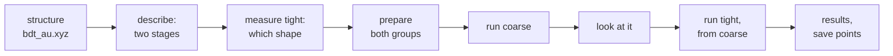
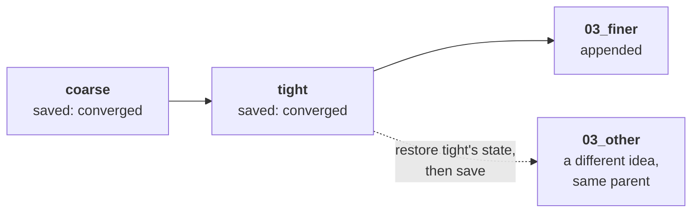

# One calculation, end to end — a worked example

**Role:** guide
**Domain:** execution
**Owns:** the one walk-through of a two-stage calculation — describe, measure,
prepare, launch, look, continue, read the results, save and go back.
**Read with:** [`job-system.md`](?doc=execution/job-system.md) § 5.0 (what
prep checks and writes), § 5.3 (the commands), § 5.4 (what a stage takes), § 6.0
(the launch) · [`job-request.md`](?doc=execution/job-request.md) § 3 (the job
request) · [`project-layout.md`](?doc=execution/project-layout.md) § 1.1 (the
folder tree) · [`generator.md`](?doc=execution/generator.md) § 4.3a (the
benchmark) · [`running-a-job.md`](?doc=execution/running-a-job.md) § 4.2 (a
run's states) · [`scheduler.md`](?doc=execution/scheduler.md) § 6a (the header
and the send line) · [`checkpointing.md`](?doc=execution/checkpointing.md) § 5,
§ 9 (the saved states) · [`configuration.md`](?doc=configuration.md) § 4, § 5
(`molbuilder.json`, the machine record)

---

## The short version

A benzene-dithiol molecule on gold, relaxed loosely (`coarse`) and then
tightly (`tight`), on a workstation; § 10 does the same on a cluster. Each step
names the chapter that owns its rules. Printed lines are molbuilder's, with
this example's names; ids and times are the example's.

| step | what you do | owner |
|---|---|---|
| § 3 describe | the Structure-optimization tab, **Send to Task setup**; Task setup, **Save to this folder** | [`web/task-setup.md`](?doc=web/task-setup.md) |
| § 5 measure | `jobset prep bench tight` · `jobset launch bench tight` · `jobset summarize bench tight` | [`generator.md`](?doc=execution/generator.md) § 4.3a |
| § 6 prepare | `jobset prep task --group 1 --group 2` | [`job-system.md`](?doc=execution/job-system.md) § 5.0 |
| § 7 run coarse | `jobset launch task --group 1` · `jobset status` | [`job-system.md`](?doc=execution/job-system.md) § 6.0 |
| § 8 continue | `jobset launch task --group 2` | [`job-system.md`](?doc=execution/job-system.md) § 5.4 |
| § 9 results, again, back | the Results tab · `jobset launch task --stage tight` · `checkpoint restore` | [`checkpointing.md`](?doc=execution/checkpointing.md) § 5 |

Every `jobset` command runs from inside the calculation's folder, or names it
with `--bundle BDT-Au/optimization/bdt-relax` from anywhere.

---

## 1. What we are doing

We want a **relaxed geometry good enough to publish**, without spending a week
of cluster time to learn the settings were wrong. So, the way a careful person
works:

1. relax it **loosely** first — cheap, and it gets the gross geometry right;
2. then **tightly** — expensive, and worth doing only from a good start;
3. before the expensive one, **measure** which hardware shape runs it fastest;
4. **look** at each result before building on it, and keep the states to go
   back to.



---

## 2. The structure into the tree

The description points at a structure; it does not contain one
([`stages.md`](?doc=engines/stages.md) § 6.3). The Molbuilder tab's **Save to
project** writes the structure and its sidecar into the folder you pick:

```text
projects/BDT-Au/structure/bdt_au.xyz
                          bdt_au.molstruct.json     ← regions, frozen atoms
```

---

## 3. Describing the calculation

Two tabs share the work. The **Structure-optimization tab** collects the
physics — every parameter, stated once — and **Send to Task setup** writes the
hand-over into the calculation folder you pick: the template, the structure
pair, and `task.1st.json`. The **Task setup tab** then asks what only it asks —
the stages, their groups, the run card — and **Save to this folder** writes
`task.json` and `job-request.json`, removes the hand-over, and saves the
folder's state first ([`checkpointing.md`](?doc=execution/checkpointing.md)
§ 9). From a terminal, `molbuilder describe` writes the same files.

|  | **base** | **01 coarse** | **02 tight** |
|---|---|---|---|
| mesh cutoff | 300 Ry | **150** | 300 |
| force tolerance | 0.01 eV/Å | **0.04** | 0.01 |
| relaxation | Broyden | **CG** | Broyden |
| everything else | stated once | — | — |

**Only what differs is written down.** A stage is a name and its overrides
([`stages.md`](?doc=engines/stages.md) § 2), so the second stage cannot drift
into different physics because one copy was edited and the other not.

**Each stage is its own group.** `tight` builds on `coarse`, so they cannot
share one job: a group holds stages that take nothing from each other
([`job-request.md`](?doc=execution/job-request.md) § 3.3). `coarse` is group 1,
`tight` group 2.

**The run card says how it runs.** On this workstation, eight ranks of one
core each; a launch value stated nowhere is refused at prep
([`architecture.md`](?doc=execution/architecture.md) § 5.2):

```json
{
  "schema": "molbuilder/job-request@1",
  "execution": {"mpi_np": 8, "omp_threads": 1},
  "stages": {
    "coarse": {"group": 1},
    "tight": {"group": 2}
  }
}
```

**The name splits in two as you type.** From "BDT/Au relax" and the formula:

```text
label   BDT_Au_relax              ← the SystemLabel in every deck, the stem of every file
id      BDT_Au_relax_Au38C6H4S2   ← recorded in task.json; never a filename
```

The **label** is what lets `tight` pick up `coarse`'s geometry at all: SIESTA
reads `<SystemLabel>.XV`. The **id** is how molbuilder knows which calculation
a state belongs to ([`run-identity.md`](?doc=execution/run-identity.md) § 2.0a).
Neither names the folder; you pick that.

---

## 4. What the folder holds after Save

```text
projects/BDT-Au/optimization/bdt-relax/   (abridged)
├── BDT_Au_relax.template.toml            every parameter, the value in force
├── task.json                             the stages and their overrides, the id
├── job-request.json                      each stage's group, the run card
├── BDT_Au_relax.source.xyz               the structure pair, from the hand-over
├── BDT_Au_relax.source.molstruct.json
└── .git/  .gitignore  .binsnapshots/     the saved states
```

**Nothing here names a machine** — no queue, no wall, no activation. Copy the
folder to any cluster and it describes the same calculation.

**A template, not finished decks.** Each stage's `.fdf` is rendered at `prep`,
for the machine that runs it, from that machine's record — here or anywhere
else (`prep --target`) — because a deck carries values that depend on the
launch: the rank count it is rendered for is recorded in it, and the run script
beside it is written for that deck. A `BlockSize` is written only when a run
card states one; the environment the run script enters follows the job's GPU
request alone, never the eigensolver
([`architecture.md`](?doc=execution/architecture.md) § 9;
[`gpu.md`](?doc=execution/gpu.md)).

---

## 5. Measuring before spending

`tight` is the expensive stage. Before committing to it, measure which shape
runs *this system at these settings* fastest. Add a plan to the job request —
what to try, never an answer
([`job-request.md`](?doc=execution/job-request.md) § 3.4):

```json
"bench": {"mpi_np": [4, 8], "omp_threads": [1, 2]}
```

```bash
molbuilder jobset prep bench tight                   # the grid, rendered into 02_tight/bench/
molbuilder jobset launch bench tight --mode direct   # here: one walk over the trials, in the background
molbuilder jobset summarize bench tight              # the table, the record, the report
```

`prep bench`, once everything is checked, saves the folder's state, writes the
trials and prints the grid — one line per cell kept; on this workstation, with
no queue, a cell's fit is said only when the node cannot hold it:

```text
  bench grid: 4 combination(s) enumerated, 4 kept
    G0N4C1      4 rank(s) x 1 core(s)
    G0N4C2      4 rank(s) x 2 core(s)
    G0N8C1      8 rank(s) x 1 core(s)
    G0N8C2      8 rank(s) x 2 core(s)
```

Each trial renders `tight`'s settings with the trial pins over them — SCF
capped at three iterations, no relaxation step, a cold start — and is relabelled
`BDT_Au_relax-<point>`, so it can neither read nor overwrite the real run's
files ([`generator.md`](?doc=execution/generator.md) § 4.2):

```text
02_tight/                         (abridged)
└── bench/
    ├── job-set.json              the benchmark's plan, every trial's point
    ├── STAGE-PLAN.md             that plan in words
    ├── bench-G0N4C1/             a trial: its deck, run script, data files
    │   └── run-0/                its one run
    ├── …
    ├── launch/                   the walk and its log
    └── bench-result.json         written by summarize
```

**Why under the stage.** The best rank count depends on the science — the mesh
changes the grid, the basis the matrix — so `coarse` and `tight` can want
different hardware, and the measurement belongs to the stage it measured.

`summarize` prints a table, one row per trial, the winner, and the report.
Abridged:

```text
molbuilder bench recommendation -- tight
NOTHING APPLIES THIS.  It is what the benchmark found; the decision is yours to write.
…
To run at it, put this in job-request.json and save:

    "execution": {
      …
      "mpi_np": 8,
      "omp_threads": 2
    }
```

**Nothing reads the verdict.** It names no wall and no memory — those are yours
([`architecture.md`](?doc=execution/architecture.md) § 5.2) — and the run uses
what you write. You write it on `tight`'s own card, since `coarse` keeps the
calculation's eight ranks of one core:

```json
"tight": {"group": 2, "execution": {"mpi_np": 8, "omp_threads": 2}}
```

---

## 6. Preparing both groups

```bash
molbuilder jobset prep task --group 1 --group 2
```

Every jobset verb opens with where its configuration and the projects tree
come from:

```text
molbuilder.json: /home/you/.config/molbuilder/molbuilder.json (found)
projects  /home/you/molbuilder/projects   (default -- no paths.projects set)
```

`prep` checks everything first, then saves the folder's state, said with the
state's note, and only then writes
([`job-system.md`](?doc=execution/job-system.md) § 5.0):

```text
the folder's state was saved first: 7b3c9f1 -- 2026-11-03 09:02:10 · before prep task group 1 (coarse), group 2 (tight)
```

It prints what it resolved — where the configuration came from, each stage's
deck and resources, what each first launch will take — and under `tight`:

```text
at launch: takes BDT_Au_relax.XV, BDT_Au_relax.DM from `coarse`'s newest run, which must have finished
```

The optimizer history, `BDT_Au_relax.CG`, is not among them: it carries only
between stages that use the same optimizer, and `coarse` is CG while `tight` is
Broyden ([`job-contracts.md`](?doc=execution/job-contracts.md) § 4.2a).

```text
bdt-relax/                                (abridged)
├── environment.json                      this machine's record, copied at the first prep
├── job-set.json  STAGE-PLAN.md           the plan, and the plan in words
├── prepared-with.json                    what each stage was prepared with
├── jobset-decisions.log                  every decision, one line each
├── BDT_Au_relax_01_coarse.siesta.hierarchical.pipeline.log   what prep did, one log per stage
├── pseudos/                              the shared package, copied into every stage
├── 01_coarse/
│   ├── BDT_Au_relax_01_coarse.fdf        the deck
│   ├── BDT_Au_relax_01_coarse.run.sh     its run script
│   ├── C.psml  H.psml  S.psml  Au.psml  mb_monitor.pyz
│   ├── BDT_Au_relax_01_coarse.validation.txt  calcdir.json
│   └── run-0/                            real copies of the above, ready to start
└── 02_tight/   …                         the same, its run-0/ holding tight's own files
```

On a machine whose scheduler has queues, each stage also gets its `.sbatch`
header, unless prep is given `--no-sbatch` (§ 10;
[`scheduler.md`](?doc=execution/scheduler.md) § 6a). The whole tree is
[`project-layout.md`](?doc=execution/project-layout.md) § 1.1; every file in it,
with who writes it, is the manifest there (§ 5).

---

## 7. Running coarse

```bash
molbuilder jobset launch task --group 1 --mode direct
```

`launch` shows the exact line it will run and asks; you answer, and the
group's first launch saves the folder's state before anything starts. A run
here starts in the background and the launch returns; `--foreground` waits
for it ([`job-system.md`](?doc=execution/job-system.md) § 6.0). `--mode` may
be left out once `launch.mode` is set in `molbuilder.json`
([`configuration.md`](?doc=configuration.md) § 4). The run script is started
with its counts alone:

```text
bash BDT_Au_relax_01_coarse.run.sh -np 8 -omp 1
```

Follow it whenever you like:

```bash
molbuilder jobset status            # every stage, where it stands, each group's next step
molbuilder jobset status coarse     # one stage in full: its deck, resources, runs, launch record
```

The run writes into `01_coarse/run-0/`: the engine's output
`BDT_Au_relax_01_coarse.out`, the session log `BDT_Au_relax_01_coarse.runwrap.log`,
the monitor's samples, and the restart files `BDT_Au_relax.XV`,
`BDT_Au_relax.DM`, `BDT_Au_relax.CG`. How `status` reads a run's state —
queued, running, finished, failed — is
[`running-a-job.md`](?doc=execution/running-a-job.md) § 4.2.

---

## 8. Looking, then continuing

It finishes. **Now you look at it** — the trajectory, the final forces, whether
the geometry is sane — in the Results tab or with `jobset status coarse`, and
only then launch `tight`.

**That pause is the design.** A stage is a long job, and one that continued by
itself could spend a week refining a geometry you would have rejected in a
minute. So nothing starts a stage but you
([`project-layout.md`](?doc=execution/project-layout.md) § 1.6). To run the
whole ladder unattended, you name its groups at one launch, as one job (§ 10).

```bash
molbuilder jobset launch task --group 2 --mode direct
```

At `tight`'s first launch, `coarse`'s newest run must have finished; its
restart files are **copied** into `02_tight/run-0/` — copied, not linked,
because `tight` writes to those very names
([`project-layout.md`](?doc=execution/project-layout.md) § 1.6.5). Before the
question the launch says what it would take — *WOULD launch it into run-0: it
continues from 01_coarse/run-0 (…): would copy …* — and once sent, what it
took:

```text
  takes      tight          [launched into run-0: it continues from 01_coarse/run-0 (the stage before it; concluded rc=0 at …; converged): copied BDT_Au_relax.XV, BDT_Au_relax.DM]
```

**You may say which run it comes from**, or none — continuing from `run-0` and
from `run-2` are different scientific choices
([`job-system.md`](?doc=execution/job-system.md) § 5.4):

```bash
molbuilder jobset launch task --group 2 --from 01_coarse/run-0 --mode direct   # this run, as said
molbuilder jobset launch task --group 2 --cold --mode direct                   # from the structure
```

---

## 9. Results, running again, and going back

**Results.** The Results tab shows the stages as `status` does, and a run's
panel shows what it continued from (*Continued from*). `jobset status tight`
says the same on the terminal.

**Running a stage again** never overwrites anything: each launch again opens
the next run, `run-1`, then `run-2`, and continues from the stage's own latest
run — `--cold` starts it over. `run-0` is left as it was; there is no
`--force`, because there is nothing to reset
([`project-layout.md`](?doc=execution/project-layout.md) § 1.6.1):

```bash
molbuilder jobset launch task --stage tight --mode direct
```

**The saved states.** Every `prep`, every group's first launch and every Task
setup Save saved the folder first, each with a note saying when and before
what ([`checkpointing.md`](?doc=execution/checkpointing.md) § 9). Save one
yourself when a stage converges:

```bash
molbuilder checkpoint save -m "coarse converged, 41 steps"
molbuilder checkpoint list
```

```text
-> 9e04c2d  coarse converged, 41 steps
      2026-11-03T15:40:02-07:00   from 5d1e2a0
   5d1e2a0  2026-11-03 11:30:51 · before launch task group 2 (tight)
      2026-11-03T11:30:51-07:00   from 2a6f813
   2a6f813  2026-11-03 09:05:37 · before launch task group 1 (coarse)
      2026-11-03T09:05:37-07:00   from 7b3c9f1
   …
```

Each state's message ends with two lines added for you — the folder it belongs
to and the fingerprint of the archive it points at:

```text
coarse converged, 41 steps

Calculation: bdt-relax
Manifest-SHA256: 9f2c…
```

Files under the size limit are kept in git, the large ones — the `.DM` files —
in the archive beside it, and an engine's scratch in neither
([`checkpointing.md`](?doc=execution/checkpointing.md) § 3). A restore is a
rewind of the whole folder: anything newer that was not saved goes with it
([`checkpointing.md`](?doc=execution/checkpointing.md) § 8).

**Changing your mind.** Two weeks later you want a third stage, a finer
k-grid, from `tight`'s result:



- **Stages append; they never renumber.** A new stage is `03`, even if it is
  coarser than `tight`, so a run's outputs stay with the stage that made them.
- **A branch is restore, then save.** The folder has one history
  ([`checkpointing.md`](?doc=execution/checkpointing.md) L1); trying another
  idea from `tight` is restoring a state that holds it and saving what you
  change from there.
- **Redoing a launched stage** is going back to the state saved before its
  group's first launch and preparing it again — after saving the folder as it
  stands, so the run you leave is kept
  ([`checkpointing.md`](?doc=execution/checkpointing.md) § 7.1):

  ```bash
  molbuilder checkpoint save -m "tight as launched, before going back"
  molbuilder checkpoint restore 5d1e2a0        # saved before group 2's first launch
  molbuilder jobset prep task --group 2
  molbuilder jobset launch task --group 2 --mode direct
  ```

---

## 10. The same walk on a cluster

The folder is the same; what changes is the machine's record and what the run
states ([`architecture.md`](?doc=execution/architecture.md) § 9).

1. **The cluster's record.** On the cluster, `molbuilder jobset probe --write`
   measures it — its queues, their limits, its nodes — and writes its record
   ([`configuration.md`](?doc=configuration.md) § 5). To prepare from your
   workstation instead, probe it with `--name sol`, copy the record over and
   prepare with `--target sol`
   ([`preparing-for-another-machine.md`](?doc=execution/preparing-for-another-machine.md)).
2. **What the run states.** On a queue a run also states its queue, its wall
   and its memory. The job request's `allocation` is shared by the benchmark
   and the run; a run card's `domain` and `time` stand over it for the run
   alone; memory has no run-card key — it is `allocation.mem`, or `--mem` at
   prep ([`job-request.md`](?doc=execution/job-request.md) § 3.1, § 3.2a). So
   `allocation` names the benchmark's short queue, and the calculation's run
   card the run's long one:

   ```json
   "allocation": {"domain": "htc", "time": "0-01:00:00", "mem": "64G"},
   "execution":  {"mpi_np": 16, "omp_threads": 1,
                  "domain": "public", "time": "2-00:00:00"}
   ```

   On ASU Sol, `htc` holds a job up to four hours and `public` up to seven days
   ([`asu-sol.md`](?doc=execution/asu-sol.md)).

3. **Prepare, then send.** `prep` writes each group's `.sbatch` header, placed
   on its queue and its fit printed; `launch` sends that header as it is,
   one job, after showing the `sbatch` line and asking
   ([`scheduler.md`](?doc=execution/scheduler.md) § 6a):

   ```bash
   molbuilder jobset prep task --group 1 --group 2
   molbuilder jobset launch task --group 1 --mode ask      # when would it start? nothing is sent
   molbuilder jobset launch task --group 1 --mode submit
   molbuilder jobset status
   molbuilder jobset launch task --group 2 --mode submit   # after looking at coarse
   ```

4. **The benchmark on a cluster** takes its queue and wall from `allocation`,
   or from `prep bench`'s own `--domain` and `--time` — never from a run card —
   so here it goes to `htc` for an hour, one job per resource shelf
   ([`generator.md`](?doc=execution/generator.md) § 4.3a, § 4.4a).
5. **The whole ladder unattended** is one job you name group by group — the
   groups prepared together with their sequence's header, then sent at once
   ([`job-system.md`](?doc=execution/job-system.md) § 6.0, *A sequence of
   groups*):

   ```bash
   molbuilder jobset prep   task --group 1 --group 2 --one-job
   molbuilder jobset launch task --group 1 --group 2 --mode submit   # one job: coarse, then tight
   ```

   Inside the job, each group is launched in turn by `jobset launch
   --in-sequence`, and each group's first launch saves the folder's state
   there, on the node ([`checkpointing.md`](?doc=execution/checkpointing.md)
   § 9).

---

## 11. What the walk shows

One description producing several decks with one label; a benchmark nested
under the stage it measures without being able to touch it; runs that never
overwrite each other; a hand-over between stages that is a copy, made at the
launch, from a run you have seen finish; and stage numbers that keep an output
attached to the stage that made it, however many times you change your mind.
