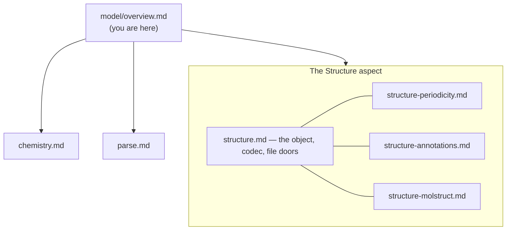
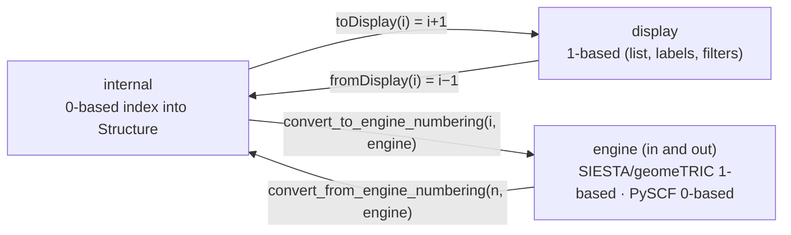

# The data model — overview & atom-index convention

**Role:** overview
**Domain:** model
**Companions:** [`architecture.md`](?doc=architecture.md) (where the model
sits in the L1/L2/L3 layering);
[`execution/job-contracts.md`](?doc=execution/job-contracts.md) § 6 (the
config↔scheduler parameter vocabulary, run identifiers, and
persisted-artifacts registry — absorbed from the legacy
`data-vocabulary.md`, see § 3).

The **model** is molbuilder's L1 layer: the pure data objects, how they persist,
and how files are read back into them. Everything else (engines, execution, the
web front end) builds on these. Start here, then open the doc for the piece
you're working on.

---

## 1. The map — start here

| Doc | What it covers | Open it when you… |
|---|---|---|
| [`structure.md`](?doc=model/structure.md) | The `Structure` object — the lingua franca; its serialization codec (`to_dict`/`from_dict`/`to_wire`), geometry I/O, the paired-file door, and the JS load/save doors. **The master of the Structure aspect.** | touch the core object, save/load, or the wire shape |
| [`structure-periodicity.md`](?doc=model/structure-periodicity.md) | Per-axis box behaviour: `cell`, `engine_offset`, `axis_kind`, derived `pbc`, `vacuum`; `resolve_cell` and the one placement rule every engine is handed through (`cell.to_engine`, § 6.0). | work on cells, vacuum, transport axes, or the FDF cell |
| [`structure-annotations.md`](?doc=model/structure-annotations.md) | The per-atom channel model (`tag`/`flag`/`value`), the ONE label store with reserved labels in it, persistence, engine translation, and the region-label vocabulary. | add per-atom metadata, regions, or a selection filter |
| [`structure-molstruct.md`](?doc=model/structure-molstruct.md) | The `.molstruct.json` save file: envelope, schema versioning, the codec, and the `.xyz`↔sidecar pairing rule. | change what a saved structure carries, or the sidecar format |
| [`chemistry.md`](?doc=model/chemistry.md) | Chemistry helpers on a `Structure`: the phosphate charge rule (the electronic state's charge step), protonation, `add_hydrogens`, clash relief, dipole (the charge and spin a calculation carries → `science/chemistry-correctness.md` § 2a). | resolve charge, add hydrogens, or clean up geometry |
| [`parse.md`](?doc=model/parse.md) | The unified read stack: three ABCs, the `ParseResult` hierarchy, the registry, and how to add a parser. | read a file/dir/text body into typed data, or add a parser |

The **atom-index convention** below is the one shared rule that cuts across all
of these (and into the engines + the web UI), so it lives here.

---

## 2. The index convention — the code's index everywhere, a number on the UI's display

Atoms and frames carry **two counts with a single explicit conversion
boundary**, the UI's display — a deliberate design, because arrays/JSON are
0-based by nature while scientists count atoms 1-based (SIESTA `.fdf`, PDB
serials, counting `.xyz` lines). Mixing them silently is the classic off-by-one
hazard, so each count has its own word: an **index** counts from 0, a
**number** from 1.

*(User, 2026-10-10: "anything CLI means direct programming, so we don't
reinterpret the meaning. only UI display would do so"; "we will give
notification to user to agree that indices start from 0 and could be
different from atom list in the UI".)*

| Layer | Count | Where |
|---|---|---|
| **Internal / machine** | **index, from 0** | Python `Structure` (`regions`/positions, frames), the `.molstruct.json` sidecar + the `.fdf`/`.py` ATOM-METADATA block, `/api/selection/*` rules, the JS selection store `atom.index`, all wiring |
| **The command line, the files, every message molbuilder writes** | **index, from 0 — said as one** | what a person types at the CLI (`molbuilder modify --delete 0,3`), which the command says counts from 0 and asks to be agreed before it acts (`jobset.ask.confirm`, `--yes`); every refusal, warning and printed line — *atom index 3 (Au)*, *frame index 1 (of 3)*, through `structure.atom_words` / `structure.frame_words`, the word *index* in each; a folder named for a frame (`f001` is frame index 1) — the code's own index, never reinterpreted |
| **The UI's own display** | **number, from 1** | the atom list's `#` column, the viewer's atom labels, measurement chips, the "by atom number" filter, the frame bar's `1 / F`, a frame picker, the Customized heading's *Frame 2 of 3* |
| **Engine input, and a format's own numbers** | **engine-specific** | SIESTA `.fdf` (1-based — `elec-pos end` counting back from the last atom, −1), geomeTRIC `$freeze` (1-based), PySCF `mol.atom` (0-based), a PDB file's atom serials (1-based) |

**Map or convert — two different changes, two words** *(the user,
2026-10-23: "use 'map' when we really mean 'order' of index, and use
'convert' when we mean starting index")*. An atom index can change in two
ways, and every function that changes one says which by its first word:

| word | what changes | what stays | functions |
|---|---|---|---|
| **map** | **which list** the atom is counted in — the user order (the structure the user built or cited) or the engine order (the sorted copy an engine runs, § 2.2) | where counting starts: both lists count from 0 | `map_to_user_index`, `map_to_engine_index`, `map_rows_to_user_order`, `map_rows_to_engine_order` — the atom index map's and the order record's (§ 2.2b); `Structure.map_to_user_index`, `map_from_user_index` |
| **convert** | **where counting starts** — from 0, as the code and the files count, or as one engine's own input counts (SIESTA, geomeTRIC from 1) | the list | `convert_to_engine_numbering(i, engine)`, `convert_from_engine_numbering(n, engine)`, and per engine `siesta_numbering`, `siesta_numbering_from_end`, `geometric_numbering`, `pyscf_numbering`, `pdb_numbering` (§ 2.1); in the browser, `toDisplay` / `fromDisplay` for the number from 1 a view shows |

They chain, never blend. The atom a person picked as the first S of the
molecule — user index 0 — written into a transport deck's `elec-pos` is first
**mapped** (its engine index in the sorted junction, say 36), then
**converted** (SIESTA's number, 37):
`siesta_numbering(atoms.map_to_engine_index([0])[0])`. A function that did
both in one step would hide which happened; none does.

### 2.1 Identity, carriage, and the only three translation points

**DEFINED** — the canonical identity is the **0-based index into `Structure`**
(`elements[i]` / `positions[i]`), fixed by the atom order in the source file
when parsed. Nothing invents an index; that order *is* the identity.

**CARRIED** — it travels 0-based and untranslated through the JS selection
store, `/api/selection/*`, the `.molstruct.json` sidecar, the ATOM-METADATA
block, and all metadata (`regions`/`annotations`). These indices
are valid only against the structure they were computed on — **pinned by
`geometry_hash`** (`structure-molstruct.md` § 3); a mismatch must refuse, not mis-apply.

**TRANSLATED** — only at three boundaries, each with one API — and **NORMALISED** at a fourth, § 2.2, which is a reorder and not an offset:

The engine edge is **two-way**: `convert_to_engine_numbering` writes the atom number into
the input file, and `convert_from_engine_numbering` reads it back when engine *output*
references an atom by number (the return leg of the round-trip). When output is
order-preserved — SIESTA/PySCF emit coordinate and force blocks in `Structure`
order — the internal index is simply the row position and no number
translation is needed.

| Boundary | Direction | The single API |
|---|---|---|
| internal → display | 0 → 1-based | `toDisplay` (`lib/molview/_atom.js`) — the browser's, an atom's index and a frame's (`model/structure.md` § 2.2e); Python never converts: a message names the index itself |
| UI input → internal | 1 → 0-based | `fromDisplay` / `shiftExpression` (same module); the CLI takes the index as typed, said and agreed |
| internal → engine input | 0-based → engine convention | `engine_atom_index.py` — `convert_to_engine_numbering(i, engine)` (dispatch), or the FACT functions `siesta_numbering`/`geometric_numbering`/`pdb_numbering` (1-based) / `pyscf_numbering` (0-based), and `siesta_numbering_from_end(i, n_atoms)` (SIESTA's count back from the last atom, −1, which `elec-pos end` takes; written, never read back) |
| engine output → internal | engine convention → 0-based | `engine_atom_index.py` — `convert_from_engine_numbering(n, engine)` (the inverse; return leg of the round-trip) |

`engine_atom_index.py` is the **sole** place a 0-based identity becomes an
engine atom number and back — **no other code applies a bare `i + 1` or
`n − 1`** (both directions route here; bound by `tests/test_engine_atom_index.py`,
including the round-trip identity `convert_from_engine_numbering(convert_to_engine_numbering(i, e), e) == i`).
It exposes the per-engine FACT functions **and** the engine-parametrized
`convert_to_engine_numbering` / `convert_from_engine_numbering` dispatch — **the engine always named, no default** (the user, 2026-10-23: a default of SIESTA made the dispatch read as SIESTA's own), backed by one base-offset
registry so a new engine defines both directions in a single line. The JS
`_atom.js` (`toDisplay`/`fromDisplay`/`shiftExpression`) is the single
web-UI implementation — the one place a number is made from an index, and
the one reading of a number typed (every digit form read as one, `NFKC`; the
server reads ASCII digits alone). Python makes none: `structure.atom_words` and
`structure.frame_words` are the one spelling of an atom and a frame in a
message, the index as it is.

**The load-bearing invariant.** Engine coordinate blocks emit atoms in internal
`Structure` order for every kind that does not sort, so engine atom
`siesta_numbering(i)` is the coordinate line for internal atom `i`. A kind
that must reorder — transport, for TranSIESTA's contiguous electrode ranges;
the SIESTA force-constant run, for a contiguous free range — emits the
**sorted copy** of § 2.2, and the same invariant holds on that copy, under its
recorded permutation. The display's number and an
input file's are both counted from 1, so `toDisplay(i)` is the number a deck
gives the same atom **where the deck lists the atoms as the view holds
them** — a calculation that sorts nothing, or a view of a sorted run's own
file. An editor and the transport report hold the user order (I8), so for a
sorted calculation the deck's number for the atom a view shows as *#1* is its
engine index + 1 — said in the view (`web/results.md` § 2.5) and answered by
`molbuilder atom-index` (§ 2.2b, F5). Each engine's base and the round trip
are bound by `tests/test_engine_atom_index.py`.

### 2.2 Normalised — a sorted COPY under one recorded permutation *(user, 2026-09-23)*

Some engines need atoms in an order the source file does not have. TranSIESTA
identifies each electrode by a **contiguous** atom range; SIESTA's
force-constant run nudges atoms *A through B* and cannot take a scattered free
set. The identity does not bend to them. **The program sorts a COPY at prep,
records the permutation in both directions beside it, and maps every number
that comes back through the inverse before a person sees it.** From the
outside, atoms go in and come out in the user order; the sorted order is an
engine fact, like the 1-based numbering, and it never leaks.

| | the rule |
|---|---|
| **one home per sort key** | the sort is a pure function, `(Structure) -> SortResult`, with one implementation per key over ONE machinery: `transport/sort.py` — `sort_by(struct, key)`, the keys named in `atom_permutation` (`transport`: the categorical order; `held-first`: held atoms first, free atoms last) and each mapped in `SORT_KEYS` to an order handed to the shared `apply_order`, which does the remap, the bijection check and the record: the sorted copy carries its order record, `atom_order` (§ 2.2a; none when the sort moved nothing). A new need is a new key there, never a second machine *(built 2026-09-23; the copy's own record 2026-10-14)* |
| **every index-carrying field moves with its atom** | `regions`, `frozen_atoms`, `annotations`, the identity columns, every per-atom array — through one map, checked to be a bijection before the copy is returned |
| **recorded, both directions** | the sorted copy's own order record, `atom_order` (§ 2.2a): `original_to_sorted`, `sorted_to_original` and the **`key`** that made the copy, of the type `atom_permutation.Permutation` (the record's own module — stdlib and numpy, so it travels). It is stated by what the copy is written into, and nowhere else: a deck's ATOM-METADATA block, which the run door reads (`runs.declared`) and the SIESTA vibration's finish reads beside the job (`deck_record.order_record_of`, I5), and the transport composer's junction in its sidecar (I7). No file of its own |
| **inverted at every return** | a per-atom result read from a sorted run — a force, a Mulliken charge, a projected DOS, an eigenchannel weight, a mode's eigenvector — passes through the record before it reaches any surface, and does so through `Permutation.map_rows_to_user_order` / `map_to_user_index`, never by hand. **The first reader that does is the SIESTA vibration's** (`spectra/vibrational_analysis.py`, from the record's own module `atom_permutation`, which travels with the job's finish; 2026-09-23): the free atoms' rows come out of `.FC` in the sorted order and are written in the user order. A transport calculation's data file states its atoms in the user order, the composed junction restored (`Structure.restored`), each atom's engine index beside it (§ 2.2b); a selection's PDOS is asked in the user order and crossed by the junction's record |
| **the sorted copy is an engine artifact** | it lives in the calculation's record (the `junction.xyz` there is the *sorted* junction, its order record in its sidecar — the codec's one door for an engine's record, § 2.2a) and in the decks. A surface that opens it shows it in the engine's order, marked by the order record it carries, or puts it back in the user order — the transport report draws its junction so, its selections named in the user order — never unmarked |
| **the person's interfaces speak the user order** | a displacement script for a frame group receives the base structure in the user order and writes the frames in the user order, as one multi-frame pair with the base as frame 0 ([`engines/transport.md`](?doc=engines/transport.md) § 2a.9; `structure-molstruct.md` § 6.1). Prep sorts the whole set once, every frame with it — a frame inherits the base's labels — so one order record serves **every frame of a group** |
| **one copy, one permutation** | never composed: `sort_by` refuses a structure already in an engine's order, so an engine order is made only from the user order and there is one order record between them (§ 2.2a, I4; *built 2026-10-14*). Two records for one copy is how a return leg inverts the wrong one |

This is a fourth translation, and it differs in kind from the three above: those
are a base offset with no state; this is a per-structure reorder with a record.
`engine_atom_index.py` therefore does not hold it, and must not — its invariant
is that its two directions cannot disagree because they share one base.

### 2.2a The remapped state — the invariants, and the one API across them *(decided with the user 2026-10-14, built in 2.10.0; plan § 5ab, RMP — its names in the user/engine words since 2.32.0, § 2.2b)*

> *"there is a mapping contract, all things will return to original index
> from input, no mapping is exposed at the output"*; *"as long as .xyz and
> .json always travel along with mapping explicit, there is no extra step
> needed"*; *"modify/molbuilder always save a fresh, consistent index without
> remapping state"*; *"state the invariable, and the api that translates
> different mapping state etc so all users are using that"* (the user,
> 2026-10-14).

**Words.** *An atom's index* is its count from 0, as everywhere in this
document (§ 2). **The order record** is what maps one order of a structure's
atoms onto another: the key that made it and both directions — the
structure's field **`atom_order`**, of the type `atom_permutation.Permutation`.
A structure is **remapped** when its atoms are in an engine's order, and
then it carries its order record; **the user order** is the order of the
structure the user built or cited. An atom's **user index** is its index in
the user order — an editor and the transport report number it *user index +
1* (§ 2, § 2.2b F5); its
**engine index**, its index in the order its engine ran: its deck's, the
order of the engine's own files. The two are equal unless a sorted copy was
made (§ 2.2) *(the words, the user, 2026-10-23: "make it explicit, like
user index or engine index")*.

**Two sides.** *The user side* is in the user order: every pair molbuilder writes for
you, a calculation's structure, a frame set, the editors (the Molbuilder tab,
`molbuilder modify`), and every result molbuilder computes for you — a
vibration's spectrum and the structure in it, a transport record's per-atom
content and its data file. *The engine side* is in the order an engine needs:
a deck, the engine's own files in a run (`.out`, `.XV`, `.DM`, `.FC`, SIESTA's
`<label>.xyz`), the files molbuilder writes in a run's own order (a
transmission point's digest, the trajectory log prep seeds, `runtime-info`'s
answer, a PySCF run's `_initial` and `_optimized` pairs — each says so,
§ 2.2b), and an engine record — the transport calculation's composed
junction. **A structure derived from the user's** — an electrode cell built from
the junction — is a new structure with its own identity: not a reordering of
the user's atoms, so it carries no order record. **An engine's fact stated as the
engine's** — the force-constant range `FC.First … FC.Last` in a result's
`engine_metadata`, in the engine's numbering — is not an atom's identity, and
is named as the engine's wherever it is written.

**The invariants:**

| # | invariant |
|---|---|
| **I1** | **The user side is never remapped.** Everything listed above as the user side is in the user order, its `atom_order` null. The codec guarantees it for pairs: it refuses to write a remapped structure, except through its one door for an engine record (below). |
| **I2** | **Remapped ⇔ the order record is present.** A structure in an engine's order carries its `atom_order`, and nothing else states the state. The identity order is never recorded: a deck whose sort moved nothing states none. |
| **I3** | **Each translation happens in one place.** Into an engine's order: `sort_by` only. Back to the user order: `Structure.restored()` for a structure, and the order record's own methods for a computed result's per-atom rows and atom indices. Nothing maps an atom index by hand. |
| **I4** | **An engine order is made only from the user order.** `sort_by` refuses a remapped structure, so between an engine and the user there is one order record, never two composed. |
| **I5** | **A run's order record is its deck's.** The deck's ATOM-METADATA block states it, and the run door reads it there and nowhere else (`runs.declared`); the finish beside a job reads it there too (`deck_record.order_record_of`). One deck, one order record — every frame of a frame set, sorted by one key from the user order, carries the same one. |
| **I6** | **A restart file is in its reader's order, by construction.** A restart file holds the state of the run's own atoms (`.XV`, `.DM`, `.CG`, `.TSDE`, `.chk`), continued from the run before or gathered from another (a seed's density into the device); every deck of one calculation is written from its one structure, which its description pins (its fingerprint — a structure edited after it was described is refused at prep, `engines/stages.md` § 6.3), so the decks that write and read it list the atoms in one order. Nothing compares them *(user, 2026-10-14: a person who edits a calculation's structure between its stages breaks the agreement, and is refused, never accommodated)*. A file that describes another structure — a lead's `.TSHS`, its electrode cell — is that structure's own. |
| **I7** | **The pair travels whole.** A structure's order record lives in its `.json` beside its `.xyz`, read and written only by the codec, with its atoms. |
| **I8** | **An editor holds only the user order.** The load route answers a file as it is — a remapped pair, or an engine's own structure file in a reordered run, with its order record attached; an editor's open asks the route to restore (`restore: true`), and the answer says it did (`structure.restored`, info, naming the order in its words — *held atoms first*). The Molbuilder tab's load and append and `molbuilder modify` ask it — `modify`'s agreement says the atom indices count in the user order; a viewer does not — the Results tab shows the engine's order, marked — but the transport report, whose drawing its PDOS selections are named on in the user order, asks it too — except for a junction whose order is not recorded (I9), which it opens as a viewer does, in TranSIESTA's order, marked, its record's line saying so and its PDOS refused by the record. |
| **I9** | **A deck written before this rule** — its ATOM-METADATA block stating no `atom_order`, for a kind that reorders (a SIESTA vibration's stage, a transport rung other than the electrode rungs) — states no order record though it may be remapped. Known by what the deck states, never by the molbuilder that wrote it *(the user, 2026-10-15: "feature/format detection")*: a block written since states `atom_order` for every structure, null in the user order, and a deck with no block wrote no label, so its sort had nothing to move (`runs.declared`). The run door says it, one sentence (`runs.Declared.order_unstated`): a door that builds from its run refuses it by name (*… states no order record … prepare its group again — once launched, go back to the state saved before its group's first launch*) — `xv2xyz`, `molbuilder describe`, `molbuilder modify` and an editor's open (the load route's `restore: true`), since a calculation's structure and an editor hold only the user order (I1, I8) (*2026-10-14*; prep and the transport citation too, by `runs.steps_of` and the codec's read) — and a door that shows it says so — the Results tab's loads, `structure.order_unstated`, warn, and the bare file readers (*2026-10-14*). **Save, Download and the hand-over from a viewer holding such a run write it as the engine listed it**, the viewer having said so: what the browser sends cannot tell, and the release says so *(user, 2026-10-14: "Write it, warned")*. A leftover `atom-permutation.json` is read by nothing, and no prep carries it into a run; a transport calculation's composed junction whose sidecar states no order record is known by what the file states (`transport.compose.recorded_junction`, the one check), and what prep does with it is [`engines/transport.md`](?doc=engines/transport.md) § 1.1's, *The first prep* — until its order is recorded, the data file and a selection's PDOS, which name the junction's atoms in the user order, are refused by name, and the report says it. **The gather takes a file an engine wrote, never a structure**: it asks whether a run computed the same engine input (`engines/transport.md` § 6.1), not the order its deck states, so a run whose deck states none is still taken. **A pair saved before this rule** from a reordered run's view is in the engine's order with no mark and cannot be told apart: the release says so. |

**The API — the only way across:**

| call | it crosses | its callers, and nobody else |
|---|---|---|
| `sort_by(structure, key) → SortResult` (`transport/sort.py`) | the user order → an engine's | prep (a SIESTA vibration's decks), the transport composer, each by the key its decks are written by — **one table**, `transport.sort.SORTED_COPY`, asked through `deck_sort_key(engine, kind, stage)`, which the run door asks too, to know which runs' decks may be remapped (I9). Its `.structure` carries `atom_order` (none for the identity), its `.notes` what the sort says; refuses a remapped input. What a structure in an order carries is `Permutation.recorded` — the record, or none for the identity (I2). The keys are named once, in `atom_permutation` (it travels beside a job, so the finish can check a key) |
| `Structure.restored() → Structure` · `Structure.in_user_order(what)` · the codec's read `StructureCodec.load(…, in_user_order=True)` · `runs.RunView.in_user_order` | an engine's → the user order | every door that crosses back — a file read by an editor or a builder through the codec's read, which restores, says so to a door that tells a person (`structure.restored`, in `said_out`) and refuses a run whose order nothing states; a run's own file through its view's `in_user_order`, which refuses that run too (`Declared.require_order`, I9) — `runs.steps_of`, the codec, `xv2xyz --from-run`; a structure the browser sent through `web/blueprints/_shared.for_writing` (the save, the export, the hand-over): the load route asked by an editor, the save and export routes, the hand-over and `molbuilder describe`, `xv2xyz --from-run`, `modify.append_structure` (the addition), prep and the transport citation building from a run, the transport data file (its atom axis), the transport report's drawing (its load asks `restore: true`). Every per-atom field and every frame's atoms moved through `atom_order`, the field cleared; `info` and `customized` rows untouched; a structure in the user order comes back unchanged |
| `atom_order.map_to_user_index(atom indices)` · `atom_order.map_rows_to_user_order(rows, atom indices)` · `atom_order.map_to_engine_index(atom indices)` · `Structure.map_to_user_index(atom indices)` · `Structure.map_from_user_index(atom indices)` · for a run that may have recorded none, `atom_permutation.map_rows_to_user_order(record, rows, atom indices, n)` · `map_to_user_index(record, atom indices, n)` — the record's own method, or the user order where it is none, never an identity record built by hand — a structure's own index and the user index, either way; the engine's index is the atom index map's (§ 2.2b), which knows whether a structure was given to an engine | a computed result's per-atom rows and atom indices, either way | the vibration finish (eigenvectors, positions, masses — through `map_rows_to_user_order`, beside the job; its equilibrium structure built in the deck's order and `restored()` there, the run door not travelling — `engines/vibration.md` § 6.10.1); the transport report's PDOS selections, named in the user order (in through `Structure.map_from_user_index`, the record's `map_to_engine_index`; back through `map_to_user_index` — `transport.record.selection_pdos`); a structure that may be remapped names its atoms in the user order through `map_to_user_index` — the record's own, or the indices as they stand in the user order — asked by a refusal naming atoms and by the leads' *unmoved* gate, which compares the sorted junction with its start held in the user order |
| `transport.compose.load_compose_record` | a recorded junction stating no order record → the order record of its composition | the one place an order record is given to a structure read back: the recorded junction, compared atom for atom with its citation composed again (`compose.junction_difference`), given that composition's record (`Structure.replace(atom_order=…)`) — written by prep through the composer's one door (`write_compose_record`, the codec's `engine_record`) |
| `runs.view_of(run).structure(...)` · `.onto(struct)` | builds an engine-side structure from a run's own files | the only builder of a structure from engine files — `structure` from a parse's arrays, `onto` for a structure the codec read from an engine's own file; attaches the run's `atom_order` from its deck. Its callers then cross with `restored()`, or show it marked |
| `runs.steps_of(run, output) → RunSteps` | a run's geometry → the user order | the one read of a door that **builds** from a run: `output` parsed by the registry, its first and last geometry steps through `view_of` (its labels, its box, its `info` — the deck's `calculation`, the output's `relaxation`), each `restored()`, with the lattice; refuses an output with no geometry (`RunStepsError`) and a run whose order nothing states (`OrderUnstated`, I9). Asked by the force-constant prep (`relax`'s coordinates and cell) and the transport citation (the relaxed junction and where it started) |
| `StructureCodec.write` · `files` · `source_files` | a structure → a pair | every writer of a pair; **refuses a remapped structure**, naming `restored()` — **except `write(…, engine_record=True)`**, the one door for an engine's record, called by the transport composer alone |
| `metadata_to_dict` / `apply_metadata_dict`, split once | serialisation | the sidecar carries every metadata field; the deck carries the box in its ENGINE-OFFSET block and **every other metadata field** — the labels, channels, customized rows, `atom_order` — in its ATOM-METADATA block, the split named once (the box fields), one predicate deciding the block has something to say, one reader (the block's reader and the order record's dict reader) used by `apply_atom_metadata` and the finish (`deck_record.order_record_of`); the browser keeps the per-atom halves folded onto the atoms and the keys it edits in shapes of its own (the box keys, the named values), one list naming them, and carries every other metadata key as one object it does not open |

**Refused by name**: a bare `xv2xyz` of an `.XV` a reordered run of ours holds
— it names `--from-run`; an edit that adds or removes atoms, and `take`, on a
remapped structure — they name `restored()`; `Structure.concat` of a remapped
input (`append_structure` restores it first).

**Forbidden in molbuilder's code, and checked in review**: `take` called with
an order put together by hand; an order record's lists read by hand — or an
order record built by hand, the identity standing for none; a parser class
imported to build a run's structure; `atom-permutation.json` read. **An atom
index outside the structure is refused by name, never wrapped** — every map
door checks it (`atom_permutation.checked_indices`): `-1` is no atom. A
person's script uses the same API — the atom index map (§ 2.2b), from
`molbuilder.postprocess`.

### 2.2b Every file says which index its atoms are listed by — the atom index map *(decided with the user 2026-10-23, for 2.32.0; plan § 1ab, AIM)*

> *"we need to be able to differentiate or actually detect it explicitly"*;
> *"we always include a mapping metadata … you can blindly apply that and
> guarantee you have the correct outcome"*; *"starting from 1 is really for
> convenience in the view window … start from 0 is natural for Python. So
> that could be explicit"*; *"the input data to feed into the read or write
> always have this information with it"*; *"make it explicit, like user index
> or engine index"*; *"an API that shows how they relate … translate to user
> index and translate to engine index"*; *"this has to be part of the module
> … that the user would be able to import and use as a unified layer for
> post-processing"* (the user, 2026-10-23).

§ 2.2a says where each order lives and which API crosses between them. This
section makes **every file say it of itself**, so a file read alone — in a
notebook, by sisl or xarray, a year later — is never read in the wrong order.

**The fields** — one set, in every file molbuilder writes that holds atoms
(positions, a per-atom row — a mass, an eigenvector, a DOS column, a charge
— an atom index or a list of them):

| field | value | read it as |
|---|---|---|
| `atoms_listed_by` | `user_index` · `engine_index` · `not_stated` | *this file's atoms are listed by …*: row i of its atom axis is the atom of that index i |
| `atom_index_base` | `0` | every atom index in the file counts from 0 |
| `user_atom_index` | one per atom of the file | that atom's user index |
| `engine_atom_index` | one per atom of the file | that atom's engine index |
| `atom_index_why` | one sentence, **where a column is not written** | why that column is not known — *a structure of its own (the electrode cell)*, *no run of ours holds this file*, or F4's warning — so the reader says it (F1) |

For example, a transmission point's digest: `atoms_listed_by` `engine_index`,
`atom_index_base` `0`, `user_atom_index` `[12, 13, …]`, `engine_atom_index`
`[0, 1, …]` — its atom 0 is user atom 12, which the user's structure numbers
13. **The atom axis** is the file's full list of atoms; a subset — the free
atoms, the device's atoms, the atom each orbital is on — is a variable whose
values are atom indices, counting by the file's map. In a file of groups the
map sits on the group that holds the atom axis (a vibration result's
`/structure`), and every index-valued variable of the file counts by it.

**The rule:**

| # | rule |
|---|---|
| **F1** | **Every file molbuilder writes that holds atoms states the fields inside itself — each column wherever it is known, the identity included.** The column the file is listed by is 0, 1, 2 …, and where the engine ran the user order the two columns are equal: **each is written all the same**, so the reading has no exception — *atom i of this file is user atom `user_atom_index[i]` and engine atom `engine_atom_index[i]`*. A column not known is **not written, and the reader says why** — the file
states the reason as `atom_index_why`, never guessed. *(§ 2.2a's I2 — the identity order is never recorded — is the order record a structure carries; the fields a file states are written whole.)* |
| **F2** | **Which columns are known is the writer's door's fact, never the order record's.** A structure carries no record both when it was never given to an engine and when its sort moved nothing, so the record cannot tell them apart; the door that writes the file can: |

| written by | listed by | columns |
|---|---|---|
| a door that saves **the user's structure** — Save, a hand-over, a frame set, `molbuilder modify`, `xv2xyz --from-run` | user index | `user_atom_index` alone: one structure may be given to several calculations, each sorting it its own way (a relaxation runs it as listed, a transport calculation by TranSIESTA's blocks, a vibration held atoms first), so its engine order is each calculation's, stated by that calculation's files |
| **a run's own files** molbuilder writes — its deck, the digest, the trajectory log prep seeds, a PySCF run's `_initial` and `_optimized` pairs, `runtime-info`'s answer | engine index | both, from the run's deck's order record (I5); equal where the deck is in the user order |
| **a calculation's composed junction** — the codec's one door for an engine's record | engine index | both, from its order record; equal where the sort moved nothing |
| **a result for the user** — `<label>.transport.nc` and its CSV, the vibration result's two files | user index | both — the engine's from the record the calculation ran on (the composed junction's; the stages' deck's) |
| **a run of a structure of its own** — an electrode cell, built from the junction, not a reordering of the user's atoms (§ 2.2a) | engine index | `engine_atom_index` alone, said *a structure of its own (the electrode cell)* |

| # | rule |
|---|---|
| **F3** | **A file that states nothing is answered by what knows it — never by a blanket guess.** *Which index a file molbuilder writes is listed by* is a column of its catalogue row (`runfiles.WRITTEN`), so a file written before this rule is read by its row: one listed by engine index (a digest, a seeded trajectory log) from its run's map; one listed by user index (a vibration result) from its own embedded structure's record, its engine column from the run's deck. **An engine's own file** (`.out`, `.XV`, `.MD.nc`, `.FC`, `.ORB_INDX`, `.TBT.nc` …) is answered by its run's deck (I5) — a deck written before the order was recorded refused by name (I9). **A point's `shared/` folder** is the point's it is read with: the finished point it shares with ran the same structure (§ 2a.16 of the transport contract), listed by the same engine order; a polarized point's two data files and their digests (`.TBT_UP`, `.TBT_DN`) each by the same run. **A file no run of ours holds** — a TBtrans data file brought from elsewhere, `runtime-info` on such a file — has no deck: `engine_index`, no user column, said so. |
| **F4** | **A structure file that states nothing is read as listed by user index — warned where it may not be.** A pair saved from 2026-10-14 (sidecar v14) states its order record, from which its fields are made, no warning. A pair saved before (v7–v13) is read as listed by user index **with a warning** — a read notice of its own, `structure.order_not_stated`, which informs and refuses nothing: *AuBDTAu.xyz states no atom order (saved before 2026-10-14): read as listed by user index. A file saved then from a view of a sorted run may be in the engine's order. If you know it is listed by user index — the order you built it in — saving it again on the Molbuilder tab records that, and a calculation described from it is then described again from the saved pair.* A calculation's composed junction is not such a pair — the catalogue lists it by engine index (`runfiles.WRITTEN`): whatever its sidecar states, I9 and the junction's one read answer it (`transport.compose.recorded_junction`), no F4 warning beside it — and the codec's read of an engine's record whose sidecar states no order record, of a kind that may sort, refuses it to an editor and a builder and opens it for a viewer marked (`order_unstated`) and said (`structure.order_unstated`); one of a kind that sorts nothing (a PySCF run's pairs) is the identity. Which kind a pair is, the catalogue and the one sort table say (`workingcopy_structure.pair_engine_listing`). A plain `.xyz` no run of ours holds and no sidecar describes is the user's own file — its order is the user order by definition — no warning. **And nothing molbuilder writes from now on claims what it does not know**: a structure loaded from a run whose deck states no order (I9) is marked so by the load route — `order_unstated`, **a field of the view** (`structure.VIEW_FIELDS`, the split named once): it rides to the browser among the metadata the browser carries back unopened, and **a file states it only as its map** — the sidecar and the deck never carry it as a field — so a pair saved, downloaded or handed over from it states `atoms_listed_by` `not_stated`, its `atom_index_why` saying so, read as the older pair is, warned; prep takes it as the user order of the calculation it is described for, the warning said. *A pair saved from such a view between 2026-10-14 and this rule states `atom_order` null and cannot be told apart — as that release said (I9).* |
| **F5** | **Counting is stated, never assumed.** `atom_index_base` is `0` in every file molbuilder writes in its own formats (§ 2: an index counts from 0 — Python, sisl and xarray use it as it stands). **A deck and an engine's input file count as their engine does** — a `.fdf`'s constraints, `FC.First`/`FC.Last` and `elec-pos`, geomeTRIC's constraints file — through § 2.1's one door, and molbuilder names an engine's numbering where it states one (`fc_range_engine_1based`; the force-constant facts' `numbering`; a run's `runtime_info.transiesta.atom_numbers` beside TranSIESTA's echoed electrode ranges, kept as it printed them). A number from 1 is the UI display's alone, and it is index + 1 **of the structure the view holds**: an editor and the transport report hold the user order, a viewer of a sorted run's own file the engine order, said by its order line (I8). |
| **F6** | **The statement travels with the data** — the writers take it with the atoms and never compose it; one reader answers it (below). |
| **F7** | **A reader holding two statements compares them.** The DOS by region and a selection's PDOS check the digest's map against the composed junction's order record — the identity where it carries none — and refuse by name when they differ: a file against its own calculation's record, never a guess. |

**The atom index map** — `AtomIndexMap` (`atom_permutation`, the order
record's own module, so it travels beside a job): the fields above, for the
atoms a file's data is over. **It is made only from where the atoms came
from**, by the door that knows which columns are known (F2):

| made by | for |
|---|---|
| `AtomIndexMap.of_user_structure(n_atoms)` | the user's structure — the user column alone |
| `AtomIndexMap.of_engine_record(record, n_atoms)` | a run's files and a calculation's composed junction — both columns, from the order record (the identity where it is none); `.as_listed_by_user()` the same atoms listed by user index, for a result written for the user |
| `AtomIndexMap.of_own_structure(n_atoms, said)` | the engine column alone, `said` why there is no user column: a run of a structure of its own (an electrode cell), a file no run of ours holds, and a run's file written where its run states no order (I9) or no atom count |
| `AtomIndexMap.assumed_user(n_atoms, said)` | a structure file that states no order (F4) — listed `not_stated`, read as by user index, `said` the warning |
| `AtomIndexMap.from_dict(block, n_atoms=…)` — a NetCDF group's through `ncdata.read_atom_index_map` | what a file molbuilder wrote states, **checked as it is read**: each column a permutation of `0 … n−1` over the file's atom count, the column it is listed by the identity, `atom_index_base` `0` |

**Writing takes the map with the data** (F6):

- **NetCDF** — `ncdata.write_group`, every data file's one writer: an atom
  axis is given **as its map, not a count** (`dims={"atom": atoms, …}`);
  the writer states the fields from it — `atoms_listed_by` and
  `atom_index_base` as the group's attributes, `user_atom_index` and
  `engine_atom_index` as variables on that axis, each where it is known —
  and **refuses** an atom axis given as a bare number, and a map whose atom
  count is not the axis's. A variable whose *values* are atom indices
  (`free_atom`, a digest's `device_orbital_atom` and `device_atom`) is marked
  in the variable record (`Var(…, atom_index=True)`): its values count by the
  file's map, and the reader translates them with it.
- **JSON** — a record that holds atoms (a vibration result, `runtime-info`'s
  and `watch parse`'s answers) carries the map's own block,
  `AtomIndexMap.to_dict()` → the fields under `atom_index_map` (the key
  named once, `atom_permutation.MAP_KEY`), and reads it back through
  `AtomIndexMap.from_dict`; a structure's sidecar carries it as an envelope
  key, written by the codec from the door that writes it, read back with the
  pair and checked against its `atom_order` (`structure-molstruct.md` § 1).
- **A text log** (the trajectory log a run writes) — the block as its header
  line (`# atom_index_map: {…}`), from the map, read back through the same
  reader.
- **A deck** states it in the engine's own input: **every deck writes its
  ATOM-METADATA block** — its atom count (`n_atoms_total`) and its order
  record, `null` in the user order (I5) — the source every map of its run is
  made from; it carries no `atom_index_map` of its own *(the user,
  2026-10-23: "every deck writes its block" — a PySCF deck of a structure
  with no labels had stated no atom count, and its run's files no map)*.
- **CSV** — a data file's tables state it where a table reader looks: the
  two columns in the atom axis's own table (`atom.csv`), `atoms_listed_by`
  and `atom_index_base` in `README.txt`. `atom_index_map` answers the data
  file, not its tables.

**Reading gives the map back with the data**, and **mapping is the map's**
— *map* for which list the atoms are in, *convert* only for where counting
starts (§ 2.1; the user, 2026-10-23) — each on the order record's own
methods (I3), and **every one refuses an index that is not one of the
file's atoms**, by name — never wrapped, never passed through
(`atom_permutation.checked_indices`):

| call | translates |
|---|---|
| `atoms.map_to_engine_index(user_indices)` | user indices → engine indices — to ask sisl about `.TBT.nc`; refused where the engine column is not known, naming the run's map |
| `atoms.map_to_user_index(engine_indices)` | engine indices → user indices — to name what an engine's file says; refused where the user column is not known (a structure of its own, a file from elsewhere) |
| `atoms.map_rows_to_user_order(rows)` · `atoms.map_rows_to_engine_order(rows)` | per-atom rows, reordered; the answer comes back with the map it is now listed by |
| `atoms.table()` | every atom: its user index and its engine index, each counted from 0 — the correspondence whole; the number a view shows is the browser's (§ 2.1), never made here *(the user, 2026-10-23: "drop the column")* |

**One reader for a person's script and molbuilder alike —
`atom_index_map(path)`**, on the run door's floor, since it reads a run's
deck: a file molbuilder wrote (its own fields, F3 for an older one), a
structure pair (its sidecar, F4), a deck (its own ATOM-METADATA block — in a
run, beside it in a stage folder, or the cited deck at a transport
calculation's root, a relaxation's deck, whose order a relaxation's sort
rule judges), an engine's file or a run folder (its run's deck — **the
file's own run**). **A file that describes another structure** — a
lead's `.TSHS` or `.TSDE` gathered into a device or transmission run, or
kept once in a run of points' attempt — is that structure's own (I6):
refused by name, naming the electrode run that answers it; an electrode
rung's own files are its run's, answered by its deck. **An input a run of
points keeps once**, in its attempt rather than a point, is refused naming
the points. **A folder that is no run** — a calculation, a stage, an attempt
of points — is refused by name, naming the run folders it holds, their maps
differing (the electrode rungs and the device); a point's `shared/` is the
point's. Each answer carries `stated_by`, the file
that states it — the sidecar for a pair, the deck for a run — and `said`,
one sentence a page or a line says — F4's warning, why a column is not
known, and for **an engine's input** (a deck, geomeTRIC's constraints file)
that its own text counts its atoms as its engine does, from 1 (F5). **A notebook imports it from one
place with every reader of a file** — the post-processing layer
([`model/parse.md`](?doc=model/parse.md) § 3, *One layer*); a notebook's kernel
imports the molbuilder its server runs ([`web/jupyter.md`](?doc=web/jupyter.md)
§ 7). **And to see it**: `molbuilder atom-index <file or run folder>` prints
`atoms.table()`, where it came from said first, and that its indices count
from 0 while a view numbers an atom index + 1; `--to-engine 0,5` or
`--to-user 0,5` prints those indices translated. Nothing is written.

**The files, and what each states** — the catalogue's column (F3), as F2
gives it:

| file | listed by | columns |
|---|---|---|
| a pair the user saves, a frame set, a structure handed over, `modify`'s and `xv2xyz --from-run`'s pairs | user index | user |
| a calculation's composed `junction.xyz` + its sidecar | engine index | both — and the `.xyz`'s comment line says it in words after the title (*atoms listed by engine index (TranSIESTA's order); each atom's user index is in junction.molstruct.json*), for a tool that reads the `.xyz` alone; read back, the title is the line without it (`workingcopy_structure.engine_record_comment`), so a structure restored from the junction never carries it into a file in the user order |
| a deck, the cited deck copied to a transport calculation's root (`junction.cited.fdf`) | engine index | both, from its ATOM-METADATA block's order record (I5) — the engine column alone for an electrode rung's; its own text counts as its engine does (F5) |
| a PySCF run's `_initial` and `_optimized` pairs | engine index | both, equal (PySCF sorts nothing), stated by each pair's sidecar — the catalogue's `_initial.xyz`, `_initial.molstruct.json` and `_optimized.molstruct.json` rows (`_optimized.xyz` is the restart file its sidecar is written beside) |
| `<label>.transport.nc` and its CSV export | user index | both — so a script asks sisl with `engine_atom_index` straight from this file |
| `<label>.spectra.json` · `<label>.spectra.nc` | user index | both — the stages' deck's order (held atoms first for SIESTA's; PySCF's, the user order) |
| `<label>.TBT.digest.nc`, `.TBT_UP` / `.TBT_DN` (`.{tbt}.digest.nc`) | engine index | both, from its run's deck — a `shared/` one, the point's it is read with; one no run of ours holds, engine alone (F3) |
| the trajectory log a run writes · `runtime-info`'s and `watch parse`'s answers | engine index | both, from its run's deck — engine alone for a file no run of ours holds |
| an electrode rung's files | engine index | engine alone — a structure of its own |
| a lead's `.TSHS` / `.TSDE` gathered into a device or transmission run | — | the electrode cell's own (I6): refused, naming the electrode run that answers it |
| an engine's own file | engine index | its run's deck (F3) |
| geomeTRIC's constraints file | engine index | its run's deck — an engine's input, its own text counting from 1 as geomeTRIC counts (F5), said |

**A folder written before this rule** reads as it did, each file by F3 and
F4; the transport data file is composed again by `summarize task` and the
export, an older one refused by its version. **An older digest is out of
date** and read again from its `.TBT.nc`, on the person's word or by
`summarize task` ([`model/parse.md`](?doc=model/parse.md) § 5e). An older
vibration result is not rewritten: its map is made as it is read (F3), and
its JSON's hash, which its data file and the frame sets made from it name,
stays as it was.

---

## 3. The rest of the shared vocabulary lives in `execution/`

The model owns the atom-index convention (above) and the structure-metadata
serialization contract (`structure.md § 2.2`). The **other** cross-system
vocabulary — the config↔scheduler parameter names (`mpi_np`/`cpus_per_task`/
`time`/`mem`/…), run identifiers and paths (`SystemLabel`, warm-restart files,
stage and attempt directories, SLURM job names), and the full
persisted-artifacts registry
(`job-set.json`, `task.json`, `job-request.json`, `<label>.template.toml`, `environment.json`,
`run.json`, checkpoint files, …) — is
an **execution** concern and lives in
[`execution/job-contracts.md`](?doc=execution/job-contracts.md) § 6 (absorbed
from the legacy `data-vocabulary.md`). This overview points there rather than
duplicating it.
