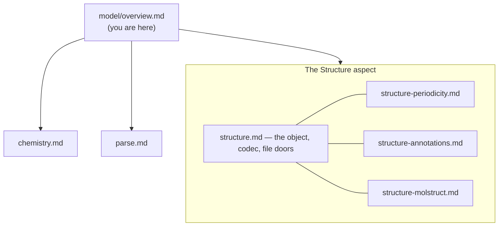
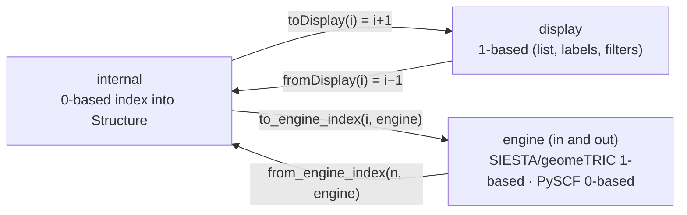

# The data model — overview & atom-index convention

**Role:** overview
**Domain:** model
**Companions:** [`architecture.md`](?doc=architecture.md) (where the model
sits in the L1/L2/L3 layering);
[`execution/job-contracts.md`](?doc=execution/job-contracts.md) § 6 (the
config↔scheduler parameter vocabulary, run identifiers, and
persisted-artifacts registry — absorbed from the legacy
`data-vocabulary.md`, see § 3).

The **model** is molbuilder's L1 layer: the pure data objects, how they persist,
and how files are read back into them. Everything else (engines, execution, the
web front end) builds on these. Start here, then open the doc for the piece
you're working on.

---

## 1. The map — start here

| Doc | What it covers | Open it when you… |
|---|---|---|
| [`structure.md`](?doc=model/structure.md) | The `Structure` object — the lingua franca; its serialization codec (`to_dict`/`from_dict`/`to_wire`), geometry I/O, the paired-file door, and the JS load/save doors. **The master of the Structure aspect.** | touch the core object, save/load, or the wire shape |
| [`structure-periodicity.md`](?doc=model/structure-periodicity.md) | Per-axis box behaviour: `cell`, `engine_offset`, `axis_kind`, derived `pbc`, `vacuum`; `resolve_cell` and the one placement rule every engine is handed through (`cell.to_engine`, § 6.0). | work on cells, vacuum, transport axes, or the FDF cell |
| [`structure-annotations.md`](?doc=model/structure-annotations.md) | The per-atom channel model (`tag`/`flag`/`value`), the ONE label store with reserved labels in it, persistence, engine translation, and the region-label vocabulary. | add per-atom metadata, regions, or a selection filter |
| [`structure-molstruct.md`](?doc=model/structure-molstruct.md) | The `.molstruct.json` save file: envelope, schema versioning, the codec, and the `.xyz`↔sidecar pairing rule. | change what a saved structure carries, or the sidecar format |
| [`chemistry.md`](?doc=model/chemistry.md) | Chemistry helpers on a `Structure`: the phosphate charge rule (the electronic state's charge step), protonation, `add_hydrogens`, clash relief, dipole (the charge and spin a calculation carries → `science/chemistry-correctness.md` § 2a). | resolve charge, add hydrogens, or clean up geometry |
| [`parse.md`](?doc=model/parse.md) | The unified read stack: three ABCs, the `ParseResult` hierarchy, the registry, and how to add a parser. | read a file/dir/text body into typed data, or add a parser |

The **atom-index convention** below is the one shared rule that cuts across all
of these (and into the engines + the web UI), so it lives here.

---

## 2. The index convention — the code's index everywhere, a number on the UI's display

Atoms and frames carry **two counts with a single explicit conversion
boundary**, the UI's display — a deliberate design, because arrays/JSON are
0-based by nature while scientists count atoms 1-based (SIESTA `.fdf`, PDB
serials, counting `.xyz` lines). Mixing them silently is the classic off-by-one
hazard, so each count has its own word: an **index** counts from 0, a
**number** from 1.

*(User, 2026-10-10: "anything CLI means direct programming, so we don't
reinterpret the meaning. only UI display would do so"; "we will give
notification to user to agree that indices start from 0 and could be
different from atom list in the UI".)*

| Layer | Count | Where |
|---|---|---|
| **Internal / machine** | **index, from 0** | Python `Structure` (`regions`/positions, frames), the `.molstruct.json` sidecar + the `.fdf`/`.py` ATOM-METADATA block, `/api/selection/*` rules, the JS selection store `atom.index`, all wiring |
| **The command line, the files, every message molbuilder writes** | **index, from 0 — said as one** | what a person types at the CLI (`molbuilder modify --delete 0,3`), which the command says counts from 0 and asks to be agreed before it acts (`jobset.ask.confirm`, `--yes`); every refusal, warning and printed line — *atom index 3 (Au)*, *frame index 1 (of 3)*, through `structure.atom_words` / `structure.frame_words`, the word *index* in each; a folder named for a frame (`f001` is frame index 1) — the code's own index, never reinterpreted |
| **The UI's own display** | **number, from 1** | the atom list's `#` column, the viewer's atom labels, measurement chips, the "by atom number" filter, the frame bar's `1 / F`, a frame picker, the Customized heading's *Frame 2 of 3* |
| **Engine input** | **engine-specific** | SIESTA `.fdf` (1-based), geomeTRIC `$freeze` (1-based), PySCF `mol.atom` (0-based) |

### 2.1 Identity, carriage, and the only three translation points

**DEFINED** — the canonical identity is the **0-based index into `Structure`**
(`elements[i]` / `positions[i]`), fixed by the atom order in the source file
when parsed. Nothing invents an index; that order *is* the identity.

**CARRIED** — it travels 0-based and untranslated through the JS selection
store, `/api/selection/*`, the `.molstruct.json` sidecar, the ATOM-METADATA
block, and all metadata (`regions`/`annotations`). These indices
are valid only against the structure they were computed on — **pinned by
`geometry_hash`** (`structure-molstruct.md` § 3); a mismatch must refuse, not mis-apply.

**TRANSLATED** — only at three boundaries, each with one API — and **NORMALISED** at a fourth, § 2.2, which is a reorder and not an offset:

The engine edge is **two-way**: `to_engine_index` writes the atom number into
the input file, and `from_engine_index` reads it back when engine *output*
references an atom by number (the return leg of the round-trip). When output is
order-preserved — SIESTA/PySCF emit coordinate and force blocks in `Structure`
order — the internal index is simply the row position and no number
translation is needed.

| Boundary | Direction | The single API |
|---|---|---|
| internal → display | 0 → 1-based | `toDisplay` (`lib/molview/_atom.js`) — the browser's, an atom's index and a frame's (`model/structure.md` § 2.2e); Python never converts: a message names the index itself |
| UI input → internal | 1 → 0-based | `fromDisplay` / `shiftExpression` (same module); the CLI takes the index as typed, said and agreed |
| internal → engine input | 0-based → engine convention | `engine_atom_index.py` — `to_engine_index(i, engine)` (dispatch), or the FACT functions `siesta_atom_index`/`geometric_atom_index` (1-based) / `pyscf_atom_index` (0-based) |
| engine output → internal | engine convention → 0-based | `engine_atom_index.py` — `from_engine_index(n, engine)` (the inverse; return leg of the round-trip) |

`engine_atom_index.py` is the **sole** place a 0-based identity becomes an
engine atom number and back — **no other code applies a bare `i + 1` or
`n − 1`** (both directions route here; bound by `tests/test_engine_atom_index.py`,
including the round-trip identity `from_engine_index(to_engine_index(i, e), e) == i`).
It exposes the per-engine FACT functions **and** the engine-parametrized
`to_engine_index` / `from_engine_index` dispatch, backed by one base-offset
registry so a new engine defines both directions in a single line. The JS
`_atom.js` (`toDisplay`/`fromDisplay`/`shiftExpression`) is the single
web-UI implementation — the one place a number is made from an index; the
standalone viewer embed inlines `+1` at the label, drift-guarded against
`toDisplay`. Python makes none: `structure.atom_words` and
`structure.frame_words` are the one spelling of an atom and a frame in a
message, the index as it is.

**The load-bearing invariant.** Engine coordinate blocks emit atoms in internal
`Structure` order for every kind that does not sort, so engine atom
`siesta_atom_index(i)` is the coordinate line for internal atom `i`. A kind
that must reorder — transport, for TranSIESTA's contiguous electrode ranges;
the SIESTA force-constant run, for a contiguous free range — emits the
**sorted copy** of § 2.2, and the same invariant holds on that copy, under its
recorded permutation. The display convention is chosen so
`toDisplay(i)` **equals** the engine atom number the user reads in the file
(SIESTA `.fdf`, geomeTRIC `$freeze`) — bound by
`tests/test_engine_atom_index.py` — **but the front-end half of this
invariant is UNBOUND.** This line named
`::test_frontend_display_matches_engine_atom_number` until 2026-09-20; a
repo-wide grep finds that name in this citation and nowhere else. The file
exists and holds six tests; none of them is that one,
with end-to-end element+position tests binding the full user→engine round-trip.

### 2.2 Normalised — a sorted COPY under one recorded permutation *(user, 2026-09-23)*

Some engines need atoms in an order the source file does not have. TranSIESTA
identifies each electrode by a **contiguous** atom range; SIESTA's
force-constant run nudges atoms *A through B* and cannot take a scattered free
set. The identity does not bend to them. **The program sorts a COPY at prep,
records the permutation in both directions beside it, and maps every number
that comes back through the inverse before a person sees it.** From the
outside, atoms go in and come out in the input order; the sorted order is an
engine fact, like the 1-based numbering, and it never leaks.

| | the rule |
|---|---|
| **one home per sort key** | the sort is a pure function, `(Structure) -> SortResult`, with one implementation per key over ONE machinery: `transport/sort.py` — `sort_by(struct, key)`, the keys named in `atom_permutation` (`transport`: the categorical order; `held-first`: held atoms first, free atoms last) and each mapped in `SORT_KEYS` to an order handed to the shared `apply_order`, which does the remap, the bijection check and the record: the sorted copy carries its order record, `atom_order` (§ 2.2a; none when the sort moved nothing). A new need is a new key there, never a second machine *(built 2026-09-23; the copy's own record 2026-10-14)* |
| **every index-carrying field moves with its atom** | `regions`, `frozen_atoms`, `annotations`, the identity columns, every per-atom array — through one map, checked to be a bijection before the copy is returned |
| **recorded, both directions** | `atom-permutation.json` beside the record ([`execution/job-contracts.md`](?doc=execution/job-contracts.md) § 6.1): `original_to_sorted`, `sorted_to_original` and the **`key`** that made the copy, written by `write_permutation` (`transport/sort.py`) and read by `read_permutation` (`atom_permutation.py`, the record's own module — stdlib and numpy, so it travels) — one writer, one reader, for every kind; a copy sits in every attempt of a sorted calculation, as part of its shared package |
| **inverted at every return** | a per-atom result read from a sorted run — a force, a Mulliken charge, a projected DOS, an eigenchannel weight, a mode's eigenvector — passes through the record before it reaches any surface, and does so through `Permutation.rows_to_input_order` / `original_of`, never by hand. **The first reader that does is the SIESTA vibration's** (`spectra/vibrational_analysis.py`, from the record's own module `atom_permutation`, which travels with the job's finish; 2026-09-23): the free atoms' rows come out of `.FC` in the sorted order and are written in the input's. No per-atom transport result is parsed yet; when one is, it uses the same two methods |
| **the sorted copy is an engine artifact** | it lives in the calculation's record (the `junction.xyz` there is the *sorted* junction, its order record in its sidecar — the codec's one door for an engine's record, § 2.2a) and in the decks. A surface that opens it presents it as the engine's order, with the permutation beside it — never as the person's structure |
| **the person's interfaces speak the input order** | a displacement script for a frame group receives the base structure in input order and writes the frames in input order, as one multi-frame pair with the base as frame 0 ([`engines/transport.md`](?doc=engines/transport.md) § 2a.9; `structure-molstruct.md` § 6.1). The sort runs per frame at prep, and because a frame inherits the base's labels the permutation is **the same for every frame of a group** |
| **one copy, one permutation** | never composed: `sort_by` refuses a structure already in an engine's order, so an engine order is made only from yours and there is one order record between them (§ 2.2a, I4; *built 2026-10-14*). Two records for one copy is how a return leg inverts the wrong one |

This is a fourth translation, and it differs in kind from the three above: those
are a base offset with no state; this is a per-structure reorder with a record.
`engine_atom_index.py` therefore does not hold it, and must not — its invariant
is that its two directions cannot disagree because they share one base.

### 2.2a The remapped state — the invariants, and the one API across them *(decided 2026-10-14, not built; plan § 5ab, RMP)*

> **Decided with the user on 2026-10-14, not yet built.** *"there is a mapping
> contract, all things will return to original index from input, no mapping
> is exposed at the output"*; *"as long as .xyz and .json always travel along
> with mapping explicit, there is no extra step needed"*; *"modify/molbuilder
> always save a fresh, consistent index without remapping state"*; *"state the
> invariable, and the api that translates different mapping state etc so all
> users are using that"*. Reviewed the same day by two rounds of agents against
> the code. Until it is built, § 2.2 above describes the code: the reorder
> kept in `atom-permutation.json` beside the calculation, read by two readers.
> As each part is built, § 2.2 is rewritten from this section, and this banner
> goes with the last. **Built 2026-10-14 (plan § 5ab R1, the model):** the
> field and its order record, `sort_by` setting it and refusing a remapped
> input, `restored()`, the refusals, the codec's guard and its one door for an
> engine's record, sidecar v14.

**Words.** *An atom's index* is its count from 0, as everywhere in this
document (§ 2). **The order record** is what maps one order of a structure's
atoms onto another: the key that made it and both directions — the
structure's field **`atom_order`**, of the type `atom_permutation.Permutation`.
A structure is **remapped** when its atoms are in an engine's order, and
then it carries its order record; **your order** is your input order.

**Two sides.** *Your side* is in your order: every pair molbuilder writes for
you, a calculation's structure, a frame set, the editors (the Molbuilder tab,
`molbuilder modify`), and every result molbuilder computes for you — a
vibration's spectrum and the structure in it, a transport record's per-atom
content and its data file. *The engine side* is in the order an engine needs:
a deck, the engine's own files in a run (`.out`, `.XV`, `.DM`, `.FC`, SIESTA's
`<label>.xyz`), and an engine record — the transport calculation's composed
junction. **A structure derived from yours** — an electrode cell built from
the junction — is a new structure with its own identity: not a reordering of
your atoms, so it carries no order record. **An engine's fact stated as the
engine's** — the force-constant range `FC.First … FC.Last` in a result's
`engine_metadata`, in the engine's numbering — is not an atom's identity, and
is named as the engine's wherever it is written.

**The invariants:**

| # | invariant |
|---|---|
| **I1** | **Your side is never remapped.** Everything listed above as your side is in your order, its `atom_order` null. The codec guarantees it for pairs: it refuses to write a remapped structure, except through its one door for an engine record (below). |
| **I2** | **Remapped ⇔ the order record is present.** A structure in an engine's order carries its `atom_order`, and nothing else states the state. The identity order is never recorded: a deck whose sort moved nothing states none. |
| **I3** | **Each translation happens in one place.** Into an engine's order: `sort_by` only. Back to yours: `Structure.restored()` for a structure, and the order record's own methods for a computed result's per-atom rows and atom indices. Nothing maps an atom index by hand. |
| **I4** | **An engine order is made only from yours.** `sort_by` refuses a remapped structure, so between an engine and you there is one order record, never two composed. |
| **I5** | **A run's order record is its deck's.** The deck's ATOM-METADATA block states it, and the run door reads it there and nowhere else (`runs.declared`); the finish beside a job reads it there too. One deck, one order record — every frame of a frame set, sorted by one key from your order, carries the same one. |
| **I6** | **A restart file is read only by a deck whose order record is the same as the deck that wrote it** — or both none. A restart file holds the state of the receiving run's own atoms (`.XV`, `.DM`, `.CG`, `.TSDE`, `.chk`, `.TS.HSX`), whether continued from the run before or gathered from another (a seed's density into the device). **Prep decides it**, since it holds both decks: a deck whose order differs from the restart file's writer is written not to read it (`DM.UseSaveDM .false.` and its kin), the file is not carried (and, in the flat layout where it lies in the folder, not read), the hand-over's record is written all the same with the files left out, and prep and the launch say so. The warm-file catalogue states it with its own key, `requires_same = "atom_order"`, answered by `same_order`. A file that describes another structure — a lead's `.TSHS`, its electrode cell — is that structure's own, not a restart file of the device. |
| **I7** | **The pair travels whole.** A structure's order record lives in its `.json` beside its `.xyz`, read and written only by the codec, with its atoms. |
| **I8** | **An editor holds only your order.** The load route answers a file as it is — a remapped pair, or an engine's own structure file in a reordered run, with its order record attached; an editor's open asks the route to restore (`restore: true`), and the answer says it did (`structure.restored`, info, naming the key). The Molbuilder tab's load and append and `molbuilder modify` ask it — `modify`'s agreement says the atom indices count in your order; a viewer does not — the Results tab shows the engine's order, marked. |
| **I9** | **A deck written before this rule** — by a molbuilder older than the release that brings it (its PROVENANCE block's `generator-version`), for a kind that reorders (a SIESTA vibration's stage, a transport rung other than the electrode rungs) — states no order record though it may be remapped. A door that builds from its run refuses it by name (*prepared before this version recorded its atoms' order; prepare the stage again*), and a door that shows it says so. A leftover `atom-permutation.json` is read by nothing. **A pair saved before this rule** from a reordered run's view is in the engine's order with no mark and cannot be told apart: the release says so. |

**The API — the only way across:**

| call | it crosses | its callers, and nobody else |
|---|---|---|
| `sort_by(structure, key) → SortResult` (`transport/sort.py`) | your order → an engine's | prep (a SIESTA vibration's decks), the transport composer. Its `.structure` carries `atom_order` (none for the identity), its `.notes` what the sort says; refuses a remapped input. The keys are named once, in `atom_permutation` (it travels beside a job, so the finish can check a key) |
| `Structure.restored() → Structure` | an engine's → yours | every door that crosses back: the load route asked by an editor, the hand-over, `xv2xyz --from-run`, `modify.append_structure` (the addition), prep and the transport citation building from a run, the transport report's drawing, the vibration finish building the spectrum's structure. Every per-atom field and every frame's atoms moved through `atom_order`, the field cleared; `info` and `customized` rows untouched; a structure in your order comes back unchanged |
| `atom_order.original_of(atom indices)` · `atom_order.rows_to_input_order(rows, atom indices)` · `atom_order.sorted_of(atom indices)` | a computed result's per-atom rows and atom indices, either way | the vibration finish (eigenvectors, positions, masses), the transport record and its data file, the transport report's selections (in through `sorted_of`, back through `original_of`), a refusal naming atoms |
| `runs.view_of(run).structure(...)` | builds an engine-side structure from a run's own files | the only builder of a structure from engine files; attaches the run's `atom_order` from its deck. Its callers then cross with `restored()`, or show it marked |
| `same_order(a, b)` (in `atom_permutation`, beside `Permutation`) | a restart file between two decks | prep, deciding what a deck reads (I6) |
| `StructureCodec.write` · `files` · `source_files` | a structure → a pair | every writer of a pair; **refuses a remapped structure**, naming `restored()` — **except `write(…, engine_record=True)`**, the one door for an engine's record, called by the transport composer alone |
| `metadata_to_dict` / `apply_metadata_dict`, split once | serialisation | the sidecar carries every metadata field; the deck carries the box in its ENGINE-OFFSET block and **every other metadata field** — the labels, channels, customized rows, `atom_order` — in its ATOM-METADATA block, the split named once (the box fields), one predicate deciding the block has something to say, one reader (the block's reader and the order record's dict reader) used by `apply_atom_metadata` and the finish; the browser keeps the per-atom halves folded onto the atoms, and carries every other metadata key as one object it does not open |

**Refused by name**: a bare `xv2xyz` of an `.XV` a reordered run of ours holds
— it names `--from-run`; an edit that adds or removes atoms, and `take`, on a
remapped structure — they name `restored()`; `Structure.concat` of a remapped
input (`append_structure` restores it first).

**Forbidden in molbuilder's code, and checked in review**: `take` called with
an order put together by hand; an order record's lists read by hand; a parser
class imported to build a run's structure; `atom-permutation.json` read (it
retires). A person's script uses the same API.

**What this supersedes in § 2.2's table**, as each part is built: *recorded,
both directions* — the order record lives in the deck and in the pair's
`.json`, no file of its own; *the sorted copy is an engine artifact … with the
permutation beside it* — it carries its order record in itself; *one copy,
one permutation … composed* — never composed: an engine order is made only
from yours (I4).

---

## 3. The rest of the shared vocabulary lives in `execution/`

The model owns the atom-index convention (above) and the structure-metadata
serialization contract (`structure.md § 2.2`). The **other** cross-system
vocabulary — the config↔scheduler parameter names (`mpi_np`/`cpus_per_task`/
`time`/`mem`/…), run identifiers and paths (`SystemLabel`, warm-restart files,
stage and attempt directories, SLURM job names), and the full
persisted-artifacts registry
(`job-set.json`, `task.json`, `<label>.template.toml`, `environment.json`,
`run.json`, checkpoint files, …) — is
an **execution** concern and lives in
[`execution/job-contracts.md`](?doc=execution/job-contracts.md) § 6 (absorbed
from the legacy `data-vocabulary.md`). This overview points there rather than
duplicating it.
