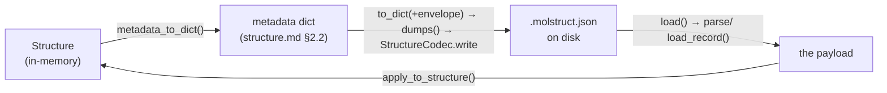

# The `.molstruct.json` file — a structure's saved metadata

**Role:** contract
**Domain:** model
**Sub-document of:** [`structure.md`](?doc=model/structure.md) (its master). **Companions:**
`structure-annotations.md` + `structure-periodicity.md` (the metadata this file
carries), [`engines/overview.md`](?doc=engines/overview.md) § 3 (the
**boundary-condition contract** — how the `frozen_atoms` / `regions` this file
stores are delivered to an engine's input script; see § 6).

When a structure is saved, its geometry goes in the `.xyz` and everything the
`.xyz` has no room for — region labels, frozen atoms, the cell, per-atom
annotations — goes in a companion JSON file next to it: `<stem>.molstruct.json`.
This doc is the contract for that file: its layout, how it is versioned, how it
is read and written, and how it stays paired with its `.xyz`.

> **One file, one authority.** The `.molstruct.json` schema lives in exactly one
> place — the server module `sidecars/molstruct.py`. The browser **never**
> authors it (a browser-written sidecar had no `schema_version` and the load
> door rejected it — the save→reload breaker). The metadata *fields* it carries
> are named only by `Structure`'s codec (see `structure.md § 2.2`); this file
> just wraps them in an envelope.

---

## 1. Layout — envelope + metadata

A `.molstruct.json` is a JSON object: a small **envelope** of bookkeeping keys,
plus the structure's **metadata fields** spread in alongside them.

```json
{
  "schema_version": <SCHEMA_VERSION>,
  "n_atoms_total": 2,
  "n_frames_total": 2,
  "geometry_hash": "3b7e…(sha256 hex)",
  "created_by": "molbuilder",
  "created_at": "2026-07-26T12:00:00Z",

  "regions": {"L-electrode": [0], "frozen_atoms": [1]},
  "cell": [[10,0,0],[0,10,0],[0,0,10]],
  "engine_offset": null,
  "offset_by": null,
  "axis_kind": ["periodic", "periodic", "isolated"],
  "vacuum": [0.0, 0.0, 12.0],
  "annotations": {"charge": {"kind": "value", "data": {"0": 0.1}}},
  "customized": {"rows":   [{"name": "temperature", "value": 300, "unit": "K"}],
                 "frames": [[], [{"name": "mode", "value": 31, "unit": "1"}]]},
  "atom_order": null,
  "atom_index_map": {"atoms_listed_by": "user_index", "atom_index_base": 0,
                     "user_atom_index": [0, 1],
                     "atom_index_why": "given to no engine: its engine order is each calculation's, stated by that calculation's files"},

  "atom_names": ["CA", "SG"],
  "residue_ids": [14, 14],
  "residue_names": ["CYS", "CYS"],
  "chain_ids": ["B", "B"]
}
```

`<SCHEMA_VERSION>` is the integer `sidecars.molstruct.SCHEMA_VERSION`, the one
version the reader reads (§ 2).

The identity block (schema 8, 2026-08-20) is **optional and real-only**: a
column appears only when it says something the server would not have
synthesized itself (names ≠ elements, residues ≠ `MOL`, chains ≠ `A`,
resids ≠ 1 — `Structure.identity_to_dict` owns that judgment, beside the
synthesis it mirrors). `title` is not among them: it is the geometry file's
own comment line, and the sidecar does not carry it (`model/structure.md`
§ 2.2c).  An xyz-born pair carries none
of them: its sidecar holds the envelope and the metadata fields, and no
identity column.

**The species labels** *(v16, 2026-10-31)* ride beside them on the same
terms: `species_labels`, each atom's species label, written only when one is
not the name the geometry file writes for its atom — `Au1`, which the file
writes `Au` ([`model/chemistry.md`](?doc=model/chemistry.md) § 3;
`Structure.identity_to_dict` judges it). Read, each label's name must be the
symbol the geometry file holds for its atom, or the pair is refused naming the
atom; a sidecar that states none leaves the file's symbols as the labels.

| Envelope key | Meaning |
|---|---|
| `schema_version` | the on-disk schema (§ 2) — the reader checks it first |
| `n_atoms_total` | atom count the metadata was computed against; a mismatch on load is refused, never mis-applied |
| `n_frames_total` | *(v11)* frame count of the paired document — what `customized.frames` is indexed against; a mismatch on load is refused like the atom count's (§ 3) |
| `geometry_hash` | *(v13)* sha256 of the paired geometry's atom lines and the cell they sit in (hex) — the integrity pin (§ 3) |
| `created_by` / `created_at` | provenance stamp (`created_at` is ISO-8601 UTC, `…Z`) |
| `atom_index_map` | *(v15)* which index the atoms are listed by and each atom's indices (`model/overview.md` § 2.2b) — written by the codec from the door that writes the pair, never a `Structure` field and never edited; read, it is checked against `atom_order` |

**Three kinds of information, one contract** *(user, 2026-08-20; the third
2026-10-09)*: a fact is **per-atom** — it rides the atom list, one entry per
atom, and survives atom edits because every edit layer carries it with its atom
(`regions` membership, the identity columns, each channel's atom-indexed
half) — or it is **system** — stored separately, whole (`cell`,
`engine_offset` and `offset_by`, `axis_kind`, `vacuum`, each channel's kind/color/fdf, the
structure's `customized` rows) — or it is **per-frame** — one entry per frame,
indexed like the frames, exactly `n_frames_total` of them (`customized.frames`;
`model/structure.md` § 2.2e).  Everything in this file is one of the three, and
every layer (the codec, the wire, the viewer's two translation doors) folds and
unfolds along exactly those lines.

The **metadata fields** (`regions`, `cell`, `engine_offset`, `offset_by`,
`axis_kind`, `vacuum`, `annotations`, `customized`, `atom_order`) are exactly the set
a file states of what `Structure`'s codec owns (`FILE_FIELDS`: `METADATA_FIELDS`
but the view's `order_unstated`, which a pair states only as its
`atom_index_map`, `model/structure.md` § 2.2) — they are **spread in, not
re-listed**, by the writer and the reader alike
(`structure_fields_via_dataclass` round-trips them through a scratch `Structure`
of `n_atoms_total` atoms and `n_frames_total` frames, so the sidecar can never
carry a field the codec doesn't know, nor a frame row set for a frame the
document does not hold; this is what closed the `cell_origin`-dropped-on-reload
bug).

**`atom_order`** *(v14, 2026-10-14 —
[`model/overview.md`](?doc=model/overview.md) § 2.2a, plan § 5ab R1)* is `null`
for a structure in the user order, and for one in an engine's order
its **order record**, written whole:

```text
"atom_order": {"key": "held-first",                  one of the keys atom_permutation names
               "sorted_to_original": [2, 0, 1],      each a bijection of 0 … n−1,
               "original_to_sorted": [1, 2, 0]}      the two inverse
```

**`atom_index_map`** *(v15, 2026-10-23 — [`model/overview.md`](?doc=model/overview.md)
§ 2.2b)* says it of the pair in the words every file molbuilder writes uses,
written by the codec from the door that writes the pair (F2) — never made
from `atom_order` alone, never edited: a pair the user saves, given to no
engine, states no engine index, and why —

```text
"atom_index_map": {"atoms_listed_by": "user_index", "atom_index_base": 0,
                   "user_atom_index": [0, 1, 2],
                   "atom_index_why": "given to no engine: its engine order is each calculation's, stated by that calculation's files"}
```

— and a calculation's composed junction, listed by engine index —

```text
"atom_index_map": {"atoms_listed_by": "engine_index", "atom_index_base": 0,
                   "user_atom_index": [2, 0, 1],
                   "engine_atom_index": [0, 1, 2]}
```

Read, it is kept with the pair as the file states it and **checked against
`atom_order`** through the map's own makers — listed by engine index with
the record's columns, or, with no record, listed by user index, by engine
index with both columns the identity (an engine record whose sort moved
nothing), or `not_stated` — or the pair is refused by name.
`atom_order` is the record the structure carries; the map is what every
reader of a file reads. A pair saved from a view of a run whose order
nothing states (I9 — its deck written before 2026-10-14) states
`"atoms_listed_by": "not_stated"`, its `atom_index_why` saying so — read as
listed by user index, with a warning (F4).

It is **system** information (stored whole, never per atom), and it holds
only for the atom list as it stands — so an edit that adds or removes atoms
refuses a remapped structure (`model/structure.md` § 2.2). It is a metadata
field like the others, spread in and read through the scratch structure, which
refuses an order record that is not two inverse bijections over
`n_atoms_total` atoms, or names no key. **Present means remapped** (I2): a
sidecar carries one only for an engine's own record — the transport
composer's junction, written through the codec's one door for it — since the
codec refuses to write a remapped structure for a person (I1).

**`customized`** (`model/structure.md` § 2.2d) is `null` when it holds no row
at all — as every other metadata field states its unset value — and otherwise
written whole: `rows`, and `frames` with exactly `n_frames_total` entries, an
empty list for a frame with no rows. Their meanings live in
`structure-periodicity.md` and `structure-annotations.md`; the codec authority
is `structure.md § 2.2`.

> **`vacuum` has three states, and all three are honoured.** `null` means
> *nobody chose one* — which is what earns an isolated axis the default 3 Å gap
> — while `[0, 0, 0]` means *no gap, deliberately*, and is used verbatim
> ([`structure-periodicity.md`](?doc=model/structure-periodicity.md) § 6.1).
>
> A reader that read a deliberate zero as unset would lose the ability to
> express one, so each is read as written.

---

## 2. Schema versioning — one version read, strict about shape

**The current schema is `sidecars.molstruct.SCHEMA_VERSION`, and the reader
reads it alone (`READABLE_VERSIONS`)** *(the user, 2026-11-26: "Drop all as
asked" — told that every pair saved before 2026-11-04 — cited junctions,
saved relaxations, frame sets — stops opening, with no rewrite command; and,
of the composed junction every transport calculation keeps, "Everything
before 2026-11-04")*.

**A file of any other version is refused by name**
(`structure_pair.MolstructVersionError`): its version, the date before
which such pairs were saved (`sidecars.molstruct.SCHEMA_SINCE`,
2026-11-04), the one version read, and the way on — the pair made again,
saved from the calculation it came from or built again; its `.xyz` opens
alone with its `.molstruct.json` moved aside, its labels, cell and rows gone
(*metadata is never required*, below). **The error also carries the fact
alone** (`MolstructVersionError.fact`: *its sidecar is version N, saved
before 2026-11-04, and this molbuilder reads version M alone* -- N the file's
version, M `SCHEMA_VERSION`), so a door
that holds such a pair for a calculation says that calculation's way on
instead of the pair's. **A version above the one read was written by a later
molbuilder** and says so, never *saved before 2026-11-04*: *schema_version is
N, written by a later molbuilder than this one -- this molbuilder reads
version M -- open it with the molbuilder that wrote it*, its fact the same
without the way (*its sidecar is version N, written by a later molbuilder
than this one, and this molbuilder reads version M*) and `later` set, so a
calculation's door says that way on too, never *described before*
([`job-contracts.md`](?doc=execution/job-contracts.md) § 6.1, *The versions'
words*). A transport calculation's composed junction of another
version is no usable record: while none of the calculation's stages is
launched, its next prep composes the junction again from its citation; with
one launched, the prep is refused with the calculation's own way on — a new
calculation described and run
([`engines/transport.md`](?doc=engines/transport.md) § 1.1). A calculation's
copy of its structure of another version is refused at its next prep, the
calculation described again from the structure it was made from
([`engines/stages.md`](?doc=engines/stages.md) § 6.3); a frame set of a
vibration whose structure was stated already relaxed, its calculation's copy
of another version, is written stating no `info.calculation`
([`engines/vibration-frames.md`](?doc=engines/vibration-frames.md) § 1). What each
version changed is the *Version history* below.

**Retired keys.** A key the schema once wrote and no longer does — `pbc`
and `cell_origin` (metadata; the second by decision, v10), `title`
(identity, 2026-09-23), `structure_hash` (the envelope's, v13) and
`selection_rules` (the envelope's, v17: how a region was selected, which no
writer had filled since 2026-07-05 and nothing read; the user, 2026-11-03)
— is in no file of the version read: a sidecar holding one is refused as
holding a key it does not carry (`sidecars.molstruct.unread_keys`). **What still holds
one is a run's deck**, read at any version (*What "refused" means*, below):
an older release's ATOM-METADATA block may state `pbc` or `cell_origin`,
ignored where the block is applied (`structure.RETIRED_METADATA_KEYS`), and
a launched PySCF deck's embedded payload the retired envelope keys, which
its comparison sets aside (`sidecars.molstruct.RETIRED_ENVELOPE_KEYS`).

**One version is read today because the user dropped every pair saved
before 2026-11-04** (above), and for no more general reason: the next change
of the schema keeps or refuses the version before it by *Changing the schema*
(below) — an additive change keeps it readable.

**A version gate that admits a version the code cannot honour is worse than no
gate**, because it converts a loud failure into a quiet one.

### What "refused" means at each surface

| Surface | On a payload of a version it does not read (outside `READABLE_VERSIONS`) |
|---|---|
| `molstruct.load` / `parse.sidecars.molstruct.load_record` (the `.molstruct.json` sidecar) | raises `MolstructVersionError` — a `MolstructJsonError`, carrying the fact alone for a calculation's door (§ 2, above); nothing is read. No surface forgives it: the browser's load route answers 400 |
| the in-script `ATOM-METADATA` block, wherever it arrives from — a run directory, the transport composite, or `/api/build/load` — | **one reader**, `Structure.apply_atom_metadata`. The block is read as written today: a retired layout is not translated, so whatever it spells the current way applies and the rest simply is not there. The run still opens. The one refusal is a block whose `n_atoms_total` disagrees with the structure — `MolstructPairingError`, the same name the sidecar's identical guard uses |

The sidecar file's message names its version and says what to do: make the
pair again, or open its geometry alone (above).

### Metadata is never required; only what is PRESENT can be wrong

The line, stated by the user 2026-09-05, and the reason the reader has exactly
one guard:

- **Structure has requirements.** The atom count must match, and the
  coordinates must be in a form we read. Break either and the labels land on
  the wrong atoms, so those refuse.
- **Metadata has none.** No file owes us any particular markings. A structure
  with no regions, no frozen set, no annotations is an ordinary structure, not
  a damaged one — so their absence is never a finding, and nothing warns about
  it. There is nothing to compare against: *metadata is metadata.*

What IS worth saying is the opposite case — a key that is present and that we
did not read, reported as copied-through or unused, so the person knows we saw
it and did nothing with it. That is a statement about something in the file,
not about something missing from it.

So: a run whose markings this build does not read opens quietly with
whatever it does read. It is not a degraded run; it is a run with less
metadata, which is a thing a run is allowed to be.

### Unknown keys in a SIDECAR FILE are refused, not ignored

A key that is neither a structure metadata field nor an envelope key is an
**error**, at the point the payload is still whole. *A key nobody reads is
metadata the writer thinks it saved.*

The guard stands where the payload arrives whole (`load_record`, `unread_keys`),
never downstream of a normaliser that would already have dropped the key.

### Version history

Kept as a record of what the numbers meant. **Only `SCHEMA_VERSION` is
readable** (`READABLE_VERSIONS`); a file at any other is refused, not
upgraded (since 2.87.0; v7–v16 were read until then).

| Version | What it was |
|---|---|
| v1 / v2 | an older `fixed_atoms` key |
| v3 | `regions` + a top-level `frozen_atoms`, no annotations |
| v4 | adds the extensible annotation channels (`structure-annotations.md`) |
| v5 | drops `kgrid` — a `SiestaConfig` sampling knob, not geometry |
| v6 | `cell_origin` persisted |
| v7 | the reserved `frozen_atoms` label moves **into** `regions` with every other label, and the top-level key is no longer written. One store, one designated accessor (`molstruct.frozen_atoms(payload)`), interpreted where it means something |
| v8 | the optional **identity columns** (`atom_names`, `residue_ids`, `residue_names`, `chain_ids` — `title` was a fifth until 2026-09-23 and is now a retired key, see *Retired keys* above), written only when real, applied **full-replace** on read (an absent column resets to the synthesized default, same as the metadata block) — so a PDB-born residue identity stops being erased by a save, and an xyz-born sidecar does not grow a byte |
| v9 | *(2026-08-29)* the optional **`info` block** (`structure-info`): a free key→value store of what the caller knows about these atoms that is not the atoms. Applied **full-replace** like every other block, so a stale store cannot survive a pair that no longer carries one |
| v10 | *(2026-09-25)* — `cell_origin` **retired** (never written; *Retired keys* above) and the optional stated **`engine_offset`** added (`null` = the rule) |
| v11 | *(2026-10-09)* — the optional **`customized`** block (the structure's rows and each frame's) and the envelope's **`n_frames_total`** |
| v12 | *(2026-10-11)* — the optional **`offset_by`**: whose the stated `engine_offset` is, `person` or `engine` |
| v13 | *(2026-10-14)* — **`geometry_hash`**, the pin over the atom lines and the cell (§ 3), in place of `structure_hash`, which is retired |
| v14 | *(2026-10-14)* — the optional **`atom_order`**, the order record of a structure in an engine's order (§ 1; `model/overview.md` § 2.2a) |
| v15 | *(2026-10-23)* — **`atom_index_map`**, which index the atoms are listed by and each atom's indices (§ 1; `model/overview.md` § 2.2b), written into every pair |
| v16 | *(2026-10-31)* — the optional **`species_labels`**, each atom's species label where one is not the name the geometry file holds (§ 1; `model/chemistry.md` § 3) |
| **v17** | **current** *(2026-11-04)* — **`selection_rules` retired**: never written (*Retired keys* above) — **the one version read** since 2.87.0 |

### Changing the schema

Bump `SCHEMA_VERSION`, then decide which kind of change it was — the
decision the reader enforces:

- **Additive** (new optional fields; every old fact stays where it was):
  add the old version to `READABLE_VERSIONS` — old files read whole, and
  refusing them would invalidate data for no protection.
- **Shape-changing** (a fact moves or changes meaning): do **not** extend
  the set — the old version is refused with a message naming the move, and
  the data is regenerated (re-save structures, re-generate scripts). A reader
  that took it would hand back a payload that looks complete and quietly is
  not: v3's top-level `frozen_atoms`, never looked for, would leave the held
  electrode atoms out of the SIESTA input's `Geometry.Constraints` block.

---

## 3. `geometry_hash` — the integrity pin

*(v13.)* The pin leaves the comment line out, so a title a person edits
(`model/structure.md` § 2.2c) never breaks it; `structure_hash`, a hash of the
file's bytes, is a retired key, refused in a sidecar (§ 2, *Retired keys*).

The sidecar's labels are indexed by atom, and its cell is the box these atoms
sit in. Applied to a geometry that changed after it was written, they land on
atoms they were not set for — a calculation described with one structure and
prepared from an edited one runs the edited atoms under the old labels and
cell, and nothing says so. `geometry_hash` pins the sidecar to the geometry it
was written with.

**What it covers.** The sha256 (hex) of these lines, in order, each ending in
a newline:

| line | holds |
|---|---|
| `frame` | before each frame's atoms, in the document's order |
| one per atom | the atom line's fields as written, one space between — the numbers' own text, so no number is parsed or rounded |
| `cell` and the cell | the sidecar's cell, its three rows as the sidecar states them (`cell none` when it states none) |
| `axis_kind` and the kinds | the sidecar's axis kinds (`axis_kind none` when it states none) |

The geometry pinned is always a `.xyz`: a `.pdb` is read, never written,
and holds no sidecar ([`model/structure.md`](?doc=model/structure.md) § 2.4).

**What it leaves out, and why.** The comment line — the title, the geometry
file's own and a person's to edit (`model/structure.md` § 2.2c). The engine
offset and whose it is — where the box is placed around the atoms, which moves
no atom against another or against its periodic images. The labels, channels,
identity columns, `customized` rows, `info` and timestamps — what the sidecar
says *about* the atoms, never the atoms: recording more about the same atoms is
not a different structure.

**Who makes it.** Every writer of a pair, over the document it writes:
`StructureCodec.pair` — a project save, an export, the CLI's writers, a
calculation's `.source` pair — and `write_moved`, a run's saved geometry
(`model/structure.md` § 2.4). Nothing else computes one to store.

**Who checks it.** The one read door, `StructureCodec.load`, computes it over
the file it read with the sidecar's cell and axis kinds and compares. When they
differ:

- **refused** — `GeometryChangedError`, naming the file and the way out — by
  every door that builds something from the structure: prep reading a
  calculation's structure, `molbuilder describe`, the CLI, a deck's file reader, a
  transport citation of a pair;
- **said** — the file opens, the load saying its labels and cell were saved for
  other coordinates — by the browser's load route, the one door of the
  Molbuilder and Results tabs, because reading does not judge
  (`structure-periodicity.md` § 8.2) and the way out is there: the Molbuilder
  tab shows the structure with the sidecar's labels and cell, and saving it
  writes the pair anew, its hash made over what is saved.

**The count guard is the other half, and it stays apart.** On apply
(`apply_to_structure`) the sidecar's `n_atoms_total` must equal the
structure's atom count, and its `n_frames_total` (v11) the frame count, or the
apply is **refused** everywhere (`MolstructPairingError`, never partially
applied): labels are indexed by atom and `customized.frames` by frame, so a
near-miss puts a fact on the wrong one — there is nothing to open.

**What it is not.** It is not the identity of a structure across
calculations, and there is no second hash over the labels and identity
columns: a cited pair — a frame-set citation among them — is pinned by its two
files' sha256, as a cited run's files are, and refused when either changed
afterwards; a calculation's structure edited between its stages is refused at
prep (`engines/stages.md` § 6.3).

---

## 4. The codec (server, one home)

All read/write of `.molstruct.json` goes through `sidecars/molstruct.py`, its
bytes read by its reader in `parse/` (`parse.sidecars.molstruct.load_record`,
through the one record reader, `persist.object_of`, and asking the same one
builder):



| Function | Role |
|---|---|
| `sidecar_path_for(xyz)` | derive `<stem>.molstruct.json` from a geometry path, by the one rule a pair's names are spelled by (`runfiles.sidecar_of`) |
| `to_dict(fields, n_atoms_total, n_frames_total, geometry_hash, …)` | THE ONE BUILDER — the envelope + the validated metadata fields spread in, for a payload written and one read alike |
| `dumps(payload)` | the one serialisation — written with its geometry, both or neither, by `StructureCodec.write` |
| `load(path)` — its bytes read by `parse.sidecars.molstruct.load_record(data)` | read + validate the version → the payload, through the one builder |
| `renewed(sidecar, …)` | a payload renewed for its moved geometry; a sidecar's `created_at` the moment it is written, by the clock every record of a run is stamped with (`runrecord.stamp`) |
| `apply_to_structure(struct, dict)` | apply the metadata onto a `Structure` (via `apply_metadata_dict`); guards `n_atoms_total` and `n_frames_total` |
| `MolstructJsonError` / `MolstructVersionError` / `MolstructPairingError` / `GeometryChangedError` — named once in `structure_pair` (L1, standard library, travelling with the codec and the structure), raised by the codec and, for a deck's block, by the structure | the payload is unreadable / the sidecar is of a **version this build does not read** — a `MolstructJsonError`, carrying the fact alone (`fact`) for a calculation's door (§ 2) / the payload is for a **different structure** (its atom or frame count) / the payload is for **these atoms at other coordinates** (§ 3's geometry hash). Separate types because each gets its own answer: no surface forgives a sidecar's *version* — the browser's load route answers 400, and only a deck's block is read at any age (§ 2, *What "refused" means*) — a door that holds the pair for a calculation says that calculation's way on, none may forgive a wrong *pairing*, and the browser's load door opens a *changed geometry*, saying so, so it can be saved anew |

Callers do not touch the field list — `Structure`'s two metadata methods are the
sole namers (`structure.md § 2.2`). The higher-level paired-file door
`StructureCodec` (`structure.md § 2.4`) wraps this codec together with the
`.xyz` read/write for atomic pair I/O.

---

## 5. Pairing — the sidecar follows its structure

The `.xyz` and its `.molstruct.json` are a unit; a file operation on one must
carry the other, or the labels are orphaned (renaming `water.xyz` →
`bridge.xyz` once left `water.molstruct.json` matching no structure, silently
losing the user's labels).

`POST /api/files/{rename,move,copy}` (`web/blueprints/files.py`, via
the pairing module's `molstruct.paired_sidecar`) move or copy
both files in lockstep:

| Concern | Behaviour |
|---|---|
| Detection | source must be a `.xyz` (`molstruct.is_paired`: a `.pdb` is read, never written, and holds no sidecar — `model/structure.md` § 2.4); pair the `<stem>.molstruct.json` if it exists (a bare `.molstruct.json` rename, or a `.pdb`'s, is single-file) |
| Atomicity | rename/move use `os.replace` on both legs; a failed sidecar leg **rolls back** the geometry leg. Copy uses `shutil.copy2`; a failed sidecar leg unlinks the half-copy |
| No-overwrite | the destination sidecar slot must be empty, else the whole op refuses with **409 before touching either file** |
| Directories | `move`/`copy` refuse directory sources (v1); directories have no sidecar |

Engine generators load the sidecar through `apply_to_structure`, not these
file-ops endpoints, so the sidecar-as-source-of-truth contract is unaffected by
a rename.

### 5.1 One sidecar, many frames *(user, 2026-09-24)*

A coordinate document may hold **several frames** — a structure holding a
frame set is written as one XYZ document, a block per frame (`structure.md`
§ 2.2e, § 2.4), and `from_xyz` reads every frame of one back. **The pair stays one
sidecar**: the per-atom facts (labels, frozen set, identity columns), the
periodicity, the `info` store and the structure's `customized` rows apply to
**every** frame, because a frame is the same atoms, in the same order, moved.
A frame carries its coordinates and its own `customized` rows
(`customized.frames[f]`) and nothing else; a frame that restated a label or a
cell would be a second source for it.

| a reader that… | gets |
|---|---|
| asks for a structure (`load(path)`) | **frame 0**, with the sidecar applied and frame 0's rows as its own |
| asks for one frame (`load(path, frame=i)`) | frame `i` the same way |
| asks for the set (`load(path, frames=True)`) | every frame, in file order, in one structure — the shared facts once, each frame's rows at its index |

This is what makes a multi-frame pair a legal input everywhere a structure is
one, and a **frame set** where a door is frame-aware:
[`engines/transport.md`](?doc=engines/transport.md) § 2a.9 defines the
transport frame group as exactly this pair — frame 0 the base, frames 1…N the
displacements, cited as § 3.1's pair. The cell and the axis kinds are the sidecar's alone — the
document's comment line is never metadata (`structure.md` § 2.3) — which is
one more reason the frames do not travel without it.

**What is particular to one frame** — its displacement, its weight in an
average — is the structure's `customized` section, one set of rows a frame
(the mode the whole set samples is among the structure's own rows) (`model/structure.md` § 2.2d), never `info`. The rows are written by what makes
the frame set — the motion toolkit, a person's script, through
`Structure.set_customized(…, frame=i)` — and never in the browser, which
shows a frame set's rows read-only at the displayed frame. On the Molbuilder
tab, which holds one frame, a person may add, change or remove a row of the
structure or of that frame, saved with the pair (`web/molview.md` § 8.4a).

---

## 6. What this file's metadata drives (pointer)

Storing the labels is one thing; *delivering* them correctly to
an engine's input script is the **boundary-condition contract**, which lives
with the engines: [`engines/overview.md`](?doc=engines/overview.md) § 3. Its
three stages: the labels are set where the structure is (the viewer writes
them into this file's one `regions` store); every deck delivers the held set
verbatim (SIESTA `frozen_atoms`→`Geometry.Constraints`, PySCF's geomeTRIC
`$freeze`, TranSIESTA's electrode labels→its electrode blocks); and **labels
are the user's** — molbuilder reads the labels it owns (the frozen label, a
transport calculation's partition) and no other, which ride along untouched
and are named by no preflight
([`science/validation.md`](?doc=science/validation.md) § 5).

**Sidecar consumers** (which code reads a `.molstruct.json`): its one read
door, `molstruct.load`, asked by the codec's read, `StructureCodec.load` —
through which prep (`rung.structure_for`), `molbuilder describe`, the CLI, the
load route and the parse registry's pair reader take a structure — and by
`atom_index.atom_index_map` (a pair's atom index map); the registry's
`molstruct-json` parser reads one alone. A deck's generator is handed the
structure prep read; the selection route reads no file; a progress log states
its held atoms in its own header.
The engines-wave contract carries the full, current consumer list.
