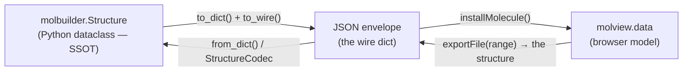
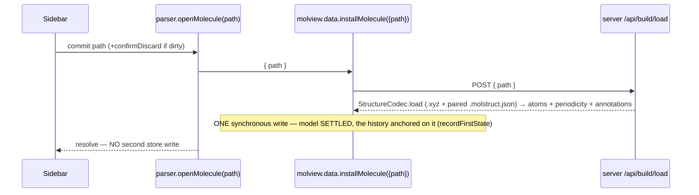
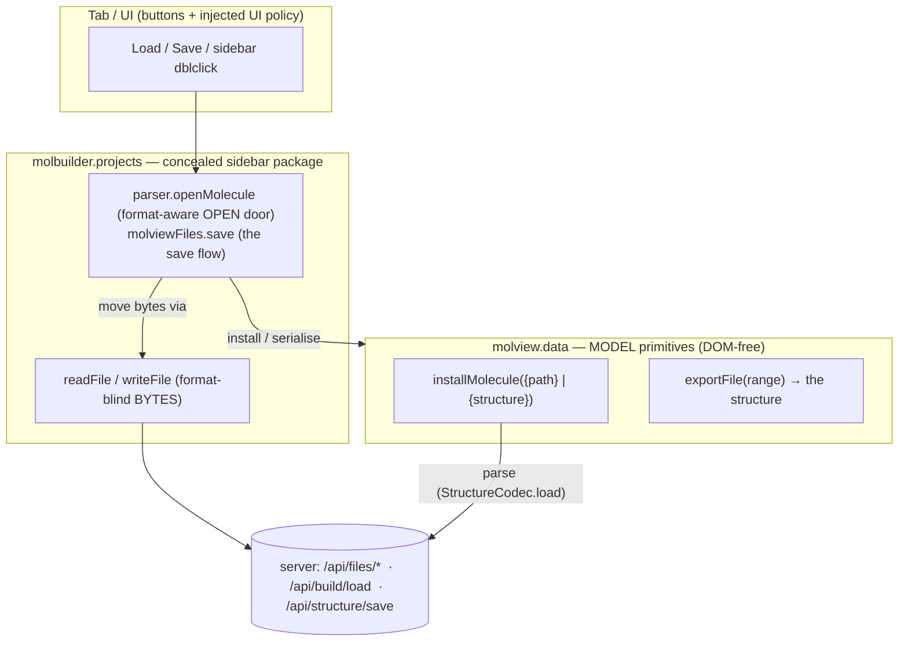

# Structure — the core object, its codec, and its file doors

**Role:** contract
**Domain:** model
**This is the master doc for the Structure aspect.** Its large facets live as
sub-documents sharing the `structure-` filename prefix (so the hierarchy is
visible in the name itself):
- [`structure-periodicity.md`](?doc=model/structure-periodicity.md) — cell · engine offset ·
  axis_kind · vacuum (the per-axis box behaviour; the boolean `pbc()` is an
  accessor for ASE (`to_ase`), not a field — `structure-periodicity.md` § 2.0a).
- [`structure-annotations.md`](?doc=model/structure-annotations.md) — per-atom channel
  model (`tag`/`flag`/`value`) + the region-label vocabulary.
- [`structure-molstruct.md`](?doc=model/structure-molstruct.md) — the `.molstruct.json`
  save file: envelope · schema versioning · codec · file pairing.

**Companions** (separate model modules):
[`model/parse.md`](?doc=model/parse.md) (the read stack that produces a
Structure from engine output), [`model/overview.md`](?doc=model/overview.md)
§ 2 (the shared JSON vocabulary). **Frontend** (see
[`web/projects.md`](?doc=web/projects.md)): the
projects-sidebar module (the Load/Save UI over the doors) and the MolView
module (`molview.data`, the JS model primitives).

`Structure` is molbuilder's **lingua franca**: the one dataclass every builder
yields and every emitter consumes. This doc is the contract for the object
itself, its serialization codec, and the one door that reads/writes it as a
paired file on disk — across **both** the Python/CLI backend and the JS/user
frontend.

> **The one-object rule.** A structure's identity lives in three models that
> must stay byte-identical as data crosses the wire. Exactly one component per
> language may **name a field** or index a structure dict by key: the Python
> `Structure` codec, and the JS translators in `lib/molview/model-jobs.js`
> (`structureFromServer` / `structureForServer`). Everyone else
> carries the dict verbatim as an opaque envelope. This is what stops the
> recurring "a field silently drops to its default on reload" bug (the
> `cell_origin → 0` regression); the field set appears in source **once per
> language**.



---

## 1. The object (L1 data model)

**Module:** `molbuilder/structure.py`. **Tests:** `tests/test_structure.py`,
`tests/test_load.py`, `tests/test_pdb_ter.py`, `tests/test_row_units.py` (a
row's unit in one place, § 2.2d).

Adding a new format means a new method on `Structure`, not changes to the
builders.

```python
@dataclass
class Structure:
    elements:      List[str]                  # chemical symbols, length N
    positions:     np.ndarray                 # shape (N, 3), Angstrom
    atom_names:    Optional[List[str]] = None # PDB-style name; default = elements
    residue_ids:   Optional[List[int]] = None # 1-based; default = all 1
    residue_names: Optional[List[str]] = None # 3-letter; default = all "MOL"
    chain_ids:     Optional[List[str]] = None # single char; default = all "A"
    title:         str = ""                   # XYZ comment / PDB TITLE
    # ── metadata (each detailed in a sub-doc; serialized as one block) ──
    # cell, engine_offset (+ offset_by: whose it is), axis_kind, vacuum
    #     → structure-periodicity.md
    #     (NB: kgrid is NOT a structure field — it is a SiestaConfig DFT
    #      sampling knob; see engines/siesta.md)
    # regions (THE label store), annotations    → structure-annotations.md
    #     (frozen_atoms is not a field: it is the reserved label's one
    #      designated read, a cut of regions)
    # customized — the structure's rows and each frame's      → § 2.2d
    # atom_order — the order record of a structure in an engine's order → § 2.2
    # order_unstated — the view's mark                          → § 2.2
    # ── beside the metadata ──
    # info — records that are not the structure (never hashed) → § 2.2a
    # ── frames (§ 2.2e) ──
    frames:        Optional[np.ndarray] = None # (F, N, 3) when F > 1;
                                               # positions IS frames[0]
```

**Invariants enforced by `__post_init__`** (the single validation site):

- `positions` must reshape to `(N, 3)`, else `ValueError`.
- `frames`, when given, must be `(F, N, 3)` with `F > 1`, and `positions`
  becomes a view of `frames[0]`; a `frames` of one frame is stored as
  `positions` alone (§ 2.2e). `customized` is `None` or holds exactly `F`
  frame row sets, its rows valid and its names unique as § 2.2d states.
- Every optional list, if provided, has length N; `None` gets the per-field
  default above.
- The metadata fields are validated/reconciled here too (see
  `structure-periodicity.md` for the cell/axis_kind reconciliation). Because
  `apply_metadata_dict` re-runs `__post_init__`, **all field validation lives
  in one place** — there is no second validator to drift from.

Atom **order is identity**: the 0-based index into `elements`/`positions`,
fixed by the atom order in the source file, is the canonical atom identity
carried everywhere (see [`model/overview.md`](?doc=model/overview.md) § 2 for
the full provenance + the 0-based/1-based boundary).

---

## 2. Backend surface (Python / CLI)

### 2.1 The whole-structure codec — `to_dict` / `from_dict` / `to_wire`

Three methods on `Structure` (`structure.py`), all shipped:

| Method | Purpose | Round-trips? |
|---|---|---|
| `to_dict()` → `dict` | The ONE canonical serializer: coordinates + per-atom columns + the full metadata block (via `metadata_to_dict()`). | **Yes** — `from_dict(s.to_dict())` reproduces `s` exactly. |
| `from_dict(d)` → `Structure` | The ONE canonical deserializer: builds the object, then `apply_metadata_dict` (the same validator a fresh Structure runs). | inverse of `to_dict` |
| `to_wire()` → `dict` | What the server works out about the structure that `to_dict` does not carry, sent beside it in every structure answer (`web-api.md` § 1): `resolved_box` — `resolved_cell`, `box_corner`, `resolved_vacuum`, the box as it will be used, through the one resolver and placement rule, which the client must not recompute (`structure-periodicity.md` § 6.0) — and `atom_order_said`, the order the atoms are in, in words. Nothing `to_dict` carries | No — derived, read-only |

```python
# to_dict() — the loss-free round-trip unit; NOBODY else assembles this dict
{
    "title": ..., "elements": [...], "positions": [[x,y,z], ...],
    #   …or, for a frame set (§ 2.2e), "frames": [[[x,y,z], ...], ...] — one
    #   key or the other, never both
    "atom_names": [...], "residue_ids": [...],
    "residue_names": [...], "chain_ids": [...],
    "metadata": self.metadata_to_dict(),   # the ONE metadata codec, nested verbatim
    "info": {...},                         # the open store beside the metadata (§ 2.2a)
}
```

**Why two methods, not one flag.** `to_dict()` is the loss-free round-trip
unit (persistence, sidecar, CLI, the wire); `from_dict` inverts it.
`to_wire()` is what is **derived** from it — the box resolved and the order in
words — which `from_dict` never has to invert, and which no field of
`to_dict` repeats. The resolved box is computed **once**, inside `to_wire()`,
so it can never drift or drop. The web layer's one composer,
`_shared.structure_answer`, sends the two side by side, and the kind table's
labels beside them; `ok_structure_response` wraps it with what the call says
(`web-api.md` § 1) — one copy of the structure per answer *(the user,
2026-11-10: "one shape, sent once")*.

### 2.2 The metadata authority — `metadata_to_dict` / `apply_metadata_dict`

The structure metadata (periodicity + region tags + per-atom annotations) has
exactly **one** serialization authority: `Structure` itself.

```python
Structure.metadata_to_dict()      -> dict   # struct → JSON metadata dict (THE writer)
Structure.apply_metadata_dict(d)  -> None   # JSON metadata dict → struct (THE reader)
```

- **Scope** = the dataclass's own metadata fields, named once as
  `METADATA_FIELDS`: `regions`, `cell`, `engine_offset`, `offset_by`,
  `axis_kind`, `vacuum`, `annotations`, `customized` (§ 2.2d), `atom_order`
  and `order_unstated` (below). **What a file states of them** is named
  once too: `FILE_FIELDS`, every one but the view's (`VIEW_FIELDS`, below)
  — the sidecar's spread — and of those the deck's ATOM-METADATA block
  carries every one but the box (`ATOM_METADATA_FIELDS`, `BOX_FIELDS`). (`regions` is the
  whole label store; a reserved label such as `frozen_atoms` is in it, so there
  is no field of its own to serialise — `structure-annotations.md` § 2.)
  `customized`'s frame row sets are indexed by frame, so the block is applied
  to a structure holding the frames it describes (§ 2.2e).
- **Strict JSON** — the dict is lists/dicts/bools/floats. `annotations` are
  JSON channel dicts (via `annotations_to_json`), **never** live `AtomChannel`
  objects (those live only in-memory; see `structure-annotations.md`).
- `apply_metadata_dict` is **full-replace**: an absent key resets that field
  to its default (absent `cell` → non-periodic; absent `regions` → none). It
  re-runs `__post_init__`, so validation is single-sourced. A caller holding
  only part of the block — the SIESTA vibration's finish applying its deck's
  box (`spectra/siesta_vibration.equilibrium_structure`),
  `Structure.apply_atom_metadata` for a deck's label block —
  **completes the block before applying it**, never patches the result; there
  is no partial door, and full-replace is what keeps *an absent key resets*
  legible.
- **NOT in scope** (it sits *around* the contract): the sidecar **envelope**
  (`schema_version` /
  `n_atoms_total` / `geometry_hash` / `created_by` / `created_at`) — see
  `structure-molstruct.md`.

**To add a metadata key:** (1) add the field to the dataclass with its
`__post_init__` validation, and its name to `METADATA_FIELDS`; (2) add it to
`metadata_to_dict()` + `apply_metadata_dict()` — nowhere else; (3) if it must
survive the sidecar, bump `SCHEMA_VERSION` and add the new version to
`READABLE_VERSIONS` (see `structure-molstruct.md`); (4) nothing in the browser:
MolView carries every metadata key it does not shape whole, in
`otherMetadata`, through its two translators (`web/molview.md` § 6.2) — only a
key MolView must show or edit in a shape of its own joins
`SHAPED_METADATA_KEYS` and is folded and unfolded there; (5) add a
save→load→apply round-trip test. You do **not** touch `to_dict`, the sidecar
writer (`sidecars/molstruct.to_dict`), its reader
(`parse/sidecars/molstruct.load_record`) or `apply_to_structure` — each SPREADS
`FILE_FIELDS` through the two methods above, so it picks the field up for
free; a field a file must not state is the view's, added to `VIEW_FIELDS`.

**To remove one:** delete it from the dataclass + both methods, and add its
name to `RETIRED_METADATA_KEYS` — only when ignoring it loses nothing, or by a
recorded decision. THREE gates REFUSE a key they do not know, and every sidecar
on disk carries the key, so without that line every old pair would be refused;
with it the key is read and ignored, and no writer emits it again
(`structure-molstruct.md` § 2, *Retired keys*). Never
leave a "read-but-never-write" half-migration — that is the drift this contract
exists to prevent.

**A field of the view, `order_unstated`** *(2.32.0 —
[`model/overview.md`](?doc=model/overview.md) § 2.2b, F4; the user,
2026-10-23: "build it")*. A tenth field, true for a structure the load route
read from a run whose deck states no order (I9) — its atoms may be in the
engine's order, and nothing says. It rides `to_dict` / `from_dict` and the
browser's road whole (MolView carries it in `otherMetadata`, unopened), so a
Save, a Download or a hand-over of that view reaches the codec still
marked; **a file states it only as its map** — the codec writes
`atoms_listed_by` `not_stated` — and the sidecar and the deck never carry
it as a field (`VIEW_FIELDS`, left out of `FILE_FIELDS`; a result file's
embedded structure, `to_dict(view=False)`, leaves it out too). A read of a
file for a person sets it false: a `not_stated` pair is read as listed by
user index, warned (`structure.order_not_stated`), and saved again records
the user index. **A copy molbuilder makes of a pair for a calculation**,
with no save of the person's in between — the source pair `molbuilder
describe` reads and the description's one writer copies
(`describe.write_description`) — reads it marked
(`StructureCodec.load(…, a_copy=True)`), so the copy states `not_stated`
as its source does: nothing molbuilder writes claims what it does not know
(F4).

**The order record of a remapped structure**
*([`model/overview.md`](?doc=model/overview.md) § 2.2a)*. A ninth
field, **`atom_order`**: null for a structure in the user order; for one in an
engine's order, its order record — an `atom_permutation.Permutation`: the key
that made it (one of the keys `atom_permutation` names) and both directions,
checked to be inverse bijections over the structure's atoms by
`__post_init__`. **Present means remapped** (I2), and nothing else states it.
It rides every road a metadata field rides — `replace`, `copy`, `frame_at`,
`with_frames`, `affine` and every derived copy that keeps the atoms in place;
the sidecar (v14, `structure-molstruct.md`); the deck's ATOM-METADATA block;
the browser. **Two calls cross with it**: `transport.sort.sort_by` sets it
(refusing a structure that already has one, I4), and **`Structure.restored()`**
moves every per-atom field and every frame's atoms back to the user order through
it and clears it — `info` (its relaxation record's fingerprint sorts its
lines, so it survives) and the `customized` rows untouched; a structure in
the user order comes back unchanged. `Structure.in_user_order(what)` is that
restore with the sentence a door says of it (*… held atoms first …*), and
**an atom of a structure that may be remapped is named in the user order** —
`Structure.map_to_user_index` for its index, `Structure.map_from_user_index` the
other way — a structure's own index and the user index, the identity for a
structure with no record (whether a structure was given to an engine is the
writer door's to say, and an engine's index the atom index map's,
[`model/overview.md`](?doc=model/overview.md) § 2.2b, F2) —
`Structure.atoms_named` for the words
every message names atoms in (`atom_words`, with each element): a deck's
sorted copy names the atom the person knows. `runs.view_of` attaches it from a run's
deck; the codec carries it, and refuses to write it except for an engine's
record (§ 2.4). **Refused by name**, naming `restored()`: `take` on a
remapped structure, an edit that adds or removes atoms on one — one sentence,
as a frame set's refusal is (§ 2.2e) — and `concat` of a remapped input
(`modify.append_structure` restores the addition first, and says so), so an
order record never outlives the atoms it describes. An editor never meets
one: it opens a remapped file restored (I8).

### 2.2a `info` — metadata that travels

**`info` IS metadata** *(user, 2026-09-21)*. It is what the MolView
Metadata pane displays (`web/molview.md` § 8.4a), it is written into the
sidecar from schema 9, and it rides every export. What it is **not** is
part of the structure:

- **Not structural.** It never enters the frozen/region machinery. The one
  engine input read from it is a run record's charge and spin, where the
  person states none (`info.calculation`, ES7: `electronic_state`); beyond
  that a deck carries it only as its record of the structure — PySCF's
  sidecar payload, for every pair it saves and its result; a SIESTA
  force-constant deck's `vibration` block, for its result
  ([`engines/vibration.md`](?doc=engines/vibration.md) § 6.10.1) — its
  earlier runs' records left behind.
- **Not in the hash.** `geometry_hash` is computed without it, so
  recording or removing a key never changes the identity of the
  coordinates (`structure-molstruct.md`).
- **Not gated.** `web/molview.md` § 9.4's one question — *"does this change the structure
  the calculation ran on?"* — answers *no* for `info`, which is what
  lets the read-only Results viewer attach a recorded contract before
  export.

Those three are why it sits **outside `METADATA_FIELDS`** (§ 2.2): that
set is the strictly-enumerated STRUCTURAL block — hash input,
gate-controlled, unknown keys refused. `info` is the open store beside
it, with `to_dict` / `from_dict` as its door. Outside is a statement
about the *hash and the gate*, never about whether it is metadata.

**IT TRAVELS WITH THE STRUCTURE, AND A STRIP IS EXPLICIT — NEVER
SILENT.** Every seam that derives one `Structure` from another carries
`info` through: `_carry_nonatom()`, `replace()`, `copy()`, `concat()`,
the geometry ops, `to_dict`/`from_dict`, the sidecar codec. A caller who
wants it gone states that; a rebuild that simply did not list the field
is a **defect**, not a default.
A builder's own steps — `add_hydrogens`, `protonate_phosphate_oxygens`,
3DNA's completion of its 5′-phosphate (`engines/builders.md` § 5) — run on
what the backend returned, before the structure holds any non-atom fact (a
modified residue's atoms are added earlier still, on the kit's own residue,
before the structure exists — `engines/builders.md` § 2). `add_hydrogens`
carries only the identity columns and title; the two that add atoms join
them through `chemistry.with_atoms` (`concat` and `take`), which carries the
rest.

Two clusters ship today, both recorded by the Results tab from the run
directory ([`model/parse.md` § 5b, § 5b.1](?doc=model/parse.md)):
`calculation`, the level of theory the deck stated, and `relaxation`, what
the run did to the geometry it left — with a fingerprint of that geometry
(`Structure.geometry_fingerprint()`), so a consumer can tell whether the
coordinates it holds are the ones the record describes.

Why the distinction is load-bearing rather than tidy: a structure whose
recorded contract vanished cannot be told apart from one that never had
one. The warning that says *"the mesh cutoff and transverse k-mesh below
were converged for a cell that is no longer there"* reads
`info.calculation`, so a silent drop does not degrade that warning — it
deletes it, and the citation then looks clean. An edit is meant to
OUTDATE the record (`structure_modified` / `labels_modified`), which is a
MARK ON IT; a record that is gone cannot carry a mark.

### 2.2b Merging two structures — who supplies each non-atom field

`Structure.concat` (and `modify.append_structure` on top of it) joins the
atoms of several structures. The non-atom fields cannot be joined, so each
one is TAKEN FROM A STATED OWNER:

| field | comes from | why |
|---|---|---|
| `cell`, `engine_offset`, `offset_by` | the first input that **states a cell** | a lattice is the one thing an incoming fragment can supply that a cell-less canvas genuinely lacks. A slab's explicit 2.9 Å box is a real crystal; the molecule's derived vacuum box is not a competing statement, so there is nothing to override *(user, 2026-09-22)* |
| `axis_kind`, `vacuum`, `info` | **the first input**, cell or no cell | these are facts OF THE CANVAS — what the person set in the Cell tab and the contract they recorded. They are equally true of a structure that states no lattice, so a fragment arriving with a box must not restate them |
| everything atom-indexed | joined | `regions`, the annotation channels and the residue IDs are re-indexed and unioned — see `concat`. Residue re-indexing is conditional: `renumber_residues=True` (the default) renumbers, `False` concatenates the ids verbatim |
| `title` | **neither input** — the caller's `title=` argument (§ 2.2c) | a merged structure is not either input, so `concat` takes the name from whoever asked for the merge. `Structure.concat([a, b])` with no `title=` yields `''`; `append_structure` passes the canvas's, which is why the seam this section is about keeps its name |
| `customized` | **the first input** — its rows and its frame's rows | named values about the canvas, as `info` is; the addition's rows are not joined, because a row about one structure is not true of the merge |
| frames | — | a merge joins one-frame structures; a frame set is refused (§ 2.2e) |
| `atom_order` | — | *(2026-10-14)* `concat` refuses a remapped input; `append_structure` restores the addition first and says so (`overview.md` § 2.2a, I8); the canvas, held by an editor, is never remapped |

**What the merge does not carry, it says** (`modify.append_structure`'s
notes, shown on the page that asked): the addition's cell when the canvas has
one, its stated origin, a label it renamed, each entry of the addition's
`info` — a saved pair's calculation and relaxation records, which the canvas's
`info` replaces — and each of its `customized` rows. A dropped record is otherwise invisible: a load onto an
open build would show the build's metadata and none of the file's, with no
word why.

The first two rows are load-bearing and they point opposite ways on purpose.
Taking the whole block from whoever carried a cell let a fragment replace a
typed 8 Å vacuum with `(0,0,0)` and turn two isolated axes crystalline,
silently. Taking nothing from it threw away the only lattice in play.

**The merged box is not made to fit.** `concat` cannot infer a lattice, so a
disagreement between the adopted cell and the merged atoms is reported rather
than papered over. `cell.check` splits it in two, and they are not the same
finding *(measured 2026-09-23)*:

| what is wrong | finding | severity |
|---|---|---|
| the atom span **exceeds** the box on a non-periodic axis — no corner can help | `cell.unfittable` | **error** |
| the box is big enough but the atoms sit outside it | `cell.atoms_outside` | warn |

`cell.py`'s gate gives the second only when the first does not apply
(`not rc.contains_atoms and rc.has_volume and not rc.unfittable_axes`) — one
cause, one finding.

**And `cell.unfittable` does not merely stand.** It is severity `error`, and
`validation.report()` raises `ValidationError` on any error unless the caller
passes `raise_on_error=False`, so **generation refuses**. The merge itself
succeeds and says nothing; the refusal comes at the door that would act on
the result. That is `structure-periodicity.md` § 8.2's division — reading
does not judge, the doors that act do — not an outcome left for the user to
notice.

**Why row 2 is load-bearing for this.** If `axis_kind` rode in from the
cell-carrier, the axes would be `periodic` and both `_unfittable` and the
containment test (`contains_atoms`, which counts an atom outside only along a
non-periodic axis) skip periodic axes — so the same geometry reports
**nothing at all**. The silence the row prevents is the safety net for row 1.

### 2.2c `title` — the geometry file's *(user, 2026-09-23)*

**The geometry file owns `title`; the sidecar does not carry it.** It is the
`.xyz` comment line and the PDB `TITLE` records, and that is its only home.
It is a `Structure` field and rides `to_dict` and `replace`, but it is neither
metadata nor lattice nor atom-indexed, and it is not one of the identity
columns (`IDENTITY_FIELDS`). Nor is it carried by `_carry_nonatom()`: every
op-helper that rebuilds a Structure spells `title=struct.title` by hand,
beside what it carries.

| read from | how |
|---|---|
| the `.xyz` comment line | `from_xyz` takes the free text before the first `Lattice=` / `Properties=` / `pbc=` (`_EXTXYZ_KEY`). Only those three, so a sentence keeps its own `=`: *"anneal at T=300K, run 3"* survives whole. The line is read directly, because ASE's reader would shred a human comment into `{'water': True, 'molecule': True}`; the header is cut, because a header is not a name |
| the PDB `TITLE` records | `from_pdb` joins them with one space |
| a PySCF run's `_optimized.xyz` whose comment line is empty | its file stem (`parse/coords/pyscf_geom.py`, `_read_optimized_xyz`) |

A text pasted or uploaded is read the same way: its title is the text's own;
the name it carries picks its format and names it in what the read says,
never its title.

| written to | how |
|---|---|
| `to_xyz` | the comment line — `(comment or self.title or "Built by molbuilder")` |
| `to_pdb` | the TITLE record, columns 11–80 — seventy characters a record; a longer title continues on further TITLE records, numbered in columns 9–10, broken between words, which `from_pdb` joins with one space — never cut, never past column 80 |

**The sidecar never carries it.** `identity_to_dict` does not emit it, so a
comment line is never something the sidecar says; `apply_to_structure` leaves
it alone — it neither applies a stored copy over the comment line nor resets
it to `""` when the sidecar names none — so a comment line edited by hand is
never overridden. `title` is a retired identity key (`RETIRED_IDENTITY_KEYS`),
with the same three gates as `RETIRED_METADATA_KEYS`: tolerated on read, so a
file the user already has is not refused as a stray key; never applied; and
dropped on rewrite. All three gates know every retired key
(`sidecars.molstruct.unread_keys`), so a payload built in code
(`spectra.pyscf_vibration.equilibrium_structure`) and a file read from disk get
one answer.

**Pinned by**
`tests/test_structure_authority_roundtrip.py::TestTitleBelongsToTheGeometryFile`.

### 2.2d `customized` — named values the structure carries, its own and each frame's *(W39; `archive/2026-10-09-plan-consolidation.md` § 5z.8 F)*

*(User, 2026-09-27: "provide an additional customization list so user can make
a list of parameters as meta data to be stored in the \"customized\" category
… a new category other than info"; "we also need a unified api for writing and
reading them from structure, no handcrafted json operation for these
customized parameters". 2026-10-09: "the data structure should be an indexed
array … the API should be like having a frame as a separate parameter".)*

A **row** is a named value: `name` (a non-empty string), `value` (a number,
text or true/false), and optionally `unit` and `note`.

**A row's unit is said in one place, never two** *(the user, 2026-11-24: "we
shouldn't allow inconsistency in such important topic"; "when we have a
quantity that has a unit, then its unit is then blank")*. A name that ends in
a unit, as the units table spells it in a name (`displacement_ang`,
`frequency_cm1`, `temperature_k`; how an ending is read — the longest, an
inverse, a bare name — is [`model/datafiles.md`](?doc=model/datafiles.md)
§ 2c's, by `units.unit_of_name`), carries its unit, and its `unit` stays
blank — the same unit there, in the table's spelling or as a page shows it
(`Å` beside `bond_ang`), is the name's, not kept. A number whose name
carries none states its unit in `unit` — any spelling, shown as written
(`deg`, `fs`, `Å`), `1` for a count, an index, a fraction or a flag. A text
or true/false states none.

**The rule holds where a row is made** *(the user, 2026-11-24; where the
browser's rows are judged, 2026-11-24: at Apply)*: at the script's doors
(`set_customized`, and `with_frames`' frame rows, § 2.2e) and at MolView's
Info page when a person applies a named value — the one place a row is made
in the browser, which asks the server (`/api/structure/row`,
[`web/molview.md`](?doc=web/molview.md) § 9.3) — all through one rule,
`structure.made_row`. A unit beside a name that carries another, a number of
no unit in its name stating none, or a text or true/false stating one is
refused by name, saying the fix: the ending it read and the rename (*the
name ends in _a, which says its unit is 'A' (ampere) … (lattice_a_ang)*), or
a unit stated, any spelling, `1` for a count. **A row in a record already
written is read as it is** — a run's deck, a result, a data file, a pair an
earlier molbuilder saved: nothing molbuilder wrote stops opening, and every
copy carries it as read — the save, the download and the hand-over from any
tab, the frame generator, a command's write, `molbuilder describe`, a deck
compared for the same calculation. Read anywhere, the same unit beside a name
that carries it is not kept, nor a `1` beside a text or true/false, nor a
unit's surrounding spaces. The row's one validator,
`structure._customized_row`, holds both: what every reader keeps, and, where
a row is made, the rule. The section holds the
**structure's rows** — about the whole structure — and, for a structure of
several frames, **each frame's rows**: an array indexed like the frames, one
row set per frame (§ 2.2e). Names are unique within one set, and a name that
is the structure's may not also be a frame's.

Unlike `info` (§ 2.2a) it is **STRUCTURAL**: it describes what the structure is
for a task — the mode a frame set samples (the structure's rows), each frame's
displacement and its weight in an average (that frame's rows) — so it is in `METADATA_FIELDS`, carried by every derivation, gated
like any edit (`web/molview.md` § 9.4), and in the sidecar (schema 11,
`structure-molstruct.md` § 2). It is never a free-form store: molbuilder
reads one row, each frame's `weight` (§ 2.2f, `frameset.WEIGHT_ROW`), and
every other row is the writer's, carried and shown as written.

**The one door, each side** — nothing else names a key of the section:

| | the door |
|---|---|
| write a row | `Structure.set_customized(name, value, unit=None, note=None, frame=None)` — `frame=None` the structure's rows, an index that frame's; an index outside `0 … F−1` refused, naming `F` |
| remove one | `Structure.remove_customized(name, frame=None)` |
| read | `Structure.customized_value(name, frame=None)` — that set only, never a fall-back to the other; `Structure.customized_rows(frame=None)` |
| the browser | MolView's `data.customized.list(frame)` / `made(name, value, {unit, note})` / `set(name, value, {unit, note, frame})` / `remove(name, {frame})` (`web/molview.md` § 9.3) — `set` checks the row's shape; the unit rule is the server's, asked by `made` (`/api/structure/row`) at the Metadata page's Apply, which sets the row as answered |

**On the wire and on disk** it is one block of the metadata dict, written by
`metadata_to_dict` and applied by `apply_metadata_dict` like every structural
field (§ 2.2) — `null` when it holds no row at all, as every field states its
unset value, and otherwise written whole:

```text
"customized": {
  "rows":   [ {"name": "temperature_k", "value": 300},
              {"name": "sampling_nodes", "value": 3, "unit": "1"} ],
  "frames": [ [ … frame 0 … ], [ … frame 1 … ], … ]      exactly F entries
}
```

`frames` has exactly `F` entries — an empty list for a frame with no rows — so
every per-frame list of the structure has the same length (§ 2.2e).

### 2.2e Frames — a frame set is a data set *(user, 2026-10-09; `archive/2026-10-09-plan-consolidation.md` § 5z.8 F)*

> *"The multi-frame is a tool for us to manage data set that's intrinsically
> consistent with each other … the way we create them is a set of script that
> understand this. That's the contract."*

A structure holds **one or more frames**: the facts shared by every frame (the
identity columns, the labels and channels, the periodicity, `info`, the
structure's `customized` rows) and, per frame, its coordinates and its
`customized` rows. **Every per-frame list is indexed by frame and has exactly
`F` entries, and only the frame doors change `F`.** A one-frame structure is
`F = 1` — the same shape, never a special case.

**What a frame set is.** A data set whose frames are consistent by
construction — the same atoms in the same order, the same species, the same
cell, each frame's rows saying what it is (a displacement along a normal mode,
`engines/transport.md` § 2a.9). It is MADE by code that understands this,
through the doors below — the motion toolkit (from R3d2b2b2; the frame
generator, `spectra.mode_frames`, until then), a person's script. **It is never
edited**: nothing moves atoms, adds or removes them, or rewrites coordinates in
a frame set; the browser views one and the Molbuilder tab loads one frame of it
(`web/molview.md` § 9.4, `web/tabs.md` § 2).

**Stored once.** `frames`, shape `(F, N, 3)`, present when `F > 1`, and
`positions` is a view of frame 0 — one coordinate store, never two copies.
`to_dict` carries `frames` instead of `positions` when `F > 1`, never both.

| | the door |
|---|---|
| how many; one of them | `n_frames`; `frame_at(i)` → a one-frame Structure at frame `i`, its rows that frame's (as its own frame 0), its origin the set's (below); an index outside `0 … F−1` refused naming `F` |
| build a set | `with_frames(coordinates, frame_rows=None)` — every frame `N` atoms of the same species in the same order; frame 0 becomes `positions` |
| reorder the atoms | `take(order)` — the order applied to every per-atom field and every frame; the transport sort's one reorder (`transport/sort.py`), which is not an edit. `take` refuses a remapped structure — its one reorder back is `restored()` (`overview.md` § 2.2a; 2026-10-14) |
| the shared facts | labels, cell, `info`, the structure's rows change for every frame at once — they are shared |

**Refused, by name**: on a set of several frames, anything that moves atoms or
changes their number — the geometry ops (`modify.py`), `affine` / `translated`,
`replace(positions=…)`, the merge (`concat`) — each answering *"a frame set is
not edited — take one frame with `frame_at(i)`"*.

**One origin for the set.** The offset an engine gets is the set's —
`structure-periodicity.md` § 6.0, *A frame set gets one offset*: "frames 1…N
state frame 0's offset". So `frame_at(0)` is frame 0 as it is, and `frame_at(i)`
for `i ≥ 1` states frame 0's offset — the stated one, or the rule's computed on
frame 0 — and every frame reaches the engine through `cell.to_engine` with the
same one. Where the rule cannot place frame 0 (no cell to place it in) there is
no offset to state, and the door that acts refuses the cell itself. The cell is
shared like the offset when the set states one; a set that states none has no
shared box — each `frame_at(i)` gets the box derived from its own atoms
(`resolve_cell`, `structure-periodicity.md` § 4), which differs from frame 0's
by as much as the frames differ, while still taking frame 0's offset.

**Reading a file** (§ 2.3, § 2.4): frame 0 by default — exactly as before — or
one frame (`frame=i`) or the whole set (`frames=True`), and a door that prints
says when it took one frame of several, which and how many. **One frame taken
out of several** (user, 2026-10-10: *"when we constrain what is loaded,
calling modify would always work on a single frame"*) arrives with the shared
facts, `info`, the structure's rows and its own, as written
(`StructureCodec.frame_choice`, the one rule for which frame a read answers
with). A one-frame file is what it is.

**Counting — a frame's index in code and files, its number wherever a person
reads** *(the user, 2026-10-10: "unify the frame index, we have one api on the
molview for frame and that should be the starting point and standard";
2026-11-05, of what a message says: "From 1 in messages")*. The API indexes
frames from 0, as MolView's does (`frame_at(0)`, `frame=0`,
`setCurrentFrame(0)`, a record's `frame`), and so do the files, **a folder name
included**: a transport point's frame level is `f001` for the frame of index 1
(`engines/transport.md` § 2a.11, `paths.frame_token`, a vibration's optical
calls' too). What a person reads counts from 1: every message, on the page and
in the terminal alike — *frame 2 of 3* (`structure.frame_words`; the
travelling module `vibration`, which imports numpy and the constants alone,
spells its own messages' frames the same way, a test holding the two one) —
and the UI's
own display — the frame bar's `1 / F`, the Molbuilder tab's frame picker, the
Customized heading's *Frame 2 of 3* — through MolView's `toDisplay` /
`fromDisplay` (`web/molview.md` § 11.5); nothing else writes a `+ 1`, those two
doors the only ones. A script's
own index, refused, is said as the index it typed: *frame index 5 is outside*.

### 2.2f A multi-frame structure — what a calculation over it needs, and its maker's rows *(user, 2026-10-18)*

> *"what you should fucking correctly define is what are the key meta data
> needed to support fucking multiframe, and extra meta data can be associated
> with particular multiframe that is contructed and with those information the
> transport can of course display them but those fucking information has
> nothing to do with fucking get calculation done"*; *"the frame can of course
> carry meta data, and why you treat it as transport's job to determine what
> should or should not be there?"*

**What a calculation over the frames needs** — the transport calculation's
point per frame ([`engines/transport.md`](?doc=engines/transport.md) § 2a.9):

| what | where | why the calculation needs it |
|---|---|---|
| every frame's coordinates | the `.xyz`, one block per frame (§ 2.2e) | each frame is its own geometry, run in turn |
| one set of atoms, labels, box and `info.calculation`, shared by every frame | the pair (§ 2.2e: the same atoms in every frame, the structure's invariant) | the labels say which atoms are the electrodes and the bridge; `info.calculation` which settings the geometry was optimized with |
| the electrode atoms where frame 0 has them, in every frame | the coordinates | every frame shares the leads' calculation (`engines/transport.md` § 2a.9). Which atoms are the leads is transport's to know: a transport citation names the frames that move one beyond the leads' tolerance (`engines/transport.md` § 2a.9, its home), said, never refused; a maker checks only the atoms it holds still |

**The one row a calculation reads: each frame's `weight`**
(`frameset.WEIGHT_ROW`) — its share of the combined result. Where every frame
states one as a number, the record averages the frames at those weights
(`engines/transport.md` § 2a.12); where some frames state none, or one is not
a number, there is no average and a warning says so; weights that do not sum
to 1 (within `frameset.WEIGHT_SUM_TOLERANCE`, 10⁻⁶) are averaged as written,
with a warning. Nothing is refused for a row. **A weight is the motion's,
not the frame's**: the set's maker's, for the motion the set was made for.
An average over another motion is an analysis of the frames' results — for a
mode's own set, with the motion toolkit's weights
([`engines/vibration-frames.md`](?doc=engines/vibration-frames.md) § 7) —
never written into the set.

**Frame 0 is the set's reference**: the geometry a calculation measures
each frame's change from ([`engines/transport.md`](?doc=engines/transport.md)
§ 2a.12). What a maker puts there is the maker's; every set the motion
toolkit writes has the relaxed geometry there (from R3d2b2b2; today's frame
generator's sets too)
([`engines/vibration-frames.md`](?doc=engines/vibration-frames.md) § 5, the
rule's home).

**Every other row is its maker's** — the structure's rows and each frame's:
carried exactly as written into the calculation's record and data file,
never computed from and never checked by the calculation (`frameset.read`,
the one reader). The
summary `summarize` prints, transport's, says each row by its name, value and
unit as written, a whole number whole; the pages — above transport and the toolkit both — say
a row in the plain words the vibration maker's vocabulary gives a name it
knows, where the row's unit is the vocabulary's or it states none, and any
other by its name and unit as written ([`engines/vibration-frames.md`](?doc=engines/vibration-frames.md)
§ 5.1, § 6). **What travels with the set**: its `info` keys and channels go
wherever the structure goes, as every structure's do — into a composed
junction, and with it into a calculation's sidecar and data file
(`structure_json`), cited whole as the structure. **Of `info`, a calculation
reads what it reads of every structure it cites** — transport frame 0's
`info.calculation` (required) and a relaxation record of its geometry
(`info.relaxation`), [`engines/transport.md`](?doc=engines/transport.md)
§ 3.1 — **and none of a maker's own keys or channels** (`info.sampling`, an
older set's `info.vibration`, `mass_amu`); its record cites the pair by its
path and sha256. What a maker wants a calculation's record to carry
it writes as rows — a vibration's run and result as `vibration_run` and
`vibration_result_sha256`.

**Every row says what it means, in the file** *(the user, 2026-10-27: "the
details of what the weights and mass correction is used should be in meta
data, and should be in contract so that when these data are cited and used
in other places, the meaning is clear and tracked")*. Every row a maker
writes carries its meaning as its `note` — the vibration maker's in its
vocabulary's words ([`engines/vibration-frames.md`](?doc=engines/vibration-frames.md)
§ 5.1) — so a frame set read anywhere says what each number is without this
page: what the weights average, over which distribution, along which
coordinate, measured with which masses. **How the frames were made is stated
as rows of their own** — the maker's `sampling_rule` and its parameters — and
which masses a coordinate is measured with, beside the `mass_amu` channel
that holds them. The one reader (`frameset.read`) carries every row's note
as written, a frame row read with the first meaning any frame writes — the
one rule, `FrameRows.meaning(name, of_frames=True)`, which every reader of a
row's meaning asks; a row
the vibration maker's vocabulary names, written without one, is said so by
the toolkit when it reads its own sets — a warning, never a refusal. **A
citation carries a row whole** — name, value, unit and note: a transport
calculation's record and its data file
([`engines/transport.md`](?doc=engines/transport.md) § 2a.12), and the pages
that draw them, so a number cited downstream keeps what it means and where
it came from.

**A vibration's frame set, as its maker writes it** — its rows, their names,
units, meanings and page words — is the motion toolkit's vocabulary
([`engines/vibration-frames.md`](?doc=engines/vibration-frames.md) § 5.1).
How many frames a set has, where they sit and what they state is its
maker's.

### 2.3 Geometry I/O

| Method | Format | Guarantees |
|---|---|---|
| `to_xyz(*, comment="")` | xmol XYZ **text** | one block per frame the structure holds (§ 2.2e): line 1 = `N`; line 2 = comment-or-title, and nothing else; then per atom its species label's name and `x y z` — `Au1` is written `Au` (`chemical_symbols`; `model/chemistry.md` § 3) |
| `to_pdb()` | PDB ATOM records, as **text** | the element columns 77–78 each label's name, as `to_xyz` writes it; TITLE if set, continued onto numbered records past seventy characters (§ 2.2c); serial capped `99999` (overflow → `*****`); residue id capped `9999`; chain id truncated to 1 char |
| `to_pyscf(*, as_string=False)` | PySCF `gto.M` atom kwarg | `(symbol,(x,y,z))` tuples; multi-line string if `as_string=True` |
| `to_ase()` | `ase.Atoms` | each atom by its label's name, as `to_xyz` writes it; raises `ImportError` with install hint if ASE absent |
| `from_xyz(text, *, title=None)` | XYZ **text** | every frame of the document, one structure (§ 2.2e); see requirements below |
| `from_pdb(text, *, title=None)` | PDB **text** | reads `ATOM`/`HETATM`; first MODEL only; TER handling below |

**The readers take a document, never a path** (`_require_text`
— a `Path` raises `TypeError` naming the door instead). To read a *file*, call
`StructureCodec().load(path)`: it reads the `.molstruct.json` beside the
geometry, which a bare reader cannot.

**The writers return a document and cannot be handed a path.** A lone
geometry file drops the frozen atoms, the labels and the explicit cell
silently, so to write a *file* call `StructureCodec().write(struct, path)`,
which writes the pair; a lone-geometry write is not a call anyone can express.

> A reader takes a path or text, never both (`model/parse.md` § 7):
> `_require_text` refuses a path, naming the door that reads a file.

**Round-trip guarantees.** XYZ: element symbols exact, positions to the six
decimals `to_xyz` writes (1e-6 Å), every frame; metadata drops to defaults
(XYZ has no slots — the comment line is not one, below). PDB: elements,
atom names and residue names exact; positions to the three decimals of the
ATOM record (1e-3 Å); residue ids up to 9999 and serials up to 99999 (the
columns' widths, above); chain ids to their first character. The pair
carries what the geometry cannot: the sidecar holds the real identity
columns and the species labels (`structure-molstruct.md` § 1), so a saved
pair loses none of them.

**`from_xyz` requirements:** a document ASE's extended-XYZ reader reads; one
it cannot read → `ValueError` carrying ASE's own diagnosis (*could not read
XYZ: …*), an empty one *XYZ is empty: …*; a frame whose atom count, species
or order differs from frame 0's → `ValueError` naming that frame.

**A document of several frames is read whole, as one frame set** (§ 2.2e),
and its frames must BE one: a frame `k` whose atom count, species or atom order
differs from frame 0's is refused, naming `k` — the frames of a set are the
same atoms. Choosing one frame is not the reader's: `StructureCodec.load`
(below) and `/api/build/load` take frame 0 unless asked otherwise.

**The comment line is never metadata** *(user, 2026-10-09: "if we deal with a
single XYZ that doesn't come with a JSON file, that means we know nothing about
it … We only take the atoms and their coordinates … we don't assume any
periodicity … The metadata have always to come from the accompanied JSON file,
which has a known origin … We have to be very consistent and explicit")*. A
structure's metadata — its cell, its axis kinds, its labels and channels, its
`customized` rows, its `info` — comes from a source molbuilder knows: the
`.molstruct.json` it wrote beside the file, or, for an engine's own file in one
of our runs, that run's own deck (§ 2.4). The `.xyz` comment line is none of
those: a `Lattice=`, a `pbc=` (booleans that cannot say `transport`), an
`energy=`, an extra per-atom column — none is read, from any file, ours or
another tool's. What the line gives is the title, by § 2.2c's rule, and nothing
else. The line does reach ASE's reader with the rest of the document — ASE
lays out the atom lines by a `Properties=` key when the line has one, the plain
`El x y z` layout when it has none — and of what ASE parses `from_xyz` takes
each frame's species and positions and nothing more (`Structure.from_xyz`),
so no key on the line becomes metadata. And molbuilder writes nothing else there: a frame set is written as plain
XYZ, one block per frame (§ 2.4), so the cell has one home, the sidecar.

**`from_pdb` / TER handling** (pinned by `test_pdb_ter.py`): a segment counter
increments on every `TER`; each atom records `(chain_letter_or_"_",
segment_index)`; a chain letter unique to one segment passes through unchanged;
one spanning multiple segments is disambiguated by appending the segment index
(`A` → `A0`, `A1`); a blank chain-id column maps to `"A"` when unambiguous,
`"_<seg>"` when it spans segments. **Forbidden:** silently truncating serial
`> 99999` (must write `*****`), coercing a multi-char `chain_id` to `?` (must
truncate to first char), or crashing on a TER between ATOM blocks.

**The one reading door.** `StructureCodec().load(path, *, frame=None,
frames=False, retired_out=None, stated_out=None, said_out=None, opened=(),
in_user_order=False, a_copy=False)` — `molbuilder/workingcopy_structure.py`. Dispatches on
the extension (`.xyz` / `.pdb`, anything else refused by name) and applies a
`.xyz`'s `.molstruct.json` (`molstruct.paired_sidecar`; a `.pdb` holds none,
§ 2.4) through `apply_to_structure`. **The pair is the
file**: a reader that takes the geometry alone hands back a structure smaller
than what is on disk — so the parse registry reads a `.xyz` with its sidecar
through this door too (`parse/coords/pair.py`, [`model/parse.md`](?doc=model/parse.md)
§ 4; the user, 2026-11-10: *read the pair whole*), and its `xyz` reader keeps
the XYZ files no sidecar is beside. **What the read says** to a person goes in `said_out`,
each a notice by its name and level — one table, `READ_NOTICES`, made by
`read_notice`: `structure.lone_file` (info, below), `structure.geometry_changed`
(warn, `structure-molstruct.md` § 3), `structure.order_unstated` (warn,
`model/overview.md` § 2.2a, I9), `structure.restored` (info, I8) and
`structure.order_not_stated` (warn — a pair that states no atom order, or
states `not_stated`, read as listed by user index, `model/overview.md`
§ 2.2b, F4). The first two warned states are refusals for a door that builds
from the file; a door that only shows it names them in `opened` and opens it,
said. **`structure.order_not_stated` refuses nothing** — every door opens the
pair, saying it — since a pair saved before the order was recorded is almost
always in the user order and cannot be told otherwise. `in_user_order` is the
read of an editor or of `molbuilder describe`: a structure in an engine's order is put
back in the user order and said, and a run whose order nothing states is refused —
asking to open it as well is refused too. A calculation's own structure needs
no such read: molbuilder writes it in the user order (I1).

**A text with no file** — pasted, or an upload read as an import — is read
by the same parse, `StructureCodec.read_document(text, fmt)`: the format by
the codec's one rule, `format_of_text(text, name)` — the one its name names,
else the text's own first line (§ 2.4) — then the reader that format picks,
every frame, the title the comment line without an engine record's words
(`model/overview.md` § 2.2b), atoms only. `load` is that parse of a file's
text with its sidecar applied.

**A lone file says what was read** *(user, 2026-10-09: "If the XYZ file doesn't
come with a JSON file, then we would notify the user that we're dumping the
comments. And we can print out the comments … and the user can decide how to
modify the metadata, which would eventually be saved as a JSON")*. A `.xyz`
with no `.molstruct.json` beside it — and not an engine's own file in one of our
runs (§ 2.4) — is read as its atoms and coordinates: isolated on every axis, no
cell, no labels. The load answers what it did not read, and every door that
opens a file for a person says it — the load route as a notice, `molbuilder describe`
and the CLI as a printed line: *"x.xyz has no .molstruct.json beside it, so
only its atoms and coordinates were read -- no cell, no labels; its comment line
was not read as metadata: «…»"* — the line quoted whole, so the person can set
what they meant on the Molbuilder tab, its Cell and Metadata pages, where saving
writes it to the sidecar.

**Which frame** *(user, 2026-10-09: "keep the default reading, just take frame
zero … If the caller doesn't provide this option, then frame zero is by
default. So we are not breaking any existing behavior")*. The pair is read
whole and its sidecar applied to the whole set; then `load(path)` answers
**frame 0** — `frame_at(0)`, its rows as its own — exactly as every caller has
always had it; `load(path, frame=i)` answers frame `i`, an index outside
`0 … F−1` refused naming `F`; `load(path, frames=True)` answers the whole set.
A one-frame file answers the same for all three. A door that prints
(`molbuilder describe`, `molbuilder validate`) says when it took one frame of
several: *"this file holds 3 frames; frame 1 of 3 was taken"* — a
line, never a refusal. **`molbuilder modify` refuses a file of several frames**
(user, 2026-10-10: *"on a cli, we do not allow direct operation on a
multiframe file because it creates a whole cluster of options and cases"*): an
edit acts on one structure, and on the command line there is no one to ask
which frame — a frame is taken out by a script (`load(path, frame=i)`) or in
the Molbuilder tab, which asks.

> **ASE owns the XYZ parse:** `from_xyz` calls
> `ase.io.read(..., format="extxyz")`, a superset reader (the plain xmol
> layout and an extended comment line alike, `FE` → `Fe`, every frame); the
> title alone is read from the comment line directly.
>
> `from_pdb` is still ours, and the one reader of a PDB, what the builders' tools
> write included: PDB carries residue, chain and atom-name columns this model owns.
> An element column left blank is read from the name by the format's columns: a
> two-letter element where cols 13-14 spell one (`FE`, `MG`), except a four-letter
> name beginning `H`, which fills the columns and is a hydrogen (`HG21`), and a
> digit there is the name's (`1HG2`).

### 2.4 The paired-file door — `StructureCodec` (L2)

The `.xyz` and its optional `.molstruct.json` are **always** read/written
together. That pairing + atomicity is owned by one L2 object,
`StructureCodec` (`molbuilder/workingcopy_structure.py`).

**What it owns.** Four things, and nothing else in the system holds a second
copy of any of them:

1. **the pairing rule** — `<stem>.xyz` ↔ `<stem>.molstruct.json`, including how
   the sidecar's name is derived (`molstruct.sidecar_path_for`, which asks the
   one rule a pair's names are spelled by, `runfiles.sidecar_of` — the file
   catalogue's sidecar rows ask it too — and the suffix,
   `runfiles.SIDECAR_SUFFIX`); only a `.xyz` pairs with a sidecar
   (`runfiles.PAIRED_SUFFIX`, `molstruct.is_paired`), so a `.pdb` beside one
   never takes it for its own;
2. **the format choice** — molbuilder writes plain XYZ, one block per frame
   the structure holds (§ 2.2e), its comment line the title and nothing else
   (§ 2.3, *the comment line is never metadata*). **A `.pdb` is read, never
   written** *(the user, 2026-11-09: molbuilder's files are always `.xyz` +
   `.molstruct.json`; a `.pdb` is for import)*: the read door opens one by its
   suffix (`format_named`), its atoms, coordinates and residue identity, a
   write to a `.pdb` is refused, and a `.pdb` brought in — uploaded, or loaded
   and saved — is written as `<stem>.xyz` with its sidecar, the residue
   identity riding the sidecar. A text is read in the format its name names,
   when it has one — a picked or uploaded file's; with no such name, pasted
   or piped in, it is XYZ when its first non-blank line is a positive
   integer, its atom count, else PDB (`format_of_text(text, name)`, the one
   rule);
3. **the sidecar envelope** — `schema_version`, the `geometry_hash` pinning it
   to its geometry and checked on every read (`structure-molstruct.md` § 3),
   and the one serialisation (`molstruct.dumps`);
4. **the invariants** — **every pair molbuilder writes has its sidecar**, a
   structure with nothing to say about its atoms included, because the
   sidecar carries the pin; **both or neither on write** — both halves rendered first, so a
   sidecar its serialiser refuses (a NaN recorded in `info`) stops the write
   with the pair on disk as it was; then both staged to temp siblings, then
   both put in place, the geometry first; and on read, a geometry with
   no sidecar beside it is one molbuilder did not write as a pair — read as
   its atoms and coordinates (§ 2.3, *a lone file says what was read*). **An engine's own structure file** — SIESTA's `<label>.xyz`,
   written with no sidecar, read where its run is recorded — **is read
   through that run's view** (`runs.view_of(run).onto(struct)`), as every
   door that builds a structure from a run reads it: the run's frame — the
   cell and axis kinds its deck recorded and the engine's origin, a stated 0,
   because `structure-periodicity.md` § 6.0 asks it of every door that makes
   a structure from an engine's output — its deck's labels and order record,
   and what it says about itself, whole: its contract from its deck and its
   relaxation record from the output a viewer opens in its folder
   (`runs.openable`; `model/parse.md` § 5b.1). A file molbuilder writes, or
   one in a folder no calculation marks, reads as before. **Not** a periodicity gate: reading does not judge
   (`structure-periodicity.md` § 8.2) — see the `load` docstring below.

   **The order record travels inside the pair**
   ([`model/overview.md`](?doc=model/overview.md) § 2.2a) — a
   remapped structure's `atom_order` is a field of its sidecar (v14), read and
   written by the codec with its atoms and nowhere else (I7). **The codec
   refuses to write a remapped structure**, naming `restored()` — `write`,
   `files` and `source_files` alike — **except `write(…, engine_record=True)`**,
   the one door for an engine's record, which the transport composer alone
   calls for its junction; so no pair molbuilder writes for a person is
   remapped (I1), and a door that writes for a person — the save, export and
   hand-over routes, `molbuilder describe`, `xv2xyz --from-run` — restores first. **An engine's own
   structure file** in a reordered run is read through that run's view
   (`runs.view_of`), carrying the run's order record from its deck (I5) —
   answered as it is, marked, unless an editor asks the load to restore (I8).

**How it is shaped: one generator, and an adapter per destination.**

```python
class StructureCodec:                       # L2 (may use the L2 sidecar codec)
    def pair(self, struct) -> StructurePair:
        """THE GENERATOR. A Structure as the two things that represent it
        outside memory: the coordinate document -- plain XYZ -- and the
        sidecar payload, its geometry hash made over that document.
        Every outbound path below goes through this one call."""

    @classmethod
    def named(cls, target) -> Path:
        """THE NAME A STRUCTURE IS WRITTEN UNDER: `<stem>.xyz`, a recognised
        extension (`.xyz`, `.extxyz`, `.pdb`) replaced, any other kept and
        `.xyz` appended -- the export's name, an upload's, and the one a
        refusal offers."""

    @classmethod
    def refused_name(cls, target) -> str | None:
        """WHY `write` REFUSES `target`: any name but a `.xyz` (a `.pdb` is
        read, never written, § 2.4) -- asked by `write`, and by a door
        before its overwrite question."""

    def files(self, struct, target) -> list[tuple[Path, bytes]]:
        """TO THE WIRE. The pair as bytes WITH THE NAMES THEY BELONG UNDER --
        `named(target)` and its sidecar. What `write` writes, without
        writing it."""

    def write(self, struct, target, *, engine_record=False) -> Path:
        """TO DISK. The pair as one unit: geometry to `target`, and the
        sidecar, its geometry hash made over that geometry, to
        sidecar_path_for(target).
        `engine_record`: the one door for an engine's record in its own
        order -- the transport composer's junction.
        Both or neither: both halves rendered, then both staged to temp
        siblings, then both os.replace'd, geometry first -- a sidecar that
        cannot be written stops the write before anything is on disk; the
        only visible interleaving is OLD-sidecar + NEW-geometry between the
        two renames, never a torn file."""

    def write_moved(self, target, elements, positions, sidecar, *,
                    comment) -> Path:
        """TO DISK, FROM INSIDE A RUN. The pair for a structure whose atoms
        MOVED, where only the new coordinates are at hand: they become the
        document through `Structure.to_xyz`, and `sidecar` -- the payload
        `pair` made for the structure before it moved -- goes beside it with
        its `geometry_hash` made over the new document, through `write`'s
        own write path. The PySCF script calls it for every geometry it
        saves, imported from `mb_pyscf.pyz` (`engines/pyscf.md` § 3)."""

    @staticmethod
    def read_document(text, fmt) -> Structure:
        """BACK IN, FROM TEXT. A geometry document's one parse -- the reader
        `fmt` picks (`format_of_text(text, name)`: the name's format, else
        the text's own), every frame, the title without an engine record's words;
        atoms only. `load` is this parse of a file's text, its
        sidecar applied; the web's paste and upload ask it for a text."""

    def load(self, source_path, *, frame=None, frames=False,
             retired_out=None, stated_out=None, said_out=None, opened=(),
             in_user_order=False, a_copy=False) -> Structure:
        """BACK IN. Parse geometry (.pdb by extension, else .xyz) AND, for a
        .xyz, its paired sidecar (`molstruct.paired_sidecar`), applying metadata via molstruct.apply_to_structure
        to the whole set, then answering frame 0, frame `frame`, or with
        `frames=True` every frame (§ 2.3, *Which frame*).
        Missing sidecar = empty metadata (NOT an error), except an engine's
        own file where its run is recorded: that run's frame. A sidecar whose
        geometry hash the file no longer matches is refused -- or, for the
        browser's load door, said (`structure-molstruct.md` § 3). READING DOES NOT
        JUDGE: a box nothing can be done with LOADS, and is refused at the
        doors that ACT on it (`structure-periodicity.md` § 8.2, decided
        2026-08-03 -- raising here made such a file unopenable and therefore
        unfixable, since the Cell page cannot be reached without the
        structure on screen)."""


def pair_files_changed(path, pinned) -> list[str]:   # beside the codec
    """THE PAIR AGAINST ITS RECORD. The names of the pair at `path`'s two
    files -- its .xyz and its sidecar, by the pairing rule -- whose bytes
    are not those `pinned` ({file name: sha256}) states: changed since,
    gone, or never pinned. The one comparison every reader of a cited pair
    against its record asks: a transport calculation's composition, which
    refuses on it, and the frame-set card's words, which say it
    (`engines/transport.md` § 3.1; the words, `engines/vibration-frames.md`
    § 6)."""
```

> **The rule this shape exists to make checkable:** *every structure↔bytes
> translation goes through the codec, and every adapter has exactly one door.*
> An adapter with no door is either retired or unbuilt, and those have opposite
> fixes — so the question gets asked rather than answered by call count.
>
> **On the web too, a structure file reaches disk only through this door**
> *(the user, 2026-11-09: "writing of structure files are always
> through one … unified api as we have designed")*. The content-blind file
> layer writes no geometry file and no sidecar (`molstruct.is_geometry`,
> `is_sidecar` — the pairing rule's own predicates): `/api/files/write`
> refuses one, naming this door; an **upload** of a geometry file is read as
> an import is read (§ 2.3 — by its name's format, atoms and coordinates, a
> lone file, said) and written as a pair through the save's own path — the
> periodicity gate, then `write` — an existing one replaced only on a yes,
> both halves at once; a sidecar uploaded alone is refused, a sidecar being
> written with its structure or not at all; the file read answers
> `read_only` for both, so the preview shows them and edits neither; and the
> hand-over's pair is written on the server
> ([`handover-procedure.md`](?doc=web/handover-procedure.md) § 2).
>
> **`write` names the file; `files` does not.** The difference is who chose the
> name. A project save was given an exact path through a picker, with an
> overwrite gate on it, so `write` puts the bytes exactly there. An export was
> given a *stem* and nothing else, so `files` completes it. Different questions,
> and conflating them is how the pairing rule came to have a second
> implementation in the browser (`web/molview.md` § 11.7).
>
> One frame or many, the file is plain XYZ under `.xyz`, so `load` reads back
> every file `write` makes.
>
> A coordinate document is never written to ask a question about coordinates
> (`web/molview.md` § 11.7).

> **Why the file door is L2, not a method on L1 `Structure`.** The layering
> invariant (`architecture.md` § 3; kept by review) forbids an L1 module
> importing an L2 one. Reading/writing the pair needs the **L2** sidecar codec
> (`sidecars/molstruct.py` — path derivation, atomic JSON, the envelope).
> Putting it on L1 would force a second L1 copy of the sidecar format — the
> exact drift this contract kills. So the pure data codec
> (`to_dict`/`from_dict`/`to_wire`/`metadata_to_dict`) is L1; the paired-file
> door is L2 `StructureCodec`, which routes the sidecar through the one
> metadata authority.

### 2.5 CLI

```bash
molbuilder peptide ASEQ                            # → XYZ on stdout
molbuilder dna ATGC > seq.xyz                      # Structure on stdout
```

**A remapped file on the command line** *([`model/overview.md`](?doc=model/overview.md)
§ 2.2a, I8)*: `molbuilder modify` is an editor — it opens a remapped pair
restored, says so, and its agreement says the atom indices it takes count in
the user order, not the file's; `xv2xyz --from-run` writes the run's geometry
restored, and says so; a bare `xv2xyz` of an `.XV` a reordered run of ours
holds is refused, naming `--from-run` *(2026-10-14, plan § 5ab R1–R2)*.

**Both sides of the CLI now go through the door.** Reads: `jobset prep`
reads the calculation's structure through `StructureCodec().load`
(`jobset/rung.py::structure_for`); every deck is made from that structure,
so every emitter sees regions and frozen atoms (SIESTA writes
`Geometry.Constraints` from them). `pyscf/input.py` reads no file: it is
handed the structure prep read. Writes: `_emit` and
`molbuilder modify` call `StructureCodec().write`, so a CLI save emits the
**pair** — and the two surfaces now agree about what saving a structure means.

> **What `write` writes, `load` reads back.** `write` writes the target
> verbatim, and `load` dispatches on its suffix, so XYZ bytes under a `.pdb`
> name would be read as a PDB and fail. The codec writes XYZ alone, and a
> `.pdb` target is refused by name (§ 2.4, *the format choice*), so every
> file `write` makes is read back by the reader its name selects.

---

## 3. Frontend surface (JS / user)

The tab-facing surface is **two doors** plus the model primitives they call.
A tab calls a door and nothing below it; reaching around a door (a second
file stack, a browser-written sidecar, poking the store) is wrong by
definition.

### 3.1 The open door — `projects.parser.openMolecule`

**Opening needs the pairing rule; saving needs a destination** — one door
each: `openMolecule` opens a file, `projects.molviewFiles.save` asks where and
owns the overwrite flow.

It is **FILE-ONLY**: the door hands a `path` to the **server**, which owns file access, the
`.xyz`↔`.molstruct.json` pairing, and the sidecar schema. The browser reads
no bytes, derives no sidecar path, writes no coordinate document, and **never
authors the sidecar schema** (a browser-written sidecar had no
`schema_version`, so the load door rejected the pair — the save→reload breaker,
task #75).

| Door | Does | Server seam |
|---|---|---|
| `openMolecule(viewer, path, {confirmDiscard?, restore?})` | dirty-gate → `viewer.data.installMolecule({path, restore, enforce: true})` — `restore` asks for a file in an engine's order put back in the user order ([`model/overview.md`](?doc=model/overview.md) § 2.2a) | `POST /api/build/load` → `StructureCodec.load` |
| *(saving)* `projects.molviewFiles.save("project", stem, exportFile(range))` | asks WHERE (`chooseSavePath`) → POST → confirms an overwrite → refreshes the sidebar | `POST /api/structure/save` → `struct_from_body` + `StructureCodec.write` (stamps `schema_version` + the `geometry_hash` of what it writes) |

`openMolecule` is **only** for a project-file path. A generated structure
(smiles/dna/…) has no file, so the generators' page hands its envelope to
`molview.data.installMolecule({structure})` directly — the model primitive,
not the door. **The browser saves XYZ only** — the save door names the file
`<stem>.xyz` (`lib/projects/molview-doors.js`), and the codec writes a
plain `.xyz` there, one block per frame. A `.pdb` is read, never written
(§ 2.4): `openMolecule` loads one, and its save writes `<stem>.xyz` with its
sidecar.
A 409 "exists" envelope → `{needsOverwrite:true, replaces}`, and the door
confirms and retries with `{overwrite:true}` — the dialog is `projects`' own
(`confirmOverwrite`, the one question naming what a yes replaces), so the
model layer stays DOM-free.

### 3.2 The model primitives + the JS key-namer

`molview.data` (`lib/molview/model.js`) is the browser model:
`installMolecule({path} | {structure} | {text, filename})`, `exportFile(range) → {name,
structure}` — ONE envelope, the range's frames and their rows inside it
(§ 2.2e). Named-key reads of the wire dict happen
in **one** place — the model's accessors (`getUnitCell`,
`getUnitCellOrigin`, `getVacuum`, `getAxisKind`, …), the JS analogue of
Structure's codec. The inbound translator composes `periodicity` from the
box keys of the structure's metadata (`BOX_METADATA_KEYS`, Python's
`BOX_FIELDS`) and the resolved box beside them; every other metadata key rides
whole in `otherMetadata`, so a server-added field survives persistence
untouched — a box key the list does not name among them. The one
periodicity writer, `commitPeriodicityOp`, posts the op to the server's door
and adopts the block it answers — it carries no key list of its own, so it
cannot drop an unlisted field.

### 3.3 SETTLE-BEFORE-READY — one store write per load

`installMolecule` installs the FINAL model — sidecar-enriched atoms, source,
periodicity, AND the cleared selection — in **one** synchronous write; the
"ready" signals fire at that write, and **no second store write may follow**
(it would land after "ready" and clobber whatever a consumer already did).



> No second store write follows the install: one landing after "ready" would
> clobber what a consumer did in between.

### 3.4 Consumer map (shipped)

| Consumer | `file:function` | Call |
|---|---|---|
| Molbuilder tab — Load / dblclick | `modify/selection-bootstrap.js:_commitFile` | `POST /api/build/load`; on a file of several frames, which frame (1 … F, frame 1 offered) and a second load of that one (§ 2.2e — the tab holds one frame); with a structure open, the add-or-clear question (`tabs.md` § 2, *Creating a structure*); then `structurePage.loadIntoCanvas(…, {replace})` — *Add* merges through `/api/modify/append` (§ 2.2b), *Clear* installs the file over the view |
| Molbuilder tab — Save panel | `modify/structure/save.js:save` | `projects.molviewFiles.save("project", stem, exportFile())` — the door asks WHERE and owns the overwrite flow (`tabs.md` § 6) |
| Transport report | `lib/inspectors/transport.js` | `molview.mount` + `openMolecule(handle, junction, {restore})` — in the user order, or marked where its order is not recorded |
| Results structure inspector | `lib/inspectors/structure.js` | `molview.mount` + `openMolecule(handle, path)` |
| Structure-optimization and Spectrum — Load / dblclick | `lib/structure-card.js:loadNow` | `molview.mount` + `openMolecule(handle, path)`, one load on the canvas at a time, the newest asked winning (`tabs.md` § 3); reads state off the model |
| Generators (smiles/dna/…) | `modify/structure/*.js` → `page.js` | `molview.data.installMolecule({structure, filename})` (not a door) |
| Trajectory inspector | `lib/trajectory/core.js` | `installMolecule({structure, filename, frames, forces})` + `reloadFrames(...)` — **the one exception to frames-in-the-envelope**: a run's frames are parsed by the tab from the run's own file, carry forces and no rows, and replace any frame axis the envelope had (`web/molview.md` § 11.7) |

> The Molbuilder tab's static files live under `modify/` — the `/modify`
> route was renamed to `/molbuilder`, but the directory name is historical.

"Load + mount is ONE shared path": Transport, Spectra, and the Results
inspector each mount its viewer (`molview.mount(host, ws, {mode, owner})`)
and open the picked file into it, `openMolecule(handle, path)`. When each hand-rolled its own copy
they drifted (the inspector read raw XYZ and dropped the sidecar — the label
bug). One path = the sidecar-correct load, for every tab.

---

## 4. The wire contract (backend ⇄ frontend)

The doors sit over the projects byte-layer + the parse seam; the model
primitives sit over the same server. The dependency points one way
(`projects.parser → molview.data`, resolved by a call-time lookup, so there is
no cycle):



| Layer | Owns | Never |
|---|---|---|
| `projects` byte layer | locating a file + moving its **bytes** | parses a molecule; knows the model |
| `projects.parser` doors | read→parse→install (load); serialise→write (save); the pairing | owns a parser (calls the seam) |
| `molview.data` primitives | a path or an envelope ⇄ live molecule; the atomic install | fetches a file; owns a file endpoint |
| tab / UI | wiring buttons; UI policy (dirty/overwrite — injected) | reaches past a door |

**A frame set crosses in the same envelope** (§ 2.2e): the structure's own
dict, with `frames` in place of `positions` (§ 2.1) and every row in
`metadata.customized` (§ 2.2d) — never a `frames` list beside it.
`/api/build/load` answers a file as `StructureCodec.load` does — frame 0,
`frame`, or the whole set with `frames` — and always says how many frames the
file holds (`web/web-api.md`). Its put-back branch, `{structure}` — a tab
putting back the structure it showed before the page was left — is
`exportFile`'s exact inverse: the envelope answered whole, a frame set with
every frame, and no frame chosen (the load route's put-back branch).

**Where the sidecar schema lives** (server, one home):
`sidecars/molstruct.py` — `apply_to_structure(struct, dict)`, `load(path)`,
`to_dict(…)`, `dumps(payload)`, `sidecar_path_for(xyz)`, and its bytes' reader in `parse/`,
`parse.sidecars.molstruct.load_record`. The
byte layer knows the pair only as "which bytes travel together"; interpreting
it (parse + apply the schema) happens only inside the server seam. Clicking a
`.molstruct.json` in the sidebar shows its JSON via the `source` inspector —
open the paired `.xyz` to view the structure.

---

## 5. The round-trip invariant + enforcement

A single Python test constructs a Structure with every metadata field but
`customized` set to a non-default value and asserts it survives each hop
unchanged — the test that would have caught `cell_origin → 0` at the source
(`tests/test_structure_authority_roundtrip.py`):

```python
def _fully_populated_structure():
    s = Structure(elements=["C", "O"], positions=[[1.,2.,3.], [4.,5.,6.]])
    s.apply_metadata_dict({
        "cell": [[10,0,0],[0,10,0],[0,0,10]], "engine_offset": [-0.5,-1.5,-2.5],
        "axis_kind": ["periodic","periodic","isolated"],
        "vacuum": [0.,0.,12.],
        # every label in one store, the reserved one included
        "regions": {"electrode":[0], "channel":[1], "frozen_atoms":[0]},
        # a value channel: kind ∈ {tag,flag,value}; value data is a sparse
        # (string-keyed) idx→value map — see structure-annotations.md § 2
        "annotations": {"charge": {"kind":"value", "data":{"0":0.1, "1":-0.1}}},
    })
    return s

# to_dict → from_dict preserves every field; to_dict carries the stated offset
# and to_wire the box_corner it puts the box at; StructureCodec.write → load preserves
# metadata and writes the .molstruct.json pair.
```

`customized` and the frames are pinned by the frame-set case table,
`tests/data/frame_sets.toml` (its runner `tests/test_frame_sets.py`): a
three-frame set with the structure's rows and each frame's, saved and read
whole (every frame, every frame's rows at its index), read with no option
(frame 0, with frame 0's rows as its own), read at one frame, and refused at a
frame outside the set.

The browser half is pinned through the real translators, not a mirror of
them: `test_structure_pair_one_generator.py` carries a pair -- a stated offset
and none -- disk → `/api/build/load` → `structureFromServer` →
`structureForServer` (executed under node) → `/api/structure/export` → disk,
and `test_molview_e2e.py::test_the_cell_door_speaks_the_route_it_posts_to`
drives the origin through the real periodicity route in a page.

**Anti-patterns (rejected by reference to this doc):** hand-rolled structure
repacks; raw-dict metadata access (`d["engine_offset"]`, `d.get("axis_kind")`) outside
the two codecs; a JS field whitelist that drops an unlisted key (a key the
translators do not shape rides whole, `otherMetadata`); a second file stack or a
browser-authored sidecar. Named-key access lives in exactly one place per
language.
