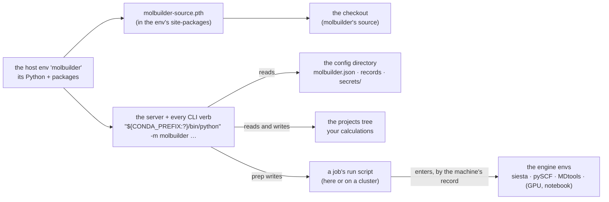
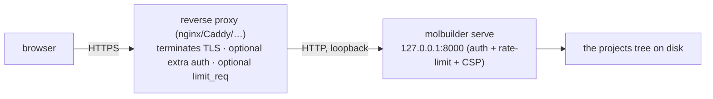
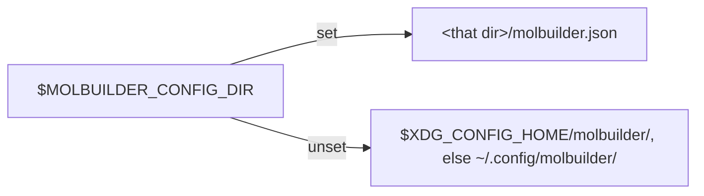

# Deployment — running the molbuilder server

**Role:** guide
**Domain:** ops
**Companions:** [`access-control.md`](?doc=ops/access-control.md) — **the design
of the gates** (identity · hostility · admin · stopping the process), which this
guide is the operational half of; [`installation.md`](?doc=ops/installation.md) —
getting molbuilder and its envs onto the host first;
[`web-api.md`](?doc=web/web-api.md) — the HTTP
API (its security section defers the full rate-limiter threat model to §4 here);
[`execution/running-a-job.md`](?doc=execution/running-a-job.md) — `molbuilder.json`
also carries the job-execution config.

molbuilder serves its web UI with the **`molbuilder serve` verbs** (§ 1). On a laptop that's the
whole story — it binds loopback, no auth, and you're done. Exposing it to other
people is where the care goes: molbuilder runs its own **single-process
development server**, so anything production-grade (TLS, real auth, per-IP
throttling at scale) is either configured here or handled by a **reverse proxy in
front of it**.

## 0. After `bootstrap` — what you have, and how it fits together

*(The user, 2026-11-22: "in the deployment section/part, explain what is the
design/setup after bootstrap".)* `bash scripts/install-env.sh bootstrap --yes`
([`installation.md`](?doc=ops/installation.md) § 2) leaves five parts on the
machine. Everything later in this guide runs on them.

| part | where | what it is | made by |
|---|---|---|---|
| **the checkout** | the folder you cloned | molbuilder's source — the code every command and the server run. It is installed nowhere else, so a `git pull` in it is the update (then § 1.1: restart the server) | you |
| **the host env** `molbuilder` | the manager's env folder | the Python molbuilder runs on and its packages (`molbuilder/envs/host-env.txt`), and **one path file in its `site-packages`, `molbuilder-source.pth`, naming the checkout** — so this env's own Python finds molbuilder from any folder. Nothing is copied; the file goes when the env does | the shim creates the env; `bootstrap` writes the path file every time it runs |
| **the engine envs** | beside the host env | `molbuilder-siesta`, `molbuilder-pySCF`, `molbuilder-MDtools` by default; the GPU build of SIESTA and the notebook's env when you install them — each entered only as [`installation.md`](?doc=ops/installation.md) M1–M6 say, its own programs by their paths | `bootstrap`, `install` |
| **the config directory** | `~/.config/molbuilder/`, or `$MOLBUILDER_CONFIG_DIR` | `molbuilder.json`, this machine's record `environment.json`, the records of machines you prepare for in `environments/`, and every credential in `secrets/` ([`installation.md`](?doc=ops/installation.md) § 2's tree; § 5 here) | `init-config`, at the end of `bootstrap`; `jobset probe` |
| **the projects tree** | `paths.projects`, asked at `bootstrap` | every calculation's folder — where the server reads and writes your work (§ 6) — and molbuilder's example notebooks in `notebooks/examples/` ([`installation.md`](?doc=ops/installation.md) § 2.1) | you, through the pages and `describe`; the examples `init-config` and `molbuilder examples` |



**How you run it.** Activate the host env and run its own Python —
`conda activate molbuilder`, then `"${CONDA_PREFIX:?}/bin/python" -m molbuilder <verb>` — **from any
folder**: the path file finds the checkout. That is the spelling of every
command molbuilder prints ([`execution/job-system.md`](?doc=execution/job-system.md)
§ 5.3): a deck's header, a refusal's next step, this guide's own lines. The
server is one of those commands (`serve start`, § 1); what it starts of its
own — its worker, the notebook's shepherd — runs on the same Python. A job runs
apart from all of this: its run script enters its engine's env on the machine
it runs on, as that machine's record says
([`execution/running-a-job.md`](?doc=execution/running-a-job.md) § 2), on a
cluster as well as here.

**When something moves.**

- **The checkout moved:** run `bootstrap` again from where it is now — it
  rewrites the path file to name it. Until then, `doctor`'s host check fails
  (molbuilder is not found), naming `bootstrap` after `repair`.
- **You cloned a second checkout:** the host env finds the one whose
  `bootstrap` ran last, and `doctor` cannot tell you meant the other — run
  `bootstrap` from the one you work in.
- **A new release in the same checkout:** nothing to rerun; restart the
  server (§ 1.1) so it runs the new code.
- **An env removed or broken:** `doctor` names the command that repairs it.

## 1. Running it

**`serve` is a group of verbs** — a verb is named, never implied:

```bash
conda activate molbuilder               # the host env; its own Python below (installation.md M6)
"${CONDA_PREFIX:?}/bin/python" -m molbuilder serve start        # background: detach, log, pidfile
"${CONDA_PREFIX:?}/bin/python" -m molbuilder serve status       # SURVEYS every server; --port for one
"${CONDA_PREFIX:?}/bin/python" -m molbuilder serve restart      # recycle the server in place
"${CONDA_PREFIX:?}/bin/python" -m molbuilder serve stop         # bring it down
"${CONDA_PREFIX:?}/bin/python" -m molbuilder serve foreground   # today's terminal-bound run (dev)
```

### 1.0a `serve start` — the background server

`start` detaches, then runs the same supervisor+child pair `foreground`
runs — nothing about the server itself changes, only who holds the
terminal. A process list shows the two: the supervisor (the `serve` command
you ran) and its child, `serve foreground --host … --port …`, the server —
marked supervised by the environment the supervisor starts it with
(`reload_protocol.server_environment`, which also gives it its one numerical
thread, § 1.0f). The many lines a thread view lists under the child are its
threads, not processes. Three files, each in a directory of **your own** account
(which is what makes every bit of this per-user):

| file | what |
|---|---|
| `$XDG_RUNTIME_DIR/molbuilder/serve-<port>.pid` | the supervisor's pid — the address `stop`/`restart`/`status` act on — and, on its second line, the address its server was started on (`--host`), where `status` asks it.  `<state>/run` when that variable is unset; a variable naming a directory that cannot be made here is refused before `start` detaches ([`configuration.md`](?doc=configuration.md) § 2.1d) |
| `$XDG_STATE_HOME/molbuilder/logs/serve-<port>.log` | everything the server prints (default `~/.local/state/molbuilder/logs/`) |
| `$XDG_STATE_HOME/molbuilder/logs/serve-<port>.stacks.log` | thread stacks, appended each time the server child receives `SIGUSR1` (§ 1.0c) |

**The log is capped and rotated** *(user requirement, 2026-08-28)*:
when it exceeds `--log-max-mb` (default 20) it is closed, gzipped to
`serve-<port>.log.1.gz` (older ones shift up), and at most `--log-keep`
(default 5) archives are kept — the oldest is deleted. A long-lived
server cannot fill the disk.

**One user cannot touch another's instance, twice over.** The kernel
already refuses cross-user signals outright; on top of that, every verb
verifies before acting — the pid in the file must be alive, be **yours**,
and its command line must actually be a molbuilder serve — so a stale
pidfile whose pid was recycled by some other program is reported as
stale, never signalled.

### 1.0b `stop` · `restart` · `status`

* **`status`** answers two different questions separately: *is the
  process up* (the pidfile checks above) and *is it answering*
  (`/api/health`, asked at the address the server was started on — `0.0.0.0`
  or `::` on loopback — straight to it, never through a proxy your shell names;
  a server whose supervisor an older molbuilder started kept no host, and is
  asked at `127.0.0.1`, which a NO names, with `serve stop` then `serve start`
  to record it) — the 2026-08-28 wedge was precisely a
  server that was up and not answering, and a status that conflated the two
  would have called it healthy.
* **`restart`** signals the supervisor (`SIGHUP`), which recycles the
  child — the Reload button's effect, workable from a script, and
  workable when the child is HUNG and the button's route cannot answer.
  **It reads `molbuilder.json` first, as the fresh child will**, and so
  does the Reload button: a child that cannot read the file exits
  nonzero and the supervisor does not respawn it (§ 1.0c), so a restart
  over a broken file would leave no server. The file's refusal comes
  back instead — `Error: <path>: …`, exit 2, on the command line; a 409
  with the same words on the button — and the running server is left
  alone. `jupyter start` and `jupyter restart` read it first for the
  same reason ([`web/jupyter.md`](?doc=web/jupyter.md) § 5).
* **`stop`** is a polite `SIGTERM` to the supervisor, which takes the
  child down with it and removes the pidfile.

### 1.0c What the supervisor does now (the 2026-08-28 hang's repairs)

The 2026-08-28 wedge found two gaps, both closed:

* **A child that dies by signal is respawned** (with a flap guard: two
  crashes within 30 s and the supervisor gives up and says so). Before,
  killing a hung child made the supervisor conclude *"that was not a
  reload"* and quit — the site went down exactly when recovery was
  needed. A clean nonzero exit (a config error) still stops: respawning
  a server that cannot start is a tight loop, not a recovery.
* **The child registers a stack-dump hook**: `kill -USR1 <child pid>`
  appends every thread's current stack to `serve-<port>.stacks.log`.
  The next hang is diagnosed by reading a file, not by theorizing from
  thread counts.

**And one thing the supervisor deliberately does NOT do** (user ruling,
2026-08-28): it never kills a child that is still *running* — there is
no health-check auto-restart. A child that is up but not answering is a
question, not a verdict: without a diagnosis, an automatic kill could
interrupt real user work on a guess. The order is diagnosis first
(the stack dump above), then a **human** decides (`serve restart`).

**`serve status` with no `--port` surveys.** A status that answered for one
default port would report a molbuilder on any other port *"not running"* —
the one answer worse than none, because it is confidently wrong while the
port sits on disk (`runtime_dir()` holds one `serve-<port>.pid` per server). With no `--port` it
lists every server that has a pidfile, each verified with `pid_state` and each
probed for an answer, and says whether a notebook is held beside it; naming a
`--port` gives the single-server detail exactly as before. A miss on a named
port also names the servers that *are* up. **Two limits it states rather than
implies:** a `serve foreground` writes no pidfile and cannot appear, and a
stale file is reported stale, never signalled. `jupyter status` does the same
for notebooks. *(User ruling 2026-09-15; [the archived plan](?doc=archive/2026-10-08-plan-consolidation.md) § 5n.4, J14.)*

**The log is the record — and nothing more is built.** Every daemon
event line (child start, respawn, flap give-up, stop) is timestamped,
and a `serve status` probe that finds the server up-but-not-answering
appends that detection to the same log — so the history of concerns,
detections and respawns reads in one place, whoever asked and whenever.

### 1.0d `serve foreground` — the terminal-bound run

Supervisor + child in your terminal, `Ctrl-C` to stop. The development
mode.

Flags (shared by `foreground` and `start`; `molbuilder/cli.py`):

| Flag | Default | Effect |
|---|---|---|
| `--host` | `127.0.0.1` | bind interface |
| `--port` | `8000` | bind port |
| `--debug` | off | Werkzeug reloader + interactive debugger (`foreground` only; never in production) |
| `--cert` / `--key` | none | serve HTTPS directly from PEM files |
| `--allow-insecure-binding` | off | override the bind guard (below) |
| `--supervise` / `--no-supervise` | **on** | (`foreground` only) run under the restarting parent; turn off when systemd/Docker/gunicorn owns restarts. `--debug` turns it off on its own |
| `--no-auth` | off | skip auth entirely — **loopback host only** |
| `--log-max-mb` / `--log-keep` | 20 / 5 | (`start` only) the log cap and how many gzipped archives survive |

### 1.0e The server is listening but answers nobody

**Symptom.** The web UI is on screen and works — it is a single-page app, so it
renders and shows banners entirely in the browser — but every save fails with
*"Couldn't save state to disk (**could not reach the server — check the connection, then try again**)"*, counting
up. `curl` gets nothing either. The process is alive and holds the port.

**Read the parenthetical first — it names the cause and the two cases are
different bugs:**

| banner says | what happened |
|---|---|
| the server's own words, or `the server's answer could not be read (HTTP n) …` | the server **answered**. A route or handler bug — debug molbuilder. |
| `could not reach the server …` | **no response at all**. The request never completed: the server is not accepting, or is unreachable. |

**Confirm in two commands.**

```bash
ss -ltn | grep :8888        # Recv-Q > 0 and not falling = queued, never accepted
kill -USR1 "$(pgrep -n -f 'serve foreground.*8888')"   # the newest match, the server child: dump every thread's stack
tail -40 ~/.local/state/molbuilder/logs/serve-8888.stacks.log
```

A `Recv-Q` in the dozens with near-zero CPU is a **wedged accept loop**, not a
busy server. The request log is the other half: an hours-long gap that ends when
you restart says the same thing.

**The cause, fixed 2026-09-05.** `socketserver.TCPServer.get_request` is
`return self.socket.accept()`, and under TLS that socket is an `ssl.SSLSocket`
whose `accept()` also performs the **handshake** — inside the accept loop. A
client that completes the TCP connection and then sends nothing holds
`do_handshake()` open with no timeout, and nobody else is ever accepted.
Measured that morning: up 8h50m on **7 seconds of CPU**, 52 connections queued,
seven hours of silence in the log, `SIGUSR1` showing the main thread in
`ssl.py:do_handshake`. The connections holding it were internet scanners.

**Authentication cannot help**, which is why this matters more than it looks:
the handshake precedes every byte of HTTP, so no request object exists, no route
runs, and the § 4 rate limiter's IP blocklist — a `before_request` hook — never
sees the connection. One TCP connection, no credentials, whole server.

`cli._harden_tls_accept_loop` now splits the two: `get_request` accepts a raw
socket with a `HANDSHAKE_TIMEOUT_S` deadline, and `finish_request` — which
`ThreadingMixIn` runs in the **worker thread** — does the TLS wrap. Bounding the
handshake *in place* is not enough and was the first attempt: it turns an
unbounded hang into an N × timeout stall, since the loop still waits for each
silent client in turn.

> **This is a dev server on a public interface.** The fix removes the cheapest
> way to stop it; it does not make Werkzeug a hardened front end. § 2's shape —
> a reverse proxy terminating TLS, molbuilder bound to loopback — is what keeps
> hostile input away from it in the first place.

### 1.0f One numerical thread for the server

Both supervisors — `serve start`'s in the background and `serve foreground`'s
in a terminal — start the server with `OPENBLAS_NUM_THREADS=1`
(`reload_protocol.server_environment`), unless the environment already sets
it: a number you set is yours. Unset, OpenBLAS (the
linear algebra under numpy) starts one thread per core, which is why the
server's process listed forty threads on a forty-core machine.

**What the server computes with numpy is small**: a cell's 3×3 algebra, a
structure's rotation, the chemistry card's bond check, the rigid motions a
vibration stage is checked against. Each takes 0.1–4 ms for 2,000 atoms, the
same on one thread as on forty (measured 2026-10-13). The heavy algebra — a
normal-mode eigensolve — runs in jobs and in `jobset summarize`, never on a
request, and there the many threads cost: on the same machine running jobs
(load 25 of 40), one 450-row eigensolve took 0.1 s on one thread and 10.7 s on
forty, each thread waiting for a core. Only the server is capped, with the helper
programs it starts while serving a page (`git` for a checkpoint, `nvidia-smi`,
the scheduler's queries, the nucleic-acid builders' `tleap` and `fiber`); the
notebook the supervisor starts keeps the environment it was given, a job keeps
the one it was launched with, and the server launches no computation of its
own. Run unsupervised (`--no-supervise`, under another process manager), set it
in that manager's environment.

### 1.1 Is the running server actually running your code?

**Static files are read from disk on every request; Python is not.** A
long-lived `serve` keeps the modules it imported at start-up, so edits to
`molbuilder/**.py` — routes, blueprints, validators — are invisible until it
restarts, while edits to `web/static/**` (CSS, JS) take effect on reload.
**Templates (`web/templates/**`) are Python's side of that line**: Jinja
compiles each one once and keeps it, so a template edit also needs the restart
— measured 2026-09-27, when `/results` went on serving its old HTML after an
edit, until `serve restart`.

That split is easy to miss precisely because the page *looks* updated. On
2026-08-25 the dev server had been up since 19 August: the Results tab
answered `/api/bench/summary` with a **404 HTML page**, the inspector's
`r.json()` threw `SyntaxError: Unexpected token '<'`, and the route was
perfectly present in the source. **109 Python commits** had landed in
between, including the feature being tested.

Two commands settle it before you debug anything:

```bash
ps -o pid,lstart,cmd -p "$(pgrep -f 'molbuilder serve' | tail -1)"   # started when?
git log --oneline --since="<that time>" -- molbuilder/ ':!molbuilder/web/static'
```

An empty log means the server is current. A non-empty one means **restart
first** — anything you conclude before that describes the old build. A route
that 404s while `create_app()` lists it is this, every time:

```bash
"${CONDA_PREFIX:?}/bin/python" -c "from molbuilder.web.app import create_app; \
print([str(r) for r in create_app(config={}).url_map.iter_rules() if 'bench' in str(r)])"
```

**Update every molbuilder that opens a calculation before a newer one saves
there — this server included, restarted.** The server saves and restores
calculations too (the checkpoint routes, Task setup's Prep and Save), and a
molbuilder older than the records it reads reads them wrong. From 2.24.0 a
save removes the engine's scratch from every archive of the calculation's
checkpoint and keeps each archive's MANIFEST and name
([`checkpointing.md`](?doc=execution/checkpointing.md) S1, I1). A molbuilder
before 2.24.1 can check a MANIFEST entry of the scratch against its file —
any release before 2.24.0, and 2.24.0 on a history that records no engine —
so on such a folder it calls the archive damaged: it refuses to restore a
state whose archive lost its scratch, and refuses a save that would reuse
such an archive. So on every machine that opens the same calculation folders
— the cluster you prep on, this server, a laptop holding a copy — update
molbuilder and `serve restart` before the first save with 2.24.1.

There is **no `--workers` flag and no built-in production server** — `serve`
always runs Flask/Werkzeug's dev server in one process. To run it under gunicorn
or behind nginx, *you* wrap it; molbuilder doesn't spawn workers, and its rate
limiter (§4) is per-process, so multiple workers would each keep their own
counters.

> **If you wrap it, set `MOLBUILDER_SERVE_PORT`** to the port molbuilder's own
> supervisor was started on. The app needs to know *which molbuilder it is* by
> port — it keys the serve and notebook pidfiles, the notebook's runtime file,
> and the port the `/jupyter/` pass-through forwards to. `molbuilder serve` tells
> the app directly; an embedding caller never touches `app.config`, so without
> the variable the app falls back to the `Host:` header and reads the **public**
> port — which behind nginx is 443, and the notebook feature then addresses
> `serve-443.pid` while the supervisor holds `serve-8000.pid`. *(Found
> 2026-09-15; the same failure had been fixed for `molbuilder serve` the day
> before and left in place for the deployment this section recommends.)*

**The bind guard.** molbuilder refuses to bind a **non-loopback** host without
TLS — because doing so serves the whole `projects/` tree (read/write/delete) to
the network. You satisfy it by adding `--cert/--key`, putting it behind a
TLS-terminating proxy (and binding loopback), or knowingly passing
`--allow-insecure-binding`.

> **⚠ TLS is not authentication.** The bind guard checks only *host + TLS* — it
> **never checks whether auth is on**. And auth is **opt-in** (§3): with no `auth`
> section in `molbuilder.json`, the server runs with **no authentication at all**.
> So `molbuilder serve start --host 0.0.0.0 --cert … --key …` passes the guard yet
> exposes a **public, unauthenticated, fully read/write/delete `projects/` tree** —
> TLS only encrypts the wire. (The guard's own message says so: *"TLS IS NOT
> AUTHENTICATION — it encrypts the wire and gates nothing"*.) A real public
> deployment must
> **turn auth on** (§3) **or** sit behind a
> proxy that authenticates (§2); `--cert/--key` alone is defense-in-depth, not
> access control.

## 2. The production shape



The recommended production setup is a **reverse proxy terminating TLS** in front
of `molbuilder serve` bound to loopback. With sign-in on, set `auth.trust_proxy`
so it installs `ProxyFix`, trusting one hop of `X-Forwarded-For`, `-Proto`,
`-Host` and `-Prefix`. Exactly one proxy must sit in front, and it must drop what
a client sends in those headers. **HSTS** is emitted only once the request
arrived over HTTPS. `auth.trust_proxy` exists only beside `auth.providers`.
Without sign-in, set `rate_limit.trust_proxy` so the limiter reads the client
from `X-Forwarded-For`; otherwise every visitor arrives from the proxy's
loopback address, which is allowlisted. Direct TLS (`--cert/--key`) also works
for simpler setups.

## 3. Auth — turning on sign-in

No `auth` section in `molbuilder.json` = no login. That is the right
setup for a personal machine. Add sign-in only when other people can
reach your server.

### 3.1 Google sign-in, step by step

**Step 1 — create the OAuth client** (once, in a browser, at
<https://console.cloud.google.com/apis/credentials>):

1. Pick or create a project. First time only: open **OAuth consent
   screen**, choose *External*, fill in the app name, save.
2. Click **Create credentials → OAuth client ID → Web application**.
3. Under **Authorized redirect URIs**, click *Add URI* and enter:

   ```
   https://YOUR-HOST:8888/oauth-callback/google
   ```

   Use the host and port people type into their browser. Through an
   ssh tunnel that is `http://localhost:8888/oauth-callback/google`.
   (Once auth is on, the server prints a guess at each OAuth provider's
   redirect URI, built from `--host` and `--port`: on the terminal under
   `serve foreground`, into `serve-<port>.log` under `serve start`.
   `auth-setup` ends by printing
   `http://localhost:8888/oauth-callback/google`. On `0.0.0.0` or behind a
   proxy, put your public host name in it.)
4. Click **Create**. Google shows a client ID and a client secret —
   keep that page open for step 2.

**Step 2 — run the wizard on the server**, in the clone:

```bash
"${CONDA_PREFIX:?}/bin/python" -m molbuilder auth-setup --provider google
```

Paste the client ID and secret at the prompts (the secret is typed
with echo off), and list the Google accounts that may log in. The
wizard writes everything: the `auth` section into `molbuilder.json`,
and the secret into `<config dir>/secrets/google_client_secret`
(mode `0600`, § 5.1). Nothing secret lands in the config file.

**Step 3 — restart and test:**

```bash
"${CONDA_PREFIX:?}/bin/python" -m molbuilder serve restart --port 8888
```

Open the site: you get a login page with a Google button. Sign in
with one of the allowed accounts.

### 3.2 ASURITE sign-in (CAS)

```bash
"${CONDA_PREFIX:?}/bin/python" -m molbuilder auth-setup --provider asu
```

No console, no secret — CAS has neither. The allowed user is your
ASURITE as an address, `<asurite>@asu.edu`: ASU CAS releases only the
ASURITE and molbuilder adds `@asu.edu`. Add lab members the same way,
`<their asurite>@asu.edu`, in `allowed_users` in `molbuilder.json`.

### 3.3 Changing things later

| what changed | what to do |
|---|---|
| rotate / replace the client secret | make a new secret on the same console page → overwrite `<config dir>/secrets/google_client_secret`; the server reads it again at the next sign-in, no restart |
| new host or port | add `https://<new host>:<port>/oauth-callback/<provider id>` in the console; the server's start-up lines (terminal, or `serve-<port>.log`) show it built from `--host`/`--port` |
| add / remove people | edit `allowed_users` in `molbuilder.json` → `molbuilder serve restart` |

### 3.4 Facts you may need

- molbuilder never sees a password. Google (or CAS) does the login;
  molbuilder only checks the returned email against `allowed_users`.
- With auth on, a browser request without a session is redirected to
  `/login`; an `/api/*` request gets a clean `401` JSON naming the
  login URL. What answers without a session is
  [`access-control.md`](?doc=ops/access-control.md) § 3.2's list.
- The session cookie is signed with the key at `<config dir>/secrets/secret_key`
  — one home, not a configured path (`configuration.md` § 2.1e) —
  auto-generated `0600` on first run, and the cookie is
  `Secure` + `HttpOnly` + `SameSite=Lax`.
- `--no-auth` skips login entirely and is refused on any
  non-loopback host.
- Google and ASURITE CAS come through the wizard; other OAuth/OIDC
  providers (GitHub, Microsoft, ORCID) take the same `auth`-section
  shape, written by hand, with the secret at
  `<config dir>/secrets/<kind>_client_secret`
  ([`configuration.md`](?doc=configuration.md) § 3.1).

## 4. Security posture

> **The design of the gates — why each question has its own, what each refuses and how,
> and the rules underneath — is [`access-control.md`](?doc=ops/access-control.md).**
> This section is the operational half: the headers, the knobs, and the routes.

Set on every response that does not already carry the header (a header hook
using `setdefault`, so a route's own header wins: the notebook passed through at
`/jupyter/` keeps its own policy and `X-Frame-Options: SAMEORIGIN`):

- **Content-Security-Policy** — `default-src 'self'`; **`script-src 'self'`**
  (no inline JS — a hard rule, enforced by a test); `style-src 'self'
  'unsafe-inline'` (the 3D viewers need inline style); `img-src 'self' data:
  blob:` (Plotly, and the image it makes in memory for a chart's PNG); `font-src 'self'` (KaTeX's math fonts, which ship in the vendor
  folder, `installation.md` § 3); `object-src 'none'`; `frame-ancestors 'none'`; `base-uri`/`form-action`
  `'self'`.
- `X-Content-Type-Options: nosniff`, `X-Frame-Options: DENY`,
  `Referrer-Policy: same-origin`, and **HSTS only when served over HTTPS**.
- a **50 MiB request cap** — over it, a JSON `413` naming the cap, not Flask's HTML default.
- **no CSRF token layer**: cross-site request forgery is defended by
  **`SameSite=Lax` cookies** (a third-party page can't ride your session on a
  state-changing request); no CORS headers are emitted (same-origin only).
  (`connect-src 'self'` and `form-action 'self'` limit where *molbuilder's own*
  pages may send; neither is the CSRF defense.)

### The rate limiter (the threat model `web-api.md` defers here)

An **on-by-default** (`enabled`, below), **per-IP, in-process** limiter runs before every request. It blocks
an IP for a **cooldown (default 1 hour)** on any of **three signals**:

1. **Attack-string signature** — an immediate block. The path+query is
   URL-decoded first (so `%3Cscript%3E` can't sneak through) and matched against
   patterns for XSS (`<script`, `<meta http-equiv`, `document.cookie`), SQLi
   (`union select`, `; drop table`), and path traversal (`/etc/passwd`,
   `../../../`). This signal is on even when the count-based ones are off.
2. **404-storm** — `threshold_404` (default **20**) *or more* 4xx responses within
   `window_404_s` (default **30 s**): a scanner walking for files.
3. **Total-burst** — `threshold_total` requests in `window_total_s`. **Disabled by
   default** (`threshold_total = 0`) — a 60/60 s cap once throttled the app's own
   1 Hz system-load poll, so it's opt-in.

A blocked request gets an empty **`429`** with `Connection: close` and
`Retry-After`. **Logged-in sessions and allowlisted IPs (loopback by default)
bypass the limiter entirely.** State is in memory only — it clears on restart, and
is per-process (another reason not to fan out to many workers).

**Its settings** are the `rate_limit` section of `molbuilder.json`, each key
checked where the config is read — a wrong type or an unlisted key is refused,
naming it, before any server starts on it (`configuration.md` § 4):

| key | type | default | what it does |
|---|---|---|---|
| `enabled` | true / false | `true` | the whole limiter — off, nothing is counted or blocked |
| `window_404_s` · `threshold_404` | seconds above 0 · a count, `0` off | `30` · `20` | the 404-storm signal |
| `window_total_s` · `threshold_total` | seconds above 0 · a count, `0` off | `60` · `0` | the total-burst signal (off by default) |
| `cooldown_s` | seconds above 0 | `3600` | how long a block lasts |
| `trust_proxy` | true / false | `false` | read the client's address from `X-Forwarded-For` |
| `max_tracked_ips` | a count above 0 | `10000` | the most addresses held at once (the least recently seen dropped first) |
| `allowlist` | addresses or networks | `["127.0.0.1", "::1"]` | never limited |

Two admin routes let an operator inspect and clear blocks:

- `GET /api/admin/rate_limit/status` → `{enabled, blocked:[{ip,reason,ttl_s}], …}`
- `POST /api/admin/rate_limit/clear` with `{"ip":"…"}` or `{"all":true}`

Both require a logged-in **admin** — an email listed in the top-level `admin`
section of `molbuilder.json`. **Absent or empty means anyone who can sign in** —
which is already a named set, because `auth.providers[].allowed_users` is
required — and naming addresses here narrows it. The restart route reads the
same answer (`access-control.md` § 5):

```json
"admin": { "emails": ["operator@asu.edu"] }
```

> **Gotcha:** the admin API needs **auth on**. Without an `auth` section (or under
> `--no-auth`) there's no session key, so those two routes always answer `403`.
> On the default localhost/no-auth shape that's fine — loopback is allowlisted and
> can never be blocked — but if you want to *use* the admin API, enable auth.

### Restarting the server from the browser

A **Reload server** button sits beside the signed-in email. Pressing it makes the
server **exit with a sentinel code** that its supervisor is waiting for, so a
fresh child starts with every Python module imported again; the page then polls
`/api/health` and reloads itself. There is no
module-swapping — a new process is the whole mechanism, which is why it can't
leave half the app running old code. **A file watcher is rejected on purpose**:
Werkzeug's reloader stat-polls every imported module each second and fires on
any change of a file's time, so a chunked write or a `git checkout` reloads it
against a half-written tree.

**New JS and CSS reach the page by revalidation, never by a version in the
URL.** The page's scripts and stylesheets are served `no-cache`
(`SEND_FILE_MAX_AGE_DEFAULT = 0`, `web/app.py`): the browser asks *is my copy
still good* on every load and the server answers 304, no body, when it is. A
version stamped into each URL would reach only the references the templates
write, never the imports written inside the JavaScript itself — so a page could
run a new module beside an old one. A front-end change therefore needs no
restart; a Python change does.

**`POST /api/admin/reload` restarts the server only when two things are true** — absent
(404) with no supervisor, refused (403) to a caller who is not an admin — so a
misconfiguration reads as *the button is missing*, never as *anyone can restart
the server*:

1. **the server is supervised** — the default since 2026-08-04, so this gate is
   normally already met. It is not met under `--no-supervise` or `--debug`,
   because then nothing would bring the server back and stopping it would leave
   a dead site with no way back from the browser. This one decides whether the
   route **exists**, because it is a property of the deployment rather than of
   who is asking;
2. **the caller is an admin** — by default anyone who signed in, since reaching
   a session required being named in a provider's required `allowed_users`. An
   `admin` section narrows that when signing in and operating the process are
   different privileges. This one decides what the route **answers**.

The button is drawn hidden and revealed only after
`GET /api/admin/reload/available` says this session may use it, so a session
the `admin` section leaves out never sees it. It asks for confirmation first, naming the cost out loud: everyone
using the server is disconnected, and workspace writes still in flight are lost
(`persist` doesn't wait for the server — [`web/workspace.md`](?doc=web/workspace.md) § 6).

> **This does not make the dev server a production server.** Supervision only
> respawns the same Werkzeug dev server; §2 still governs how it is exposed. Under
> gunicorn or another process manager, pass `--no-supervise` — that manager owns
> the process lifecycle, and a supervisor inside it is a second answer to a
> question already answered. The route is then absent, because
> `MOLBUILDER_SUPERVISED` is unset.

## 5. Configuration — `molbuilder.json`

The server reads **`molbuilder.json`** from ONE place — the config directory
(`configuration.md` § 2.1c); a `./molbuilder.json` in the launch directory is
not read:



The override is used **exactly as given** — no `molbuilder` component is
appended, because the variable names *our* directory rather than a shared root.
A malformed file refuses to start rather than silently misconfiguring.

**`molbuilder auth-setup` writes the file the server reads**, asked of the
reader's own resolver (`runtime_config.write_config_scope`, as a merge), so the
wizard cannot leave the auth block in a file nothing consults; a
`./molbuilder.json` in the launch directory is neither read nor written.

**These are the server's sections.** The same file also carries what
*calculations* need — `launch`, `envs`, `env_init`, `checkpoint`. Every key
the file may hold, what it is for and who reads it is
[`configuration.md`](?doc=configuration.md) § 4.

| Key | Controls |
|---|---|
| `tls: {cert, key}` | HTTPS (CLI `--cert/--key` overrides) |
| `auth: {providers:[…]}` | enable SSO login (§3) |
| `auth.trust_proxy` | install `ProxyFix` for a reverse proxy |
| *(run reports)* | **nothing goes here.** `molbuilder notify-token`, or the *This machine* tab, writes `notify_keys` in the config directory, and **that file is the switch**: it carries its own route, and the listener is registered because the file exists and names one. `notify_keys_file` and `notify_route` were retired on 2026-08-31 and are now refused ([`run-reports.md`](?doc=execution/run-reports.md) § 4.3) |
| `rate_limit: {…}` | tune the limiter (§4 defaults) |
| `admin: {emails:[…]}` | who may clear the block list, restart the server and start the notebook (§ 4) |
| `paths: {projects}` | where the projects tree lives (§ 6) |
| `envs: {siesta, pyscf, …}` | the conda-env names for the backends |

The server reads these environment variables: `MOLBUILDER_CONFIG_DIR` /
`XDG_CONFIG_HOME` (where `molbuilder.json` and `secrets/` are),
`XDG_STATE_HOME` / `XDG_RUNTIME_DIR` (logs and pidfiles, § 1.0a),
`MOLBUILDER_PROJECTS` (the projects tree, ahead of `paths.projects`), and
`MOLBUILDER_SERVE_PORT` (which molbuilder this is, when wrapped, § 1.1).
`MOLBUILDER_LOG` appears in a code comment but is *not* wired, so don't rely on it.

**No config file ships in this repository, deliberately**: a configuration
file is **yours**, and a repository that keeps a copy keeps somebody's machine
in version control — and a second template beside the one
`molbuilder envs init-config` generates is the one that goes stale.

**Where the template comes from now:** `molbuilder envs init-config` writes it,
and `envs bootstrap` runs that at the end of a first install — what it seeds,
and the two values it asks, is [`configuration.md`](?doc=configuration.md)
§ 3.2. A generated template cannot drift from the reader, because the same
package writes both.

**Your site's own values come from your site** — measured by `jobset probe`
on it into its record, never written into this file (`configuration.md` § 4):
partitions, QOS, GPUs and queue limits are the cluster's facts, and a job states
which queue it uses. For ASU Sol specifically
those numbers and the reasoning behind them are in
[`execution/asu-sol.md`](?doc=execution/asu-sol.md), which is documentation about
a machine rather than a file you copy over your own config.

### 5.1 The config directory — secrets live outside the repo

The design rule: **no secret in `molbuilder.json` except the cert files**
*(user, 2026-10-02)*. The config file gets copied, backed up, and diffed as you
tune a deployment — secrets must not travel with it, and neither must their
whereabouts. Every secret molbuilder keeps lives in its config directory's
`secrets/`, each at a home molbuilder names; the config names only the TLS
certificate and key, and a CAS server's `ca_certs`.

**That directory is `$MOLBUILDER_CONFIG_DIR`, else `$XDG_CONFIG_HOME/molbuilder`,
else `~/.config/molbuilder`** (`molbuilder.config_dir.config_dir`,
`configuration.md` § 2.1c) — the same
one `molbuilder auth-setup` writes to, so a wizard-generated deployment and a
hand-made one put their secrets in the same place.

> **Files in an older `~/.molbuilder/` must move** to the config directory,
> where the wizard and the server both look: `~/.molbuilder/` is not read, and
> `secret_key_file` is refused by name (`configuration.md` § 2.1e).

Being able to move the directory is not decoration. On an HPC login node
`$HOME` is NFS-mounted and often snapshotted; `MOLBUILDER_CONFIG_DIR=/scratch/$USER/molbuilder`
(or `XDG_CONFIG_HOME=/scratch/$USER`) is how you keep a credential off it.
molbuilder cannot tell whether a directory is shared — it guarantees only that
everything of its own lives under the one you name (`configuration.md`
§ 2.1c). That matters most for the run-report token
([`run-reports.md`](?doc=execution/run-reports.md)), which is read on a
**compute node**.

Initial setup (once per deployment host):

```bash
cfg="${MOLBUILDER_CONFIG_DIR:-${XDG_CONFIG_HOME:-$HOME/.config}/molbuilder}"
mkdir -p -m 700 "$cfg"

# The Flask session-signing key.  Nothing references it BY PATH -- the name
# and the location are the contract (configuration.md § 2.1e), and the server
# creates it on first run if you skip this.  Every credential lives in
# `secrets/`; nothing molbuilder keeps sits beside the config.
mkdir -p -m 700 "$cfg/secrets"
"${CONDA_PREFIX:?}/bin/python" -c "import secrets; print(secrets.token_hex(32))" > "$cfg/secrets/secret_key"
chmod 600 "$cfg/secrets/secret_key"

# One file per OAuth provider KIND, at the name molbuilder reads it from:
# secrets/<kind>_client_secret -- google, github, microsoft, orcid.  The
# provider entry names no path.  Content = exactly the client-secret string
# from that provider's developer console, nothing else:
printf '%s' 'GOCSPX-…' > "$cfg/secrets/google_client_secret"
chmod 600 "$cfg/secrets/google_client_secret"
```

Notes:

- **TLS is the exception** — `tls.cert` / `tls.key` usually point at the
  certificate store that owns them (e.g.
  `/etc/letsencrypt/live/<host>/`), not at the config directory; renewal
  tooling rotates them in place.
- A CAS provider (e.g. ASURITE) has no client secret — nothing to create.
- The same directory holds `molbuilder.json` itself — its one home: a file in
  the launch directory is not read (`configuration.md` § 2.1a).
  Config and secrets sharing a directory is fine and is what the code does:
  the rule that protects you is *no secret in the config* — the config may be
  copied and diffed; the `0600` files in `secrets/` may not.

## 6. What's on disk at runtime

A running server keeps your work under **the projects tree**, found as
[`job-contracts.md`](?doc=execution/job-contracts.md) § 2.5 says — the whole project/topic/structure/job tree. Config and secrets live in
the config directory: `molbuilder.json` (`0600`) and `secrets/` (`0700`, each file in it `0600`). The rate-limiter's blocklist is memory
only. The server writes nothing into its working directory and makes no
shared-filesystem assumptions.

## 7. Test map

- `test_rate_limit.py` — the full limiter contract (each signal, TTL expiry,
  allowlist, XFF trust, the admin routes + role gate, the authenticated bypass).
- `test_auth_config.py` — `molbuilder.json` auth validation + the session-cookie
  security flags.
- `test_cli_tls.py` — the TLS precedence (CLI > json), the bind/HTTPS behaviour;
  a malformed `molbuilder.json` refused by the command that reads it.
- `test_admin_reload.py` — a restart over a broken `molbuilder.json` refused
  before anything is signalled: `serve restart`, `jupyter start`/`restart`, and
  the Reload route (§ 1.0b).
- `test_cli.py` — `--no-auth` refuses a non-loopback host.
- `test_security_headers.py` — the header values, no page served carrying the
  inline JavaScript the CSP `script-src 'self'` blocks, and a public bind
  without TLS refused.
