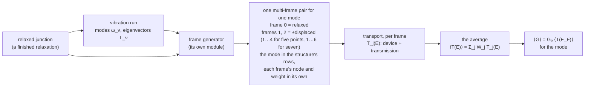
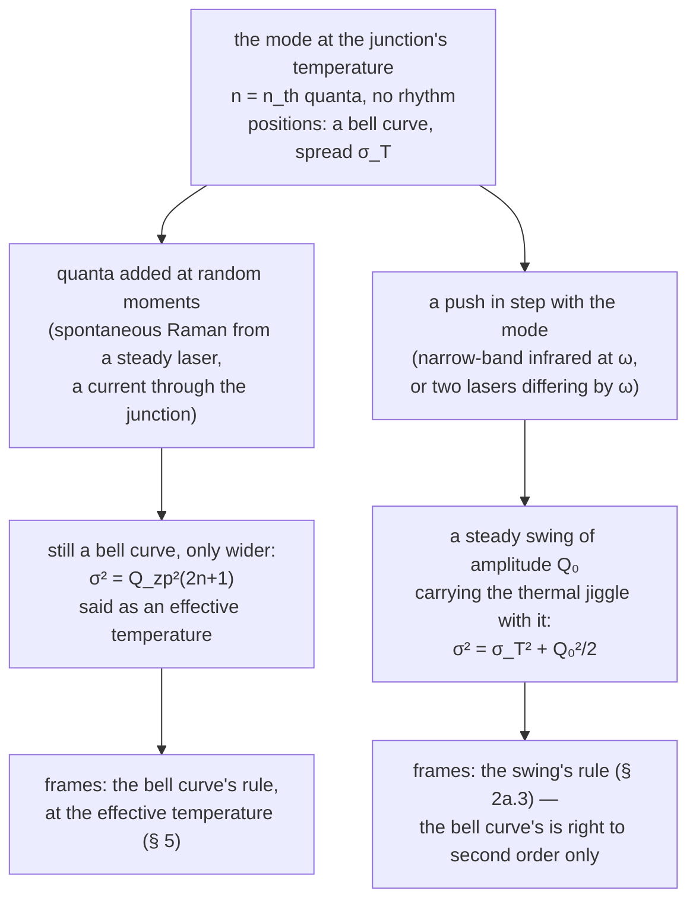
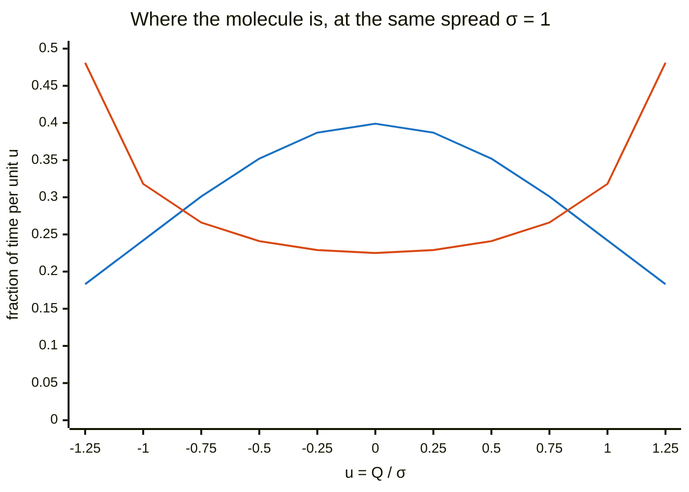
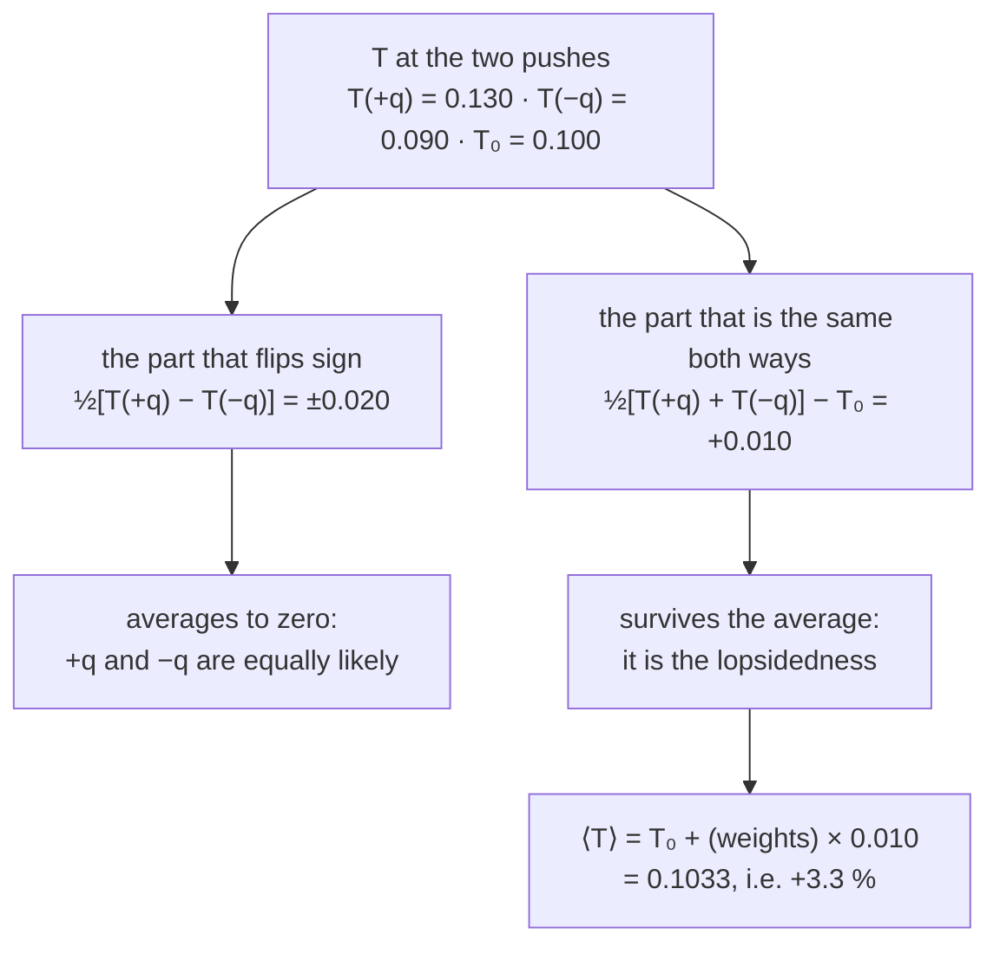
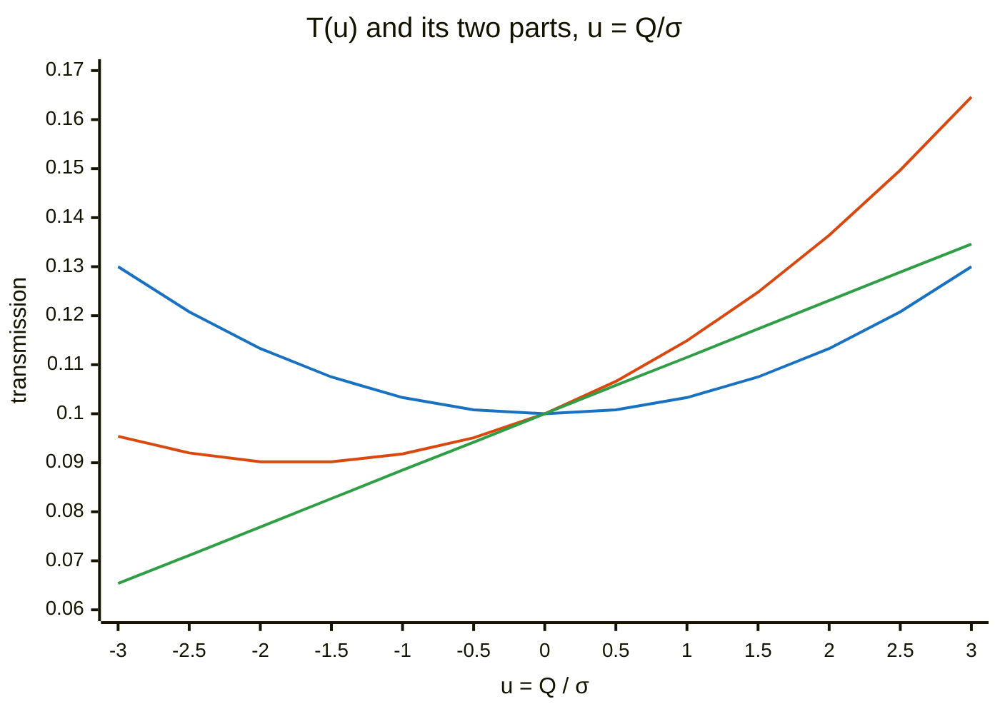
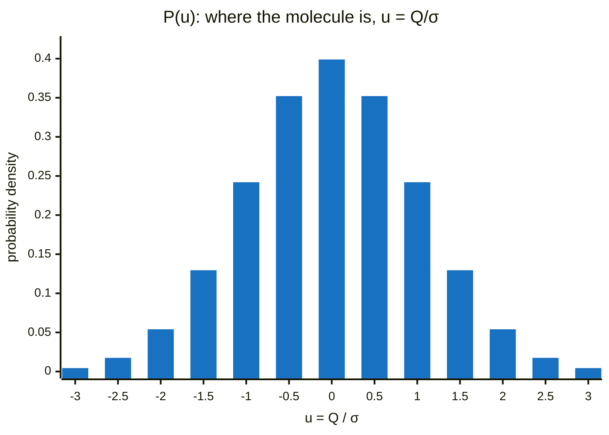
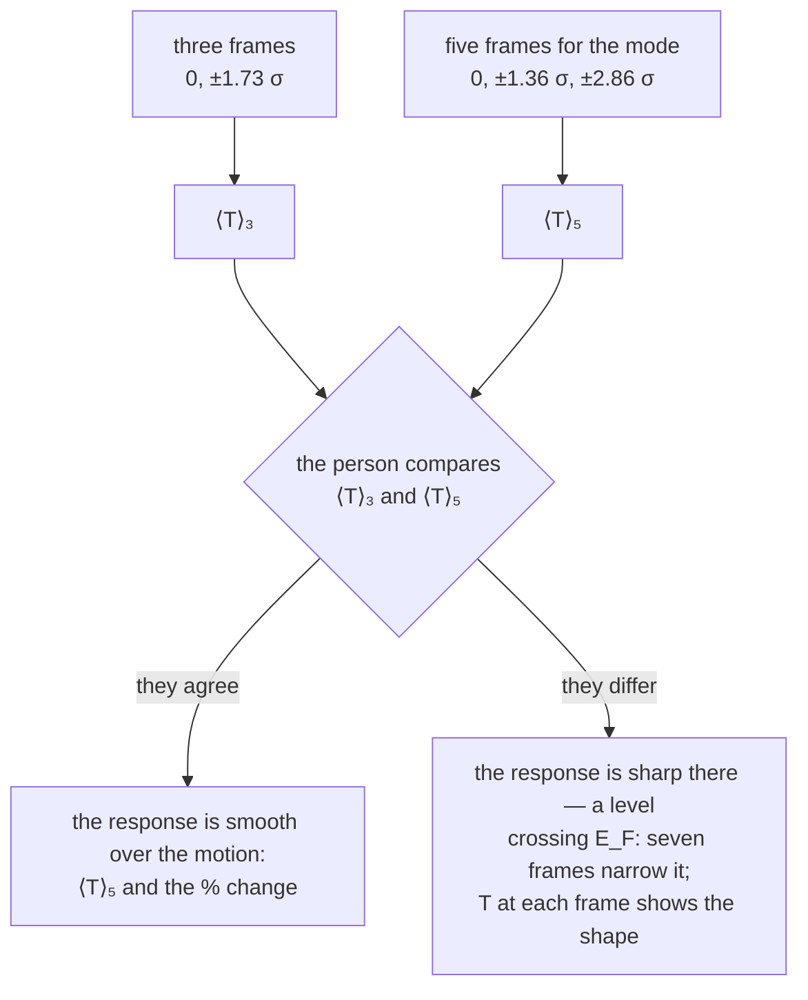
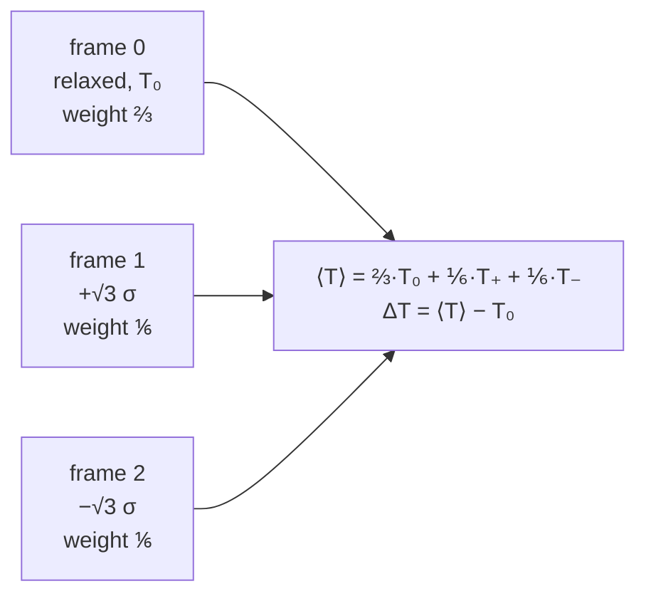

# Averaging the transmission over the junction's vibrations

**Role:** science reference
**Domain:** science
**Companions:** [`normal-modes.md`](?doc=science/normal-modes.md) § 4c (which
mode moves the current: the screen this average feeds);
[`engines/transport.md`](?doc=engines/transport.md) § 2a.9 (the frame set a
transport calculation is handed); [`engines/vibration.md`](?doc=engines/vibration.md)
§ 5.10 ③ (the frame rule's fields); `plans/plan.md` § 5z (Q17, decision D5).

*Written 2026-10-09 at the user's request: "add a discussion of this
averaging as an independent document under science, expand the details".*

---

## 0. The question

A molecule bridging two electrodes is never still. Every vibration moves it —
a little even at absolute zero, more when warm — and a conductance measurement
lasts millions of vibrational periods. What it reports is the transmission
**averaged over every geometry the molecule passes through**, not the
transmission of the relaxed geometry.

A transport calculation on a frame set computes that average from a handful of
**static frames**: the relaxed junction and copies of it displaced along
**one** normal mode — one frame set per mode *(user, 2026-10-09: "i would
rather let one multi-frame focus on one mode")*. Each frame is an ordinary
transport calculation; the average is assembled afterwards from the weight
each frame's own rows state (`model/structure.md` § 2.2f; the mode's rows are
carried and shown, and decide nothing in the average).

This document answers three questions: **where** the molecule is while it
vibrates (§ 2; under light, § 2a), **what** the measurement averages and why a lopsided response
gives a net change (§ 3–4), and **how** few frames can compute that average and
when they cannot (§ 5); § 6 says what one mode's frames do not answer. § 7 lists what the picture assumes; § 8 what the
record carries.

---

## 1. The quantities

A normal mode $\nu$ has an angular frequency $\omega_\nu$ and a mass-weighted
normal coordinate $Q_\nu$ (units $\mathrm{amu}^{1/2}\,\text{Å}$). Displacing the
junction along the mode moves each atom $A$ by its share of the canonical
eigenvector $\mathbf L_{\nu,A}$ (`vibration.md` § 6.3):

$$
\mathbf R_A(Q_\nu) \;=\; \mathbf R_A^{0} \;+\; Q_\nu\,\mathbf L_{\nu,A},
\qquad \mathbf L_{\nu,A} = \mathbf 0 \ \text{for every held atom.}
$$

The electrodes are held, so no frame moves a lead atom — the condition that
lets every frame share one pair of lead calculations (`transport.md` § 2a.9).

For each frame the transport calculation gives the transmission $T(E;Q)$, and
at low bias the conductance

$$
G(Q) \;=\; G_0\,T(E_F;Q), \qquad G_0 = \frac{2e^2}{h}
$$

for a spin-degenerate junction (per spin channel, $e^2/h$ each; `transport.md`
§ 2a.12).

---

## 2. Where the molecule is: the thermal distribution of one mode

For a harmonic mode in thermal equilibrium at temperature $T_{\mathrm{K}}$ the
probability of finding the coordinate at $Q$ is a Gaussian — exactly, quantum
mechanically, at every temperature (the probability of each position in the
oscillator's thermal state, [Feynman1972] § 2.5):

$$
P(Q) \;=\; \frac{1}{\sqrt{2\pi}\,\sigma}\,\exp\!\left(-\frac{Q^2}{2\sigma^2}\right),
\qquad
\sigma^2 \;=\; \langle Q^2\rangle \;=\; \frac{\hbar}{2\omega}\,
\coth\!\left(\frac{\hbar\omega}{2k_B T_{\mathrm K}}\right).
$$

Its two limits say what sets the width:

$$
\sigma^2 \xrightarrow{\;k_BT_{\mathrm K}\ll\hbar\omega\;} \frac{\hbar}{2\omega}
= Q_{\mathrm{zp}}^2 \quad\text{(zero-point motion)},
\qquad
\sigma^2 \xrightarrow{\;k_BT_{\mathrm K}\gg\hbar\omega\;} \frac{k_BT_{\mathrm K}}{\omega^2}
\quad\text{(classical equipartition)}.
$$

$Q_{\mathrm{zp}}$ is in every vibration result already
(`zero_point_amplitude_amu12_ang`, `vibration.md` § 6.3, beside
`zero_point_displacement_ang`, $Q_{\mathrm{zp}}\,\mathbf L$ per atom in Å), so
$\sigma = Q_{\mathrm{zp}}\sqrt{\coth(\hbar\omega/2k_BT_{\mathrm K})}$. At
298 K:

| mode | $\hbar\omega/2k_BT_{\mathrm K}$ | $\sigma/Q_{\mathrm{zp}}$ | what it means |
|---|---|---|---|
| 1600 cm⁻¹ (a ring stretch) | 3.86 | 1.00 | frozen in its ground state: zero-point only |
| 500 cm⁻¹ | 1.21 | 1.09 | mostly zero-point |
| 50 cm⁻¹ (a soft torsion) | 0.12 | 2.89 | thermally excited: three times wider |

Soft modes move far — which is why each frame states its largest
single-atom move against that atom's nearest-neighbour distance
(`normal-modes.md` § 4c.5), and why § 7 names the harmonic picture's limit.

**What matters for § 3: $P(Q)$ is symmetric, $P(-Q) = P(Q)$.** The molecule
spends as much time pushed one way as pushed the other. This is a property of
the *distribution* of positions, for a harmonic mode — and it says nothing
about whether the *transmission* responds symmetrically.

## 2a. When light drives the mode — the spread out of equilibrium

*(Written 2026-10-24 at the user's request: "we are looking at EM driven mode
which means we have an external force to drive a particular mode, how to
estimate the reasonable displace to use for that? … or we can only use
temperature dependent value to just first estimate?"; rewritten 2026-10-28:
"for a mode that is activated due to interaction with an photon, the
'temperature' is no longer accurate because it is not in equilibrium. so
what's the right way to propose a right amount of displacement?")*

> **In short.** Two things decide where the molecule sits along a mode. How
> far it moves is set by how much vibrational energy the mode holds — its mean
> number of quanta $n$. The shape of where it sits is set by whether the
> motion keeps a fixed rhythm. In equilibrium the temperature sets $n$, and
> there is no rhythm. Light, or a current, can raise $n$ in two ways that look
> alike on paper but differ in shape:
>
> - **Quanta added at random moments** — spontaneous Raman scattering from a
>   steady laser, or a current through the junction — keep the bell curve of
>   § 2 and only widen it. The frames stay the bell curve's, at an *effective
>   temperature* (§ 2a.1).
> - **A push in step with the mode** — a narrow-band infrared laser at the
>   mode's frequency, or two lasers whose frequencies differ by it — makes the
>   molecule *swing*. A swing spends most of its time near its turning points,
>   not in the middle, so its positions are not a bell curve (§ 2a.2). A
>   strongly curved response then needs frames placed for a swing (§ 2a.3).

### What sets the spread: the mean number of quanta

The equilibrium spread $\sigma_T$ is usually the floor: light or a current
adds to it (cooling by anti-Stokes scattering can push a mode below it, which
nothing here assumes). How much is added depends on three things:

| what | where it comes from |
|---|---|
| how strongly the light couples to the mode: $\partial\boldsymbol\mu/\partial Q$, the dipole's change along the mode, for infrared — the force per unit local field; $\partial\alpha/\partial Q$, the polarizability's change, for Raman — whose rate grows with the light's intensity | the optical method, [`vibrational-optical-response.md`](?doc=science/vibrational-optical-response.md) § 2, § 3 |
| the local field at the molecule | the field model, or the experiment — not computed here |
| how fast the mode loses what it gains: its quanta at the energy lifetime $\tau$; a swing's amplitude at the line's homogeneous width $\Gamma$ (full width at half maximum, cm⁻¹), $\gamma = 2\pi c\,\Gamma$, which also counts whatever scrambles the rhythm | the measured spectrum — not computed here. A measured line is also broadened by the spread of environments, so $\gamma$ read from it overestimates both rates, and the amplitude below is a lower bound |

**The spread is set by $n$, for any state of the mode.** For a harmonic
oscillator, the time-averaged potential energy is half the total energy (the
other half is kinetic). In mass-weighted coordinates the potential energy is
$\tfrac12\omega^2 Q^2$ and the total is $\hbar\omega\,(n + \tfrac12)$, so

$$
\tfrac12\,\omega^2\,\langle Q^2\rangle = \tfrac12\,\hbar\omega\,\big(n+\tfrac12\big)
\quad\Longrightarrow\quad
\sigma^2 = \langle Q^2\rangle = \frac{\hbar}{2\omega}\,(2n+1) = Q_{\mathrm{zp}}^2\,(2n+1),
$$

using $Q_{\mathrm{zp}}^2 = \hbar/2\omega$ (§ 2). This holds whatever the state
— thermal, pumped or swinging — with $\langle\cdot\rangle$ the average over
time. In equilibrium $n = 1/(e^{\hbar\omega/k_BT_{\mathrm K}} - 1)$, and
$2n+1 = \coth(\hbar\omega/2k_BT_{\mathrm K})$ — § 2's formula again. **The
spread comes from $n$; the shape comes from whether the motion keeps a
rhythm.**

### 2a.1 Quanta added at random moments — a wider bell curve, an effective temperature

A steady laser shining on the junction scatters off the molecule. Most of the
scattered light keeps its colour; a little comes back with one vibrational
quantum less energy — a **Stokes** event, which leaves that quantum in the
mode — or one quantum more — an **anti-Stokes** event, which takes a quantum
from the mode. The surroundings, meanwhile, exchange quanta with the mode at
their own temperature. A current through a biased junction adds quanta
in the same one-at-a-time way.

**Every one of these moves the mode one rung up or down its ladder of
levels**, at a rate proportional to $k+1$ for a step up from level $k$ and to
$k$ for a step down — the harmonic oscillator's own transition strengths.
Call the total rate constants $G$ (gain) and $L$ (loss). The probabilities
$p_k$ of finding the mode on rung $k$ obey

$$
\frac{dp_k}{dt} = G\big[k\,p_{k-1} - (k+1)\,p_k\big] + L\big[(k+1)\,p_{k+1} - k\,p_k\big].
$$

**In steady state each step up balances the step back down**: a ladder has
only one path between two neighbouring rungs, so the flow up from rung $k$
must equal the flow down from rung $k+1$,
$G\,(k+1)\,p_k = L\,(k+1)\,p_{k+1}$. So

$$
\frac{p_{k+1}}{p_k} = \frac{G}{L} \quad\Longrightarrow\quad
p_k = \Big(1-\frac{G}{L}\Big)\Big(\frac{G}{L}\Big)^{k}, \qquad
n = \sum_k k\,p_k = \frac{G}{L-G}.
$$

**Where $G$ and $L$ come from.** The surroundings, at the junction's
temperature and with energy lifetime $\tau$, give $n_{\mathrm{th}}/\tau$ up
and $(n_{\mathrm{th}}+1)/\tau$ down. The laser gives $R$ up and $R_{\mathrm{aS}}$
down, $R$ the Stokes rate of a molecule in its ground state — its Stokes
cross section in the gap times the laser's photon flux — and $R_{\mathrm{aS}}$
the anti-Stokes rate constant likewise. So

$$
G = \frac{n_{\mathrm{th}}}{\tau} + R, \qquad
L = \frac{n_{\mathrm{th}}+1}{\tau} + R_{\mathrm{aS}}
\quad\Longrightarrow\quad
n = \frac{n_{\mathrm{th}} + R\tau}{1 + (R_{\mathrm{aS}} - R)\,\tau} .
$$

When the two rate constants are equal, or the pumping is weak
($R\tau \ll 1$), this is the familiar $n = n_{\mathrm{th}} + R\tau$, the
weak-pumping form of [Kneipp1996]. With no anti-Stokes losses at all it
grows without bound as $R\tau \to 1$.

**Why the shape stays a bell curve.** The populations $p_k \propto (G/L)^k$
fall off by a constant factor per rung — exactly as a thermal state's do,
$p_{k+1}/p_k = e^{-\hbar\omega/k_BT_{\mathrm K}}$. So the pumped mode is a
thermal state at the **effective temperature** $T_{\mathrm{eff}}$ with
$e^{-\hbar\omega/k_BT_{\mathrm{eff}}} = G/L$. A thermal state's positions are
the bell curve of § 2 ([Feynman1972] § 2.5), so the mode under random
pumping is a bell curve of spread

$$
\sigma^2 = Q_{\mathrm{zp}}^2\,(2n+1) = Q_{\mathrm{zp}}^2\,\coth\!\left(\frac{\hbar\omega}{2k_BT_{\mathrm{eff}}}\right),
\qquad
T_{\mathrm{eff}} = \frac{\hbar\omega}{k_B\,\ln(1 + 1/n)} .
$$

**$T_{\mathrm{eff}}$ is measured, not computed here.** The ratio of the
line's anti-Stokes to its Stokes intensity goes as $n/(n+1)$, once the two
lines' frequency factors and enhancements are divided out. Ward, Corley, Tour
and Natelson measured mode temperatures in biased junctions this way
[Ward2011]. Kneipp and co-workers reported pumping by surface-enhanced Raman
scattering itself [Kneipp1996]; Le Ru and Etchegoin examined when that
pumping is real, against heating and other readings of the same data
[LeRuEtchegoin2006].

**So a randomly pumped mode takes the same frames as an equilibrium one**, at
its effective temperature in place of the junction's: the frame set's
temperature (§ 5) is that effective temperature.

### 2a.2 A push in step with the mode — a steady swing

**The push.** A field $E_{\mathrm{loc}}\cos(\omega_L t)$ along $\hat z$ pushes
the mode's coordinate with the force

$$
F(t) = \hat z\cdot\frac{\partial\boldsymbol\mu}{\partial Q}\;E_{\mathrm{loc}}\cos(\omega_L t)
\equiv F_0\cos(\omega_L t)
$$

(the dipole's energy in the field, $-\boldsymbol\mu\cdot\mathbf E$,
differentiated along $Q$). The mode answers as a damped, driven oscillator
that the surroundings also jostle:

$$
\ddot Q + \gamma\,\dot Q + \omega^2 Q = F_0\cos(\omega_L t) + \xi(t),
$$

$\xi(t)$ the random force of the surroundings — what keeps the thermal
jiggle going against the damping $\gamma$.

**Its steady swing.** Leave $\xi$ aside for the moment. Write the push as the
real part of $F_0 e^{i\omega_L t}$ and try $Q = \mathrm{Re}\,\tilde Q\,e^{i\omega_L t}$;
each time derivative brings down a factor $i\omega_L$, so

$$
\big(\omega^2 - \omega_L^2 + i\gamma\omega_L\big)\,\tilde Q = F_0
\quad\Longrightarrow\quad
Q_0 = |\tilde Q| = \frac{F_0}{\sqrt{(\omega^2-\omega_L^2)^2 + \gamma^2\omega_L^2}} .
$$

At resonance, $\omega_L = \omega$, this is $Q_0 = F_0/(\gamma\,\omega)$: the
swing is limited only by the damping — halve the linewidth and the swing
doubles. The swing lags the push by the angle $\phi$ with
$\tan\phi = \gamma\omega_L/(\omega^2-\omega_L^2)$, a quarter period at
resonance.

**The quanta it adds.** The swing's energy is $\tfrac12\omega^2 Q_0^2$ (its
potential energy at the turning points); divided by one quantum, $\hbar\omega$,
and with $Q_{\mathrm{zp}}^2 = \hbar/2\omega$, it holds
$Q_0^2/4Q_{\mathrm{zp}}^2$ quanta.

**How large, for one example** — a moderately strong infrared mode,
$\partial\mu/\partial Q = 0.1\ e\ \mathrm{amu}^{-1/2}$ (0.48 D Å⁻¹ amu⁻¹ᐟ²,
$A(\hat z)$ = 29 km/mol), at 1000 cm⁻¹ ($Q_{\mathrm{zp}}$ = 0.130 amu½ Å),
linewidth 10 cm⁻¹ ($\tau$ = 0.53 ps), driven at resonance (computed from the
CODATA constants; no run of ours):

| local field | local intensity, $\tfrac12 c\varepsilon_0E^2$ | $Q_0/Q_{\mathrm{zp}}$ | quanta added, $Q_0^2/4Q_{\mathrm{zp}}^2$ | $\sigma/Q_{\mathrm{zp}}$ at 0 K |
|---|---|---|---|---|
| 0.001 V/Å | 1.3 × 10⁷ W/cm² | 0.021 | 0.0001 | 1.000 |
| 0.01 V/Å | 1.3 × 10⁹ W/cm² | 0.21 | 0.011 | 1.011 |
| 0.1 V/Å | 1.3 × 10¹¹ W/cm² | 2.1 | 1.1 | 1.79 |

The drive spreads such a mode beyond its zero-point motion only at very high
local fields — a pulsed laser, or a very large enhancement in the gap.

**Where a swing spends its time.** Picture a child on a swing, photographed at
random moments. Near the bottom the swing moves fastest, so few photographs
catch it there; near the two high points it slows, stops and turns, so most
photographs catch it there. The same holds for $Q(t) = Q_0\cos\omega t$. The
time it spends in a small stretch $dQ$ is $dQ/|\dot Q|$, with
$|\dot Q| = \omega\sqrt{Q_0^2 - Q^2}$; it crosses the stretch twice per period
$2\pi/\omega$, so the fraction of time it spends there is

$$
\rho(Q)\,dQ = 2\cdot\frac{dQ}{\omega\sqrt{Q_0^2-Q^2}}\cdot\frac{\omega}{2\pi}
\quad\Longrightarrow\quad
\rho(Q) = \frac{1}{\pi\sqrt{Q_0^2-Q^2}}, \qquad |Q| < Q_0 .
$$

It is **U-shaped**: smallest in the middle, rising without bound at the two
turning points, and zero beyond them. Its moments follow from the averages of
$\cos^2$ and $\cos^4$ over a period, $\tfrac12$ and $\tfrac38$:

$$
\langle Q^2\rangle = \tfrac12\,Q_0^2, \qquad \langle Q^4\rangle = \tfrac38\,Q_0^4 .
$$

The two shapes at the **same spread** $\sigma = 1$ (so $Q_0 = \sqrt2 \approx 1.41$),
as the fraction of time per unit of $u = Q/\sigma$:

*(Blue: the bell curve, thermal or randomly pumped. Orange: the steady swing,
which keeps rising past $u = \pm1.25$ and without bound at its turning
points, $u = \pm1.41$, and is zero beyond them.)*

| at the same spread σ | bell curve | steady swing |
|---|---|---|
| fraction of time per unit $u$ at the middle | 0.40 | 0.23 |
| at $u = 1.2$ | 0.19 | 0.43 |
| time spent beyond $\lvert u\rvert = 1.41$ | **16 %** | **0** — it never goes there |
| $\langle Q^4\rangle$ | $3\sigma^4$ | $1.5\,\sigma^4$ |

**The quantum picture: the swing carries a bell curve with it.** A mode
starting in its ground state — the zero-point bell curve of spread
$Q_{\mathrm{zp}}$ — and pushed by a force that does not depend on the mode
itself stays a single bell curve of that same width: the push enters the
energy as $-F(t)\,Q$, a term in $Q$ alone, which moves the bell curve's
centre without changing its shape. The centre follows the classical swing,
$Q_0\cos(\omega_L t - \phi)$. Such a state is called a *coherent state* —
Glauber's name for the corresponding states of the radiation field
[Glauber1963]; their properties as states of the harmonic oscillator are
[CohenTannoudji2020] Complement G$_\mathrm{V}$.

**With the junction's temperature as well**, the equation of motion is
linear, so its solution splits into two parts that do not disturb each
other:

$$
Q(t) = \underbrace{Q_0\cos(\omega_L t - \phi)}_{\text{the driven swing}}
\;+\; \underbrace{\delta Q(t)}_{\text{the thermal jiggle}} ,
\qquad
\ddot{\delta Q} + \gamma\,\dot{\delta Q} + \omega^2\,\delta Q = \xi(t),
$$

$\delta Q$ answering the surroundings alone, as the mode would without the
light: its positions are the thermal bell curve of spread $\sigma_T$. Averaged
over time, the positions are the bell curve *smeared along* the U — each
position of the swing carries a whole bell curve with it. Their spreads add,
in agreement with the rule of quanta above:

$$
\sigma^2 = \sigma_T^2 + \tfrac12 Q_0^2 = Q_{\mathrm{zp}}^2\,(2n+1), \qquad
n = n_{\mathrm{th}} + \frac{Q_0^2}{4Q_{\mathrm{zp}}^2} ,
$$

and the shape is the bell curve's when $Q_0 \ll \sigma_T$, the U's when
$Q_0 \gg \sigma_T$.

### 2a.3 What the frames need — the spread to second order, the shape beyond

**Expand the transmission about equilibrium** (§ 4.2). For any distribution
symmetric about $Q = 0$ — the bell curve, the swing, or the two together — the
odd terms average to zero, and

$$
\langle T\rangle = T_0 + \tfrac12\,T''\,\langle Q^2\rangle + \tfrac1{24}\,T''''\,\langle Q^4\rangle + \dots
$$

**Up to the $Q^2$ term only the spread enters**, $\langle Q^2\rangle = \sigma^2$,
whatever the shape: a response that is nearly a parabola over the motion is
averaged correctly by bell-curve frames at the same σ. **From the $Q^4$ term
on, the shape enters**: $\langle Q^4\rangle$ is $3\sigma^4$ for the bell curve
and $1.5\,\sigma^4$ for a pure swing. A strongly curved response — the contact
bond of § 4.3, whose tunnelling grows exponentially as the bond shortens —
weights the rare, far-out positions heavily, and the bell curve visits
positions the swing never reaches.

**The contact bond, exactly.** Take $T(Q) = T_0\,e^{-aQ}$ (§ 4.3), $1/a$ the
distance over which the response changes by a factor $e$. Over the bell curve,
$\langle e^{-aQ}\rangle = e^{a^2\sigma^2/2}$. Over the swing,
$\langle e^{-aQ_0\cos\omega t}\rangle$ is the modified Bessel function $I_0$,
by its integral form $I_0(z) = \frac1\pi\int_0^\pi e^{\pm z\cos\theta}\,d\theta$
([DLMF] 10.32.1). At the same spread ($\sigma^2 = Q_0^2/2$) the two are

$$
\frac{\langle T\rangle_{\text{swing}}}{T_0} = I_0(aQ_0) = 1 + \frac{(aQ_0)^2}{4} + \frac{(aQ_0)^4}{64} + \dots ,
\qquad
\frac{\langle T\rangle_{\text{bell}}}{T_0} = e^{(aQ_0)^2/4} = 1 + \frac{(aQ_0)^2}{4} + \frac{(aQ_0)^4}{32} + \dots
$$

— equal up to the $Q^2$ term, and different from the $Q^4$ term on, by the
factor 2 between the two shapes' $\langle Q^4\rangle$:

| the swing against the response's length, $aQ_0$ | true average, $I_0(aQ_0)$ | bell curve at the same σ | bell-curve error |
|---|---|---|---|
| 0.5 | 1.0635 | 1.0645 | +0.1 % |
| 1.0 | 1.2661 | 1.2840 | +1.4 % |
| 2.0 | 2.2796 | 2.7183 | **+19 %** |
| 3.0 | 4.8808 | 9.4877 | **+94 %** |

**The frames a swing needs: snapshots at equal steps through one period.**
The time average over a period is an average over the swing's phase
$\varphi$,
$\langle T\rangle = \frac1{2\pi}\int_0^{2\pi} T(Q_0\cos\varphi)\,d\varphi$, of
a function that repeats itself every $2\pi$. For such a function the plainest
rule is the best: $N$ equally spaced phases $\varphi_k = 2\pi k/N$, each with
weight $1/N$, are exact whenever the function is a sum of $\cos k\varphi$ and
$\sin k\varphi$ with $k < N$, and converge faster than any power of $N$ for a
smooth one ([TrefethenWeideman2014]). $T(Q_0\cos\varphi)$ is such a sum, with
$k \le m$, whenever $T(Q)$ is a polynomial of degree $m$ in $Q$, because
$\cos^m\varphi$ is. Equal phases fall at unequal positions, crowded near the
turning points where the swing lingers; with $N = 8$, $\varphi$ and
$360° - \varphi$ land at the same position, leaving five frames:

| position $Q$ | phases landing there | weight |
|---|---|---|
| 0 | 90°, 270° | $\tfrac14$ |
| $+Q_0/\sqrt2$ and $-Q_0/\sqrt2$ | 45° and 315°; 135° and 225° | $\tfrac14$ each |
| $+Q_0$ and $-Q_0$ | 0°; 180° | $\tfrac18$ each |

These five are exact for a response of degree up to 7. On the contact bond at
$aQ_0 = 2$: 2.3811 with four phases (frames $0, \pm Q_0$ at
$\tfrac12, \tfrac14, \tfrac14$), 2.2828 with six, 2.2796 with eight, against
the true 2.2796. When the thermal jiggle is comparable to the swing, every
phase position carries a bell curve of its own: the frames are each phase
position plus each bell-curve offset, and each frame's weight is the product
of the two weights.

**What molbuilder does.** The frame generator samples a bell curve (§ 5). Its
frames are exact in shape for a mode in equilibrium, and for one pumped at
random moments at its effective temperature (§ 2a.1).

For a mode swung in step with light, the bell curve is right only up to the
$Q^2$ term, and two things go wrong as the swing grows:

1. **The bell curve's frames reach beyond the swing's turning points.** At
   the swing's own spread, $\sigma = Q_0/\sqrt2$, the outermost of three frames
   sits at $1.22\,Q_0$, of five at $2.02\,Q_0$, of seven at $2.65\,Q_0$: they
   compute geometries the molecule never visits.
2. **More bell-curve frames do not reveal the error.** They converge to the
   bell curve's average, not the swing's, so comparing three frames with five
   (§ 5.3) cannot show it.

So a bell-curve set serves a swing only while the swing is short against the
response's length, $aQ_0 \lesssim 1$ in the example. Its temperature is then
the one holding the swing's quanta,
$n = n_{\mathrm{th}} + Q_0^2/4Q_{\mathrm{zp}}^2$ and
$T_{\mathrm K} = \hbar\omega/\big(k_B\ln(1 + 1/n)\big)$. Beyond that, the
frames already computed are re-averaged over the swing after the run (§ 5.4)
— the same frames, the swing's weights — as long as they reach its turning
points; frames at the swing's own phases are needed only past that reach.

Within the range where only the $Q^2$ term matters, a wider spread also
rescales a result already computed,
$\langle\Delta G\rangle/G\,(\sigma) = (\sigma/\sigma_T)^2 \times \langle\Delta G\rangle/G\,(\sigma_T)$
— an analysis on the data file (§ 8), never a value of the record.

---

## 3. What a measurement averages

The current at bias $V$ is linear in the transmission (Landauer),

$$
I \;=\; \frac{2e}{h}\int T(E)\,\big[f_L(E)-f_R(E)\big]\,dE ,
$$

and the measurement integrates over many vibrational periods, so — in the
static-frame picture of § 7 — the measured current and conductance are those
of the **averaged transmission**:

$$
\big\langle T(E)\big\rangle \;=\; \int_{-\infty}^{\infty} P(Q)\,T(E;Q)\,dQ ,
\qquad
\langle G\rangle = G_0\,\big\langle T(E_F)\big\rangle .
$$

The question the frame set answers is how far $\langle T\rangle$ is from the
relaxed geometry's $T_0 = T(E;0)$.

---

## 4. A lopsided response is what produces a net change

### 4.1 The transmission is not symmetric about equilibrium

The working hypothesis is that $T(Q)$ is **not** symmetric: pushing the
molecule one way changes the transmission differently from pushing it the
other way, because $T$ depends non-linearly on the geometry — a contact bond
shortened raises the tunnelling exponentially more than the same bond
lengthened lowers it; a level moved toward $E_F$ raises $T$ more than the same
level moved away lowers it. That hypothesis is exactly what gives a net
change, and the way to see it is to split $T(Q)$ into the part that flips sign
with the push and the part that does not:

$$
T(Q) \;=\;
\underbrace{\tfrac12\big[T(Q)+T(-Q)\big]}_{T_{\mathrm{even}}(Q)\ \text{— same both ways}}
\;+\;
\underbrace{\tfrac12\big[T(Q)-T(-Q)\big]}_{T_{\mathrm{odd}}(Q)\ \text{— flips sign}} .
$$

Averaged over the symmetric distribution of § 2, the odd part vanishes
exactly — whatever its size — because every push $+Q$ is matched by a push
$-Q$ of equal probability:

$$
\big\langle T_{\mathrm{odd}}\big\rangle = \int P(Q)\,T_{\mathrm{odd}}(Q)\,dQ = 0
\quad\Longrightarrow\quad
\big\langle T\big\rangle \;=\; \big\langle T_{\mathrm{even}}\big\rangle .
$$

So **the net change comes entirely from the even part**, and the even part is
non-zero only because of the asymmetry: if $T$ responded linearly —
$T(Q) - T_0 = -\big[T(-Q) - T_0\big]$, a symmetric response — then
$T_{\mathrm{even}} = T_0$ and the average would be the relaxed value, no
matter how strongly the mode moves $T$. A mode changes the measured
conductance precisely when $T(+Q) + T(-Q) \neq 2T_0$: when the response is
lopsided.

The same example drawn: the full response (lopsided), its odd part drawn
about $T_0$ (a straight line here — it cancels), and its even part (a bowl —
it survives). $u = Q/\sigma$.

*(Orange: the full $T(u)$, lopsided. Blue: its even part — the bowl that
survives the average. Green: its odd part drawn about $T_0$ — the straight
line that cancels. The example is $T(u) = 0.100 + 0.0115\,u + 0.0033\,u^2$.)* And the distribution it is
averaged over:

### 4.2 In derivatives

Expanding about equilibrium makes the same statement term by term:

$$
T(Q) = T_0 + T'Q + \tfrac12 T''Q^2 + \tfrac16 T'''Q^3 + \tfrac1{24}T''''Q^4 + \dots
$$

The Gaussian's odd moments vanish, $\langle Q\rangle = \langle Q^3\rangle = 0$,
and its even ones are $\langle Q^2\rangle = \sigma^2$,
$\langle Q^4\rangle = 3\sigma^4$:

$$
\big\langle T\big\rangle \;=\; T_0 \;+\; \tfrac12\,T''\sigma^2 \;+\; \tfrac18\,T''''\sigma^4 \;+\;\dots
$$

$T'$ and $T'''$ — the odd, sign-flipping response — drop out; $T''$, the
curvature, is the leading measure of the lopsidedness. The *relative* change
of the conductance,

$$
\frac{\langle\Delta G\rangle_\nu}{G} \;=\; \frac{\tfrac12\,T''_\nu\,\sigma_\nu^2}{T_0},
$$

is the transport score of `normal-modes.md` § 4c.4. Its sign is the sign of
the curvature: a convex response (a level's tail, an exponential contact)
raises the average conductance, a concave one (sitting on a resonance's peak)
lowers it.

### 4.3 Two examples of a strongly lopsided response

**A contact bond.** Tunnelling through a contact falls exponentially with its
length, $T \propto e^{-2\kappa d}$. If the mode stretches the contact,
$d = d_0 + d'Q$, then $T(Q) = T_0\,e^{-aQ}$ with $a = 2\kappa d'$ — very
lopsided: with $a\sigma = 0.6$ the two frames at $\pm\sqrt3\,\sigma$ give
$T/T_0 = 2.83$ and $0.35$. The Gaussian average is exact:

$$
\frac{\langle T\rangle}{T_0} = \big\langle e^{-aQ}\big\rangle = e^{a^2\sigma^2/2}
= e^{2\kappa^2 d'^2\sigma^2} \;>\; 1 \quad \text{for either sign of } d' ,
$$

$= 1.197$ for $a\sigma = 0.6$: a 20 % rise. The shortened side wins because it
wins exponentially — the log-normal average of `normal-modes.md` § 4c.4.

**A level near $E_F$.** A single level of full width $\Gamma$ at
$\varepsilon(Q) = \varepsilon_0 + gQ$ transmits

$$
T(E_F;Q) = \frac{(\Gamma/2)^2}{\big(\varepsilon(Q)-E_F\big)^2+(\Gamma/2)^2}.
$$

With $\Gamma = 0.2$ eV and a thermal level shift $g\sigma = 0.1$ eV:

| where the level sits | $T_0$ | exact $\langle T\rangle$ | change | the response |
|---|---|---|---|---|
| on the tail, $\varepsilon_0 - E_F = 0.5$ eV | 0.0385 | 0.0436 | **+13 %** | convex: the side moved toward $E_F$ gains more than the other loses |
| on the peak, $\varepsilon_0 = E_F$ | 1.000 | 0.656 | **−34 %** | concave: either push moves the level off resonance |

The same mode raises or lowers the conductance depending on where $E_F$ sits —
the curvature's sign, read off the frames, not assumed.

---

## 5. Computing the average from a few frames

**The spread the frames sample is stated as a temperature** *(the user,
2026-10-28: "shall we actually use the sigma as the reference to state how
much we want the max displacement to be? this is statistically making more
sense especially if we propose the value based on temperature"; it replaces
the maximum displacement of 2026-10-24)*. The person names the temperature
$T_{\mathrm K}$ of the motion the frames sample — the junction's, or for a
mode pumped out of equilibrium its effective temperature (§ 2a.1). The
generator (`engines/vibration.md` § 5.10 ③) sets the mode's mean number of
quanta and its spread from it:

$$
n = \frac{1}{e^{\hbar\omega/k_BT_{\mathrm K}} - 1}, \qquad
\sigma = Q_{\mathrm{zp}}\,\sqrt{2n+1} = Q_{\mathrm{zp}}\,\sqrt{\coth\!\left(\frac{\hbar\omega}{2k_BT_{\mathrm K}}\right)} .
$$

**Why a temperature (which fixes σ), and not a displacement:**

1. **The frames and their weights are defined against σ.** The rule's
   positions are multiples of σ, and its weights are a bell curve's (§ 5.1).
   A displacement is a consequence of σ, not a property of the motion.
2. **The same displacement is a different motion for each rule.** The
   outermost frame sits at $1.73\,\sigma$ with three frames and at
   $2.86\,\sigma$ with five. One displacement typed for both would sample a
   bell curve 1.65 times narrower with five — and comparing the two rules, the
   check of § 5.3, would compare two different motions.
3. **σ is physics a person can name**: a temperature, or a number of quanta
   (§ 2a). Its ratio to the zero-point amplitude, $\sigma/Q_{\mathrm{zp}} = \sqrt{2n+1}$,
   says how many times wider the motion is than its zero-point motion.

**What the frames move is reported, in Å: the outermost move.** The
outermost frames move the atom that moves most in the mode — the one with the
largest $\lvert\mathbf L_A\rvert$, often a light atom but not always — by

$$
d_{\mathrm{out}} = \sqrt2\,x_{\mathrm{out}}\;\sigma\,\max_A\lvert\mathbf L_A\rvert
\qquad (\sqrt3\,\sigma\max_A\lvert\mathbf L_A\rvert \text{ for three frames}),
$$

$x_{\mathrm{out}}$ the rule's outermost node (§ 5.1: $\sqrt{3/2}$ for three
frames, 2.0202 for five, 2.6520 for seven). Each frame states its own largest
single-atom move beside it — the check a person reads against a bond length.

**An example — mode 48 of the user's AuBDTAu vibration on Sol**
(`AuBDTAu/spectrum/AuBDTAu_relaxed_vib_IRandRaman`; 1039.9 cm⁻¹,
$Q_{\mathrm{zp}}$ = 0.12732 amu½ Å, $\max_A\lvert\mathbf L_A\rvert$ = 0.3977
amu⁻½, as the frame set `AuBDTAu/structure/AuBDTAu_vib_mode48` written from
it on 2026-10-28 states them):

| the temperature stated | $n$ | $\sigma/Q_{\mathrm{zp}}$ | the outermost move — 3 / 5 / 7 frames |
|---|---|---|---|
| 4 K, 77 K | 0 | 1.000 | 0.088 / 0.145 / 0.190 Å |
| 298 K | 0.007 | 1.007 | 0.088 / 0.146 / 0.191 Å |
| 1000 K | 0.29 | 1.26 | 0.110 / 0.182 / 0.239 Å |
| 1362 K, an effective temperature | 0.5 | 1.41 | 0.124 / 0.205 / 0.269 Å |
| 2159 K, an effective temperature | 1 | 1.73 | 0.152 / 0.251 / 0.329 Å |

A 1040 cm⁻¹ mode holds almost no thermal quanta below about 500 K: its
motion is its zero-point motion, and only pumping widens it.

### 5.1 The Gauss–Hermite rule

Each frame costs a device calculation and a transmission, so the integral of
§ 3 is computed from as few frames as possible. For a bell curve the best
choice is the **Gauss–Hermite** rule ([AbramowitzStegun1964] eq. 25.4.46 and
Table 25.10). It samples the motion at $m$ fixed positions — the rule's
*nodes* $x_j$ — each with a fixed weight $w_j$. With $Q = \sqrt2\,\sigma x$,

$$
\big\langle T\big\rangle = \frac{1}{\sqrt\pi}\int e^{-x^2}\,T(\sqrt2\sigma x)\,dx
\;\approx\; \sum_{j=1}^{m} W_j\,T(Q_j),
\qquad Q_j = \sqrt2\,\sigma\,x_j,\quad W_j = \frac{w_j}{\sqrt\pi}.
$$

The rule is **exact whenever $T(Q)$ is a polynomial of degree $\le 2m-1$**
over the motion — including every odd term, so an arbitrarily lopsided cubic
or quintic response is averaged exactly.

| frames $m$ | positions $Q_j/\sigma$ | weights $W_j$ | exact for degree |
|---|---|---|---|
| 3 | $0,\ \pm1.7321$ | $\tfrac23,\ \tfrac16$ each | $\le 5$ |
| 5 | $0,\ \pm1.3556,\ \pm2.8570$ | $0.53333,\ 0.22208,\ 0.01126$ each | $\le 9$ |
| 7 | $0,\ \pm1.1544,\ \pm2.3668,\ \pm3.7504$ | $0.45714,\ 0.24012,\ 0.03076,\ 0.00055$ each | $\le 13$ |

Every rule here has an odd number of frames, so one of them is the relaxed
junction itself, $Q = 0$ — the frame a transport extension takes over from
the finished calculation ([`engines/transport.md`](?doc=engines/transport.md)
§ 2a.16).

### 5.1a Why more frames reach further out

Adding frames does not sample the middle more finely; it reaches into the
tails. A rule exact to degree $2m-1$ must reproduce the bell curve's higher
averages, $\langle u^{2k}\rangle = 1\cdot3\cdot5\cdots(2k-1) = 1, 3, 15, 105, \dots$
for $u = Q/\sigma$. The high ones are made almost entirely of the rare,
far-out positions. To get $\langle u^8\rangle = 105$ right with weights
summing to 1, some frame has to sit far out with a tiny weight:

| frames | $\langle u^4\rangle$ (exact 3) | $\langle u^6\rangle$ (exact 15) | $\langle u^8\rangle$ (exact 105) |
|---|---|---|---|
| 3 | 3 | **9** | **27** |
| 5 | 3 | 15 | 105 |
| 7 | 3 | 15 | 105 |

Five frames get $\langle u^8\rangle$ almost entirely from the outermost pair,
$2 \times 0.01126 \times 2.857^8 \approx 100$; the inner pair adds 5. So the
outermost frames move out, and their weight falls, as frames are added:

| frames | outermost frames | the weight of each | time the molecule spends beyond them, either side |
|---|---|---|---|
| 3 | ±1.73 σ | 0.167 | 8 % |
| 5 | ±2.86 σ | 0.011 | 0.4 % |
| 7 | ±3.75 σ | 0.0005 | 0.02 % |
| 9 | ±4.51 σ | 0.00002 | 0.0006 % |

### 5.2 Three frames give the average and the curvature at once

With three frames,

$$
\big\langle T\big\rangle \approx \tfrac23\,T_0 + \tfrac16\big[T(+\sqrt3\sigma) + T(-\sqrt3\sigma)\big]
= T_0 + \tfrac16\big[T_+ + T_- - 2T_0\big],
$$

and the bracket is the second difference at step $h = \sqrt3\,\sigma$:
$T_+ + T_- - 2T_0 = h^2\,T''_{\mathrm{fd}} = 3\sigma^2 T''_{\mathrm{fd}}$, so

$$
\big\langle T\big\rangle \approx T_0 + \tfrac12\,T''_{\mathrm{fd}}\,\sigma^2 .
$$

The same three frames are the curvature of § 4.2 and the average over the
spread σ, and the step is that spread's: $h=\sqrt3\,\sigma$, with σ set by the
temperature the person states (§ 5) — so the step is where the molecule
actually is at that temperature. The bracket is the "same both ways" part of
§ 4.1 — twice the lopsidedness at $\pm\sqrt3\sigma$.

On the examples of § 4.3: the contact gives $1.1968$ against the exact
$1.1972$; the level on its tail $0.0435$ against $0.0436$. Both responses are
smooth over $\pm3\sigma$, so three frames suffice.

### 5.3 When three are not enough — and how to tell

**A smooth response** changes gently and steadily over the whole motion — the
contact bond's exponential, a level's distant tail. **A sharp response**
changes a great deal over a small part of the motion. The typical case is a
level sitting at the Fermi energy: the transmission peaks at the relaxed
geometry, and a small push moves the level off resonance, so the transmission
falls fast. Between frames, a sharp response does things the frames never
see.

Each rule against the exact average, on § 4.3's examples (a level of width
$\Gamma$ = 0.2 eV; $g\sigma$ the level's shift at one σ):

| response | $T_0$ | exact $\langle T\rangle$ | 3 frames | 5 | 7 | 9 | 11 |
|---|---|---|---|---|---|---|---|
| contact bond, $a\sigma = 0.6$ | 1.000 | 1.1972 | 1.1968 | 1.1972 | 1.1972 | 1.1972 | 1.1972 |
| contact bond, $a\sigma = 1.2$ | 1.000 | 2.0544 | 2.0195 | 2.0541 | 2.0544 | 2.0544 | 2.0544 |
| level 0.5 eV from $E_F$, $g\sigma = 0.1$ eV | 0.0385 | 0.0436 | 0.0435 | 0.0436 | 0.0436 | 0.0436 | 0.0436 |
| level at $E_F$, $g\sigma = 0.1$ eV | 1.000 | **0.656** | 0.750 | 0.692 | 0.672 | 0.664 | 0.660 |
| level at $E_F$, $g\sigma = 0.2$ eV | 1.000 | **0.438** | 0.692 | 0.587 | 0.536 | 0.506 | 0.487 |

For a smooth response three frames are right to 0.3 %, and a stiffer contact
needs five. For a level crossing $E_F$ within the motion, more frames narrow
the error slowly — eleven still miss by 11 % in the last row — because the
transmission there is not a low-degree polynomial over the motion at all.
The disagreement between two rules is the signal:

**Three, five or seven frames** *(the user, 2026-10-28)*: each rule a check
of the one before. Every frame is a device calculation and a transmission,
and frame 0 is taken over by an extension (§ 5.1).

**Why seven is the last rule offered.** Nine frames' outermost pair sits at
$\pm4.51\,\sigma$, each with weight $2\times10^{-5}$, where the molecule
spends $6\times10^{-6}$ of its time. That is also where the harmonic picture
is least sure (§ 7, assumption 1). A response that needs nine frames is one
whose shape across the frames tells more than one averaged number (§ 8).

A frame set is one mode at one rule, its weights summing to 1. So the check
is a second set of the same mode, at the same temperature and another rule,
and comparing the two is the person's.

### 5.4 Re-averaging the frames over another motion *(the user, 2026-10-29; built 2.52.0)*

*(The user, 2026-10-29: "or this can be a parameter in post-processing?";
"so essential information is in fact the deltaQ for each frame (normal mode
displacement), and then the weight will be determined by the shape of
statistics".)*

**What a frame is: its position along the mode.** Each frame's geometry is
frame 0 moved by $q_f$ along the mode, and its transmission $T_f(E)$ depends
on that geometry alone. The weight a frame carries is not the frame's: it is
the motion's — how much time the molecule spends near $q_f$ in the motion
being averaged over. The set's own weights are those of the bell curve it was
written for (§ 5.1). Once the frames have run, the same $T_f(E)$ can be
averaged over **another motion** with other weights, and no frame is
computed again.

**The motion, stated by two numbers.**

| what | gives | where it comes from |
|---|---|---|
| the temperature $T$ of the random part — the junction's, or a randomly pumped mode's effective one (§ 2a.1) | the bell curve of spread $\sigma_T = Q_{\mathrm{zp}}\sqrt{2n_{\mathrm{th}}+1}$, its zero-point motion included, $n_{\mathrm{th}} = 1/(e^{\hbar\omega/k_BT}-1)$ | § 2, § 5 |
| the quanta a push in step with the mode adds, $n_{\mathrm{swing}}$, 0 or more | the swing of amplitude $Q_0 = 2Q_{\mathrm{zp}}\sqrt{n_{\mathrm{swing}}}$ | § 2a.2 |

$n_{\mathrm{swing}} = 0$ is the bell curve alone. The two together are the
bell curve carried along the swing (§ 2a.2):
$n = n_{\mathrm{th}} + n_{\mathrm{swing}}$ quanta in all, a spread
$\sigma^2 = \sigma_T^2 + \tfrac12 Q_0^2$.

**The weights.** With $m$ frames, the weights $w_f$ are the ones with which
the frames reproduce the motion's own averages of
$1, q, q^2, \dots, q^{m-1}$:

$$
\sum_f w_f\, q_f^{\,k} = \langle q^k\rangle \quad (k = 0, \dots, m-1), \qquad
\langle q^k\rangle = \sum_{j=0}^{k} \binom{k}{j}\, Q_0^{\,j}\,\langle\cos^j\varphi\rangle\,\langle\delta^{k-j}\rangle ,
$$

$\langle\cos^j\varphi\rangle = \binom{j}{j/2}/2^j$ and
$\langle\delta^i\rangle = \sigma_T^{\,i}\,(i-1)(i-3)\cdots 1$ for $j$, $i$
even, and zero for odd — the swing's averages over its phase and the bell
curve's, which add because the two motions do not disturb each other
(§ 2a.2). Then

$$
\langle T(E)\rangle = \sum_f w_f\, T_f(E)
$$

is **exact whenever $T(q)$ is a polynomial of degree $m-1$ or less** over the
motion. Frames placed for the motion itself do better — degree $2m-1$ — so at
the set's own temperature, with no swing, the set's own weights are the
answer, and these reproduce them.

**How well — the contact bond of § 4.3**, $T = T_0\,e^{-aq}$ with
$a\sigma_T = 1$, frames written at the junction's own spread $\sigma_T$ and a
swing added on top (true: $I_0(aQ_0)\,e^{a^2\sigma_T^2/2}$; computed
2026-10-29):

| the swing, $Q_0/\sigma_T$ | true average | a bell curve of the same spread | re-averaged: 3 / 5 / 7 frames |
|---|---|---|---|
| 1 | 2.0874 | 2.1170 (+1.4 %) | 1.9573 / 2.0815 / 2.0873 |
| 2 | 3.7584 | 4.4817 (+19 %) | refused / 3.6405 / 3.7494 |
| 3 | 8.0471 | 15.6426 (+94 %) | refused / refused / 7.9011 |

The bell curve of the same spread is the shape-blind answer of § 2a.3; the
re-averaged frames follow the swing's shape. Re-averaging to another
temperature alone works the same way: seven frames written at $\sigma$ and
re-averaged to a bell curve of $1.5\sigma$ give 2.0517 against the true
2.0544 on the contact bond at $a \cdot 1.5\sigma = 1.2$; five, 2.0264; three,
1.8428.

**What it needs, each said beside the number:**

1. **Frames that reach the swing.** A swing spends most of its time near its
   turning points $\pm Q_0$ (§ 2a.2); frames that stop short of them would
   average values extrapolated past the frames. **A swing whose turning
   points lie beyond the outermost frame is refused**, naming both: frames
   written at a higher temperature, or more of them, reach further (§ 5.1a).
   Three frames reach $1.73\,\sigma$, five $2.86\,\sigma$, seven
   $3.75\,\sigma$ of the spread they were written at.
2. **Enough frames to see the shape.** Three frames carry only the curvature,
   and up to the curvature a swing and a bell curve of the same spread agree
   (§ 2a.3); with three, the re-averaged number is said to be blind to the
   shape.
3. **A weight below zero** says the frames do not suit the motion's shape
   well — the seven-frame row at $Q_0 = 3\sigma_T$ weights its middle frame
   at −1.0 and its second pair at −0.18 each, since a swing that wide spends
   little time near the middle, and is still within 2 % on the contact bond.
   It is said with the number, never refused.
4. **A response not smooth over the motion** — a level crossing $E_F$ — is
   averaged poorly by any weights (§ 5.3); the frames' own values, the family
   of curves, tell more.

**Where.** The re-averaging is the post-process's, on the transport
calculation's data file, where every frame's $q_f$ and $T_f(E)$ sit
(`molbuilder.postprocess.reaveraged`, [`model/parse.md`](?doc=model/parse.md)
§ 3; [`engines/transport-postprocessing.md`](?doc=engines/transport-postprocessing.md)
§ 3.2). It writes nothing: the record and its data file keep the set's own
average (§ 8). A voltage whose points are not all done has no re-averaged
value, as it has no average (`engines/transport.md` § 2a.12).

---

## 6. One mode a set — and what its frames do not answer

A frame set samples **one** mode: frame 0 and the mode's displaced frames,
**every frame stating its weight and the weights summing to 1** *(user,
2026-10-09: "all weights should add up to 1 that's an explicit rule within
error tolerance")*:

Another mode is another frame set and another transport calculation. **How
several modes act together is not answered here.** Whether their changes add,
compound or cancel depends on the joint motion of the modes and on the
cross-derivatives $\partial^2T/\partial Q_\nu\partial Q_\mu$, which frames
displaced along one mode never measure; and no thermodynamic data at hand
supports a claim about it. So each mode's average stands on its own, and
weighing one mode against another is the person's post-processing *(user,
2026-10-09: "it is cleaner and more focused to let user to post-process the
results from different vibrational mode and decide how they can be weighed to
give an overall impact ... it is baseless to discuss how different normal mode
would mix because there is not thermal dynamic data to support any claims at
this point")*.

---

## 7. What the picture assumes

Each is stated beside the numbers it limits, never dropped:

1. **A harmonic mode.** $P(Q)$ is a Gaussian — § 2's, at the temperature
   the person states: the junction's, or a pumped mode's effective one
   (§ 2a.1, § 5). A strongly
   anharmonic mode — a soft contact bond, softer outward than inward — has a
   *skewed* distribution, $\langle Q\rangle \neq 0$ and $\langle Q^3\rangle\neq0$,
   and then the odd part of $T$ no longer cancels: a second source of
   asymmetry, the distribution's own, which a harmonic frame set does not
   carry. The soft-mode displacement check of `normal-modes.md` § 4c.5 flags
   where it may matter.
2. **Static frames (the electron is fast).** Each frame is a frozen geometry:
   the electron crosses the junction quickly against the vibration,
   $\hbar\omega \ll \max\big(|\varepsilon - E_F|,\ \Gamma\big)$. What a static
   average cannot give — the inelastic steps at $eV = \hbar\omega$, a strongly
   coupled level's polaron shift — needs the electron–vibration coupling itself
   [Frederiksen2007, Galperin2007] (`vibration.md` § 5.6, level two).
3. **One distribution, one voltage at a time.** The average is taken over
   the frames at each voltage separately (`transport.md` § 2a.9, *Both
   axes*), with the same weights at every voltage — a Gaussian of the spread
   the set states, at the temperature the person states. A finite bias can
   heat the modes the current couples to, and light can pump them (§ 2a);
   their spread is then said by an effective temperature, measured, not
   computed here, and stated as the set's temperature. At low bias the averaged $T(E_F)$ is the averaged conductance.
4. **Each frame's electrons in their ground state for that frame** (the
   Born–Oppenheimer picture): every frame runs its own self-consistent device.
5. **The level alignment is DFT's**, frame by frame (`normal-modes.md` § 4c.6).
6. **The electrodes do not move**: the held atoms are the leads, shared by
   every frame (§ 1).

---

## 8. What the record carries

The frame set states what every frame is, raw values beside derived ones,
as the maker's rows of [`model/structure.md`](?doc=model/structure.md)
§ 2.2f, each with its meaning, carried as written:

- **the mode**: its number as the vibration result counts it, its frequency,
  its zero-point amplitude and which masses measure it;
- **the motion sampled**: the temperature the person stated, the mean number
  of quanta and the spread $\sigma$ it gives, and the outermost move;
- **the rule**: what placed and weighted the frames, and how many;
- **each frame**: its plain displacement, its mass-weighted position $Q_j$
  and $Q_j/\sigma$, its largest single-atom move, its weight;
- **every atom's mass**.

The calculation reads each frame's weight alone.
The transport record (`transport.md` § 2a.12) carries the frame set it
averages over, cited whole (`frame_set`: its rows with their meanings, the
vibration it came from, the masses, the pair and its sha256), and:

- each frame's $T_j(E)$ and current — the family of curves — beside its rows;
- $\langle T(E)\rangle = \sum_j W_j T_j(E)$, the mode's average at every
  frame's stated weight, and $\Delta T(E) = \langle T(E)\rangle - T_0(E)$;
- at $E_F$ the averaged conductance beside the base frame's, and
  $\langle\Delta G\rangle / G$ in per cent;

with § 7's assumptions beside them. It computes with the weights alone, and
**no curvature or slope**: a level crossing $E_F$ within the vibration makes
$T(Q)$ jump between frames, and a difference of three frames is then no
derivative (§ 5.3) — so a number shaped like one would mislead (the user,
2026-10-10). What is derived across the frames — a slope, the curvature where
the response is smooth, a comparison with another mode's set — is the
analysis's, made on the data file, where every frame's transmission sits
beside its $Q_j$ and its weight (`transport.md` § 2a.12, *the data file*).
So is an average over another motion than the set's — a bell curve at
another temperature, a swing — re-weighted from every frame's $Q_j$ (§ 5.4)
and never written into the record.

---

## References

Each article checked against Crossref and each book against its publisher's
or a library's record, 2026-10-28; each is in `references.bib`.

- [Feynman1972] R. P. Feynman, *Statistical Mechanics: A Set of Lectures*
  (W. A. Benjamin, Reading, Mass., 1972; Frontiers in Physics 36), ch. 2,
  "Density Matrices", § 2.5, the linear harmonic oscillator — its thermal
  density matrix, whose diagonal is the bell curve of § 2 and § 2a.1.
- [AbramowitzStegun1964] M. Abramowitz and I. A. Stegun, *Handbook of
  Mathematical Functions* (NBS Applied Mathematics Series 55, 1964),
  eq. 25.4.46 (p. 890) and Table 25.10 (p. 924) — Gauss–Hermite nodes and
  weights (§ 5.1).
- [DLMF] *NIST Digital Library of Mathematical Functions*,
  https://dlmf.nist.gov/, eq. 10.32.1 — the integral form of the modified
  Bessel function $I_0$, the swing's exact average of an exponential
  (§ 2a.3).
- [Glauber1963] R. J. Glauber, *Phys. Rev.* **131**, 2766–2788 (1963),
  doi:10.1103/PhysRev.131.2766 — coherent states, the name and the states,
  in the radiation field (§ 2a.2).
- [CohenTannoudji2020] C. Cohen-Tannoudji, B. Diu, F. Laloë, *Quantum
  Mechanics, Volume I: Basic Concepts, Tools, and Applications*, 2nd ed.
  (Wiley-VCH, Weinheim, 2020), Complement G$_\mathrm{V}$, "Coherent
  'quasi-classical' states of the harmonic oscillator" — the ground state's
  bell curve carried along the classical motion (§ 2a.2).
- [TrefethenWeideman2014] L. N. Trefethen, J. A. C. Weideman, *SIAM Rev.*
  **56**, 385–458 (2014), doi:10.1137/130932132 — equally spaced points
  average a periodic function exactly when it is a sum of cosines and sines
  of lower order, and converge exponentially for an analytic one (§ 2a.3).
- [Frederiksen2007], [Galperin2007] — inelastic transport and the
  electron–vibration coupling (`references.bib`).
- [Kneipp1996] K. Kneipp, Y. Wang, H. Kneipp, I. Itzkan, R. R. Dasari,
  M. S. Feld, *Phys. Rev. Lett.* **76**, 2444–2447 (1996),
  doi:10.1103/PhysRevLett.76.2444 — vibrational pumping by surface-enhanced
  Raman scattering (§ 2a.1).
- [LeRuEtchegoin2006] E. C. Le Ru, P. G. Etchegoin, *Faraday Discuss.*
  **132**, 63–75 (2006), doi:10.1039/b505343a — when that pumping is real
  (§ 2a.1).
- [Ward2011] D. R. Ward, D. A. Corley, J. M. Tour, D. Natelson, *Nature
  Nanotechnol.* **6**, 33–38 (2011), doi:10.1038/nnano.2010.240 — mode
  temperatures in biased junctions, from the anti-Stokes/Stokes ratio
  (§ 2a.1).
