# Averaging over the molecule's vibrations

**Role:** science reference
**Domain:** science
**Companions:** [`engines/vibration-frames.md`](?doc=engines/vibration-frames.md)
(the motion toolkit: the API that makes frames from the modes, by this
chapter's recipes); [`engines/vibration.md`](?doc=engines/vibration.md) § 6
(the vibration calculation: every mode's data);
[`engines/transport.md`](?doc=engines/transport.md) § 2a.9 (a calculation
over frames); [`normal-modes.md`](?doc=science/normal-modes.md) § 4c (which
mode moves the current);
[`archive/2026-10-10-q17.md`](?doc=archive/2026-10-10-q17.md) § 5z.1 (Q17, decision D5).

*Written 2026-10-09 at the user's request: "add a discussion of this
averaging as an independent document under science, expand the details";
widened 2026-11-23 to the whole molecule and every state of a mode; § 2d,
each snapshot's draw derived, added 2026-11-24.*

---

## 0. The question

A molecule bridging two electrodes is never still. Every vibration moves it —
a little even at absolute zero, more when warm — and a measurement lasts
millions of vibrational periods. What it reports is a property — the
transmission, a level's energy — **averaged over every geometry the molecule
passes through**, not the property of the relaxed geometry.

A calculation over frames computes that average from a handful of **static
frames**: geometries of the molecule, each computed as an ordinary static
calculation and each carrying a weight, the average being
$\sum_f w_f\,X_f$ ([`engines/transport.md`](?doc=engines/transport.md)
§ 2a.9, § 2a.12). Which frames, with which weights, is a question about how
the molecule moves — this chapter's — and choosing them is the person's
research, made with the motion toolkit
([`engines/vibration-frames.md`](?doc=engines/vibration-frames.md)):

- **one mode on its own** — the relaxed junction and a few copies displaced
  along that mode, placed and weighted by the mode's state (§ 5): how much
  that mode changes the result;
- **the whole molecule** — snapshots in which every mode moves at once, each
  drawn from its own state and weighted equally (§ 2c, § 5.5): the
  molecule's average at its temperature, with a mode driven by light where
  the person sets one.

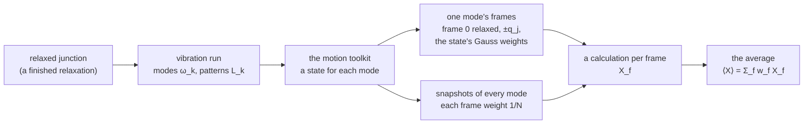

This document answers: **where** the molecule is while it vibrates — one mode
in each of its states (§ 2, § 2a, § 2b) and the whole molecule (§ 2c);
**what** a measurement averages and why a lopsided response gives a net
change (§ 3–4); **how** few frames compute that average and when they cannot
(§ 5); what each kind of frame set answers (§ 6); what the picture assumes
(§ 7); where each number is recorded (§ 8).

---

## 1. The quantities

A normal mode $\nu$ has an angular frequency $\omega_\nu$ and a mass-weighted
normal coordinate $Q_\nu$ (units $\mathrm{amu}^{1/2}\,\text{Å}$). Displacing the
junction along the mode moves each atom $A$ by its share of the canonical
eigenvector $\mathbf L_{\nu,A}$ (`vibration.md` § 6.3):

$$
\mathbf R_A(Q_\nu) \;=\; \mathbf R_A^{0} \;+\; Q_\nu\,\mathbf L_{\nu,A},
\qquad \mathbf L_{\nu,A} = \mathbf 0 \ \text{for every held atom.}
$$

With every mode moving at once, the moves add (§ 2c):
$\mathbf R_A = \mathbf R_A^{0} + \sum_\nu Q_\nu\,\mathbf L_{\nu,A}$.

The electrodes are held, so no frame moves a lead atom — the condition that
lets every frame share one pair of lead calculations (`transport.md` § 2a.9).

For each frame the transport calculation gives the transmission $T(E;Q)$, and
at low bias the conductance

$$
G(Q) \;=\; G_0\,T(E_F;Q), \qquad G_0 = \frac{2e^2}{h}
$$

for a spin-degenerate junction (per spin channel, $e^2/h$ each; `transport.md`
§ 2a.12).

---

## 2. Where the molecule is: the thermal distribution of one mode

For a harmonic mode in thermal equilibrium at temperature $T_{\mathrm{K}}$ the
probability of finding the coordinate at $Q$ is a Gaussian — exactly, quantum
mechanically, at every temperature (the probability of each position in the
oscillator's thermal state, [Feynman1972] § 2.5):

$$
P(Q) \;=\; \frac{1}{\sqrt{2\pi}\,\sigma}\,\exp\!\left(-\frac{Q^2}{2\sigma^2}\right),
\qquad
\sigma^2 \;=\; \langle Q^2\rangle \;=\; \frac{\hbar}{2\omega}\,
\coth\!\left(\frac{\hbar\omega}{2k_B T_{\mathrm K}}\right).
$$

Its two limits say what sets the width:

$$
\sigma^2 \xrightarrow{\;k_BT_{\mathrm K}\ll\hbar\omega\;} \frac{\hbar}{2\omega}
= Q_{\mathrm{zp}}^2 \quad\text{(zero-point motion)},
\qquad
\sigma^2 \xrightarrow{\;k_BT_{\mathrm K}\gg\hbar\omega\;} \frac{k_BT_{\mathrm K}}{\omega^2}
\quad\text{(classical equipartition)}.
$$

$Q_{\mathrm{zp}}$ is in every vibration result already
(`zero_point_amplitude_amu12_ang`, `vibration.md` § 6.3, beside
`zero_point_displacement_ang`, $Q_{\mathrm{zp}}\,\mathbf L$ per atom in Å), so
$\sigma = Q_{\mathrm{zp}}\sqrt{\coth(\hbar\omega/2k_BT_{\mathrm K})}$. At
298 K:

| mode | $\hbar\omega/2k_BT_{\mathrm K}$ | $\sigma/Q_{\mathrm{zp}}$ | what it means |
|---|---|---|---|
| 1600 cm⁻¹ (a ring stretch) | 3.86 | 1.00 | frozen in its ground state: zero-point only |
| 500 cm⁻¹ | 1.21 | 1.09 | mostly zero-point |
| 50 cm⁻¹ (a soft torsion) | 0.12 | 2.89 | thermally excited: three times wider |

Soft modes move far — which is why each frame states its largest
single-atom move, the number a person reads against that atom's bond length
(`normal-modes.md` § 4c.5), and why § 7 names the harmonic picture's limit.

**What matters for § 3: $P(Q)$ is symmetric, $P(-Q) = P(Q)$.** The molecule
spends as much time pushed one way as pushed the other. This is a property of
the *distribution* of positions, for a harmonic mode — and it says nothing
about whether the *transmission* responds symmetrically.

## 2a. When light drives the mode — the spread out of equilibrium

*(Written 2026-10-24 at the user's request: "we are looking at EM driven mode
which means we have an external force to drive a particular mode, how to
estimate the reasonable displace to use for that? … or we can only use
temperature dependent value to just first estimate?"; rewritten 2026-10-28:
"for a mode that is activated due to interaction with an photon, the
'temperature' is no longer accurate because it is not in equilibrium. so
what's the right way to propose a right amount of displacement?")*

> **In short.** Two things decide where the molecule sits along a mode. How
> far it moves is set by how much vibrational energy the mode holds — its mean
> number of quanta $n$. The shape of where it sits is set by whether the
> motion keeps a fixed rhythm. In equilibrium the temperature sets $n$, and
> there is no rhythm. Light, or a current, can raise $n$ in two ways that look
> alike on paper but differ in shape:
>
> - **Quanta added at random moments** — spontaneous Raman scattering from a
>   steady laser, or a current through the junction — keep the bell curve of
>   § 2 and only widen it. The frames stay the bell curve's, at an *effective
>   temperature* (§ 2a.1).
> - **A push in step with the mode** — a narrow-band infrared laser at the
>   mode's frequency, or two lasers whose frequencies differ by it — makes the
>   molecule *swing*. A swing spends most of its time near its turning points,
>   not in the middle, so its positions are not a bell curve (§ 2a.2): one
>   driven molecule is in one state, a bell curve of its zero-point width
>   riding the swing. A strongly curved response then needs frames placed by
>   the swing's own distribution (§ 2a.3).

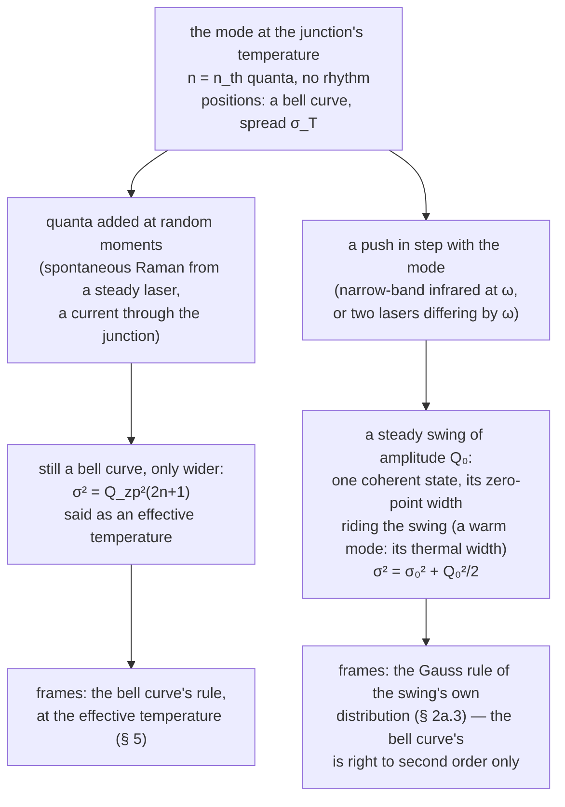

### What sets the spread: the mean number of quanta

The equilibrium spread $\sigma_T$ is usually the floor: light or a current
adds to it (cooling by anti-Stokes scattering can push a mode below it, which
nothing here assumes). How much is added depends on three things:

| what | where it comes from |
|---|---|
| how strongly the light couples to the mode: $\partial\boldsymbol\mu/\partial Q$, the dipole's change along the mode, for infrared — the force per unit local field; $\partial\alpha/\partial Q$, the polarizability's change, for Raman — whose rate grows with the light's intensity | the optical method, [`vibrational-optical-response.md`](?doc=science/vibrational-optical-response.md) § 2, § 3 |
| the local field at the molecule | the field model, or the experiment — not computed here |
| how fast the mode loses what it gains: its quanta at the energy lifetime $\tau$; a swing's amplitude at the line's homogeneous width $\Gamma$ (full width at half maximum, cm⁻¹), $\gamma = 2\pi c\,\Gamma$, which also counts whatever scrambles the rhythm | the measured spectrum — not computed here. A measured line is also broadened by the spread of environments, so $\gamma$ read from it overestimates both rates, and the amplitude below is a lower bound |

**The spread is set by $n$, for any state of the mode.** For a harmonic
oscillator, the time-averaged potential energy is half the total energy (the
other half is kinetic). In mass-weighted coordinates the potential energy is
$\tfrac12\omega^2 Q^2$ and the total is $\hbar\omega\,(n + \tfrac12)$, so

$$
\tfrac12\,\omega^2\,\langle Q^2\rangle = \tfrac12\,\hbar\omega\,\big(n+\tfrac12\big)
\quad\Longrightarrow\quad
\sigma^2 = \langle Q^2\rangle = \frac{\hbar}{2\omega}\,(2n+1) = Q_{\mathrm{zp}}^2\,(2n+1),
$$

using $Q_{\mathrm{zp}}^2 = \hbar/2\omega$ (§ 2). This holds whatever the state
— thermal, pumped or swinging — with $\langle\cdot\rangle$ the average over
time. In equilibrium $n = 1/(e^{\hbar\omega/k_BT_{\mathrm K}} - 1)$, and
$2n+1 = \coth(\hbar\omega/2k_BT_{\mathrm K})$ — § 2's formula again. **The
spread comes from $n$; the shape comes from whether the motion keeps a
rhythm.**

### 2a.1 Quanta added at random moments — a wider bell curve, an effective temperature

A steady laser shining on the junction scatters off the molecule. Most of the
scattered light keeps its colour; a little comes back with one vibrational
quantum less energy — a **Stokes** event, which leaves that quantum in the
mode — or one quantum more — an **anti-Stokes** event, which takes a quantum
from the mode. The surroundings, meanwhile, exchange quanta with the mode at
their own temperature. A current through a biased junction adds quanta
in the same one-at-a-time way.

**Every one of these moves the mode one rung up or down its ladder of
levels**, at a rate proportional to $k+1$ for a step up from level $k$ and to
$k$ for a step down — the harmonic oscillator's own transition strengths.
Call the total rate constants $G$ (gain) and $L$ (loss). The probabilities
$p_k$ of finding the mode on rung $k$ obey

$$
\frac{dp_k}{dt} = G\big[k\,p_{k-1} - (k+1)\,p_k\big] + L\big[(k+1)\,p_{k+1} - k\,p_k\big].
$$

**In steady state each step up balances the step back down**: a ladder has
only one path between two neighbouring rungs, so the flow up from rung $k$
must equal the flow down from rung $k+1$,
$G\,(k+1)\,p_k = L\,(k+1)\,p_{k+1}$. So

$$
\frac{p_{k+1}}{p_k} = \frac{G}{L} \quad\Longrightarrow\quad
p_k = \Big(1-\frac{G}{L}\Big)\Big(\frac{G}{L}\Big)^{k}, \qquad
n = \sum_k k\,p_k = \frac{G}{L-G}.
$$

**Where $G$ and $L$ come from.** The surroundings, at the junction's
temperature and with energy lifetime $\tau$, give $n_{\mathrm{th}}/\tau$ up
and $(n_{\mathrm{th}}+1)/\tau$ down. The laser gives $R$ up and $R_{\mathrm{aS}}$
down, $R$ the Stokes rate of a molecule in its ground state — its Stokes
cross section in the gap times the laser's photon flux — and $R_{\mathrm{aS}}$
the anti-Stokes rate constant likewise. So

$$
G = \frac{n_{\mathrm{th}}}{\tau} + R, \qquad
L = \frac{n_{\mathrm{th}}+1}{\tau} + R_{\mathrm{aS}}
\quad\Longrightarrow\quad
n = \frac{n_{\mathrm{th}} + R\tau}{1 + (R_{\mathrm{aS}} - R)\,\tau} .
$$

When the two rate constants are equal, or the pumping is weak and the mode
cold ($R\tau \ll 1$ and $n_{\mathrm{th}} \ll 1$), this is the familiar
$n = n_{\mathrm{th}} + R\tau$, the weak-pumping form of [Kneipp1996] — to
first order in the rates it is
$n \approx n_{\mathrm{th}} + \big[R(n_{\mathrm{th}}+1) - R_{\mathrm{aS}}n_{\mathrm{th}}\big]\tau$,
so a warm soft mode with $R_{\mathrm{aS}} > R$ gains less. It grows without
bound as $(R - R_{\mathrm{aS}})\,\tau \to 1$.

**Why the shape stays a bell curve.** The populations $p_k \propto (G/L)^k$
fall off by a constant factor per rung — exactly as a thermal state's do,
$p_{k+1}/p_k = e^{-\hbar\omega/k_BT_{\mathrm K}}$. So the pumped mode is a
thermal state at the **effective temperature** $T_{\mathrm{eff}}$ with
$e^{-\hbar\omega/k_BT_{\mathrm{eff}}} = G/L$. A thermal state's positions are
the bell curve of § 2 ([Feynman1972] § 2.5), so the mode under random
pumping is a bell curve of spread

$$
\sigma^2 = Q_{\mathrm{zp}}^2\,(2n+1) = Q_{\mathrm{zp}}^2\,\coth\!\left(\frac{\hbar\omega}{2k_BT_{\mathrm{eff}}}\right),
\qquad
T_{\mathrm{eff}} = \frac{\hbar\omega}{k_B\,\ln(1 + 1/n)} .
$$

**$T_{\mathrm{eff}}$ is measured, not computed here.** The ratio of the
line's anti-Stokes to its Stokes intensity goes as $n/(n+1)$, once the two
lines' frequency factors and enhancements are divided out. Ward, Corley, Tour
and Natelson measured mode temperatures in biased junctions this way
[Ward2011]. Kneipp and co-workers reported pumping by surface-enhanced Raman
scattering itself [Kneipp1996]; Le Ru and Etchegoin examined when that
pumping is real, against heating and other readings of the same data
[LeRuEtchegoin2006].

**So a randomly pumped mode takes the same frames as an equilibrium one**, at
its effective temperature in place of the junction's: the frame set's
temperature (§ 5) is that effective temperature.

### 2a.2 A push in step with the mode — a steady swing

**The push.** A field $E_{\mathrm{loc}}\cos(\omega_L t)$ along $\hat z$ pushes
the mode's coordinate with the force

$$
F(t) = \hat z\cdot\frac{\partial\boldsymbol\mu}{\partial Q}\;E_{\mathrm{loc}}\cos(\omega_L t)
\equiv F_0\cos(\omega_L t)
$$

(the dipole's energy in the field, $-\boldsymbol\mu\cdot\mathbf E$,
differentiated along $Q$). The mode answers as a damped, driven oscillator
that the surroundings also jostle:

$$
\ddot Q + \gamma\,\dot Q + \omega^2 Q = F_0\cos(\omega_L t) + \xi(t),
$$

$\xi(t)$ the random force of the surroundings — what keeps the thermal
jiggle going against the damping $\gamma$.

**Its steady swing.** Leave $\xi$ aside for the moment. Write the push as the
real part of $F_0 e^{i\omega_L t}$ and try $Q = \mathrm{Re}\,\tilde Q\,e^{i\omega_L t}$;
each time derivative brings down a factor $i\omega_L$, so

$$
\big(\omega^2 - \omega_L^2 + i\gamma\omega_L\big)\,\tilde Q = F_0
\quad\Longrightarrow\quad
Q_0 = |\tilde Q| = \frac{F_0}{\sqrt{(\omega^2-\omega_L^2)^2 + \gamma^2\omega_L^2}} .
$$

At resonance, $\omega_L = \omega$, this is $Q_0 = F_0/(\gamma\,\omega)$: the
swing is limited only by the damping — halve the linewidth and the swing
doubles. The swing lags the push by the angle $\phi$ with
$\tan\phi = \gamma\omega_L/(\omega^2-\omega_L^2)$, a quarter period at
resonance.

**The quanta it adds.** The swing's energy is $\tfrac12\omega^2 Q_0^2$ (its
potential energy at the turning points); divided by one quantum, $\hbar\omega$,
and with $Q_{\mathrm{zp}}^2 = \hbar/2\omega$, it holds
$Q_0^2/4Q_{\mathrm{zp}}^2$ quanta.

**How large, for one example** — a moderately strong infrared mode,
$\partial\mu/\partial Q = 0.1\ e\ \mathrm{amu}^{-1/2}$ (0.48 D Å⁻¹ amu⁻¹ᐟ²,
$A(\hat z)$ = 29 km/mol), at 1000 cm⁻¹ ($Q_{\mathrm{zp}}$ = 0.130 amu½ Å),
linewidth 10 cm⁻¹ ($\tau$ = 0.53 ps), driven at resonance (computed from the
CODATA constants; no run of ours):

| local field | local intensity, $\tfrac12 c\varepsilon_0E^2$ | $Q_0/Q_{\mathrm{zp}}$ | quanta added, $Q_0^2/4Q_{\mathrm{zp}}^2$ | $\sigma/Q_{\mathrm{zp}}$ at 0 K |
|---|---|---|---|---|
| 0.001 V/Å | 1.3 × 10⁷ W/cm² | 0.021 | 0.0001 | 1.000 |
| 0.01 V/Å | 1.3 × 10⁹ W/cm² | 0.21 | 0.011 | 1.011 |
| 0.1 V/Å | 1.3 × 10¹¹ W/cm² | 2.1 | 1.1 | 1.79 |

The drive spreads such a mode beyond its zero-point motion only at very high
local fields — a pulsed laser, or a very large enhancement in the gap.

**Where a swing spends its time.** Picture a child on a swing, photographed at
random moments. Near the bottom the swing moves fastest, so few photographs
catch it there; near the two high points it slows, stops and turns, so most
photographs catch it there. The same holds for $Q(t) = Q_0\cos\omega t$. The
time it spends in a small stretch $dQ$ is $dQ/|\dot Q|$, with
$|\dot Q| = \omega\sqrt{Q_0^2 - Q^2}$; it crosses the stretch twice per period
$2\pi/\omega$, so the fraction of time it spends there is

$$
\rho(Q)\,dQ = 2\cdot\frac{dQ}{\omega\sqrt{Q_0^2-Q^2}}\cdot\frac{\omega}{2\pi}
\quad\Longrightarrow\quad
\rho(Q) = \frac{1}{\pi\sqrt{Q_0^2-Q^2}}, \qquad |Q| < Q_0 .
$$

It is **U-shaped**: smallest in the middle, rising without bound at the two
turning points, and zero beyond them. Its moments follow from the averages of
$\cos^2$ and $\cos^4$ over a period, $\tfrac12$ and $\tfrac38$:

$$
\langle Q^2\rangle = \tfrac12\,Q_0^2, \qquad \langle Q^4\rangle = \tfrac38\,Q_0^4 .
$$

The two shapes at the **same spread** $\sigma = 1$ (so $Q_0 = \sqrt2 \approx 1.41$),
as the fraction of time per unit of $u = Q/\sigma$:

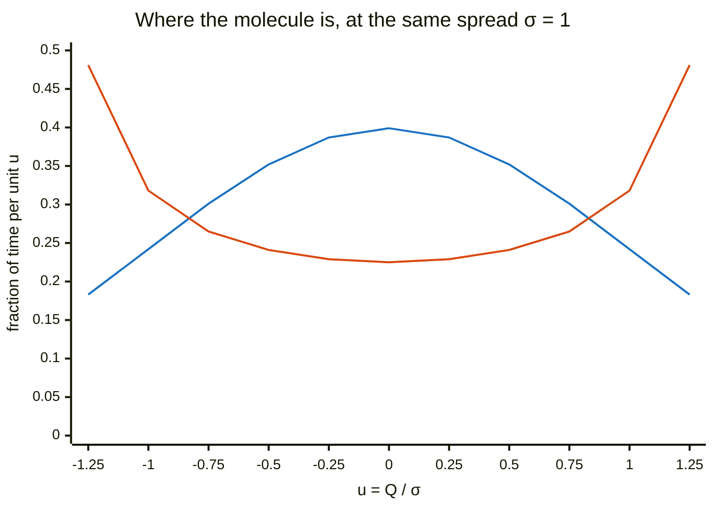

*(Blue: the bell curve, thermal or randomly pumped. Orange: the steady swing,
which keeps rising past $u = \pm1.25$ and without bound at its turning
points, $u = \pm1.41$, and is zero beyond them.)*

| at the same spread σ | bell curve | steady swing |
|---|---|---|
| fraction of time per unit $u$ at the middle | 0.40 | 0.23 |
| at $u = 1.2$ | 0.19 | 0.43 |
| time spent beyond $\lvert u\rvert = 1.41$ | **16 %** | **0** — it never goes there |
| $\langle Q^4\rangle$ | $3\sigma^4$ | $1.5\,\sigma^4$ |

**The quantum picture: the swing carries a bell curve with it.** A mode
starting in its ground state — the zero-point bell curve of spread
$Q_{\mathrm{zp}}$ — and pushed by a force that does not depend on the mode
itself stays a single bell curve of that same width: the push enters the
energy as $-F(t)\,Q$, a term in $Q$ alone, which moves the bell curve's
centre without changing its shape. The centre follows the classical swing,
$Q_0\cos(\omega_L t - \phi)$. Such a state is called a *coherent state* —
Glauber's name for the corresponding states of the radiation field
[Glauber1963]; their properties as states of the harmonic oscillator are
[CohenTannoudji2020] Complement G$_\mathrm{V}$.

**One driven molecule is in one state.** A laser is a classical field, and a
classical push on a harmonic mode that starts in its ground state leaves it in
exactly one pure state [CarruthersNieto1965] — the coherent state above: at every moment a bell
curve of the zero-point width $Q_{\mathrm{zp}}$, centred on the swing.
Photographed at a random moment, the molecule is where the swing is, plus a
zero-point-sized spread — nothing thermal, and no other quanta mixed in. Its
quanta are not a fixed number: a coherent state holds $n$ quanta with
Poisson's probabilities, of mean $Q_0^2/4Q_{\mathrm{zp}}^2$
([CohenTannoudji2020] Complement G$_\mathrm{V}$). A state with exactly $n$
quanta is another pure state, which a steady classical push cannot make: one
heralded event leaves it on a cold mode — one detected Stokes photon, one
electron tunnelling inelastically — and it lasts about the energy lifetime
$\tau$; on a warm mode one added quantum is not a number state (§ 2b.3).

**A warm mode, driven.** A molecule in a junction touches its surroundings —
the electrodes, the substrate. That contact is what damps the mode, giving
its line its width, and the same contact keeps kicking it at random — the
force $\xi(t)$ above. Quantum mechanically the mode is then not in one pure
state but in a mixed one: on rung $n$ of its ladder with the thermal
probability $p_n$ — the state of one molecule, no ensemble of molecules
needed. The equation of motion is linear, so its solution splits into two
parts that do not disturb each other:

$$
Q(t) = \underbrace{Q_0\cos(\omega_L t - \phi)}_{\text{the driven swing}}
\;+\; \underbrace{\delta Q(t)}_{\text{the thermal jiggle}} ,
\qquad
\ddot{\delta Q} + \gamma\,\dot{\delta Q} + \omega^2\,\delta Q = \xi(t),
$$

$\delta Q$ answering the surroundings alone, its positions the thermal bell
curve of spread $\sigma_T$. The drive moves that whole mixture back and
forth: the positions are the thermal bell curve carried along the swing, and
the spreads add,

$$
\sigma^2 = \sigma_T^2 + \tfrac12 Q_0^2 = Q_{\mathrm{zp}}^2\,(2n+1), \qquad
n = n_{\mathrm{th}} + \frac{Q_0^2}{4Q_{\mathrm{zp}}^2} ,
$$

with $\sigma_T = Q_{\mathrm{zp}}$ when the mode is cold — the coherent state
again. **Whether the warmth matters is the mode's frequency against the
temperature** — the driven mode's width against the coherent state's,
$\sigma_T/Q_{\mathrm{zp}} = \sqrt{\coth(\hbar\omega/2k_BT)}$:

| mode | at 4 K | at 300 K |
|---|---|---|
| 1000 cm⁻¹ | 1.000 | 1.008 |
| 300 cm⁻¹ | 1.000 | 1.27 |
| 50 cm⁻¹ | 1.000 | 2.9 |

The pure coherent state is right for a cold junction or a stiff mode; the
thermal width only for a soft mode near room temperature. Which a driven mode
is given is the person's, said with its frames
([`engines/vibration-frames.md`](?doc=engines/vibration-frames.md) § 2, its
rows § 5.1). The
shape is the bell curve's when $Q_0 \ll \sigma_T$, the U's when
$Q_0 \gg \sigma_T$.

**One frequency drives every rung — in the harmonic picture alone** *(the
user, 2026-11-24)*. A drive at the mode's frequency, or a photon absorbed at
it, moves the mode one rung, $n \to n \pm 1$, and it is resonant with every
rung only because the harmonic ladder's gaps are all $\hbar\omega$. A real
mode's gaps shrink as it climbs: for a Morse-like bond [Morse1929]
$E_n = \hbar\omega(n+\tfrac12) - \hbar\omega x_e(n+\tfrac12)^2$, each gap
$2\hbar\omega x_e$ below the one beneath it — large for a stiff stretch of a
light atom, small for a soft one. **A narrow-band drive climbs only while that shift stays within
the line's width** $\Gamma$: past it, the light tuned to $0\to1$ is off
resonance for $1\to2$. A stiff mode's resonant absorption mostly stops at one
quantum, and a coherent drive's swing saturates as the mode's frequency moves
with its amplitude, below § 2a.2's $Q_0 = F_0/(\gamma\omega)$; a soft
stretch, its shift inside the width, climbs several rungs at one frequency.
A torsion is another matter: its well is periodic, so its gaps shrink too
and its positions leave the harmonic shapes near the barrier between two
wells, however few quanta that takes.
Spontaneous Raman and inelastic tunnelling electrons are not resonant with a
rung — the scattered photon or the electron carries away whatever the gap is
— so they climb every rung, Raman at one laser frequency and the electrons
at one bias (§ 2a.1), each step's line shifted. The vibration's result states no anharmonic constant ($\omega x_e$),
so where a mode's ladder leaves resonance is the person's to judge, and many
quanta are where the harmonic picture itself fails (§ 7, item 1): the doors
say so beyond 1 eV in a mode ([`engines/vibration-frames.md`](?doc=engines/vibration-frames.md) § 6).

### 2a.3 What the frames need — the spread to second order, the shape beyond

**Expand the transmission about equilibrium** (§ 4.2). For any distribution
symmetric about $Q = 0$ — the bell curve, the swing, or the two together — the
odd terms average to zero, and

$$
\langle T\rangle = T_0 + \tfrac12\,T''\,\langle Q^2\rangle + \tfrac1{24}\,T''''\,\langle Q^4\rangle + \dots
$$

**Up to the $Q^2$ term only the spread enters**, $\langle Q^2\rangle = \sigma^2$,
whatever the shape: a response that is nearly a parabola over the motion is
averaged correctly by bell-curve frames at the same σ. **From the $Q^4$ term
on, the shape enters**: $\langle Q^4\rangle$ is $3\sigma^4$ for the bell curve
and $1.5\,\sigma^4$ for a pure swing. A strongly curved response — the contact
bond of § 4.3, whose tunnelling grows exponentially as the bond shortens —
weights the rare, far-out positions heavily, and the bell curve visits
positions the swing never reaches.

**The contact bond, exactly.** Take $T(Q) = T_0\,e^{-aQ}$ (§ 4.3), $1/a$ the
distance over which the response changes by a factor $e$. Over the bell curve,
$\langle e^{-aQ}\rangle = e^{a^2\sigma^2/2}$. Over the swing,
$\langle e^{-aQ_0\cos\omega t}\rangle$ is the modified Bessel function $I_0$,
by its integral form $I_0(z) = \frac1\pi\int_0^\pi e^{\pm z\cos\theta}\,d\theta$
([DLMF] 10.32.1). At the same spread ($\sigma^2 = Q_0^2/2$) the two are

$$
\frac{\langle T\rangle_{\text{swing}}}{T_0} = I_0(aQ_0) = 1 + \frac{(aQ_0)^2}{4} + \frac{(aQ_0)^4}{64} + \dots ,
\qquad
\frac{\langle T\rangle_{\text{bell}}}{T_0} = e^{(aQ_0)^2/4} = 1 + \frac{(aQ_0)^2}{4} + \frac{(aQ_0)^4}{32} + \dots
$$

— equal up to the $Q^2$ term, and different from the $Q^4$ term on, by the
factor 2 between the two shapes' $\langle Q^4\rangle$:

| the swing against the response's length, $aQ_0$ | true average, $I_0(aQ_0)$ | bell curve at the same σ | bell-curve error |
|---|---|---|---|
| 0.5 | 1.0635 | 1.0645 | +0.1 % |
| 1.0 | 1.2661 | 1.2840 | +1.4 % |
| 2.0 | 2.2796 | 2.7183 | **+19 %** |
| 3.0 | 4.8808 | 9.4877 | **+94 %** |

**The frames a swing needs: the Gauss rule of its own distribution.** The
frames are a few positions $Q_j$ with weights $w_j$ summing to 1, and the
average is $\langle T\rangle \approx \sum_j w_j\,T(Q_j)$. Write the response
as its series, $T = T_0 + T_1Q + T_2Q^2 + \dots$: averaged, each term is a
coefficient times an average of a power, $\langle Q^k\rangle$. So frames
that reproduce the distribution's own averages $\langle Q^k\rangle$ for every
$k$ up to some degree get every term of the response up to that degree
exactly. With $m$ frames the most that can be matched is
$k = 0, 1, \dots, 2m-1$ — the $m$ positions and $m$ weights are $2m$ numbers —
and the frames that do it are the distribution's **Gauss rule**
[GolubWelsch1969]. It is the one recipe every state's frames follow: the
bell curve's is Gauss–Hermite (§ 5.1).

For three frames on a symmetric distribution — the swing, the bell curve, or
the two together — the steps are short. The odd averages are zero, so the
frames are $0$ and $\pm x$, with weights $w_0$ and $w$:

1. **Measure the distribution's shape with two numbers**, both from formulas,
   no calculation of $T$: $\langle Q^2\rangle$, its width, and
   $\langle Q^4\rangle$, how much of it sits far out. For the swing carrying
   a bell curve of spread $\sigma$ (§ 2a.2),
   $\langle Q^2\rangle = \sigma^2 + \tfrac12 Q_0^2$ and
   $\langle Q^4\rangle = 3\sigma^4 + 3\sigma^2Q_0^2 + \tfrac38 Q_0^4$.
2. **Choose the frames to reproduce them**: $2w\,x^2 = \langle Q^2\rangle$
   and $2w\,x^4 = \langle Q^4\rangle$, so
   $x^2 = \langle Q^4\rangle/\langle Q^2\rangle$,
   $w = \langle Q^2\rangle^2/2\langle Q^4\rangle$ and $w_0 = 1 - 2w$.
3. **Compute the response at the three geometries**: $T(0)$, $T(+x)$,
   $T(-x)$.
4. **Average**: $\langle T\rangle \approx w_0\,T(0) + w\,T(+x) + w\,T(-x)$ —
   exact whenever $T$ is a polynomial of degree 5 or less over the motion.

**Five frames, by hand.** The frames are $0$, $\pm x_1$ and $\pm x_2$,
with weights $w_0$, $w_1$, $w_2$; they must reproduce four averages,
$\mu_2 = \langle Q^2\rangle$ to $\mu_8 = \langle Q^8\rangle$:

1. **Measure** $\mu_2, \mu_4, \mu_6, \mu_8$ from the formulas.
2. **Find the two squared positions** $y_i = x_i^2$: they are the roots of
   $y^2 + c_1 y + c_0 = 0$, whose $c_1$ and $c_0$ solve the 2×2 system
   $\mu_6 + c_1\mu_4 + c_0\mu_2 = 0$, $\mu_8 + c_1\mu_6 + c_0\mu_4 = 0$ —
   because the five positions are the zeros of $x\,(x^4 + c_1x^2 + c_0)$,
   and that polynomial, multiplied by $x$ or by $x^3$, must average to zero
   over the distribution, as every Gauss rule's node polynomial does against
   the lower powers.
3. **Find the weights**: $2w_1y_1 + 2w_2y_2 = \mu_2$ and
   $2w_1y_1^2 + 2w_2y_2^2 = \mu_4$, then $w_0 = 1 - 2w_1 - 2w_2$.
4. **Compute and average**, as for three: exact to degree 9.

For seven frames and more the same matching is a small eigenvalue problem
[GolubWelsch1969] — built without the averages themselves, from which the
rule is found ill-conditioned as the frames grow, about a digit lost a frame
even with the averages scaled not to grow [Gautschi1982]: the swing's
distribution is replaced by a discrete one holding the same averages to
degree $2m+1$ — $2m+2$ equal phases of the swing, each carrying the bell
curve's $(m+1)$-point Gauss–Hermite rule — and the Gauss rule of that
discrete distribution is found by the Lanczos recurrence on it, in exact
arithmetic Gautschi's discretized Stieltjes procedure [Gautschi1982]; the
bare swing's is Chebyshev's, below (`vibration.State.frames`, which builds
three and five frames the same way, equal to the hand recipe).

**Worked** — a swing $Q_0 = 2$ carrying a bell curve $\sigma = 1$ (any unit
of $Q$): $\langle Q^2\rangle = 1 + 2 = 3$, $\langle Q^4\rangle = 3 + 12 + 6 =
21$, so $x^2 = 7$, $x = 2.65$, $w = 9/42 = 0.214$, $w_0 = 0.571$. For five,
$\mu_6 = 215$ and $\mu_8 = 2835$ give $c_1 = -19.559$, $c_0 = 65.245$, so
$x_1 = 2.0656$, $x_2 = 3.9105$, $w_1 = 0.2644$, $w_2 = 0.0243$,
$w_0 = 0.4225$. On the contact bond $T = T_0e^{-Q}$, whose true average is
$I_0(2)\,e^{1/2}\,T_0 = 3.7584\,T_0$:

| frames, the Gauss rule | the average | error |
|---|---|---|
| 3 | 3.6068 | −4.0 % |
| 5 | 3.7568 | −0.044 % |
| 9 | 3.7584 | −0.0000004 % |

For the bare swing ($\sigma \to 0$) the Gauss rule is Chebyshev's: frames at
$Q_0\cos\big((2j-1)\pi/2m\big)$, each of weight $1/m$ — three at $0$ and
$\pm0.866\,Q_0$. At $aQ_0 = 2$ the three give 2.2764 against the true 2.2796
(−0.14 %), five agree to all the digits shown. The frames sit inside the
turning points, never on them: the turning points hold the most time, but
each is one position, and the rule places frames by what the averages need.

**Why the bell curve's frames are not the swing's.** The bell curve's frames
(§ 5) are exact in shape for a mode in equilibrium, and for one pumped at
random moments at its effective temperature (§ 2a.1). For a mode swung in
step with light they are right only up to the $Q^2$ term, and two things go
wrong as the swing grows:

1. **The bell curve's frames reach beyond the swing's turning points.** At
   the swing's own spread, $\sigma = Q_0/\sqrt2$, the outermost of three frames
   sits at $1.22\,Q_0$, of five at $2.02\,Q_0$, of seven at $2.65\,Q_0$: they
   compute geometries the molecule never visits.
2. **More bell-curve frames do not reveal the error.** They converge to the
   bell curve's average, not the swing's, so comparing three frames with five
   (§ 5.3) cannot show it.

So a bell-curve set serves a swing only while the swing is short against the
response's length, $aQ_0 \lesssim 1$ in the example. Its temperature is then
the one holding the swing's quanta,
$n = n_{\mathrm{th}} + Q_0^2/4Q_{\mathrm{zp}}^2$ and
$T_{\mathrm K} = \hbar\omega/\big(k_B\ln(1 + 1/n)\big)$. Beyond that, the
swing's own frames (above), or frames already computed re-averaged over it
(§ 5.4).

Within the range where only the $Q^2$ term matters, a wider spread also
rescales a result already computed,
$\langle\Delta G\rangle/G\,(\sigma) = (\sigma/\sigma_T)^2 \times \langle\Delta G\rangle/G\,(\sigma_T)$
— an analysis on the data file (§ 8), never a value of the record.

---

## 2b. One mode in any state — its zero-point amplitude, where it sits, and what each atom moves

*(The user, 2026-11-22: "offer the theory and api for recalculation of
zero-point amplitude and different distribution/probability distribution
function for mode at different excitation state"; "the displacement of atoms
from a given mode's displacement should be able to be calculated with clear
theory/document"; "those theory / calculation api should be scientifically
validated in tests".)* The API that computes each of these is
`postprocess.vibration` ([`engines/vibration.md`](?doc=engines/vibration.md)
§ 6.11 § 6), by the module `vibration`; the tests of § 2b.5 are
`tests/test_vibration_mechanics.py` and, end to end,
`tests/test_vibration_mechanics_e2e.py`, and for snapshots (§ 2c) the motion
toolkit's ([`engines/vibration-frames.md`](?doc=engines/vibration-frames.md)
§ 8).

> **In short.** A mode's coordinate $Q$ has a natural length, the zero-point
> amplitude $Q_{\mathrm{zp}}$, set by its frequency alone. Where the molecule
> sits along the mode is a probability density $P(Q)$, and its shape depends
> on the mode's state: a bell curve in equilibrium or under random quanta
> (§ 2, § 2a.1), the oscillator's own standing-wave densities with exactly $n$
> quanta, a bell curve riding a swing when driven in step (§ 2a.2). Every
> atom moves along its own row of the mode's pattern, $\mathbf u_A = Q\,\mathbf
> L_A$, so any coordinate — a number, a number of zero-point widths, a state's
> r.m.s. — gives every atom's move in x, y, z.

### 2b.1 The zero-point amplitude, from any frequency

$$
Q_{\mathrm{zp}} \;=\; \sqrt{\frac{\hbar}{2\omega}} \;=\; \sqrt{\frac{C}{\tilde\nu}},
\qquad C = 16.8576\ \mathrm{amu}\,\text{Å}^2\,\mathrm{cm}^{-1}
$$

in amu$^{1/2}$·Å, $\tilde\nu$ the wavenumber in cm⁻¹ — `constants.ZERO_POINT_Q2_AMU_ANG2_CM1`,
derived from the hartree in cm⁻¹, the Bohr radius and the amu in electron
masses (16.857629, as SI's $\hbar$, $c$ and amu give). It is the
ground state's r.m.s. coordinate, $\langle Q^2\rangle_0 = Q_{\mathrm{zp}}^2$, and the
oscillator's natural length: the dimensionless coordinate is
$\xi = Q/(\sqrt2\,Q_{\mathrm{zp}})$, $Q$ in units of $\sqrt{\hbar/\omega}$.

It can be **recalculated from any frequency** with the mode's pattern kept —
a scaled frequency (a factor for the harmonic picture's overestimate), a
measured one — since $\mathbf L$ is unchanged by a scale on $\omega$. **Other
masses** (an isotope) change both $\omega$ and $\mathbf L$: that needs the
force constants and a new diagonalisation (`normal-modes.md` § 3), which the
result stores from the vibration record on (`vibration.md` § 6.11 § 9 item 3;
not built).

### 2b.2 From the mode's coordinate to each atom's move

The canonical eigenvector $\mathbf L$ is normalised with the masses,
$\sum_A m_A\lvert\mathbf L_A\rvert^2 = 1$ ($m_A$ in amu, $\mathbf L_A$ in
amu$^{-1/2}$; `vibration.md` § 6.3). A coordinate $Q$ moves **every atom $A$ by**

$$
\mathbf u_A(Q) \;=\; Q\,\mathbf L_A \qquad (\text{Å, its x, y and z}),
\qquad \mathbf u_A = \mathbf 0 \ \text{for a held atom},
$$

and **back**, a set of atom moves along the mode gives its coordinate by the
mass-weighted projection

$$
Q \;=\; \sum_A m_A\,\mathbf L_A\cdot\mathbf u_A ,
$$

exact because different modes are orthogonal with the masses. The coordinate
may be given as a number (amu$^{1/2}$·Å), as $k$ zero-point widths
($Q = k\,Q_{\mathrm{zp}}$, each atom moving $k\,\mathbf u_{\mathrm{zp},A}$ —
`zero_point_displacement_ang`), or as a state's r.m.s. ($\sqrt{\langle
Q^2\rangle}$, each atom's r.m.s. move $\sqrt{\langle Q^2\rangle}\,\lvert\mathbf
L_A\rvert$ along $\mathbf L_A$).

**H₂, worked.** At 4400 cm⁻¹, $Q_{\mathrm{zp}} = \sqrt{16.8576/4400} = 0.0619$
amu$^{1/2}$·Å. The stretch moves the two atoms oppositely, $\lvert\mathbf
L_{\mathrm H}\rvert = 1/\sqrt{2m_{\mathrm H}} = 0.7043$ amu$^{-1/2}$, so at
$Q_{\mathrm{zp}}$ each atom moves 0.0436 Å and the bond changes by 0.0872 Å —
$Q_{\mathrm{zp}}/\sqrt\mu$ with $\mu = m_{\mathrm H}/2$, the textbook zero-point
amplitude (`normal-modes.md` § 4b.5 F).

### 2b.3 Where the molecule sits — the distribution in each state

**Which state for which experiment.** A conductance is a steady average over
millions of vibrational periods (§ 0), so the state is the one the
experiment holds steadily:

| experiment | state (the toolkit's arguments for each: [`engines/vibration-frames.md`](?doc=engines/vibration-frames.md) § 2) |
|---|---|
| quanta added at random moments — spontaneous Raman from a steady laser, a current through the junction — or equilibrium | thermal, at the junction's temperature or an effective one (§ 2a.1) |
| a steady push in step with the mode — resonant infrared, two lasers differing by its frequency | driven: the coherent state, or a warm mode's thermal width carried by the swing (§ 2a.2) |
| the moment after one heralded quantum — one inelastic tunnelling electron, one detected Stokes photon — for times below the energy lifetime $\tau$, **on a cold mode** ($\hbar\omega \gg k_BT$) | $n$ quanta exactly, a transient, not a steady state; a steady infrared drive is the row above, never this one. On a warm mode one added quantum is not a number state: from a thermal state of $\bar n$ quanta it leaves one quantum exactly with chance $1/(\bar n+1)^2$ — 0.83 at $\bar n = 0.1$, 0.25 at $\bar n = 1$, 0.045 for a 50 cm⁻¹ mode at 300 K, whose mean is then $2\bar n + 1 = 8.4$ quanta |

| state | what it is | $P(Q)$ | $\langle Q^2\rangle$ | $\langle Q^4\rangle$ |
|---|---|---|---|---|
| **$n$ quanta exactly** (a number state) | the oscillator's $n$-th eigenstate — what one heralded event leaves on a cold mode, for about the energy lifetime $\tau$ | $\dfrac{H_n(\xi)^2\,e^{-\xi^2}}{2^n\,n!\,\sqrt{2\pi}\,Q_{\mathrm{zp}}}$, $\xi = \dfrac{Q}{\sqrt2\,Q_{\mathrm{zp}}}$, $H_n$ the Hermite polynomial | $(2n+1)\,Q_{\mathrm{zp}}^2$ | $3\,(2n^2+2n+1)\,Q_{\mathrm{zp}}^4$ |
| **thermal**, at $T$ or at mean quanta $\bar n$ | equilibrium (§ 2), or quanta added at random moments (§ 2a.1): the number states weighted by $p_n = \bar n^n/(\bar n+1)^{n+1}$ | the Gaussian of § 2, $\sigma^2 = (2\bar n+1)\,Q_{\mathrm{zp}}^2$ — exactly, the weighted sum of the densities above (Mehler's formula) | $\sigma^2$ | $3\sigma^4$ |
| **driven** — a steady swing | a push in step with the mode (§ 2a.2): the coherent state, a bell curve of the zero-point width $\sigma_0 = Q_{\mathrm{zp}}$ centred at $Q_0\cos\omega t$, $Q_0 = 2\,Q_{\mathrm{zp}}\sqrt{n_s}$ for $n_s$ swing quanta; a warm mode's, the thermal width $\sigma_T$ in its place | that bell curve averaged over the swing's phase | $\sigma_0^2 + Q_0^2/2$ | $3\sigma_0^4 + 3\sigma_0^2Q_0^2 + \tfrac38 Q_0^4$ |
| **classical**, for comparison | the high-temperature limit; a classical swing alone; a classical swing carrying the classical bell curve — a warm driven mode, classically | a Gaussian, $\sigma^2 = k_BT/\omega^2$; a swing alone, $1/\bigl(\pi\sqrt{Q_0^2 - Q^2}\bigr)$ inside $\pm Q_0$; that Gaussian averaged over the swing's phase | $k_BT/\omega^2$; $Q_0^2/2$; $\sigma^2 + Q_0^2/2$ | $3\sigma^4$; $\tfrac38 Q_0^4$; $3\sigma^4 + 3\sigma^2Q_0^2 + \tfrac38 Q_0^4$ |

What each shape says. **With $n \ge 1$ quanta it is not a bell curve**:
$P_n$ has $n$ zeros, its weight piles toward the classical turning points
$\pm Q_{\mathrm{zp}}\sqrt{2(2n+1)}$, and some lies beyond them — 15.7 % for
$n = 0$ (the bell curve at 0 K), 11.2 % for $n = 1$, 9.5 % for $n = 2$. **Thermal and random quanta are the same bell curve**,
set by the mean number of quanta alone (§ 2a). **A swing spends its time near
its turning points** (§ 2a.2). In every state the spread is set by the mean
number of quanta, $\langle Q^2\rangle = Q_{\mathrm{zp}}^2(2\langle n\rangle+1)$ (§ 2a),
and each atom's r.m.s. move is that spread times $\lvert\mathbf L_A\rvert$ (§ 2b.2).

### 2b.4 Frames for a state

An average over a state — a level's, a transmission's — is computed from a
few frames placed by a quadrature for that state's $P(Q)$, its weights the
frames' (§ 5): for a Gaussian state, the Gauss–Hermite rule,
$Q_j = \sqrt2\,\sigma\,x_j$ (§ 5.1); for $n$ quanta exactly, the rule whose
weight function is $P_n$ itself — its nodes and weights from that density's
own orthogonal polynomials, built by the Lanczos recurrence of the
oscillator's position operator from the state $\lvert n\rangle$ and Golub and
Welsch's eigenproblem; for a swing, its own distribution's Gauss rule
(§ 2a.3) — every state's frames by one recipe, $m$ frames exact for a
response polynomial up to degree $2m-1$. **The distribution is the maker's
alone**: a multi-frame structure carries each frame's weight, the one row a
calculation reads, and the maker's rows say what motion the weights stand
for ([`model/structure.md`](?doc=model/structure.md) § 2.2f), so a
calculation over the frames is the same whatever the state. A mode's own
frames for any state, and snapshots of the whole molecule (§ 2c), are the
motion toolkit's ([`engines/vibration-frames.md`](?doc=engines/vibration-frames.md)
§ 3, § 4); re-averaging frames already computed over another motion (§ 5.4)
is an analysis of their results.

**A frame's weight is its share of the average, not the chance of finding
the molecule there.** For one quantum exactly, the three-frame rule places
frames at $0$ and $\pm\sqrt5\,Q_{\mathrm{zp}}$ with weights 0.4, 0.3 and 0.3
($x^2 = \langle Q^4\rangle/\langle Q^2\rangle = 15/3$) — weight 0.4 at
$Q = 0$, where $\lvert\psi_1\rvert^2$ is zero and the molecule is never
found. The weights are what make the frames reproduce the state's averages
(§ 2a.3); a frame's weight says how much its geometry counts in the average,
not how often the molecule is there.

### 2b.5 How each is validated

Each test takes its expected numbers from the science below — never from
molbuilder's own constants; a row holding two of its answers together holds
them to the relation the science or the contract states between them
(Mehler's sum and the hot limit, § 2b.3; the record's temperature,
[`engines/vibration.md`](?doc=engines/vibration.md) § 6.11 § 9 item 6) — and
is seen failing on the release before:

| what | the test's expectation | where it comes from |
|---|---|---|
| $Q_{\mathrm{zp}}$ | H₂ at 4400 cm⁻¹: 0.0619 amu$^{1/2}$·Å; the bond's r.m.s. 0.0872 Å $= Q_{\mathrm{zp}}/\sqrt\mu$ | $\sqrt{\hbar/2\omega}$; the textbook zero-point amplitude |
| a harmonic diatomic built from a spring constant $k$ and two masses | its frequency $\sqrt{k/\mu}$; at $Q_{\mathrm{zp}}$ the atoms move $\tfrac{m_2}{M}\,\tfrac{Q_{\mathrm{zp}}}{\sqrt\mu}$ and $\tfrac{m_1}{M}\,\tfrac{Q_{\mathrm{zp}}}{\sqrt\mu}$ in opposite directions, the centre of mass still | the two-body problem in closed form |
| an atom's move and its way back | the projection $\sum_A m_A\mathbf L_A\cdot\mathbf u_A$ returns $Q$; the displaced geometry's harmonic energy $\tfrac12\mathbf u^{\mathsf T}H\mathbf u = \tfrac12\omega^2Q^2$ | the eigenproblem's orthonormality with the masses |
| $n$ quanta exactly | each $P_n$ integrates to 1; $\langle Q^2\rangle$ and $\langle Q^4\rangle$ as in § 2b.3; $n$ zeros; the weight beyond the classical turning points (§ 2b.3's 15.7 %, 11.2 %, 9.5 %); the potential energy half of $\hbar\omega(n+\tfrac12)$ | the oscillator's eigenfunctions; the virial theorem |
| thermal | the $p_n$-weighted sum of the $P_n$ equals the Gaussian of $\sigma^2 = (2\bar n+1)Q_{\mathrm{zp}}^2$; $\bar n$ is Bose–Einstein's; $\sigma \to Q_{\mathrm{zp}}$ at 0 K and $\sigma^2 \to k_BT/\omega^2$ hot | Mehler's formula; § 2 |
| a swing | its $\langle Q^2\rangle$ and $\langle Q^4\rangle$ as in § 2b.3; its density the bell curve averaged over the swing's phase | § 2a.2, in closed form |
| frames | each state's Gauss rule — a bell curve, $n$ quanta, a swing — reproduces its state's moments to degree $2m-1$ | Gauss quadrature |
| the average of $e^{aQ}$ in each state | thermal: $e^{a^2\sigma^2/2}$; driven: $I_0(aQ_0)\,e^{a^2\sigma_0^2/2}$, $\sigma_0$ the swing's carried width; $n$ quanta: $e^{\lambda^2/2}L_n(-\lambda^2)$, $\lambda = aQ_{\mathrm{zp}}$, $L_n$ the Laguerre polynomial; over snapshots of many modes, $\langle e^{\sum_k a_kQ_k}\rangle$ the product of each mode's own, each drive group one factor (the row below; § 2c.1) | the bell curve's moment generating function; the phase average of § 2a.3 ([DLMF] 10.32.1); $\langle n\rvert e^{\lambda(b+b^\dagger)}\lvert n\rangle$ by the oscillator's ladder operators |
| a drive group (§ 2c.2) | its modes' coordinates correlated, $\mathrm{Cov}(Q_a, Q_b) = \tfrac12 Q_{0,a}Q_{0,b}\cos(\ell_a - \ell_b)$; the group's average of $e^{\sum_d a_dQ_d}$, one factor, $I_0\big(\lvert\sum_d a_dQ_{0,d}\,e^{-i\ell_d}\rvert\big)\prod_d e^{a_d^2\sigma_{0,d}^2/2}$ | the shared phase: $\sum_d a_dQ_{0,d}\cos(\varphi - \ell_d) = R\cos(\varphi - \theta)$ with $R = \lvert\sum_d a_dQ_{0,d}e^{-i\ell_d}\rvert$, then the phase average of § 2a.3 ([DLMF] 10.32.1) |
| snapshots | each mode's draws follow its state's distribution; the modes' coordinates uncorrelated but within a drive group (the row above); each atom's displacement covariance $\sum_k\langle Q_k^2\rangle\,\mathbf L_{k,A}\mathbf L_{k,A}^{\mathsf T}$, plus each group's cross terms $\tfrac12Q_{0,a}Q_{0,b}\cos(\ell_a-\ell_b)\big(\mathbf L_{a,A}\mathbf L_{b,A}^{\mathsf T} + \mathbf L_{b,A}\mathbf L_{a,A}^{\mathsf T}\big)$; an antithetic pair's odd response cancels exactly; the average of $e^{\sum_k a_kQ_k}$ the product above, within its error — for $X = e^{\sum_k a_kQ_k}$, $X(Q)\,X(-Q) = 1$, so a paired set's pair-mean variance is $\tfrac12(\langle X^2\rangle + 1) - \langle X\rangle^2$, its error known before the draw | § 2c, § 5.5 |
| end to end | a real PySCF H₂ run: the bond's r.m.s. $\sqrt{\hbar/2\mu\omega}$ from CODATA's constants and the file's frequency and masses, each atom moving half of it at $Q_{\mathrm{zp}}$, and the projection giving $Q_{\mathrm{zp}}$ back | CODATA; the two-body problem |

## 2c. The whole molecule — every mode at once

*(The user, 2026-11-23: "(1) correctly generate a full displacement map of
all atoms with the included modes at specified temperature with thermal
equilibrium assumption such that it takes care of the distribution while
making a snapshot of one possible frame, (2) … the displacement of a selected
mode where it is optically activated and therefore not in thermal
equilibrium, but only samples that distribution with one snapshot, (3) a
correct way/api to merge/add the two situation into a combined
displacement/frame"; "each frame is like a Monte Caro sampling of the
different combination of the thermal background and selected activation, and
then the average can be done correctly (in this case then it would be an
equal weight)".)* The API is
[`engines/vibration-frames.md`](?doc=engines/vibration-frames.md) § 3.

### 2c.1 The modes move independently

At a temperature every mode moves at once, and the molecule's geometry is
all of them together, $\mathbf R_A = \mathbf R_A^0 + \sum_k Q_k\,\mathbf L_{k,A}$
(§ 1). In the harmonic picture the energy is a sum over the modes,
$\sum_k \tfrac12\big(\dot Q_k^2 + \omega_k^2 Q_k^2\big)$, with no term that
joins two of them: each mode is an oscillator of its own, and in thermal
equilibrium the probability of one set of coordinates is the product of each
mode's,

$$
P(Q_1, \dots, Q_N) = P_1(Q_1)\,P_2(Q_2)\cdots P_N(Q_N),
$$

each $P_k$ the bell curve of § 2 at the mode's own spread $\sigma_k(T)$
([Feynman1972] § 2.5, one oscillator at a time). A soft mode moves far, a
stiff one barely beyond its zero-point motion, and no mode's position says
anything about another's — save the modes one laser drives in step, which
share its phase (§ 2c.2).

### 2c.2 A driven mode among thermal ones

Light driving one mode, $k^\ast$, puts that mode in its driven state
(§ 2a.2) — the coherent state when the mode is cold against the junction
($\hbar\omega \gg k_BT$); otherwise the junction's thermal width carried by
the swing, the table of § 2a.2 saying which — and leaves the others at the
junction's temperature. The molecule's distribution is the same product with
that one factor changed:

$$
P = P^{\mathrm{driven}}_{k^\ast}(Q_{k^\ast})\;\prod_{k\neq k^\ast} P_k(Q_k).
$$

The driven mode's distribution **replaces** its thermal one: it is in one
state of its own (a warm mode's driven state, § 2a.2, is still that one
factor). The product holds because the harmonic energy separates into the
modes (§ 2c.1) and the drive is resonant with $k^\ast$ alone: the other
modes keep their thermal motion, which has no phase relation to the light,
each factor drawn on its own. The toolkit's default for a driven mode is the
pure coherent state, the user's (`engines/vibration-frames.md` § 2); inside a
warm motion it says the thermal width that default leaves out, never
deciding (§ 3.1 there).

**Several modes driven by one laser swing in step.** In steady state a
driven mode moves at the laser's frequency, not its own (§ 2a.2), so every
mode one laser drives oscillates at that one frequency and their phases are
locked: one phase $\varphi$ per snapshot, shared by the group, each mode $k$
at its own lag $\ell_k$ behind the field,
$Q_k = Q_{0,k}\cos(\varphi - \ell_k) + \sigma_{0,k}z_k$. **The lag** is
§ 2a.2's angle at the laser's frequency, taken between 0 and π,
$\ell_k = \operatorname{atan2}\big(\gamma_k\omega_L,\ \omega_k^2 - \omega_L^2\big)$
— π/2 at resonance, near 0 for a mode above the laser, near π for one below
it; written as a plain arctangent of the ratio it lands a mode below the
laser in the wrong quadrant, $-0.05$ where it is $3.09$ rad 100 cm⁻¹ below
it — plus π where the mode's dipole change along the field,
$\hat z\cdot\partial\boldsymbol\mu/\partial Q_k$, is negative, the signed
vector as `postprocess.infrared_view` gives it in the result's eigenvector
sign on both engines (the record's own on PySCF, from the charges on SIESTA,
whose result states no dipole change of its own): a mode's eigenvector sign is a convention, and the lag carries it,
so a lag of 0 between two modes is no physics, and the toolkit takes every
lag from the person, never a default (§ 3.1 there). **Two lasers at
different frequencies** drive their modes at two frequencies, whose relative
phase sweeps through every value over a measurement: independent phases, the
toolkit's default for modes driven each alone. **One laser swings a mode off
its resonance** less, by $\gamma\omega/\sqrt{(\omega_k^2 - \omega_L^2)^2 +
\gamma^2\omega_L^2}$, about $\Gamma/2\Delta$ for a line of full width
$\Gamma$ a detuning $\Delta$ away — 0.45 at one linewidth, 0.24 at two, about
0.05 at 100 cm⁻¹ from the laser for a 10 cm⁻¹ line (§ 7, item 9) — so
comparable swings in one group need the laser within about one linewidth of
each mode. In step, the modes are correlated,
$\mathrm{Cov}(Q_a, Q_b) = \tfrac12Q_{0,a}Q_{0,b}\cos(\ell_a - \ell_b)$, and the
product above holds with each drive group taken as one factor (§ 2b.5).

### 2c.3 Snapshots, and why each weighs the same

The average of a property over the molecule's motion is an integral over all
$N$ coordinates at once. A fixed grid of $m$ positions per mode needs $m^N$
geometries — $3^{30} \approx 2\times10^{14}$ for 30 modes — which no
calculation affords. **Random snapshots** need no grid:

1. **Draw** each mode's coordinate $Q_k$ from its own distribution, every
   mode independently — the modes of a drive group sharing one phase
   (§ 2c.2): a bell curve's draw is its spread times a standard normal
   number $z$; the driven mode's is $Q_0\cos\varphi$ for a uniformly drawn
   phase $\varphi$, plus its carried spread times a normal number; a mode
   with $n$ quanta, a normal number $z$, and the $Q$ where the chance of
   finding the mode at $Q$ or less is $\Phi(z)$, the chance a standard normal
   number falls below $z$. Every state takes one normal number per draw, so a
   mirrored draw $-z$ is the mirror $-Q$.
2. **Move** every atom by all of them at once,
   $\mathbf R_A = \mathbf R_A^0 + \sum_k Q_k\,\mathbf L_{k,A}$: one frame.
3. **Repeat** for $N$ frames, and compute the property at each.
4. **Average** with equal weights,
   $\langle X\rangle \approx \tfrac1N\sum_f X(\text{frame}_f)$.

The weights are equal because the probabilities are already in where the
frames were drawn: a likely geometry is drawn often, an unlikely one seldom.
Each frame costs one calculation whatever the number of modes, and the
average is right for any response, not only a low-degree polynomial
[PatrickGiustino2013, ZachariasPatrickGiustino2015]: the number of frames
needed is set by the spread of the results, not by $m^N$ — though every mode
that moves the result adds to that spread. Its error and how to shrink it
are § 5.5.

**Worked — one snapshot of two modes.** A soft mode, 50 cm⁻¹, thermal at
300 K: $Q_{\mathrm{zp}} = \sqrt{16.8576/50} = 0.581$ amu$^{1/2}$·Å and its
spread $\sigma = 2.895\,Q_{\mathrm{zp}} = 1.681$. A stiff mode, 1000 cm⁻¹,
driven with one swing quantum: $Q_{\mathrm{zp}} = 0.130$ and
$Q_0 = 2Q_{\mathrm{zp}} = 0.260$. Take an atom whose rows are
$\mathbf L_1 = (0, 0, 0.30)$ and $\mathbf L_2 = (0.50, 0, 0)$ amu$^{-1/2}$.
Four frames, each from its own draws — for the soft mode a normal number
$z_1$, for the driven one a phase $\varphi$ and a normal number $z_2$:

| frame | $z_1$ | $Q_1 = \sigma z_1$ | $\varphi$ (rad) | $z_2$ | $Q_2 = Q_0\cos\varphi + Q_{\mathrm{zp}}z_2$ | the atom's move $Q_1\mathbf L_1 + Q_2\mathbf L_2$ (Å) |
|---|---|---|---|---|---|---|
| 1 | 0.31 | 0.521 | 1.2 | −0.75 | −0.003 | (−0.002, 0, 0.156) |
| 2 | −1.20 | −2.017 | 3.9 | 0.40 | −0.137 | (−0.068, 0, −0.605) |
| 3 | 0.85 | 1.429 | 5.1 | 1.10 | 0.241 | (0.120, 0, 0.429) |
| 4 | −0.05 | −0.084 | 0.4 | −0.20 | 0.213 | (0.107, 0, −0.025) |

Every other atom moves by its own rows with the same $Q_1$ and $Q_2$, and
the property is computed at each of the four geometries. **The average, step
by step.** Say the property is a tunnelling that falls as
$X/X_0 = e^{-0.4\,Q_1 - 1.0\,Q_2}$ ($Q$ in amu$^{1/2}$·Å, each factor in
amu$^{-1/2}$·Å$^{-1}$). At the four frames it is 0.8145, 2.5687, 0.4438 and
0.8356:

1. **The average** is the plain mean, each frame at ¼:
   $(0.8145 + 2.5687 + 0.4438 + 0.8356)/4 = 1.1657$.
2. **Its error** is the spread of the four values — their standard
   deviation, 0.9525 — over $\sqrt4$: 0.48. The exact average is 1.2856
   (§ 2b.5's product, $e^{a_1^2\sigma_1^2/2} \times I_0(a_2Q_0)\,e^{a_2^2Q_{\mathrm{zp}}^2/2}
   = 1.2536 \times 1.0255$), within one error of the four-frame mean: four
   frames say $1.17 \pm 0.48$, and $N$ times the frames shrink the error by
   $\sqrt N$.
3. **With mirrored pairs** (§ 5.5): draw only frames 1 and 3, and give each
   its mirror — every $Q$ flipped. Four frames again, 0.8145 and 1.2277
   (frame 1 and its mirror), 0.4438 and 2.2535 (frame 3 and its mirror). The
   average is still the plain mean, 1.1849. Its error is the spread of the
   two **pair means**, 1.0211 and 1.3486 — 0.2316 — over $\sqrt2$: 0.16,
   here by the luck of two pairs. For this response pairs give on average
   0.63 of the independent set's error — the same error from 2.5 times fewer
   frames — because it is mostly odd in $Q$ (§ 5.5). An error read from two
   pair means is itself rough: a real set takes tens of pairs.

### 2c.4 What one set of snapshots answers

The molecule's average at its temperature, every mode at once — the
cross terms between modes included, because each snapshot moves them
together and the property is computed at the geometry they make, never
added up mode by mode (§ 6). With a driven mode among them, the average with
that mode driven. **A drive's own effect is a difference between two states
at one temperature** (§ 6): the warm driven state against the thermal one at
the junction's temperature, or the coherent state against that one mode in
its ground state, at 0 K, beside the warm others
(`with_mode(k, temperature_k=0.0)`, `engines/vibration-frames.md` § 3.1).
The baseline is a second set with the same seed — each mode drawn from its
own streams of the seed, so every other mode's draws are the same in both
sets, and their share of the spread cancels in the difference: exactly for a
response that adds the modes' effects, in part where they multiply (§ 5.5).

## 2d. Drawing a snapshot, justified — every mode thermal, and one mode a photon excited

*(The user, 2026-11-24: "the module/api we designed to generate the correct
distribution of displacement of (1) thermal equilibrium mode mix (2) a single
mode activated by photon. we need a detailed document justify how these
distribution is calculated, and how each displacement for each snapshot is
generated with the correct justification and scientific vigor.")* § 2b and
§ 2c say what each state is and how a snapshot is made; this section derives
why each step gives the right distribution, names the function that takes
it, and the test that holds it to the science. The API is
[`engines/vibration-frames.md`](?doc=engines/vibration-frames.md) § 2, § 3;
the module `vibration`; the figures are drawn by `scripts/science_figures.py`
from the closed forms below — but Figure 2d-4, molbuilder's own draws, and
Figure 2d-6, numpy's normal numbers.

> **In short.** A property computed at a frozen geometry averages over the
> molecule's *position* distribution alone — the diagonal of its density
> operator in position. In the harmonic picture the Hamiltonian is a sum of
> one oscillator per mode, so (1) in thermal equilibrium that distribution is
> a product of one Gaussian per mode, of variance
> $Q_{\mathrm{zp}}^2\coth(\hbar\omega/2k_BT)$; and (2) one photon absorbed or
> one Stokes photon scattered by a mode — the only mode within the photon's
> resolution — changes that mode's factor alone: on a cold mode to the
> one-quantum density $\lvert\psi_1\rvert^2$, for times below the mode's
> energy lifetime (under steady light the mode is thermal at an effective
> temperature, or a swing, § 2d.4). A snapshot draws each mode's coordinate
> from its own factor with its own random stream — the draws independent
> exactly as the product says, a drive group one factor (§ 2c.2) — and moves
> every atom by all of them at once. Within the harmonic, static-frame
> picture (§ 2d.8) each step below is exact, save one photon on a warm mode,
> whose state the toolkit stands in for (§ 2d.4); the remaining
> approximation is the finite number of snapshots, whose error is computed
> (§ 5.5).

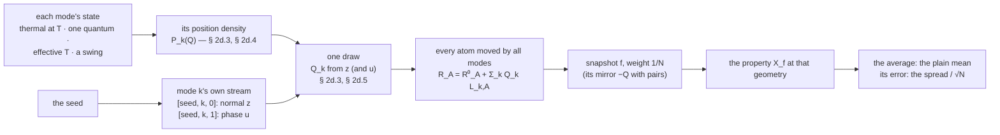

### 2d.1 What a frame averages: the position distribution alone

A frame is a frozen geometry, and the property computed there — a level, a
transmission — is a function $X(\mathbf R)$ of the nuclear positions (static
frames, § 7 item 2). Its quantum average over a nuclear state $\hat\rho$ is

$$
\langle X\rangle
\;=\; \operatorname{Tr}\!\big[\hat\rho\,X(\hat{\mathbf R})\big]
\;=\; \int d\mathbf R\;\langle\mathbf R\rvert\hat\rho\lvert\mathbf R\rangle\;X(\mathbf R)
\;=\; \int d\mathbf R\;P(\mathbf R)\,X(\mathbf R),
$$

because $X(\hat{\mathbf R})$ is diagonal in the position basis,
$X(\hat{\mathbf R})\lvert\mathbf R\rangle = X(\mathbf R)\lvert\mathbf R\rangle$.
**Only the diagonal $P(\mathbf R) = \langle\mathbf R\rvert\hat\rho\lvert\mathbf R\rangle$
enters** — not the momenta, not the coherences between positions — so
geometries drawn from $P$ average $X$ exactly in the limit of many draws,
whatever the state, the nuclei's zero-point motion included (it is in $P$).

**In the mode coordinates.** The free atoms move along the modes,

$$
\mathbf R_A \;=\; \mathbf R_A^0 + \sum_{k} Q_k\,\mathbf L_{k,A},
\qquad
\sum_A m_A\,\mathbf L_{k,A}\cdot\mathbf L_{l,A} = \delta_{kl}
$$

(§ 1, § 2b.2), held atoms with $\mathbf L_{k,A} = \mathbf 0$, the rigid motions
no modes and not drawn. The map $\mathbf Q \mapsto \mathbf R$ is linear with a
constant Jacobian $J$, so

$$
\int d\mathbf R\;P(\mathbf R)\,X(\mathbf R) \;=\; \int d^N Q\;P(\mathbf Q)\,X\big(\mathbf R(\mathbf Q)\big),
\qquad P(\mathbf Q) = \lvert J\rvert\,P\big(\mathbf R(\mathbf Q)\big):
$$

a draw of the coordinates $Q_k$ is a draw of a geometry, and equal weights in
$\mathbf Q$ are equal weights in $\mathbf R$. An imaginary mode — a geometry
that is no minimum along it — has no harmonic state; it is left out, at
$Q = 0$, said (`Vibration.motion`).

### 2d.2 The harmonic Hamiltonian is one oscillator per mode

In mass-weighted normal coordinates

$$
\hat H \;=\; \sum_k \hat H_k,
\qquad
\hat H_k \;=\; \tfrac12\hat P_k^2 + \tfrac12\omega_k^2\hat Q_k^2,
\qquad [\hat H_k, \hat H_l] = 0,
$$

with no term joining two modes ([`normal-modes.md`](?doc=science/normal-modes.md)
§ 3): the Hessian is diagonal in these coordinates and the kinetic energy is
$\tfrac12\sum_k\dot Q_k^2$, the transformation being orthogonal with the
masses. Each $\hat H_k$ is an oscillator of its own:

$$
\hat Q_k = Q_{\mathrm{zp},k}\,\big(\hat b_k + \hat b_k^\dagger\big),
\qquad Q_{\mathrm{zp},k}^2 = \frac{\hbar}{2\omega_k},
\qquad \hat H_k\lvert n\rangle_k = \hbar\omega_k\big(n+\tfrac12\big)\lvert n\rangle_k,
$$

$$
\hat b^\dagger\lvert n\rangle = \sqrt{n+1}\,\lvert n+1\rangle,
\qquad
\hat b\lvert n\rangle = \sqrt n\,\lvert n-1\rangle,
$$

and its number states' wavefunctions and position densities, in
$\xi = Q/(\sqrt2\,Q_{\mathrm{zp}})$,

$$
\psi_n(Q) = \frac{H_n(\xi)\,e^{-\xi^2/2}}{\sqrt{2^n\,n!}\;(2\pi Q_{\mathrm{zp}}^2)^{1/4}},
\qquad
\lvert\psi_n(Q)\rvert^2 = \frac{H_n(\xi)^2\,e^{-\xi^2}}{2^n\,n!\,\sqrt{2\pi}\,Q_{\mathrm{zp}}}
$$

(§ 2b.3), $H_n$ the Hermite polynomial. Figure 2d-1 draws the first two,
$n = 0$ and $1$, beside the other states this section uses.

*Figure 2d-1. One mode's position density $P(Q)$ in each state, $Q$ in
units of $Q_{\mathrm{zp}}$: the ground state (thermal at 0 K) and a thermal
state of one mean quantum are Gaussians; one quantum exactly,
$\lvert\psi_1\rvert^2$, vanishes at $Q = 0$; one photon on a warm mode (the
photon-added thermal state, § 2d.4) dips at $Q = 0$, to about half its
peak at $\bar n = 1$; the coherent state
spreads its weight toward the swing's turning points.*

### 2d.3 (1) Every mode thermal: a product of Gaussians

**The state factorizes.** In equilibrium at temperature $T$,
$\hat\rho = e^{-\beta\hat H}/Z$, $\beta = 1/k_BT$. Because the $\hat H_k$
commute, $e^{-\beta\hat H} = \prod_k e^{-\beta\hat H_k}$, and

$$
\hat\rho \;=\; \bigotimes_k \hat\rho_k,
\qquad
\hat\rho_k = \frac{e^{-\beta\hat H_k}}{Z_k} = \sum_{n=0}^\infty p_n\,\lvert n\rangle_k\langle n\rvert,
\qquad
p_n = (1-t)\,t^n = \frac{\bar n^{\,n}}{(\bar n+1)^{n+1}},
$$

$$
t = e^{-\beta\hbar\omega_k},
\qquad
\bar n = \sum_n n\,p_n = \frac{t}{1-t} = \frac{1}{e^{\hbar\omega_k/k_BT}-1} .
$$

The diagonal of a product of operators on different coordinates is the
product of their diagonals:

$$
P(Q_1,\dots,Q_N) \;=\; \prod_k P_k(Q_k),
\qquad
P_k(Q) = \langle Q\rvert\hat\rho_k\lvert Q\rangle = \sum_n p_n\,\lvert\psi_n(Q)\rvert^2 .
$$

**The modes' coordinates are independent random variables** (§ 2c.1).

**Each factor is a Gaussian (Mehler's formula).** Mehler's formula for the
Hermite polynomials ([DLMF] 18.18.28 at $x = y = \xi$, both sides
multiplied by $e^{-\xi^2}$),

$$
\sum_{n=0}^{\infty}\frac{t^n}{2^n\,n!}\,H_n(\xi)^2\,e^{-\xi^2}
\;=\; \frac{1}{\sqrt{1-t^2}}\,\exp\!\Big(-\xi^2\,\frac{1-t}{1+t}\Big),
$$

sums the factor:

$$
P(Q) \;=\; \frac{1-t}{\sqrt{2\pi}\,Q_{\mathrm{zp}}}\,\frac{1}{\sqrt{1-t^2}}
\exp\!\Big(-\xi^2\frac{1-t}{1+t}\Big)
\;=\; \frac{1}{\sqrt{2\pi}\,\sigma}\,\exp\!\Big(-\frac{Q^2}{2\sigma^2}\Big),
$$

$$
\boxed{\;\sigma^2 \;=\; Q_{\mathrm{zp}}^2\,\frac{1+t}{1-t}
\;=\; Q_{\mathrm{zp}}^2\coth\frac{\hbar\omega}{2k_BT}
\;=\; Q_{\mathrm{zp}}^2\,(2\bar n+1)\;}
$$

([Feynman1972] § 2.5). At 0 K, $t = 0$ and $\sigma = Q_{\mathrm{zp}}$, the
ground state; hot, $\coth x \to 1/x$ and $\sigma^2 \to k_BT/\omega^2$, the
classical spread. Figure 2d-2 shows the sum for $\bar n = 1$.

*Figure 2d-2. A thermal mode with $\bar n = 1$: each number state's density
weighted by $p_n = 2^{-(n+1)}$, stacked, adds up to the Gaussian of
$\sigma^2 = 3\,Q_{\mathrm{zp}}^2$ — Mehler's formula, term by term.*

*Held by* `test_thermal_is_mehlers_sum_of_the_number_states` (the
$p_n$-weighted sum of the $\lvert\psi_n\rvert^2$ against the Gaussian),
`test_a_temperatures_quanta_are_bose_and_einsteins`,
`test_hot_the_thermal_spread_is_the_classical_one`.

**Drawing it.** A Gaussian of spread $\sigma$ is drawn exactly as

$$
Q = \sigma\,z, \qquad z \sim \mathcal N(0,1)
\quad\Longrightarrow\quad
\Pr(Q \le q) = \Phi(q/\sigma)
$$

(`State._at`). Each mode's normal numbers come from its own random stream
(§ 2d.6), so the draws of different modes are independent: the product above,
drawn factor by factor. *Held by* `test_each_states_draws_follow_its_own_distribution`
(a Kolmogorov test of 4000 draws against the state's `cdf`) and
`test_snapshots_of_a_thermal_motion_have_the_sciences_covariance` (40 000
snapshots: each mode's variance $\sigma_k^2$, every pair uncorrelated, each
within five standard errors).

**What every atom does.** With independent coordinates,
$\langle Q_k\rangle = 0$ and $\langle Q_kQ_l\rangle = \delta_{kl}\,\sigma_k^2$, so
each atom's displacement $\mathbf u_A = \sum_k Q_k\mathbf L_{k,A}$ has mean zero
and covariance

$$
\big\langle\mathbf u_A\,\mathbf u_B^{\mathsf T}\big\rangle
\;=\; \sum_{k,l}\langle Q_kQ_l\rangle\,\mathbf L_{k,A}\mathbf L_{l,B}^{\mathsf T}
\;=\; \sum_k \sigma_k^2\,\mathbf L_{k,A}\mathbf L_{k,B}^{\mathsf T},
$$

the same covariance the full harmonic thermal state gives the atoms; and,
the $Q_k$ jointly Gaussian, $\mathbf u$ is jointly Gaussian too — every atom's
place a 3-dimensional Gaussian cloud around $\mathbf R_A^0$, its axes and
widths those of $\sum_k\sigma_k^2\,\mathbf L_{k,A}\mathbf L_{k,A}^{\mathsf T}$
— along the modes' rows where those are orthogonal on that atom (Figure 2d-6,
left). *Held by* the covariance test above, on one atom's own block.

### 2d.4 (2) One mode a photon excited: which state it is in

**A photon changes one mode, one rung.** Light couples to the nuclei through
the dipole (infrared) or the polarizability (Raman), each expanded in the
displacement:

$$
\hat H_{\mathrm{int}}(t) = -\hat{\boldsymbol\mu}\cdot\mathbf E(t),
\qquad
\boldsymbol\mu(\mathbf Q) = \boldsymbol\mu_0 + \sum_k\frac{\partial\boldsymbol\mu}{\partial Q_k}\,Q_k + O(Q^2)
$$

([`vibrational-optical-response.md`](?doc=science/vibrational-optical-response.md)
§ 2, § 3; the Raman coupling likewise, through
$\partial\alpha/\partial Q_k$). The term that moves mode $j$ is linear in
$\hat Q_j = Q_{\mathrm{zp},j}(\hat b_j + \hat b_j^\dagger)$ and the identity on
every other mode, so its only matrix elements change $n_j$ by one:

$$
\langle n+1\rvert\hat Q_j\lvert n\rangle = Q_{\mathrm{zp}}\sqrt{n+1},
\qquad
\langle n-1\rvert\hat Q_j\lvert n\rangle = Q_{\mathrm{zp}}\sqrt n .
$$

One absorbed infrared photon at the mode's frequency, or one Stokes-scattered
photon, takes the $\hat b_j^\dagger$ part — $n_j \to n_j+1$ — and leaves every
other mode as it was (§ 2a.1). After one such event, heralded (the Stokes
photon detected, the absorbed photon or the inelastic tunnelling electron
counted),

$$
\hat\rho' \;=\; \frac{\hat b_j^\dagger\,\hat\rho_j\,\hat b_j}{\operatorname{Tr}\big[\hat b_j^\dagger\hat\rho_j\hat b_j\big]}
\;\otimes\;\bigotimes_{k\neq j}\hat\rho_k,
\qquad
P'(\mathbf Q) \;=\; P'_j(Q_j)\prod_{k\neq j}P_k(Q_k):
$$

**still a product** — the excited mode's factor changes and the others stay
thermal — **where mode $j$ is the only mode within the photon's energy
resolution and the lines' widths**. Modes within it — two lines that
overlap, or a degenerate pair — share the quantum: the event raises their
combination $c_a\hat b_a^\dagger + c_b\hat b_b^\dagger$, each
$c_k \propto \mathbf E\cdot(\partial\boldsymbol\mu/\partial Q_k)\,Q_{\mathrm{zp},k}$
(through $\partial\alpha/\partial Q_k$ for Raman), $\lvert c_a\rvert^2 + \lvert c_b\rvert^2 = 1$
— a degenerate pair's combination set by the field's polarisation — and
leaves their coordinates correlated: on cold modes
$\langle Q_aQ_b\rangle = 2\,\mathrm{Re}\big(c_ac_b^*e^{-i(\omega_a-\omega_b)t}\big)\,Q_{\mathrm{zp},a}Q_{\mathrm{zp},b}$,
beating at $\omega_a-\omega_b$ and lost as the two dephase — which can be well
before the energy lifetime — leaving a mixture of either mode excited,
uncorrelated and still not a product. Either way a state of the pair, which
no state of one mode gives. A snapshot draws mode $j$ from $P'_j$ and every other mode as in
§ 2d.3. Which $P'_j$ depends on the experiment:

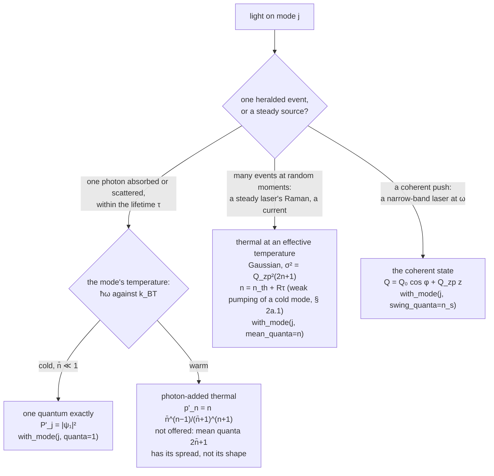

**On a cold mode** ($\hbar\omega_j \gg k_BT$, so $\hat\rho_j = \lvert0\rangle\langle0\rvert$):
$\hat b_j^\dagger\lvert0\rangle = \lvert1\rangle$, and

$$
P'_j(Q) \;=\; \lvert\psi_1(Q)\rvert^2 \;=\; \frac{Q^2}{\sqrt{2\pi}\,Q_{\mathrm{zp}}^3}\;e^{-Q^2/2Q_{\mathrm{zp}}^2},
\qquad
\langle Q^2\rangle = 3\,Q_{\mathrm{zp}}^2,
\qquad
\langle Q^4\rangle = 15\,Q_{\mathrm{zp}}^4 —
$$

the **one-quantum state**, two lobes with a zero at $Q = 0$
(`with_mode(j, quanta=1)` in a thermal motion). **It holds for times below
the mode's energy lifetime $\tau$**: the mode then relaxes toward its thermal
state, so the set describes the moment after the event, not a steady average.

**On a warm mode** ($\bar n_j$ not small), the same operator gives the
*photon-added thermal state*. Its populations, from
$\hat b^\dagger\lvert n-1\rangle = \sqrt n\,\lvert n\rangle$,

$$
p'_n \;=\; \frac{n\,p_{n-1}}{\sum_m m\,p_{m-1}}
\;=\; \frac{n\,\bar n^{\,n-1}}{(\bar n+1)^{n+1}},
\qquad
\langle n\rangle' = 2\bar n+1,
\qquad
p'_1 = \frac{1}{(\bar n+1)^2}
$$

(the normalisation $\sum_{n\ge1}n\,t^{n-1} = (1-t)^{-2}$, $t = \bar n/(\bar n+1)$
of § 2d.3; § 2b.3). Its density $\sum_n p'_n\lvert\psi_n\rvert^2$ (Figure 2d-1,
dash-dot) has a closed form. The thermal kernel is Mehler's,
$\langle\xi\rvert\hat\rho_{\mathrm{th}}\lvert\xi'\rangle \propto e^{-A(\xi^2+\xi'^2)/2 + B\xi\xi'}$
with $A = (1+t^2)/(1-t^2)$ and $B = 2t/(1-t^2)$ ([DLMF] 18.18.28 at $x = \xi$,
$y = \xi'$, times $e^{-(\xi^2+\xi'^2)/2}$); $\hat b^\dagger = (\xi - \partial_\xi)/\sqrt2$
acting from both sides, then $\xi' = \xi$, gives $\big[B + (1+A-B)^2\xi^2\big]$
times the thermal Gaussian — in $x = Q/Q_{\mathrm{zp}}$, normalised:

$$
P'_j(Q) \;=\; \Big[\frac{\bar n}{2\bar n+1} + \frac{(\bar n+1)\,x^2}{(2\bar n+1)^2}\Big]
\frac{e^{-x^2/2(2\bar n+1)}}{\sqrt{2\pi(2\bar n+1)}\;Q_{\mathrm{zp}}}
$$

— a mix of the thermal Gaussian of $\sigma^2 = (2\bar n+1)\,Q_{\mathrm{zp}}^2$,
weight $\bar n/(2\bar n+1)$, and the one-quantum shape stretched to that
width, $(Q^2/\sigma^2)$ times the same Gaussian, weight $(\bar n+1)/(2\bar n+1)$
(it agrees with the sum over number states to rounding at $\bar n$ = 0, 0.1, 1
and 3.69). Every moment follows from the mix: at $\bar n = 0$ the one-quantum
density, and a dip at $Q = 0$ to about half its peak at $\bar n = 1$. Quantum optics names a light mode's
$\hat b^\dagger\hat\rho_{\mathrm{th}}\hat b$ so [Zavatta2007]; here the quantum
added is the vibration's. **The toolkit offers no such state**; the thermal
state of the same mean $2\bar n+1$ has its spread — $\langle Q^2\rangle = Q_{\mathrm{zp}}^2(2\langle n\rangle+1)$ in every
state (§ 2a) — and, both even, the right cubic moment, but not the right
shape: its $\langle Q^4\rangle = 3(4\bar n+3)^2Q_{\mathrm{zp}}^4$ against the
state's $3(12\bar n^2+16\bar n+5)\,Q_{\mathrm{zp}}^4$, a third to four fifths
too large (hot to cold). It is right for a response up to cubic in $Q_j$, not
beyond.

**Many photons, at random moments** — a steady laser's spontaneous Raman, a
current: each event moves the mode one rung, the surroundings relax it, and
the steady populations fall by one factor per rung, a thermal state at an
effective temperature (§ 2a.1): the Gaussian of § 2d.3 with
$\sigma^2 = Q_{\mathrm{zp}}^2(2n+1)$, $n = n_{\mathrm{th}} + R\tau$ for weak
pumping of a cold mode, or for equal Stokes and anti-Stokes rate constants
(§ 2a.1 gives the general form). **A coherent push** — a narrow-band infrared laser at the mode's
frequency — is a classical force, not photon by photon: the coherent state of
§ 2a.2. **The harmonic ladder**: a drive at one frequency climbs every rung
only because the harmonic gaps are equal; a real mode's shrink as it climbs
(§ 2a.2), and many quanta are where the harmonic picture fails first (§ 7,
item 1) — the doors say so beyond 1 eV in a mode, far up its ladder: a
mark, not a bound, which a torsion can leave well below.

### 2d.5 Drawing the one-quantum state — and any $n$

**The inverse transform.** Let $F_n(q) = \int_{-\infty}^q\lvert\psi_n(Q)\rvert^2\,dQ$,
the distribution function of $Q$.
If $z\sim\mathcal N(0,1)$, then $u = \Phi(z)$ is uniform on $(0,1)$, and

$$
Q = F_n^{-1}\big(\Phi(z)\big)
\quad\Longrightarrow\quad
\Pr(Q\le q) = \Pr\big(\Phi(z)\le F_n(q)\big) = F_n(q):
$$

$Q$ has exactly the one-quantum distribution (for $n = 1$) — one normal
number per draw, as for every state, so a number state draws from the same
stream as a thermal mode would, and a set and its baseline share every other
mode's numbers (§ 2c.4). For one quantum, $F_1$ is closed:

$$
F_1(Q) \;=\; \int_{-\infty}^{x} s^2\,\phi(s)\,ds \;=\; \Phi(x) - x\,\phi(x),
\qquad x = \frac{Q}{Q_{\mathrm{zp}}},
\qquad \phi(s) = \frac{e^{-s^2/2}}{\sqrt{2\pi}}
$$

(integrating by parts, $\int s\cdot s\phi\,ds = -s\phi + \int\phi\,ds$).

*Figure 2d-3. One draw of the one-quantum state: a normal number $z$ gives a
uniform $u = \Phi(z)$ (left), and $Q = F_1^{-1}(u)$ (right) — three of the
worked example's four normal numbers (§ 2d.7). $F_1$ is flat at $Q = 0$, where
$\lvert\psi_1\rvert^2$ vanishes: $z = -0.05$ lands at $Q = -0.55\,Q_{\mathrm{zp}}$,
not near zero.*

**The code's variable.** The code works in $\xi = Q/(\sqrt2\,Q_{\mathrm{zp}})$,
with the forms normalised in it:

$$
\tilde\psi_n(\xi) = h_n(\xi)\,e^{-\xi^2/2} = \big(\sqrt2\,Q_{\mathrm{zp}}\big)^{1/2}\,\psi_n(Q),
\qquad
\tilde F_n(\xi) = \int_{-\infty}^{\xi}\tilde\psi_n^2\,d\xi' = F_n\big(\sqrt2\,Q_{\mathrm{zp}}\,\xi\big),
$$

$h_n$ the normalised Hermite polynomials below; a draw is $\xi$, and
$Q = \sqrt2\,Q_{\mathrm{zp}}\,\xi$.

**Mirror-exact.** $\tilde\psi_n^2$ is even, so

$$
\tilde F_n(-\xi) = 1 - \tilde F_n(\xi)
\quad\Longrightarrow\quad
\tilde F_n^{-1}\big(\Phi(-z)\big) = -\tilde F_n^{-1}\big(\Phi(z)\big).
$$

The code takes the lower tail always and restores the sign (`State._at`):

$$
\xi_- = \tilde F_n^{-1}\!\Big(\tfrac12\operatorname{erfc}\big(\lvert z\rvert/\sqrt2\big)\Big)\le 0,
\qquad
\xi = -\operatorname{sign}(z)\,\xi_-,
\qquad
Q = \sqrt2\,Q_{\mathrm{zp}}\,\xi :
$$

$-z$ gives exactly $-Q$, a property of the draw; and the tail probability
$\tfrac12\operatorname{erfc}(\lvert z\rvert/\sqrt2) = \Phi(-\lvert z\rvert)$
keeps its relative digits where $1-\Phi(z)$ would lose them. A mirrored pair
is exact by construction: the sampler negates every drawn coordinate
(`Motion.sample`, § 5.5, Figure 2d-5).

**The distribution function, tabulated** (`_NumberDistribution`). $\tilde F_n$ is
integrated once per $n$ over

$$
\xi \in [-\xi_{\max},\,\xi_{\max}],
\qquad
\xi_{\max} = \sqrt{2n+1} + 9,
$$

nine units past the classical turning point $\sqrt{2n+1}$, where the density
has fallen below what double precision holds, in $2(n+20)$ panels — the
neighbouring zeros of $\tilde\psi_n^2$, $n$ of them within $\pm\sqrt{2n+1}$,
at least a panel's width apart (1.14 panels at the least, at $n = 70$, over
every $n$ from 2 to 1000) —
each by a 40-point Gauss–Legendre rule, exact for the panel's smooth
integrand to rounding. $\tilde\psi_n$ comes from the stable three-term
recurrence of the normalised Hermite polynomials $h_n$ (the Hermite
functions $h_n e^{-\xi^2/2}$),

$$
h_0 = \pi^{-1/4},
\qquad
h_{k+1} = \sqrt{\tfrac{2}{k+1}}\;\xi\,h_k - \sqrt{\tfrac{k}{k+1}}\;h_{k-1},
\qquad
\tilde\psi_n(\xi) = h_n\,e^{-\xi^2/2},
$$

rescaled whenever a value passes $10^{100}$ and the Gaussian applied once at
the end, so no $n$ overflows or loses the weight near the turning points
(`_eigenfunction`). The quantile is found from the left, where the running
integral keeps its digits: the table's panel, then Newton's method,

$$
\xi \;\leftarrow\; \xi - \frac{\tilde F_n(\xi) - p}{\tilde\psi_n(\xi)^2},
$$

kept inside the panel by bisection, stopped within four units in the last
place (`lower_quantile`).

*Figure 2d-4. 40 000 of molbuilder's own draws (`vibration.State.draw`) of a
thermal state of one mean quantum and of one quantum exactly, against the
densities they must follow — the Gaussian and $\lvert\psi_1\rvert^2$.*

*Held by* `test_n_quanta_exactly_is_the_oscillators_own_density` (each
$\lvert\psi_n\rvert^2$ integrates to 1; $\langle Q^2\rangle = (2n+1)Q_{\mathrm{zp}}^2$
and $\langle Q^4\rangle = 3(2n^2+2n+1)Q_{\mathrm{zp}}^4$; $n$ zeros; the weight
beyond the turning points, 15.7 %, 11.2 %, 9.5 % for $n$ = 0, 1, 2) and
`test_each_states_draws_follow_its_own_distribution` (a Kolmogorov test of
4000 draws of three quanta, and $F_n(Q) = \Phi(z)$ for every draw to $10^{-9}$,
$z$ the mode's own stream's).

### 2d.6 The random streams: independent, reproducible, extendable

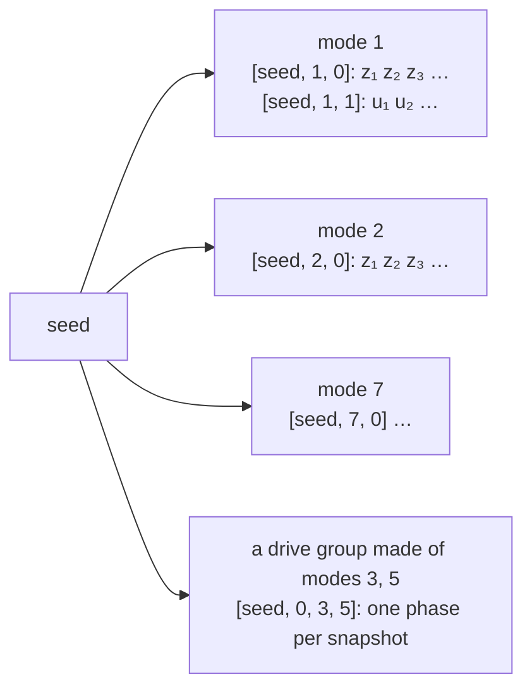

Each mode $k$ draws its normal numbers from `numpy.random.default_rng([seed,
k, 0])` — numpy's PCG64 generator seeded through `SeedSequence`, which hashes
the whole key into the generator's state so that different keys give streams
with no detectable correlation — and a driven mode its phases,
$\varphi = 2\pi u$, from `[seed, k, 1]` (`_stream`, `_phases_of`). **Keyed by
the mode's number**, not its place: a set of some modes, or one with a mode
set apart, draws every other mode exactly as before, which is what lets a
driven set and its thermal baseline differ by the driven mode's draws alone
(§ 2c.4). **Drawn in one block from the first**, so snapshots
$s \dots s+N-1$ are the same however many were asked: a set continues from
its last snapshot and pools with its continuation (`start=`,
`vibration.pooled`). A drive group's one phase per snapshot comes from
`[seed, 0, *modes]`, the modes it was made with. **Reproducible on the same
numpy**: one seed gives the same numbers there, and a set records numpy's
version in its `rng` row, beside the streams' keys in `info.sampling`
([`engines/vibration-frames.md`](?doc=engines/vibration-frames.md) § 5).
*Held by* `test_a_draw_continues_its_seed_from_the_modes_own_stream`,
`test_a_seed_holds_a_set_and_its_continuation`,
`test_a_driven_modes_normal_numbers_are_its_baselines_own`.

### 2d.7 One snapshot, assembled — and what the set's average is

For snapshot $f$ (`Motion.sample`):

1. **Each mode's coordinate**, from its own state and stream:

$$
Q_{f,k} \;=\;
\begin{cases}
\sigma_k\,z_{f,k} & \text{thermal (or classical),}\\[2pt]
\sqrt2\,Q_{\mathrm{zp},k}\,\big(-\operatorname{sign} z_{f,k}\big)\,\tilde F_n^{-1}\!\big(\Phi(-\lvert z_{f,k}\rvert)\big) & n\ \text{quanta,}\\[2pt]
Q_{0,k}\cos\!\big(\varphi_f - \ell_k\big) + s_k\,z_{f,k} & \text{a swing,}
\end{cases}
$$

   $\tilde F_n$ the distribution function in $\xi$ (§ 2d.5); for a swing,
   $\varphi_f = 2\pi u_f$ from its stream, one phase per drive group (§ 2d.6),
   $\ell_k$ the mode's lag in its group (§ 2c.2), 0 for a mode driven alone,
   $Q_{0,k} = 2\,Q_{\mathrm{zp},k}\sqrt{n_{s,k}}$ the swing's turning point,
   and $s_k$ the spread it carries — $Q_{\mathrm{zp},k}$ for the coherent
   state, $\sigma_{T,k}$ for a warm driven mode (§ 2a.2).

2. **With mirrored pairs** (the person's choice), each drawn snapshot is
   followed by its mirror, every $Q_{f,k}$ negated: every state's distribution
   is even in $Q$ — a swing's because its phase is uniform,
   $\cos(\varphi+\pi) = -\cos\varphi$ — so the mirror is a draw from the same
   distribution (Figure 2d-5).
3. **Every atom moved by all modes at once**,
   $\mathbf R_{f,A} = \mathbf R_A^0 + \sum_k Q_{f,k}\,\mathbf L_{k,A}$, in the
   result's atom order, held atoms still — the rule `Vibration.displaced`
   (`test_a_vibrations_geometry_and_its_frequencies_scaled`) and held atoms
   in a mode's own frames
   (`test_a_held_atom_stays_still_and_adds_nothing_to_its_elements_share`);
   no test yet draws snapshots with a held atom.
4. **Frame 0 the relaxed geometry at weight 0, each snapshot at $1/N$.** The
   probabilities are in where the snapshots were drawn, so the average is the
   plain mean, an unbiased estimate of § 2d.1's integral, its error the spread
   of the results:

$$
\bar X_N = \frac1N\sum_{f=1}^N X_f,
\qquad
\mathbb E\big[\bar X_N\big] = \langle X\rangle,
\qquad
\operatorname{Var}\big[\bar X_N\big] = \frac{\operatorname{Var}X}{N}
\;\approx\; \frac{s_X^2}{N} .
$$

   With pairs, the $N/2$ pair means $\tfrac12(X_f + X_f^{-})$ are the
   independent draws, and

$$
\operatorname{Var}\Big[\tfrac12\big(X + X^{-}\big)\Big]
= \tfrac12\big(\operatorname{Var}X + \operatorname{Cov}(X, X^{-})\big),
$$

   which is zero for the response's odd part — $X^{-} = -X$ there — so the
   error is the spread of the pair means over $\sqrt{N/2}$ (§ 5.5,
   `Snapshots.standard_error`; `test_mirrored_pairs_cancel_the_odd_part_exactly`).
5. **Written with what made it**: each frame's coordinate along each mode,
   each mode's state, the streams' keys (`info.sampling`,
   [`engines/vibration-frames.md`](?doc=engines/vibration-frames.md) § 5), so
   a set read back draws the same frames again on the same numpy.

*Figure 2d-5. Two mirrored pairs of one quantum: each $z$ and $-z$ give $Q$
and exactly $-Q$, draws from the same even density.*

**Worked: a bend one photon left with one quantum, beside a thermal
stretch.** The bend at 1600 cm⁻¹, cold at 300 K, just after one absorbed
photon — within its energy lifetime (§ 2d.4):

$$
Q_{\mathrm{zp},1} = \sqrt{\frac{16.8576}{1600}} = 0.1026\ \mathrm{amu^{1/2}\,Å},
\qquad
F_1(Q) = \Phi(x) - x\,\phi(x),\quad x = Q/Q_{\mathrm{zp},1}.
$$

The stretch at 3700 cm⁻¹, thermal at 300 K: $\bar n = 2\times10^{-8}$, so
$\sigma_2 = Q_{\mathrm{zp},2} = 0.0675$. The same normal numbers as § 2c.3's
table, and an atom whose rows are $\mathbf L_1 = (0, 0, 0.30)$ and
$\mathbf L_2 = (0.50, 0, 0)$ amu$^{-1/2}$:

| frame | $z_1$ | $\Phi(z_1)$ | $Q_1 = F_1^{-1}(\Phi(z_1))$ | $z_2$ | $Q_2 = \sigma_2 z_2$ | the atom's move $Q_1\mathbf L_1 + Q_2\mathbf L_2$ (Å) |
|---|---|---|---|---|---|---|
| 1 | 0.31 | 0.6217 | 0.1117 | −0.75 | −0.0506 | (−0.0253, 0, 0.0335) |
| 2 | −1.20 | 0.1151 | −0.2130 | 0.40 | 0.0270 | (0.0135, 0, −0.0639) |
| 3 | 0.85 | 0.8023 | 0.1771 | 1.10 | 0.0742 | (0.0371, 0, 0.0531) |
| 4 | −0.05 | 0.4801 | −0.0562 | −0.20 | −0.0135 | (−0.0067, 0, −0.0169) |

Frame 4 shows the one-quantum shape: a normal number near zero gives
$\lvert Q_1\rvert = 0.55\,Q_{\mathrm{zp}}$, not a coordinate near zero —
$\lvert\psi_1\rvert^2$ vanishes at $Q = 0$, so $F_1$ is flat there and its
draws avoid the middle, where a Gaussian's would cluster. Over many
snapshots the atom's place shows it (Figure 2d-6).

*Figure 2d-6. The worked example's atom over 6000 snapshots. Left, every mode
thermal at 300 K: a Gaussian cloud, its widths the two modes' (§ 2d.3).
Right, the bend after one photon: the cloud splits along the bend's row into
the two lobes of $\lvert\psi_1\rvert^2$, the stretch's width unchanged — the
photon changes one mode's factor alone (§ 2d.4).*

### 2d.8 What it holds, and what it assumes

| claim | why it holds | where | held by |
|---|---|---|---|
| a frame's property averages over the position distribution alone | $X(\hat{\mathbf R})$ is diagonal in position | § 2d.1 | — (the static-frame assumption, § 7 item 2) |
| the modes are independent, a drive group one factor (§ 2c.2) | the harmonic $\hat H$ separates; the thermal state, and one photon's change of one mode alone within its resolution, keep the product | § 2d.2–§ 2d.4 | the covariance test |
| a thermal mode's coordinate is Gaussian, $\sigma^2 = Q_{\mathrm{zp}}^2\coth(\hbar\omega/2k_BT)$ | Mehler's formula | § 2d.3 | the Mehler, Bose–Einstein and hot-limit tests |
| one photon on a cold mode leaves $\lvert\psi_1\rvert^2$, the others thermal | the coupling is linear in $\hat Q_j$ and the identity on the other modes | § 2d.4 | the number state's density test |
| a draw has the state's distribution | $\sigma z$ for a Gaussian; the inverse transform for $n$ quanta; a uniform phase for a swing | § 2d.3, § 2d.5, § 2d.7 | the Kolmogorov test, each state |
| a mirrored pair is two draws of the same distribution | every state's density is even, and the sampler negates every drawn coordinate | § 2d.5, § 2d.7 | the mirrored-pairs test (a thermal motion) |
| the snapshots are independent, and reproducible on the same numpy | keyed, block-drawn streams | § 2d.6 | the stream tests |
| the average is unbiased, its error the spread over $\sqrt N$ | Monte Carlo with draws from $P$ | § 2d.7 | the error tests of § 5.5 |

It assumes harmonic modes — the ladder's equal gaps among them (§ 2a.2,
§ 7 item 1) — which every set says in its `assumptions` row; and static
frames (§ 7 item 2), which the calculation over the frames says. For a mode
a photon excited (§ 2d.4) the conditions are the person's to judge, and no
set states them: the one-quantum state only while the mode has not relaxed;
the photon resonant with that mode alone within its resolution and the
lines' widths; no photon-added thermal state for a warm mode, its stand-in
right up to the cubic term.

---

## 3. What a measurement averages

The current at bias $V$ is linear in the transmission (Landauer),

$$
I \;=\; \frac{2e}{h}\int T(E)\,\big[f_L(E)-f_R(E)\big]\,dE ,
$$

and the measurement integrates over many vibrational periods, so — in the
static-frame picture of § 7 — the measured current and conductance are those
of the **averaged transmission**:

$$
\big\langle T(E)\big\rangle \;=\; \int_{-\infty}^{\infty} P(Q)\,T(E;Q)\,dQ ,
\qquad
\langle G\rangle = G_0\,\big\langle T(E_F)\big\rangle .
$$

The question the frame set answers is how far $\langle T\rangle$ is from the
relaxed geometry's $T_0 = T(E;0)$.

---

## 4. A lopsided response is what produces a net change

### 4.1 The transmission is not symmetric about equilibrium

The working hypothesis is that $T(Q)$ is **not** symmetric: pushing the
molecule one way changes the transmission differently from pushing it the
other way, because $T$ depends non-linearly on the geometry — a contact bond
shortened raises the tunnelling exponentially more than the same bond
lengthened lowers it; a level moved toward $E_F$ raises $T$ more than the same
level moved away lowers it. That hypothesis is exactly what gives a net
change, and the way to see it is to split $T(Q)$ into the part that flips sign
with the push and the part that does not:

$$
T(Q) \;=\;
\underbrace{\tfrac12\big[T(Q)+T(-Q)\big]}_{T_{\mathrm{even}}(Q)\ \text{— same both ways}}
\;+\;
\underbrace{\tfrac12\big[T(Q)-T(-Q)\big]}_{T_{\mathrm{odd}}(Q)\ \text{— flips sign}} .
$$

Averaged over the symmetric distribution of § 2, the odd part vanishes
exactly — whatever its size — because every push $+Q$ is matched by a push
$-Q$ of equal probability:

$$
\big\langle T_{\mathrm{odd}}\big\rangle = \int P(Q)\,T_{\mathrm{odd}}(Q)\,dQ = 0
\quad\Longrightarrow\quad
\big\langle T\big\rangle \;=\; \big\langle T_{\mathrm{even}}\big\rangle .
$$

So **the net change comes entirely from the even part**, and the even part is
non-zero only because of the asymmetry: if $T$ responded linearly —
$T(Q) - T_0 = -\big[T(-Q) - T_0\big]$, a symmetric response — then
$T_{\mathrm{even}} = T_0$ and the average would be the relaxed value, no
matter how strongly the mode moves $T$. A mode changes the measured
conductance precisely when $T(+Q) + T(-Q) \neq 2T_0$: when the response is
lopsided.

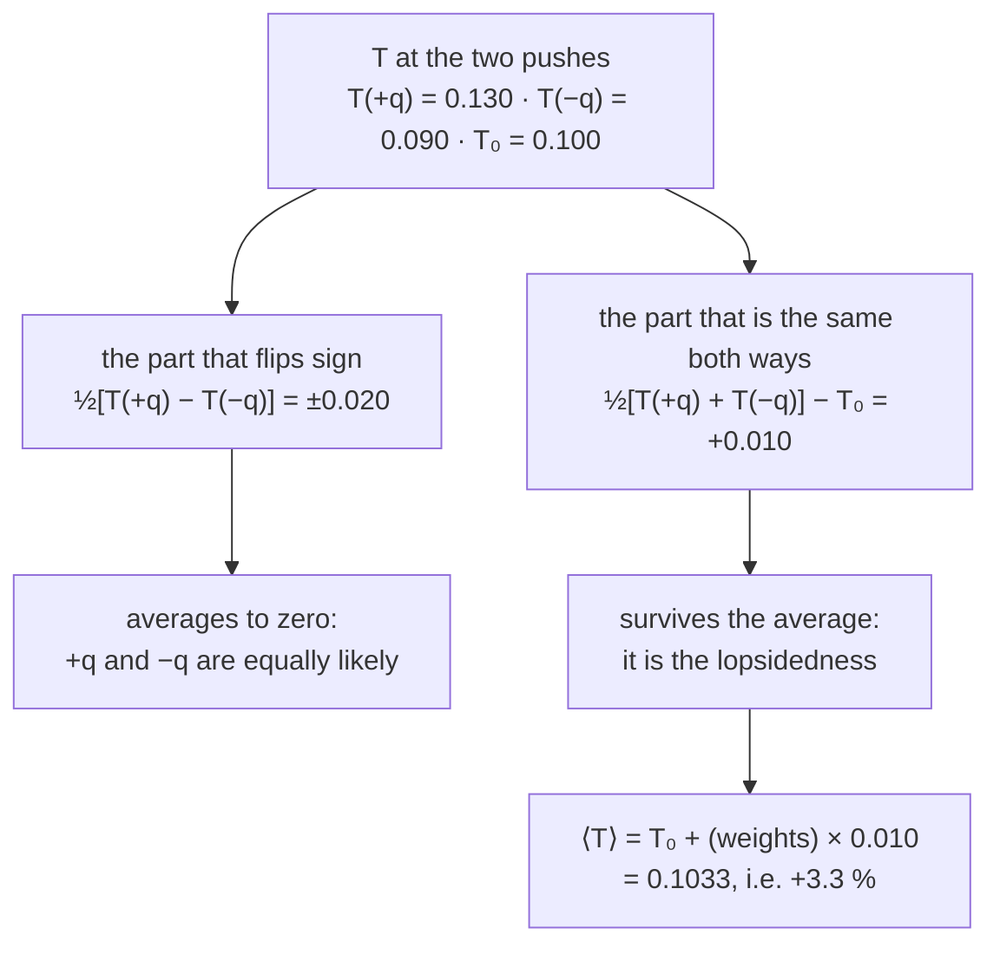

The same example drawn: the full response (lopsided), its odd part drawn
about $T_0$ (a straight line here — it cancels), and its even part (a bowl —
it survives). $u = Q/\sigma$.

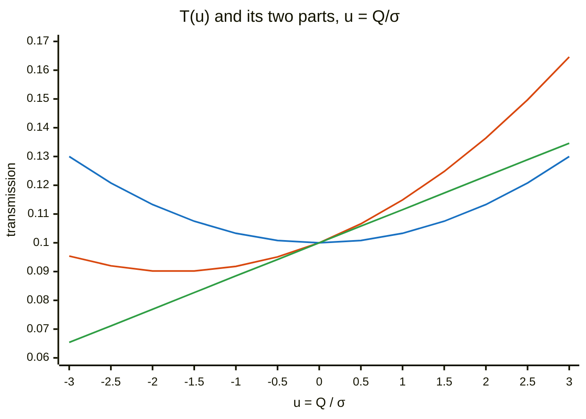

*(Orange: the full $T(u)$, lopsided. Blue: its even part — the bowl that
survives the average. Green: its odd part drawn about $T_0$ — the straight
line that cancels. The example is $T(u) = 0.100 + 0.0115\,u + 0.0033\,u^2$.)* And the distribution it is
averaged over:

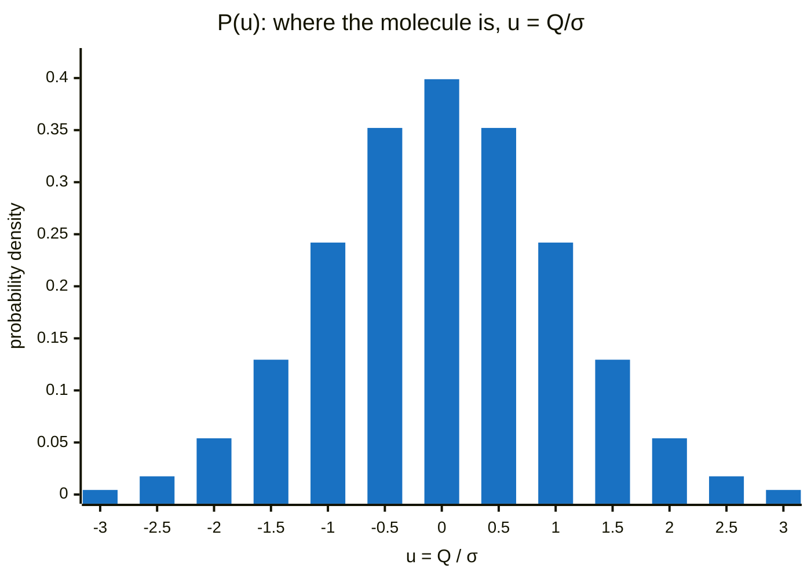

### 4.2 In derivatives

Expanding about equilibrium makes the same statement term by term:

$$
T(Q) = T_0 + T'Q + \tfrac12 T''Q^2 + \tfrac16 T'''Q^3 + \tfrac1{24}T''''Q^4 + \dots
$$

The Gaussian's odd moments vanish, $\langle Q\rangle = \langle Q^3\rangle = 0$,
and its even ones are $\langle Q^2\rangle = \sigma^2$,
$\langle Q^4\rangle = 3\sigma^4$:

$$
\big\langle T\big\rangle \;=\; T_0 \;+\; \tfrac12\,T''\sigma^2 \;+\; \tfrac18\,T''''\sigma^4 \;+\;\dots
$$

$T'$ and $T'''$ — the odd, sign-flipping response — drop out; $T''$, the
curvature, is the leading measure of the lopsidedness. The *relative* change
of the conductance,

$$
\frac{\langle\Delta G\rangle_\nu}{G} \;=\; \frac{\tfrac12\,T''_\nu\,\sigma_\nu^2}{T_0},
$$

is the transport score of `normal-modes.md` § 4c.4. Its sign is the sign of
the curvature: a convex response (a level's tail, an exponential contact)
raises the average conductance, a concave one (sitting on a resonance's peak)
lowers it.

### 4.3 Two examples of a strongly lopsided response

**A contact bond.** Tunnelling through a contact falls exponentially with its
length, $T \propto e^{-2\kappa d}$. If the mode stretches the contact,
$d = d_0 + d'Q$, then $T(Q) = T_0\,e^{-aQ}$ with $a = 2\kappa d'$ — very
lopsided: with $a\sigma = 0.6$ the two frames at $\pm\sqrt3\,\sigma$ give
$T/T_0 = 2.83$ and $0.35$. The Gaussian average is exact:

$$
\frac{\langle T\rangle}{T_0} = \big\langle e^{-aQ}\big\rangle = e^{a^2\sigma^2/2}
= e^{2\kappa^2 d'^2\sigma^2} \;>\; 1 \quad \text{for either sign of } d' ,
$$

$= 1.197$ for $a\sigma = 0.6$: a 20 % rise. The shortened side wins because it
wins exponentially — the log-normal average of `normal-modes.md` § 4c.4.

**A level near $E_F$.** A single level of full width $\Gamma$ at
$\varepsilon(Q) = \varepsilon_0 + gQ$ transmits

$$
T(E_F;Q) = \frac{(\Gamma/2)^2}{\big(\varepsilon(Q)-E_F\big)^2+(\Gamma/2)^2}.
$$

With $\Gamma = 0.2$ eV and a thermal level shift $g\sigma = 0.1$ eV:

| where the level sits | $T_0$ | exact $\langle T\rangle$ | change | the response |
|---|---|---|---|---|
| on the tail, $\varepsilon_0 - E_F = 0.5$ eV | 0.0385 | 0.0436 | **+13 %** | convex: the side moved toward $E_F$ gains more than the other loses |
| on the peak, $\varepsilon_0 = E_F$ | 1.000 | 0.656 | **−34 %** | concave: either push moves the level off resonance |

The same mode raises or lowers the conductance depending on where $E_F$ sits —
the curvature's sign, read off the frames, not assumed.

---

## 5. Computing the average from a few frames

This section is one mode's own frames, placed and weighted by its state's
Gauss rule; snapshots of many modes are § 5.5. The temperature, the outermost
move and the rules of § 5.1–§ 5.3 below are a **thermal** set's — the
Gauss–Hermite rule; another state's own rule is § 2a.3's, and its outermost
move is $\lvert q_{\mathrm{out}}\rvert\max_A\lvert\mathbf L_A\rvert$ at its own
outermost node.

**A thermal set's spread is stated as a temperature** *(the user,
2026-10-28: "shall we actually use the sigma as the reference to state how
much we want the max displacement to be? this is statistically making more
sense especially if we propose the value based on temperature")*. The person names the temperature
$T_{\mathrm K}$ of the motion the frames sample — the junction's, or for a
mode pumped at random moments its effective temperature (§ 2a.1). A mode's
own thermal set ([`engines/vibration-frames.md`](?doc=engines/vibration-frames.md)
§ 4) sets the mode's mean number of quanta and its spread from it:

$$
n = \frac{1}{e^{\hbar\omega/k_BT_{\mathrm K}} - 1}, \qquad
\sigma = Q_{\mathrm{zp}}\,\sqrt{2n+1} = Q_{\mathrm{zp}}\,\sqrt{\coth\!\left(\frac{\hbar\omega}{2k_BT_{\mathrm K}}\right)} .
$$

**Why a temperature (which fixes σ), and not a displacement:**

1. **The frames and their weights are defined against σ.** The rule's
   positions are multiples of σ, and its weights are a bell curve's (§ 5.1).
   A displacement is a consequence of σ, not a property of the motion.
2. **The same displacement is a different motion for each rule.** The
   outermost frame sits at $1.73\,\sigma$ with three frames and at
   $2.86\,\sigma$ with five. One displacement typed for both would sample a
   bell curve 1.65 times narrower with five — and comparing the two rules, the
   check of § 5.3, would compare two different motions.
3. **σ is physics a person can name**: a temperature, or a number of quanta
   (§ 2a). Its ratio to the zero-point amplitude, $\sigma/Q_{\mathrm{zp}} = \sqrt{2n+1}$,
   says how many times wider the motion is than its zero-point motion.

**What a thermal set's frames move is reported, in Å: the outermost move.** The
outermost frames move the atom that moves most in the mode — the one with the
largest $\lvert\mathbf L_A\rvert$, often a light atom but not always — by

$$
d_{\mathrm{out}} = \sqrt2\,x_{\mathrm{out}}\;\sigma\,\max_A\lvert\mathbf L_A\rvert
\qquad (\sqrt3\,\sigma\max_A\lvert\mathbf L_A\rvert \text{ for three frames}),
$$

$x_{\mathrm{out}}$ the rule's outermost node (§ 5.1: $\sqrt{3/2}$ for three
frames, 2.0202 for five, 2.6520 for seven); $\max_A\lvert\mathbf L_A\rvert$ is
`vibration.largest_move`, the one a Raman phase's $\pm\delta Q$ rests on too
(the motion toolkit's `outermost_move` asks it, for any state:
`vibration.outermost_move_ang`). Each frame states its own largest
single-atom move beside it — the check a person reads against a bond length.

**An example — mode 48 of the user's AuBDTAu vibration on Sol**
(`AuBDTAu/spectrum/AuBDTAu_relaxed_vib_IRandRaman`; 1039.9 cm⁻¹,
$Q_{\mathrm{zp}}$ = 0.12732 amu½ Å, $\max_A\lvert\mathbf L_A\rvert$ = 0.3977
amu⁻½, as the frame set `AuBDTAu/structure/AuBDTAu_vib_mode48` written from
it on 2026-10-28 states them):

| the temperature stated | $n$ | $\sigma/Q_{\mathrm{zp}}$ | the outermost move — 3 / 5 / 7 frames |
|---|---|---|---|
| 4 K, 77 K | 0 | 1.000 | 0.088 / 0.145 / 0.190 Å |
| 298 K | 0.007 | 1.007 | 0.088 / 0.146 / 0.191 Å |
| 1000 K | 0.29 | 1.26 | 0.110 / 0.182 / 0.239 Å |
| 1362 K, an effective temperature | 0.5 | 1.41 | 0.124 / 0.205 / 0.269 Å |
| 2159 K, an effective temperature | 1 | 1.73 | 0.152 / 0.251 / 0.329 Å |

A 1040 cm⁻¹ mode holds almost no thermal quanta below about 500 K: its
motion is its zero-point motion, and only pumping widens it.

### 5.1 The Gauss–Hermite rule

Each frame costs a device calculation and a transmission, so the integral of
§ 3 is computed from as few frames as possible. For a bell curve the best
choice is the **Gauss–Hermite** rule ([AbramowitzStegun1964] eq. 25.4.46 and
Table 25.10). It samples the motion at $m$ fixed positions — the rule's
*nodes* $x_j$ — each with a fixed weight $w_j$. With $Q = \sqrt2\,\sigma x$,

$$
\big\langle T\big\rangle = \frac{1}{\sqrt\pi}\int e^{-x^2}\,T(\sqrt2\sigma x)\,dx
\;\approx\; \sum_{j=1}^{m} W_j\,T(Q_j),
\qquad Q_j = \sqrt2\,\sigma\,x_j,\quad W_j = \frac{w_j}{\sqrt\pi}.
$$

The rule is **exact whenever $T(Q)$ is a polynomial of degree $\le 2m-1$**
over the motion — including every odd term, so an arbitrarily lopsided cubic
or quintic response is averaged exactly.

| frames $m$ | positions $Q_j/\sigma$ | weights $W_j$ | exact for degree |
|---|---|---|---|
| 3 | $0,\ \pm1.7321$ | $\tfrac23,\ \tfrac16$ each | $\le 5$ |
| 5 | $0,\ \pm1.3556,\ \pm2.8570$ | $0.53333,\ 0.22208,\ 0.01126$ each | $\le 9$ |
| 7 | $0,\ \pm1.1544,\ \pm2.3668,\ \pm3.7504$ | $0.45714,\ 0.24012,\ 0.03076,\ 0.00055$ each | $\le 13$ |

Every rule here has an odd number of frames, so one of them is the relaxed
junction itself, $Q = 0$ — the frame a transport extension takes over from
the finished calculation ([`engines/transport.md`](?doc=engines/transport.md)
§ 2a.16).

### 5.1a Why more frames reach further out

Adding frames does not sample the middle more finely; it reaches into the
tails. A rule exact to degree $2m-1$ must reproduce the bell curve's higher
averages, $\langle u^{2k}\rangle = 1\cdot3\cdot5\cdots(2k-1) = 1, 3, 15, 105, \dots$
for $u = Q/\sigma$. The high ones are made almost entirely of the rare,
far-out positions. To get $\langle u^8\rangle = 105$ right with weights
summing to 1, some frame has to sit far out with a tiny weight:

| frames | $\langle u^4\rangle$ (exact 3) | $\langle u^6\rangle$ (exact 15) | $\langle u^8\rangle$ (exact 105) |
|---|---|---|---|
| 3 | 3 | **9** | **27** |
| 5 | 3 | 15 | 105 |
| 7 | 3 | 15 | 105 |

Five frames get $\langle u^8\rangle$ almost entirely from the outermost pair,
$2 \times 0.01126 \times 2.857^8 \approx 100$; the inner pair adds 5. So the
outermost frames move out, and their weight falls, as frames are added:

| frames | outermost frames | the weight of each | time the molecule spends beyond them, either side |
|---|---|---|---|
| 3 | ±1.73 σ | 0.167 | 8 % |
| 5 | ±2.86 σ | 0.011 | 0.4 % |
| 7 | ±3.75 σ | 0.0005 | 0.02 % |
| 9 | ±4.51 σ | 0.00002 | 0.0006 % |

### 5.2 Three frames give the average and the curvature at once

With three frames,

$$
\big\langle T\big\rangle \approx \tfrac23\,T_0 + \tfrac16\big[T(+\sqrt3\sigma) + T(-\sqrt3\sigma)\big]
= T_0 + \tfrac16\big[T_+ + T_- - 2T_0\big],
$$

and the bracket is the second difference at step $h = \sqrt3\,\sigma$:
$T_+ + T_- - 2T_0 = h^2\,T''_{\mathrm{fd}} = 3\sigma^2 T''_{\mathrm{fd}}$, so

$$
\big\langle T\big\rangle \approx T_0 + \tfrac12\,T''_{\mathrm{fd}}\,\sigma^2 .
$$

The same three frames are the curvature of § 4.2 and the average over the
spread σ, and the step is that spread's: $h=\sqrt3\,\sigma$, with σ set by the
temperature the person states (§ 5) — so the step is where the molecule
actually is at that temperature. The bracket is the "same both ways" part of
§ 4.1 — twice the lopsidedness at $\pm\sqrt3\sigma$.

On the examples of § 4.3: the contact gives $1.1968$ against the exact
$1.1972$; the level on its tail $0.0435$ against $0.0436$. Both responses are
smooth over $\pm3\sigma$, so three frames suffice.

### 5.3 When three are not enough — and how to tell

**A smooth response** changes gently and steadily over the whole motion — the
contact bond's exponential, a level's distant tail. **A sharp response**
changes a great deal over a small part of the motion. The typical case is a
level sitting at the Fermi energy: the transmission peaks at the relaxed
geometry, and a small push moves the level off resonance, so the transmission
falls fast. Between frames, a sharp response does things the frames never
see.

Each rule against the exact average, on § 4.3's examples (a level of width
$\Gamma$ = 0.2 eV; $g\sigma$ the level's shift at one σ):

| response | $T_0$ | exact $\langle T\rangle$ | 3 frames | 5 | 7 | 9 | 11 |
|---|---|---|---|---|---|---|---|
| contact bond, $a\sigma = 0.6$ | 1.000 | 1.1972 | 1.1968 | 1.1972 | 1.1972 | 1.1972 | 1.1972 |
| contact bond, $a\sigma = 1.2$ | 1.000 | 2.0544 | 2.0195 | 2.0541 | 2.0544 | 2.0544 | 2.0544 |
| level 0.5 eV from $E_F$, $g\sigma = 0.1$ eV | 0.0385 | 0.0436 | 0.0435 | 0.0436 | 0.0436 | 0.0436 | 0.0436 |
| level at $E_F$, $g\sigma = 0.1$ eV | 1.000 | **0.656** | 0.750 | 0.692 | 0.672 | 0.664 | 0.660 |
| level at $E_F$, $g\sigma = 0.2$ eV | 1.000 | **0.438** | 0.692 | 0.587 | 0.536 | 0.506 | 0.487 |

For a smooth response three frames are right to 0.3 %, and a stiffer contact
needs five. For a level crossing $E_F$ within the motion, more frames narrow
the error slowly — eleven still miss by 11 % in the last row — because the
transmission there is not a low-degree polynomial over the motion at all.
The disagreement between two rules is the signal:

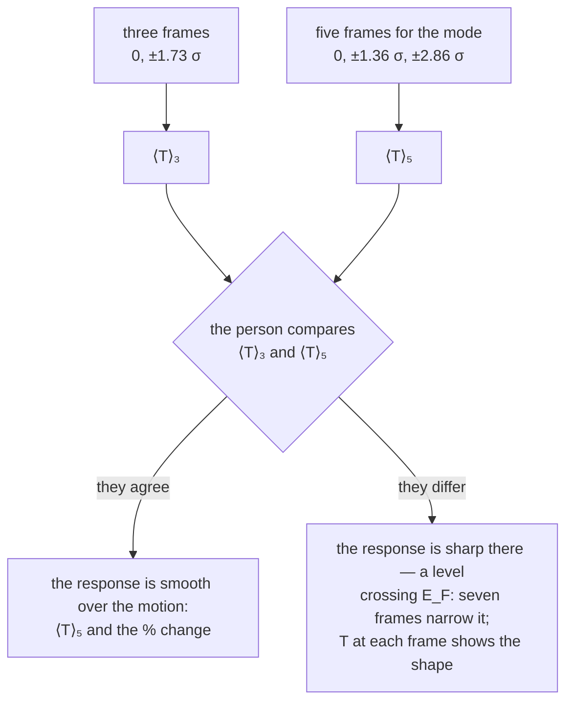

**Three, five or seven frames** *(the user, 2026-10-28)*: each rule a check
of the one before. Every frame is a device calculation and a transmission,
and frame 0 is taken over by an extension (§ 5.1).

**Why seven is the last rule offered.** Nine frames' outermost pair sits at
$\pm4.51\,\sigma$, each with weight $2\times10^{-5}$, where the molecule
spends $6\times10^{-6}$ of its time. That is also where the harmonic picture
is least sure (§ 7, assumption 1). A response that needs nine frames is one
whose shape across the frames tells more than one averaged number (§ 8).

A mode's own set is one mode at one rule, its weights summing to 1. So the check
is a second set of the same mode, at the same temperature and another rule,
and comparing the two is the person's.

### 5.4 Re-averaging the frames over another motion *(the user, 2026-10-29)*

*(The user, 2026-10-29: "or this can be a parameter in post-processing?";
"so essential information is in fact the deltaQ for each frame (normal mode
displacement), and then the weight will be determined by the shape of
statistics".)*

**What a frame is: its position along the mode.** Each frame's geometry is
frame 0 moved by $q_f$ along the mode, and its transmission $T_f(E)$ depends
on that geometry alone. The weight a frame carries is not the frame's: it is
the motion's — how much time the molecule spends near $q_f$ in the motion
being averaged over. The set's own weights are those of the state it was
written for (§ 2b.4) — a thermal set's, a bell curve's (§ 5.1). Once the frames have run, the same $T_f(E)$ can be
averaged over **another motion** with other weights, and no frame is
computed again.

**The motion, here stated by two numbers** — a bell curve and a swing on it; the toolkit's weights take any state's ([`engines/vibration-frames.md`](?doc=engines/vibration-frames.md) § 7):

| what | gives | where it comes from |
|---|---|---|
| the temperature $T$ of the random part — the junction's, or a randomly pumped mode's effective one (§ 2a.1) | the bell curve of spread $\sigma_T = Q_{\mathrm{zp}}\sqrt{2n_{\mathrm{th}}+1}$, its zero-point motion included, $n_{\mathrm{th}} = 1/(e^{\hbar\omega/k_BT}-1)$ | § 2, § 5 |
| the quanta a push in step with the mode adds, $n_s$, 0 or more | the swing of amplitude $Q_0 = 2Q_{\mathrm{zp}}\sqrt{n_s}$ | § 2a.2 |

$n_s = 0$ is the bell curve alone. The two together are the
bell curve carried along the swing (§ 2a.2):
$n = n_{\mathrm{th}} + n_s$ quanta in all, a spread
$\sigma^2 = \sigma_T^2 + \tfrac12 Q_0^2$.

**The weights.** With $m$ frames, the weights $w_f$ are the ones with which
the frames reproduce the motion's own averages of
$1, q, q^2, \dots, q^{m-1}$:

$$
\sum_f w_f\, q_f^{\,k} = \langle q^k\rangle \quad (k = 0, \dots, m-1), \qquad
\langle q^k\rangle = \sum_{j=0}^{k} \binom{k}{j}\, Q_0^{\,j}\,\langle\cos^j\varphi\rangle\,\langle\delta^{k-j}\rangle ,
$$

$\langle\cos^j\varphi\rangle = \binom{j}{j/2}/2^j$ and
$\langle\delta^i\rangle = \sigma_T^{\,i}\,(i-1)(i-3)\cdots 1$ for $j$, $i$
even, and zero for odd — the swing's averages over its phase and the bell
curve's, which add because the two motions do not disturb each other
(§ 2a.2). Then

$$
\langle T(E)\rangle = \sum_f w_f\, T_f(E)
$$

is **exact whenever $T(q)$ is a polynomial of degree $m-1$ or less** over the
motion — degree $m$ for an odd number of symmetric frames and a symmetric
motion, the odd average $\langle q^m\rangle$ vanishing on both. Frames placed for the
motion itself do better — degree $2m-1$ — so at the set's own temperature,
with no swing, the set's own weights are the answer, and these reproduce
them; the toolkit states the degree it checks the weights reproduce
(`Weights.exact_to_degree`).

**How well — the contact bond of § 4.3**, $T = T_0\,e^{-aq}$ with
$a\sigma_T = 1$, frames written at the junction's own spread $\sigma_T$ and a
swing added on top (true: $I_0(aQ_0)\,e^{a^2\sigma_T^2/2}$; computed
2026-10-29, the share of the swing beyond the outermost frame in brackets
2026-11-23):

| the swing, $Q_0/\sigma_T$ | true average | a bell curve of the same spread | re-averaged: 3 / 5 / 7 frames |
|---|---|---|---|
| 1 | 2.0874 | 2.1170 (+1.4 %) | 1.9573 (16 % beyond) / 2.0815 (1.7 %) / 2.0873 (0.1 %) |
| 2 | 3.7584 | 4.4817 (+19 %) | 2.9146 (36 % beyond) / 3.6405 (8.7 %) / 3.7494 (1.5 %) |
| 3 | 8.0471 | 15.6426 (+94 %) | 4.5101 (57 % beyond) / 7.1067 (26 %) / 7.9011 (8.3 %) |

The bell curve of the same spread is the shape-blind answer of § 2a.3; the
re-averaged frames follow the swing's shape. Re-averaging to another
temperature alone works the same way: seven frames written at $\sigma$ and
re-averaged to a bell curve of $1.5\sigma$ give 2.0517 against the true
2.0544 on the contact bond at $a \cdot 1.5\sigma = 1.2$; five, 2.0264; three,
1.8428.

**What it needs, each said beside the number** — items 1 and 2 for
frames placed for another motion; frames placed for the motion itself — its
own rule, or a set whose written weights are the motion's, an even rule's
set with its frame 0 at weight 0 among them — are the rule they were written
with, and neither is said of them (counted on every frame, so frames placed
for another motion whose weights happen to fall on a shorter rule of this
one, a node at weight 0, are still said of); item 3 for any frames; item 4
said by no rule of the weights' -- the person's to see in the frames' own
values:

1. **Frames that reach the motion.** The part of the motion beyond the
   outermost frames is averaged by values the frames never computed. **The
   share of the motion beyond them is said beside the number** — read from
   the motion's own distribution (`State.cdf`), the column in brackets
   above — never refused: frames written at a higher temperature, or more
   of them, reach further (§ 5.1a). A thermal set's three frames reach
   $1.73\,\sigma$, five $2.86\,\sigma$, seven $3.75\,\sigma$ of the spread
   they were written at.
2. **Enough frames to see the shape.** Three frames carry only the curvature,
   and up to the curvature a swing and a bell curve of the same spread agree
   (§ 2a.3); with three, the re-averaged number is said to be blind to the
   shape.
3. **A weight below zero** — past rounding: a weight that is zero in exact
   arithmetic is none — says the frames do not suit the motion's shape
   well — the seven-frame row at $Q_0 = 3\sigma_T$ weights its middle frame
   at −1.0 and its second pair at −0.18 each, since a swing that wide spends
   little time near the middle, and is still within 2 % on the contact bond.
   It is said with the number, never refused.
4. **A response not smooth over the motion** — a level crossing $E_F$ — is
   averaged poorly by any weights (§ 5.3); the frames' own values, the family
   of curves, tell more.

**Where.** The re-averaging is an analysis of the frames' results: the
motion toolkit gives the weights from each frame's coordinate and the new
state ([`engines/vibration-frames.md`](?doc=engines/vibration-frames.md)
§ 7), and the frames' results are read from the calculation's data file,
where each frame's $q_f$ and $T_f(E)$ sit
([`engines/transport-postprocessing.md`](?doc=engines/transport-postprocessing.md)
§ 3.2). It writes nothing: the calculation's record keeps the set's own
average (§ 8).

### 5.5 Many modes: snapshots, their error, and antithetic pairs

Snapshots of the whole molecule (§ 2c.3) are averaged with equal weights,
$\langle X\rangle \approx \bar X = \tfrac1N\sum_f X_f$. Unlike a Gauss rule
it is right for any response, and its error is statistical. For **independent
snapshots**,

$$
\text{error of } \bar X \approx \frac{s_X}{\sqrt N},
$$

$s_X$ the spread of the frames' own results — read from them, so the frames
say how many more are needed: four times the frames halve the error.

**Antithetic pairs.** In every state the toolkit draws from — thermal, $n$
quanta, a driven mode averaged over its phase — the molecule is as likely
displaced one way as the opposite way, every mode at once: a snapshot
$(Q_1, Q_2, \dots)$ and its mirror $(-Q_1, -Q_2, \dots)$ are equally likely.
So draw half the frames, and give each its mirror. Write the response as
$X = X_0 + X_1Q + X_2Q^2 + \dots$ (for one mode; the same holds term by term
for many): within each pair the odd terms — $X_1Q$, $X_3Q^3$, … — cancel
**exactly** — antithetic variates [HammersleyMorton1956], used on snapshots
of the modes in [ZachariasGiustino2016] — and only the even terms are left
to fluctuate. The weights stay equal, $1/N$ each.

**The error of a paired set** is the spread of the **pair means**,
$\bar X_j = \tfrac12(X_{2j-1} + X_{2j})$, over $\sqrt{N/2}$ — never the
frames' spread over $\sqrt N$: the two frames of a pair are not independent,
and that formula is wrong both ways.

**When pairs help, and when they hurt.** Split $X$ into its even and odd
parts (§ 4.1). Independent frames give the mean a variance
$\big[\mathrm{Var}(X_{\mathrm{even}}) + \mathrm{Var}(X_{\mathrm{odd}})\big]/N$;
pairs give $2\,\mathrm{Var}(X_{\mathrm{even}})/N$ — the odd part's variance
gone, the even part's doubled ([Owen2013] § 8.2, eq. 8.4). So pairs help a
response dominated by its odd part and can be up to $\sqrt2$ worse for an
even one:

| response, over a bell curve, $u = Q/\sigma$ | independent | pairs |
|---|---|---|
| § 4.1's, $T = 0.100 + 0.0115\,u + 0.0033\,u^2$ — mostly odd | $0.0124/\sqrt N$ | $0.0066/\sqrt N$ — the same error from 3.5 times fewer frames |
| a level at $E_F$ (§ 4.3, $g\sigma = 0.1$ eV), $T = 1/(1+u^2)$ — even | $0.265/\sqrt N$ | $0.374/\sqrt N$ — worse |

A mode that is not totally symmetric in a symmetric junction — of a
one-dimensional symmetry species — moves the response evenly, by symmetry,
and pairs double its share of the spread; but a snapshot moves every mode at
once, and whether pairs help the whole set depends on which share dominates,
the totally symmetric modes (the contact stretches, mostly linear) supplying
an odd one. **A paired set's own results say which**: the spread of the pair
means is the even part's, the spread of the pair half-differences
$\tfrac12(X_{2j-1} - X_{2j})$ the odd part's (`Snapshots.parts`,
[`engines/vibration-frames.md`](?doc=engines/vibration-frames.md) § 7).
Whether to pair is the person's (§ 3.3 there).

**More frames later.** The streams of a seed are drawn in blocks, each
mode's own (`engines/vibration-frames.md` § 3.3), so a larger count drawn
with the same seed begins with the smaller one's frames: more frames are the
same seed drawn further — the next $N$ snapshots, written as a set of their
own — or another seed. The two calculations' frames are pooled at equal
weights, each set's frame 0 left out, and the pooled error is taken from all
their pairs (or frames) together, $N$ counting both (`pooled`, § 3.3 there).

**The seed, and a driven set against its baseline.** Every set states the
seed it was drawn with, and the same seed gives the same frames, on the same
numpy. Each mode draws from its own streams of the seed, its normal numbers
first in one block, so changing one mode's state — driving it — leaves every
other mode's draws as they were, and the driven mode's normal numbers are its
baseline's own. Split a response into the driven mode's part and the rest:
**for a response that adds the modes' effects**, the rest is the same in a
driven set and its baseline and cancels exactly in their difference; **where
the effects multiply** — the contact bond, § 2c.3's tunnelling — the rest
scales the driven part and cancels only in part: on § 2c.3's response, the
stiff mode warm-driven with one swing quantum against its thermal state, the
difference spreads 0.30 per frame with one seed, against 0.19 for the driven
mode's part alone and 1.43 with two seeds. So one seed gives a far better
difference than two; it beats either set's own error only when the other
modes move the result more than the driven mode does — when the driven mode
moves it most, the difference can be the noisier number: on § 6's stiff
example, the warm driven state against the thermal one, the difference
spreads 8.77 per frame with the driven mode's own draws independent, against
the driven set's 8.48 and the baseline's 2.21, and 7.39 with its normal
numbers shared — the same error from 1.4 times fewer frames.

**How many frames a difference needs**, $\varepsilon$ the error wanted:
for independent snapshots $(s_\Delta/\varepsilon)^2$, $s_\Delta$ the spread
of the frame-by-frame differences of a first set; for a paired set
$2(\bar s_\Delta/\varepsilon)^2$, $\bar s_\Delta$ the spread of the pairs'
mean differences. A small effect needs many: on § 2c.3's response, one swing
quantum on the stiff mode raises the average by 1.7 %, 0.021, the
differences spreading 0.30 per frame and 0.16 per pair — about 190 frames
independent and about 120 paired for an error the size of the effect, about
19 000 and 12 000 for a 10 % error, where 64 frames see noise. (The pairs
cancel the difference's leading odd term, $-aQ_0\cos\varphi$; its cross term
with the soft mode is even under the full mirror and stays.) That mode's own two sets, three
frames each (§ 6), give its own relative effect, +1.69 %, from six — the
same as the snapshots' for a response whose modes multiply; the snapshot
difference adds what the cross terms change.

**Why a snapshot set is not re-weighted** for another motion. Re-weighting
frames drawn from one distribution, $P_{\mathrm{old}}$, to average over
another, $P_{\mathrm{new}}$, gives each frame the weight
$w = P_{\mathrm{new}}/P_{\mathrm{old}}$ at its geometry; the average stays
right, but its error grows: the frames count as $N/\langle w^2\rangle$
independent ones, $\langle w^2\rangle$ the mean square weight over the old
draws. For one mode, thermal at its zero-point width $\sigma = Q_{\mathrm{zp}}$,
re-weighted to the same mode driven with $n_s$ swing quanta,
$\langle w^2\rangle = \int P_{\mathrm{new}}^2/P_{\mathrm{old}}\,dQ$; with
$P_{\mathrm{new}}$ the bell curve averaged over the swing's phase,
$\langle w^2\rangle = \overline{e^{Q_0^2\cos\varphi\cos\varphi'/\sigma^2}}
= I_0\big(Q_0^2/2\sigma^2\big)^2$, averaged over both phases ([DLMF] 10.32.1
twice), and with $Q_0 = 2Q_{\mathrm{zp}}\sqrt{n_s}$ that is $I_0(2n_s)^2$ —
5.2 at one quantum, so 19 % of the frames count, and $1.8\times10^5$ at four,
none. Over a warm width $\sigma_T$ it is $I_0\big(2n_sQ_{\mathrm{zp}}^2/\sigma_T^2\big)^2$,
smaller; every other mode whose state changes multiplies it. Another motion
is another set.

---

## 6. One mode, or the whole molecule — what each set answers

**A mode's own set** samples **one** mode: frame 0 and the mode's displaced
frames, **every frame stating its weight and the weights summing to 1**
*(user, 2026-10-09: "all weights should add up to 1 that's an explicit rule
within error tolerance")*:

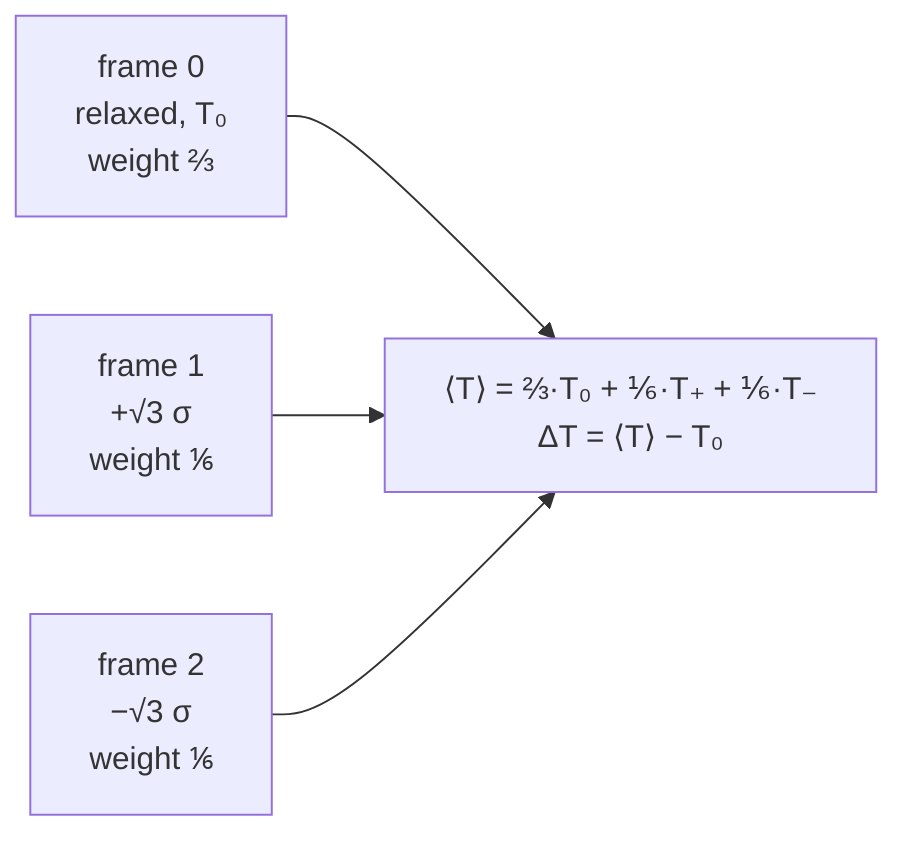

It answers how much that mode, in the state chosen, changes the result from
the relaxed geometry. **The excitation's own effect** is another number: the
relaxed geometry is not a state the molecule is ever in, and the mode's
zero-point and thermal motion already change the result. A driven or excited
mode's own effect is its state's average against the same mode's state
without the excitation **at the same temperature** — the warm driven state
against the thermal one at the junction's temperature, a pure state (the
coherent state, $n$ quanta) against that one mode in its ground state, 0 K,
the others as they are. **The default cold coherent state against a warm
baseline** measures the drive less the mode's own thermal quanta. To second
order (§ 2a.3), the cold coherent state has
$\langle Q^2\rangle = Q_{\mathrm{zp}}^2(1 + 2n_s)$, the thermal one
$Q_{\mathrm{zp}}^2(1 + 2n_{\mathrm{th}})$ and the warm driven one
$Q_{\mathrm{zp}}^2(1 + 2n_{\mathrm{th}} + 2n_s)$: the cold-against-warm
difference holds $n_s - n_{\mathrm{th}}$ quanta of the drive's $n_s$, a
share $(n_s - n_{\mathrm{th}})/n_s$ of its effect —
$n_{\mathrm{th}} = \tfrac12(\sigma_T^2/Q_{\mathrm{zp}}^2 - 1)$ read from the
mode's warm width. On the contact bond of § 4.3 it is exact:
$\langle e^{-aQ}\rangle$ over each state (§ 2b.5) gives the cold default
against the warm baseline as the drive's own effect, $I_0(aQ_0)$, times
$e^{-\lambda^2 n_{\mathrm{th}}}$, $\lambda = aQ_{\mathrm{zp}}$. A 50 cm⁻¹ mode
at 300 K ($n_{\mathrm{th}} = 3.69$, $\lambda = 0.3$) with one swing quantum:
$1.0920 \times 0.7174 = 0.783$, so it reads −22 %, where the drive's own
effect, warm driven against thermal, is +9 %; with four swing quanta, −0.0 %
against +39 %. Even a mode only a little warm reads a weak drive short: at
$\sigma_T/Q_{\mathrm{zp}} = 1.1$ ($n_{\mathrm{th}} = 0.105$) a quarter-quantum
drive reads 58 % of its effect. The cold default's exact baseline is the same
mode at 0 K beside the warm others. On a stiff mode the comparisons agree: a
1000 cm⁻¹ mode at 300 K with $aQ_{\mathrm{zp}} = 1$ has a thermal average of
$1.66\,T_0$, and one swing quantum gives $3.76\,T_0$ cold and $3.79\,T_0$
warm — +276 % against the relaxed geometry, +126 % cold against the thermal
state, +128 % warm against it, the excitation's own.

**From two sets, or one set re-weighted.** The two states' averages come
best from two sets, each placed by its own state's rule and exact to degree
$2m - 1$. One set's results re-weighted to the other state (§ 5.4) are exact
only to degree $m - 1$ ($m$ for an odd number of symmetric frames and a
symmetric state): on the stiff example, three frames give +77 % (the
thermal set re-weighted to the drive) or +92 % (the driven set re-weighted to
the thermal state) against the true +126 % (the cold default against the
thermal state — the two states these sets sample); five frames +119 % or
+132 %;
seven +126 % or +125 % — against two sets' +118 %, +126 % and +126 %. So the
one-calculation route needs five frames at least. Another mode is another
set.

**Snapshots of the whole molecule** answer the molecule's average at its
temperature, every mode moving at once, with a driven mode where one is set
(§ 2c) — what the user asked for on 2026-11-23: *"a full displacement map of
all atoms with the included modes at specified temperature with thermal
equilibrium assumption"*. A snapshot moves the modes together, as the
harmonic picture's equilibrium does (§ 2c.1), and computes the property at
the geometry they make, so no cross-derivative
$\partial^2T/\partial Q_\nu\partial Q_\mu$ has to be known. Weighing one
mode's own set against another's stays the person's, as ruled on 2026-10-09:
*"it is cleaner and more focused to let user to post-process the results from
different vibrational mode and decide how they can be weighed to give an
overall impact"*.

---

## 7. What the picture assumes

Each is stated beside the numbers it limits, never dropped: items 2–6 by
a calculation over the frames, beside its average
([`engines/transport.md`](?doc=engines/transport.md) § 2a.12); items 1, 7, 8
and 9 by the frame set itself, in its maker's `assumptions` row, which every
calculation carries as written
([`engines/vibration-frames.md`](?doc=engines/vibration-frames.md) § 5):

1. **Harmonic modes.** Each mode's $P(Q)$ is its state's (§ 2b.3) — in
   equilibrium § 2's Gaussian, at the temperature the person states: the
   junction's, or for a mode pumped at random moments its effective one
   (§ 2a.1, § 5) — and the modes move independently but within a drive
   group (§ 2c.1, § 2c.2). A strongly
   anharmonic mode — a soft contact bond, softer outward than inward — has a
   *skewed* distribution, $\langle Q\rangle \neq 0$ and $\langle Q^3\rangle\neq0$,
   and then the odd part of $T$ no longer cancels: a second source of
   asymmetry, the distribution's own, which a harmonic frame set does not
   carry. Each frame's largest single-atom move, stated beside it
   (`normal-modes.md` § 4c.5), is what a person reads to see where it may
   matter. A mode holding many quanta is where it fails first: its ladder's
   gaps shrink as it climbs, so a drive at one frequency is resonant with
   one rung alone once the shift passes the line's width (§ 2a.2), and its
   positions leave the harmonic shapes. The doors say so beyond 1 eV in a
   mode, $\langle n\rangle h c\tilde\nu$ — far up its ladder
   ([`engines/vibration-frames.md`](?doc=engines/vibration-frames.md) § 6);
   a mark, not a bound: a soft stretch climbs several rungs below it, and a
   torsion leaves the harmonic picture near its barrier, which can be well
   below it (§ 2a.2).
2. **Static frames (the electron is fast).** Each frame is a frozen geometry:
   the electron crosses the junction quickly against the vibration,
   $\hbar\omega \ll \max\big(|\varepsilon - E_F|,\ \Gamma\big)$. What a static
   average cannot give — the inelastic steps at $eV = \hbar\omega$, a strongly
   coupled level's polaron shift — needs the electron–vibration coupling itself
   [Frederiksen2007, Galperin2007] (`vibration.md` § 5.6, level two).
3. **One distribution, one voltage at a time.** The average is taken over
   the frames at each voltage separately (`transport.md` § 2a.9, *Both
   axes*), with the same weights at every voltage — the motion the set was
   made for. A finite bias can
   heat the modes the current couples to, and light can pump them at random
   moments (§ 2a.1); their spread is then said by an effective temperature,
   measured, not computed here, and stated as the set's temperature — a
   driven mode has no effective temperature for its shape (§ 2a.3). At low bias the averaged $T(E_F)$ is the averaged conductance.
4. **Each frame's electrons in their ground state for that frame** (the
   Born–Oppenheimer picture): every frame runs its own self-consistent device.
5. **The level alignment is DFT's**, frame by frame (`normal-modes.md` § 4c.6).
6. **The electrodes do not move**: the held atoms are the leads, shared by
   every frame (§ 1); their own vibrations are not among the modes.
7. **A finite number of snapshots.** A sampled set's average carries a
   statistical error (§ 5.5), computed by the analysis that reads the
   results (`engines/vibration-frames.md` § 7); a mode's own set carries
   none, only its rule's degree (§ 5.3).
8. **The light acts on the electrons too.** A drive strong enough to add one
   quantum needs a local field near 0.1 V/Å (§ 2a.2's table) — about 1 V
   across a 1 nm gap, oscillating at the light's frequency, some eight times
   the photon energy at 1000 cm⁻¹. Such a field changes the current by
   itself: photon-assisted tunnelling [TienGordon1963] and the optical
   rectification measured in a nanogap [Ward2010], beyond anything static
   frames of a displaced molecule give.
9. **A drive pushes every infrared-active mode.** The field couples to each
   mode through its own $\partial\boldsymbol\mu/\partial Q_k$; off resonance,
   each answers with a small forced motion in step with the drive, of
   amplitude about $\gamma\omega/\lvert\omega_k^2 - \omega_L^2\rvert$ times the
   ratio of the dipole derivatives — about 0.05 for a neighbour 100 cm⁻¹ away
   with a 10 cm⁻¹ line — which a one-mode drive (§ 2c.2) leaves out.

---

## 8. What is recorded where

**The frame set** states what every frame is: its weight — the one row a
calculation reads — and the maker's rows, the motion and the recipe, each
with its meaning ([`engines/vibration-frames.md`](?doc=engines/vibration-frames.md)
§ 5; [`model/structure.md`](?doc=model/structure.md) § 2.2f).

**A calculation over the frames** records each frame's result — the family
of curves — and the average at the stated weights, carrying the set's rows as
written, and derives nothing else across the frames: no slope or curvature
([`engines/transport.md`](?doc=engines/transport.md) § 2a.12, the user's
2026-10-10 ruling; § 5.3 says why). What is derived across the frames — a
slope, the curvature where the response is smooth, a comparison with another
set, an average over another motion (§ 5.4), a snapshot set's error (§ 5.5) —
is the analysis's, made on the calculation's data file, where every frame's
result sits beside its weight and its rows, and never written into the
record.

---

## References

Each article checked against Crossref and each book against its publisher's
or a library's record, 2026-10-28 (the eight added 2026-11-23, likewise; Owen's
book against its author's page, 2026-11-23); each is in `references.bib`.

- [Feynman1972] R. P. Feynman, *Statistical Mechanics: A Set of Lectures*
  (W. A. Benjamin, Reading, Mass., 1972; Frontiers in Physics 36), ch. 2,
  "Density Matrices", § 2.5, the linear harmonic oscillator — its thermal
  density matrix, whose diagonal is the bell curve of § 2 and § 2a.1.
- [AbramowitzStegun1964] M. Abramowitz and I. A. Stegun, *Handbook of
  Mathematical Functions* (NBS Applied Mathematics Series 55, 1964),
  eq. 25.4.46 (p. 890) and Table 25.10 (p. 924) — Gauss–Hermite nodes and
  weights (§ 5.1).
- [DLMF] *NIST Digital Library of Mathematical Functions*,
  https://dlmf.nist.gov/, eq. 10.32.1 — the integral form of the modified
  Bessel function $I_0$, the swing's exact average of an exponential
  (§ 2a.3); eq. 18.18.28, Mehler's formula, the thermal state's sum of its
  number states (§ 2d.3).
- [Glauber1963] R. J. Glauber, *Phys. Rev.* **131**, 2766–2788 (1963),
  doi:10.1103/PhysRev.131.2766 — coherent states, the name and the states,
  in the radiation field (§ 2a.2).
- [CohenTannoudji2020] C. Cohen-Tannoudji, B. Diu, F. Laloë, *Quantum
  Mechanics, Volume I: Basic Concepts, Tools, and Applications*, 2nd ed.
  (Wiley-VCH, Weinheim, 2020), Complement G$_\mathrm{V}$, "Coherent
  'quasi-classical' states of the harmonic oscillator" — the ground state's
  bell curve carried along the classical motion (§ 2a.2).
- [CarruthersNieto1965] P. Carruthers, M. M. Nieto, *Am. J. Phys.* **33**,
  537–544 (1965), doi:10.1119/1.1971895 — a classical push leaves a harmonic
  mode that starts in its ground state in a coherent state (§ 2a.2).
- [HammersleyMorton1956] J. M. Hammersley, K. W. Morton, *Proc. Camb. Phil.
  Soc.* **52**, 449–475 (1956), doi:10.1017/S0305004100031455 — antithetic
  variates, the method of mirrored draws (§ 5.5).
- [TienGordon1963] P. K. Tien, J. P. Gordon, *Phys. Rev.* **129**, 647–651
  (1963), doi:10.1103/PhysRev.129.647 — photon-assisted tunnelling (§ 7).
- [Ward2010] D. R. Ward, F. Hüser, F. Pauly, J. C. Cuevas, D. Natelson,
  *Nature Nanotechnol.* **5**, 732–736 (2010), doi:10.1038/nnano.2010.176 —
  optical rectification and field enhancement in a nanogap (§ 7).
- [Zavatta2007] A. Zavatta, V. Parigi, M. Bellini, *Phys. Rev. A* **75**,
  052106 (2007), doi:10.1103/PhysRevA.75.052106 — the single-photon-added
  thermal state of light, whose name § 2d.4 borrows for a vibration's
  quantum; checked against Crossref 2026-11-24.
- [Morse1929] P. M. Morse, *Phys. Rev.* **34**, 57–64 (1929),
  doi:10.1103/PhysRev.34.57 — the anharmonic ladder, its gaps shrinking a
  rung at a time (§ 2a.2); checked against Crossref 2026-11-24.
- [GolubWelsch1969] G. H. Golub, J. H. Welsch, *Math. Comp.* **23**,
  221–230 (1969), doi:10.1090/S0025-5718-69-99647-1 — a distribution's Gauss
  rule from its recurrence, as an eigenvalue problem (§ 2a.3, § 2b.4).
- [Gautschi1982] W. Gautschi, *SIAM J. Sci. Stat. Comput.* **3**, 289–317
  (1982), doi:10.1137/0903018 — a distribution's recurrence from a discrete
  distribution holding its averages, by the Lanczos (Stieltjes) recurrence
  (§ 2a.3).
- [PatrickGiustino2013] C. E. Patrick, F. Giustino, *Nat. Commun.* **4**,
  2006 (2013), doi:10.1038/ncomms3006 — properties averaged over the
  harmonic nuclear distribution by random snapshots of every mode (§ 2c.3).
- [ZachariasPatrickGiustino2015] M. Zacharias, C. E. Patrick, F. Giustino,
  *Phys. Rev. Lett.* **115**, 177401 (2015),
  doi:10.1103/PhysRevLett.115.177401 — the stochastic, equal-weight
  average over snapshots of the modes (§ 2c.3).
- [ZachariasGiustino2016] M. Zacharias, F. Giustino, *Phys. Rev. B* **94**,
  075125 (2016), doi:10.1103/PhysRevB.94.075125 — snapshots in mirrored
  pairs, whose odd contributions cancel (§ 5.5).
- [Owen2013] A. B. Owen, *Monte Carlo theory, methods and examples* (2013),
  https://artowen.su.domains/mc/, ch. 8, § 8.2, eq. 8.4 — antithetic sampling
  removes the odd part's variance and doubles the even part's (§ 5.5).
- [Frederiksen2007], [Galperin2007] — inelastic transport and the
  electron–vibration coupling (`references.bib`).
- [Kneipp1996] K. Kneipp, Y. Wang, H. Kneipp, I. Itzkan, R. R. Dasari,
  M. S. Feld, *Phys. Rev. Lett.* **76**, 2444–2447 (1996),
  doi:10.1103/PhysRevLett.76.2444 — vibrational pumping by surface-enhanced
  Raman scattering (§ 2a.1).
- [LeRuEtchegoin2006] E. C. Le Ru, P. G. Etchegoin, *Faraday Discuss.*
  **132**, 63–75 (2006), doi:10.1039/b505343a — when that pumping is real
  (§ 2a.1).
- [Ward2011] D. R. Ward, D. A. Corley, J. M. Tour, D. Natelson, *Nature
  Nanotechnol.* **6**, 33–38 (2011), doi:10.1038/nnano.2010.240 — mode
  temperatures in biased junctions, from the anti-Stokes/Stokes ratio
  (§ 2a.1).
