# Averaging over the molecule's vibrations

**Role:** science reference
**Domain:** science
**Companions:** [`engines/vibration-frames.md`](?doc=engines/vibration-frames.md)
(the motion toolkit: the API that makes frames from the modes, by this
chapter's recipes); [`engines/vibration.md`](?doc=engines/vibration.md) § 6
(the vibration calculation: every mode's data);
[`engines/transport.md`](?doc=engines/transport.md) § 2a.9 (a calculation
over frames); [`normal-modes.md`](?doc=science/normal-modes.md) § 4c (which
mode moves the current);
[`archive/2026-10-10-q17.md`](?doc=archive/2026-10-10-q17.md) § 5z.1 (Q17, decision D5).

*Written 2026-10-09 at the user's request: "add a discussion of this
averaging as an independent document under science, expand the details";
widened 2026-11-23 to the whole molecule and every state of a mode; § 2d,
each snapshot's draw derived, added 2026-11-24; the coherent state, and why
molbuilder does not model it (§ 2a.2), 2026-11-25 at the user's word.*

---

## 0. The question

A molecule bridging two electrodes is never still. Every vibration moves it —
a little even at absolute zero, more when warm — and a measurement lasts
millions of vibrational periods. What it reports is a property — the
transmission, a level's energy — **averaged over every geometry the molecule
passes through**, not the property of the relaxed geometry.

A calculation over frames computes that average from a handful of **static
frames**: geometries of the molecule, each computed as an ordinary static
calculation and each carrying a weight, the average being
$\sum_f w_f\,X_f$ ([`engines/transport.md`](?doc=engines/transport.md)
§ 2a.9, § 2a.12). Which frames, with which weights, is a question about how
the molecule moves — this chapter's — and choosing them is the person's
research, made with the motion toolkit
([`engines/vibration-frames.md`](?doc=engines/vibration-frames.md)):

- **one mode on its own** — the relaxed junction and a few copies displaced
  along that mode, placed and weighted by the mode's state (§ 5): how much
  that mode changes the result;
- **the whole molecule** — snapshots in which every mode moves at once, each
  drawn from its own state and weighted equally (§ 2c, § 5.5): the
  molecule's average at its temperature, with a mode a photon excited, or
  one pumped, where the person sets one.

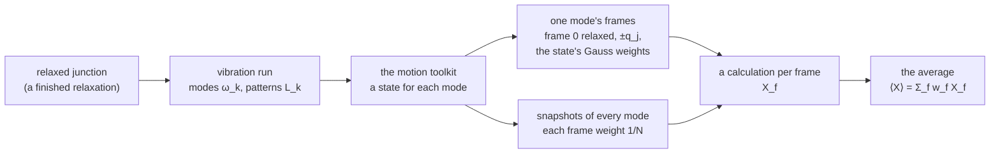

This document answers: **where** the molecule is while it vibrates — one mode
in each of its states (§ 2, § 2a, § 2b) and the whole molecule (§ 2c); how
each snapshot is drawn (§ 2d); every state built in steps from a start and
the events after it, the theory of the generic tools (§ 2e);
**what** a measurement averages and why a lopsided response gives a net
change (§ 3–4); **how** few frames compute that average and when they cannot
(§ 5); what each kind of frame set answers (§ 6); what the picture assumes
(§ 7); where each number is recorded (§ 8).

**Computed by** — `vibration(run_folder)` → the vibration run's modes, each
by its number; `v.mode(k).bind(chain).frames(nodes)` → one mode's $m$ frames,
placed and weighted by its state's own rule; `v.motion(chain).sample(N,
seed=, antithetic=)` → snapshots of every mode, each frame at $1/N$;
`write_frame_set(path, frames)` → the pair a calculation cites
([`engines/vibration-frames.md`](?doc=engines/vibration-frames.md) § 1,
§ 3.3, § 4, § 5). The average $\sum_f w_f X_f$ is no call of these: it is
the calculation's own record (§ 3).

```python
from molbuilder.postprocess import vibration, states, write_frame_set, topic_dir
v = vibration(run_folder)                    # on a run of your own -- engines/vibration-frames.md § 1
warm = states.thermal(temperature_k=300.0)
one_mode = v.mode(7).bind(warm).frames(3)    # frame 0 relaxed and ±q, weights 2/3, 1/6, 1/6
snaps = v.motion(warm).sample(64, seed=1, antithetic=True)    # every mode at once, each frame 1/64
write_frame_set(topic_dir("P", "structure") / "m7-300K.xyz", one_mode)
```

Each section below ends with its **Computed by**: the calls that compute
its step, each with what it returns, and where its manual is. An example
that needs a vibration run takes `v` as above, on a run of a person's own,
and shows no output; an example with `>>>` needs no run, and its output is
what molbuilder 2.85.1 printed — the chapter's `>>>` examples run in order
as one session.

---

## 1. The quantities

A normal mode $\nu$ has an angular frequency $\omega_\nu$ and a mass-weighted
normal coordinate $Q_\nu$ (units $\mathrm{amu}^{1/2}\,\text{Å}$). Displacing the
junction along the mode moves each atom $A$ by its share of the canonical
eigenvector $\mathbf L_{\nu,A}$ (`vibration.md` § 6.3):

$$
\mathbf R_A(Q_\nu) \;=\; \mathbf R_A^{0} \;+\; Q_\nu\,\mathbf L_{\nu,A},
\qquad \mathbf L_{\nu,A} = \mathbf 0 \ \text{for every held atom.}
$$

With every mode moving at once, the moves add (§ 2c):
$\mathbf R_A = \mathbf R_A^{0} + \sum_\nu Q_\nu\,\mathbf L_{\nu,A}$.

The electrodes are held, so no frame moves a lead atom — the condition that
lets every frame share one pair of lead calculations (`transport.md` § 2a.9).

For each frame the transport calculation gives the transmission $T(E;Q)$, and
at low bias the conductance

$$
G(Q) \;=\; G_0\,T(E_F;Q), \qquad G_0 = \frac{2e^2}{h}
$$

for a spin-degenerate junction (per spin channel, $e^2/h$ each; `transport.md`
§ 2a.12).

**Computed by** — `m.displacement(q)` → each atom's move $Q\,\mathbf L_A$,
Å, zero on every held atom; `m.displaced(q)` → the geometry
$\mathbf R^0 + Q\,\mathbf L$; `v.displaced({k: q, …})` → the geometry of
several modes at once, $\mathbf R^0 + \sum_k Q_k\mathbf L_k$
([`engines/vibration.md`](?doc=engines/vibration.md) § 6.11 § 6;
[`engines/vibration-frames.md`](?doc=engines/vibration-frames.md) § 3.2).
$G$ at each frame is the transport calculation's own, `conductance_g0` in
its data file
([`engines/transport-postprocessing.md`](?doc=engines/transport-postprocessing.md)
§ 3).

```python
m = v.mode(7)                        # on a run of your own -- engines/vibration-frames.md § 3.2
m.displacement(0.12)                 # (atoms, 3), Å: Q L_A at Q = 0.12 amu½·Å
m.displaced(0.12)                    # the geometry R⁰ + Q L
v.displaced({7: 0.12, 9: -0.05})     # two modes at once, R⁰ + Σ_k Q_k L_k
```

---

## 2. Where the molecule is: the thermal distribution of one mode

For a harmonic mode in thermal equilibrium at temperature $T_{\mathrm{K}}$ the
probability of finding the coordinate at $Q$ is a Gaussian — exactly, quantum
mechanically, at every temperature (the probability of each position in the
oscillator's thermal state, [Feynman1972] § 2.5):

$$
P(Q) \;=\; \frac{1}{\sqrt{2\pi}\,\sigma}\,\exp\!\left(-\frac{Q^2}{2\sigma^2}\right),
\qquad
\sigma^2 \;=\; \langle Q^2\rangle \;=\; \frac{\hbar}{2\omega}\,
\coth\!\left(\frac{\hbar\omega}{2k_B T_{\mathrm K}}\right).
$$

Its two limits say what sets the width:

$$
\sigma^2 \xrightarrow{\;k_BT_{\mathrm K}\ll\hbar\omega\;} \frac{\hbar}{2\omega}
= Q_{\mathrm{zp}}^2 \quad\text{(zero-point motion)},
\qquad
\sigma^2 \xrightarrow{\;k_BT_{\mathrm K}\gg\hbar\omega\;} \frac{k_BT_{\mathrm K}}{\omega^2}
\quad\text{(classical equipartition)}.
$$

$Q_{\mathrm{zp}}$ is in every vibration result already
(`zero_point_amplitude_amu12_ang`, `vibration.md` § 6.3, beside
`zero_point_displacement_ang`, $Q_{\mathrm{zp}}\,\mathbf L$ per atom in Å), so
$\sigma = Q_{\mathrm{zp}}\sqrt{\coth(\hbar\omega/2k_BT_{\mathrm K})}$. At
298 K:

| mode | $\hbar\omega/2k_BT_{\mathrm K}$ | $\sigma/Q_{\mathrm{zp}}$ | what it means |
|---|---|---|---|
| 1600 cm⁻¹ (a ring stretch) | 3.86 | 1.00 | frozen in its ground state: zero-point only |
| 500 cm⁻¹ | 1.21 | 1.09 | mostly zero-point |
| 50 cm⁻¹ (a soft torsion) | 0.12 | 2.89 | thermally excited: three times wider |

Soft modes move far — which is why each frame states its largest
single-atom move, the number a person reads against that atom's bond length
(`normal-modes.md` § 4c.5), and why § 7 names the harmonic picture's limit.

**What matters for § 3: $P(Q)$ is symmetric, $P(-Q) = P(Q)$.** The molecule
spends as much time pushed one way as pushed the other. This is a property of
the *distribution* of positions, for a harmonic mode — and it says nothing
about whether the *transmission* responds symmetrically.

**Computed by** — `Oscillator(ν̃).zero_point_amplitude_amu12_ang` →
$Q_{\mathrm{zp}}$; `Oscillator(ν̃).bose_einstein_mean_quanta(T)` → $\bar n$;
`oscillator.thermal_spread_amu12_ang(Q_zp, ν̃, T)` →
$\sigma = Q_{\mathrm{zp}}\sqrt{\coth(\hbar\omega/2k_BT)}$; for a mode of a
run, `m.bind(states.thermal(temperature_k=T)).spread_amu12_ang` → its σ, and
`m.thermal` → its spread and mean quanta at the temperatures the record
states ([`engines/vibration-frames.md`](?doc=engines/vibration-frames.md)
§ 9.1 `Oscillator`, *The mechanics on a wavenumber*; § 2). The table's
$\sigma/Q_{\mathrm{zp}}$:

```python
>>> from molbuilder.postprocess import Oscillator, oscillator
>>> for nu in (1600.0, 500.0, 50.0):
...     qzp = Oscillator(nu).zero_point_amplitude_amu12_ang
...     print(nu, round(oscillator.thermal_spread_amu12_ang(qzp, nu, 298.0) / qzp, 2))
1600.0 1.0
500.0 1.09
50.0 2.89
```

## 2a. When light or a current excites the mode — the spread out of equilibrium

*(Written 2026-10-24 at the user's request: "we are looking at EM driven mode
which means we have an external force to drive a particular mode, how to
estimate the reasonable displace to use for that? … or we can only use
temperature dependent value to just first estimate?"; rewritten 2026-10-28:
"for a mode that is activated due to interaction with an photon, the
'temperature' is no longer accurate because it is not in equilibrium. so
what's the right way to propose a right amount of displacement?")*

> **In short.** Two things decide where the molecule sits along a mode. How
> far it moves is set by how much vibrational energy the mode holds — its mean
> number of quanta $n$. The shape of where it sits is set by its state. In
> equilibrium the temperature sets $n$, and the shape is a bell curve. Light,
> or a current, raises $n$ one quantum at a time, in two ways that differ in
> shape:
>
> - **Quanta added at random moments** — spontaneous Raman scattering from a
>   steady laser, or a current through the junction — keep the bell curve of
>   § 2 and only widen it. The frames stay the bell curve's, at an *effective
>   temperature* (§ 2a.1).
> - **One detected quantum** — one photon absorbed or one Stokes photon
>   scattered, for times below the mode's energy lifetime — leaves a cold mode
>   with one quantum exactly: two lobes and a zero at rest, not a bell curve
>   (§ 2b.3, § 2d.4). A strongly curved response then needs frames placed by
>   the state's own distribution (§ 2a.3).
>
> A push in step with the mode — the coherent state — is not among them
> (§ 2a.2).

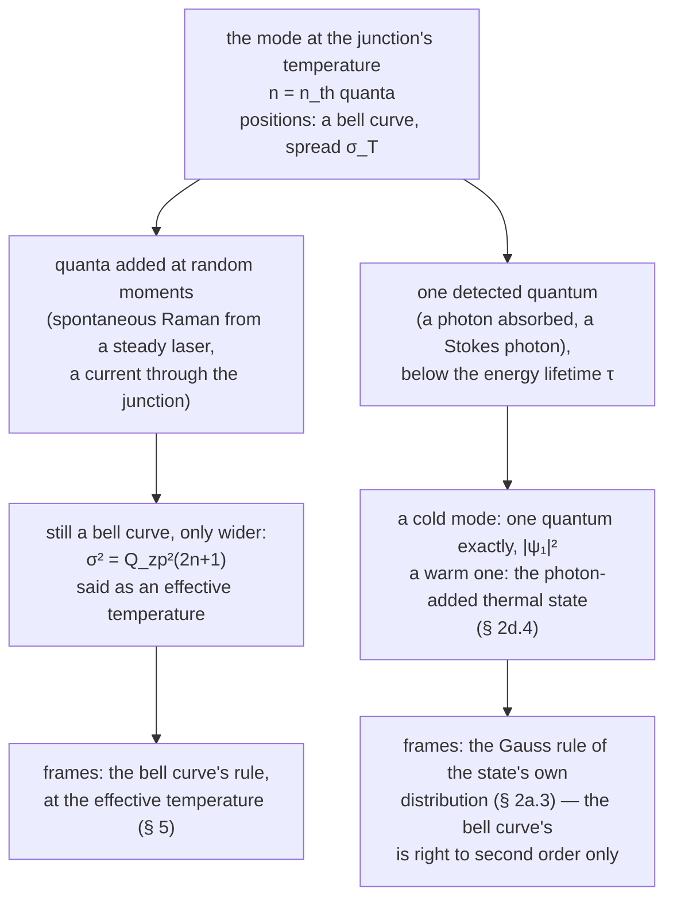

### What sets the spread: the mean number of quanta

The equilibrium spread $\sigma_T$ is usually the floor: light or a current
adds to it (cooling by anti-Stokes scattering can push a mode below it, which
nothing here assumes). How much is added depends on three things:

| what | where it comes from |
|---|---|
| how strongly the light couples to the mode: $\partial\boldsymbol\mu/\partial Q$, the dipole's change along the mode, for infrared — the force per unit local field; $\partial\alpha/\partial Q$, the polarizability's change, for Raman — whose rate grows with the light's intensity | the optical method, [`vibrational-optical-response.md`](?doc=science/vibrational-optical-response.md) § 2, § 3 |
| the local field at the molecule | the field model, or the experiment — not computed here |
| how fast the mode loses what it gains: its quanta at the energy lifetime $\tau = 1/(2\pi c\,\Gamma)$, $\Gamma$ the line's homogeneous width (full width at half maximum, cm⁻¹) — a 10 cm⁻¹ line, 0.53 ps | the measured spectrum — not computed here. A measured line is also broadened by the spread of environments, so $\tau$ read from it is a lower bound |

**The spread is set by $n$, for any state of the mode.** For a harmonic
oscillator, the time-averaged potential energy is half the total energy (the
other half is kinetic). In mass-weighted coordinates the potential energy is
$\tfrac12\omega^2 Q^2$ and the total is $\hbar\omega\,(n + \tfrac12)$, so

$$
\tfrac12\,\omega^2\,\langle Q^2\rangle = \tfrac12\,\hbar\omega\,\big(n+\tfrac12\big)
\quad\Longrightarrow\quad
\sigma^2 = \langle Q^2\rangle = \frac{\hbar}{2\omega}\,(2n+1) = Q_{\mathrm{zp}}^2\,(2n+1),
$$

using $Q_{\mathrm{zp}}^2 = \hbar/2\omega$ (§ 2). This holds whatever the state
— thermal, pumped, or $n$ quanta exactly — with $\langle\cdot\rangle$ the
average over the state. In equilibrium $n = 1/(e^{\hbar\omega/k_BT_{\mathrm K}} - 1)$, and
$2n+1 = \coth(\hbar\omega/2k_BT_{\mathrm K})$ — § 2's formula again. **The
spread comes from $n$; the shape comes from the state** — the bell curve
for any thermal or randomly pumped mode, the oscillator's own standing waves
for $n$ quanta exactly (§ 2b.3).

**Computed by** — `oscillator.spread_of_quanta(Q_zp, n̄)` →
$Q_{\mathrm{zp}}\sqrt{2\bar n+1}$, in any state; `chain.on(Oscillator(ν̃))`
→ the state, `.mean_quanta` its $\bar n$; `dist.of_state(state).moment(k)`
→ its $\langle x^k\rangle$, $x = Q/Q_{\mathrm{zp}}$; for a mode of a run,
`m.bind(chain).spread_amu12_ang` → $\sqrt{\langle Q^2\rangle}$
([`engines/vibration-frames.md`](?doc=engines/vibration-frames.md) § 9.1
*The mechanics on a wavenumber*, `.on(oscillator, …)`, `of_state(state)`;
§ 2). The same mean, two states — one spread, two shapes:

```python
>>> from molbuilder.postprocess import Oscillator, states, dist, oscillator
>>> osc = Oscillator(200.0)
>>> for chain in (states.thermal(mean_quanta=1.0), states.level(1)):
...     d = dist.of_state(chain.on(osc))
...     print(chain.on(osc).mean_quanta, round(d.moment(2), 9), round(d.moment(4), 9))
1.0 3.0 27.0
1.0 3.0 15.0
>>> round(oscillator.spread_of_quanta(1.0, 1.0) ** 2, 9)
3.0
```

### 2a.1 Quanta added at random moments — a wider bell curve, an effective temperature

A steady laser shining on the junction scatters off the molecule. Most of the
scattered light keeps its colour; a little comes back with one vibrational
quantum less energy — a **Stokes** event, which leaves that quantum in the
mode — or one quantum more — an **anti-Stokes** event, which takes a quantum
from the mode. The surroundings, meanwhile, exchange quanta with the mode at
their own temperature. A current through a biased junction adds quanta
in the same one-at-a-time way.

**Every one of these moves the mode one rung up or down its ladder of
levels**, at a rate proportional to $k+1$ for a step up from level $k$ and to
$k$ for a step down — the harmonic oscillator's own transition strengths.
Call the total rate constants $G$ (gain) and $L$ (loss). The probabilities
$p_k$ of finding the mode on rung $k$ obey

$$
\frac{dp_k}{dt} = G\big[k\,p_{k-1} - (k+1)\,p_k\big] + L\big[(k+1)\,p_{k+1} - k\,p_k\big].
$$

**In steady state each step up balances the step back down**: a ladder has
only one path between two neighbouring rungs, so the flow up from rung $k$
must equal the flow down from rung $k+1$,
$G\,(k+1)\,p_k = L\,(k+1)\,p_{k+1}$. So

$$
\frac{p_{k+1}}{p_k} = \frac{G}{L} \quad\Longrightarrow\quad
p_k = \Big(1-\frac{G}{L}\Big)\Big(\frac{G}{L}\Big)^{k}, \qquad
n = \sum_k k\,p_k = \frac{G}{L-G}.
$$

**Where $G$ and $L$ come from.** The surroundings, at the junction's
temperature and with energy lifetime $\tau$, give $n_{\mathrm{th}}/\tau$ up
and $(n_{\mathrm{th}}+1)/\tau$ down. The laser gives $R$ up and $R_{\mathrm{aS}}$
down, $R$ the Stokes rate of a molecule in its ground state — its Stokes
cross section in the gap times the laser's photon flux — and $R_{\mathrm{aS}}$
the anti-Stokes rate constant likewise. So

$$
G = \frac{n_{\mathrm{th}}}{\tau} + R, \qquad
L = \frac{n_{\mathrm{th}}+1}{\tau} + R_{\mathrm{aS}}
\quad\Longrightarrow\quad
n = \frac{n_{\mathrm{th}} + R\tau}{1 + (R_{\mathrm{aS}} - R)\,\tau} .
$$

When the two rate constants are equal, or the pumping is weak and the mode
cold ($R\tau \ll 1$ and $n_{\mathrm{th}} \ll 1$), this is the familiar
$n = n_{\mathrm{th}} + R\tau$, the weak-pumping form of [Kneipp1996] — to
first order in the rates it is
$n \approx n_{\mathrm{th}} + \big[R(n_{\mathrm{th}}+1) - R_{\mathrm{aS}}n_{\mathrm{th}}\big]\tau$,
so a warm soft mode with $R_{\mathrm{aS}} > R$ gains less. It grows without
bound as $(R - R_{\mathrm{aS}})\,\tau \to 1$.

**Why the shape stays a bell curve.** The populations $p_k \propto (G/L)^k$
fall off by a constant factor per rung — exactly as a thermal state's do,
$p_{k+1}/p_k = e^{-\hbar\omega/k_BT_{\mathrm K}}$. So the pumped mode is a
thermal state at the **effective temperature** $T_{\mathrm{eff}}$ with
$e^{-\hbar\omega/k_BT_{\mathrm{eff}}} = G/L$. A thermal state's positions are
the bell curve of § 2 ([Feynman1972] § 2.5), so the mode under random
pumping is a bell curve of spread

$$
\sigma^2 = Q_{\mathrm{zp}}^2\,(2n+1) = Q_{\mathrm{zp}}^2\,\coth\!\left(\frac{\hbar\omega}{2k_BT_{\mathrm{eff}}}\right),
\qquad
T_{\mathrm{eff}} = \frac{\hbar\omega}{k_B\,\ln(1 + 1/n)} .
$$

**$T_{\mathrm{eff}}$ is measured, not computed here.** The ratio of the
line's anti-Stokes to its Stokes intensity goes as $n/(n+1)$, once the two
lines' frequency factors and enhancements are divided out. Ward, Corley, Tour
and Natelson measured mode temperatures in biased junctions this way
[Ward2011]. Kneipp and co-workers reported pumping by surface-enhanced Raman
scattering itself [Kneipp1996]; Le Ru and Etchegoin examined when that
pumping is real, against heating and other readings of the same data
[LeRuEtchegoin2006].

**So a randomly pumped mode takes the same frames as an equilibrium one**, at
its effective temperature in place of the junction's: the frame set's
temperature (§ 5) is that effective temperature.

**Computed by** — `states.thermal(mean_quanta=n)` → a mode pumped at random
moments, named by its mean; `oscillator.bose_einstein_temperature(ν̃, n)` →
its effective temperature $T_{\mathrm{eff}}$; the command line's
`--mean-quanta N` writes a mode's own set in that state
([`engines/vibration-frames.md`](?doc=engines/vibration-frames.md) § 9.1
*The starts*, *The mechanics on a wavenumber*; § 6). The rates — $R$,
$R_{\mathrm{aS}}$, $\tau$ — and so $n$ are measured; no call computes them.
§ 5's mode 48, pumped to a half and to one quantum:

```python
>>> from molbuilder.postprocess import Oscillator, states, oscillator
>>> [round(oscillator.bose_einstein_temperature(1039.9, n)) for n in (0.5, 1.0)]
[1362, 2159]
>>> states.thermal(mean_quanta=0.5).on(Oscillator(1039.9)).words
'thermal, 0.5 mean quanta'
```

### 2a.2 A push in step with the mode — the coherent state, and why molbuilder does not model it

**What it is.** A classical force pushing a harmonic mode in step with its
own motion — the force entering the energy as $-F(t)\,Q$, a term in $Q$
alone — moves the mode's state without changing its shape: from rest, the
zero-point bell curve of spread $Q_{\mathrm{zp}}$ moved as a whole, its
centre swinging as $Q_0\cos\omega t$, its width unchanged. This is the
*coherent state* — Glauber's name for the corresponding states of the
radiation field [Glauber1963]; their properties as states of the harmonic
oscillator are [CohenTannoudji2020] Complement G$_\mathrm{V}$, and a
classical push leaves a mode that starts in its ground state in one
[CarruthersNieto1965]. Counted in quanta it is no single level: it holds
$n$ quanta with Poisson's probabilities, of mean $Q_0^2/4Q_{\mathrm{zp}}^2$.

**What makes one.** A force that keeps a fixed phase against the mode: a
femtosecond pulse shorter than one vibrational period, which kicks the mode
through its polarizability — impulsive Raman scattering, coherent phonons;
an intense mid-infrared or terahertz pulse driving an infrared-active mode —
nonlinear phononics [Forst2011]; on one molecule, a terahertz pulse in a
scanning tunnelling microscope that sets the molecule's vibration going, a
second pulse reading the tunnelling current at a set delay [Cocker2016].
**Each swing lasts picoseconds** — about the mode's energy lifetime, 0.53 ps
for a 10 cm⁻¹ line — before damping and dephasing end it.

**Why molbuilder does not model it** *(the user's decision, 2026-11-25)*. A
conductance in these calculations is a DC measurement, over milliseconds or
more — $10^9$ to $10^{12}$ vibrational periods. A coherent swing would count
only if a resonant, phase-steady force renewed it against the damping the
whole time, and a junction holds none. What a junction does hold —
tunnelling electrons, Raman events, absorbed infrared photons — acts one
quantum at a time at random moments: it builds populations of the levels,
no phase between them, steady near a thermal list at an effective mean
(§ 2a.1, `states.thermal(mean_quanta=…)`), and one detected event leaves one
quantum (§ 2d.4). The one coherent experiment on a single molecule, the
terahertz microscope, reads the current at a set delay — one moment of the
swing — which frames drawn at random moments do not represent. So no state
of the toolkit is a coherent one.

**The ladder's equal gaps — the harmonic picture alone** *(the user,
2026-11-24)*. A photon absorbed at the mode's frequency moves the mode one
rung, $n \to n + 1$, and it is resonant with every rung only because the
harmonic ladder's gaps are all $\hbar\omega$. A real mode's gaps shrink as
it climbs: for a Morse-like bond [Morse1929]
$E_n = \hbar\omega(n+\tfrac12) - \hbar\omega x_e(n+\tfrac12)^2$, each gap
$2\hbar\omega x_e$ below the one beneath it — large for a stiff stretch of a
light atom, small for a soft one. **Light at one frequency climbs only while
that shift stays within the line's width** $\Gamma$: past it, the light
tuned to $0\to1$ is off resonance for $1\to2$. A stiff mode's resonant
absorption mostly stops at one quantum; a soft stretch, its shift inside
the width, climbs several rungs at one frequency. A torsion is another
matter: its well is periodic, so its gaps shrink too and its positions
leave the harmonic shapes near the barrier between two wells, however few
quanta that takes. Spontaneous Raman and inelastic tunnelling electrons are
not resonant with a rung — the scattered photon or the electron carries away
whatever the gap is — so they climb every rung, Raman at one laser frequency
and the electrons at one bias (§ 2a.1), each step's line shifted. The
vibration's result states no anharmonic constant ($\omega x_e$), so where a
mode's ladder leaves resonance is the person's to judge, and many quanta are
where the harmonic picture itself fails (§ 7, item 1): the command line and
the spectrum tab say so beyond 1 eV in a mode ([`engines/vibration-frames.md`](?doc=engines/vibration-frames.md) § 6).

**Computed by** — no call: the coherent state is no state of the toolkit's,
by the user's decision of 2026-11-25 (above); and no call gives a mode's
anharmonic shift, which the vibration's result does not state — the note
beyond 1 eV is the command line's and the spectrum tab's
([`engines/vibration-frames.md`](?doc=engines/vibration-frames.md) § 6).

### 2a.3 What the frames need — the spread to second order, the shape beyond

**Expand the transmission about equilibrium** (§ 4.2). For any distribution
symmetric about $Q = 0$ — the bell curve, $n$ quanta, every state here —
the odd terms average to zero, and

$$
\langle T\rangle = T_0 + \tfrac12\,T''\,\langle Q^2\rangle + \tfrac1{24}\,T''''\,\langle Q^4\rangle + \dots
$$

**Up to the $Q^2$ term only the spread enters**, $\langle Q^2\rangle = \sigma^2$,
whatever the shape: a response that is nearly a parabola over the motion is
averaged correctly by bell-curve frames at the same σ. **From the $Q^4$ term
on, the shape enters**: $\langle Q^4\rangle$ is $3\sigma^4$ for the bell curve
and $\tfrac53\sigma^4$ for one quantum exactly ($15\,Q_{\mathrm{zp}}^4$ at
$\sigma^2 = 3\,Q_{\mathrm{zp}}^2$). A strongly curved response — the contact
bond of § 4.3, whose tunnelling grows exponentially as the bond shortens —
weights the rare, far-out positions heavily, and the bell curve holds more
of them.

**The contact bond, exactly.** Take $T(Q) = T_0\,e^{-aQ}$ (§ 4.3), $1/a$ the
distance over which the response changes by a factor $e$. Over the bell curve,
$\langle e^{-aQ}\rangle = e^{a^2\sigma^2/2}$. Over one quantum,
$\langle1\rvert e^{-a\hat Q}\lvert1\rangle = e^{\lambda^2/2}(1+\lambda^2)$,
$\lambda = aQ_{\mathrm{zp}}$ (§ 2b.5). At the same spread
($\sigma^2 = 3Q_{\mathrm{zp}}^2$) the two are

$$
\frac{\langle T\rangle_{\text{one quantum}}}{T_0} = e^{\lambda^2/2}(1+\lambda^2) = 1 + \tfrac32\lambda^2 + \tfrac58\lambda^4 + \dots ,
\qquad
\frac{\langle T\rangle_{\text{bell}}}{T_0} = e^{3\lambda^2/2} = 1 + \tfrac32\lambda^2 + \tfrac98\lambda^4 + \dots
$$

— equal up to the $Q^2$ term, and different from the $Q^4$ term on, by the
factor 5/9 between the two shapes' $\langle Q^4\rangle$:

| the spread against the response's length, $a\sigma$ | true average, one quantum | bell curve at the same σ | bell-curve error |
|---|---|---|---|
| 0.5 | 1.1294 | 1.1331 | +0.3 % |
| 1.0 | 1.5751 | 1.6487 | +4.7 % |
| 2.0 | 4.5447 | 7.3891 | **+63 %** |
| 3.0 | 17.927 | 90.017 | **+402 %** |

**The frames a state needs: the Gauss rule of its own distribution.** The
frames are a few positions $Q_j$ with weights $w_j$ summing to 1, and the
average is $\langle T\rangle \approx \sum_j w_j\,T(Q_j)$. Write the response
as its series, $T = T_0 + T_1Q + T_2Q^2 + \dots$: averaged, each term is a
coefficient times an average of a power, $\langle Q^k\rangle$. So frames
that reproduce the distribution's own averages $\langle Q^k\rangle$ for every
$k$ up to some degree get every term of the response up to that degree
exactly. With $m$ frames the most that can be matched is
$k = 0, 1, \dots, 2m-1$ — the $m$ positions and $m$ weights are $2m$ numbers —
and the frames that do it are the distribution's **Gauss rule**
[GolubWelsch1969]. It is the one recipe every state's frames follow: the
bell curve's is Gauss–Hermite (§ 5.1).

For three frames on a symmetric distribution — every state here — the steps
are short. The odd averages are zero, so the frames are $0$ and $\pm x$,
with weights $w_0$ and $w$:

1. **Measure the distribution's shape with two numbers**, both from formulas,
   no calculation of $T$: $\langle Q^2\rangle$, its width, and
   $\langle Q^4\rangle$, how much of it sits far out. For $n$ quanta exactly
   (§ 2b.3), $\langle Q^2\rangle = (2n+1)\,Q_{\mathrm{zp}}^2$ and
   $\langle Q^4\rangle = 3(2n^2+2n+1)\,Q_{\mathrm{zp}}^4$.
2. **Choose the frames to reproduce them**: $2w\,x^2 = \langle Q^2\rangle$
   and $2w\,x^4 = \langle Q^4\rangle$, so
   $x^2 = \langle Q^4\rangle/\langle Q^2\rangle$,
   $w = \langle Q^2\rangle^2/2\langle Q^4\rangle$ and $w_0 = 1 - 2w$.
3. **Compute the response at the three geometries**: $T(0)$, $T(+x)$,
   $T(-x)$.
4. **Average**: $\langle T\rangle \approx w_0\,T(0) + w\,T(+x) + w\,T(-x)$ —
   exact whenever $T$ is a polynomial of degree 5 or less over the motion.

**Five frames, by hand.** The frames are $0$, $\pm x_1$ and $\pm x_2$,
with weights $w_0$, $w_1$, $w_2$; they must reproduce four averages,
$\mu_2 = \langle Q^2\rangle$ to $\mu_8 = \langle Q^8\rangle$:

1. **Measure** $\mu_2, \mu_4, \mu_6, \mu_8$ from the formulas.
2. **Find the two squared positions** $y_i = x_i^2$: they are the roots of
   $y^2 + c_1 y + c_0 = 0$, whose $c_1$ and $c_0$ solve the 2×2 system
   $\mu_6 + c_1\mu_4 + c_0\mu_2 = 0$, $\mu_8 + c_1\mu_6 + c_0\mu_4 = 0$ —
   because the five positions are the zeros of $x\,(x^4 + c_1x^2 + c_0)$,
   and that polynomial, multiplied by $x$ or by $x^3$, must average to zero
   over the distribution, as every Gauss rule's node polynomial does against
   the lower powers.
3. **Find the weights**: $2w_1y_1 + 2w_2y_2 = \mu_2$ and
   $2w_1y_1^2 + 2w_2y_2^2 = \mu_4$, then $w_0 = 1 - 2w_1 - 2w_2$.
4. **Compute and average**, as for three: exact to degree 9.

For seven frames and more the same matching is a small eigenvalue problem
[GolubWelsch1969] — built without the averages themselves, from which the
rule is found ill-conditioned as the frames grow, about a digit lost a frame
even with the averages scaled not to grow [Gautschi1982]: for $n$ quanta,
the Lanczos recurrence of the oscillator's position operator from the state
$\lvert n\rangle$ (§ 2b.4); for a list over the levels, the Lanczos
recurrence on every level's own rule, pooled (§ 2e.3) — in exact arithmetic
Gautschi's discretized Stieltjes procedure [Gautschi1982]
(`dist.Level(n).gauss_rule` for $n$ quanta, which builds three and five
frames the same way, equal to the hand recipe; `dist.LevelList(p).gauss_rule`
for a list; a mode's own frames, `m.bind(chain).frames(nodes)`, take
them).

**Worked** — one quantum exactly, in units of $Q_{\mathrm{zp}}$:
$\langle Q^2\rangle = 3$, $\langle Q^4\rangle = 15$, so $x^2 = 5$,
$x = 2.236$, $w = 9/30 = 0.3$, $w_0 = 0.4$ (§ 2b.4). For five, $\mu_6 = 105$
and $\mu_8 = 945$ give $c_1 = -14$, $c_0 = 35$, so $y = 7 \mp \sqrt{14}$,
$x_1 = 1.8051$, $x_2 = 3.2774$, $w_1 = 0.3532$, $w_2 = 0.0325$,
$w_0 = 8/35 = 0.2286$. On the contact bond $T = T_0e^{-Q}$ ($\lambda = 1$),
whose true average is $2e^{1/2}\,T_0 = 3.2974\,T_0$:

| frames, the Gauss rule | the average | error |
|---|---|---|
| 3 | 3.2390 | −1.8 % |
| 5 | 3.2971 | −0.0096 % |
| 7 | 3.29744 | −0.00002 % |

**Why the bell curve's frames are not one quantum's.** The bell curve's
frames (§ 5) are exact in shape for a mode in equilibrium, and for one
pumped at random moments at its effective temperature (§ 2a.1). For one
quantum exactly they are right only up to the $Q^2$ term, and **more
bell-curve frames do not reveal the error**: they converge to the bell
curve's average, not the state's — on the example 4.02, 4.47 and 4.48 with
three, five and seven frames, against the true 3.30 — so comparing three
frames with five (§ 5.3) cannot show it. A bell-curve set serves one quantum
only while the response is long against the motion, $a\sigma \lesssim 1$ in
the table above; beyond that, the state's own frames (above), or frames
already computed re-averaged over it (§ 5.4).

Within the range where only the $Q^2$ term matters, a wider spread also
rescales a result already computed,
$\langle\Delta G\rangle/G\,(\sigma) = (\sigma/\sigma_T)^2 \times \langle\Delta G\rangle/G\,(\sigma_T)$
— an analysis on the data file (§ 8), never a value of the record.

**Computed by** — `dist.Level(n).moment(k)` → $\langle x^k\rangle$ of $n$
quanta, $x = Q/Q_{\mathrm{zp}}$; `dist.Level(n).gauss_rule(nodes)`,
`dist.LevelList(p).gauss_rule(nodes)` → the state's own $m$ frames and weights,
in $x$; for a mode of a run, `m.bind(chain).frames(nodes)` → its own frames, as
geometries ([`engines/vibration-frames.md`](?doc=engines/vibration-frames.md)
§ 9.1 `gauss_rule(nodes)`, § 4). The worked one quantum, and its frames on
the contact bond:

```python
>>> import numpy as np
>>> from molbuilder.postprocess import dist
>>> one = dist.Level(1)
>>> round(one.moment(2), 9), round(one.moment(4), 9)
(3.0, 15.0)
>>> x, w = one.gauss_rule(5)
>>> np.round(x, 4), np.round(w, 4)
(array([-3.2774, -1.8051,  0.    ,  1.8051,  3.2774]), array([0.0325, 0.3532, 0.2286, 0.3532, 0.0325]))
>>> [round(float((w * np.exp(-x)).sum()), 5) for x, w in (one.gauss_rule(m) for m in (3, 5, 7))]
[3.239, 3.29713, 3.29744]
```

---

## 2b. One mode in any state — its zero-point amplitude, where it sits, and what each atom moves

*(The user, 2026-11-22: "offer the theory and api for recalculation of
zero-point amplitude and different distribution/probability distribution
function for mode at different excitation state"; "the displacement of atoms
from a given mode's displacement should be able to be calculated with clear
theory/document"; "those theory / calculation api should be scientifically
validated in tests".)* The tests of § 2b.5 are
`tests/test_vibration_mechanics.py` and, end to end,
`tests/test_vibration_mechanics_e2e.py`, and for snapshots (§ 2c) the motion
toolkit's ([`engines/vibration-frames.md`](?doc=engines/vibration-frames.md)
§ 8).

> **In short.** A mode's coordinate $Q$ has a natural length, the zero-point
> amplitude $Q_{\mathrm{zp}}$, set by its frequency alone. Where the molecule
> sits along the mode is a probability density $P(Q)$, and its shape depends
> on the mode's state: a bell curve in equilibrium or under random quanta
> (§ 2, § 2a.1), the oscillator's own standing-wave densities with exactly $n$
> quanta (§ 2b.3), a mix of the two after one photon on a warm mode (§ 2d.4). Every
> atom moves along its own row of the mode's pattern, $\mathbf u_A = Q\,\mathbf
> L_A$, so any coordinate — a number, a number of zero-point widths, a state's
> r.m.s. — gives every atom's move in x, y, z.

**Computed by** — `vibration(run_folder)` → the vibration; `v.mode(k)` → its
mode $k$, with its $Q_{\mathrm{zp}}$, its pattern $\mathbf L$, each atom's
move and the coordinate back; `m.bind(chain_or_distribution)` → the mode in
a state, its distribution of $Q$, draws, frames and each atom's r.m.s. move
([`engines/vibration-frames.md`](?doc=engines/vibration-frames.md) § 1, § 2;
[`engines/vibration.md`](?doc=engines/vibration.md) § 6.11 § 6).

```python
from molbuilder.postprocess import vibration, states
v = vibration(run_folder)              # on a run of your own -- engines/vibration-frames.md § 1
m = v.mode(7)                          # mode 7, as the result numbers it
d = m.bind(states.level(1))            # the mode with one quantum exactly
d.distribution.pdf(0.0), d.spread_amu12_ang, d.atom_rms_ang
```

### 2b.1 The zero-point amplitude, from any frequency

$$
Q_{\mathrm{zp}} \;=\; \sqrt{\frac{\hbar}{2\omega}} \;=\; \sqrt{\frac{C}{\tilde\nu}},
\qquad C = 16.8576\ \mathrm{amu}\,\text{Å}^2\,\mathrm{cm}^{-1}
$$

in amu$^{1/2}$·Å, $\tilde\nu$ the wavenumber in cm⁻¹ — `constants.ZERO_POINT_Q2_AMU_ANG2_CM1`,
derived from the hartree in cm⁻¹, the Bohr radius and the amu in electron
masses (16.857629, as SI's $\hbar$, $c$ and amu give). It is the
ground state's r.m.s. coordinate, $\langle Q^2\rangle_0 = Q_{\mathrm{zp}}^2$, and the
oscillator's natural length: the dimensionless coordinate is
$\xi = Q/(\sqrt2\,Q_{\mathrm{zp}})$, $Q$ in units of $\sqrt{\hbar/\omega}$.

It can be **recalculated from any frequency** with the mode's pattern kept —
a scaled frequency (a factor for the harmonic picture's overestimate), a
measured one — since $\mathbf L$ is unchanged by a scale on $\omega$. **Other
masses** (an isotope) change both $\omega$ and $\mathbf L$: that needs the
force constants and a new diagonalisation (`normal-modes.md` § 3), which the
result is to store (R3d2d; `vibration.md` § 6.11 § 9 item 3).

**Computed by** — `oscillator.zero_point_amplitude_amu12_ang(ν̃)`, or
`Oscillator(ν̃).zero_point_amplitude_amu12_ang` → $Q_{\mathrm{zp}}$ from any
wavenumber; `m.with_frequency(ν̃)` → the mode at another frequency, its
pattern kept; `v.with_frequency_scale(s)` → every mode at $s$ times its
frequency ([`engines/vibration-frames.md`](?doc=engines/vibration-frames.md)
§ 9.1 *The mechanics on a wavenumber*; § 1). Other masses, `m.with_masses`,
are *to build (R3d2d)*.

```python
>>> from molbuilder.postprocess import Oscillator, oscillator
>>> round(oscillator.zero_point_amplitude_amu12_ang(4400.0), 4)       # H₂, § 2b.2
0.0619
>>> round(Oscillator(0.96 * 4400.0).zero_point_amplitude_amu12_ang, 4)    # its frequency scaled by 0.96
0.0632
```

### 2b.2 From the mode's coordinate to each atom's move

The canonical eigenvector $\mathbf L$ is normalised with the masses,
$\sum_A m_A\lvert\mathbf L_A\rvert^2 = 1$ ($m_A$ in amu, $\mathbf L_A$ in
amu$^{-1/2}$; `vibration.md` § 6.3). A coordinate $Q$ moves **every atom $A$ by**

$$
\mathbf u_A(Q) \;=\; Q\,\mathbf L_A \qquad (\text{Å, its x, y and z}),
\qquad \mathbf u_A = \mathbf 0 \ \text{for a held atom},
$$

and **back**, a set of atom moves along the mode gives its coordinate by the
mass-weighted projection

$$
Q \;=\; \sum_A m_A\,\mathbf L_A\cdot\mathbf u_A ,
$$

exact because different modes are orthogonal with the masses. The coordinate
may be given as a number (amu$^{1/2}$·Å), as $k$ zero-point widths
($Q = k\,Q_{\mathrm{zp}}$, each atom moving $k\,\mathbf u_{\mathrm{zp},A}$ —
`zero_point_displacement_ang`), or as a state's r.m.s. ($\sqrt{\langle
Q^2\rangle}$, each atom's r.m.s. move $\sqrt{\langle Q^2\rangle}\,\lvert\mathbf
L_A\rvert$ along $\mathbf L_A$).

**H₂, worked.** At 4400 cm⁻¹, $Q_{\mathrm{zp}} = \sqrt{16.8576/4400} = 0.0619$
amu$^{1/2}$·Å. The stretch moves the two atoms oppositely, $\lvert\mathbf
L_{\mathrm H}\rvert = 1/\sqrt{2m_{\mathrm H}} = 0.7043$ amu$^{-1/2}$, so at
$Q_{\mathrm{zp}}$ each atom moves 0.0436 Å and the bond changes by 0.0872 Å —
$Q_{\mathrm{zp}}/\sqrt\mu$ with $\mu = m_{\mathrm H}/2$, the textbook zero-point
amplitude (`normal-modes.md` § 4b.5 F).

**Computed by** — `m.displacement(q)`, or
`m.displacement(zero_point_widths=k)` → each atom's move
$\mathbf u_A = Q\,\mathbf L_A$, Å; `m.coordinate(u)` →
$Q = \sum_A m_A\mathbf L_A\cdot\mathbf u_A$; `m.bind(chain).atom_rms_ang` →
each atom's r.m.s. move in that state
([`engines/vibration.md`](?doc=engines/vibration.md) § 6.11 § 6;
[`engines/vibration-frames.md`](?doc=engines/vibration-frames.md) § 2).

```python
u = m.displacement(zero_point_widths=1.0)    # on a run of your own -- engines/vibration.md § 6.11 § 6
m.coordinate(u)                              # Q_zp again, by the mass-weighted projection
m.bind(states.thermal(temperature_k=300.0)).atom_rms_ang    # each atom's r.m.s. move at 300 K, Å
```

### 2b.3 Where the molecule sits — the distribution in each state

**Which state for which experiment.** A conductance is a steady average over
millions of vibrational periods (§ 0), so the state is the one the
experiment holds steadily:

| experiment | state (the toolkit's arguments for each: [`engines/vibration-frames.md`](?doc=engines/vibration-frames.md) § 2) |
|---|---|
| quanta added at random moments — spontaneous Raman from a steady laser, a current through the junction — or equilibrium | thermal, at the junction's temperature or an effective one (§ 2a.1) |
| the moment after one heralded quantum — one inelastic tunnelling electron, one detected Stokes photon — for times below the energy lifetime $\tau$, **on a cold mode** ($\hbar\omega \gg k_BT$) | $n$ quanta exactly, a transient, not a steady state. On a warm mode one added quantum is not a number state: from a thermal state of $\bar n$ quanta it leaves one quantum exactly with chance $1/(\bar n+1)^2$ — 0.83 at $\bar n = 0.1$, 0.25 at $\bar n = 1$, 0.045 for a 50 cm⁻¹ mode at 300 K, whose mean is then $2\bar n + 1 = 8.4$ quanta |

| state | what it is | $P(Q)$ | $\langle Q^2\rangle$ | $\langle Q^4\rangle$ |
|---|---|---|---|---|
| **$n$ quanta exactly** (a number state) | the oscillator's $n$-th eigenstate — what one heralded event leaves on a cold mode, for about the energy lifetime $\tau$ | $\dfrac{H_n(\xi)^2\,e^{-\xi^2}}{2^n\,n!\,\sqrt{2\pi}\,Q_{\mathrm{zp}}}$, $\xi = \dfrac{Q}{\sqrt2\,Q_{\mathrm{zp}}}$, $H_n$ the Hermite polynomial | $(2n+1)\,Q_{\mathrm{zp}}^2$ | $3\,(2n^2+2n+1)\,Q_{\mathrm{zp}}^4$ |
| **thermal**, at $T$ or at mean quanta $\bar n$ | equilibrium (§ 2), or quanta added at random moments (§ 2a.1): the number states weighted by $p_n = \bar n^n/(\bar n+1)^{n+1}$ | the Gaussian of § 2, $\sigma^2 = (2\bar n+1)\,Q_{\mathrm{zp}}^2$ — exactly, the weighted sum of the densities above (Mehler's formula) | $\sigma^2$ | $3\sigma^4$ |
| **classical**, for comparison | the high-temperature limit, no zero-point motion; at 0 K a point at rest | a Gaussian, $\sigma^2 = k_BT/\omega^2$ | $k_BT/\omega^2$ | $3\sigma^4$ |

What each shape says. **With $n \ge 1$ quanta it is not a bell curve**:
$P_n$ has $n$ zeros, its weight piles toward the classical turning points
$\pm Q_{\mathrm{zp}}\sqrt{2(2n+1)}$, and some lies beyond them — 15.7 % for
$n = 0$ (the bell curve at 0 K), 11.2 % for $n = 1$, 9.5 % for $n = 2$. **Thermal and random quanta are the same bell curve**,
set by the mean number of quanta alone (§ 2a). In every state the spread is set by the mean
number of quanta, $\langle Q^2\rangle = Q_{\mathrm{zp}}^2(2\langle n\rangle+1)$ (§ 2a),
and each atom's r.m.s. move is that spread times $\lvert\mathbf L_A\rvert$ (§ 2b.2).

**Computed by** — `states.level(n)`, `states.thermal(temperature_k=T)` or
`states.thermal(mean_quanta=n̄)`, `states.classical_thermal(temperature_k=T)`
→ the chain; for a mode of a run, `m.bind(chain).distribution` → its $P(Q)$
in amu½·Å, `.pdf(q)`, `.cdf(q)`, `.moment(k)`; `dist.Level(n)` → $n$ quanta
in $x = Q/Q_{\mathrm{zp}}$, and `oscillator.level_density(n, x)` →
$\lvert\psi_n\rvert^2$ in it
([`engines/vibration-frames.md`](?doc=engines/vibration-frames.md) § 9.1
*The starts*, the families, `level_density`; § 2). The share beyond the
turning points, and one photon on the warm 50 cm⁻¹ mode:

```python
>>> from molbuilder.postprocess import Oscillator, states, dist
>>> [round(2 * float(dist.Level(n).cdf(-(2 * (2 * n + 1)) ** 0.5)), 3) for n in (0, 1, 2)]
[0.157, 0.112, 0.095]
>>> photon = states.thermal(temperature_k=300.0).add_quantum().on(Oscillator(50.0))
>>> round(float(photon.populations[1]), 3), round(photon.mean_quanta, 1)
(0.045, 8.4)
```

### 2b.4 Frames for a state

An average over a state — a level's, a transmission's — is computed from a
few frames placed by a quadrature for that state's $P(Q)$, its weights the
frames' (§ 5): for a Gaussian state, the Gauss–Hermite rule,
$Q_j = \sqrt2\,\sigma\,x_j$ (§ 5.1); for $n$ quanta exactly, the rule whose
weight function is $P_n$ itself — its nodes and weights from that density's
own orthogonal polynomials, built by the Lanczos recurrence of the
oscillator's position operator from the state $\lvert n\rangle$ and Golub and
Welsch's eigenproblem (§ 2a.3) — every state's frames by one recipe, $m$ frames exact for a
response polynomial up to degree $2m-1$. **The distribution is the maker's
alone**: a multi-frame structure carries each frame's weight, the one row a
calculation reads, and the maker's rows say what motion the weights stand
for ([`model/structure.md`](?doc=model/structure.md) § 2.2f), so a
calculation over the frames is the same whatever the state. A mode's own
frames for any state, and snapshots of the whole molecule (§ 2c), are the
motion toolkit's ([`engines/vibration-frames.md`](?doc=engines/vibration-frames.md)
§ 3, § 4); re-averaging frames already computed over another motion (§ 5.4)
is an analysis of their results.

**A frame's weight is its share of the average, not the chance of finding
the molecule there.** For one quantum exactly, the three-frame rule places
frames at $0$ and $\pm\sqrt5\,Q_{\mathrm{zp}}$ with weights 0.4, 0.3 and 0.3
($x^2 = \langle Q^4\rangle/\langle Q^2\rangle = 15/3$) — weight 0.4 at
$Q = 0$, where $\lvert\psi_1\rvert^2$ is zero and the molecule is never
found. The weights are what make the frames reproduce the state's averages
(§ 2a.3); a frame's weight says how much its geometry counts in the average,
not how often the molecule is there.

**Computed by** — `m.bind(chain).frames(nodes)` → the mode's own $m$ frames,
`.q_amu12_ang`, `.weights`, `.positions_ang`;
`m.bind(chain).distribution.gauss_rule(nodes)` → the same rule's positions in
amu½·Å and weights alone; `write_frame_set(path, frames)` → the set, each
frame's `weight` the one row a calculation reads
([`engines/vibration-frames.md`](?doc=engines/vibration-frames.md) § 4,
§ 5; § 9.1 `gauss_rule(nodes)`). One quantum's three frames, in units of
$Q_{\mathrm{zp}}$:

```python
>>> import numpy as np
>>> from molbuilder.postprocess import dist
>>> x, w = dist.Level(1).gauss_rule(3)
>>> round(float(x.max()) ** 2, 9), np.round(w, 4)       # x² = ⟨x⁴⟩/⟨x²⟩ = 5; weight 0.4 in the middle
(5.0, array([0.3, 0.4, 0.3]))
>>> float(dist.Level(1).pdf(0.0))                        # where the molecule is never found
0.0
```

### 2b.5 How each is validated

Each test takes its expected numbers from the science below — never from
molbuilder's own constants; a row holding two of its answers together holds
them to the relation the science or the contract states between them
(Mehler's sum and the hot limit, § 2b.3; the record's temperature,
[`engines/vibration.md`](?doc=engines/vibration.md) § 6.11 § 9 item 6) — and
is seen failing on the release before:

| what | the test's expectation | where it comes from |
|---|---|---|
| $Q_{\mathrm{zp}}$ | H₂ at 4400 cm⁻¹: 0.0619 amu$^{1/2}$·Å; the bond's r.m.s. 0.0872 Å $= Q_{\mathrm{zp}}/\sqrt\mu$ | $\sqrt{\hbar/2\omega}$; the textbook zero-point amplitude |
| a harmonic diatomic built from a spring constant $k$ and two masses | its frequency $\sqrt{k/\mu}$; at $Q_{\mathrm{zp}}$ the atoms move $\tfrac{m_2}{M}\,\tfrac{Q_{\mathrm{zp}}}{\sqrt\mu}$ and $\tfrac{m_1}{M}\,\tfrac{Q_{\mathrm{zp}}}{\sqrt\mu}$ in opposite directions, the centre of mass still | the two-body problem in closed form |
| an atom's move and its way back | the projection $\sum_A m_A\mathbf L_A\cdot\mathbf u_A$ returns $Q$; the displaced geometry's harmonic energy $\tfrac12\mathbf u^{\mathsf T}H\mathbf u = \tfrac12\omega^2Q^2$ | the eigenproblem's orthonormality with the masses |
| $n$ quanta exactly | each $P_n$ integrates to 1; $\langle Q^2\rangle$ and $\langle Q^4\rangle$ as in § 2b.3; $n$ zeros; the weight beyond the classical turning points (§ 2b.3's 15.7 %, 11.2 %, 9.5 %); the potential energy half of $\hbar\omega(n+\tfrac12)$ | the oscillator's eigenfunctions; the virial theorem |
| thermal | the $p_n$-weighted sum of the $P_n$ equals the Gaussian of $\sigma^2 = (2\bar n+1)Q_{\mathrm{zp}}^2$; $\bar n$ is Bose–Einstein's; $\sigma \to Q_{\mathrm{zp}}$ at 0 K and $\sigma^2 \to k_BT/\omega^2$ hot | Mehler's formula; § 2 |
| frames | each state's Gauss rule — a bell curve, $n$ quanta — reproduces its state's moments to degree $2m-1$ | Gauss quadrature |
| the average of $e^{aQ}$ in each state | thermal: $e^{a^2\sigma^2/2}$; $n$ quanta: $e^{\lambda^2/2}L_n(-\lambda^2)$, $\lambda = aQ_{\mathrm{zp}}$, $L_n$ the Laguerre polynomial; over snapshots of many modes, $\langle e^{\sum_k a_kQ_k}\rangle$ the product of each mode's own (§ 2c.1) | the bell curve's moment generating function; $\langle n\rvert e^{\lambda(b+b^\dagger)}\lvert n\rangle$ by the oscillator's ladder operators |
| snapshots | each mode's draws follow its state's distribution; the modes' coordinates uncorrelated; each atom's displacement covariance $\sum_k\langle Q_k^2\rangle\,\mathbf L_{k,A}\mathbf L_{k,A}^{\mathsf T}$; an antithetic pair's odd response cancels exactly; the average of $e^{\sum_k a_kQ_k}$ the product above, within its error — for $X = e^{\sum_k a_kQ_k}$, $X(Q)\,X(-Q) = 1$, so a paired set's pair-mean variance is $\tfrac12(\langle X^2\rangle + 1) - \langle X\rangle^2$, its error known before the draw | § 2c, § 5.5 |
| end to end | a real PySCF H₂ run: the bond's r.m.s. $\sqrt{\hbar/2\mu\omega}$ from CODATA's constants and the file's frequency and masses, each atom moving half of it at $Q_{\mathrm{zp}}$, and the projection giving $Q_{\mathrm{zp}}$ back | CODATA; the two-body problem |

**Computed by** — no call: the expectations are the science's, and the
tests the § 2b lead names, with
[`engines/vibration-frames.md`](?doc=engines/vibration-frames.md) § 8's,
hold the calls of § 2b.1–§ 2b.4 to them.

## 2c. The whole molecule — every mode at once

*(The user, 2026-11-23: "(1) correctly generate a full displacement map of
all atoms with the included modes at specified temperature with thermal
equilibrium assumption such that it takes care of the distribution while
making a snapshot of one possible frame, (2) … the displacement of a selected
mode where it is optically activated and therefore not in thermal
equilibrium, but only samples that distribution with one snapshot, (3) a
correct way/api to merge/add the two situation into a combined
displacement/frame"; "each frame is like a Monte Caro sampling of the
different combination of the thermal background and selected activation, and
then the average can be done correctly (in this case then it would be an
equal weight)".)*

**Computed by** — `v.motion(chain_or_distribution)` → the molecule's
motion, the one chain or distribution bound to every real mode (§ 2c.1);
`.with_mode(k, chain)` → mode $k$ set apart (§ 2c.2);
`.sample(N, seed=, antithetic=)` → $N$ snapshots, each frame at $1/N$
(§ 2c.3); `write_frame_set(path, snaps)` → their pair
([`engines/vibration-frames.md`](?doc=engines/vibration-frames.md) § 3,
§ 5). The user's three asks, in one chain of calls:

```python
snaps = (v.motion(states.thermal(temperature_k=300.0))   # on a run of your own -- engines/vibration-frames.md § 3
         .with_mode(7, states.level(1))                   # mode 7 one quantum exactly
         .sample(64, seed=20261123, antithetic=True))      # each snapshot every mode at once, weight 1/64
write_frame_set(topic_dir("P", "structure") / "m7-one-quantum-300K-64.xyz", snaps)
```

### 2c.1 The modes move independently

At a temperature every mode moves at once, and the molecule's geometry is
all of them together, $\mathbf R_A = \mathbf R_A^0 + \sum_k Q_k\,\mathbf L_{k,A}$
(§ 1). In the harmonic picture the energy is a sum over the modes,
$\sum_k \tfrac12\big(\dot Q_k^2 + \omega_k^2 Q_k^2\big)$, with no term that
joins two of them: each mode is an oscillator of its own, and in thermal
equilibrium the probability of one set of coordinates is the product of each
mode's,

$$
P(Q_1, \dots, Q_N) = P_1(Q_1)\,P_2(Q_2)\cdots P_N(Q_N),
$$

each $P_k$ the bell curve of § 2 at the mode's own spread $\sigma_k(T)$
([Feynman1972] § 2.5, one oscillator at a time). A soft mode moves far, a
stiff one barely beyond its zero-point motion, and no mode's position says
anything about another's.

**Computed by** — `v.motion(chain)` → every real mode bound to the one
chain, each its own factor (`motion.distributions`, by mode number), each
drawn from its own stream — the product above
([`engines/vibration-frames.md`](?doc=engines/vibration-frames.md) § 3.1).

```python
motion = v.motion(states.thermal(temperature_k=300.0))   # on a run of your own -- engines/vibration-frames.md § 3.1
motion.distributions[7].spread_amu12_ang                  # mode 7's σ_k(T); every other mode its own
motion.said                                               # what it says: an imaginary mode left out, at Q = 0
```

### 2c.2 One mode in another state among thermal ones

A photon that excites one mode, $k^\ast$ — the only mode within the
photon's energy resolution and the lines' widths (§ 2d.4) — changes that
mode's state alone: one quantum exactly on a cold mode, the photon-added
thermal state on a warm one; steady random pumping leaves it thermal at an
effective temperature (§ 2a.1). The others stay at the junction's
temperature. The molecule's distribution is the same product with that one
factor changed:

$$
P = P'_{k^\ast}(Q_{k^\ast})\;\prod_{k\neq k^\ast} P_k(Q_k).
$$

The excited mode's distribution **replaces** its thermal one. The product
holds because the harmonic energy separates into the modes (§ 2c.1) and the
event's coupling is linear in $\hat Q_{k^\ast}$ and the identity on every
other mode (§ 2d.4), each factor drawn on its own.

**A quantum two modes share is not a product, and the toolkit does not
treat it** *(the user, 2026-11-25: "degenerated modes will not be treated
correctly, need manual mixing correctly")*. Two modes within the photon's
resolution — a degenerate pair, or two lines that overlap — share the
quantum: the event raises their combination
$c_a\hat b_a^\dagger + c_b\hat b_b^\dagger$, set by the light's polarisation
(§ 2d.4, § 2e.5), which no state of one mode gives. **A degenerate pair**
(one frequency — a symmetric molecule's E pair) is set up by hand with the
generic tools ([`engines/vibration-frames.md`](?doc=engines/vibration-frames.md)
§ 3.1, § 9.1): the pair turned to the field's axes — one combination along
the light's pull, $c_k \propto \hat z\cdot\partial\boldsymbol\mu/\partial Q_k$,
normalised, $c_a^2 + c_b^2 = 1$ (through $\partial\alpha/\partial Q_k$ for
Raman) — is two modes of the same frequency again, the photon raising the
first alone: that one drawn in the excited state, the one across it thermal,
each a single mode of the kind the toolkit draws, then turned back,

$$
Q_a = c_a\,q_{\mathrm{excited}} - c_b\,q_{\mathrm{thermal}},
\qquad
Q_b = c_b\,q_{\mathrm{excited}} + c_a\,q_{\mathrm{thermal}},
$$

the other modes drawn as usual, each geometry
$\mathbf R^0 + \sum_k Q_k\mathbf L_k$ (`v.displaced`), and the frames
written as the person's own set, equal weights. **Two modes of nearby
frequencies** share the quantum too, but their combination is no stationary
mode — it beats at $\omega_a - \omega_b$ — and needs a joint state of the
two modes, outside these tools (§ 2e.5).

**Computed by** — `motion.with_mode(k, chain_or_distribution)` → the motion
with mode $k$'s factor replaced: `states.level(1)` on a cold mode,
`states.thermal().add_quantum()` on a warm one,
`states.thermal(mean_quanta=n)` pumped at random. A degenerate pair, by
hand: `m.bind(chain).draw(N, seed=)` → each turned mode's coordinates, the
person's turn back to $Q_a$, $Q_b$; `v.displaced({...})` → each geometry, the
other modes' coordinates from
`v.motion(chain, modes=v.mode_selection().drop([a, b])).sample(N, seed=,
antithetic=)` added in; `write_frame_set(path, positions, weights,
vibration=v)` → the person's set
([`engines/vibration-frames.md`](?doc=engines/vibration-frames.md) § 3.1,
§ 3.4, § 5). A joint state of two modes of nearby frequencies: no call —
built when a case needs it, the user's choice of 2026-11-25
([`archive/2026-11-26-vibration-frames-steps-design.md`](?doc=archive/2026-11-26-vibration-frames-steps-design.md),
decision 2).

```python
x = v.mode(a).bind(states.level(1)).draw(64, seed=1)                      # on a run of your own -- engines/vibration-frames.md § 3.4
y = v.mode(b).bind(states.thermal(temperature_k=300.0)).draw(64, seed=1)  # the combination across it, thermal
pair = [v.displaced({a: ca * xi - cb * yi, b: cb * xi + ca * yi}) for xi, yi in zip(x, y)]
write_frame_set(path, pair, [1 / 64] * 64, vibration=v)                   # the other modes at rest, in this short form
```

### 2c.3 Snapshots, and why each weighs the same

The average of a property over the molecule's motion is an integral over all
$N$ coordinates at once. A fixed grid of $m$ positions per mode needs $m^N$
geometries — $3^{30} \approx 2\times10^{14}$ for 30 modes — which no
calculation affords. **Random snapshots** need no grid:

1. **Draw** each mode's coordinate $Q_k$ from its own distribution, every
   mode independently: a bell curve's draw is its spread times a standard
   normal number $z$; a mode with $n$ quanta, a normal number $z$, and the
   $Q$ where the chance of
   finding the mode at $Q$ or less is $\Phi(z)$, the chance a standard normal
   number falls below $z$. Every state takes one normal number per draw, so a
   mirrored draw $-z$ is the mirror $-Q$.
2. **Move** every atom by all of them at once,
   $\mathbf R_A = \mathbf R_A^0 + \sum_k Q_k\,\mathbf L_{k,A}$: one frame.
3. **Repeat** for $N$ frames, and compute the property at each.
4. **Average** with equal weights,
   $\langle X\rangle \approx \tfrac1N\sum_f X(\text{frame}_f)$.

The weights are equal because the probabilities are already in where the
frames were drawn: a likely geometry is drawn often, an unlikely one seldom.
Each frame costs one calculation whatever the number of modes, and the
average is right for any response, not only a low-degree polynomial
[PatrickGiustino2013, ZachariasPatrickGiustino2015]: the number of frames
needed is set by the spread of the results, not by $m^N$ — though every mode
that moves the result adds to that spread. Its error and how to shrink it
are § 5.5.

**Worked — one snapshot of two modes.** A soft mode, 50 cm⁻¹, thermal at
300 K: $Q_{\mathrm{zp}} = \sqrt{16.8576/50} = 0.581$ amu$^{1/2}$·Å and its
spread $\sigma_1 = 2.895\,Q_{\mathrm{zp}} = 1.681$. A stiff mode, 1000 cm⁻¹,
thermal at 300 K: $Q_{\mathrm{zp}} = 0.130$ and, its 0.008 quanta barely
widening it, $\sigma_2 = 1.008\,Q_{\mathrm{zp}} = 0.131$. Take an atom whose
rows are $\mathbf L_1 = (0, 0, 0.30)$ and $\mathbf L_2 = (0.50, 0, 0)$
amu$^{-1/2}$. Four frames, each from its own draws — a normal number for
each mode:

| frame | $z_1$ | $Q_1 = \sigma_1 z_1$ | $z_2$ | $Q_2 = \sigma_2 z_2$ | the atom's move $Q_1\mathbf L_1 + Q_2\mathbf L_2$ (Å) |
|---|---|---|---|---|---|
| 1 | 0.31 | 0.521 | −0.75 | −0.098 | (−0.049, 0, 0.156) |
| 2 | −1.20 | −2.017 | 0.40 | 0.052 | (0.026, 0, −0.605) |
| 3 | 0.85 | 1.429 | 1.10 | 0.144 | (0.072, 0, 0.429) |
| 4 | −0.05 | −0.084 | −0.20 | −0.026 | (−0.013, 0, −0.025) |

Every other atom moves by its own rows with the same $Q_1$ and $Q_2$, and
the property is computed at each of the four geometries. **The average, step
by step.** Say the property is a tunnelling that falls as
$X/X_0 = e^{-0.4\,Q_1 - 1.0\,Q_2}$ ($Q$ in amu$^{1/2}$·Å, each factor in
amu$^{-1/2}$·Å$^{-1}$). At the four frames it is 0.8956, 2.1265, 0.4889 and
1.0616:

1. **The average** is the plain mean, each frame at ¼:
   $(0.8956 + 2.1265 + 0.4889 + 1.0616)/4 = 1.1432$.
2. **Its error** is the spread of the four values — their standard
   deviation, 0.6983 — over $\sqrt4$: 0.35. The exact average is 1.2644
   (§ 2b.5's product, $e^{a_1^2\sigma_1^2/2} \times e^{a_2^2\sigma_2^2/2}
   = 1.2536 \times 1.0086$), within one error of the four-frame mean: four
   frames say $1.14 \pm 0.35$, and $N$ times the frames shrink the error by
   $\sqrt N$.
3. **With mirrored pairs** (§ 5.5): draw only frames 1 and 3, and give each
   its mirror — every $Q$ flipped. Four frames again, 0.8956 and 1.1166
   (frame 1 and its mirror), 0.4889 and 2.0452 (frame 3 and its mirror). The
   average is still the plain mean, 1.1366. Its error is the spread of the
   two **pair means**, 1.0061 and 1.2671 — 0.1845 — over $\sqrt2$: 0.13,
   here by the luck of two pairs. For this response pairs give on average
   0.61 of the independent set's error — the same error from 2.7 times fewer
   frames — because it is mostly odd in $Q$ (§ 5.5). An error read from two
   pair means is itself rough: a real set takes tens of pairs.

**Computed by** — `motion.sample(N, seed=, antithetic=)` → the snapshots:
`.q_amu12_ang` each mode's coordinate, `.positions_ang` each geometry,
`.weights` $1/N$ each, frame 0 the relaxed geometry at 0;
`snaps.standard_error(values)` → the average at the set's stored weights,
its error and the count, from the calculation's values one per frame; on a
person's own arrays and their weights, `sampling.mean_with_error(values,
weights)` → the mean and its error, `sampling.pair_means(values, weights)`
→ a paired set's pair means and the pairs' weights
([`engines/vibration-frames.md`](?doc=engines/vibration-frames.md) § 3.3,
§ 7; § 9.1 `mean_with_error`, `pair_means`). Steps 2 and 3 above, on the
four frames' values:

```python
>>> import numpy as np
>>> from molbuilder.postprocess import sampling
>>> four = np.array([0.8956, 2.1265, 0.4889, 1.0616])
>>> weights = np.full(4, 0.25)                               # each snapshot's, as the set stores it
>>> [round(float(a), 4) for a in sampling.mean_with_error(four, weights)]
[1.1432, 0.3492]
>>> pairs = np.array([0.8956, 1.1166, 0.4889, 2.0452])     # frames 1 and 3, each followed by its mirror
>>> [round(float(a), 4) for a in sampling.mean_with_error(*sampling.pair_means(pairs, weights))]
[1.1366, 0.1305]
```

### 2c.4 What one set of snapshots answers

The molecule's average at its temperature, every mode at once — the
cross terms between modes included, because each snapshot moves them
together and the property is computed at the geometry they make, never
added up mode by mode (§ 6). With a mode a photon excited among them, the
average with that mode in its excited state. **An excitation's own effect
is a difference between two states at one temperature** (§ 6): the
photon-added state against the thermal one at the junction's temperature,
or one quantum exactly against that one mode's thermal state. The baseline
is a second set with the same seed — each mode drawn from its own stream of
the seed, so every other mode's draws are the same in both sets, and their
share of the spread cancels in the difference: exactly for a response that
adds the modes' effects, in part where they multiply (§ 5.5).

**Computed by** — the same `seed=` with and without `.with_mode(k, …)` → a
set and its baseline, every other mode's draws the same; on the two
calculations' values at the sets' stored weights, the same in both,
`sampling.pair_means(x[1:] - x0[1:], base.weights[1:])` and
`sampling.mean_with_error(...)` → the excitation's own effect and its
error ([`engines/vibration-frames.md`](?doc=engines/vibration-frames.md)
§ 3.3, § 7; § 9.1 `pair_means`).

```python
warm = states.thermal(temperature_k=300.0)                # on a run of your own -- engines/vibration-frames.md § 3.3
base = v.motion(warm).sample(64, seed=1, antithetic=True)
photon = v.motion(warm).with_mode(7, states.thermal().add_quantum()).sample(64, seed=1, antithetic=True)
# x, x0: the two calculations' values, one per frame, frame 0 first
sampling.mean_with_error(*sampling.pair_means(x[1:] - x0[1:], base.weights[1:]))   # the photon's own effect, and its error
```

### 2c.5 Which modes to include — the soft ones

Every mode a vibration result states is a mode the person may let move; which
to include is the person's — molbuilder carries the choice out and records
it: a list of modes, or a selection built in steps, a window of
frequencies, modes added and dropped
([`engines/vibration-frames.md`](?doc=engines/vibration-frames.md) § 3.1).
The soft modes are where the choice matters, for three reasons.

**Noise in the forces weighs on them most.** The force constants are
differences of forces (`engines/vibration.md` § 5.9): noise $\varepsilon$ in
the forces — the SCF's convergence, the real-space grid's ripple — adds about
$\varepsilon/\delta$ to every force constant, $\delta$ the nudge, the same
size for every mode. A mode's frequency squared is its force constant over
its mass, so the relative error of the frequency grows as $1/\omega^2$:

$$
\frac{\delta\omega}{\omega} \;\approx\; \frac{\delta k}{2k} \;\propto\; \frac{1}{\omega^2},
$$

and an error that moves a 1000 cm⁻¹ mode by 0.1 % — its force constant by
0.2 % — moves a 50 cm⁻¹ mode's force constant by $0.2\,\% \times
(1000/50)^2 = 80\,\%$: to first order its frequency by 40 %, exactly by
+34 % or −55 % ($\sqrt{1 \pm 0.8}$), and an error of 0.125 % at 1000 cm⁻¹
can leave the 50 cm⁻¹ mode imaginary. A geometry not fully relaxed adds its
own: leftover forces, which a stiff mode's restoring force dwarfs and a soft
mode's does not.

**The held atoms set them.** With the electrodes held still, the molecule's
rocking and sliding against them — among its lowest modes — are set by
where the held region ends: a real electrode moves with them. Their
frequencies are the held model's, not the junction's.

**They make the largest moves.** A mode's thermal spread grows as its
frequency falls — classically $\sigma \to \sqrt{k_BT}/\omega$ (§ 2b.3) — so
the soft modes move the atoms most, a frequency error $\delta\omega/\omega$
becomes about the same relative error in the spread, and a frequency near
zero an unbounded one: atoms pushed past where the harmonic picture holds
(§ 7, item 1).

Neither choice is safe in general. **Included**, an uncertain soft mode moves
the atoms by a spread as uncertain, possibly past the harmonic region;
**left out**, its motion is frozen at the relaxed geometry, and the average
misses that disorder. What tells them apart is measured, not guessed: the
displacement sweep (`engines/vibration.md` § 5.9) — the frequencies at two
nudges, and a finer grid — says which soft frequencies hold, and every frame
states its largest single-atom move beside that atom's bond length. The
selection then carries out what the person decides, e.g. every mode from
50 cm⁻¹ up, one torsion added back, and the set records the steps.

**Computed by** — `v.mode_selection()` → every real mode, then
`.window(low_cm1, high_cm1)`, `.only([...])`, `.add([...])`,
`.drop([...])`, each acting on what the step before left, `.final()` → the
list; `v.motion(chain, modes=selection)` → the motion of those modes, the
steps written with the set
([`engines/vibration-frames.md`](?doc=engines/vibration-frames.md) § 3.1).
Which soft frequencies hold is measured by the displacement sweep
(`engines/vibration.md` § 5.9), no call of these.

```python
chosen = v.mode_selection().window(50.0, None).add([3]).drop([12, 13])   # on a run of your own -- engines/vibration-frames.md § 3.1
chosen.final()                                                           # the modes kept, in the result's order
motion = v.motion(states.thermal(temperature_k=300.0), modes=chosen)
```

## 2d. Drawing a snapshot, justified — every mode thermal, and one mode a photon excited

*(The user, 2026-11-24: "the module/api we designed to generate the correct
distribution of displacement of (1) thermal equilibrium mode mix (2) a single
mode activated by photon. we need a detailed document justify how these
distribution is calculated, and how each displacement for each snapshot is
generated with the correct justification and scientific vigor.")* § 2b and
§ 2c say what each state is and how a snapshot is made; this section derives
why each step gives the right distribution, names the call that takes
it, and the test that holds it to the science. The figures are drawn by
`scripts/science_figures.py` from the closed forms below — but Figure 2d-4,
molbuilder's own draws, and Figure 2d-6, numpy's normal numbers.

> **In short.** A property computed at a frozen geometry averages over the
> molecule's *position* distribution alone — the diagonal of its density
> operator in position. In the harmonic picture the Hamiltonian is a sum of
> one oscillator per mode, so (1) in thermal equilibrium that distribution is
> a product of one Gaussian per mode, of variance
> $Q_{\mathrm{zp}}^2\coth(\hbar\omega/2k_BT)$; and (2) one photon absorbed or
> one Stokes photon scattered by a mode — the only mode within the photon's
> resolution — changes that mode's factor alone: on a cold mode to the
> one-quantum density $\lvert\psi_1\rvert^2$, for times below the mode's
> energy lifetime (under steady light the mode is thermal at an effective
> temperature, § 2d.4). A snapshot draws each mode's coordinate
> from its own factor with its own random stream — the draws independent
> exactly as the product says — and moves
> every atom by all of them at once. Within the harmonic, static-frame
> picture (§ 2d.8) each step below is exact, save one photon on a warm mode,
> whose state the toolkit stands in for (§ 2d.4); the remaining
> approximation is the finite number of snapshots, whose error is computed
> (§ 5.5).

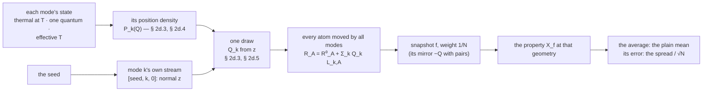

**Computed by** — `v.motion(chain).with_mode(k, chain).sample(N, seed=,
antithetic=)` → the snapshots, each mode's coordinate drawn by its bound
state, `d.draw(N, seed=)` → $Q_{\mathrm{zp}}$ times
`dist.of_state(state).draw(z)` of the normal numbers
`sampling.normal_stream((seed, k, 0), N)`, and every atom moved by all of
them ([`engines/vibration-frames.md`](?doc=engines/vibration-frames.md) § 2,
§ 3.3; § 9.1 `draw(z)`, `normal_stream`).

```python
d = v.mode(7).bind(states.level(1))   # on a run of your own -- engines/vibration-frames.md § 2
d.draw(4, seed=7)                     # Q_zp × dist.Level(1).draw(sampling.normal_stream((7, 7, 0), 4))
snaps = v.motion(states.thermal(temperature_k=300.0)).with_mode(7, states.level(1)).sample(64, seed=7, antithetic=True)
```

### 2d.1 What a frame averages: the position distribution alone

A frame is a frozen geometry, and the property computed there — a level, a
transmission — is a function $X(\mathbf R)$ of the nuclear positions (static
frames, § 7 items 3 and 5). Its quantum average over a nuclear state $\hat\rho$ is

$$
\langle X\rangle
\;=\; \operatorname{Tr}\!\big[\hat\rho\,X(\hat{\mathbf R})\big]
\;=\; \int d\mathbf R\;\langle\mathbf R\rvert\hat\rho\lvert\mathbf R\rangle\;X(\mathbf R)
\;=\; \int d\mathbf R\;P(\mathbf R)\,X(\mathbf R),
$$

because $X(\hat{\mathbf R})$ is diagonal in the position basis,
$X(\hat{\mathbf R})\lvert\mathbf R\rangle = X(\mathbf R)\lvert\mathbf R\rangle$.
**Only the diagonal $P(\mathbf R) = \langle\mathbf R\rvert\hat\rho\lvert\mathbf R\rangle$
enters** — not the momenta, not the coherences between positions — so
geometries drawn from $P$ average $X$ exactly in the limit of many draws,
whatever the state, the nuclei's zero-point motion included (it is in $P$).

**In the mode coordinates.** The free atoms move along the modes,

$$
\mathbf R_A \;=\; \mathbf R_A^0 + \sum_{k} Q_k\,\mathbf L_{k,A},
\qquad
\sum_A m_A\,\mathbf L_{k,A}\cdot\mathbf L_{l,A} = \delta_{kl}
$$

(§ 1, § 2b.2), held atoms with $\mathbf L_{k,A} = \mathbf 0$, the rigid motions
no modes and not drawn. The map $\mathbf Q \mapsto \mathbf R$ is linear with a
constant Jacobian $J$, so

$$
\int d\mathbf R\;P(\mathbf R)\,X(\mathbf R) \;=\; \int d^N Q\;P(\mathbf Q)\,X\big(\mathbf R(\mathbf Q)\big),
\qquad P(\mathbf Q) = \lvert J\rvert\,P\big(\mathbf R(\mathbf Q)\big):
$$

a draw of the coordinates $Q_k$ is a draw of a geometry, and equal weights in
$\mathbf Q$ are equal weights in $\mathbf R$. An imaginary mode — a geometry
that is no minimum along it — has no harmonic state; it is left out, at
$Q = 0$, said (`v.motion`).

**Computed by** — no call: that a frozen geometry's property averages over
the position distribution alone is physics, the static-frame picture (§ 7,
items 3 and 5). The one call named here, `v.motion(...)`, leaves an
imaginary mode out and says so in `motion.said`
([`engines/vibration-frames.md`](?doc=engines/vibration-frames.md) § 3.1).

### 2d.2 The harmonic Hamiltonian is one oscillator per mode

In mass-weighted normal coordinates

$$
\hat H \;=\; \sum_k \hat H_k,
\qquad
\hat H_k \;=\; \tfrac12\hat P_k^2 + \tfrac12\omega_k^2\hat Q_k^2,
\qquad [\hat H_k, \hat H_l] = 0,
$$

with no term joining two modes ([`normal-modes.md`](?doc=science/normal-modes.md)
§ 3): the Hessian is diagonal in these coordinates and the kinetic energy is
$\tfrac12\sum_k\dot Q_k^2$, the transformation being orthogonal with the
masses. Each $\hat H_k$ is an oscillator of its own:

$$
\hat Q_k = Q_{\mathrm{zp},k}\,\big(\hat b_k + \hat b_k^\dagger\big),
\qquad Q_{\mathrm{zp},k}^2 = \frac{\hbar}{2\omega_k},
\qquad \hat H_k\lvert n\rangle_k = \hbar\omega_k\big(n+\tfrac12\big)\lvert n\rangle_k,
$$

$$
\hat b^\dagger\lvert n\rangle = \sqrt{n+1}\,\lvert n+1\rangle,
\qquad
\hat b\lvert n\rangle = \sqrt n\,\lvert n-1\rangle,
$$

and its number states' wavefunctions and position densities, in
$\xi = Q/(\sqrt2\,Q_{\mathrm{zp}})$,

$$
\psi_n(Q) = \frac{H_n(\xi)\,e^{-\xi^2/2}}{\sqrt{2^n\,n!}\;(2\pi Q_{\mathrm{zp}}^2)^{1/4}},
\qquad
\lvert\psi_n(Q)\rvert^2 = \frac{H_n(\xi)^2\,e^{-\xi^2}}{2^n\,n!\,\sqrt{2\pi}\,Q_{\mathrm{zp}}}
$$

(§ 2b.3), $H_n$ the Hermite polynomial. Figure 2d-1 draws the first two,
$n = 0$ and $1$, beside the other states this section uses.


*Figure 2d-1. One mode's position density $P(Q)$ in each state, $Q$ in
units of $Q_{\mathrm{zp}}$: the ground state (thermal at 0 K) and a thermal
state of one mean quantum are Gaussians; one quantum exactly,
$\lvert\psi_1\rvert^2$, vanishes at $Q = 0$; one photon on a warm mode (the
photon-added thermal state, § 2d.4) dips at $Q = 0$, to about half its
peak at $\bar n = 1$.*

**Computed by** — `Oscillator(ν̃)` → one mode's oscillator, its
$Q_{\mathrm{zp}}$ and $\hbar\omega$; `oscillator.level_wavefunction(n, x)`,
`oscillator.level_density(n, x)` → $\psi_n$ and $\lvert\psi_n\rvert^2$ in
$x = Q/Q_{\mathrm{zp}}$, normalised in $x$ (so $\lvert\psi_n(Q)\rvert^2$ is
`level_density(n, Q / Q_zp) / Q_zp`); `oscillator.position_matrix(lo, hi)`
→ $\hat x = \hat Q/Q_{\mathrm{zp}} = \hat b + \hat b^\dagger$ on the levels
`lo` … `hi − 1` ([`engines/vibration-frames.md`](?doc=engines/vibration-frames.md)
§ 9.1 module 1).

```python
>>> import numpy as np
>>> from molbuilder.postprocess import oscillator
>>> np.round(oscillator.position_matrix(0, 3), 4)                         # ⟨n+1| x |n⟩ = √(n+1)
array([[0.    , 1.    , 0.    ],
       [1.    , 0.    , 1.4142],
       [0.    , 1.4142, 0.    ]])
>>> np.round(oscillator.level_density(1, np.array([0.0, 1.0, 2.0])), 4)   # |ψ₁|², zero at rest
array([0.   , 0.242, 0.216])
```

### 2d.3 (1) Every mode thermal: a product of Gaussians

**The state factorizes.** In equilibrium at temperature $T$,
$\hat\rho = e^{-\beta\hat H}/Z$, $\beta = 1/k_BT$. Because the $\hat H_k$
commute, $e^{-\beta\hat H} = \prod_k e^{-\beta\hat H_k}$, and

$$
\hat\rho \;=\; \bigotimes_k \hat\rho_k,
\qquad
\hat\rho_k = \frac{e^{-\beta\hat H_k}}{Z_k} = \sum_{n=0}^\infty p_n\,\lvert n\rangle_k\langle n\rvert,
\qquad
p_n = (1-t)\,t^n = \frac{\bar n^{\,n}}{(\bar n+1)^{n+1}},
$$

$$
t = e^{-\beta\hbar\omega_k},
\qquad
\bar n = \sum_n n\,p_n = \frac{t}{1-t} = \frac{1}{e^{\hbar\omega_k/k_BT}-1} .
$$

The diagonal of a product of operators on different coordinates is the
product of their diagonals:

$$
P(Q_1,\dots,Q_N) \;=\; \prod_k P_k(Q_k),
\qquad
P_k(Q) = \langle Q\rvert\hat\rho_k\lvert Q\rangle = \sum_n p_n\,\lvert\psi_n(Q)\rvert^2 .
$$

**The modes' coordinates are independent random variables** (§ 2c.1).

**Each factor is a Gaussian (Mehler's formula).** Mehler's formula for the
Hermite polynomials ([DLMF] 18.18.28 at $x = y = \xi$, both sides
multiplied by $e^{-\xi^2}$),

$$
\sum_{n=0}^{\infty}\frac{t^n}{2^n\,n!}\,H_n(\xi)^2\,e^{-\xi^2}
\;=\; \frac{1}{\sqrt{1-t^2}}\,\exp\!\Big(-\xi^2\,\frac{1-t}{1+t}\Big),
$$

sums the factor:

$$
P(Q) \;=\; \frac{1-t}{\sqrt{2\pi}\,Q_{\mathrm{zp}}}\,\frac{1}{\sqrt{1-t^2}}
\exp\!\Big(-\xi^2\frac{1-t}{1+t}\Big)
\;=\; \frac{1}{\sqrt{2\pi}\,\sigma}\,\exp\!\Big(-\frac{Q^2}{2\sigma^2}\Big),
$$

$$
\boxed{\;\sigma^2 \;=\; Q_{\mathrm{zp}}^2\,\frac{1+t}{1-t}
\;=\; Q_{\mathrm{zp}}^2\coth\frac{\hbar\omega}{2k_BT}
\;=\; Q_{\mathrm{zp}}^2\,(2\bar n+1)\;}
$$

([Feynman1972] § 2.5). At 0 K, $t = 0$ and $\sigma = Q_{\mathrm{zp}}$, the
ground state; hot, $\coth x \to 1/x$ and $\sigma^2 \to k_BT/\omega^2$, the
classical spread. Figure 2d-2 shows the sum for $\bar n = 1$.


*Figure 2d-2. A thermal mode with $\bar n = 1$: each number state's density
weighted by $p_n = 2^{-(n+1)}$, stacked, adds up to the Gaussian of
$\sigma^2 = 3\,Q_{\mathrm{zp}}^2$ — Mehler's formula, term by term.*

*Held by* `test_thermal_is_mehlers_sum_of_the_number_states` (the
$p_n$-weighted sum of the $\lvert\psi_n\rvert^2$ against the Gaussian),
`test_a_temperatures_quanta_are_bose_and_einsteins`,
`test_hot_the_thermal_spread_is_the_classical_one`.

**Drawing it.** A Gaussian of spread $\sigma$ is drawn exactly as

$$
Q = \sigma\,z, \qquad z \sim \mathcal N(0,1)
\quad\Longrightarrow\quad
\Pr(Q \le q) = \Phi(q/\sigma)
$$

(`dist.Gaussian(σ).draw(z)`). Each mode's normal numbers come from its own random stream
(§ 2d.6), so the draws of different modes are independent: the product above,
drawn factor by factor. *Held by* `test_each_states_draws_follow_its_own_distribution`
(a Kolmogorov test of 4000 draws against the state's `cdf`) and
`test_snapshots_of_a_thermal_motion_have_the_sciences_covariance` (40 000
snapshots: each mode's variance $\sigma_k^2$, every pair uncorrelated, each
within five standard errors).

**What every atom does.** With independent coordinates,
$\langle Q_k\rangle = 0$ and $\langle Q_kQ_l\rangle = \delta_{kl}\,\sigma_k^2$, so
each atom's displacement $\mathbf u_A = \sum_k Q_k\mathbf L_{k,A}$ has mean zero
and covariance

$$
\big\langle\mathbf u_A\,\mathbf u_B^{\mathsf T}\big\rangle
\;=\; \sum_{k,l}\langle Q_kQ_l\rangle\,\mathbf L_{k,A}\mathbf L_{l,B}^{\mathsf T}
\;=\; \sum_k \sigma_k^2\,\mathbf L_{k,A}\mathbf L_{k,B}^{\mathsf T},
$$

the same covariance the full harmonic thermal state gives the atoms; and,
the $Q_k$ jointly Gaussian, $\mathbf u$ is jointly Gaussian too — every atom's
place a 3-dimensional Gaussian cloud around $\mathbf R_A^0$, its axes and
widths those of $\sum_k\sigma_k^2\,\mathbf L_{k,A}\mathbf L_{k,A}^{\mathsf T}$
— along the modes' rows where those are orthogonal on that atom (Figure 2d-6,
left). *Held by* the covariance test above, on one atom's own block.

**Computed by** — `dist.of_state(chain.on(Oscillator(ν̃)))` → a thermal
state's distribution, the bell curve `dist.Gaussian(σ)`,
$\sigma^2 = 2\bar n + 1$ in $x = Q/Q_{\mathrm{zp}}$; `dist.Gaussian(σ).draw(z)` → $\sigma z$;
`dist.LevelList(p)` → the same density summed over the number states; for a
run, `snaps.atom_moves_ang` → each atom's move in every snapshot, whose
covariance is the sum above
([`engines/vibration-frames.md`](?doc=engines/vibration-frames.md) § 9.1
`of_state(state)`, the families; § 3.3). Mehler's sum, at one mean quantum:

```python
>>> import numpy as np
>>> from molbuilder.postprocess import Oscillator, states, dist
>>> warm = states.thermal(mean_quanta=1.0).on(Oscillator(200.0))
>>> g = dist.of_state(warm)
>>> type(g).__name__, round(g.sigma ** 2, 9)                            # σ² = 2n̄ + 1
('Gaussian', 3.0)
>>> xs = np.array([0.0, 1.0, 2.5])
>>> np.allclose(dist.LevelList(warm.populations).pdf(xs), g.pdf(xs))    # the number states' sum
True
>>> np.round(g.draw(np.array([0.31, -1.2])), 4)                         # σ z
array([ 0.5369, -2.0785])
```

### 2d.4 (2) One mode a photon excited: which state it is in

**A photon changes one mode, one rung.** Light couples to the nuclei through
the dipole (infrared) or the polarizability (Raman), each expanded in the
displacement:

$$
\hat H_{\mathrm{int}}(t) = -\hat{\boldsymbol\mu}\cdot\mathbf E(t),
\qquad
\boldsymbol\mu(\mathbf Q) = \boldsymbol\mu_0 + \sum_k\frac{\partial\boldsymbol\mu}{\partial Q_k}\,Q_k + O(Q^2)
$$

([`vibrational-optical-response.md`](?doc=science/vibrational-optical-response.md)
§ 2, § 3; the Raman coupling likewise, through
$\partial\alpha/\partial Q_k$). The term that moves mode $j$ is linear in
$\hat Q_j = Q_{\mathrm{zp},j}(\hat b_j + \hat b_j^\dagger)$ and the identity on
every other mode, so its only matrix elements change $n_j$ by one:

$$
\langle n+1\rvert\hat Q_j\lvert n\rangle = Q_{\mathrm{zp}}\sqrt{n+1},
\qquad
\langle n-1\rvert\hat Q_j\lvert n\rangle = Q_{\mathrm{zp}}\sqrt n .
$$

One absorbed infrared photon at the mode's frequency, or one Stokes-scattered
photon, takes the $\hat b_j^\dagger$ part — $n_j \to n_j+1$ — and leaves every
other mode as it was (§ 2a.1). After one such event, heralded (the Stokes
photon detected, the absorbed photon or the inelastic tunnelling electron
counted),

$$
\hat\rho' \;=\; \frac{\hat b_j^\dagger\,\hat\rho_j\,\hat b_j}{\operatorname{Tr}\big[\hat b_j^\dagger\hat\rho_j\hat b_j\big]}
\;\otimes\;\bigotimes_{k\neq j}\hat\rho_k,
\qquad
P'(\mathbf Q) \;=\; P'_j(Q_j)\prod_{k\neq j}P_k(Q_k):
$$

**still a product** — the excited mode's factor changes and the others stay
thermal — **where mode $j$ is the only mode within the photon's energy
resolution and the lines' widths**. Modes within it — two lines that
overlap, or a degenerate pair — share the quantum: the event raises their
combination $c_a\hat b_a^\dagger + c_b\hat b_b^\dagger$, each
$c_k \propto \mathbf E\cdot(\partial\boldsymbol\mu/\partial Q_k)\,Q_{\mathrm{zp},k}$
(through $\partial\alpha/\partial Q_k$ for Raman), $\lvert c_a\rvert^2 + \lvert c_b\rvert^2 = 1$
— a degenerate pair's combination set by the field's polarisation — and
leaves their coordinates correlated: on cold modes
$\langle Q_aQ_b\rangle = 2\,\mathrm{Re}\big(c_ac_b^*e^{-i(\omega_a-\omega_b)t}\big)\,Q_{\mathrm{zp},a}Q_{\mathrm{zp},b}$,
beating at $\omega_a-\omega_b$ and lost as the two dephase — which can be well
before the energy lifetime — leaving a mixture of either mode excited,
uncorrelated and still not a product. Either way a state of the pair, which
no state of one mode gives. A snapshot draws mode $j$ from $P'_j$ and every other mode as in
§ 2d.3. Which $P'_j$ depends on the experiment:

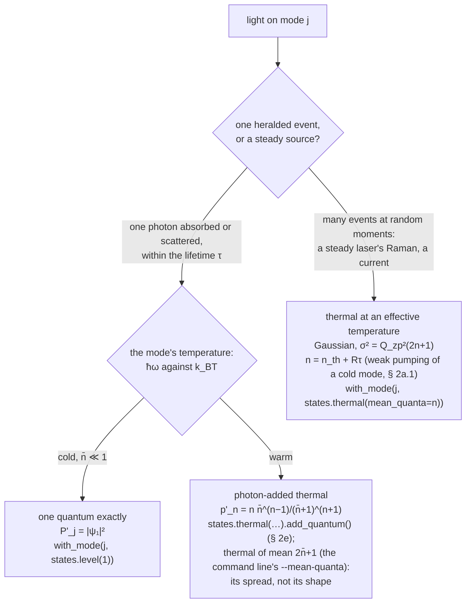

**On a cold mode** ($\hbar\omega_j \gg k_BT$, so $\hat\rho_j = \lvert0\rangle\langle0\rvert$):
$\hat b_j^\dagger\lvert0\rangle = \lvert1\rangle$, and

$$
P'_j(Q) \;=\; \lvert\psi_1(Q)\rvert^2 \;=\; \frac{Q^2}{\sqrt{2\pi}\,Q_{\mathrm{zp}}^3}\;e^{-Q^2/2Q_{\mathrm{zp}}^2},
\qquad
\langle Q^2\rangle = 3\,Q_{\mathrm{zp}}^2,
\qquad
\langle Q^4\rangle = 15\,Q_{\mathrm{zp}}^4 —
$$

the **one-quantum state**, two lobes with a zero at $Q = 0$
(`with_mode(j, states.level(1))` in a thermal motion). **It holds for times below
the mode's energy lifetime $\tau$**: the mode then relaxes toward its thermal
state, so the set describes the moment after the event, not a steady average.

**On a warm mode** ($\bar n_j$ not small), the same operator gives the
*photon-added thermal state*. Its populations, from
$\hat b^\dagger\lvert n-1\rangle = \sqrt n\,\lvert n\rangle$,

$$
p'_n \;=\; \frac{n\,p_{n-1}}{\sum_m m\,p_{m-1}}
\;=\; \frac{n\,\bar n^{\,n-1}}{(\bar n+1)^{n+1}},
\qquad
\langle n\rangle' = 2\bar n+1,
\qquad
p'_1 = \frac{1}{(\bar n+1)^2}
$$

(the normalisation $\sum_{n\ge1}n\,t^{n-1} = (1-t)^{-2}$, $t = \bar n/(\bar n+1)$
of § 2d.3; § 2b.3). Its density $\sum_n p'_n\lvert\psi_n\rvert^2$ (Figure 2d-1,
dash-dot) has a closed form. The thermal kernel is Mehler's,
$\langle\xi\rvert\hat\rho_{\mathrm{th}}\lvert\xi'\rangle \propto e^{-A(\xi^2+\xi'^2)/2 + B\xi\xi'}$
with $A = (1+t^2)/(1-t^2)$ and $B = 2t/(1-t^2)$ ([DLMF] 18.18.28 at $x = \xi$,
$y = \xi'$, times $e^{-(\xi^2+\xi'^2)/2}$); $\hat b^\dagger = (\xi - \partial_\xi)/\sqrt2$
acting from both sides, then $\xi' = \xi$, gives $\big[B + (1+A-B)^2\xi^2\big]$
times the thermal Gaussian — in $x = Q/Q_{\mathrm{zp}}$, normalised:

$$
P'_j(Q) \;=\; \Big[\frac{\bar n}{2\bar n+1} + \frac{(\bar n+1)\,x^2}{(2\bar n+1)^2}\Big]
\frac{e^{-x^2/2(2\bar n+1)}}{\sqrt{2\pi(2\bar n+1)}\;Q_{\mathrm{zp}}}
$$

— a mix of the thermal Gaussian of $\sigma^2 = (2\bar n+1)\,Q_{\mathrm{zp}}^2$,
weight $\bar n/(2\bar n+1)$, and the one-quantum shape stretched to that
width, $(Q^2/\sigma^2)$ times the same Gaussian, weight $(\bar n+1)/(2\bar n+1)$
(it agrees with the sum over number states to rounding at $\bar n$ = 0, 0.1, 1
and 3.69). Every moment follows from the mix: at $\bar n = 0$ the one-quantum
density, and a dip at $Q = 0$ to about half its peak at $\bar n = 1$. Quantum optics names a light mode's
$\hat b^\dagger\hat\rho_{\mathrm{th}}\hat b$ so [Zavatta2007]; here the quantum
added is the vibration's. **A mode bound to it holds it**:
`m.bind(states.thermal(temperature_k=T).add_quantum())` (§ 2e;
[`engines/vibration-frames.md`](?doc=engines/vibration-frames.md) § 2), its distribution the closed form
above; the command line's choices stay three — thermal at a temperature,
thermal of a mean, $n$ quanta — and the spectrum tab's dialog two, thermal
and $n$ quanta, until a person asks for another ([`engines/vibration-frames.md`](?doc=engines/vibration-frames.md) § 6). The thermal
state of the same mean $2\bar n+1$ has its spread — $\langle Q^2\rangle = Q_{\mathrm{zp}}^2(2\langle n\rangle+1)$ in every
state (§ 2a) — and, both even, the right cubic moment, but not the right
shape: its $\langle Q^4\rangle = 3(4\bar n+3)^2Q_{\mathrm{zp}}^4$ against the
state's $3(12\bar n^2+16\bar n+5)\,Q_{\mathrm{zp}}^4$, a third to four fifths
too large (hot to cold). It is right for a response up to cubic in $Q_j$, not
beyond.

**Many photons, at random moments** — a steady laser's spontaneous Raman, a
current: each event moves the mode one rung, the surroundings relax it, and
the steady populations fall by one factor per rung, a thermal state at an
effective temperature (§ 2a.1): the Gaussian of § 2d.3 with
$\sigma^2 = Q_{\mathrm{zp}}^2(2n+1)$, $n = n_{\mathrm{th}} + R\tau$ for weak
pumping of a cold mode, or for equal Stokes and anti-Stokes rate constants
(§ 2a.1 gives the general form). **A coherent push** — a force in step
with the mode, not photon by photon — leaves the coherent state, which no
process on molbuilder's road makes (§ 2a.2). **The harmonic ladder**: light
at one frequency climbs every rung only because the harmonic gaps are
equal; a real mode's shrink as it climbs (§ 2a.2), and many quanta are where the harmonic picture fails first (§ 7,
item 1) — the command line and the spectrum tab say so beyond 1 eV in a
mode, far up its ladder: a mark, not a bound, which a torsion can leave
well below.

**Computed by** — a cold mode's one quantum,
`motion.with_mode(j, states.level(1))`; a warm mode's photon,
`m.bind(states.thermal(temperature_k=T).add_quantum())`, its distribution
`dist.QuantumAdded(n̄)` in $x = Q/Q_{\mathrm{zp}}$; steady random pumping,
`states.thermal(mean_quanta=n)`
([`engines/vibration-frames.md`](?doc=engines/vibration-frames.md) § 2,
§ 3.1; § 9.1 the families). A quantum two modes share: no call — a joint
state, built when a case needs it (the user's choice of 2026-11-25,
[`archive/2026-11-26-vibration-frames-steps-design.md`](?doc=archive/2026-11-26-vibration-frames-steps-design.md)
decision 2); a degenerate pair by hand, § 2c.2. One photon on $\bar n = 1$
against the thermal state of the same mean 3:

```python
>>> from molbuilder.postprocess import Oscillator, states, dist
>>> osc = Oscillator(200.0)
>>> photon = dist.of_state(states.thermal(mean_quanta=1.0).add_quantum().on(osc))
>>> stand_in = dist.of_state(states.thermal(mean_quanta=3.0).on(osc))
>>> type(photon).__name__, [round(d.moment(2), 6) for d in (photon, stand_in)]      # the same spread
('QuantumAdded', [7.0, 7.0])
>>> [round(d.moment(4), 6) for d in (photon, stand_in)]                              # not the same shape
[99.0, 147.0]
```

### 2d.5 Drawing the one-quantum state — and any $n$

**The inverse transform.** Let $F_n(q) = \int_{-\infty}^q\lvert\psi_n(Q)\rvert^2\,dQ$,
the distribution function of $Q$.
If $z\sim\mathcal N(0,1)$, then $u = \Phi(z)$ is uniform on $(0,1)$, and

$$
Q = F_n^{-1}\big(\Phi(z)\big)
\quad\Longrightarrow\quad
\Pr(Q\le q) = \Pr\big(\Phi(z)\le F_n(q)\big) = F_n(q):
$$

$Q$ has exactly the one-quantum distribution (for $n = 1$) — one normal
number per draw, as for every state, so a number state draws from the same
stream as a thermal mode would, and a set and its baseline share every other
mode's numbers (§ 2c.4). For one quantum, $F_1$ is closed:

$$
F_1(Q) \;=\; \int_{-\infty}^{x} s^2\,\phi(s)\,ds \;=\; \Phi(x) - x\,\phi(x),
\qquad x = \frac{Q}{Q_{\mathrm{zp}}},
\qquad \phi(s) = \frac{e^{-s^2/2}}{\sqrt{2\pi}}
$$

(integrating by parts, $\int s\cdot s\phi\,ds = -s\phi + \int\phi\,ds$).


*Figure 2d-3. One draw of the one-quantum state: a normal number $z$ gives a
uniform $u = \Phi(z)$ (left), and $Q = F_1^{-1}(u)$ (right) — three of the
worked example's four normal numbers (§ 2d.7). $F_1$ is flat at $Q = 0$, where
$\lvert\psi_1\rvert^2$ vanishes: $z = -0.05$ lands at $Q = -0.55\,Q_{\mathrm{zp}}$,
not near zero.*

**The tables' variable.** A level's table works in
$\xi = Q/(\sqrt2\,Q_{\mathrm{zp}})$, with the forms normalised in it:

$$
\tilde\psi_n(\xi) = h_n(\xi)\,e^{-\xi^2/2} = \big(\sqrt2\,Q_{\mathrm{zp}}\big)^{1/2}\,\psi_n(Q),
\qquad
\tilde F_n(\xi) = \int_{-\infty}^{\xi}\tilde\psi_n^2\,d\xi' = F_n\big(\sqrt2\,Q_{\mathrm{zp}}\,\xi\big),
$$

$h_n$ the normalised Hermite polynomials below. The calls answer in the
oscillator's unit, $x = Q/Q_{\mathrm{zp}} = \sqrt2\,\xi$: `dist.Level(n).cdf(x)`
is $\tilde F_n(x/\sqrt2)$, and `dist.Level(n).quantile(p)` and `.draw(z)`
give $x = \sqrt2\,\xi$ — a mode's `d.draw` then $Q = Q_{\mathrm{zp}}\,x$.

**Mirror-exact.** $\tilde\psi_n^2$ is even, so

$$
\tilde F_n(-\xi) = 1 - \tilde F_n(\xi)
\quad\Longrightarrow\quad
\tilde F_n^{-1}\big(\Phi(-z)\big) = -\tilde F_n^{-1}\big(\Phi(z)\big).
$$

Every distribution's `draw` — `dist.Level(n).draw(z)` among them — takes the
lower tail always and restores the sign:

$$
\xi_- = \tilde F_n^{-1}\!\Big(\tfrac12\operatorname{erfc}\big(\lvert z\rvert/\sqrt2\big)\Big)\le 0,
\qquad
\xi = -\operatorname{sign}(z)\,\xi_-,
\qquad
Q = \sqrt2\,Q_{\mathrm{zp}}\,\xi :
$$

$-z$ gives exactly $-Q$, a property of the draw; and the tail probability
$\tfrac12\operatorname{erfc}(\lvert z\rvert/\sqrt2) = \Phi(-\lvert z\rvert)$
keeps its relative digits where $1-\Phi(z)$ would lose them. A mirrored pair
is exact by construction: the sampler negates every drawn coordinate
(`motion.sample(N, seed=, antithetic=True)`, § 5.5, Figure 2d-5).

**The distribution function, tabulated** — `dist.Level(n).cdf`, its table
built the first time `cdf`, `quantile` or `draw` asks it. $\tilde F_n$ is
integrated once per $n$ over

$$
\xi \in [-\xi_{\max},\,\xi_{\max}],
\qquad
\xi_{\max} = \sqrt{2n+1} + 9,
$$

nine units past the classical turning point $\sqrt{2n+1}$, where the density
has fallen below what double precision holds, in $2(n+20)$ panels — the
neighbouring zeros of $\tilde\psi_n^2$, $n$ of them within $\pm\sqrt{2n+1}$,
at least a panel's width apart (1.14 panels at the least, at $n = 70$, over
every $n$ from 2 to 1000) —
each by a 40-point Gauss–Legendre rule, exact for the panel's smooth
integrand to rounding. $\tilde\psi_n$ comes from the stable three-term
recurrence of the normalised Hermite polynomials $h_n$ (the Hermite
functions $h_n e^{-\xi^2/2}$),

$$
h_0 = \pi^{-1/4},
\qquad
h_{k+1} = \sqrt{\tfrac{2}{k+1}}\;\xi\,h_k - \sqrt{\tfrac{k}{k+1}}\;h_{k-1},
\qquad
\tilde\psi_n(\xi) = h_n\,e^{-\xi^2/2},
$$

rescaled whenever a value passes $10^{100}$ and the Gaussian applied once at
the end, so no $n$ overflows or loses the weight near the turning points
(the recurrence `oscillator.level_wavefunction` runs). The quantile is found from the left, where the running
integral keeps its digits: from the table's panel, a search kept inside a
bracket that holds the answer. Each pass asks first how far the point
misses, $\tilde F_n(\xi) - p$: a point that misses by nothing is the answer,
and is kept. Otherwise the miss's sign narrows the bracket, and the next
point is Newton's,

$$
\xi \;\leftarrow\; \xi - \frac{\tilde F_n(\xi) - p}{\tilde\psi_n(\xi)^2},
$$

where that stays inside the bracket and is at most half the last step, and
the bracket's middle otherwise — so a flat start, where the density is 0,
halves the bracket, and no point bounces between two humps across a flat
middle. A point stops when its step reaches the last digits a double can
tell (`dist.Level(n).quantile(p)` — one search for every distribution
but the bell curve, whose quantile is closed, $\sigma\Phi^{-1}(p)$; its
numbers § 2e.6's).


*Figure 2d-4. 40 000 of molbuilder's own draws (a state's distribution's `draw`, `dist.of_state`) of a
thermal state of one mean quantum and of one quantum exactly, against the
densities they must follow — the Gaussian and $\lvert\psi_1\rvert^2$.*

*Held by* `test_n_quanta_exactly_is_the_oscillators_own_density` (each
$\lvert\psi_n\rvert^2$ integrates to 1; $\langle Q^2\rangle = (2n+1)Q_{\mathrm{zp}}^2$
and $\langle Q^4\rangle = 3(2n^2+2n+1)Q_{\mathrm{zp}}^4$; $n$ zeros; the weight
beyond the turning points, 15.7 %, 11.2 %, 9.5 % for $n$ = 0, 1, 2) and
`test_each_states_draws_follow_its_own_distribution` (a Kolmogorov test of
4000 draws of three quanta, and $F_n(Q) = \Phi(z)$ for every draw to $10^{-9}$,
$z$ the mode's own stream's).

**Computed by** — `dist.Level(n).cdf(x)` → $F_n$ at $x = Q/Q_{\mathrm{zp}}$;
`.quantile(p)` → the $x$ where $F_n$ reaches $p$; `.draw(z)` →
$x = F_n^{-1}(\Phi(z))$, one per normal number, $-z$ giving $-x$ exactly;
for a mode of a run, `d.draw(size, seed=)` → its coordinates
$Q = Q_{\mathrm{zp}}\,x$ from its own stream
([`engines/vibration-frames.md`](?doc=engines/vibration-frames.md) § 9.1
`quantile(p)` and `draw(z)`; § 2). Figure 2d-3's draw, and $F_1$'s closed
form:

```python
>>> import numpy as np
>>> from statistics import NormalDist
>>> from molbuilder.postprocess import dist
>>> one = dist.Level(1)
>>> x = one.draw(np.array([-0.05, 0.05, 1.2]))
>>> np.round(x, 4)                                            # z = −0.05 lands at −0.55, not near zero
array([-0.5473,  0.5473,  2.0754])
>>> t, N = float(x[2]), NormalDist()
>>> round(float(one.cdf(t)), 6), round(N.cdf(t) - t * N.pdf(t), 6), round(N.cdf(1.2), 6)   # F₁(x) = Φ(x) − x φ(x) = Φ(z)
(0.88493, 0.88493, 0.88493)
```

### 2d.6 The random streams: independent, reproducible, extendable

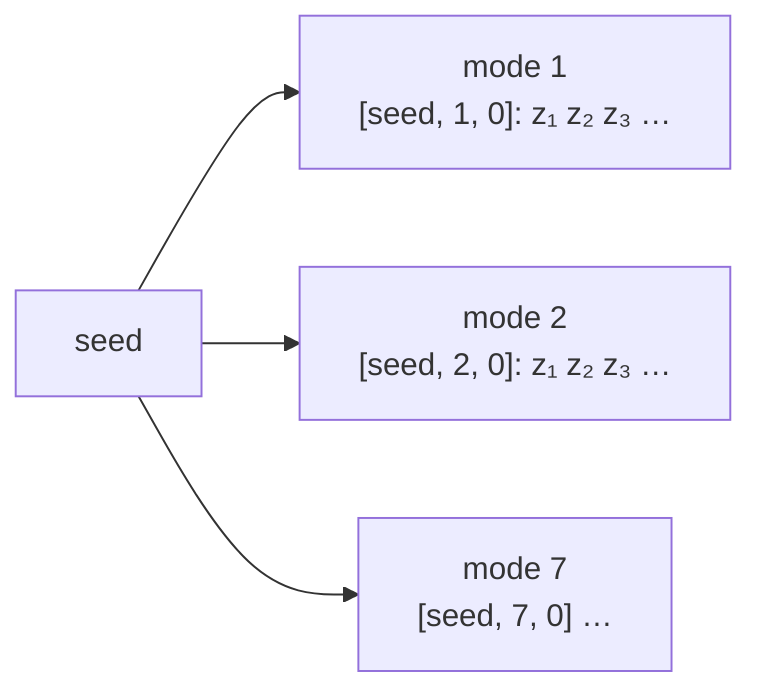

Each mode $k$ draws its normal numbers from `numpy.random.default_rng([seed,
k, 0])` — numpy's PCG64 generator seeded through `SeedSequence`, which hashes
the whole key into the generator's state so that different keys give streams
with no detectable correlation (`sampling.normal_stream`) — keys that differ
only by trailing zeros are one key, numpy padding a seed with zeros, so
`[seed, k]` is mode $k$'s own stream. **Keyed by the
mode's number**, not its place: a set of some modes, or one with a mode set
apart, draws every other mode exactly as before, which is what lets a set
with one mode excited and its thermal baseline differ by that mode's draws
alone (§ 2c.4). **Drawn in one block from the first**, so snapshots
$s \dots s+N-1$ are the same however many were asked: a set continues from
its last snapshot, and its continuation (`start=`) is a set of its own.
**Reproducible on the same
numpy**: one seed gives the same numbers there, and a set records numpy's
version in its `rng` row, beside its `seed` and `start` rows, from which
each mode's key `[seed, mode, 0]` follows
([`engines/vibration-frames.md`](?doc=engines/vibration-frames.md) § 5).
*Held by* `test_a_draw_continues_its_seed_from_the_modes_own_stream` and
`test_a_seed_holds_a_set_and_its_continuation`.

**Computed by** — `sampling.normal_stream((seed, k, 0), size, start=)` →
normal numbers `start` … `start + size − 1` of mode $k$'s stream;
`motion.sample(N, seed=, antithetic=, start=)` → snapshots `start` … of the
seed's sequence, a set of their own; the set's `seed`, `start` and `rng`
rows say which ([`engines/vibration-frames.md`](?doc=engines/vibration-frames.md)
§ 9.1 `normal_stream`; § 3.3, § 5.1).

```python
>>> import numpy as np
>>> from molbuilder.postprocess import sampling
>>> first = sampling.normal_stream((20261123, 7, 0), 6)                              # mode 7's stream
>>> np.array_equal(first[4:], sampling.normal_stream((20261123, 7, 0), 2, start=4))   # continued: the same numbers
True
>>> np.array_equal(sampling.normal_stream((20261123, 7), 6), first)                   # trailing zeros: one key
True
```

### 2d.7 One snapshot, assembled — and what the set's average is

For snapshot $f$ (`motion.sample`):

1. **Each mode's coordinate**, from its own state and stream:

$$
Q_{f,k} \;=\;
\begin{cases}
\sigma_k\,z_{f,k} & \text{thermal (or classical),}\\[2pt]
\sqrt2\,Q_{\mathrm{zp},k}\,\big(-\operatorname{sign} z_{f,k}\big)\,\tilde F_n^{-1}\!\big(\Phi(-\lvert z_{f,k}\rvert)\big) & n\ \text{quanta,}
\end{cases}
$$

   $\tilde F_n$ the distribution function in $\xi$ (§ 2d.5); a list over the
   levels, the same inverse transform of its own $F$ (§ 2e.3).

2. **With mirrored pairs** (the person's choice), each drawn snapshot is
   followed by its mirror, every $Q_{f,k}$ negated: every state's distribution
   is even in $Q$, so the mirror is a draw from the same distribution
   (Figure 2d-5).
3. **Every atom moved by all modes at once**,
   $\mathbf R_{f,A} = \mathbf R_A^0 + \sum_k Q_{f,k}\,\mathbf L_{k,A}$, in the
   result's atom order, held atoms still — the rule `v.displaced`
   (`test_a_vibrations_geometry_and_its_frequencies_scaled`) and held atoms
   in a mode's own frames
   (`test_a_held_atom_stays_still_and_adds_nothing_to_its_elements_share`)
   and in snapshots (`test_snapshots_keep_a_held_atom_still`).
4. **Frame 0 the relaxed geometry at weight 0, each snapshot at $1/N$.** The
   probabilities are in where the snapshots were drawn, so the average is the
   plain mean, an unbiased estimate of § 2d.1's integral, its error the spread
   of the results:

$$
\bar X_N = \frac1N\sum_{f=1}^N X_f,
\qquad
\mathbb E\big[\bar X_N\big] = \langle X\rangle,
\qquad
\operatorname{Var}\big[\bar X_N\big] = \frac{\operatorname{Var}X}{N}
\;\approx\; \frac{s_X^2}{N} .
$$

   With pairs, the $N/2$ pair means $\tfrac12(X_f + X_f^{-})$ are the
   independent draws, and

$$
\operatorname{Var}\Big[\tfrac12\big(X + X^{-}\big)\Big]
= \tfrac12\big(\operatorname{Var}X + \operatorname{Cov}(X, X^{-})\big),
$$

   which is zero for the response's odd part — $X^{-} = -X$ there — so the
   error is the spread of the pair means over $\sqrt{N/2}$ (§ 5.5,
   `snaps.standard_error`; `test_mirrored_pairs_cancel_the_odd_part_exactly`).
5. **Written with what made it**: each frame's coordinate along each mode,
   each mode's state (`info.sampling`), the seed and the first snapshot (the
   `seed` and `start` rows, [`engines/vibration-frames.md`](?doc=engines/vibration-frames.md) § 5), so
   a set read back draws the same frames again on the same numpy.


*Figure 2d-5. Two mirrored pairs of one quantum: each $z$ and $-z$ give $Q$
and exactly $-Q$, draws from the same even density.*

**Worked: a bend one photon left with one quantum, beside a thermal
stretch.** The bend at 1600 cm⁻¹, cold at 300 K, just after one absorbed
photon — within its energy lifetime (§ 2d.4):

$$
Q_{\mathrm{zp},1} = \sqrt{\frac{16.8576}{1600}} = 0.1026\ \mathrm{amu^{1/2}\,Å},
\qquad
F_1(Q) = \Phi(x) - x\,\phi(x),\quad x = Q/Q_{\mathrm{zp},1}.
$$

The stretch at 3700 cm⁻¹, thermal at 300 K: $\bar n = 2\times10^{-8}$, so
$\sigma_2 = Q_{\mathrm{zp},2} = 0.0675$. The same normal numbers as § 2c.3's
table, and an atom whose rows are $\mathbf L_1 = (0, 0, 0.30)$ and
$\mathbf L_2 = (0.50, 0, 0)$ amu$^{-1/2}$:

| frame | $z_1$ | $\Phi(z_1)$ | $Q_1 = F_1^{-1}(\Phi(z_1))$ | $z_2$ | $Q_2 = \sigma_2 z_2$ | the atom's move $Q_1\mathbf L_1 + Q_2\mathbf L_2$ (Å) |
|---|---|---|---|---|---|---|
| 1 | 0.31 | 0.6217 | 0.1117 | −0.75 | −0.0506 | (−0.0253, 0, 0.0335) |
| 2 | −1.20 | 0.1151 | −0.2130 | 0.40 | 0.0270 | (0.0135, 0, −0.0639) |
| 3 | 0.85 | 0.8023 | 0.1771 | 1.10 | 0.0742 | (0.0371, 0, 0.0531) |
| 4 | −0.05 | 0.4801 | −0.0562 | −0.20 | −0.0135 | (−0.0067, 0, −0.0169) |

Frame 4 shows the one-quantum shape: a normal number near zero gives
$\lvert Q_1\rvert = 0.55\,Q_{\mathrm{zp}}$, not a coordinate near zero —
$\lvert\psi_1\rvert^2$ vanishes at $Q = 0$, so $F_1$ is flat there and its
draws avoid the middle, where a Gaussian's would cluster. Over many
snapshots the atom's place shows it (Figure 2d-6).


*Figure 2d-6. The worked example's atom over 6000 snapshots. Left, every mode
thermal at 300 K: a Gaussian cloud, its widths the two modes' (§ 2d.3).
Right, the bend after one photon: the cloud splits along the bend's row into
the two lobes of $\lvert\psi_1\rvert^2$, the stretch's width unchanged — the
photon changes one mode's factor alone (§ 2d.4).*

**Computed by** — `motion.sample(N, seed=, antithetic=)` → steps 1–4, the
snapshots; `v.displaced({k: Q_k, …})` → one geometry from coordinates
given, step 3's rule; `snaps.standard_error(values)` → step 4's average and
its error; `write_frame_set(path, snaps)` → step 5, the set with what made
it; `read_frame_set(path)` → the set back, its motion bound again
([`engines/vibration-frames.md`](?doc=engines/vibration-frames.md) § 3.2,
§ 3.3, § 5, § 7).

```python
snaps = v.motion(states.thermal(temperature_k=300.0)).with_mode(7, states.level(1)).sample(64, seed=1, antithetic=True)   # on a run of your own -- engines/vibration-frames.md § 3.3
written = write_frame_set(topic_dir("P", "structure") / "m7-one-quantum-300K-64.xyz", snaps)
read_frame_set(written.path).standard_error(values)      # values: the calculation's, one per frame, frame 0 first
```

The worked table's coordinates, from its normal numbers and the generic
tools:

```python
>>> import numpy as np
>>> from molbuilder.postprocess import Oscillator, states, dist
>>> bend, stretch = Oscillator(1600.0), Oscillator(3700.0)
>>> q1 = dist.Level(1).scaled(bend.zero_point_amplitude_amu12_ang)
>>> q2 = dist.of_state(states.thermal(temperature_k=300.0).on(stretch)).scaled(stretch.zero_point_amplitude_amu12_ang)
>>> np.round(q1.draw(np.array([0.31, -1.20, 0.85, -0.05])), 4)        # Q₁, one quantum
array([ 0.1117, -0.213 ,  0.1771, -0.0562])
>>> np.round(q2.draw(np.array([-0.75, 0.40, 1.10, -0.20])), 4)        # Q₂, thermal
array([-0.0506,  0.027 ,  0.0742, -0.0135])
```

### 2d.8 What it holds, and what it assumes

| claim | why it holds | where | held by |
|---|---|---|---|
| a frame's property averages over the position distribution alone | $X(\hat{\mathbf R})$ is diagonal in position | § 2d.1 | — (the static-frame assumption, § 7 items 3 and 5) |
| the modes are independent, a quantum two modes share aside (§ 2c.2) | the harmonic $\hat H$ separates; the thermal state, and one photon's change of one mode alone within its resolution, keep the product | § 2d.2–§ 2d.4 | the covariance test |
| a thermal mode's coordinate is Gaussian, $\sigma^2 = Q_{\mathrm{zp}}^2\coth(\hbar\omega/2k_BT)$ | Mehler's formula | § 2d.3 | the Mehler, Bose–Einstein and hot-limit tests |
| one photon on a cold mode leaves $\lvert\psi_1\rvert^2$, the others thermal | the coupling is linear in $\hat Q_j$ and the identity on the other modes | § 2d.4 | the number state's density test |
| a draw has the state's distribution | $\sigma z$ for a Gaussian; the inverse transform for $n$ quanta | § 2d.3, § 2d.5, § 2d.7 | the Kolmogorov test, each state |
| a mirrored pair is two draws of the same distribution | every state's density is even, and the sampler negates every drawn coordinate | § 2d.5, § 2d.7 | the mirrored-pairs test (a thermal motion) |
| the snapshots are independent, and reproducible on the same numpy | keyed, block-drawn streams | § 2d.6 | the stream tests |
| the average is unbiased, its error the spread over $\sqrt N$ | Monte Carlo with draws from $P$ | § 2d.7 | the error tests of § 5.5 |

It assumes harmonic modes — the ladder's equal gaps among them (§ 2a.2,
§ 7 item 1) — and an electron fast against the vibration (§ 7 item 3),
which every set says in its `assumptions` row; and static frames (§ 7
item 5), which the calculation over the frames says. For a mode
a photon excited (§ 2d.4) the conditions are the person's to judge, and no
set states them: the one-quantum state only while the mode has not relaxed;
the photon resonant with that mode alone within its resolution and the
lines' widths; for a warm mode, the photon-added thermal state from the
generic tools (§ 2e) — the thermal state of the same mean, the command
line's `--mean-quanta` (the spectrum tab's dialog offers thermal at a
temperature and $n$ quanta), is right only up to the cubic term.

**Computed by** — no call: the claims are § 2d.1–§ 2d.7's, each section's
calls named at its end; what a set assumes it states in its `assumptions`
row, and what any calculation over frames assumes it states beside its
average (§ 7).

## 2e. A mode's state, built in steps — the theory the toolkit's tools follow *(decided 2026-11-25; built in 2.84.0 and 2.85.0)*

*(The user, 2026-11-25: "this should not be a single api call just to get
the result, but rather a carefully separated scientifically correct steps
that each supported by a api and the correct combination give us all the
different cases"; "we are not exposing api for special case direct results,
but rather this is an effort to give support to a group of
problem/category of problem such as distribution calculation etc.")* § 2a,
§ 2b and § 2d treat each state of a mode as a case of its own. This section
describes every state **one way**, and makes each from **a few physical
steps**, so that every case — the thermal state and $n$ quanta, and those
no single start makes, such as one photon on a warm mode (§ 2d.4) — is a
short chain of the same steps. The tools that carry the steps are
[`engines/vibration-frames.md`](?doc=engines/vibration-frames.md) § 9 — one
oscillator, its state built in steps, one coordinate's distribution, random
streams — and a chain bound to a mode gives its frames and snapshots (that
chapter's § 2); the cases are written as chains there (§ 2's table), and
are in the example notebook (§ 6.1 there), which a person copies and
changes. The numbers the
tools fix — where a list is cut, when two numbers are one — are § 2e.6's.

> **In short.** As far as a set of frames can see, one mode's state is a
> list of probabilities $p_0, p_1, p_2, \dots$ — the chance of finding
> 0, 1, 2, … quanta in it. A few physical steps make every list:
> - **a start** — the ground state, $n$ quanta exactly, or the mode in
>   equilibrium at a temperature (thermal);
> - single **events** — a quantum added (a photon absorbed, a Stokes photon
>   detected, an electron losing $\hbar\omega$), a quantum removed (an
>   anti-Stokes photon detected, an electron gaining $\hbar\omega$).
>
> Where the atoms are follows from the list by one formula,
> $P(Q) = \sum_n p_n\lvert\psi_n(Q)\rvert^2$, and the frames and snapshots
> follow from $P(Q)$ as § 2b–§ 2d describe. *Example:* a 200 cm⁻¹ mode at
> 300 K holds 0.62 quanta on average, $p_n = 0.617, 0.236, 0.091, 0.035,
> \dots$; one absorbed photon makes the list $0, 0.380, 0.292, 0.168, 0.086,
> \dots$ — a mean of 2.24 quanta, not 1.62 (§ 2e.2 says why).


*Figure 2e-1. Four states of one mode: left, the list $p_n$ — the chance of
each number of quanta; right, where the coordinate is, $P(Q)$, in units of
the zero-point amplitude $Q_{\mathrm{zp}}$. From the top: thermal with 1
quantum on average; one photon added to it (mean 3); one quantum taken from
it (mean 2); 3 quanta exactly.*

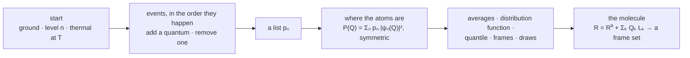

**Computed by** — `Oscillator(ν̃)` → one mode's oscillator; a start,
`states.ground()`, `states.level(n)`, `states.thermal(...)` or
`states.classical_thermal(...)`, and the events, `.add_quantum()`,
`.remove_quantum()` → a chain, written without a frequency;
`chain.on(osc)` → the state, its list `.populations` and `.mean_quanta`;
`dist.of_state(state)` → its distribution — averages, distribution
function, quantile, frames, draws; `sampling` → the random streams and the
statistics of results; for a mode of a run, `m.bind(chain)` → the chain on
the mode ([`engines/vibration-frames.md`](?doc=engines/vibration-frames.md)
§ 9.1; § 2). The example above:

```python
>>> import numpy as np
>>> from molbuilder.postprocess import Oscillator, states
>>> osc = Oscillator(200.0)
>>> np.round(states.thermal(temperature_k=300.0).on(osc).populations[:4], 3)
array([0.617, 0.236, 0.091, 0.035])
>>> photon = states.thermal(temperature_k=300.0).add_quantum().on(osc)
>>> np.round(photon.populations[:5], 3), round(photon.mean_quanta, 2)
(array([0.   , 0.38 , 0.292, 0.168, 0.086]), 2.24)
```

### 2e.1 What a state is — a list of chances

**The words.** The oscillator's levels are $\lvert n\rangle$, $n = 0, 1, 2,
\dots$ quanta; the operator $\hat n = \hat b^\dagger\hat b$ counts them,
$\hat n\lvert n\rangle = n\lvert n\rangle$ ($\hat b^\dagger$, $\hat b$ the
raising and lowering operators of § 2d.2). A quantum state is written in
these levels as a square array of numbers, the **density matrix**,

$$
\rho_{mn} = \langle m\rvert\hat\rho\lvert n\rangle,
\qquad
p_n = \rho_{nn},
\qquad
\sum_n p_n = 1 .
$$

Its diagonal $p_n$ — the **populations** — is the chance of $n$ quanta. The
entries off the diagonal — the **coherences** — say whether two levels
oscillate in step. A frozen geometry sees only where the coordinate is
(§ 2d.1), for one mode

$$
P(Q) \;=\; \langle Q\rvert\hat\rho\lvert Q\rangle
\;=\; \sum_{m,n}\rho_{mn}\,\psi_m(Q)\,\psi_n(Q).
$$

**An example of what a coherence does.** Put the mode half in level 0 and
half in level 1, $(\lvert0\rangle + \lvert1\rangle)/\sqrt2$:
$p_0 = p_1 = \rho_{01} = \rho_{10} = \tfrac12$. Each level's part turns at
its own energy, so at time $t$

$$
P(Q, t) \;=\; \tfrac12\lvert\psi_0\rvert^2 + \tfrac12\lvert\psi_1\rvert^2
+ \psi_0\,\psi_1\cos\omega t .
$$

At $\omega t = 0$ the last term pushes the weight to positive $Q$:
$P(+Q_{\mathrm{zp}}) = 0.484/Q_{\mathrm{zp}}$ and
$P(-Q_{\mathrm{zp}}) = 0$. Half a period later the picture is mirrored. At
a moment taken at random over the period the last term is gone, and
$P(\pm Q_{\mathrm{zp}}) = 0.242/Q_{\mathrm{zp}}$ — the even density of the
populations alone.

**Why a snapshot needs only the list.** A snapshot is one geometry, taken at
a moment of the mode's own motion that is random — nothing in a junction
holds the mode to a phase (§ 2a.2). Over a time $t$ the motion multiplies
each entry by a phase, $\rho_{mn} \to \rho_{mn}\,e^{-i(m-n)\varphi}$ with
$\varphi = \omega t$, and with $\varphi$ random

$$
\frac{1}{2\pi}\int_0^{2\pi} e^{-i(m-n)\varphi}\,d\varphi \;=\; \delta_{mn}:
\qquad
P(Q) \;=\; \sum_n p_n\,\lvert\psi_n(Q)\rvert^2 ,
$$

the chance a snapshot finds the coordinate at $Q$. Every coherence drops
out; the populations stay. So **for a snapshot, every state of one mode is a
list $p_0, p_1, p_2, \dots$**, and where the atoms are follows from it by
one formula. A measurement timed to one moment of the motion — a pump–probe
delay shorter than a period, the terahertz microscope (§ 2a.2) — keeps the
coherences; frames drawn at random moments do not represent it.

| the state | its list $p_n$ | made by (§ 2e.2) |
|---|---|---|
| the ground state | $p_0 = 1$ | — |
| thermal, mean $\bar n$ (§ 2d.3) | $\dfrac{\bar n^{\,n}}{(\bar n+1)^{n+1}}$ | a thermal start |
| $n_0$ quanta exactly | $p_{n_0} = 1$ | a level, or $n_0$ quanta added to the ground state |
| one photon on a cold mode | $p_1 = 1$ | a quantum added to the ground state |
| one photon on a warm mode (§ 2d.4) | $\dfrac{n\,\bar n^{\,n-1}}{(\bar n+1)^{n+1}}$ | thermal, then a quantum added |
| one quantum taken from a warm mode | $\dfrac{(n+1)\,\bar n^{\,n}}{(\bar n+1)^{n+2}}$ — the row above moved down one level | thermal, then a quantum removed |
| many photons at random, steady (§ 2a.1) | thermal at the effective mean $n$ | thermal at that mean |

**Computed by** — `chain.on(Oscillator(ν̃)).populations` → a state's list
$p_n$; `dist.LevelList(p)` → the distribution of any list,
$P(x) = \sum_n p_n\psi_n(x)^2$, $x = Q/Q_{\mathrm{zp}}$ — a person's own
model among them ([`engines/vibration-frames.md`](?doc=engines/vibration-frames.md)
§ 9.1 `.on(oscillator, …)`, the families). The coherences have no call: a
snapshot does not see them (above). Half in level 0 and half in level 1, at
a random moment, and a thermal list:

```python
>>> import numpy as np
>>> from molbuilder.postprocess import Oscillator, states, dist
>>> np.round(dist.LevelList([0.5, 0.5]).pdf(np.array([-1.0, 1.0])), 4)
array([0.242, 0.242])
>>> np.round(states.thermal(mean_quanta=1.0).on(Oscillator(200.0)).populations[:4], 4)
array([0.5   , 0.25  , 0.125 , 0.0625])
```

### 2e.2 The steps — what starts a state, and what happens to it

Two kinds of steps make a state. **A start** sets the state afresh: the
ground state, a number of quanta, a thermal state. It replaces whatever the
mode held before. **An event** is quicker than the mode relaxes — quicker
than its energy lifetime $\tau$, 0.53 ps for a 10 cm⁻¹ wide line,
$\tau = 1/(2\pi c\,\Gamma)$ — and changes the state the mode is in; events
apply in the order they happen. Each takes a list to a list.

| the step | kind | what happens physically | on the state | on a list |
|---|---|---|---|---|
| **a level** $n$ | start | the mode put directly in its level $n$, nothing before it — on a stiff mode, $n$ quanta absorbed from its ground state | $\hat\rho \to \lvert n\rangle\langle n\rvert$ | $p_n = 1$ |
| **thermal** at $T$, or at mean $\bar n$ | start | the mode in equilibrium with its surroundings — or, many quanta added at random and relaxed, at an effective mean (§ 2a.1) | $\hat\rho \to e^{-\beta\hbar\omega\hat n}/Z$ | $p_n = \bar n^{\,n}/(\bar n+1)^{n+1}$ |
| **add a quantum** | event | a photon absorbed, a Stokes photon scattered, an electron losing $\hbar\omega$ — detected, so the event is known to have happened (§ 2d.4): the molecules it happened to, each one level up | $\hat\rho \to \hat b^\dagger\hat\rho\,\hat b\,/\,\mathrm{Tr}$ | $p'_n = \dfrac{n\,p_{n-1}}{\langle n\rangle + 1}$ |
| **remove a quantum** | event | an anti-Stokes photon scattered, an electron gaining $\hbar\omega$ — detected: the molecules it happened to, each one level down | $\hat\rho \to \hat b\,\hat\rho\,\hat b^\dagger\,/\,\mathrm{Tr}$ | $p'_n = \dfrac{(n+1)\,p_{n+1}}{\langle n\rangle}$ |

**An event keeps the molecules it happened to.** Of a sample in a state,
light at the mode's frequency raises some molecules by one level and leaves
most as they were; an added quantum is the first kind alone — each molecule
exactly one level up, taken from wherever it was. It is not every level
shifted by one, and not the whole sample under the light.

**Adding a quantum raises the mean by more than one.** Written out,

$$
p'_n = \frac{\langle n\rvert\hat b^\dagger\hat\rho\,\hat b\lvert n\rangle}{\mathrm{Tr}\,\hat b^\dagger\hat\rho\,\hat b}
= \frac{n\,p_{n-1}}{\langle n\rangle + 1},
\qquad
\mathrm{Tr}\,\hat b^\dagger\hat\rho\,\hat b = \sum_n n\,p_{n-1} = \sum_m (m+1)\,p_m = \langle n\rangle + 1 .
$$

In words: a photon is absorbed, or a Stokes photon scattered, from level
$m$ with a probability proportional to $m + 1$. The light — or the
electron — acts on the mode through a quantity linear in its coordinate:
the dipole for absorption, $\mu(Q) \approx \mu_0 + (\partial\mu/\partial
Q)\,Q$, the polarizability for Raman scattering, the electron's coupling for
a tunnelling electron; a jump from level $m$ to $m+1$ goes as
$\lvert\langle m+1\rvert Q\lvert m\rangle\rvert^2 = (m+1)\,
\lvert\langle 1\rvert Q\lvert 0\rangle\rvert^2$ on a harmonic oscillator
— the oscillator's $\lvert\langle m+1\rvert\hat b^\dagger\lvert
m\rangle\rvert^2$, the same $m + 1$ as emission into a light mode holding
$m$ photons, stimulated ($m$) plus spontaneous (1). The light drives the
jump down, $m \to m-1$, as $m$; over a thermal sample, up less down is
$(m+1) - m = 1$ per molecule whatever the populations, so a harmonic mode's
integrated absorption does not change with temperature. Both hold while the
mode is harmonic and the coupling linear in $Q$: an anharmonic mode's
$1 \to 2$ jump sits at a lower frequency (a hot band), which light tuned to
$0 \to 1$ drives less. Once the event is known to have happened, the
higher levels are the likelier places it started from (Bayes' rule), so one
detected quantum raises the mean by more than one. Removing a quantum goes
with $m$ — it needs a quantum to take. In general, with
$\mathrm{Var}(n) = \langle n^2\rangle - \langle n\rangle^2$ the spread of
the number of quanta, one detected quantum added moves the mean by
$1 + \mathrm{Var}(n)/(\langle n\rangle + 1)$ and one removed by
$-1 + \mathrm{Var}(n)/\langle n\rangle$: a number state, with no spread,
moves by exactly one; a thermal state, $\mathrm{Var}(n) = \bar n^2 + \bar n$,
goes to $2\bar n + 1$ and to $2\bar n$:

| at $\bar n = 1$ | levels 0, 1, 2, 3, 4 | mean |
|---|---|---|
| thermal | $\tfrac12, \tfrac14, \tfrac18, \tfrac1{16}, \tfrac1{32}, \dots$ | 1 |
| one quantum added | $0, \tfrac14, \tfrac14, \tfrac3{16}, \tfrac18, \dots$ | $2\bar n + 1 = 3$, not 2 |
| one quantum removed | $\tfrac14, \tfrac14, \tfrac3{16}, \tfrac18, \dots$ | $2\bar n = 2$, not 0 |

On the modes a frame set is for — stiff against $k_BT$, a soft one left
out of a motion by its window (§ 2c.5) — nearly every molecule starts in
level 0, and one quantum added is level 1 within a few percent, the share
of the molecules that absorbed left in level 1 $1/(1+\bar n)^2$:

| at 300 K | $\bar n$ before | in level 1 after one added | mean after (level 1: 1) |
|---|---|---|---|
| 500 cm⁻¹ | 0.100 | 82.6% | 1.200 |
| 700 cm⁻¹ | 0.0361 | 93.2% | 1.072 |
| 1000 cm⁻¹ | 0.00833 | 98.4% | 1.017 |
| 1600 cm⁻¹ | 0.000465 | 99.9% | 1.001 |


*Figure 2e-2. A warm mode's list, $\bar n = 1$, and the same mode after one
detected quantum added or removed: the more quanta a mode holds, the likelier
the event.*

**When a quantum cannot be removed.** The event's probability is
proportional to $\langle n\rangle$. The ground state holds level 0 alone,
$\langle n\rangle = 0$: there is no event to condition on ($0/0$), and the
toolkit stops with a message — for the ground state, and for a thermal
state at exactly 0 K or of no mean quanta, as the person typed it. A thermal mode above 0 K, however
cold, holds a little of level 1, and one quantum removed is a state: with
$t = \bar n/(\bar n+1) = e^{-\hbar\omega/k_BT}$, $k$ quanta removed from a
thermal state give

$$
p'_n = \binom{n+k}{k}(1-t)^{k+1}\,t^n,
$$

the mean $(k+1)\bar n$ — the mean, which a step-by-step removal divides by,
has cancelled. At 4 K a 1000 cm⁻¹ mode holds $\bar n = 6\times10^{-157}$, and
one quantum removed leaves $2\bar n$; a 3000 cm⁻¹ mode at 4 K has
$t = e^{-1079}$, below what a double holds (about $10^{-308}$), and the
formula gives its limit, the ground state's list, with nothing divided by
zero.

**What comes first.**

- A start erases every step before it: an event, then a thermal start, is
  the thermal state alone.
- Order matters for events. On a warm mode of $\bar n = 1$, one quantum
  added and then one removed leaves $p_n = (n+1)^2/(3\cdot2^{n+2})$, a mean
  of $\tfrac{10}3$; one removed and then one added leaves the same list one
  level up, $p_n = n^2/(6\cdot2^n)$ — no chance of 0 quanta, since an added
  quantum always leaves one — a mean of $\tfrac{13}3$ (Figure 2e-3).


*Figure 2e-3. A warm mode, $\bar n = 1$, one detected quantum added and one
removed, in either order. Added, then removed: $0.083, 0.167, 0.188, 0.167,
0.130, \dots$, mean $\tfrac{10}3$. Removed, then added: the same list one
level up, $0, 0.083, 0.167, 0.188, 0.167, \dots$, mean $\tfrac{13}3$ —
$p_0 = 0$ exactly.*

**Computed by** — a start, `states.ground()`, `states.level(n)`,
`states.thermal(temperature_k=T)` or `states.thermal(mean_quanta=n̄)`, and
the events after it in the order they happen, `.add_quantum()` and
`.remove_quantum()`; `.reduced()` → the chain in its one form;
`.on(osc)` → the state, `.populations` its list and `.mean_quanta` its
mean ([`engines/vibration-frames.md`](?doc=engines/vibration-frames.md)
§ 9.1 module 2). The tables above — the stiff modes' too — and Figure
2e-3's two orders:

```python
>>> import numpy as np
>>> from molbuilder.postprocess import Oscillator, states
>>> osc, warm = Oscillator(200.0), states.thermal(mean_quanta=1.0)
>>> for chain in (warm.add_quantum(), warm.remove_quantum(),
...               warm.add_quantum().remove_quantum(), warm.remove_quantum().add_quantum()):
...     s = chain.on(osc)
...     print(np.round(s.populations[:5], 4), round(s.mean_quanta, 4))
[0.     0.25   0.25   0.1875 0.125 ] 3.0
[0.25   0.25   0.1875 0.125  0.0781] 2.0
[0.0833 0.1667 0.1875 0.1667 0.1302] 3.3333
[0.     0.0833 0.1667 0.1875 0.1667] 4.3333
>>> for nu in (500.0, 700.0, 1000.0, 1600.0):
...     o, t = Oscillator(nu), states.thermal(temperature_k=300.0)
...     a = t.add_quantum().on(o)
...     print(nu, f"{t.on(o).mean_quanta:.3g}", f"{a.populations[1]:.3f}", f"{a.mean_quanta:.3f}")
500.0 0.1 0.826 1.200
700.0 0.0361 0.932 1.072
1000.0 0.00833 0.984 1.017
1600.0 0.000465 0.999 1.001
```

### 2e.3 From a list to the frames — one route for every state

Every state takes the route below. Where a chain is one of the closed
families, the toolkit takes its closed form instead — the same distribution,
each the other's check (`engines/vibration-frames.md` § 9.1's diagram): the
ground state or a thermal one, the bell curve; $n$ quanta, its level; one
quantum added to a thermal state, the bell curve times a quadratic; the
classical form, its bell curve — a point at rest at 0 K.

| what | from the list | how much work |
|---|---|---|
| where the coordinate is, $P(Q)$ | $\sum_n p_n\lvert\psi_n(Q)\rvert^2$ — every $\psi_n$ at a point in one sweep, $\psi_{n+1}$ from $\psi_n$ and $\psi_{n-1}$ (§ 2d.5) | one sweep over the levels per point |
| the chance of $Q \le q$, $F(q)$ | $P$ integrated once on a grid — the range cut into short pieces (panels), each by a 40-point Gauss–Legendre rule (§ 2d.5) — into one lookup table of $F$ for the whole list | the list's length times the panels |
| the averages $\langle Q^k\rangle$ | $\sum_n p_n\langle n\rvert\hat Q^k\lvert n\rangle$; $\hat Q = Q_{\mathrm{zp}}(\hat b + \hat b^\dagger)$ applied $k$ times to $\lvert n\rangle$ reaches only the levels $n-k \dots n+k$, so each is a small product (§ 2b.4): $\langle n\rvert\hat Q^2\lvert n\rangle = (2n+1)Q_{\mathrm{zp}}^2$, $\langle n\rvert\hat Q^4\lvert n\rangle = 3(2n^2+2n+1)Q_{\mathrm{zp}}^4$ | small |
| the frames — the $m$-point Gauss rule of $P$ (§ 2b.4) | below | the list's length times $m$ |
| a draw from one normal number $z$ | the $Q$ with $F(Q) = \Phi(z)$ (§ 2d.5): one normal number per draw, $-z \to -Q$, the random streams of § 2d.6 unchanged | one look-up and a few Newton steps |

**The frames of a list.** Replace each level's density $\lvert\psi_n\rvert^2$
by its own Gauss rule of $m$ points or more — $m$ positions and weights
reproduce that level's averages up to $Q^{2m-1}$, all the $m$-point rule of
$P$ is built from; the toolkit takes $m + 1$, a margin — and pool all these points, each
weight multiplied by $p_n$. The pooled, weighted points have the same
averages as $P(Q)$ up to $Q^{2m-1}$:

$$
\mu = \sum_n p_n\sum_{j=1}^m w^{(n)}_j\,\delta\big(Q - Q^{(n)}_j\big),
\qquad
\int Q^k\,d\mu = \sum_n p_n\,\langle n\rvert\hat Q^k\lvert n\rangle = \langle Q^k\rangle
\quad (k \le 2m-1).
$$

An $m$-point Gauss rule depends on a distribution only through its averages
up to $Q^{2m-1}$, so the pooled points' rule **is** $P$'s rule. It is found
by a standard eigenvalue computation: the Lanczos procedure reduces the
pooled points to a small tridiagonal matrix, whose eigenvalues are the frame
positions and whose eigenvectors give the weights [GolubWelsch1969] — as
§ 2a.3 builds a level's.

**Worked: one photon on a warm mode, from the steps to the frames.** A thermal
start at $\bar n = 1$; add a quantum. The list is $p_n = n/2^{n+1}$ — $0, \tfrac14,
\tfrac14, \tfrac3{16}, \tfrac18, \dots$ — of mean 3 quanta, and in units of
$Q_{\mathrm{zp}}$

$$
\langle Q^2\rangle = \sum_n p_n\,(2n+1) = 7,
\qquad
\langle Q^4\rangle = \sum_n p_n\,3(2n^2+2n+1) = 99 .
$$

Three frames of a symmetric distribution sit at $0$ and $\pm a$, the
weights $w_0$ and $w$ each matching $1$, $Q^2$ and $Q^4$:
$a^2 = \langle Q^4\rangle/\langle Q^2\rangle = 99/7$, so
$a = 3.761\,Q_{\mathrm{zp}}$, $w = \langle Q^2\rangle/2a^2 = 0.2475$ and
$w_0 = 1 - 2w = 0.505$. The thermal state of the same mean 3 — the stand-in
of § 2d.4 — has the same $\langle Q^2\rangle = 7$ but
$\langle Q^4\rangle = 3\cdot7^2 = 147$; its three frames sit at $0$ and
$\pm\sqrt{21} = \pm4.583\,Q_{\mathrm{zp}}$, weights $\tfrac23$ and
$\tfrac16$: farther out, and weighing the middle more.


*Figure 2e-4. One photon on a warm mode ($\bar n = 1$; solid) against the
thermal state of the same mean 3 (dashed): the same width, another shape.
Each set's three frames are drawn as stems, their heights half their
weights; the stand-in's stems are set a little to the right to be seen.*

**The exact formulas and the list give the same distribution, and the same
draws.** Where a family has a closed form — the bell curve for a thermal
state; the bell curve times a quadratic for one photon on a warm mode
(§ 2d.4); a level's own table for $n$ quanta (§ 2d.5) — its density,
averages and frames are the list's, and the two routes check each other.
Each draws the coordinate $F^{-1}(\Phi(z))$ from one normal number $z$, the
same $F$ on either route, so one seed gives one set either way — for the
bell curve exactly, $F^{-1}(\Phi(z)) = \sigma z$. Every distribution here is
symmetric, $P(-Q) = P(Q)$: each level's density is even, so every list's is,
and $-z$ gives exactly $-Q$ (§ 2d.5). Where its frame 0 goes is the frame
set's rule ([`engines/vibration-frames.md`](?doc=engines/vibration-frames.md) § 5).

**Computed by** — `dist.of_state(state)` → the state's distribution by its
route: a family's closed form (`dist.Gaussian`, `dist.QuantumAdded`,
`dist.Level`), its list (`dist.LevelList`) otherwise; then `.pdf(x)`,
`.cdf(x)`, `.moment(k)`, `.gauss_rule(nodes)` → its frames, `.draw(z)` → its
draws ([`engines/vibration-frames.md`](?doc=engines/vibration-frames.md)
§ 9.1 `of_state(state)`, `gauss_rule(nodes)`). The worked chain, by both
routes:

```python
>>> import numpy as np
>>> from molbuilder.postprocess import Oscillator, states, dist
>>> state = states.thermal(mean_quanta=1.0).add_quantum().on(Oscillator(200.0))
>>> closed, listed = dist.of_state(state), dist.LevelList(state.populations)
>>> type(closed).__name__, round(closed.moment(2), 6), round(closed.moment(4), 6)
('QuantumAdded', 7.0, 99.0)
>>> [(round(float(x.max()), 3), np.round(w, 4)) for x, w in (closed.gauss_rule(3), listed.gauss_rule(3))]
[(3.761, array([0.2475, 0.5051, 0.2475])), (3.761, array([0.2475, 0.5051, 0.2475]))]
```

### 2e.4 How many levels a list keeps

A list is cut where the levels beyond it no longer change the numbers asked.
For the chances themselves, that is where what is left falls below
$10^{-16}$ — for a thermal list, since
$\ln\big((\bar n+1)/\bar n\big) = \hbar\omega/k_BT$,

$$
N = 16\ln10\;\frac{k_BT}{\hbar\omega} \;\approx\; 36.8\,\frac{k_BT}{\hbar\omega}.
$$

*Example:* $k_BT$ at 300 K is 208.5 cm⁻¹, so a 50 cm⁻¹ mode needs
$36.8\times4.17 = 154$ levels. **The frames need more**: they match averages
up to $Q^{2m-1}$, which weigh the high levels more, so the cut for $m$
frames is where the levels beyond hold less than $10^{-16}$ of those
averages — for the same mode 183 levels for 3 frames, 206 for 5, 227 for 7.
**When events follow a start**, each weighs a level by one more power of
$n$, so the list is built two powers further per event, and the cut is
taken on the final list, for the numbers asked of it. The
$10^{-16}$ is the default **precision**, a parameter
(`chain.on(oscillator, precision=…)`): $10^{-8}$ keeps 77 levels for the
same mode's chances, $N = \lceil\ln(\text{precision})/\ln t\rceil$; what
the parameter buys and costs, and how the cut is placed, are § 2e.6's.

| the mode | mean quanta | levels, for the chances |
|---|---|---|
| 1600 cm⁻¹ at 300 K, thermal | 0.0005 | 5 |
| 200 cm⁻¹ at 300 K, thermal | 0.62 | 39 |
| 50 cm⁻¹ at 300 K, thermal | 3.69 | 154 |
| 10 cm⁻¹ at 300 K, thermal | 20.4 | 769 |

One lookup table of $F$ for a whole list costs about $N^2$ —
each point sweeps every level — where a table per level, as § 2d.5 keeps for
one number state, would cost about $N^3$; the closed forms do not grow at
all. A hot soft mode is where they differ — why the toolkit keeps the closed
forms beside the list (the user's choice of 2026-11-25, decision 1(b),
[`archive/2026-11-26-vibration-frames-steps-design.md`](?doc=archive/2026-11-26-vibration-frames-steps-design.md)).

**Computed by** — `chain.on(osc).populations_for(order)` → the list cut for
the averages up to $\langle x^{\mathrm{order}}\rangle$, `order` 0 for the
chances alone; `.populations` → the list cut for $\langle x^{12}\rangle$;
`chain.on(osc, precision=…)` → another precision
([`engines/vibration-frames.md`](?doc=engines/vibration-frames.md) § 9.1
`.on(oscillator, …)`). The levels above:

```python
>>> from molbuilder.postprocess import Oscillator, states
>>> warm = states.thermal(temperature_k=300.0)
>>> [warm.on(Oscillator(nu)).populations_for(0).size for nu in (1600.0, 200.0, 50.0, 10.0)]
[5, 39, 154, 769]
>>> [warm.on(Oscillator(50.0)).populations_for(k).size for k in (4, 8, 12)]      # for 3, 5 and 7 frames
[183, 206, 227]
>>> warm.on(Oscillator(50.0), precision=1e-8).populations_for(0).size
77
```

### 2e.5 Where one list per mode is not enough

- **A quantum two modes share** (§ 2d.4). One photon gives **one** quantum
  where the light couples linearly to the coordinates — the terms of § 2d.4;
  an overtone or a combination band, from the second-order terms of
  $\boldsymbol\mu(\mathbf Q)$ or $\alpha(\mathbf Q)$, gives two. Which mode
  takes it:
  - **Two modes of one frequency** — a degenerate pair — under linearly
    polarised light. The pair's two axes are one choice among many: choose
    them so that one lies along the field's pull,
    $\mathbf E\cdot\partial\boldsymbol\mu/\partial Q$, and the photon raises
    that combination alone, leaving the other as it was — a product in those
    axes, one list each, nothing shared. The toolkit needs that turned mode,
    set up by hand (§ 2c.2), not a joint state.
  - **Two modes of nearby frequencies** — within the photon's energy
    resolution or the lines' widths — or a degenerate pair under circularly
    polarised light. Nothing tells which took the quantum, and the event
    raises their combination, $c_a\hat b_a^\dagger + c_b\hat b_b^\dagger$,
    $c_k \propto \mathbf E\cdot(\partial\boldsymbol\mu/\partial Q_k)\,Q_{\mathrm{zp},k}$
    (through $\partial\alpha/\partial Q_k$ for Raman),
    $\lvert c_a\rvert^2 + \lvert c_b\rvert^2 = 1$. The coordinates then move
    together: two cold modes coupled alike, $c_a = c_b = 1/\sqrt2$, each
    hold half a quantum on average,
    $\langle Q_a^2\rangle = 2\,Q_{\mathrm{zp},a}^2$, and at first
    $\langle Q_aQ_b\rangle = 2\,\mathrm{Re}\big(c_ac_b^*\big)\,Q_{\mathrm{zp},a}Q_{\mathrm{zp},b} = Q_{\mathrm{zp},a}Q_{\mathrm{zp},b}$
    — a correlation of one half, where *$a$ took it or $b$ took it, half the
    time each* would give none. It beats at $\omega_a - \omega_b$ and fades
    as the two lose step, leaving that *either-or* mixture — uncorrelated,
    still not a product. It needs a density matrix over both modes' levels,
    outside these tools.

  Most modes lie far apart in frequency, and one photon then picks one.
- **The classical state**, kept for comparison (§ 2b.3). The classical
  bell curve, variance $k_BT/\omega^2$, is the bell curve of a quantum
  thermal state at another, effective temperature — the thermal list at
  $\bar n = k_BT/\hbar\omega - \tfrac12$, wherever $k_BT \ge \hbar\omega/2$ —
  not the mode's quantum state at $T$; at 0 K a point at rest, which no list
  gives. It is a distribution of the coordinate, given as such.
- **An anharmonic mode** leaves the oscillator's levels behind (§ 2a.2, § 7
  item 1): another basis, outside these steps.

**Computed by** — a degenerate pair turned to the field's axes: by hand,
§ 2c.2's steps (`m.bind(chain).draw`, `v.displaced`, `write_frame_set`).
Two modes of nearby frequencies, or a pair under circularly polarised
light: no call — a joint state over both modes' levels, built when a case
needs it (the user's choice of 2026-11-25,
[`archive/2026-11-26-vibration-frames-steps-design.md`](?doc=archive/2026-11-26-vibration-frames-steps-design.md)
decision 2). An anharmonic mode: no call — another basis than the
oscillator's levels. `states.classical_thermal(temperature_k=T)` → the
classical bell curve, `dist.Gaussian` of variance $2k_BT/\hbar\omega$ in
$x = Q/Q_{\mathrm{zp}}$ ([`engines/vibration-frames.md`](?doc=engines/vibration-frames.md)
§ 9.1 *The starts*). Its effective mean, and the quantum list there with
its spread:

```python
>>> from molbuilder.postprocess import Oscillator, states, dist
>>> osc = Oscillator(50.0)
>>> classical = dist.of_state(states.classical_thermal(temperature_k=300.0).on(osc))
>>> nbar = (classical.moment(2) - 1) / 2                                  # k_BT/ħω − ½
>>> quantum = dist.of_state(states.thermal(mean_quanta=nbar).on(osc))
>>> round(nbar, 4), round(quantum.moment(2), 6) == round(classical.moment(2), 6)
(3.6702, True)
```

---

### 2e.6 The numbers the tools fix

A double carries about sixteen digits, and some lists never end, so the tools
fix a few numbers. Each is here, with what it decides, why its value, and
what changes if it is changed. Two kinds: **one epsilon**, which tells
rounding from a real value — any sensible value gives the same answers —
and **the precision**, which decides how many levels a list keeps, a
parameter a person sets.

| the number | what it decides | why this value | if changed |
|---|---|---|---|
| **the one epsilon**, $10^{-12}$ of the size of what is compared | every "is this zero, are these equal": a typed list's chance just below 0, taken as 0; whether frames reproduce an average — the degree they are exact to — and whether weights are the ones written; a weight below zero | a double rounds each operation to about $10^{-16}$ of its size; a distribution's own rule reproduces its averages to $1.8\times10^{-14}$ of them at worst up to seven frames, the most the command line and the spectrum tab offer — about 55 times below $10^{-12}$ — and to $10^{-13}$ at nine, ten times below; the first average frames do not reproduce is off by $8\times10^{-5}$ or more (a bell curve, one quantum added to a thermal state of 0 to 20 mean quanta, levels 1 to 40, lists of a thermal state with one or two quanta added or removed on modes of 50 to 1000 cm⁻¹ at 77 and 300 K, one to nine frames; computed 2026-11-25) | $10^{-10}$: the same answers; $10^{-14}$: own rules near the measured rounding read as not reproducing; $10^{-16}$: rounding read as a miss |
| **the precision**, $10^{-16}$ by default — `chain.on(oscillator, precision=…)` | where a list is cut: the levels left out hold less than this share of the averages asked, up to $\langle x^{12}\rangle$ unless more is asked (§ 2e.4) | what a double holds: smaller is below rounding | larger, fewer levels and faster, the averages good to that share: $10^{-8}$ keeps 77 levels for a 50 cm⁻¹ mode's chances at 300 K, $10^{-16}$ 154 |
| **the averages a cut keeps**, up to $\langle x^{12}\rangle$ | the cut's weighting, $(2n+1)^{6}$ per level | the highest even average the largest rule the command line and the spectrum tab offer, seven frames, reproduces (degree 13) | `populations_for(order)` asks any other |
| **how exactly the cut is placed**: a list is built until what lies beyond holds $10^{-4}$ of the precision | that the cut counts what it leaves out | built only to the precision itself, the uncounted part moves the cut early where the list ends near it, and it may leave out up to twice the precision — a 30 cm⁻¹ mode at 300 K with one quantum added, asked to $10^{-8}$, would keep 243 levels and leave out 1.04 of the precision of its averages up to $\langle x^{12}\rangle$; $10^{-4}$ places the cut on its level, 244, leaving out 0.92 | smaller: more levels built, the same cut |
| **when a search stops**: its step within four units of the last digit of $\max(1, \lvert x\rvert)$ — near 0 within about $9\times10^{-16}$ — and after 200 passes in any case | the point where $F$ reaches $p$ (§ 2d.5) | the last digits a double can tell; each pass at least halves the bracket or takes a step at most half the last, so 200 narrow any bracket a double holds below its spacing | where $F$ is flat at the answer — one quantum's middle, $F - \tfrac12 \approx x^3/3\sqrt{2\pi} = 0.133\,x^3$ — a double holds $F$ at exactly $\tfrac12$ for every $\lvert x\rvert$ below about $7\times10^{-6}$ (measured $7.4\times10^{-6}$), and every such point is an answer to $F$'s last digit; a start already on the answer is kept |
| **a table of levels**: out to nine past the top level's turning point, $2(n+20)$ panels of 40-point Gauss–Legendre, $n$ the top level | the distribution function of $n$ quanta, of a list — built the first time $F$, a draw or a quantile asks it | beyond, $e^{-81}$ of the density; a panel or more between neighbouring zeros (1.14 at the least, $n = 70$); each panel exact to degree 79 | — |
| **a search's bracket**: twelve spreads beyond the mean | where a quantile is looked for | a bell curve holds $e^{-72}$ beyond | — |

**The floors.** $10^{-300}$, about the smallest a double holds, stands for
0 where nothing must divide by it: an empty panel of a table holds it as
its share, and a point's search bracket is kept open by twelve times its
square root. A distribution of no spread — a point — has its weights for
points placed elsewhere solved in a unit of 1.

**What the precision buys.** A list's averages, frames, density and
distribution function are good to it: the levels it leaves out hold less
than the precision of its averages, and the averages, density and frames
are sums over the levels. Measured against the same lists cut far below
rounding (a 50 cm⁻¹ mode at 300 K, thermal, with one quantum added, two
removed, and one added then one removed), at $10^{-8}$: every average up to
$\langle x^{12}\rangle$ within 0.8 to 0.96 of the precision, the density to
$10^{-13}$ of its peak, the seven frames' positions to about four times the
precision, in units of the spread.

**Computed by** — `chain.on(osc, precision=…)` → the precision, the one of
these numbers a person sets; `.populations_for(order)` → the cut for other
averages; the one epsilon, the search's stop and the tables' shape are
fixed inside the tools, no call
([`engines/vibration-frames.md`](?doc=engines/vibration-frames.md) § 9.1
`.on(oscillator, …)`, `quantile(p)` and `draw(z)`). The cut's row, and a
search started on its answer:

```python
>>> from molbuilder.postprocess import Oscillator, states, dist
>>> states.thermal(temperature_k=300.0).add_quantum().on(Oscillator(30.0), precision=1e-8).populations.size
244
>>> float(dist.Level(1).quantile(0.5))                  # one quantum's flat middle
0.0
```

## 3. What a measurement averages

The current at bias $V$ is linear in the transmission (Landauer),

$$
I \;=\; \frac{2e}{h}\int T(E)\,\big[f_L(E)-f_R(E)\big]\,dE ,
$$

and the measurement integrates over many vibrational periods, so — in the
static-frame picture of § 7 — the measured current and conductance are those
of the **averaged transmission**:

$$
\big\langle T(E)\big\rangle \;=\; \int_{-\infty}^{\infty} P(Q)\,T(E;Q)\,dQ ,
\qquad
\langle G\rangle = G_0\,\big\langle T(E_F)\big\rangle .
$$

The question the frame set answers is how far $\langle T\rangle$ is from the
relaxed geometry's $T_0 = T(E;0)$.

**Computed by** — the transport calculation over the frames, not the
toolkit: its data file's `average_transmission` →
$\langle T(E)\rangle = \sum_f w_f T_f(E)$ at each voltage, and
`average_conductance_g0` → $\langle G\rangle/G_0$, read with
`read_transport_data(data_file)`
([`engines/transport.md`](?doc=engines/transport.md) § 2a.12;
[`engines/transport-postprocessing.md`](?doc=engines/transport-postprocessing.md)
§ 3.2).

```python
summary = read_transport_data(data_file)["groups"]["summary"]["variables"]   # a calculation of your own -- engines/transport-postprocessing.md § 3.2
summary["average_transmission"]["data"]       # ⟨T(E)⟩, at each voltage and energy
summary["average_conductance_g0"]["data"]     # ⟨G⟩/G₀, at each voltage
```

---

## 4. A lopsided response is what produces a net change

### 4.1 The transmission is not symmetric about equilibrium

The working hypothesis is that $T(Q)$ is **not** symmetric: pushing the
molecule one way changes the transmission differently from pushing it the
other way, because $T$ depends non-linearly on the geometry — a contact bond
shortened raises the tunnelling exponentially more than the same bond
lengthened lowers it; a level moved toward $E_F$ raises $T$ more than the same
level moved away lowers it. That hypothesis is exactly what gives a net
change, and the way to see it is to split $T(Q)$ into the part that flips sign
with the push and the part that does not:

$$
T(Q) \;=\;
\underbrace{\tfrac12\big[T(Q)+T(-Q)\big]}_{T_{\mathrm{even}}(Q)\ \text{— same both ways}}
\;+\;
\underbrace{\tfrac12\big[T(Q)-T(-Q)\big]}_{T_{\mathrm{odd}}(Q)\ \text{— flips sign}} .
$$

Averaged over the symmetric distribution of § 2, the odd part vanishes
exactly — whatever its size — because every push $+Q$ is matched by a push
$-Q$ of equal probability:

$$
\big\langle T_{\mathrm{odd}}\big\rangle = \int P(Q)\,T_{\mathrm{odd}}(Q)\,dQ = 0
\quad\Longrightarrow\quad
\big\langle T\big\rangle \;=\; \big\langle T_{\mathrm{even}}\big\rangle .
$$

So **the net change comes entirely from the even part**, and the even part is
non-zero only because of the asymmetry: if $T$ responded linearly —
$T(Q) - T_0 = -\big[T(-Q) - T_0\big]$, a symmetric response — then
$T_{\mathrm{even}} = T_0$ and the average would be the relaxed value, no
matter how strongly the mode moves $T$. A mode changes the measured
conductance precisely when $T(+Q) + T(-Q) \neq 2T_0$: when the response is
lopsided.

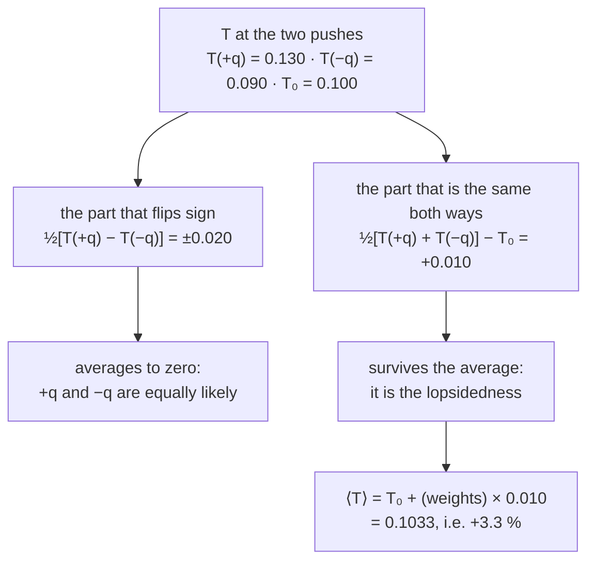

The same example drawn: the full response (lopsided), its odd part drawn
about $T_0$ (a straight line here — it cancels), and its even part (a bowl —
it survives). $u = Q/\sigma$.

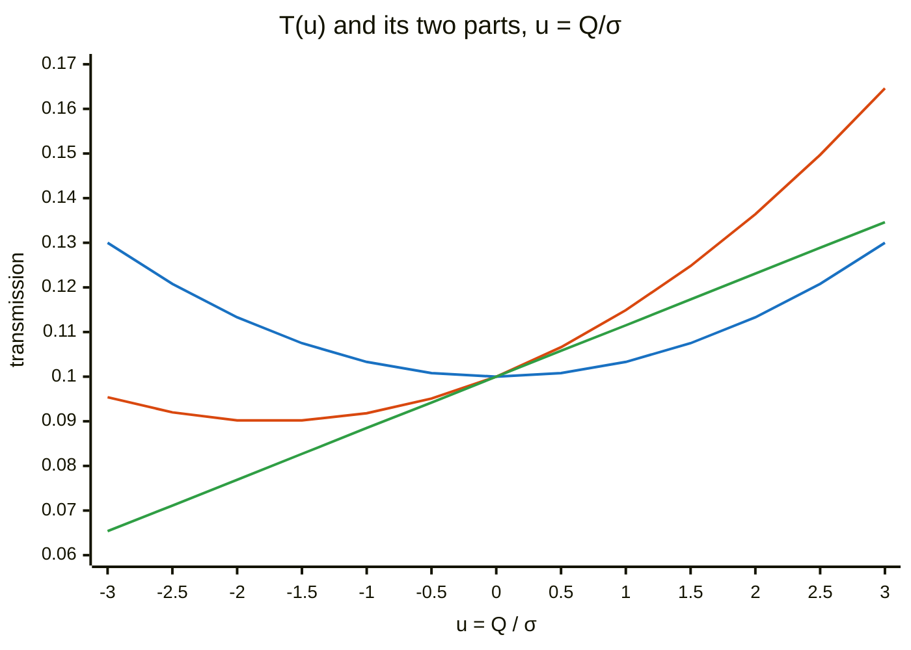

*(Orange: the full $T(u)$, lopsided. Blue: its even part — the bowl that
survives the average. Green: its odd part drawn about $T_0$ — the straight
line that cancels. The example is $T(u) = 0.100 + 0.0115\,u + 0.0033\,u^2$.)* And the distribution it is
averaged over:

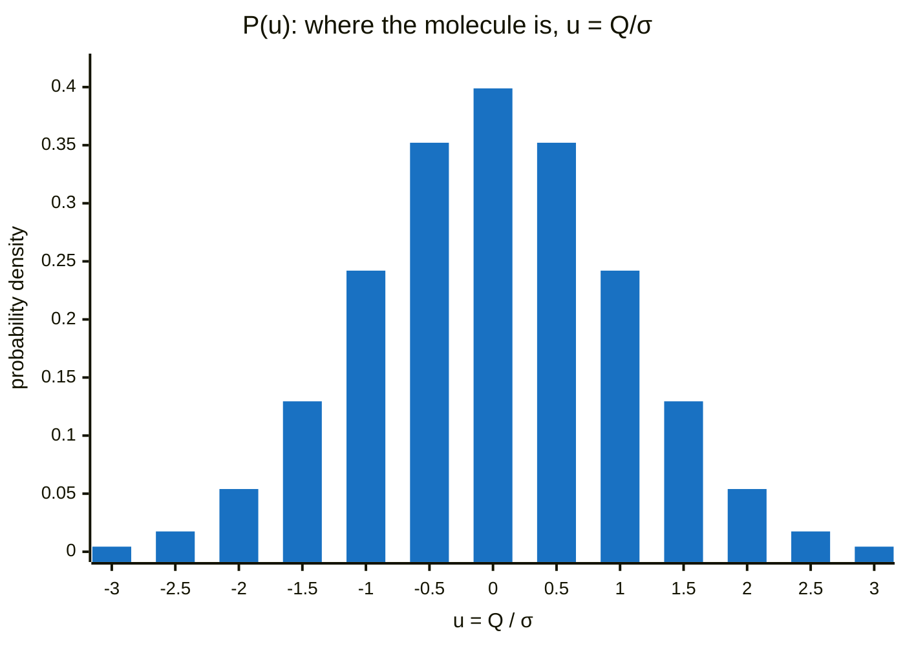

**Computed by** — no call computes $T$: each frame's is the transport
calculation's. On values at mirrored positions the split is arithmetic:
`sampling.pair_means(values, weights).means` → each pair's mean, the even part; on a
paired snapshot set, `snaps.parts(values)` → the even and odd shares of
its spread (§ 5.5; [`engines/vibration-frames.md`](?doc=engines/vibration-frames.md)
§ 7, § 9.1 `pair_means`). The chart's $T(+u), T(-u)$ at $u = 1, 2, 3$:

```python
>>> import numpy as np
>>> from molbuilder.postprocess import sampling
>>> sampling.pair_means(np.array([0.1149, 0.0918, 0.1364, 0.0902, 0.1646, 0.0954]), np.full(6, 1 / 6)).means   # the bowl
array([0.10335, 0.1133 , 0.13   ])
```

### 4.2 In derivatives

Expanding about equilibrium makes the same statement term by term:

$$
T(Q) = T_0 + T'Q + \tfrac12 T''Q^2 + \tfrac16 T'''Q^3 + \tfrac1{24}T''''Q^4 + \dots
$$

The Gaussian's odd moments vanish, $\langle Q\rangle = \langle Q^3\rangle = 0$,
and its even ones are $\langle Q^2\rangle = \sigma^2$,
$\langle Q^4\rangle = 3\sigma^4$:

$$
\big\langle T\big\rangle \;=\; T_0 \;+\; \tfrac12\,T''\sigma^2 \;+\; \tfrac18\,T''''\sigma^4 \;+\;\dots
$$

$T'$ and $T'''$ — the odd, sign-flipping response — drop out; $T''$, the
curvature, is the leading measure of the lopsidedness. The *relative* change
of the conductance,

$$
\frac{\langle\Delta G\rangle_\nu}{G} \;=\; \frac{\tfrac12\,T''_\nu\,\sigma_\nu^2}{T_0},
$$

is the transport score of `normal-modes.md` § 4c.4. Its sign is the sign of
the curvature: a convex response (a level's tail, an exponential contact)
raises the average conductance, a concave one (sitting on a resonance's peak)
lowers it.

**Computed by** — no call: no call computes $T''$ — a curvature is the
person's analysis of the frames' values where the response is smooth,
never a value of the record (the user's ruling of 2026-10-10; § 5.3, § 8).

### 4.3 Two examples of a strongly lopsided response

**A contact bond.** Tunnelling through a contact falls exponentially with its
length, $T \propto e^{-2\kappa d}$. If the mode stretches the contact,
$d = d_0 + d'Q$, then $T(Q) = T_0\,e^{-aQ}$ with $a = 2\kappa d'$ — very
lopsided: with $a\sigma = 0.6$ the two frames at $\pm\sqrt3\,\sigma$ give
$T/T_0 = 2.83$ and $0.35$. The Gaussian average is exact:

$$
\frac{\langle T\rangle}{T_0} = \big\langle e^{-aQ}\big\rangle = e^{a^2\sigma^2/2}
= e^{2\kappa^2 d'^2\sigma^2} \;>\; 1 \quad \text{for either sign of } d' ,
$$

$= 1.197$ for $a\sigma = 0.6$: a 20 % rise. The shortened side wins because it
wins exponentially — the log-normal average of `normal-modes.md` § 4c.4.

**A level near $E_F$.** A single level of full width $\Gamma$ at
$\varepsilon(Q) = \varepsilon_0 + gQ$ transmits

$$
T(E_F;Q) = \frac{(\Gamma/2)^2}{\big(\varepsilon(Q)-E_F\big)^2+(\Gamma/2)^2}.
$$

With $\Gamma = 0.2$ eV and a thermal level shift $g\sigma = 0.1$ eV:

| where the level sits | $T_0$ | exact $\langle T\rangle$ | change | the response |
|---|---|---|---|---|
| on the tail, $\varepsilon_0 - E_F = 0.5$ eV | 0.0385 | 0.0436 | **+13 %** | convex: the side moved toward $E_F$ gains more than the other loses |
| on the peak, $\varepsilon_0 = E_F$ | 1.000 | 0.656 | **−34 %** | concave: either push moves the level off resonance |

The same mode raises or lowers the conductance depending on where $E_F$ sits —
the curvature's sign, read off the frames, not assumed.

**Computed by** — no call: the two responses are models, their averages
closed forms; a junction's own response is computed frame by frame by the
calculation (§ 3), and § 5.2–§ 5.3 hold these numbers against a few frames.

---

## 5. Computing the average from a few frames

This section is one mode's own frames, placed and weighted by its state's
Gauss rule; snapshots of many modes are § 5.5. The temperature, the outermost
move and the rules of § 5.1–§ 5.3 below are a **thermal** set's — the
Gauss–Hermite rule; another state's own rule is § 2a.3's, and its outermost
move is $\lvert q_{\mathrm{out}}\rvert\max_A\lvert\mathbf L_A\rvert$ at its own
outermost node.

**A thermal set's spread is stated as a temperature** *(the user,
2026-10-28: "shall we actually use the sigma as the reference to state how
much we want the max displacement to be? this is statistically making more
sense especially if we propose the value based on temperature")*. The person names the temperature
$T_{\mathrm K}$ of the motion the frames sample — the junction's, or for a
mode pumped at random moments its effective temperature (§ 2a.1). A mode's
own thermal set ([`engines/vibration-frames.md`](?doc=engines/vibration-frames.md)
§ 4) sets the mode's mean number of quanta and its spread from it:

$$
n = \frac{1}{e^{\hbar\omega/k_BT_{\mathrm K}} - 1}, \qquad
\sigma = Q_{\mathrm{zp}}\,\sqrt{2n+1} = Q_{\mathrm{zp}}\,\sqrt{\coth\!\left(\frac{\hbar\omega}{2k_BT_{\mathrm K}}\right)} .
$$

**Why a temperature (which fixes σ), and not a displacement:**

1. **The frames and their weights are defined against σ.** The rule's
   positions are multiples of σ, and its weights are a bell curve's (§ 5.1).
   A displacement is a consequence of σ, not a property of the motion.
2. **The same displacement is a different motion for each rule.** The
   outermost frame sits at $1.73\,\sigma$ with three frames and at
   $2.86\,\sigma$ with five. One displacement typed for both would sample a
   bell curve 1.65 times narrower with five — and comparing the two rules, the
   check of § 5.3, would compare two different motions.
3. **σ is physics a person can name**: a temperature, or a number of quanta
   (§ 2a). Its ratio to the zero-point amplitude, $\sigma/Q_{\mathrm{zp}} = \sqrt{2n+1}$,
   says how many times wider the motion is than its zero-point motion.

**What a thermal set's frames move is reported, in Å: the outermost move.** The
outermost frames move the atom that moves most in the mode — the one with the
largest $\lvert\mathbf L_A\rvert$, often a light atom but not always — by

$$
d_{\mathrm{out}} = \sqrt2\,x_{\mathrm{out}}\;\sigma\,\max_A\lvert\mathbf L_A\rvert
\qquad (\sqrt3\,\sigma\max_A\lvert\mathbf L_A\rvert \text{ for three frames}),
$$

$x_{\mathrm{out}}$ the rule's outermost node (§ 5.1: $\sqrt{3/2}$ for three
frames, 2.0202 for five, 2.6520 for seven); $\max_A\lvert\mathbf L_A\rvert$ is
`molbuilder.vibration.largest_move`, the one a Raman phase's $\pm\delta Q$ rests on too
(a mode's state's outermost move asks it, for any state:
`d.outermost_move(nodes)`). Each frame states its own largest
single-atom move beside it — the check a person reads against a bond length.

**An example — mode 48 of the user's AuBDTAu vibration on Sol**
(`AuBDTAu/spectrum/AuBDTAu_relaxed_vib_IRandRaman`; 1039.9 cm⁻¹,
$Q_{\mathrm{zp}}$ = 0.12732 amu½ Å, $\max_A\lvert\mathbf L_A\rvert$ = 0.3977
amu⁻½, as the frame set `AuBDTAu/structure/AuBDTAu_vib_mode48` written from
it on 2026-10-28 states them):

| the temperature stated | $n$ | $\sigma/Q_{\mathrm{zp}}$ | the outermost move — 3 / 5 / 7 frames |
|---|---|---|---|
| 4 K, 77 K | 0 | 1.000 | 0.088 / 0.145 / 0.190 Å |
| 298 K | 0.007 | 1.007 | 0.088 / 0.146 / 0.191 Å |
| 1000 K | 0.29 | 1.26 | 0.110 / 0.182 / 0.239 Å |
| 1362 K, an effective temperature | 0.5 | 1.41 | 0.124 / 0.205 / 0.269 Å |
| 2159 K, an effective temperature | 1 | 1.73 | 0.152 / 0.251 / 0.329 Å |

A 1040 cm⁻¹ mode holds almost no thermal quanta below about 500 K: its
motion is its zero-point motion, and only pumping widens it.

**Computed by** — `m.bind(states.thermal(temperature_k=T)).frames(nodes)` → a
mode's thermal set of 3, 5 or 7 frames, its σ from $T$;
`d.outermost_move(nodes)` → the outermost move, Å;
`outermost_move(run_folder, mode=k, chain_or_distribution=chain, nodes=3)`
→ the same before a set is written; the command line,
`molbuilder frameset from-mode RUN --mode k --temperature T --nodes 3 --out PAIR.xyz`,
and the spectrum tab's *Write frame set…* write the set
([`engines/vibration-frames.md`](?doc=engines/vibration-frames.md) § 4,
§ 6). The table's moves at 298 and 1000 K, from the run's two numbers and
the generic tools:

```python
>>> from molbuilder.postprocess import Oscillator, states, dist
>>> osc = Oscillator(1039.9)                     # mode 48; its largest |L_A| is 0.3977 amu^-½
>>> for t in (298.0, 1000.0):
...     q = dist.of_state(states.thermal(temperature_k=t).on(osc)).scaled(osc.zero_point_amplitude_amu12_ang)
...     print(t, [round(float(q.gauss_rule(m)[0].max()) * 0.3977, 3) for m in (3, 5, 7)])
298.0 [0.088, 0.146, 0.191]
1000.0 [0.11, 0.182, 0.239]
```

### 5.1 The Gauss–Hermite rule

Each frame costs a device calculation and a transmission, so the integral of
§ 3 is computed from as few frames as possible. For a bell curve the best
choice is the **Gauss–Hermite** rule ([AbramowitzStegun1964] eq. 25.4.46 and
Table 25.10). It samples the motion at $m$ fixed positions — the rule's
*nodes* $x_j$ — each with a fixed weight $w_j$. With $Q = \sqrt2\,\sigma x$,

$$
\big\langle T\big\rangle = \frac{1}{\sqrt\pi}\int e^{-x^2}\,T(\sqrt2\sigma x)\,dx
\;\approx\; \sum_{j=1}^{m} W_j\,T(Q_j),
\qquad Q_j = \sqrt2\,\sigma\,x_j,\quad W_j = \frac{w_j}{\sqrt\pi}.
$$

The rule is **exact whenever $T(Q)$ is a polynomial of degree $\le 2m-1$**
over the motion — including every odd term, so an arbitrarily lopsided cubic
or quintic response is averaged exactly.

| frames $m$ | positions $Q_j/\sigma$ | weights $W_j$ | exact for degree |
|---|---|---|---|
| 3 | $0,\ \pm1.7321$ | $\tfrac23,\ \tfrac16$ each | $\le 5$ |
| 5 | $0,\ \pm1.3556,\ \pm2.8570$ | $0.53333,\ 0.22208,\ 0.01126$ each | $\le 9$ |
| 7 | $0,\ \pm1.1544,\ \pm2.3668,\ \pm3.7504$ | $0.45714,\ 0.24012,\ 0.03076,\ 0.00055$ each | $\le 13$ |

Every rule here has an odd number of frames, so one of them is the relaxed
junction itself, $Q = 0$ — the frame a transport extension takes over from
the finished calculation ([`engines/transport.md`](?doc=engines/transport.md)
§ 2a.16).

**Computed by** — `dist.Gaussian(σ).gauss_rule(nodes)` → the Gauss–Hermite
positions and weights, $W_j$ (σ = 1: positions in units of σ);
`m.bind(states.thermal(temperature_k=T)).frames(nodes)` → a mode's frames at
them, its set's `sampling_rule` row `gauss-hermite`
([`engines/vibration-frames.md`](?doc=engines/vibration-frames.md) § 9.1
the families; § 4, § 5.1). The table's five frames:

```python
>>> import numpy as np
>>> from molbuilder.postprocess import dist
>>> x, w = dist.Gaussian(1.0).gauss_rule(5)
>>> np.round(x, 4), np.round(w, 5)
(array([-2.857 , -1.3556,  0.    ,  1.3556,  2.857 ]), array([0.01126, 0.22208, 0.53333, 0.22208, 0.01126]))
```

### 5.1a Why more frames reach further out

Adding frames does not sample the middle more finely; it reaches into the
tails. A rule exact to degree $2m-1$ must reproduce the bell curve's higher
averages, $\langle u^{2k}\rangle = 1\cdot3\cdot5\cdots(2k-1) = 1, 3, 15, 105, \dots$
for $u = Q/\sigma$. The high ones are made almost entirely of the rare,
far-out positions. To get $\langle u^8\rangle = 105$ right with weights
summing to 1, some frame has to sit far out with a tiny weight:

| frames | $\langle u^4\rangle$ (exact 3) | $\langle u^6\rangle$ (exact 15) | $\langle u^8\rangle$ (exact 105) |
|---|---|---|---|
| 3 | 3 | **9** | **27** |
| 5 | 3 | 15 | 105 |
| 7 | 3 | 15 | 105 |

Five frames get $\langle u^8\rangle$ almost entirely from the outermost pair,
$2 \times 0.01126 \times 2.857^8 \approx 100$; the inner pair adds 5. So the
outermost frames move out, and their weight falls, as frames are added:

| frames | outermost frames | the weight of each | time the molecule spends beyond them, either side |
|---|---|---|---|
| 3 | ±1.73 σ | 0.167 | 8 % |
| 5 | ±2.86 σ | 0.011 | 0.4 % |
| 7 | ±3.75 σ | 0.0005 | 0.02 % |
| 9 | ±4.51 σ | 0.00002 | 0.0006 % |

**Computed by** — `dist.Gaussian(1.0).gauss_rule(nodes)` → the rule in units of
σ, its averages $\sum_j W_j u_j^k$ the person's sum; `.cdf(u)` → the share
of the bell curve below $u$, so $2F(-u_{\mathrm{out}})$ beyond the
outermost frames ([`engines/vibration-frames.md`](?doc=engines/vibration-frames.md)
§ 9.1 *Every distribution answers*). The two tables:

```python
>>> from molbuilder.postprocess import dist
>>> g = dist.Gaussian(1.0)
>>> x, w = g.gauss_rule(3)
>>> [round(float((w * x**k).sum()), 6) for k in (4, 6, 8)]                       # ⟨u⁴⟩, ⟨u⁶⟩, ⟨u⁸⟩ by three frames
[3.0, 9.0, 27.0]
>>> [round(100 * float(2 * g.cdf(-g.gauss_rule(m)[0].max())), 4) for m in (3, 5, 7, 9)]   # % beyond, either side
[8.3265, 0.4277, 0.0177, 0.0006]
```

### 5.2 Three frames give the average and the curvature at once

With three frames,

$$
\big\langle T\big\rangle \approx \tfrac23\,T_0 + \tfrac16\big[T(+\sqrt3\sigma) + T(-\sqrt3\sigma)\big]
= T_0 + \tfrac16\big[T_+ + T_- - 2T_0\big],
$$

and the bracket is the second difference at step $h = \sqrt3\,\sigma$:
$T_+ + T_- - 2T_0 = h^2\,T''_{\mathrm{fd}} = 3\sigma^2 T''_{\mathrm{fd}}$, so

$$
\big\langle T\big\rangle \approx T_0 + \tfrac12\,T''_{\mathrm{fd}}\,\sigma^2 .
$$

The same three frames are the curvature of § 4.2 and the average over the
spread σ, and the step is that spread's: $h=\sqrt3\,\sigma$, with σ set by the
temperature the person states (§ 5) — so the step is where the molecule
actually is at that temperature. The bracket is the "same both ways" part of
§ 4.1 — twice the lopsidedness at $\pm\sqrt3\sigma$.

On the examples of § 4.3: the contact gives $1.1968$ against the exact
$1.1972$; the level on its tail $0.0435$ against $0.0436$. Both responses are
smooth over $\pm3\sigma$, so three frames suffice.

**Computed by** — no call: the second difference is the person's arithmetic
on the three frames' values — no call computes $T''$ (the user's ruling of
2026-10-10, § 8) — and the average itself is the calculation's (§ 3).

### 5.3 When three are not enough — and how to tell

**A smooth response** changes gently and steadily over the whole motion — the
contact bond's exponential, a level's distant tail. **A sharp response**
changes a great deal over a small part of the motion. The typical case is a
level sitting at the Fermi energy: the transmission peaks at the relaxed
geometry, and a small push moves the level off resonance, so the transmission
falls fast. Between frames, a sharp response does things the frames never
see.

Each rule against the exact average, on § 4.3's examples (a level of width
$\Gamma$ = 0.2 eV; $g\sigma$ the level's shift at one σ):

| response | $T_0$ | exact $\langle T\rangle$ | 3 frames | 5 | 7 | 9 | 11 |
|---|---|---|---|---|---|---|---|
| contact bond, $a\sigma = 0.6$ | 1.000 | 1.1972 | 1.1968 | 1.1972 | 1.1972 | 1.1972 | 1.1972 |
| contact bond, $a\sigma = 1.2$ | 1.000 | 2.0544 | 2.0195 | 2.0541 | 2.0544 | 2.0544 | 2.0544 |
| level 0.5 eV from $E_F$, $g\sigma = 0.1$ eV | 0.0385 | 0.0436 | 0.0435 | 0.0436 | 0.0436 | 0.0436 | 0.0436 |
| level at $E_F$, $g\sigma = 0.1$ eV | 1.000 | **0.656** | 0.750 | 0.692 | 0.672 | 0.664 | 0.660 |
| level at $E_F$, $g\sigma = 0.2$ eV | 1.000 | **0.438** | 0.692 | 0.587 | 0.536 | 0.506 | 0.487 |

For a smooth response three frames are right to 0.3 %, and a stiffer contact
needs five. For a level crossing $E_F$ within the motion, more frames narrow
the error slowly — eleven still miss by 11 % in the last row — because the
transmission there is not a low-degree polynomial over the motion at all.
The disagreement between two rules is the signal:

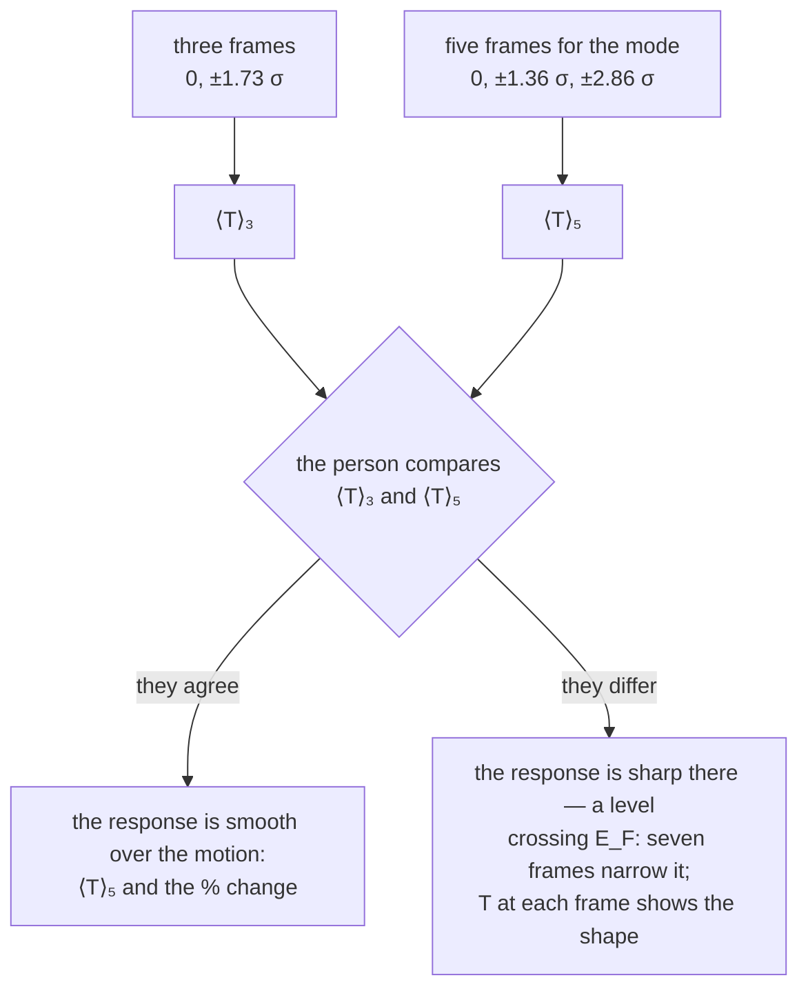

**Three, five or seven frames** *(the user, 2026-10-28)*: each rule a check
of the one before. Every frame is a device calculation and a transmission,
and frame 0 is taken over by an extension (§ 5.1).

**Why seven is the last rule offered.** Nine frames' outermost pair sits at
$\pm4.51\,\sigma$, each with weight $2\times10^{-5}$, where the molecule
spends $6\times10^{-6}$ of its time. That is also where the harmonic picture
is least sure (§ 7, assumption 1). A response that needs nine frames is one
whose shape across the frames tells more than one averaged number (§ 8).

A mode's own set is one mode at one rule, its weights summing to 1. So the check
is a second set of the same mode, at the same temperature and another rule,
and comparing the two is the person's.

**Computed by** — two sets of the same mode at one temperature,
`m.bind(states.thermal(temperature_k=T)).frames(3)` and `.frames(5)` — or
the command line's `--nodes 3` and `--nodes 5` — each written by
`write_frame_set` and computed by its own calculation; comparing their
averages is the person's, no call
([`engines/vibration-frames.md`](?doc=engines/vibration-frames.md) § 4,
§ 6). The table's row of the level at $E_F$, $g\sigma = 0.1$ eV, where
$T = 1/(1 + u^2)$:

```python
>>> import numpy as np
>>> from molbuilder.postprocess import dist
>>> rules = [dist.Gaussian(1.0).gauss_rule(m) for m in (3, 5, 7, 9, 11)]
>>> [round(float((w / (1 + x**2)).sum()), 3) for x, w in rules]         # the exact average is 0.656
[0.75, 0.692, 0.672, 0.664, 0.66]
```

### 5.4 Re-averaging the frames over another motion *(the user, 2026-10-29)*

*(The user, 2026-10-29: "or this can be a parameter in post-processing?";
"so essential information is in fact the deltaQ for each frame (normal mode
displacement), and then the weight will be determined by the shape of
statistics".)*

**What a frame is: its position along the mode.** Each frame's geometry is
frame 0 moved by $q_f$ along the mode, and its transmission $T_f(E)$ depends
on that geometry alone. The weight a frame carries is not the frame's: it is
the motion's — how much time the molecule spends near $q_f$ in the motion
being averaged over. The set's own weights are those of the state it was
written for (§ 2b.4) — a thermal set's, a bell curve's (§ 5.1). Once the frames have run, the same $T_f(E)$ can be
averaged over **another motion** with other weights, and no frame is
computed again.

**The motion** is any chain or distribution — a thermal state at another
temperature, $n$ quanta, a mean number of quanta, one photon on the warm
mode, the classical bell curve ([`engines/vibration-frames.md`](?doc=engines/vibration-frames.md) § 2, § 7).

**The weights.** With $m$ frames, the weights $w_f$ are the ones with which
the frames reproduce the motion's own averages of
$1, q, q^2, \dots, q^{m-1}$:

$$
\sum_f w_f\, q_f^{\,k} = \langle q^k\rangle \quad (k = 0, \dots, m-1),
$$

$\langle q^k\rangle$ the state's own — $\sigma^k(k-1)(k-3)\cdots1$ for a
bell curve, $\langle n\rvert\hat Q^k\lvert n\rangle$ for $n$ quanta (§ 2b.3),
zero for odd $k$. Then

$$
\langle T(E)\rangle = \sum_f w_f\, T_f(E)
$$

is **exact whenever $T(q)$ is a polynomial of degree $m-1$ or less** over the
motion — degree $m$ for an odd number of symmetric frames and a symmetric
motion, the odd average $\langle q^m\rangle$ vanishing on both. Frames placed for the
motion itself do better — degree $2m-1$ — so at the set's own state the
set's own weights are the answer, and these reproduce them; the toolkit
states the degree it checks the weights reproduce
(`d.weights_at(q).exact_to_degree`).

**How well — the contact bond of § 4.3**, $T = T_0\,e^{-aq}$ with
$a\sigma_T = 1$, frames written for a bell curve of spread $\sigma_T$ and
re-averaged over another state (computed 2026-11-25, the share of that state
beyond the outermost frame in brackets): one quantum exactly — the set
written at 0 K, $\sigma_T = Q_{\mathrm{zp}}$, re-averaged to the moment after
a photon on that cold mode — and the thermal state at a wider spread:

| the state re-averaged to | true average | a bell curve of the same spread | re-averaged: 3 / 5 / 7 frames |
|---|---|---|---|
| one quantum, $\sigma = \sqrt3\,\sigma_T$ | 3.2974 | 4.4817 (+36 %) | 2.9146 (39 % beyond) / 3.2933 (4.3 %) / 3.2974 (0.28 %) |
| thermal, $\sigma = 1.5\,\sigma_T$ | 3.0802 | — | 2.4359 (25 % beyond) / 2.9478 (5.7 %) / 3.0598 (1.2 %) |
| thermal, $\sigma = 2\,\sigma_T$ | 7.3891 | — | 3.5528 (39 % beyond) / 5.6780 (15 %) / 6.7898 (6.1 %) |

The bell curve of the same spread is the shape-blind answer of § 2a.3; the
re-averaged frames follow one quantum's shape, seven of them to the last
digit shown. A wider thermal state needs frames that reach it: at twice the
spread, seven frames still miss by 8 %.

**What it needs, each said beside the number** — items 1 and 2 for
frames placed for another motion; frames placed for the motion itself — its
own rule, or a set whose written weights are the motion's, an even rule's
set with its frame 0 at weight 0 among them — are the rule they were written
with, and neither is said of them (counted on every frame, so frames placed
for another motion whose weights happen to fall on a shorter rule of this
one, a node at weight 0, are still said of); item 3 for any frames; item 4
said by no rule of the weights' -- the person's to see in the frames' own
values:

1. **Frames that reach the motion.** The part of the motion beyond the
   outermost frames is averaged by values the frames never computed. **The
   share of the motion beyond them is said beside the number** — read from
   the motion's own distribution (its `cdf`), the column in brackets
   above — never refused: frames written at a higher temperature, or more
   of them, reach further (§ 5.1a). A thermal set's three frames reach
   $1.73\,\sigma$, five $2.86\,\sigma$, seven $3.75\,\sigma$ of the spread
   they were written at.
2. **Enough frames to see the shape.** Three frames carry only the curvature,
   and up to the curvature every state of the same spread agrees (§ 2a.3);
   with three, the re-averaged number is said to be blind to the shape.
3. **A weight below zero** — past rounding: a weight that is zero in exact
   arithmetic is none — says the frames do not suit the motion's shape
   well — re-averaging to the thermal state twice as wide, the seven frames
   weight their middle frame at −2.5 and their second pair at −0.73 each,
   the frames sitting too close in for that motion. It is said with the
   number, never refused.
4. **A response not smooth over the motion** — a level crossing $E_F$ — is
   averaged poorly by any weights (§ 5.3); the frames' own values, the family
   of curves, tell more.

**Where.** The re-averaging is an analysis of the frames' results: the
motion toolkit gives the weights from each frame's coordinate and the new
state ([`engines/vibration-frames.md`](?doc=engines/vibration-frames.md)
§ 7), and the frames' results are read from the calculation's data file,
where each frame's $q_f$ and $T_f(E)$ sit
([`engines/transport-postprocessing.md`](?doc=engines/transport-postprocessing.md)
§ 3.2). It writes nothing: the calculation's record keeps the set's own
average (§ 8).

**Computed by** — `m.bind(chain).weights_at(q, written=w)` → the weights of
a mode's frames for another state, a `dist.PointWeights`: `.weights`,
`.exact_to_degree`, `.beyond` (item 1), `.below_zero` (item 3), and
`.said`, items 1–3 in words; from a calculation's data file,
`weights_for_set(frame_rows(data_file), chain)` → the same for the set's
rows, and `reaveraged(data_file, chain)` → the frames' average at those
weights, nothing written
([`engines/vibration-frames.md`](?doc=engines/vibration-frames.md) § 7;
§ 9.1 `points_weights`).

```python
f = v.mode(7).bind(states.thermal(temperature_k=300.0)).frames(5)   # on a run of your own -- engines/vibration-frames.md § 7
w = v.mode(7).bind(states.level(1)).weights_at(f.q_amu12_ang[:, 0], written=f.weights)   # these frames, for one quantum
r = reaveraged(data_file, states.level(1))   # their calculation so averaged: r["transmission"], r["said"], r["assumptions"]
```

The table's first row with the generic tools — frames written at 0 K, in
units of $Q_{\mathrm{zp}}$, re-averaged to one quantum:

```python
>>> import numpy as np
>>> from molbuilder.postprocess import dist
>>> for m in (3, 5, 7):
...     q, _ = dist.Gaussian(1.0).gauss_rule(m)
...     pw = dist.Level(1).weights_at(q)
...     print(m, round(float((pw.weights * np.exp(-q)).sum()), 4), f"{100 * pw.beyond:.2g} % beyond")
3 2.9146 39 % beyond
5 3.2933 4.3 % beyond
7 3.2974 0.28 % beyond
```

### 5.5 Many modes: snapshots, their error, and antithetic pairs

Snapshots of the whole molecule (§ 2c.3) are drawn so that each counts the
same, and the set **stores** each one's weight, $w_f = 1/N$ — frame 0, the
relaxed geometry, at 0. The average is taken at the weights the set stores,
$\langle X\rangle \approx \bar X = \sum_f w_f X_f$, never at weights an
analysis counts out for itself *(the user, 2026-11-26: "weight is explicitly
calculated and saved with multiframe data, and is required")*. Unlike a
Gauss rule it is right for any response, and its error is statistical. For
**independent snapshots**, each frame's result of one spread,

$$
\text{error of } \bar X \approx \sqrt{\Big(\sum_f w_f^2\Big)\,
\frac{\sum_f w_f\,(X_f - \bar X)^2}{1 - \sum_f w_f^2}}
\;=\; \frac{s_X}{\sqrt N}\ \text{at } w_f = 1/N,
$$

$s_X$ the spread of the frames' own results, $s_X^2 = \frac{1}{N-1}\sum_f
(X_f - \bar X)^2$ — read from them, so the frames say how many more are
needed: four times the frames halve the error. Why the weighted form: for
independent $X_f$ of one variance $\sigma^2$, $\mathrm{Var}\,\bar X =
\sigma^2\sum_f w_f^2$, and $\sum_f w_f(X_f-\bar X)^2$ falls short of
$\sigma^2$ on average by the factor $1-\sum_f w_f^2$ — $\mathrm{E}(X_f-\bar
X)^2 = \sigma^2(1 - 2w_f + \sum_g w_g^2)$, summed at the weights — which the
denominator puts back; a frame of weight 0, frame 0, adds nothing to
either.

**Antithetic pairs.** In every state the toolkit draws from — thermal, $n$
quanta, any list over the levels — the molecule is as likely
displaced one way as the opposite way, every mode at once: a snapshot
$(Q_1, Q_2, \dots)$ and its mirror $(-Q_1, -Q_2, \dots)$ are equally likely.
So draw half the frames, and give each its mirror. Write the response as
$X = X_0 + X_1Q + X_2Q^2 + \dots$ (for one mode; the same holds term by term
for many): within each pair the odd terms — $X_1Q$, $X_3Q^3$, … — cancel
**exactly** — antithetic variates [HammersleyMorton1956], used on snapshots
of the modes in [ZachariasGiustino2016] — and only the even terms are left
to fluctuate. The weights stay equal, $1/N$ each.

**The error of a paired set** is the spread of the **pair means** — the
formula above over the pairs, each pair the weight of its two frames,
$W_j = w_{2j-1} + w_{2j}$, its mean $\bar X_j = (w_{2j-1}X_{2j-1} +
w_{2j}X_{2j})/W_j$: at equal weights $\tfrac12(X_{2j-1} + X_{2j})$, its
spread over $\sqrt{N/2}$ — never the frames' spread over $\sqrt N$: the two
frames of a pair are not independent, and that formula is wrong both ways.

**When pairs help, and when they hurt.** Split $X$ into its even and odd
parts (§ 4.1). Independent frames give the mean a variance
$\big[\mathrm{Var}(X_{\mathrm{even}}) + \mathrm{Var}(X_{\mathrm{odd}})\big]/N$;
pairs give $2\,\mathrm{Var}(X_{\mathrm{even}})/N$ — the odd part's variance
gone, the even part's doubled ([Owen2013] § 8.2, eq. 8.4). So pairs help a
response dominated by its odd part and can be up to $\sqrt2$ worse for an
even one:

| response, over a bell curve, $u = Q/\sigma$ | independent | pairs |
|---|---|---|
| § 4.1's, $T = 0.100 + 0.0115\,u + 0.0033\,u^2$ — mostly odd | $0.0124/\sqrt N$ | $0.0066/\sqrt N$ — the same error from 3.5 times fewer frames |
| a level at $E_F$ (§ 4.3, $g\sigma = 0.1$ eV), $T = 1/(1+u^2)$ — even | $0.265/\sqrt N$ | $0.374/\sqrt N$ — worse |

A mode that is not totally symmetric in a symmetric junction — of a
one-dimensional symmetry species — moves the response evenly, by symmetry,
and pairs double its share of the spread; but a snapshot moves every mode at
once, and whether pairs help the whole set depends on which share dominates,
the totally symmetric modes (the contact stretches, mostly linear) supplying
an odd one. **A paired set's own results say which**: the spread of the pair
means is the even part's, the spread of the pair half-differences
$\tfrac12(X_{2j-1} - X_{2j})$ the odd part's (`snaps.parts`,
[`engines/vibration-frames.md`](?doc=engines/vibration-frames.md) § 7).
Whether to pair is the person's (§ 3.3 there).

**More frames later.** The streams of a seed are drawn in blocks, each
mode's own (`engines/vibration-frames.md` § 3.3), so a larger count drawn
with the same seed begins with the smaller one's frames: more frames are the
same seed drawn further — the next $N$ snapshots, written as a set of their
own — or another seed. Averaged together, the two calculations' results
are put end to end, each set's frame 0 left out, and the error taken from
all their pairs (or frames) together — the arithmetic of
`sampling.mean_with_error` and `pair_means`, on the person's two arrays and
their weights: each set's own, summing to 1, scaled by the share the person
gives that set of the whole — $N_a/(N_a+N_b)$ and $N_b/(N_a+N_b)$ for two
sets drawn alike, as every weight is its maker's to state.
The values go in one per snapshot, in the order the snapshots were drawn;
with pairs each snapshot is followed by its mirror, and `pair_means` and
`even_odd_parts` group the values two by two themselves — values 1 and 2
the first pair, 3 and 4 the second:

$$
\bar X_j = \tfrac12\,(X_{2j-1} + X_{2j}),
\qquad
\Delta_j = \tfrac12\,(X_{2j-1} - X_{2j}),
\qquad j = 1 \dots N/2,
$$

at equal weights — the error of the average the spread of the $\bar X_j$
over $\sqrt{N/2}$, the even part the spread of the $\bar X_j$, the odd part
that of the $\Delta_j$, each spread at the pairs' weights $W_j$ (the
weighted form above, the sample spread at equal weights); an odd count is refused by name (most often a set's frame 0 left
in). The worked lines are `engines/vibration-frames.md` § 7's.

**The seed, and a set against its baseline.** Every set states the seed it
was drawn with, and the same seed gives the same frames, on the same numpy.
Each mode draws from its own stream of the seed, its normal numbers in one
block, so changing one mode's state — the photon's mode set apart with one
quantum — leaves every other mode's draws as they were, and the changed
mode's normal numbers are its baseline's own. Split a response into the
changed mode's part and the rest: **for a response that adds the modes'
effects**, the rest is the same in a set and its baseline and cancels
exactly in their difference; **where the effects multiply** — the contact
bond, § 2c.3's tunnelling — the rest scales the changed part and cancels
only in part: on § 2c.3's response, the stiff mode with one quantum against
its thermal state, the difference spreads 0.17 per frame with one seed,
against 0.11 for the changed mode's part alone and 1.43 with two seeds. So
one seed gives a far better difference than two; it beats either set's own
error only when the other modes move the result more than the changed mode
does — when the changed mode moves it most, the difference can be the
noisier number: on § 6's stiff example, one quantum against the thermal
state, the difference spreads 5.56 per frame with that mode's own draws
independent, against the one-quantum set's 5.11 and the baseline's 2.21,
and 2.93 with its normal numbers shared — the same error from 3.6 times
fewer frames.

**How many frames a difference needs**, $\varepsilon$ the error wanted:
for independent snapshots $(s_\Delta/\varepsilon)^2$, $s_\Delta$ the spread
of the frame-by-frame differences of a first set; for a paired set
$2(\bar s_\Delta/\varepsilon)^2$, $\bar s_\Delta$ the spread of the pairs'
mean differences. A small effect needs many: on § 2c.3's response, one
quantum on the stiff mode raises the average by 1.7 %, 0.021, the
differences spreading 0.17 per frame and 0.092 per pair — about 63 frames
independent and about 38 paired for an error the size of the effect, about
6300 and 3800 for a 10 % error, where 64 frames give an error the size of
the effect itself. (The pairs
cancel the difference's odd terms; its cross terms with the soft mode, even
under the full mirror, stay.) That mode's own two sets, three frames each
(§ 6), give its own relative effect, +1.67 %, from six — the same as the
snapshots' for a response whose modes multiply; the snapshot difference
adds what the cross terms change.

**Why a snapshot set is not re-weighted** for another motion. Re-weighting
frames drawn from one distribution, $P_{\mathrm{old}}$, to average over
another, $P_{\mathrm{new}}$, gives each frame the weight
$w = P_{\mathrm{new}}/P_{\mathrm{old}}$ at its geometry; the average stays
right, but its error grows: the frames count as $N/\langle w^2\rangle$
independent ones, $\langle w^2\rangle = \int P_{\mathrm{new}}^2/P_{\mathrm{old}}\,dQ$
the mean square weight over the old draws. For one mode drawn at its
zero-point width and re-weighted to one quantum, $w = x^2$
($x = Q/Q_{\mathrm{zp}}$) and $\langle w^2\rangle = \langle x^4\rangle = 3$: a
third of the frames count. Re-weighted to a bell curve $r$ times as wide,
$\langle w^2\rangle = 1/\big(r\sqrt{2-r^2}\big)$ — 1.11 at $r = 1.2$, 3.6 at
$r = 1.4$ — and none count from $r = \sqrt2$ on, the integral no longer
finite; every other mode whose state changes multiplies it. Another motion
is another set.

**Computed by** — `snaps.standard_error(values)` → the average at the
set's stored weights, its error — from the pair means where paired — and
the count; `snaps.parts(values)` → a paired set's even and odd shares of
the spread; on a person's own arrays and weights,
`sampling.mean_with_error(values, weights)`, `sampling.pair_means(values,
weights)` and `sampling.even_odd_parts(values, weights)`; more frames later,
`motion.sample(N, seed=, antithetic=, start=N)`
([`engines/vibration-frames.md`](?doc=engines/vibration-frames.md) § 3.3,
§ 7; § 9.1 module 4).

```python
est = snaps.standard_error(values)    # on a run of your own -- engines/vibration-frames.md § 7; values one per frame, frame 0 first
est.value, est.error, est.n
snaps.parts(values)                   # the even and odd shares: whether the pairs helped
more = motion.sample(64, seed=20261123, antithetic=True, start=64)   # the next 64, a set of their own
```

§ 2c.3's two pairs, split:

```python
>>> import numpy as np
>>> from molbuilder.postprocess import sampling
>>> [round(float(s), 4) for s in sampling.even_odd_parts(np.array([0.8956, 1.1166, 0.4889, 2.0452]), np.full(4, 0.25))]
[0.1845, 0.4721]
```

---

## 6. One mode, or the whole molecule — what each set answers

**A mode's own set** samples **one** mode: frame 0 and the mode's displaced
frames, **every frame stating its weight and the weights summing to 1**
*(user, 2026-10-09: "all weights should add up to 1 that's an explicit rule
within error tolerance")*:

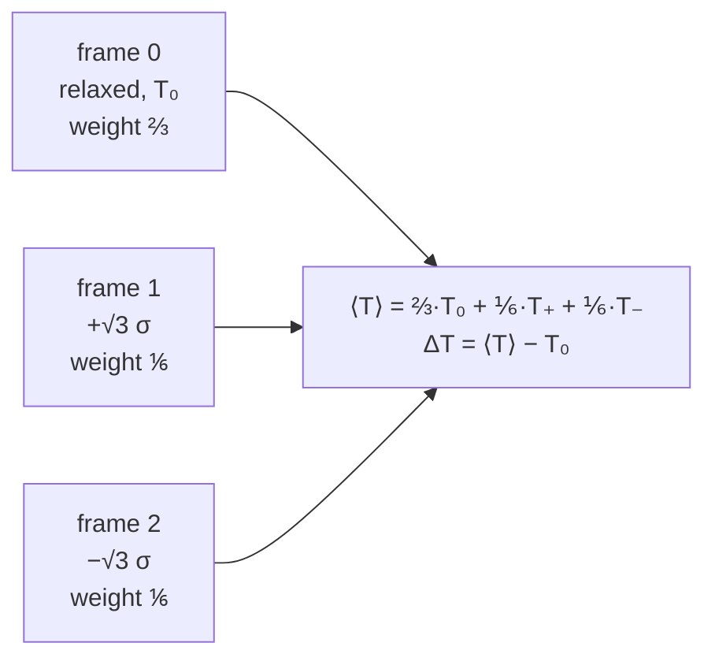

It answers how much that mode, in the state chosen, changes the result from
the relaxed geometry. **The excitation's own effect** is another number: the
relaxed geometry is not a state the molecule is ever in, and the mode's
zero-point and thermal motion already change the result. An excited mode's
own effect is its state's average against the same mode's state without the
excitation **at the same temperature** — the photon-added state against the
thermal one at the junction's temperature, one quantum exactly against that
one mode's thermal state, the others as they are. On a stiff mode the two
agree: a 1000 cm⁻¹ mode at 300 K, $aQ_{\mathrm{zp}} = 1$ on the contact
bond of § 4.3, has a thermal average of $1.66\,T_0$; one quantum gives
$3.30\,T_0$ and the photon-added state $3.34\,T_0$ — +230 % against the
relaxed geometry, +98 % against the thermal state for one quantum, +101 %
for the photon-added one, the excitation's own. **On a warm mode one quantum
exactly is not what a photon leaves** (§ 2d.4): a 50 cm⁻¹ mode at 300 K
($\bar n = 3.69$, $aQ_{\mathrm{zp}} = 0.3$) has a thermal average of
$1.458\,T_0$, the photon-added state $2.074\,T_0$ — +42 %, the photon's own
effect — and one quantum exactly $1.140\,T_0$, which would read −22 %.

**From two sets, or one set re-weighted.** The two states' averages come
best from two sets, each placed by its own state's rule and exact to degree
$2m - 1$. One set's results re-weighted to the other state (§ 5.4) are exact
to degree $m - 1$ at least ($m$ for an odd number of symmetric frames and a
symmetric state, § 5.4): on the stiff example, against the true +98 %, three frames
give +77 % (the thermal set re-weighted to one quantum) or +84 % (the
one-quantum set re-weighted to the thermal state), five +98 % or +100 %,
seven +98 % or +98 % — against two sets' +96 %, +98 % and +98 %. So the
one-calculation route needs five frames at least. Another mode is another
set.

**Snapshots of the whole molecule** answer the molecule's average at its
temperature, every mode moving at once, with a mode a photon excited where
one is set (§ 2c) — what the user asked for on 2026-11-23: *"a full displacement map of
all atoms with the included modes at specified temperature with thermal
equilibrium assumption"*. A snapshot moves the modes together, as the
harmonic picture's equilibrium does (§ 2c.1), and computes the property at
the geometry they make, so no cross-derivative
$\partial^2T/\partial Q_\nu\partial Q_\mu$ has to be known. Weighing one
mode's own set against another's stays the person's, as ruled on 2026-10-09:
*"it is cleaner and more focused to let user to post-process the results from
different vibrational mode and decide how they can be weighed to give an
overall impact"*.

**Computed by** — a mode's own sets, `m.bind(chain).frames(nodes)`, one state
each — `states.thermal(temperature_k=T)` and
`states.thermal(temperature_k=T).add_quantum()` for a photon's own effect —
each written by `write_frame_set` and computed by its own calculation; one
set's results for the other state, `reaveraged(data_file, chain)`, five
frames at least; the whole molecule,
`v.motion(chain).with_mode(k, …).sample(N, seed=, antithetic=)`
([`engines/vibration-frames.md`](?doc=engines/vibration-frames.md) § 3,
§ 4, § 5, § 7).

```python
warm = states.thermal(temperature_k=300.0)               # on a run of your own -- engines/vibration-frames.md § 4
for name, chain in (("thermal", warm), ("photon", warm.add_quantum())):
    write_frame_set(topic_dir("P", "structure") / f"m7-{name}-300K.xyz", v.mode(7).bind(chain).frames(3))
```

The examples' averages above, each state's own seven frames on the model
response $e^{-aQ}$, $aQ_{\mathrm{zp}} = 1$ on the stiff mode and 0.3 on the
warm one:

```python
>>> import numpy as np
>>> from molbuilder.postprocess import Oscillator, states, dist
>>> warm = states.thermal(temperature_k=300.0)
>>> for nu, a in ((1000.0, 1.0), (50.0, 0.3)):
...     averages = []
...     for chain in (warm, states.level(1), warm.add_quantum()):           # thermal, one quantum, a photon
...         x, w = dist.of_state(chain.on(Oscillator(nu))).gauss_rule(7)
...         averages.append(round(float((w * np.exp(-a * x)).sum()), 3))
...     print(nu, averages)
1000.0 [1.663, 3.297, 3.339]
50.0 [1.458, 1.14, 2.074]
```

---

## 7. What the picture assumes

*(Split by owner, the user's decision of 2026-11-26: "transport does
transport calculation and that's it".)* Each assumption is stated beside
the numbers it limits, never dropped, by the one that owns it. **What frames
of a vibration assume** — items 1–4 — the frame set states in its maker's
`assumptions` row, which every calculation carries as written
([`engines/vibration-frames.md`](?doc=engines/vibration-frames.md) § 5): its
harmonic modes and each mode's state, then one mode alone or the snapshots'
statistics, then the two sentences items 3 and 4 quote. **What any
calculation over frames assumes** — items 5–9, whatever made the frames —
transport states beside every average it takes, its own five, quoted as it
states them ([`engines/transport.md`](?doc=engines/transport.md) § 2a.12).

**A vibration's frame set, in its `assumptions` row:**

1. **Harmonic modes.** Each mode's $P(Q)$ is its state's (§ 2b.3) — in
   equilibrium § 2's Gaussian, at the temperature the person states: the
   junction's, or for a mode pumped at random moments its effective one
   (§ 2a.1, § 5) — and the modes move independently, a quantum two modes
   share aside (§ 2c.1, § 2c.2). A strongly
   anharmonic mode — a soft contact bond, softer outward than inward — has a
   *skewed* distribution, $\langle Q\rangle \neq 0$ and $\langle Q^3\rangle\neq0$,
   and then the odd part of $T$ no longer cancels: a second source of
   asymmetry, the distribution's own, which a harmonic frame set does not
   carry. Each frame's largest single-atom move, stated beside it
   (`normal-modes.md` § 4c.5), is what a person reads to see where it may
   matter. A mode holding many quanta is where it fails first: its ladder's
   gaps shrink as it climbs, so light at one frequency is resonant with one
   rung alone once the shift passes the line's width (§ 2a.2), and its
   positions leave the harmonic shapes. The command line and the spectrum
   tab say so beyond 1 eV in a
   mode, $\langle n\rangle h c\tilde\nu$ — far up its ladder
   ([`engines/vibration-frames.md`](?doc=engines/vibration-frames.md) § 6);
   a mark, not a bound: a soft stretch climbs several rungs below it, and a
   torsion leaves the harmonic picture near its barrier, which can be well
   below it (§ 2a.2).
2. **One mode alone, or a finite number of snapshots.** A mode's own set
   moves its one mode, every other at the relaxed geometry, and carries no
   statistical error — only its rule's degree, exact for a response
   polynomial up to degree $2m - 1$ (§ 5.3). A snapshot set moves the modes
   it includes, every mode left out at the relaxed geometry — an imaginary
   one named, having no harmonic state — and its average carries a
   statistical error (§ 5.5), computed by the analysis that reads the
   results (`engines/vibration-frames.md` § 7).
3. **The electron fast against the vibration.** *"Frames of a vibration:
   each is a geometry the electrons cross fast against the vibration, hbar
   omega << max(|e - E_F|, Gamma); the inelastic steps at eV = hbar omega
   and a strongly coupled level's polaron shift need the electron-vibration
   coupling and are not in a frame average."* A frozen geometry stands for
   the moment an electron crosses only where the electron crosses quickly
   against the vibration,
   $\hbar\omega \ll \max\big(|\varepsilon - E_F|,\ \Gamma\big)$. What a
   frame average cannot give — the inelastic steps at
   $eV = \hbar\omega$, a strongly coupled level's polaron shift — needs the
   electron–vibration coupling itself [Frederiksen2007, Galperin2007]
   (`vibration.md` § 5.6, level two).
4. **One state at every voltage.** *"The state is the same at every
   voltage: a bias that heats the modes the current couples to, or light
   that pumps them, is said by an effective temperature, measured, and
   stated as the set's."* A set carries one motion, the state it was made
   for, at every voltage. A finite bias can heat the modes the current
   couples to, and light can pump them at random moments (§ 2a.1); their
   spread is then said by an effective temperature, measured, not computed
   here, and stated as the set's temperature (§ 5) — one quantum exactly has
   no effective temperature for its shape (§ 2a.3).

**Any calculation over frames, beside its average — transport's own:**

5. **Static frames.** *"Static frames: each frame is a fixed geometry, and
   the transmission is computed at it with its atoms held still."* Why a
   fixed geometry stands for a moment of a vibration is item 3.
6. **One set of weights at every voltage.** *"One set of weights at every
   voltage: the average is taken over the frames at each voltage
   separately, each frame's weight the same at every voltage."*
   (`transport.md` § 2a.9, *Both axes*.) At low bias the averaged
   $T(E_F)$ is the averaged conductance.
7. **Each frame's electrons in their ground state for that frame** (the
   Born–Oppenheimer picture). *"Each frame's electrons in their ground
   state for that frame: every frame runs its own self-consistent device."*
8. **The level alignment is DFT's.** *"The level alignment is DFT's, frame
   by frame."* (`normal-modes.md` § 4c.6.)
9. **The electrodes do not move.** *"The electrodes do not move: the held
   atoms are the leads, shared by every frame."* (§ 1.) Their own
   vibrations are not among the modes.

**Computed by** — a frame set's row, from a calculation's data file,
`frame_rows(data_file).value("assumptions")`; transport's five beside its
average, the data file's `average_assumptions`
(`read_transport_data(data_file)`); and both with an average over another
state, `reaveraged(data_file, chain)["assumptions"]` — transport's, then
the set's, for the state it was written for
([`engines/vibration-frames.md`](?doc=engines/vibration-frames.md) § 5,
§ 7; [`engines/transport.md`](?doc=engines/transport.md) § 2a.12).

```python
frame_rows(data_file).value("assumptions")                       # a calculation of your own -- engines/vibration-frames.md § 7
read_transport_data(data_file)["attrs"]["average_assumptions"]   # transport's five
reaveraged(data_file, states.level(1))["assumptions"]            # transport's, then the set's
```

---

## 8. What is recorded where

**The frame set** — one pair, `.xyz` and `.molstruct.json` — states what
every frame is, each item with its meaning; the one home of each is
[`engines/vibration-frames.md`](?doc=engines/vibration-frames.md) § 5's
table ([`model/structure.md`](?doc=model/structure.md) § 2.2f):

- each frame's `weight`, the one row a calculation reads, beside the
  frame's measured rows;
- the maker's rows, the vocabulary of
  [`engines/vibration-frames.md`](?doc=engines/vibration-frames.md) § 5.1 —
  the recipe, the state, the mode or the seed, and the maker's
  `assumptions` (§ 7);
- where the frames came from: the provenance rows `vibration_run` and
  `vibration_result_sha256`; every atom's mass, the pair's `mass_amu`
  channel; and frame 0's `info.calculation`, the record of the relaxation
  its geometry came from;
- what made the frames, to make them again: a mode's own set's
  `info.state` — the chain or distribution it was bound from, the
  temperature its start took and where that came from — or a snapshot
  set's `info.sampling` — its `modes`, `background`, `frequency_scale`,
  each mode's `states`, the modes `set_apart`, the `mode_selection`, those
  `left_out`, the `notes`, `antithetic`, and each frame's coordinate along
  each mode, `q_amu12_ang`. `read_frame_set` binds the state again.

**A calculation over the frames** records each frame's result — the family
of curves — and the average at the stated weights, carrying the set's rows as
written, and derives nothing else across the frames: no slope or curvature
([`engines/transport.md`](?doc=engines/transport.md) § 2a.12, the user's
2026-10-10 ruling; § 5.3 says why). What is derived across the frames — a
slope, the curvature where the response is smooth, a comparison with another
set, an average over another motion (§ 5.4), a snapshot set's error (§ 5.5) —
is the analysis's, made on the calculation's data file, where every frame's
result sits beside its weight and its rows, and never written into the
record.

**Computed by** — `write_frame_set(path, frames)` → the pair, every item
above, and `Written(path, n_frames, said)`; `read_frame_set(path)` → the
set as written, its state or its motion bound again; `frame_rows(data_file)`
→ the rows a calculation carried, `.value(name, frame)` and `.weights`; the
analyses, written nowhere — `weights_for_set(rows, chain)`,
`reaveraged(data_file, chain)`, `snaps.standard_error(values)`,
`snaps.parts(values)`
([`engines/vibration-frames.md`](?doc=engines/vibration-frames.md) § 5,
§ 7; [`engines/transport-postprocessing.md`](?doc=engines/transport-postprocessing.md)
§ 3.2).

```python
f = v.mode(7).bind(states.thermal(temperature_k=300.0)).frames(3)   # on a run of your own -- engines/vibration-frames.md § 5
written = write_frame_set(topic_dir("P", "structure") / "m7-300K.xyz", f)
again = read_frame_set(written.path)       # as written, frame 0 first: again.weights, again.mode_distribution.words
rows = frame_rows(data_file)               # the calculation's copy: rows.value("vibration_run"), rows.weights
```

---

## References

Each article checked against Crossref and each book against its publisher's
or a library's record, 2026-10-28 (the eight added 2026-11-23, likewise; Owen's
book against its author's page, 2026-11-23); each is in `references.bib`.

- [Feynman1972] R. P. Feynman, *Statistical Mechanics: A Set of Lectures*
  (W. A. Benjamin, Reading, Mass., 1972; Frontiers in Physics 36), ch. 2,
  "Density Matrices", § 2.5, the linear harmonic oscillator — its thermal
  density matrix, whose diagonal is the bell curve of § 2 and § 2a.1.
- [AbramowitzStegun1964] M. Abramowitz and I. A. Stegun, *Handbook of
  Mathematical Functions* (NBS Applied Mathematics Series 55, 1964),
  eq. 25.4.46 (p. 890) and Table 25.10 (p. 924) — Gauss–Hermite nodes and
  weights (§ 5.1).
- [DLMF] *NIST Digital Library of Mathematical Functions*,
  https://dlmf.nist.gov/, eq. 18.18.28 — Mehler's formula, the thermal
  state's sum of its number states (§ 2d.3).
- [Glauber1963] R. J. Glauber, *Phys. Rev.* **131**, 2766–2788 (1963),
  doi:10.1103/PhysRev.131.2766 — coherent states, the name and the states,
  in the radiation field (§ 2a.2).
- [CohenTannoudji2020] C. Cohen-Tannoudji, B. Diu, F. Laloë, *Quantum
  Mechanics, Volume I: Basic Concepts, Tools, and Applications*, 2nd ed.
  (Wiley-VCH, Weinheim, 2020), Complement G$_\mathrm{V}$, "Coherent
  'quasi-classical' states of the harmonic oscillator" — the ground state's
  bell curve carried along the classical motion (§ 2a.2).
- [CarruthersNieto1965] P. Carruthers, M. M. Nieto, *Am. J. Phys.* **33**,
  537–544 (1965), doi:10.1119/1.1971895 — a classical push leaves a harmonic
  mode that starts in its ground state in a coherent state (§ 2a.2).
- [HammersleyMorton1956] J. M. Hammersley, K. W. Morton, *Proc. Camb. Phil.
  Soc.* **52**, 449–475 (1956), doi:10.1017/S0305004100031455 — antithetic
  variates, the method of mirrored draws (§ 5.5).
- [Zavatta2007] A. Zavatta, V. Parigi, M. Bellini, *Phys. Rev. A* **75**,
  052106 (2007), doi:10.1103/PhysRevA.75.052106 — the single-photon-added
  thermal state of light, whose name § 2d.4 borrows for a vibration's
  quantum; checked against Crossref 2026-11-24.
- [Forst2011] M. Först, C. Manzoni, S. Kaiser, Y. Tomioka, Y. Tokura,
  R. Merlin, A. Cavalleri, *Nature Phys.* **7**, 854–856 (2011),
  doi:10.1038/nphys2055 — an intense mid-infrared pulse driving an
  infrared-active mode coherently, nonlinear phononics (§ 2a.2); checked
  against Crossref 2026-11-25.
- [Cocker2016] T. L. Cocker, D. Peller, P. Yu, J. Repp, R. Huber, *Nature*
  **539**, 263–267 (2016), doi:10.1038/nature19816 — terahertz-pulse
  scanning tunnelling microscopy of one molecule's vibration, read at a set
  delay (§ 2a.2); checked against Crossref 2026-11-25.
- [Morse1929] P. M. Morse, *Phys. Rev.* **34**, 57–64 (1929),
  doi:10.1103/PhysRev.34.57 — the anharmonic ladder, its gaps shrinking a
  rung at a time (§ 2a.2); checked against Crossref 2026-11-24.
- [GolubWelsch1969] G. H. Golub, J. H. Welsch, *Math. Comp.* **23**,
  221–230 (1969), doi:10.1090/S0025-5718-69-99647-1 — a distribution's Gauss
  rule from its recurrence, as an eigenvalue problem (§ 2a.3, § 2b.4).
- [Gautschi1982] W. Gautschi, *SIAM J. Sci. Stat. Comput.* **3**, 289–317
  (1982), doi:10.1137/0903018 — a distribution's recurrence from a discrete
  distribution holding its averages, by the Lanczos (Stieltjes) recurrence
  (§ 2a.3, § 2e.3).
- [PatrickGiustino2013] C. E. Patrick, F. Giustino, *Nat. Commun.* **4**,
  2006 (2013), doi:10.1038/ncomms3006 — properties averaged over the
  harmonic nuclear distribution by random snapshots of every mode (§ 2c.3).
- [ZachariasPatrickGiustino2015] M. Zacharias, C. E. Patrick, F. Giustino,
  *Phys. Rev. Lett.* **115**, 177401 (2015),
  doi:10.1103/PhysRevLett.115.177401 — the stochastic, equal-weight
  average over snapshots of the modes (§ 2c.3).
- [ZachariasGiustino2016] M. Zacharias, F. Giustino, *Phys. Rev. B* **94**,
  075125 (2016), doi:10.1103/PhysRevB.94.075125 — snapshots in mirrored
  pairs, whose odd contributions cancel (§ 5.5).
- [Owen2013] A. B. Owen, *Monte Carlo theory, methods and examples* (2013),
  https://artowen.su.domains/mc/, ch. 8, § 8.2, eq. 8.4 — antithetic sampling
  removes the odd part's variance and doubles the even part's (§ 5.5).
- [Frederiksen2007], [Galperin2007] — inelastic transport and the
  electron–vibration coupling (`references.bib`).
- [Kneipp1996] K. Kneipp, Y. Wang, H. Kneipp, I. Itzkan, R. R. Dasari,
  M. S. Feld, *Phys. Rev. Lett.* **76**, 2444–2447 (1996),
  doi:10.1103/PhysRevLett.76.2444 — vibrational pumping by surface-enhanced
  Raman scattering (§ 2a.1).
- [LeRuEtchegoin2006] E. C. Le Ru, P. G. Etchegoin, *Faraday Discuss.*
  **132**, 63–75 (2006), doi:10.1039/b505343a — when that pumping is real
  (§ 2a.1).
- [Ward2011] D. R. Ward, D. A. Corley, J. M. Tour, D. Natelson, *Nature
  Nanotechnol.* **6**, 33–38 (2011), doi:10.1038/nnano.2010.240 — mode
  temperatures in biased junctions, from the anti-Stokes/Stokes ratio
  (§ 2a.1).
