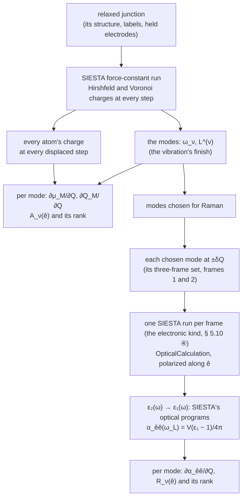

# The optical activity of a SIESTA vibration — infrared and Raman

**Role:** science reference — a method; the charges it reads are written
since 2.35.2, the rest is not built
**Domain:** science
**Companions:** [`engines/vibration.md`](?doc=engines/vibration.md) § 5.3 (the
force-constant input) and § 5.10 ② (the charge each mode moves) and ③ (a
mode's frames); [`vibrational-averaging.md`](?doc=science/vibrational-averaging.md)
§ 5 and § 2a (the displacement); [`normal-modes.md`](?doc=science/normal-modes.md)
§ 4b.7 (why SIESTA offers no infrared or Raman today); `plans/plan.md` § 1ac.

*Written 2026-10-24 at the user's request: "we need a new method document for
this, science, procedure design, and quantitative explanation, all formula
should be latex and checked, with diagram of workflow and explanation of
dependency". Its scope, the user's: "it is simple: siesta calculate correctly
optical activity and evalaute the displacement"; "all i asked is a vibration
calculation, assumed an EM in the vacuum"; "here we focus for a unit EM
intensity with a specific direction how the molecule respond".*

---

## 0. The question, and the answer in short

A SIESTA vibration gives a junction's modes: the molecule and the metal atoms
left free beside it move, the electrodes are held. **Which modes are infrared-
or Raman-active, and how strong is each relative to the others**, for light
in vacuum polarized along a direction $\hat e$ the person chooses?

Both come from SIESTA alone, from the electronic structure at the mode's
displaced geometries — **no field is applied, and no other calculation
enters**:

| | what decides it | where SIESTA gives it |
|---|---|---|
| **infrared** (§ 2) | how the dipole changes along the mode | the charges SIESTA prints at every step of the vibration's own force-constant run |
| **Raman** (§ 3) | how the polarizability changes along the mode | SIESTA's optical calculation — its response to light, from its own states — in one run per frame of the mode's three-frame set (`engines/vibration.md` § 5.10 ④, not built) |
| **the displacement** (§ 4) | where the frames along a mode sit | the vibration result itself |

**Which atoms.** The modes are defined on the **free set** $F$, every atom the
vibration moves. The infrared dipole is the **molecule's**, $M$: the atoms of
a label the person names (`BDT` on the AuBDTAu junction); the free metal atoms
move in the modes, and when they move the molecule's charges change — that is
counted — but their own charges are the metal's and are not.

---

## 1. The quantities

| symbol | what it is | unit |
|---|---|---|
| $F$ | the free set: every atom the vibration moves | — |
| $M$ | the molecule: the atoms of the label the person names | — |
| $m_k$ | atom $k$'s mass, as the vibration result states it | amu |
| $\omega_\nu$ | mode $\nu$'s frequency, as the result states it | cm$^{-1}$ |
| $\mathbf L^{(\nu)}$ | mode $\nu$'s displacement pattern over $F$, normalised with the masses, $\sum_{k\in F} m_k\,\lvert\mathbf L_k^{(\nu)}\rvert^2 = 1$ (`engines/vibration.md` § 6.3); zero on every held atom | amu$^{-1/2}$ |
| $Q_\nu$ | how far the structure is moved along mode $\nu$: atom $k$ moves by $Q_\nu\,\mathbf L_k^{(\nu)}$ | amu$^{1/2}$ Å |
| $q_a$ | atom $a$'s partial charge: its valence charge less the electrons a partition gives it — positive where electrons left it; by Hirshfeld [Hirshfeld1977] or Voronoi [FonsecaGuerra2004], both computed (§ 1a) | $e$ |
| $\bar{\mathbf r}_M^{\,0}$ | the molecule's centre at equilibrium, $\frac{1}{N_M}\sum_{a\in M}\mathbf r_a^0$ — a fixed point | Å |
| $\hat e$ | the direction of the light's field, the person's choice | — |
| $\varepsilon_{\hat e\hat e}(\omega)$ | the cell's dielectric function for a field along $\hat e$, $\varepsilon_1 + i\varepsilon_2$ | — |
| $V_{\mathrm{cell}}$ | the cell's volume | ų |
| $\omega_L$ | the laser's frequency, the person's | eV |

### 1a. The two charge partitions — Hirshfeld and Voronoi

*(Decided by the user, 2026-10-24: "both on"; "default to hirshfeld".)*
**Both are computed in every run this method uses, every number is stated
with the partition it came from, and Hirshfeld is the one shown unless the
person picks Voronoi.**

**What they share.** Both give each atom a charge, and both start from the
same thing — how the electrons moved when the atoms bonded: the real electron
density $\rho$ less the density the same atoms would have as neutral, isolated
atoms,

$$
\Delta\rho(\mathbf r) = \rho(\mathbf r) - \sum_{b} \rho_b^{\mathrm{free}}(\mathbf r) .
$$

(SIESTA works with the valence electrons; $\rho_b^{\mathrm{free}}$ is atom
$b$'s neutral valence density on its own basis.) A charge of $+0.1\,e$ means
the atom ended with 0.1 electron fewer than it had alone. **The two differ
only in how they share $\Delta\rho$ between neighbouring atoms**:

$$
q_a^{\mathrm{Hirshfeld}} = -\int w_a(\mathbf r)\,\Delta\rho(\mathbf r)\,d\mathbf r,
\quad w_a(\mathbf r) = \frac{\rho_a^{\mathrm{free}}(\mathbf r)}{\sum_b \rho_b^{\mathrm{free}}(\mathbf r)} ;
\qquad
q_a^{\mathrm{Voronoi}} = -\int_{V_a} \Delta\rho(\mathbf r)\,d\mathbf r ,
$$

$V_a$ the points nearer to atom $a$'s nucleus than to any other.

- **Voronoi draws a hard wall.** Every point belongs to the nearest nucleus —
  by distance alone, whatever the atoms' sizes — so on the S–Au bond the wall
  sits exactly halfway between the two nuclei, and each atom takes all the
  moved charge on its side (a point exactly on the wall is shared equally).
- **Hirshfeld shares softly.** At each point it asks how much density a lone
  neutral S and a lone neutral Au would each have there, and splits the moved
  charge in that ratio: near S, S takes nearly all of it; at the bond's middle
  it is shared; near Au, Au takes it — no wall, a split that changes smoothly
  through the bond.

Both are read in SIESTA 5.4.2's source (`partial_charges.F90`: Voronoi
subtracts the neutral-atom density at each grid point and gives the rest to
the nearest atom; Hirshfeld weights the density by $w_a$); the Hirshfeld form
above follows because $w_a\sum_b\rho_b^{\mathrm{free}} = \rho_a^{\mathrm{free}}$
integrates to the atom's valence charge.

**What it means for this method.**

1. **Every number changes with the partition.** The molecule's charge
   depends on where the S–Au boundary is drawn, and that boundary is a
   convention — no partition is the true one. What should not change is the
   ranking of the modes; where it does, that is a finding — the ranking is
   then set by how the bond is split, not by the molecule.
2. **Smoothness as atoms move.** The derivatives compare charges at
   geometries $2\delta$ = 0.042 Å apart. Under Voronoi the wall moves with the
   atoms and points of SIESTA's grid jump from one atom to the other; under
   Hirshfeld the shares change gradually, so its derivatives are expected to
   be less noisy — the reason it is shown first. This is expected, not yet
   measured; a displacement sweep (§ 6) shows it, where one is run.
3. **The cost is the same and small**: each is a sum over SIESTA's grid after
   every step, with no extra self-consistent solution, and both are asked for
   in the same run.

---

## 2. Infrared — the dipole change along a mode

### 2.1 The molecule's charge and dipole

**Why partial charges.** The cell's own dipole is not defined for a periodic
metal, and the Born effective charges SIESTA can compute come from the
Berry-phase polarization, which is defined for an insulator [KingSmith1993]
(SIESTA 5.4.2 manual, `BornCharge` and `PolarizationGrids`: the system "must be
an insulator"; `normal-modes.md` § 4b.7); the charges of the molecule's own atoms are
defined in any cell. From them, at any geometry $R$:

$$
Q_M(R) = \sum_{a\in M} q_a(R),
\qquad
\boldsymbol\mu_M(R) = \sum_{a\in M} q_a(R)\,\bigl(\mathbf r_a(R) - \bar{\mathbf r}_M^{\,0}\bigr).
$$

As the molecule vibrates, its electrons shift at the bonds to the metal, so
$Q_M$ changes along a mode (the user: "the bridge's charge transfer (electron
density) correctly calculated in different modes"). Two numbers are reported
for each mode:

- **the dipole change** $\partial\boldsymbol\mu_M/\partial Q_\nu$, taken about
  the molecule's own fixed centre — no point outside the molecule enters it;
- **the charge the mode moves** $\partial Q_M/\partial Q_\nu$ between the
  molecule and the metal — beside it, not folded in: its dipole depends on
  where in the metal the charge comes from, which these charges do not say.
  (`engines/vibration.md` § 5.10 ② reads the same charges for the whole free
  set and each element in it; this is the molecule's.)

### 2.2 Read from the force-constant run, with no extra calculation

SIESTA's force-constant run moves each free atom $k$ by $\pm\delta$ along x,
y and z in turn (`FC.Displacement`, 0.04 bohr = 0.0212 Å by default) and
solves the electrons self-consistently at each step. With
`Charge.Hirshfeld geometry` and `Charge.Voronoi geometry` in its input —
written there since 2.35.2 (`engines/vibration.md` § 5.3) — SIESTA prints
every atom's partial charge, by both partitions, "at the end of every geometry
step" (SIESTA 5.4.2 manual, `Charge.Hirshfeld`; `grdsam.F`), to $10^{-6}\,e$
(`partial_charges.F90`), each column summing to zero for a neutral cell.

By central differences, each displaced geometry's dipole taken at that
geometry's own positions — so both the charges changing and the charged
atoms moving are counted:

$$
\frac{\partial\boldsymbol\mu_M}{\partial R_{k\beta}}
\approx \frac{\boldsymbol\mu_M(R^{+}_{k\beta}) - \boldsymbol\mu_M(R^{-}_{k\beta})}{2\delta},
\qquad
\frac{\partial Q_M}{\partial R_{k\beta}}
\approx \frac{Q_M(R^{+}_{k\beta}) - Q_M(R^{-}_{k\beta})}{2\delta},
$$

where $R^{\pm}_{k\beta}$ is the geometry with free atom $k$ moved by
$\pm\delta$ along $\beta \in \{x, y, z\}$. Every free atom counts, the metal
ones too: moving a free gold atom changes the molecule's charges. Projected
onto each mode,

$$
\frac{\partial\boldsymbol\mu_M}{\partial Q_\nu}
= \sum_{k\in F}\sum_{\beta} \frac{\partial\boldsymbol\mu_M}{\partial R_{k\beta}}\;L^{(\nu)}_{k\beta},
\qquad
\frac{\partial Q_M}{\partial Q_\nu}
= \sum_{k\in F}\sum_{\beta} \frac{\partial Q_M}{\partial R_{k\beta}}\;L^{(\nu)}_{k\beta}.
$$

Every mode's values come out of the one run that gave the modes, once for
each partition.

### 2.3 The infrared strength for a unit field along $\hat e$

For a molecule held in one orientation, in light whose field points along
$\hat e$, mode $\nu$'s integrated absorption is

$$
A_\nu(\hat e) = \frac{N_A}{4\varepsilon_0 c^2}\,
\Bigl(\hat e\cdot\frac{\partial\boldsymbol\mu_M}{\partial Q_\nu}\Bigr)^{2}
= 126.768\ \tfrac{\mathrm{km}}{\mathrm{mol}}
\times \Bigl(\hat e\cdot\frac{\partial\boldsymbol\mu_M}{\partial Q_\nu}\Bigr)^{2} ,
$$

with the derivative in D Å$^{-1}$ amu$^{-1/2}$ (a charge of $e$ moved 1 Å is
4.8032 D, so a derivative in $e$ amu$^{-1/2}$ is multiplied by 4.8032). A free
molecule tumbles in the light, and its average over orientations is the
familiar $\frac{N_A}{12\varepsilon_0 c^2}\lvert\partial\boldsymbol\mu/\partial Q\rvert^2
= 42.256\ \mathrm{km/mol}$ per $(\mathrm D/\text{Å})^2/\mathrm{amu}$
[Porezag1996] — a third of the value above, since a tumbling dipole lies along
the field a third of the time; held in the junction, it does not tumble. (Both
prefactors computed from the CODATA constants.)

**Reported**: $A_\nu(\hat e)$ for every mode, and
$A_\nu(\hat e)/\max_{\nu'}A_{\nu'}(\hat e)$; the charge the mode moves beside
it.

---

## 3. Raman — the polarizability change along a mode

### 3.1 The polarizability at one geometry, from SIESTA's own states

The polarizability is a property of the electrons at a geometry: how far
light of a given polarization and frequency would shift them. **It is
computed from the states SIESTA has already solved — no field is applied.**
SIESTA's optical calculation does exactly this:

- `OpticalCalculation true`, with `Optical.PolarizationType polarized` and
  `Optical.Vector` $\hat e$: the imaginary part of the dielectric function for
  a field along $\hat e$, $\varepsilon_{2,\hat e\hat e}(\omega)$, "using first
  order perturbation theory" from "the dipolar transition matrix elements
  between different eigenfunctions of the self-consistent Hamiltonian", in the
  momentum formulation for a solid — a cell periodic in three directions, as
  the junction's is (SIESTA 5.4.2 manual, `OpticalCalculation`;
  `Src/optical.F`). It covers the transitions between different states
  (interband) and is written to `<label>.EPSIMG`, with the plasma frequency
  $\omega_p^2$ of the transitions within a band in its header.
- The real part follows by the Kramers–Kronig relation — SIESTA's own
  programs `optical_input` and `optical` (`Util/Optical`; in the
  `molbuilder-siesta` env's `bin`, and in the source build's `siesta/bin`),
  which also transform it back, a check of the transformation
  (`e2.interband.out`).
- **A cell with metal also needs the transitions within a band** — SIESTA's
  README: a Drude term, $-\omega_p^2/\bigl(\omega(\omega + i\Gamma)\bigr)$ in
  $\varepsilon$, with $\omega_p^2$ from SIESTA and the damping $\Gamma$ "an
  empirical parameter, the inverse of the relaxation time" — a value the
  person states, never one this method picks.

At the laser's frequency, the cell's polarizability along $\hat e$, as a
polarizability volume:

$$
\alpha_{\hat e\hat e}(\omega_L) = \frac{V_{\mathrm{cell}}}{4\pi}\,
\bigl[\varepsilon_{1,\hat e\hat e}(\omega_L) - 1\bigr] .
$$

(From $\mathbf P = \varepsilon_0(\varepsilon_r - 1)\mathbf E$, a dipole
$\mathbf P V_{\mathrm{cell}}$, divided by $4\pi\varepsilon_0$.) SIESTA computes
the optical response once, after a run's last step, for its final geometry
(`siesta.F` calls `siesta_analysis` once, after the run), so **each geometry
is its own run**: the force-constant run cannot give it at its displaced
steps.

### 3.2 Its change along a mode, and the Raman strength

The two geometries at $\pm\delta Q$ along mode $\nu$ are frames 1 and 2 of
the mode's three-frame set (`engines/vibration.md` § 5.10 ③) written with its
maximum displacement set to $\delta$: every free atom moved by
$\pm\delta Q\,\mathbf L_k^{(\nu)}$, $\delta Q = \delta/\max_k\lvert\mathbf L_k^{(\nu)}\rvert$,
the one that moves most by $\delta$. The runs are the `electronic` kind's
(`engines/vibration.md` § 5.10 ④, decided, not built): one SCF per frame of
the set, in the vibration's cell and at its settings, with the optical
calculation added to its input — three runs a mode, frame 0 the same geometry
for every mode.

$$
\frac{\partial\alpha_{\hat e\hat e}}{\partial Q_\nu}
\approx \frac{\alpha_{\hat e\hat e}(+\delta Q) - \alpha_{\hat e\hat e}(-\delta Q)}{2\,\delta Q},
\qquad
R_\nu(\hat e) = \Bigl(\frac{\partial\alpha_{\hat e\hat e}}{\partial Q_\nu}\Bigr)^{2}
\quad[\text{Å}^4/\mathrm{amu}] .
$$

$R_\nu(\hat e)$ is the Raman strength for light polarized along $\hat e$,
incoming and scattered. The textbook Raman activity $45a'^2 + 7\gamma'^2$
[Porezag1996] — $a'$ the mean of the polarizability's derivative, $\gamma'$
its anisotropy — is a tumbling molecule's, averaged over orientations and
summed over both scattered polarizations. The same $\hat e\hat e$ component,
averaged over orientations, is
$\langle\alpha'^{\,2}_{\hat e\hat e}\rangle = (45a'^2 + 4\gamma'^2)/45$
(checked by sampling random rotations of a random tensor): related, not the
same number.

**Reported**: $R_\nu(\hat e)$ for each chosen mode, and
$R_\nu(\hat e)/\max_{\nu'}R_{\nu'}(\hat e)$.

### 3.3 What the optical calculation is, and is not

- **Independent states.** SIESTA's "simplest approach": transitions between
  the self-consistent states, with no correction for the field the response
  itself creates (no local-field effects).
- **The whole cell's response.** The cell holds metal, and the metal's
  response is in $\varepsilon$ at both geometries. What the mode does not
  change cancels between $\pm\delta Q$ — the held electrodes do not move — but
  the derivative is then a small difference of large numbers; how far it
  stands above the k-point mesh, the broadening and the band count is the
  person's judgement, with the settings stated beside the value.
- **Kramers–Kronig needs the whole spectrum**: $\varepsilon_2$ up to
  `Optical.Energy.Maximum` over enough bands (`Optical.NumberOfBands`); the
  back-transform of `optical` says how well it held.

---

## 4. The displacement

The frames along a mode sit where the person's **maximum displacement** puts
them: the move, at the outermost frames, of the atom that moves most in the
mode. Its reference at the experiment's temperature T, from the vibration
result alone, is the displacement whose frames sample the mode's thermal
spread (`vibrational-averaging.md` § 5),

$$
d_T = \sqrt2\,x_{\mathrm{out}}\;Q_{\mathrm{zp}}\sqrt{\coth\!\left(\frac{\hbar\omega}{2k_BT}\right)}\;\max_k\lvert\mathbf L_k\rvert
\qquad (\sqrt3\,\sigma_T\max_k\lvert\mathbf L_k\rvert \text{ for three frames}),
$$

and a mode driven by light spreads further (`vibrational-averaging.md` § 2a).
The Raman difference of § 3.2 is a derivative, not an average: its step is
the force-constant run's own $\delta$, in the same linear range.

---

## 5. The procedure

| step | what runs | cost |
|---|---|---|
| infrared, every mode | the force-constant run as it is; the finish reads the charges | none beyond reading |
| Raman, chosen modes | the `electronic` kind on each mode's three-frame set: one self-consistent solution and the optical calculation per frame | 3 runs a mode (frame 0 the same for every mode) |

---

## 6. Numerical choices, and their checks

Every choice is stated beside the values it gave; the checks below cost
nothing beyond reading what the runs wrote.

| choice | proposed | check |
|---|---|---|
| $\delta$ (`FC.Displacement`) | the run's own, 0.0212 Å by default | where the person runs a displacement sweep (`engines/vibration.md` § 5.9), the charge derivatives are read at each of its steps, as the force constants are |
| the charges' grain | Hirshfeld or Voronoi charges are integrated on SIESTA's real-space mesh, so an atom moved by $\delta$ against the mesh changes its charge a little even with no physics behind it | the same sweep, where it is run |
| $\delta Q$ for Raman | $\delta/\max_k\lvert\mathbf L_k^{(\nu)}\rvert$ — the largest atom moved by $\delta$, the force constants' own linear range | — |
| `Optical.Mesh`, `Optical.Broaden`, `Optical.NumberOfBands`, `Optical.Energy.Maximum`; the Drude damping $\Gamma$ | the person's, stated with every value | the Kramers–Kronig back-transform (`e2.interband.out`) |
| the charge sum | — | at every step the charge column over all atoms sums to zero (measured, § 7) |

---

## 7. What is measured, and what is not yet

**Measured** (2026-10-24, the toy junction `claude-transport-walk`: a chain
of 22 hydrogen atoms, its middle two free) — **the charges at every
force-constant step**: the vibration `frequency/h-vib-q`, through jobset, its
input asking for both partitions (2.35.2): 13 steps, 13 Hirshfeld and 13
Voronoi blocks, every atom in each, each summing to zero within
1.2 × 10⁻⁵ e. A free atom moved across the chain leaves the charges unchanged
both ways; moved along it, it changes them with opposite signs — as the
chain's symmetry asks. Molbuilder's reader reads the output without a
warning, and the modes are the earlier run's to the last digit.

**Not yet shown — the proof before anything is built**: on a molecule whose
answer is known independently, SIESTA's infrared (§ 2) and Raman (§ 3)
against PySCF's, which molbuilder computes already (`engines/vibration.md`
§ 4): water in a box, the same modes, compared mode by mode and in rank. The
Raman half needs SIESTA runs at single displaced geometries, a calculation
kind molbuilder does not have yet (`engines/vibration.md` § 5.10 ④, decided,
not built). **What water cannot prove**: SIESTA computes an isolated
molecule's optical response with the position operator and a solid's in the
momentum formulation (its manual, `OpticalCalculation`); water in a box takes
the first, the junction the second, so the Raman comparison checks the chain
from the response to $R_\nu$, not the junction's formulation.

---

## 8. What the method assumes

1. **Point charges** (infrared): the molecule's dipole is its atoms' partial
   charges at their positions; each atom's own dipole is not in it, and two
   partitions give two answers.
2. **Independent states** (Raman): SIESTA's optical calculation, without
   local-field effects (§ 3.3).
3. **The whole cell's response** (Raman), the metal included; what the mode
   does not change cancels in the difference. For metal, a Drude damping
   $\Gamma$ the person states.
4. **Harmonic modes**, and derivatives taken in their linear range.

---

## References

Each checked against Crossref, 2026-10-24.

- [Hirshfeld1977] F. L. Hirshfeld, *Theor. Chim. Acta* **44**, 129–138
  (1977), doi:10.1007/BF00549096 — bonded-atom (Hirshfeld) partial charges.
- [FonsecaGuerra2004] C. Fonseca Guerra, J.-W. Handgraaf, E. J. Baerends,
  F. M. Bickelhaupt, *J. Comput. Chem.* **25**, 189–210 (2004),
  doi:10.1002/jcc.10351 — Voronoi deformation density charges, assessed
  against Mulliken, Bader and Hirshfeld.
- [KingSmith1993] R. D. King-Smith, D. Vanderbilt, *Phys. Rev. B* **47**,
  1651–1654 (1993), doi:10.1103/PhysRevB.47.1651 — the Berry-phase
  polarization of an insulator.
- [Porezag1996] D. Porezag, M. R. Pederson, *Phys. Rev. B* **54**, 7830–7836
  (1996), doi:10.1103/PhysRevB.54.7830 — infrared intensities and Raman
  activities in density-functional theory.
- SIESTA 5.4.2 manual, `OpticalCalculation`, `Optical.*` and
  `Charge.Hirshfeld`; its source `Src/optical.F`, `Src/partial_charges.F90`,
  `Src/grdsam.F`, `Src/siesta_analysis.F90`, `Src/siesta.F`;
  `Util/Optical/README`.
