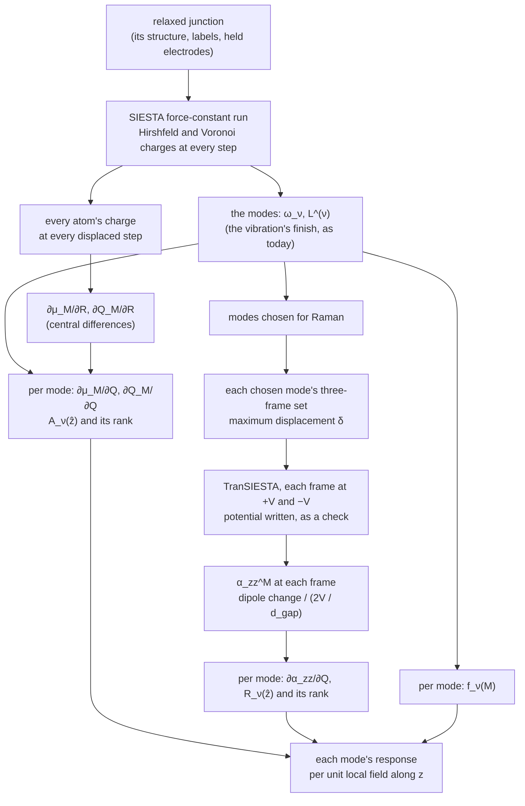

# The molecule's infrared and Raman response along a vibration, in the junction

**Role:** science reference — a method, proposed for discussion; nothing here
is built
**Domain:** science
**Companions:** [`vibrational-averaging.md`](?doc=science/vibrational-averaging.md)
(the frames along a mode, and their weights);
[`normal-modes.md`](?doc=science/normal-modes.md) § 4b.7 (optical response at
a metal: why SIESTA offers no infrared or Raman today);
[`engines/vibration.md`](?doc=engines/vibration.md) § 5.10 ② (the charge each
mode moves) and ③ (a mode's frame set);
[`engines/transport.md`](?doc=engines/transport.md) § 1.1 (the transport
procedure) and § 2a.12 (the device's charges, region by region);
`plans/plan.md` § 1ac.

*Written 2026-10-24 at the user's request: "we need a new method document for
this, science, procedure design, and quantitative explanation, all formula
should be latex and checked, with diagram of workflow and explanation of
dependency". The method is the user's, settled in discussion the same day:
"the polarizability of the metal cluster is a fake statement … with the
bridge's charge transfer (electron density) correctly calculated in different
modes, our calculation of the optical activity of vibration mode inside the
gap is only a function of how strong the field is"; "here we focus for a unit
EM intensity with a specific direction how the molecule respond".*

---

## 0. The question, and what this method answers

A junction's vibration run gives its modes. The molecule and the few metal
atoms left free beside it move; the electrodes are held still. **Which of
these modes would show in an infrared or a Raman spectrum taken in the gap,
and how strong is each, relative to the others?**

Two separate things decide that:

1. **How the molecule's electrons respond to the mode** — how much its dipole
   changes (infrared) and how much its polarizability changes (Raman),
   including the charge it exchanges with the metal. This is the molecule's
   own physics, and SIESTA computes it **in the junction**, with the same
   model the modes came from.
2. **How strong the light's field is at the molecule** — the gap's
   electromagnetic enhancement, set by the electrodes' shape, the light's
   wavelength and its polarization. It is **not computed here**.

This method computes the first: every mode's response **per unit local field
along z, the gap's axis**, and its size relative to the strongest mode.
Whoever has a model of the gap's field multiplies by its enhancement:

- for **Raman**, by one number for the laser, nearly the same for every mode
  (§ 3.3);
- for **infrared**, by the enhancement at each mode's own frequency, which
  varies across the infrared (§ 2.3). The ranking in the gap then also
  depends on that variation; the ranking reported here is the molecule's own.

**Which atoms.** Two sets appear, and they are different:

- the **free set** $F$ — every atom the vibration moves: the molecule and the
  metal atoms left free beside it. The modes are defined on $F$.
- the **molecule** $M$ — the atoms of a label the person names (`BDT` on the
  AuBDTAu junction). **Every charge, dipole and polarizability below sums over
  $M$ only.**

The free metal atoms move in the modes, and when they move the molecule's
charges change — that is counted. Their own charges are the metal's response
and are not counted. Neither set is molbuilder's `bridge` label, which holds
the whole device region (on the AuBDTAu junction, 162 atoms, 150 of them
gold).

**What is deliberately not computed**: the metal's own response — its
polarizability, its screening, the image of the molecule's dipole in the
metal surfaces. All of it belongs to the field model, with the enhancement.

**How this meets `normal-modes.md` § 4b.7**, which says why SIESTA offers no
infrared or Raman today:

- *A periodic metal has no defined dipole.* The dipole here is the
  molecule's: a finite set of atoms, by a stated charge partition, taken
  about the molecule's own centre — so it is defined.
- *A change in a metal's density is a small difference of large numbers.* The
  differences here are of the molecule's charges, and each is checked against
  the step size (§ 7).
- *The interface's charge transfer is signal.* It is kept: the charge the
  molecule exchanges with the metal (§ 2.1). The metal's own screening is left
  to the field model, by the user's decision quoted above.
- *The local field is not the incident one.* It is the one number outside
  this method.

---

## 1. The quantities

| symbol | what it is | unit |
|---|---|---|
| $F$ | the free set: every atom the vibration moves | — |
| $M$ | the molecule: the atoms of the label the person names | — |
| $m_k$ | atom $k$'s mass, as the vibration result states it | amu |
| $\omega_\nu$ | mode $\nu$'s frequency, as the result states it | cm$^{-1}$ |
| $\mathbf L^{(\nu)}$ | mode $\nu$'s displacement pattern over $F$, normalised with the masses, $\sum_{k\in F} m_k\,\lvert\mathbf L_k^{(\nu)}\rvert^2 = 1$ (`engines/vibration.md` § 6.3); zero on every held atom | amu$^{-1/2}$ |
| $Q_\nu$ | how far the structure is moved along mode $\nu$: atom $k$ moves by $Q_\nu\,\mathbf L_k^{(\nu)}$ | amu$^{1/2}$ Å |
| $q_a$ | atom $a$'s partial charge: its valence charge less the electrons a partition gives it — positive where electrons left it; by Hirshfeld [Hirshfeld1977] or Voronoi [FonsecaGuerra2004], both computed (§ 1a) | $e$ |
| $\bar{\mathbf r}_M^{\,0}$ | the molecule's centre at equilibrium, $\frac{1}{N_M}\sum_{a\in M}\mathbf r_a^0$ — a fixed point | Å |
| $\hat z$ | the gap's axis: the direction from one electrode to the other | — |

### 1a. The two charge partitions — Hirshfeld and Voronoi

*(Decided by the user, 2026-10-24: "both on"; "default to hirshfeld".)*
**Both are computed in every run this method uses, every number is stated
with the partition it came from, and Hirshfeld is the one shown unless the
person picks Voronoi.**

**What they share.** Both give each atom a charge, and both start from the
same thing — how the electrons moved when the atoms bonded: the real electron
density $\rho$ less the density the same atoms would have as neutral, isolated
atoms,

$$
\Delta\rho(\mathbf r) = \rho(\mathbf r) - \sum_{b} \rho_b^{\mathrm{free}}(\mathbf r) .
$$

(SIESTA works with the valence electrons; $\rho_b^{\mathrm{free}}$ is atom
$b$'s neutral valence density on its own basis.) A charge of $+0.1\,e$ means
the atom ended with 0.1 electron fewer than it had alone. **The two differ
only in how they share $\Delta\rho$ between neighbouring atoms**:

$$
q_a^{\mathrm{Hirshfeld}} = -\int w_a(\mathbf r)\,\Delta\rho(\mathbf r)\,d\mathbf r,
\quad w_a(\mathbf r) = \frac{\rho_a^{\mathrm{free}}(\mathbf r)}{\sum_b \rho_b^{\mathrm{free}}(\mathbf r)} ;
\qquad
q_a^{\mathrm{Voronoi}} = -\int_{V_a} \Delta\rho(\mathbf r)\,d\mathbf r ,
$$

$V_a$ the points nearer to atom $a$'s nucleus than to any other.

- **Voronoi draws a hard wall.** Every point belongs to the nearest nucleus —
  by distance alone, whatever the atoms' sizes — so on the S–Au bond the wall
  sits exactly halfway between the two nuclei, and each atom takes all the
  moved charge on its side (a point exactly on the wall is shared equally).
- **Hirshfeld shares softly.** At each point it asks how much density a lone
  neutral S and a lone neutral Au would each have there, and splits the moved
  charge in that ratio: near S, S takes nearly all of it; at the bond's middle
  it is shared; near Au, Au takes it — no wall, a split that changes smoothly
  through the bond.

Both are read in SIESTA 5.4.2's source (`partial_charges.F90`: Voronoi
subtracts the neutral-atom density at each grid point and gives the rest to
the nearest atom; Hirshfeld weights the density by $w_a$); the Hirshfeld form
above follows because $w_a\sum_b\rho_b^{\mathrm{free}} = \rho_a^{\mathrm{free}}$
integrates to the atom's valence charge.

**What it means for this method.**

1. **Every number changes with the partition.** The molecule's charge
   depends on where the S–Au boundary is drawn, and that boundary is a
   convention — no partition is the true one. The dipole change, the charge
   transfer and the polarizability are all different numbers under the two,
   which is why each is stated with its partition. What should not change is
   the ranking of the modes; where it does, that is a finding — the ranking is
   then set by how the bond is split, not by the molecule.
2. **Smoothness as atoms move.** The derivatives compare charges at
   geometries $2\delta$ = 0.042 Å apart. Under Voronoi the wall moves with the
   atoms and points of SIESTA's grid jump from one atom to the other; under
   Hirshfeld the shares change gradually, so its derivatives are expected to
   be less noisy — the reason it is shown first. This is expected, not yet
   measured; the step-size check of § 7 shows it on a real run.
3. **The cost is the same and small**: each is a sum over SIESTA's grid after
   every step, with no extra self-consistent solution, and both are asked for
   in the same run.

---

## 2. Infrared — the molecule's dipole change along a mode

### 2.1 The molecule's charge and dipole

From the partial charges of the molecule's atoms, at any geometry $R$:

$$
Q_M(R) = \sum_{a\in M} q_a(R),
\qquad
\boldsymbol\mu_M(R) = \sum_{a\in M} q_a(R)\,\bigl(\mathbf r_a(R) - \bar{\mathbf r}_M^{\,0}\bigr).
$$

The molecule's charge $Q_M$ changes as it vibrates: it exchanges charge with
the metal, and that transfer is part of what this method keeps. It also makes
the dipole depend on the point it is taken about. About any point
$\mathbf o$,

$$
\boldsymbol\mu_M^{(\mathbf o)} = \boldsymbol\mu_M + Q_M\,\bigl(\bar{\mathbf r}_M^{\,0} - \mathbf o\bigr),
\qquad
\frac{\partial\boldsymbol\mu_M^{(\mathbf o)}}{\partial Q_\nu}
= \frac{\partial\boldsymbol\mu_M}{\partial Q_\nu}
+ \frac{\partial Q_M}{\partial Q_\nu}\,\bigl(\bar{\mathbf r}_M^{\,0} - \mathbf o\bigr).
$$

So two numbers are reported for each mode:

- **the dipole change** $\partial\boldsymbol\mu_M/\partial Q_\nu$, taken about
  the molecule's own fixed centre — no point outside the molecule enters it;
- **the charge transfer** $\partial Q_M/\partial Q_\nu$ — how much charge the
  mode moves between the molecule and the metal.

How the transfer couples to a field along z depends on where the metal gives
or takes that charge. If it does so at height $z_s$, the transfer adds
$(\partial Q_M/\partial Q_\nu)\,(\bar z_M^{\,0} - z_s)$ to
$\hat z\cdot\partial\boldsymbol\mu_M/\partial Q_\nu$. The sum does not depend
on the point the dipole is taken about; the split between its two terms does,
which is why both terms are reported and the point is named. In a junction
symmetric about the molecule's centre the transfer term is zero: a mode
symmetric under that mirror draws charge equally from both sides
($z_s = \bar z_M^{\,0}$), and an antisymmetric one moves no net charge. $z_s$
belongs to the metal's response and is not chosen here.

### 2.2 Read from the force-constant run, with no extra calculation

SIESTA's force-constant run moves each free atom $k$ by $\pm\delta$ along x,
y and z in turn (`FC.Displacement`, 0.04 bohr = 0.0212 Å by default) and
solves the electrons self-consistently at each step. With
`Charge.Hirshfeld geometry` and `Charge.Voronoi geometry` in its input,
SIESTA also prints every atom's partial charge, by both partitions, at each
step: "at the end of
every geometry step" (SIESTA 5.4.2 manual, `Charge.Hirshfeld`). In its source,
`grdsam.F` asks for them at every geometry, and `partial_charges.F90` prints
them to $10^{-6}\,e$, positive where electrons left the atom, the column
summing to zero for a neutral cell. This is the output switch
`engines/vibration.md` § 5.10 ② already decided (D3) for the charge each mode
moves; this method adds the dipole.

By central differences, each displaced geometry's dipole taken at that
geometry's own positions — so both the charges changing and the charged
atoms moving are counted:

$$
\frac{\partial\boldsymbol\mu_M}{\partial R_{k\beta}}
\approx \frac{\boldsymbol\mu_M(R^{+}_{k\beta}) - \boldsymbol\mu_M(R^{-}_{k\beta})}{2\delta},
\qquad
\frac{\partial Q_M}{\partial R_{k\beta}}
\approx \frac{Q_M(R^{+}_{k\beta}) - Q_M(R^{-}_{k\beta})}{2\delta},
$$

where $R^{\pm}_{k\beta}$ is the geometry with free atom $k$ moved by
$\pm\delta$ along $\beta \in \{x, y, z\}$. Every free atom counts, the metal
ones too: moving a free gold atom changes the molecule's charges. Projected
onto each mode,

$$
\frac{\partial\boldsymbol\mu_M}{\partial Q_\nu}
= \sum_{k\in F}\sum_{\beta} \frac{\partial\boldsymbol\mu_M}{\partial R_{k\beta}}\;L^{(\nu)}_{k\beta},
\qquad
\frac{\partial Q_M}{\partial Q_\nu}
= \sum_{k\in F}\sum_{\beta} \frac{\partial Q_M}{\partial R_{k\beta}}\;L^{(\nu)}_{k\beta}.
$$

Every mode's values come out of the one run that gave the modes, once for
each partition.

### 2.3 The infrared strength per unit local field

For a molecule held in one orientation, in light whose local field at the
molecule points along $\hat e$, mode $\nu$'s integrated absorption is

$$
A_\nu(\hat e) = \frac{N_A}{4\varepsilon_0 c^2}\,
\Bigl(\hat e\cdot\frac{\partial\boldsymbol\mu_M}{\partial Q_\nu}\Bigr)^{2}
= 126.768\ \tfrac{\mathrm{km}}{\mathrm{mol}}
\times \Bigl(\hat e\cdot\frac{\partial\boldsymbol\mu_M}{\partial Q_\nu}\Bigr)^{2} ,
$$

with the derivative in D Å$^{-1}$ amu$^{-1/2}$ (a charge of $e$ moved 1 Å is
4.8032 D, so a derivative in $e$ amu$^{-1/2}$ is multiplied by 4.8032).

A free molecule tumbles in the light, and its average over orientations is the
familiar $\frac{N_A}{12\varepsilon_0 c^2}\lvert\partial\boldsymbol\mu/\partial Q\rvert^2
= 42.256\ \mathrm{km/mol}$ per $(\mathrm D/\text{Å})^2/\mathrm{amu}$
[Porezag1996] — a third of the value above, since a tumbling dipole lies along
the field a third of the time on average. In the gap the molecule does not
tumble, and beside a metal only the dipole component normal to the surface
couples to light [Greenler1966] — here, z. (Both prefactors are computed from
the CODATA constants.)

**Reported**: $A_\nu(\hat z)$ for every mode, and
$A_\nu(\hat z)/\max_{\nu'}A_{\nu'}(\hat z)$ — the dipole change alone; the
charge transfer is reported beside it (§ 2.1).

**In the gap** it is multiplied by
$\lvert E_{\mathrm{loc}}(\omega_\nu)/E_0\rvert^2$, the local field's intensity
at the mode's own frequency relative to the incident light's — the field
model's, mode by mode.

---

## 3. Raman — the molecule's polarizability change along a mode

### 3.1 A field along the gap's axis is a small bias

A uniform field in the electrode plane (x, y) cannot be applied: the cell
repeats in that plane. Along z it is applied the physical way, as **a small
bias $V$ between the electrodes**, solved self-consistently by TranSIESTA
(`engines/transport.md` § 1.1).

Without the molecule, the bias would fall evenly across the gap between the
two metal surfaces, a uniform field

$$
E_z = \frac{V}{d_{\mathrm{gap}}} ,
$$

$d_{\mathrm{gap}}$ the distance along z between the planes of the two
surfaces' outermost metal atoms. **This is the field the molecule is placed
in** — the field a model of the empty gap computes — and the one every
polarizability below is divided by. It is one number for every frame and every
mode, so it scales every polarizability alike: it sets their absolute size,
never their ranking. Where a metal's surface lies for this purpose (its atom
plane, or somewhat outside it) is not sharp, so $d_{\mathrm{gap}}$ is stated
with every value.

The potential TranSIESTA computes across the molecule is not this field: it
includes the molecule's own response, which partly screens the field inside
the molecule. It is written (`SaveElectrostaticPotential`: the Hartree
potential plus the local part of the pseudopotential, in `<label>.VH`) and
used as **a check only**. The difference between the two biases, averaged
over the electrode plane,

$$
\Delta\bar V(z) = \bar V(z;\,+V) - \bar V(z;\,-V),
$$

must be flat inside the metal on both sides, its step falling across the gap:
the device region holds enough metal to screen the bias.

### 3.2 The polarizability at one geometry

At a fixed geometry, at biases $+V$ and $-V$:

$$
\alpha^{M}_{zz} = \frac{\mu_{M,z}(+V) - \mu_{M,z}(-V)}{2V/d_{\mathrm{gap}}} ,
$$

$\mu_{M,z}$ from the molecule's partial charges in the density TranSIESTA
solves at each bias, taken about $\bar{\mathbf r}_M^{\,0}$ as in § 2.1. The
molecule's charging with the bias,
$\bigl(Q_M(+V) - Q_M(-V)\bigr)/2V$, is reported beside it, not folded in.
Units: a dipole of $1\ e\,\text{Å}$ per $1\ \mathrm V/\text{Å}$ is a
polarizability volume of 14.400 ų (divided by $4\pi\varepsilon_0$; computed
from the constants).

### 3.3 Its change along a mode, and the Raman strength

The two geometries come from the mode's **three-frame set**
(`engines/vibration.md` § 5.10 ③), written with its maximum displacement set
to $\delta$. Its frames 1 and 2 sit at $\pm\delta Q$ along mode $\nu$, with
$\delta Q = \delta/\max_k\lvert\mathbf L_k^{(\nu)}\rvert$: every free atom
moved by $\pm\delta Q\,\mathbf L_k^{(\nu)}$, the one that moves most by
$\delta$. Its frame 0, the equilibrium, gives $\alpha^M_{zz}$ there — the same
for every mode.

$$
\frac{\partial\alpha^{M}_{zz}}{\partial Q_\nu}
\approx \frac{\alpha^{M}_{zz}(+\delta Q) - \alpha^{M}_{zz}(-\delta Q)}{2\,\delta Q},
\qquad
R_\nu(\hat z) = \Bigl(\frac{\partial\alpha^{M}_{zz}}{\partial Q_\nu}\Bigr)^{2}
\quad[\text{Å}^4/\mathrm{amu}] .
$$

$R_\nu(\hat z)$ is the Raman strength for light polarized along z, both
incoming and scattered — the one component a field along the gap gives. The
textbook Raman activity $45a'^2 + 7\gamma'^2$ [Porezag1996] — $a'$ the mean
of the polarizability's derivative, $\gamma'$ its anisotropy — is a tumbling
molecule's, averaged over orientations and summed over both scattered
polarizations. The same zz component, averaged over orientations, is
$\langle\alpha'^{\,2}_{zz}\rangle = (45a'^2 + 4\gamma'^2)/45$ (checked by
sampling random rotations of a random tensor): the two are related, but not
the same number.

**Reported**: $R_\nu(\hat z)$ for each chosen mode, and
$R_\nu(\hat z)/\max_{\nu'}R_{\nu'}(\hat z)$.

**In the gap** it is multiplied by
$\lvert E_{\mathrm{loc}}(\omega_L)/E_0\rvert^{2}\,\lvert E_{\mathrm{loc}}(\omega_L - \omega_\nu)/E_0\rvert^{2}$
— the $\lvert E\rvert^4$ rule [LeRu2006]: the enhancement at the laser's
frequency $\omega_L$ times that at the scattered one. It is nearly the same
for every mode where the enhancement changes little between the two.

---

## 4. Which modes are the molecule's — localization

Each mode's motion, shared among the parts of the free set:

$$
f_\nu(S) = \sum_{k\in S} m_k\,\lvert\mathbf L_k^{(\nu)}\rvert^2 ,
\qquad \sum_{S} f_\nu(S) = 1
$$

over any division of $F$ into parts (the normalisation of
$\mathbf L^{(\nu)}$; checked numerically). **Reported** per mode:
$f_\nu(M)$, the share of the motion on the molecule, and $1 - f_\nu(M)$, the
share on the free metal atoms. Near 1, a mode of the molecule; near 0, the
free metal moving; in between, a mode of the contact. Beside $A_\nu$ and
$R_\nu$, it says which of the strong modes are the molecule's own.

---

## 5. The procedure

| step | what runs | cost |
|---|---|---|
| the force-constant run, with charges | the vibration as today, with `Charge.Hirshfeld geometry` and `Charge.Voronoi geometry` in its input (`engines/vibration.md` § 5.10 ②) | the two charge integrations at each step; no extra self-consistent solution |
| infrared and localization, every mode | the vibration's post-processing (its *finish*) | reading only |
| Raman, chosen modes | each mode's three-frame set as a transport calculation, every frame at $+V$ and $-V$; the electrode calculations once | per mode, **4 device solutions** (2 displaced frames × 2 biases); the equilibrium frame's 2 are the same for every mode |

---

## 6. What each result depends on

| result | depends on | why |
|---|---|---|
| the modes $\omega_\nu$, $\mathbf L^{(\nu)}$ | the force-constant run: its settings, its step $\delta$, which atoms are held | they are its own |
| $\partial\boldsymbol\mu_M/\partial Q$, $\partial Q_M/\partial Q$, $A_\nu$ | the modes; the molecule's label; the charge partition — both computed, Hirshfeld shown first, stated with every number (§ 1a); $\delta$ | two partitions give two numbers |
| $f_\nu(M)$ | the modes and the masses; the molecule's label | — |
| $\alpha^M_{zz}$ | the bias $V$; $d_{\mathrm{gap}}$; the partition; the device's settings (the transport calculation's) | the field is the bias's |
| $\partial\alpha^M_{zz}/\partial Q$, $R_\nu$ | $\alpha^M_{zz}$ at the two displaced frames; $\delta Q$ | a difference across two frames |
| the strength in the gap | all of the above **and** the field model's enhancement — not here | one number per frequency and polarization |

---

## 7. Numerical choices, and their checks

| choice | proposed | check |
|---|---|---|
| $\delta$ (`FC.Displacement`) | the run's own, 0.0212 Å by default | the displacement sweep (`engines/vibration.md` § 5.9): the force constants **and** the charge derivatives agree across its steps |
| the charges' grain | Hirshfeld or Voronoi charges are integrated on SIESTA's real-space mesh, so an atom moved by $\delta$ against the mesh changes its charge a little even with no physics behind it | the same sweep: where a charge derivative changes with $\delta$, the grain sets it, not the physics |
| $\delta Q$ for the Raman frames | the three-frame set at maximum displacement $\delta$: $\delta Q = \delta / \max_k\lvert\mathbf L_k^{(\nu)}\rvert$ — the same linear range as the force constants | the same mode at $2\delta$: $\partial\alpha^M_{zz}/\partial Q$ unchanged within a tolerance set from the measurements of § 9 |
| $V$ | $\pm 0.05$ V | $\pm 0.1$ V: $\alpha^M_{zz}$ unchanged within that tolerance — the response is linear |
| the self-consistent solution | the density matrix converged to $10^{-5}$ or tighter, since a Raman derivative is a small difference of differences; the junction's own mesh and k-points | — |
| the charge sum | — | at every step, the charge column over all atoms sums to the cell's net charge: zero in the force-constant run; under bias, the excess TranSIESTA reports (dQ, `engines/transport.md` § 2a.12) |
| the reference point | — | $\partial\boldsymbol\mu_M/\partial Q$ recomputed about another point, its transfer term removed (§ 2.1), gives the same values |

---

## 8. What the method assumes

1. **Point charges.** The molecule's dipole is its atoms' partial charges at
   their positions. Each atom's own dipole — the distortion of its electron
   cloud — is not in it, and two partitions give two answers, so every
   number is stated with its partition.
2. **The metal's own response is left out by design.** No metal atom's charge
   enters $\boldsymbol\mu_M$, free or held. The metal's screening, the image
   of the molecule's dipole and the enhancement are the field model's. The
   charge the molecule exchanges with the metal is kept.
3. **Static response.** $\alpha^M_{zz}$ is the zero-frequency
   polarizability, standing for the one at the laser's frequency — the usual
   approximation away from the molecule's electronic resonances. It includes
   the charge the molecule exchanges with the metal, which a field
   oscillating at the light's frequency may drive only in part.
4. **One direction.** Only z: a field in the electrode plane (x, y) cannot be
   applied to a cell that repeats in it.
5. **The charge transfer's coupling** needs the height $z_s$ at which the
   metal gives or takes the charge; the transfer is reported, not folded in.
6. **TranSIESTA's densities are used, never its energies**
   (`engines/transport.md` § 1.1).

---

## 9. What is measured before anything is built

On the toy junction (`claude-transport-walk`: 22 hydrogen atoms, two free):

- **The charges at every force-constant step.** SIESTA's source says they are
  computed at every geometry (`grdsam.F`); the run shows it: every step's
  charges printed by both partitions, each column summing to zero.
- **The charges in a biased TranSIESTA run, and their linear response.** Two
  device runs at $\pm 0.05$ V and $\pm 0.1$ V with the potential written:
  the charges printed at each bias, $\Delta\bar V(z)$ flat inside the
  electrodes, and the two free atoms' $\mu_{M,z}$ linear in $V$.

---

## References

Each checked against Crossref, 2026-10-24.

- [Hirshfeld1977] F. L. Hirshfeld, *Theor. Chim. Acta* **44**, 129–138
  (1977), doi:10.1007/BF00549096 — bonded-atom (Hirshfeld) partial charges.
- [FonsecaGuerra2004] C. Fonseca Guerra, J.-W. Handgraaf, E. J. Baerends,
  F. M. Bickelhaupt, *J. Comput. Chem.* **25**, 189–210 (2004),
  doi:10.1002/jcc.10351 — Voronoi deformation density charges, assessed
  against Mulliken, Bader and Hirshfeld.
- [Porezag1996] D. Porezag, M. R. Pederson, *Phys. Rev. B* **54**, 7830–7836
  (1996), doi:10.1103/PhysRevB.54.7830 — infrared intensities and Raman
  activities in density-functional theory.
- [LeRu2006] E. C. Le Ru, P. G. Etchegoin, *Chem. Phys. Lett.* **423**, 63–66
  (2006), doi:10.1016/j.cplett.2006.03.042 — the $\lvert E\rvert^4$
  enhancement factor in surface-enhanced Raman.
- [Greenler1966] R. G. Greenler, *J. Chem. Phys.* **44**, 310–315 (1966),
  doi:10.1063/1.1726462 — infrared of molecules adsorbed on metals: only the
  dipole component normal to the surface couples.
