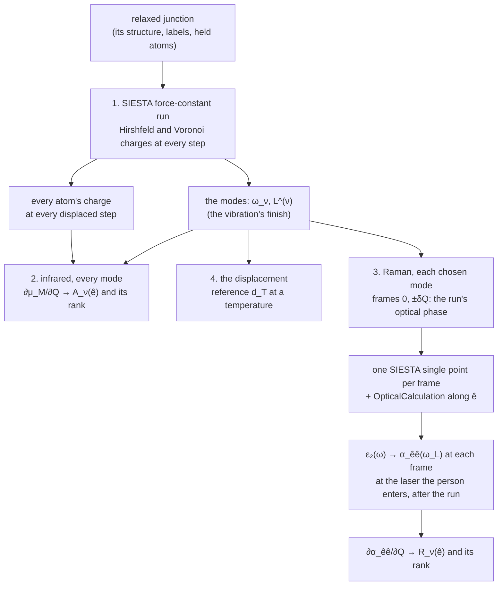
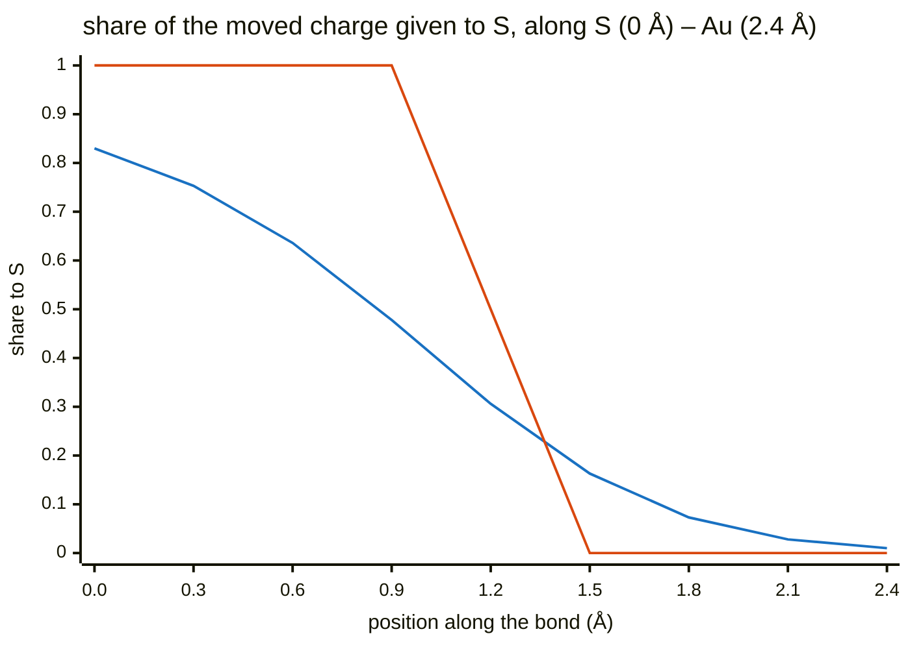
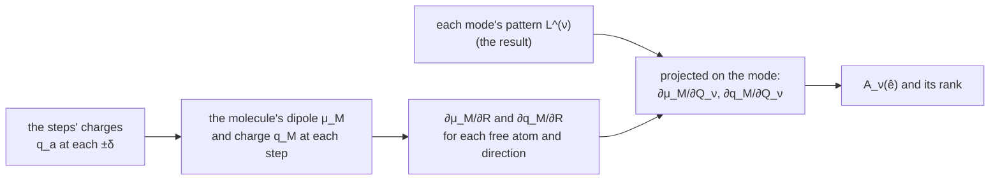

# The optical activity of a SIESTA vibration — infrared and Raman

**Role:** science reference — a method; the charges are written since
2.35.2, the infrared and the displacement reference built in 2.36.0, Raman
designed ([`engines/vibration.md`](?doc=engines/vibration.md) § 5.11), not built
**Domain:** science
**Companions:** [`engines/vibration.md`](?doc=engines/vibration.md) § 5.3 (the
force-constant input), § 5.10 ② (the charge each mode moves), ③ (a mode's
frames) and § 5.11 (one run in phases — Raman its optical phase); [`vibrational-averaging.md`](?doc=science/vibrational-averaging.md)
§ 5 and § 2a (the displacement); [`normal-modes.md`](?doc=science/normal-modes.md)
§ 4a.6, § 4b.7 (the infrared of a named set of atoms, and why Raman is not
built); `plans/plan.md` § 1ac.

*Written 2026-10-24 at the user's request: "we need a new method document for
this, science, procedure design, and quantitative explanation, all formula
should be latex and checked, with diagram of workflow and explanation of
dependency". Its scope, the user's: "it is simple: siesta calculate correctly
optical activity and evalaute the displacement"; "all i asked is a vibration
calculation, assumed an EM in the vacuum"; "here we focus for a unit EM
intensity with a specific direction how the molecule respond".*

---

## 0. In short — the question, and the workflow

A SIESTA [Soler2002, Garcia2020] vibration gives a junction's modes: the
molecule and the metal atoms left free beside it move, the electrodes are
held.

```text
   held electrode                 the molecule M                 held electrode
  ● ● ● ● ● ● ○ ─ S ─────────── C6H4 ─────────── S ─ ○ ● ● ● ● ● ●
              └──────────── the free set F: every atom that moves ───┘
                     ○ a free metal atom      ● a held one

        light in vacuum, its field along a direction ê the person chooses
        ──────────────────────────────────────────────►  (z, the gap's axis, for one)
```

**Which modes are infrared- or Raman-active, and how strong is each relative
to the others**, for light polarized along $\hat e$? And **where should the
frames along a mode sit** — the maximum displacement?

Everything comes from SIESTA's own electronic structure at the mode's
geometries. **No field is applied in any calculation**, and the metal's own
bulk response is left out *(the user: "the polarizability of the metal cluster
is a fake statement")* — in the infrared, the metal atoms' own charges are not
in the set's dipole; for Raman, the response of the metal at the contact is
kept, and the molecule's share is stated beside it (§ 3.1).

| | a mode shows in the spectrum when it changes … | read from |
|---|---|---|
| **infrared** | the molecule's **dipole** — how its charge sits | the charges SIESTA prints at every step of the vibration itself |
| **Raman** | the **polarizability** — how easily light shifts the electrons | SIESTA's optical calculation at the mode's displaced geometries |

### 0.1 What the person gives

| input | for | default |
|---|---|---|
| the relaxed junction — its structure, labels and held atoms | everything | — |
| the molecule — a label the person names (`BDT` on AuBDTAu) | the infrared dipole | — |
| the light's direction $\hat e$ | infrared and Raman | z on the spectrum viewer, which takes x, y, z or any vector *(the user, 2026-10-24)*; a script names it. None for a free molecule — nothing held — whose infrared is the orientation average (§ 2.3). The infrared takes any direction at no cost (§ 2.3); Raman takes one per optical run: z, the gap's axis, by default, another chosen before the run (`plans/plan.md` § 1ac, D-h) |
| the charge partition | infrared | Hirshfeld (§ 1a) |
| the modes to compute Raman for — fixed before the run, since a mode exists only after the force-constant run | Raman | none (`skip`): the vibration's mode selector, PySCF's reused — `all` within a frequency window, or the modes listed ([`engines/vibration.md`](?doc=engines/vibration.md) § 5.11 § 6) |
| the laser's wavelength | Raman, after the run — the polarizability is taken at its frequency (§ 3.1) | — |
| a temperature | the displacement's reference | — |

### 0.2 The workflow

| step | what runs | molbuilder today |
|---|---|---|
| **1. The vibration** | SIESTA's force-constant run on the relaxed junction, as today: each free atom nudged ±0.0212 Å along x, y and z, a self-consistent solution at each — $1 + 6\,n_{\mathrm{free}}$ of them; SIESTA prints every atom's Hirshfeld and Voronoi charge after each | **exists** — the charges since 2.35.2 |
| **2. Infrared, every mode** | nothing more: the vibration's finish stores the charges of step 1; asked for a set of atoms, a direction and a partition, one function derives each mode's dipole change → its infrared strength $A_\nu(\hat e)$ and rank (§ 2; a worked example, § 2.4) | **built 2.36.0** — the spectrum viewer and `molbuilder.postprocess.infrared_view` |
| **3. Raman, the chosen modes** | the vibration run's optical phase, after its force-constant phase in the same run: the geometries at $0$ and $\pm\delta Q$ along each chosen mode (§ 3.2); one SIESTA single point at each with its optical calculation (the `OpticalCalculation` option: the light-absorption spectrum from its own states, § 3.1) → the polarizability at each, at the laser's frequency the person enters after the run (static beside it) → its change → the Raman strength $R_\nu(\hat e)$ and rank (§ 3), from the whole cell's change, the named set's share beside it (§ 3.4) | **designed, not built** ([`engines/vibration.md`](?doc=engines/vibration.md) § 5.11); how the polarizability behaves in a cell holding metal is measured with it (§ 3.1, R1) |
| **4. The displacement** | nothing: the reference maximum displacement at the person's temperature, from the vibration result, beside the person's own (§ 4; an example, § 4.1) | **built 2.36.0** — the *Write frame set…* dialog and `molbuilder.postprocess.reference_max_displacement` |



**What it costs** (§ 5.1, measured on AuBDTAu): infrared and the
displacement, nothing beyond the vibration already run; keeping the held gold
in Raman and reporting the named set's share beside the whole, no SIESTA run
either; Raman, $1 + 2\times$(the number of modes) SIESTA runs — frame 0 once,
$\pm\delta Q$ for each mode — each one junction SCF and SIESTA's optical
calculation: for five modes about 20–40 min of SCF on 64 ranks, against the
vibration's 3.3 h; the optical calculation's own cost not yet measured.

**Which atoms.** The modes are defined on the **free set** $F$, every atom the
vibration moves. The infrared dipole is the **molecule's**, $M$; the free
metal atoms move in the modes, and when they move the molecule's charges
change — that is counted — but their own charges are the metal's and are not.

### 0.3 Where each number comes from

| number | file | written by |
|---|---|---|
| the modes $\omega_\nu$, $\mathbf L^{(\nu)}$, the masses | `<label>.spectra.json` | the vibration's finish (`engines/vibration.md` § 5.5) |
| every atom's charge at every force-constant step | `<label>.spectra.json` (`partial_charges`), read from the run's output's *Hirshfeld* and *Voronoi Atomic Populations* blocks | SIESTA (asked by the input since 2.35.2), kept by the vibration's finish since 2.36.0 |
| $\varepsilon_{2,\hat e\hat e}(\omega)$ at a frame | `<label>.EPSIMG` | SIESTA's optical calculation, at each frame of the vibration run's optical phase ([`engines/vibration.md`](?doc=engines/vibration.md) § 5.11, not built) |
| the zero-point amplitude $Q_{\mathrm{zp}}$ | `<label>.spectra.json` (`zero_point_amplitude_amu12_ang`) | the vibration's finish |

---

## 1. The quantities

| symbol | what it is | unit |
|---|---|---|
| $F$ | the free set: every atom the vibration moves | — |
| $M$ | the molecule: the atoms of the label the person names | — |
| $m_k$ | atom $k$'s mass, as the vibration result states it | amu |
| $\omega_\nu$ | mode $\nu$'s frequency, as the result states it | cm$^{-1}$ |
| $\mathbf L^{(\nu)}$ | mode $\nu$'s displacement pattern over $F$, normalised with the masses, $\sum_{k\in F} m_k\,\lvert\mathbf L_k^{(\nu)}\rvert^2 = 1$ (`engines/vibration.md` § 6.3); zero on every held atom | amu$^{-1/2}$ |
| $Q_\nu$ | how far the structure is moved along mode $\nu$: atom $k$ moves by $Q_\nu\,\mathbf L_k^{(\nu)}$ | amu$^{1/2}$ Å |
| $q_a$ | atom $a$'s partial charge: its valence charge less the electrons a partition gives it — positive where electrons left it; by Hirshfeld [Hirshfeld1977] or Voronoi [FonsecaGuerra2004], both computed (§ 1a) | $e$ |
| $\bar{\mathbf r}_M^{\,0}$ | the molecule's centre of mass at equilibrium, $\sum_{a\in M} m_a\mathbf r_a^0 \big/ \sum_{a\in M} m_a$, the masses the result states — a fixed point *(the user, 2026-10-24: "center should be mass center")* | Å |
| $\hat e$ | the direction of the light's field, the person's choice | — |
| $\varepsilon_{\hat e\hat e}(\omega)$ | the cell's dielectric function for a field along $\hat e$, $\varepsilon_1 + i\varepsilon_2$ | — |
| $V_{\mathrm{cell}}$ | the cell's volume | ų |

### 1a. The two charge partitions — Hirshfeld and Voronoi

*(Decided by the user, 2026-10-24: "both on"; "default to hirshfeld".)*
**Both are computed, every number is stated with the partition it came from,
and Hirshfeld is the one shown unless the person picks Voronoi.**

**What they share.** Both give each atom a charge, and both start from the
same thing — how the electrons moved when the atoms bonded: the real electron
density $\rho$ less the density the same atoms would have as neutral, isolated
atoms,

$$
\Delta\rho(\mathbf r) = \rho(\mathbf r) - \sum_{b} \rho_b^{\mathrm{free}}(\mathbf r) .
$$

(SIESTA works with the valence electrons; $\rho_b^{\mathrm{free}}$ is atom
$b$'s neutral valence density on its own basis.) A charge of $+0.1\,e$ means
the atom ended with 0.1 electron fewer than it had alone. **The two differ
only in how they share $\Delta\rho$ between neighbouring atoms**:

$$
q_a^{\mathrm{Hirshfeld}} = -\int w_a(\mathbf r)\,\Delta\rho(\mathbf r)\,d\mathbf r,
\quad w_a(\mathbf r) = \frac{\rho_a^{\mathrm{free}}(\mathbf r)}{\sum_b \rho_b^{\mathrm{free}}(\mathbf r)} ;
\qquad
q_a^{\mathrm{Voronoi}} = -\int_{V_a} \Delta\rho(\mathbf r)\,d\mathbf r ,
$$

$V_a$ the points nearer to atom $a$'s nucleus than to any other.

- **Voronoi draws a hard wall.** Every point belongs to the nearest nucleus —
  by distance alone, whatever the atoms' sizes — so on the S–Au bond the wall
  sits exactly halfway between the two nuclei, and each atom takes all the
  moved charge on its side (a point exactly on the wall is shared equally).
- **Hirshfeld shares softly.** At each point it asks how much density a lone
  neutral S and a lone neutral Au would each have there, and splits the moved
  charge in that ratio: near S, S takes nearly all of it; at the bond's middle
  it is shared; near Au, Au takes it — no wall, a split that changes smoothly
  through the bond.

**The two shares along a bond, drawn.** The share of the moved charge that
goes to S, at points along an S–Au bond 2.4 Å long. *An illustration with
model densities* — one-dimensional Gaussians for the two neutral atoms (S: 6
valence electrons, width 0.8 Å; Au: 11, width 1.3 Å), not SIESTA's:



*(Blue: Hirshfeld — a smooth hand-over through the bond, set by the two atoms'
own densities. Orange: Voronoi — everything on S's side of the midpoint, a
step.)*

Both are read in SIESTA 5.4.2's source (`partial_charges.F90`: Voronoi
subtracts the neutral-atom density at each grid point and gives the rest to
the nearest atom; Hirshfeld weights the density by $w_a$); the Hirshfeld form
above follows because $w_a\sum_b\rho_b^{\mathrm{free}} = \rho_a^{\mathrm{free}}$
integrates to the atom's valence charge.

**What it means for this method.**

1. **Every number changes with the partition.** The molecule's charge
   depends on where the S–Au boundary is drawn, and that boundary is a
   convention — no partition is the true one. What should not change is the
   ranking of the modes; where it does, that is a finding — the ranking is
   then set by how the bond is split, not by the molecule. (In the worked
   example of § 2.4 the two partitions give the same ranking and strengths
   about five times apart.)
2. **Smoothness as atoms move.** The derivatives compare charges at
   geometries $2\delta$ = 0.042 Å apart. Under Voronoi the wall moves with the
   atoms and points of SIESTA's grid jump from one atom to the other; under
   Hirshfeld the shares change gradually, so its derivatives are expected to
   be less noisy — the reason it is shown first. This is expected, not yet
   measured; a displacement sweep (§ 6) shows it, where one is run.
3. **The cost is the same and small**: each is a sum over SIESTA's grid after
   every step, with no extra self-consistent solution, and both are asked for
   in the same run.

---

## 2. Infrared — the dipole change along a mode (workflow step 2)

**The idea.** Light whose field points along $\hat e$ pushes positive and
negative charge apart along $\hat e$. A mode absorbs it when moving along the
mode changes the molecule's dipole along $\hat e$ — the charges move, or the
charged atoms move, or both. How strongly is the square of that change.

```text
   equilibrium              the mode at +Q             what the light sees
   δ−   δ+                   δ−      δ+               the dipole along ê
   ●────●            →       ●───────●                changes:  Δμ ≠ 0  → infrared-active
                         (bond longer, charge         stays:    Δμ = 0  → infrared-silent
                          shifted)
```

### 2.1 The molecule's charge and dipole

**Why partial charges.** The cell's own dipole is not defined for a periodic
metal, and the Born effective charges SIESTA can compute come from the
Berry-phase polarization, which is defined for an insulator [KingSmith1993]
(SIESTA 5.4.2 manual, `BornCharge` and `PolarizationGrids`: the system "must be
an insulator"; `normal-modes.md` § 4b.7); the charges of the molecule's own
atoms are defined in any cell. From them, at any geometry $R$:

$$
q_M(R) = \sum_{a\in M} q_a(R),
\qquad
\boldsymbol\mu_M(R) = \sum_{a\in M} q_a(R)\,\bigl(\mathbf r_a(R) - \bar{\mathbf r}_M^{\,0}\bigr).
$$

As the molecule vibrates, its electrons shift at the bonds to the metal, so
$q_M$ changes along a mode (the user: "the bridge's charge transfer (electron
density) correctly calculated in different modes"). Two numbers are given for
each mode by the one derivation — the dipole change as the full vector; the
spectrum viewer shows the strength it gives along $\hat e$ (§ 2.3) and the
charge moved:

- **the dipole change** $\partial\boldsymbol\mu_M/\partial Q_\nu$, taken about
  the molecule's own centre of mass at equilibrium, $\bar{\mathbf r}_M^{\,0}$, a fixed point — no point outside
  the molecule enters it. Where the mode moves charge, the number depends on
  that centre: moving it by $\Delta\mathbf r$ changes
  $\partial\boldsymbol\mu_M/\partial Q_\nu$ by
  $-(\partial q_M/\partial Q_\nu)\,\Delta\mathbf r$, which is why the
  charge moved is reported beside it;
- **the charge the mode moves** $\partial q_M/\partial Q_\nu$ between the
  molecule and the metal — beside it, not folded in: its dipole depends on
  where in the metal the charge comes from, which these charges do not say.
  (The set may be any label of the structure the person names; the
  molecule's is the one this method is about.)

### 2.2 Read from the force-constant run, with no extra calculation

SIESTA's force-constant run moves each free atom $k$ by $\pm\delta$ along x,
y and z in turn (`FC.Displacement`, 0.04 bohr = 0.0212 Å by default) and
solves the electrons self-consistently at each step. With
`Charge.Hirshfeld geometry` and `Charge.Voronoi geometry` in its input —
written there since 2.35.2 (`engines/vibration.md` § 5.3) — SIESTA prints
every atom's partial charge, by both partitions, "at the end of every geometry
step" (SIESTA 5.4.2 manual, `Charge.Hirshfeld`; `grdsam.F`), to $10^{-6}\,e$
(`partial_charges.F90`), each column summing to zero for a neutral cell.

The steps come in a fixed order — displaced atom, then direction, then side,
$-$ before $+$ (`engines/vibration.md` § 5.4):

```text
 step 0          the relaxed geometry
 steps 1–6       free atom 1:  −x, +x, −y, +y, −z, +z
 steps 7–12      free atom 2:  −x, +x, −y, +y, −z, +z
 …               every free atom in turn: 1 + 6·n_free steps
```

By central differences, each displaced geometry's dipole taken at that
geometry's own positions — so both the charges changing and the charged
atoms moving are counted:

$$
\frac{\partial\boldsymbol\mu_M}{\partial R_{k\beta}}
\approx \frac{\boldsymbol\mu_M(R^{+}_{k\beta}) - \boldsymbol\mu_M(R^{-}_{k\beta})}{2\delta},
\qquad
\frac{\partial q_M}{\partial R_{k\beta}}
\approx \frac{q_M(R^{+}_{k\beta}) - q_M(R^{-}_{k\beta})}{2\delta},
$$

where $R^{\pm}_{k\beta}$ is the geometry with free atom $k$ moved by
$\pm\delta$ along $\beta \in \{x, y, z\}$. Every free atom counts, the metal
ones too: moving a free gold atom changes the molecule's charges. Projected
onto each mode,

$$
\frac{\partial\boldsymbol\mu_M}{\partial Q_\nu}
= \sum_{k\in F}\sum_{\beta} \frac{\partial\boldsymbol\mu_M}{\partial R_{k\beta}}\;L^{(\nu)}_{k\beta},
\qquad
\frac{\partial q_M}{\partial Q_\nu}
= \sum_{k\in F}\sum_{\beta} \frac{\partial q_M}{\partial R_{k\beta}}\;L^{(\nu)}_{k\beta}.
$$

Every mode's values come out of the one run that gave the modes, once for
each partition.



### 2.3 The infrared strength for a unit field along $\hat e$

For a molecule held in one orientation, in light whose field points along
$\hat e$, mode $\nu$'s integrated absorption is

$$
A_\nu(\hat e) = \frac{N_A}{4\varepsilon_0 c^2}\,
\Bigl(\hat e\cdot\frac{\partial\boldsymbol\mu_M}{\partial Q_\nu}\Bigr)^{2}
= 126.768\ \tfrac{\mathrm{km}}{\mathrm{mol}}
\times \Bigl(\hat e\cdot\frac{\partial\boldsymbol\mu_M}{\partial Q_\nu}\Bigr)^{2} ,
$$

with the derivative in D Å$^{-1}$ amu$^{-1/2}$ (a charge of $e$ moved 1 Å is
4.8032 D, so a derivative in $e$ amu$^{-1/2}$ is multiplied by 4.8032). A free
molecule tumbles in the light, and its average over orientations is the
familiar $\frac{N_A}{12\varepsilon_0 c^2}\lvert\partial\boldsymbol\mu/\partial Q\rvert^2 = 42.256\ \mathrm{km/mol}$
per $(\mathrm D/\text{Å})^2/\mathrm{amu}$
[Porezag1996] — a third of the value above, since $\cos^2\theta$ between a
dipole and the field averages to $1/3$ over orientations; held in the
junction, it does not tumble. (Both prefactors computed from the CODATA
constants.)

**Held or free — the result decides** *(the user, 2026-10-24: "if no fix atoms
are listed, that means gas phase, and you can keep conventional average, but
when we have fixed atoms that means we have rigidity and surface effects, so
it is correct to see specific peak respond better in certain EM and the result
is real")*. Where the vibration held atoms, the molecule is rigid in a
junction or on a surface and meets the light in one orientation: its strength
is $A_\nu(\hat e)$ above, along the light's direction, and a peak that
answers one polarization more than another is a real result. Where nothing
was held, the molecule is free and tumbles: its strength is the conventional
orientation average, $42.256\ \mathrm{km/mol}\times\lvert\partial\boldsymbol\mu/\partial Q_\nu\rvert^2$,
with no direction — the mean of the three axes' $A_\nu$, the number a free
molecule's infrared reports (`spectra.infrared.orientation_of`). Each mode's $A_\nu(\hat e)$ is also given relative to the
strongest real mode's — an imaginary mode is never the reference.

**The direction is applied after the run.** The light's field enters only
through the projection $\hat e\cdot\partial\boldsymbol\mu_M/\partial Q_\nu$:
the coupling is first order in the field, so the run needs no field, and the
force-constant charges give the whole vector $\partial\boldsymbol\mu_M/\partial Q_\nu$
— one run answers every direction, each a dot product (the viewer's *Light
along*, `web/spectra.md` § 3.2).

**Given** by the one derivation (`spectra.infrared.infrared_view`), and drawn
by the spectrum viewer as its column and its lane: $A_\nu(\hat e)$ for every mode, and
$A_\nu(\hat e)/\max_{\nu'}A_{\nu'}(\hat e)$; the charge the mode moves beside
it.

### 2.4 A worked example — the toy junction, from its real run

The charges are those the force-constant run of § 7 printed: the toy junction
`claude-transport-walk` — a straight chain of 22 hydrogen atoms, nine held on
each side, its four-atom `bridge` (user indices 9–12) the molecule $M$, its
middle two (10, 11) free; $\hat e = \hat z$, along the chain. The steps were
read and the derivatives formed by a measurement script, as § 2.2 states
them, and the built function (2.36.0) gives the same numbers (§ 7).

**The modes** (the run's result): two free hydrogen atoms give six modes. The
four that move them off the chain's axis (along x or y) are imaginary (−666.35 and
−481.53 cm⁻¹, each twice) — a straight hydrogen chain is not a minimum
sideways; their dipole change along z is zero. The two along the chain:

| mode | frequency | the two free atoms | $\partial\mu_{M,z}/\partial Q$ ($e$ amu$^{-1/2}$), Hirshfeld / Voronoi | $A_\nu(\hat z)$ (km/mol), Hirshfeld / Voronoi | $\partial q_M/\partial Q$ ($e$ amu$^{-1/2}$ Å$^{-1}$), Hirshfeld / Voronoi |
|---|---|---|---|---|---|
| 5 | 2023.77 cm⁻¹ | move together, both along −z | −0.0853 / −0.1865 | **21.3 / 101.8** | 0 / 0 |
| 6 | 2548.37 cm⁻¹ | move apart, mirror images | 0 / 0 | **0 / 0** | −0.0395 / −0.0373 |

**Why — the symmetry, and what it checks.** The chain is the same on both
sides of a mirror plane through the bridge's centre ($z$ = 11 Å).

- **Mode 6** is its own mirror image: the two atoms move apart as each
  other's reflection. The dipole along z changes sign under that mirror, so
  it cannot change in this mode — **infrared-silent**, under either
  partition. The bridge's total charge does not change sign under the
  mirror, so it *can* change — and does: the mode moves charge between the
  bridge and the metal. Its dipole change reads zero about the bridge's
  centre, which lies on the mirror plane; about a centre $\Delta z$ away it
  would read $-(\partial q_M/\partial Q)\,\Delta z$ (§ 2.1).
- **Mode 5** turns into its own reverse under the mirror (both atoms shift the
  same way). Now the dipole along z can change — **infrared-active** — and
  the total charge cannot change at first order.

Both zeros come out of the numbers, not out of an assumption: the method
reads symmetry correctly. The two partitions **rank the modes the same** and
put mode 5's strength about five times apart (21.3 against 101.8 km/mol) —
§ 1a's point, in numbers. (Each free atom's own $\partial\mu_{M,z}/\partial z$
is $0.0606\,e$ under Hirshfeld and $0.1324\,e$ under Voronoi: how much charge
the molecule's dipole sees move with the atom.)

---

## 3. Raman — the polarizability change along a mode (workflow step 3)

**The idea.** Light's field shifts the electrons; the polarizability says how
easily. A mode is Raman-active when moving along it makes the electrons
easier or harder to shift — when the polarizability changes along the mode.
How strongly is the square of that change.

### 3.1 The static polarizability at one geometry, from SIESTA's own states

The polarizability is a property of the electrons at a geometry: how far
light of a given polarization would shift them. **It is computed from the
states SIESTA has already solved — no field is applied.**

**What "the optical calculation" is.** After SIESTA has solved the electrons
at a geometry it holds every occupied and every empty state. Its
`OpticalCalculation` option then computes, for each pair of an occupied and
an empty state, how strongly light polarized along $\hat e$ couples the two
(the dipole transition between them), and from those couplings the
structure's light-absorption spectrum, $\varepsilon_2(\omega)$. The static
polarizability is the same couplings, each weighted by the energy between its
two states — one integral over that spectrum (below).

```text
   empty states   ─────────  ─────────  ─────────
                      ▲          ▲           ▲         each arrow: one pair, its coupling to
                      │          │           │         light along ê, at the energy of the gap
   occupied       ─────────  ─────────  ─────────
                  → ε₂(ω): every pair's coupling, placed at its gap ħω (the absorption spectrum)
                  → the static polarizability: the couplings weighted by 1/gap, summed
```

In the input it is:

```text
OpticalCalculation        true
Optical.PolarizationType  polarized
%block Optical.Vector
  0.0  0.0  1.0           # e, here along z
%endblock Optical.Vector
```

with `Optical.Mesh` (its k-points), `Optical.NumberOfBands` (all bands by
default) and `Optical.Energy.Maximum` (10 Ry by default). In SIESTA's words:

- `OpticalCalculation true`, with `Optical.PolarizationType polarized` and
  `Optical.Vector` $\hat e$: the imaginary part of the dielectric function for
  a field along $\hat e$, $\varepsilon_{2,\hat e\hat e}(\omega)$, "using first
  order perturbation theory" from "the dipolar transition matrix elements
  between different eigenfunctions of the self-consistent Hamiltonian" —
  with the position operator only for a cell SIESTA judges an atom or a
  molecule and samples at Γ alone, and with the momentum operator
  otherwise: a junction, its atoms joined across the cell's boundary, takes
  the momentum formulation and needs `Optical.Mesh` (SIESTA 5.4.2 manual,
  `OpticalCalculation`; `Src/optical.F`). It covers the transitions between
  different states (interband) and is written to `<label>.EPSIMG`.
- The real part at any frequency is one integral of it — the
  Kramers–Kronig relation, its principal value taken:

  $$
  \varepsilon_{1,\hat e\hat e}(\omega) = 1 + \frac{2}{\pi}\,
  \mathrm{P}\!\int_0^{\infty}
  \frac{\omega'\,\varepsilon_{2,\hat e\hat e}(\omega')}{\omega'^2-\omega^2}\,d\omega' ,
  $$

  which at $\omega = 0$ is the static one,
  $1 + \frac{2}{\pi}\int_0^\infty \varepsilon_2(\omega')/\omega'\,d\omega'$.

**At the laser's frequency, the static value beside it** *(decided
2026-10-24 — the user: "yes", to taking $\alpha$ at the laser the person enters
after the run)*. In the pair sum of the optical calculation each pair of
states a gap $\Delta\varepsilon$ apart adds to $\alpha$ with the weight
$2/\Delta\varepsilon$ at $\omega = 0$ and
$2\Delta\varepsilon/(\Delta\varepsilon^2-\omega_L^2)$ at the laser's
$\omega_L$. For a 633 nm laser, $\hbar\omega_L$ = 1.96 eV:

| a pair | static weight | at the laser | what it means |
|---|---|---|---|
| the molecule's, a 3 eV gap | 0.67 | 1.16 | 1.7 times larger — the laser near enough to the gap to count (pre-resonance) |
| the gold's at the Fermi level, a 0.05 eV gap | 40 | −0.026 | from dominant to negligible |
| a gap equal to the laser's energy | — | very large | resonance Raman, a real effect the static number cannot show |

So the polarizability at the laser is what an experiment measures: the
near-Fermi gold pairs shrink to almost nothing, the molecule's pairs near the
laser are enhanced, and the result moves with the laser as a measured
spectrum does. **The static value** — the far-from-resonance limit in which
the textbook Raman activity is defined [Porezag1996], independent of the
laser — is shown beside it where it is stable: a free molecule, or wherever
the toy junction's measurement shows it settling. (molbuilder's PySCF Raman
takes its static polarizability from coupled-perturbed theory,
`engines/vibration.md` § 4.6, this one from independent states, § 3.3, so the
two differ by construction.)

**The laser costs no calculation.** Each frame's optical calculation writes
the whole absorption spectrum $\varepsilon_2(\omega)$, up to
`Optical.Energy.Maximum`, in one run; the polarizability at zero or at any
laser is one integral over that saved spectrum, done after the run — so the
wavelength is entered afterwards, like the infrared's light direction, and
changed or compared on the same runs. It asks only a broadening above zero
(`Optical.Broaden`), which near a resonance is a setting to check, not a
constant. (The measured Raman intensity carries, besides the polarizability,
a laser-dependent factor and a temperature factor; molbuilder reports the
strength, on both engines, and applies neither — decided 2026-10-26,
[`engines/vibration.md`](?doc=engines/vibration.md) § 5.11 § 13, M4-d.)

The cell's polarizability along $\hat e$ at the frequency $\omega$, as a
polarizability volume:

$$
\alpha_{\hat e\hat e}(\omega) = \frac{V_{\mathrm{cell}}}{4\pi}\,
\bigl[\varepsilon_{1,\hat e\hat e}(\omega) - 1\bigr]
$$

(from $\mathbf P = \varepsilon_0(\varepsilon_r - 1)\mathbf E$, a dipole
$\mathbf P V_{\mathrm{cell}}$, divided by $4\pi\varepsilon_0$).

**This is the whole cell's polarizability**, the held gold's electrons in it,
and it is kept: what is reported from it, and why, is § 3.4.

**Open — the whole cell's number, measured first** *(the 2026-10-24 review)*. SIESTA's
$\varepsilon_2$ keeps every pair of states more than $10^{-3}$ Ry apart, each
weighted by the difference of their occupations and its momentum element
divided by the gap (`Src/transition_rate.F`, `Src/optical.F`). In a cell
holding metal, the pairs near the Fermi level — partly filled at the
electronic temperature — carry $\varepsilon_2$ down to $\omega\to0$, and the
integral of $\varepsilon_2/\omega$ is dominated by them: its value is set by
the k-point mesh, the smearing and that cutoff, not by the molecule. The
contact's change between $\pm\delta Q$ is the physics kept above; whether
the far gold's part cancels in the difference to well below it, at the
settings a person can afford, is measured on the toy junction — the change
compared at two k-point meshes and two broadenings — before Raman is built.
`Optical.Broaden` 0,
SIESTA's default, makes its frequency step zero (`dw = smooth/10`,
`Src/optical.F`). At the laser's frequency those near-Fermi pairs weigh
almost nothing (the table above), so the measurement asks chiefly of the
static value whether it may be shown beside it (`plans/plan.md` § 1ac, R1).

### 3.2 Its change along a mode, and the Raman strength

**What the Raman calculation asks, and what it takes itself** *(decided
2026-10-24 — the user: "go ahead with your recommendation")*:

- **The step is the vibration's own, taken, never typed.** Every free atom is
  moved by $\pm\delta Q\,\mathbf L_k^{(\nu)}$,
  $\delta Q = \delta/\max_k\lvert\mathbf L_k^{(\nu)}\rvert$ — the atom that moves
  most by $\delta$, the force-constant run's own step read from its result
  (`partial_charges.displacement_ang`, `engine_metadata.fc_displacement_ang`),
  in the same linear range — and the step is stated beside the strengths. It
  is not the frame generator's maximum displacement, which is a spread to
  average over (§ 4), and its averaging weights do not enter.
- **The modes are the person's; the equilibrium is shared.** The optical
  phase takes the modes the selection picks — fixed before the run, since a mode
  exists only after the force-constant run: the vibration's mode selector, PySCF's reused ([`engines/vibration.md`](?doc=engines/vibration.md) § 5.11 § 6) —
  and runs the undisplaced geometry once and the two displaced ones for each
  mode: $1 + 2N$ runs (§ 5.1).
- **The light's direction: z by default, another chosen before the run.** One
  optical run gives one direction's entry of the polarizability's change; any
  direction after the run would need the whole table — six optical runs a
  geometry — decided once the toy junction's measurement says what an optical
  run costs (`plans/plan.md` § 1ac, R1). The infrared, by contrast, takes any
  direction after the run at no cost (§ 2.3).
- **The settings the runs read are declared** — the optical keywords and the
  charge switch alike shown on Task setup and in each deck's provenance, as
  every input is (`plans/plan.md` § 1ac, L4).

Each geometry is one SIESTA single point with the optical calculation in
its input — a call of the vibration run's optical phase (§ 5).

```text
   frame 2: −δQ                 frame 0: equilibrium              frame 1: +δQ
   every free atom moved        as relaxed                        every free atom moved
   by −δQ·L  (largest: −δ)                                        by +δQ·L  (largest: +δ)
        │                             │                                 │
   one SIESTA run               one SIESTA run                    one SIESTA run
   α(−δQ)                       α(0)                              α(+δQ)
        └──────────── ∂α/∂Q ≈ [ α(+δQ) − α(−δQ) ] / 2δQ ───────────────┘
```

$$
\frac{\partial\alpha_{\hat e\hat e}}{\partial Q_\nu}
\approx \frac{\alpha_{\hat e\hat e}(+\delta Q) - \alpha_{\hat e\hat e}(-\delta Q)}{2\,\delta Q},
\qquad
R_\nu(\hat e) = \Bigl(\frac{\partial\alpha_{\hat e\hat e}}{\partial Q_\nu}\Bigr)^{2}
\quad[\text{Å}^4/\mathrm{amu}] .
$$

$R_\nu(\hat e)$ is the Raman strength for light polarized along $\hat e$,
incoming and scattered. The textbook Raman activity $45a'^2 + 7\gamma'^2$
[Porezag1996] — $a'$ the mean of the polarizability's derivative, $\gamma'$
its anisotropy — is a tumbling molecule's, averaged over orientations and
summed over both scattered polarizations. The same $\hat e\hat e$ component,
averaged over orientations, is
$\langle\alpha'^{\,2}_{\hat e\hat e}\rangle = (45a'^2 + 4\gamma'^2)/45$
(checked by sampling random rotations of a random tensor): related, not the
same number.

**Reported**: for each chosen mode, $R_\nu(\hat e)$ from the whole cell's
change and the named set's share of that change beside it (§ 3.4), and
$R_\nu(\hat e)/\max_{\nu'}R_{\nu'}(\hat e)$. Frame 0's $\alpha$ is the
equilibrium polarizability, the same for every mode, reported once.

**On the toy junction of § 2.4**, the step would be
$\delta Q$ = 0.0301 amu$^{1/2}$ Å for both real modes (each free atom
carries $\lvert\mathbf L\rvert$ = 0.7043 amu$^{-1/2}$); no Raman number is given
here — Raman is not built (§ 5).

### 3.2a From a laser wavelength to a Raman strength — the steps *(M4, 2026-10-26)*

**A new wavelength costs no calculation**: every step reads the absorption
spectra the run already stored (`<label>.optical.nc`, one per geometry), so
a laser changed on the page is a new number in a second
([`engines/vibration.md`](?doc=engines/vibration.md) § 5.11 § 10).

1. **The wavelength as a photon energy**:

   $$
   \hbar\omega_L\,[\mathrm{eV}] = \frac{1239.842}{\lambda\,[\mathrm{nm}]}
   $$

   | laser | $\hbar\omega_L$ |
   |---|---|
   | 532 nm | 2.331 eV |
   | 633 nm | 1.959 eV |
   | 785 nm | 1.579 eV |

2. **Each geometry's spectrum smoothed to the width asked** — the run spread
   every transition as a Gaussian of its own width $\sigma_{\mathrm{run}}$
   (`Optical.Broaden`); a wider $\sigma$ is one more Gaussian of
   $\sqrt{\sigma^2-\sigma_{\mathrm{run}}^2}$. The laser does not enter here.
3. **The real part at the laser's energy**, by Kramers–Kronig (§ 3.1):

   $$
   \varepsilon_1(\omega_L) - 1 = \frac{2}{\pi}\,
   \mathrm{P}\!\int_0^{E_{\max}}
   \frac{\omega'\,\varepsilon_2(\omega')}{\omega'^2-\omega_L^2}\,d\omega' .
   $$

   This is where the laser acts: a transition whose energy is near
   $\hbar\omega_L$ weighs heavily (pre-resonance), one far below it almost
   nothing; $\omega_L = 0$ gives the static value shown beside.
4. **The polarizability at the laser**:
   $\alpha_{\hat e\hat e}(\omega_L) = \frac{V_{\mathrm{cell}}}{4\pi}\,[\varepsilon_1(\omega_L)-1]$,
   in ų.
5. **Its change along each mode**, both sides at the same $\omega_L$:

   $$
   \frac{\partial\alpha_{\hat e\hat e}}{\partial Q_\nu}(\omega_L) =
   \frac{\alpha_{\hat e\hat e}(+\delta Q;\,\omega_L) - \alpha_{\hat e\hat e}(-\delta Q;\,\omega_L)}{2\,\delta Q}
   $$

6. **The strength** $R_\nu(\hat e;\omega_L) = \bigl(\partial\alpha_{\hat e\hat e}/\partial Q_\nu\bigr)^2$
   in Å⁴/amu, ranked against the strongest real mode.

**On H₂** (the proof of concept, [`engines/vibration.md`](?doc=engines/vibration.md)
§ 5.11 § 12): $\alpha$ = 1.32 ų static and 1.36 ų at 633 nm; $R$ = 23.4
and 25.8 Å⁴/amu — its gap is far from the laser, so the laser moves it
little. In a junction the gold's near-Fermi transitions fall to almost
nothing at 633 nm while the molecule's near 2 eV grow (the table of § 3.1).

**What the laser does not change**: the polarizability is taken at the
laser's frequency for the light going in and coming out — the usual
approximation while the vibration's energy is small beside the laser's — and
the measured intensity's factors, the scattered light's
$(\tilde\nu_L-\tilde\nu_\nu)^4$ and the temperature's
$1/\bigl(1-e^{-hc\tilde\nu_\nu/k_BT}\bigr)$ over $\tilde\nu_\nu$, are not
applied: the strength is reported, on both engines — the factors an option
later ([`engines/vibration.md`](?doc=engines/vibration.md) § 5.11 § 13,
M4-d).

### 3.3 What the optical calculation is, and is not

- **Independent states.** SIESTA's "simplest approach": transitions between
  the self-consistent states, with no correction for the field the response
  itself creates (no local-field effects).
- **A difference of large numbers.** The metal's transitions are large; the
  contact's change is kept, the far gold's must cancel (§ 3.1, measured
  first), so the derivative is a small difference of large numbers; how far
  it stands above the k-point mesh, the broadening and the band count is the
  person's judgement, with the settings stated beside the value.
- **The integral needs the whole spectrum**: $\varepsilon_2$ up to
  `Optical.Energy.Maximum` over enough bands (`Optical.NumberOfBands`).

### 3.4 What is reported — the held gold's response kept, the named set's share beside it *(decided 2026-10-24)*

**The question.** Most of a junction's gold is held. In the AuBDTAu vibration
on Sol (2026-10-24) 20 atoms are free — the 12 of BDT and 8 Au, four at each
contact, the label `VIB_CALC` — and 292 are held. **Held means the nucleus
stays where it is**: no held atom is nudged and no force constant is taken
for it. **It does not mean its electrons are left out**: every step of the
force-constant run solves the electrons of all 312 atoms — the run's output
reads 312 atoms, 5,824 orbitals and 5,740 electrons — which is how the held
gold shapes the free atoms' forces, and so the modes. SIESTA's optical
calculation reads that same whole-cell solution and cannot leave atoms out,
so the polarizability of § 3.1 is the whole cell's, the held gold's electrons
in it.

**A held atom's electrons answer its neighbours — measured.** In the CO₂ run
of § 7 the carbon is held and never moves, yet its charge changes as the
oxygens do: over the run's 13 steps its Hirshfeld charge ranges from 0.2215 to
0.2241 $e$. Along each mode:

| mode | what the oxygens do | the held carbon's charge change ($e$ amu$^{-1/2}$ Å$^{-1}$), Hirshfeld / Voronoi |
|---|---|---|
| 1, 2 — the bends | move off the axis | 0 / 0 |
| 3 — one bond shorter, the other longer | move together along z | 0 / 0.003 |
| 4 — both bonds longer | move apart along z | +0.022 / −0.037 |

Where symmetry forbids a change it reads zero (Voronoi's 0.003 is the mesh's
residue, § 6); where it allows one, the carbon's electrons rearrange though
the carbon stays put. (The two partitions disagree on its sign: how electrons
are assigned to atoms is a convention, § 1a — that they move is not.) **In the
junction the held gold next to the contact answers the anchors the same
way**: charge moves across the Au–S contact and the states there shift. That
is what gives a molecule on a metal surface its own Raman strengths and even
its own peak positions *(the user, 2026-10-24: "molecule next to a metal
surface will have different peak strength or even peak position precisely
because there will be some charge transfer and electronic state changes. most
of the fixed atoms will not feel much but the ones closer to the molecule
will contribute some, and molecule will feel it")*. Gold farther from the
contact barely changes.

**Decided: both numbers** *(the user, 2026-10-24: "i suggest we include both
numbers such that we will not miss the correct physics to say the least";
"i am not convinced that completely remove fixed Au is the correct
solution")*:

| number | what it holds | why it is reported |
|---|---|---|
| the whole cell's $\partial\alpha_{\hat e\hat e}/\partial Q_\nu$, and $R_\nu(\hat e)$ from it | every electron's response — the molecule's, the free gold's and the held gold's | the junction's own Raman: the contact's charge transfer and shifted states are the physics, not background |
| the named set's share of it | each transition counted by how much of it sits on the atoms of a label the person names — BDT and the free gold, say | how much of the change is the molecule's own: a convention, stated beside the value as the charge partitions are (§ 1a); how a transition is shared between atoms is designed with the contract |

**Rejected: leaving the held gold out of the electrons.** It would drop the
contact's physics above, and where it draws the line between the molecule and
the metal would be arbitrary — the line is drawn instead by the share,
reported beside the whole and never in place of it.

**The infrared, the same physics, one number.** The infrared has no whole-cell
number — a periodic metal's dipole is not defined (§ 2.1) — so it reads the
charges of a set the person names. The contact gold is in it when the label
holds it, and the charge each mode moves between the set and everything else
is reported beside the strength (§ 2.1).

**What it does not settle** (§ 3.1): whether the far gold's part cancels in
the whole cell's difference at the settings a person can afford — measured on
the toy junction (R1). Whether $\alpha$ is taken static or at the laser's
frequency is decided: both, the laser's the one the strength is ranked by
(§ 3.1, D-f).

---

## 4. The displacement (workflow step 4)

The frames along a mode sit where the person's **maximum displacement** puts
them: the move, at the outermost frames, of the atom that moves most in the
mode. Its reference at a temperature T, from the vibration result alone, is
the displacement whose frames sample the mode's thermal spread
(`vibrational-averaging.md` § 5),

$$
d_T = \sqrt2\,x_{\mathrm{out}}\;Q_{\mathrm{zp}}\sqrt{\coth\!\left(\frac{\hbar\omega}{2k_BT}\right)}\;\max_k\lvert\mathbf L_k\rvert
\qquad (\sqrt3\,\sigma_T\max_k\lvert\mathbf L_k\rvert \text{ for three frames}),
$$

$\sigma_T = Q_{\mathrm{zp}}\sqrt{\coth(\hbar\omega/2k_BT)}$ the mode's
thermal spread, $x_{\mathrm{out}}$ the rule's outermost node ($\sqrt{3/2}$ for three frames,
2.0202 for five) and $Q_{\mathrm{zp}}$ the mode's zero-point amplitude, which
every result states; a mode driven by light spreads further
(`vibrational-averaging.md` § 2a). The value stays the person's. Raman's
$\pm\delta Q$ (§ 3.2) is a different thing: a step for a derivative, not a
spread to average over.

### 4.1 An example — the toy junction's two real modes

From the result of § 2.4's run, computed with the vibration code's own
functions (`spectra.derived`):

| mode | frequency | $Q_{\mathrm{zp}}$ (amu$^{1/2}$ Å) | largest atom's zero-point move | $d_T$, three frames, 4 K / 300 K | $d_T$, five frames, 300 K |
|---|---|---|---|---|---|
| 5 | 2023.77 cm⁻¹ | 0.0913 | 0.0643 Å | 0.111 / 0.111 Å | 0.184 Å |
| 6 | 2548.37 cm⁻¹ | 0.0813 | 0.0573 Å | 0.099 / 0.099 Å | 0.164 Å |

Both modes are stiff — $\hbar\omega$ is about ten times $k_BT$ at room
temperature (0.251 and 0.316 eV against 0.026 eV) —
so their thermal spread is their zero-point spread at 4 K and at 300 K alike
($\sigma_T/Q_{\mathrm{zp}}$ = 1.000 at both). A soft mode, tens of cm⁻¹ — a
contact or a whole-molecule rocking — widens several-fold by room
temperature (`vibrational-averaging.md` § 2).

---

## 5. Why Raman is a phase of the vibration run

molbuilder runs SIESTA in three kinds of calculation today — an
optimization, a vibration and a transport calculation. Raman's step 3 needs
something none of them does: **SIESTA run once at a fixed geometry — a single
point — at each frame of a mode, with the optical calculation in its input.**

| kind | what SIESTA does | the geometry | the optical response it could give |
|---|---|---|---|
| optimization | relaxes the structure | moves, step by step | the final geometry's only |
| vibration | the force-constant run: $1 + 6\,n_{\mathrm{free}}$ nudged geometries | nudged and restored | the last displacement's only |
| transport | electrodes and the device, for a current | fixed | not this question |
| `electronic` (decided, not built) | one self-consistent solution per frame of a frame set | each frame, as given | each frame's |
| **the vibration run's optical phase** (designed, not built) | **one single point per frame** | **$R_0$ and $R_0 \pm \delta Q\,\mathbf L$, from the force-constant run's modes** | **each frame's — what Raman needs** |

- **The vibration cannot give it.** Its force-constant run does visit
  displaced geometries, but SIESTA computes the optical response once, after a
  run's last step, for its final geometry — `siesta.F` calls
  `siesta_analysis`, where `optical` is called, once, after the run. One
  force-constant run would give one geometry's response, its last
  displacement's, and not the mode's.

**Decided 2026-10-25** *(the user: "there is no intrinsic difference"; "i
choose B")*: **one vibration run in phases**, PySCF's shape — the
relaxation, the force constants, then the optical phase: one SIESTA single
point per frame, the equilibrium once and $\pm\delta Q$ along each selected
mode, each SIESTA call in its own folder of the run. Prep writes every deck
with every setting, the optical keywords among them (`OpticalCalculation`,
`Optical.PolarizationType polarized`, `Optical.Vector`, `Optical.Mesh`,
`Optical.Broaden`, `Optical.NumberOfBands`, `Optical.EnergyMaximum`, each
checked against SIESTA's manual before it is written); the run writes only
each call's coordinates, which SIESTA reads from a file beside the deck. How
the phases are joined and where every record lies: [`engines/vibration.md`](?doc=engines/vibration.md) § 5.11. The
`electronic` kind (§ 5.10 ④) stays the design for the electronic response
along a mode; Raman does not wait on it.

### 5.1 What it costs — measured on AuBDTAu *(2026-10-24)*

**The reference** is the AuBDTAu vibration run on Sol
(`spectrum/AuBDTAu_relaxed_vib`, 2026-10-24): 312 atoms, 20 free, 64 MPI
ranks, at the vibration's settings — a 1×1×1 k-point grid and a 300 Ry mesh.
Read from the run's own SCF timer log (`…-run0.scf-timing.log`), each step's
time its iterations times the run's average iteration:

| measured | value |
|---|---|
| one SCF iteration, on average | 5.7 s — the run's 2,072 iterations over 3.30 h |
| the first step, from scratch | 37 iterations, about 3.5 min |
| every later step, starting from the step before | 17 iterations on average (11 to 21), about 1.6 min |
| the whole force-constant run | 121 steps, 3.3 h |

**What each part adds:**

| part | SIESTA runs it adds | its cost |
|---|---|---|
| the infrared, every mode | none | read from the vibration's own steps (§ 2.2) |
| keeping the held gold in Raman (§ 3.4) | none | it is in every run already: all 312 atoms' electrons are solved at every step |
| the named set's share beside the whole (§ 3.4) | none | worked out afterwards from each frame's saved states — a post-processing step, not yet designed, so not measured |
| Raman for $N$ chosen modes | $1 + 2N$ — frame 0 once, $\pm\delta Q$ for each mode | each run one junction SCF and SIESTA's optical calculation |
| the test before building (§ 3.1) | about a dozen, on the toy junction | minutes in all |

**The calculation for five modes**: $1 + 2\times5 = 11$ runs. Frame 0 from
scratch, about 3.5 min; each $\pm\delta Q$ run started from frame 0's
density, about 1.6 min — $3.5 + 10\times1.6 \approx 20$ min — or about
$11\times3.5 \approx 40$ min if every run starts from scratch. So **about
20–40 min of SCF on 64 ranks, a sixth to a third of the vibration's 3.3 h**,
at the vibration's settings; a denser k-point grid for the SCF multiplies it.

**Not measured: the optical calculation itself.** After each SCF it
diagonalizes the 5,824-orbital Hamiltonian at every k-point of its own mesh
(`Optical.Mesh`) and couples every occupied state with every empty one; a
metal wants more k-points there than the vibration's single one. Its cost is
measured on the toy junction, then on one junction frame, before any batch.


---

## 6. Numerical choices, and their checks

Every choice is stated beside the values it gave; the checks below cost
nothing beyond reading what the runs wrote.

| choice | proposed | check |
|---|---|---|
| $\delta$ (`FC.Displacement`) | the run's own, 0.0212 Å by default | where the person runs a displacement sweep (`engines/vibration.md` § 5.9), the charge derivatives are read at each of its steps, as the force constants are |
| the charges' grain | Hirshfeld or Voronoi charges are integrated on SIESTA's real-space mesh, so an atom moved by $\delta$ against the mesh changes its charge a little even with no physics behind it | the same sweep, where it is run |
| `MeshCutoff` | the vibration's own: its force constants and its charges are both taken on the mesh | a coarse mesh tells two equivalent atoms apart in the force constants, so their modes mix and a symmetry-forbidden mode borrows strength — measured on CO₂, the forbidden stretch at 0.5 % of the other at 150 Ry and $6.5\times10^{-8}$ at 500 Ry (§ 7) |
| $\delta Q$ for Raman | $\delta/\max_k\lvert\mathbf L_k^{(\nu)}\rvert$ — the largest atom moved by $\delta$, the force constants' own linear range | — |
| `Optical.Mesh`, `Optical.Broaden`, `Optical.NumberOfBands`, `Optical.Energy.Maximum` | the person's, stated with every value; a broadening above zero | the toy junction's measurement (§ 3.1) |
| the laser's wavelength | the person's, entered after the run | none needed: a parameter of the integral, not of the runs |
| the charge sum | — | at every step the charge column over all atoms sums to zero (measured, § 7) |
| symmetry | — | a mode the structure's symmetry forbids reads zero, the dipole taken about a centre on the symmetry element (as § 2.4's mode 6 does) |

---

## 7. What is measured, and what is not yet

**Measured** (2026-10-24, the toy junction `claude-transport-walk`: a chain
of 22 hydrogen atoms, its middle two free) — **the charges at every
force-constant step**: the vibration `frequency/h-vib-q`, through jobset, its
input asking for both partitions (2.35.2): 13 steps, 13 Hirshfeld and 13
Voronoi blocks, every atom in each, each summing to zero within
1.2 × 10⁻⁵ e. A free atom moved off the chain's axis (along x or y) leaves
the charges unchanged both ways; moved along it (along z), it changes them
with opposite signs — as the
chain's symmetry asks. Molbuilder's reader reads the output without a
warning, and the modes are the earlier run's to the last digit. **From the same
run, the infrared strengths of § 2.4**: the symmetry-forbidden mode reads
zero under both partitions, the allowed one does not — and the built
function (2.36.0) gives § 2.4's numbers again, 21.3 and 101.8 km/mol.

**CO₂ with its carbon held, through jobset** (the SIESTA vibration e2e,
`tests/test_siesta_vibration_e2e.py`, 2.36.0): on the relaxed molecule and on
the unrelaxed one alike, under both partitions, a field along z sees neither
bend, a field along x neither stretch; each stretch's dipole change along z
opposes the oxygens' net motion — their charge is negative under both
partitions — and the neutral molecule moves no charge (below
$5\times10^{-5}\,e$ amu$^{-1/2}$). **The stretch whose oxygens move apart
reads 0.5 % of the other** on the relaxed molecule (1.13 against
215.3 km/mol, Hirshfeld), not zero: the computed modes themselves are not
quite the symmetric pair — the oxygens' z components (−0.164, 0.189) give an
in-phase share whose square, 0.0050, is the measured ratio. With the carbon
held the two stretches lie close (1250 and 1312 cm⁻¹), so the slightest
difference between the two oxygens mixes them. **The mesh is what made the
difference**: relaxing to 0.001 eV/Å instead of 0.01 changes nothing (the
relaxation had reached 0.0009 eV/Å either way), while raising `MeshCutoff`
from 150 to 500 Ry (`frequency/co2-tight-500`, the same tolerance) gives the
symmetric pair — oxygen z components 0.17675 and 0.17682 — and the stretch
whose oxygens move apart then reads $6.5\times10^{-8}$ of the other under
Hirshfeld (216.5 km/mol against $1.4\times10^{-5}$) and $1.2\times10^{-5}$
under Voronoi. The same cutoff moves the bend from 281 to 325 cm⁻¹ and the
stretches by 6 cm⁻¹. A residue of this kind is the calculation's mesh,
read beside the values, never corrected (§ 6, the charges' grain).

**Measured 2026-10-25 — the route of § 3, end to end on H₂** (a 10 Å
box, SIESTA 5.4.2, by hand outside jobset: the proof of concept of
[`engines/vibration.md`](?doc=engines/vibration.md) § 5.11 § 12). The relaxation, the force-constant run
and three optical single points — the equilibrium and $\pm\delta Q$ along
the one mode, 4271 cm⁻¹ — in 46 s on two ranks; $\alpha_{zz}(0)$ = 1.32 ų
and 1.36 ų at 633 nm (the molecule's measured 1.0 ų along the bond: the
independent-state picture of § 3.3, no local field);
$\partial\alpha_{zz}/\partial Q$ = 4.84 Ų amu$^{-1/2}$ static, 5.08 at
633 nm, so $R(\hat z)$ = 23.4 and 25.8 Å⁴/amu — non-zero for the one mode of
H₂, Raman-active and infrared-silent. The broadening composes exactly after
the run (§ 3.1): the 0.001 Ry spectrum convolved to 0.01 and 0.1 Ry gives the
direct runs' $\alpha$ to four decimals, and the width moves $\alpha$ by
0.6 % between 0.0136 and 1.36 eV.

**Not yet shown — the comparison owed** (the infrared was built before it,
2.36.0; Raman waits on it): on a molecule whose
answer is known independently, SIESTA's infrared (§ 2) and Raman (§ 3)
against PySCF's, which molbuilder computes already (`engines/vibration.md`
§ 4): water in a box, the same modes, compared mode by mode and in rank. The
infrared half needs only the two vibrations that exist; PySCF's
`ir_intensity_km_mol` is the tumbling molecule's, so it is compared with the
mean of SIESTA's three axes, $\tfrac13[A_\nu(\hat x)+A_\nu(\hat y)+A_\nu(\hat z)]$
(§ 2.3), the whole molecule the set. The Raman half needs the Raman runs (§ 5) and a comparison that is like for
like: PySCF stores the
orientation-averaged activity, $45a'^2+7\gamma'^2$, from coupled-perturbed
theory, while $R_\nu(\hat e)$ is one component from independent states —
what it is compared with is decided with the Raman route (§ 3.1). **What
water cannot prove**: SIESTA takes the position operator only for a cell it
judges a molecule, sampled at Γ alone, and the momentum formulation for a
junction (§ 3.1), so the comparison checks the chain from the response to
$R_\nu$, not the junction's formulation.

---

## 8. What the method assumes

1. **Point charges** (infrared): the molecule's dipole is its atoms' partial
   charges at their positions; each atom's own dipole is not in it, and two
   partitions give two answers.
2. **Independent states** (Raman): SIESTA's optical calculation, without
   local-field effects (§ 3.3).
3. **The metal** (Raman): no free-electron (Drude) term is added; the
   contact gold's response is kept in the whole cell's number, the molecule's
   share stated beside it; the far gold's near-Fermi transitions must cancel
   between the frames, measured first (§ 3.1).
4. **The polarizability at the laser's frequency** (Raman), from
   independent states — pre-resonance included, the laser's own; the static
   value beside it, the textbook activity, away from every resonance.
5. **Harmonic modes**, and derivatives taken in their linear range.

---

## 9. Words used here

| word | what it means here |
|---|---|
| **mode** | one pattern in which the free atoms move together, with one frequency (`engines/vibration.md` § 6.3) |
| **force-constant run** | SIESTA nudging each free atom both ways along x, y and z and recording the forces — the vibration's own SIESTA run |
| **partial charge** | the charge a partition gives one atom: its valence charge less the electrons assigned to it (§ 1a) |
| **dipole change** | how the molecule's charge distribution shifts as it moves along a mode — what infrared sees (§ 2) |
| **polarizability** | how easily light's field shifts the electrons — what Raman sees through its change (§ 3) |
| **dielectric function** $\varepsilon$ | the material's response to light; its imaginary part $\varepsilon_2$ is the absorption, its real part $\varepsilon_1$ at zero frequency gives the static polarizability |
| **the optical calculation** | SIESTA's `OpticalCalculation`: $\varepsilon_2$ from the couplings between its occupied and empty states (§ 3.1) |
| **static** | at zero frequency — away from the molecule's electronic resonances |
| **frame set** | one mode written as a few geometries along it, each its own frame (`engines/vibration.md` § 5.10 ③) |
| **single point** | one SIESTA solution at one fixed geometry, nothing moved |
| **the `electronic` kind** | the calculation kind that runs a single point at each frame of a frame set — decided, not built; not Raman's route (§ 5) |
| **the optical phase** | the SIESTA vibration run's phase after its force constants: one single point with the optical calculation per frame — the equilibrium and $\pm\delta Q$ along each selected mode — each a SIESTA call in its own folder of the run ([`engines/vibration.md`](?doc=engines/vibration.md) § 5.11) |

---

## References

Each checked against Crossref, 2026-10-24, and in `references.bib`.

- [Soler2002] J. M. Soler, E. Artacho, J. D. Gale, A. García, J. Junquera,
  P. Ordejón, D. Sánchez-Portal, *J. Phys.: Condens. Matter* **14**,
  2745–2779 (2002), doi:10.1088/0953-8984/14/11/302 — the SIESTA method.
- [Garcia2020] A. García, N. Papior, A. Akhtar, E. Artacho, V. Blum,
  E. Bosoni, P. Brandimarte, M. Brandbyge, J. I. Cerdá, *et al.*, *J. Chem.
  Phys.* **152**, 204108 (2020), doi:10.1063/5.0005077 — SIESTA's recent
  developments and applications.
- [Hirshfeld1977] F. L. Hirshfeld, *Theor. Chim. Acta* **44**, 129–138
  (1977), doi:10.1007/BF00549096 — bonded-atom (Hirshfeld) partial charges.
- [FonsecaGuerra2004] C. Fonseca Guerra, J.-W. Handgraaf, E. J. Baerends,
  F. M. Bickelhaupt, *J. Comput. Chem.* **25**, 189–210 (2004),
  doi:10.1002/jcc.10351 — Voronoi deformation density charges, assessed
  against Mulliken, Bader, Hirshfeld and Weinhold.
- [KingSmith1993] R. D. King-Smith, D. Vanderbilt, *Phys. Rev. B* **47**,
  1651–1654 (1993), doi:10.1103/PhysRevB.47.1651 — the Berry-phase
  polarization of an insulator.
- [Porezag1996] D. Porezag, M. R. Pederson, *Phys. Rev. B* **54**, 7830–7836
  (1996), doi:10.1103/PhysRevB.54.7830 — infrared intensities and Raman
  activities in density-functional theory.
- SIESTA 5.4.2 manual, `OpticalCalculation`, `Optical.*`, `Charge.Hirshfeld`,
  `BornCharge` and `PolarizationGrids`; its source `Src/optical.F`,
  `Src/partial_charges.F90`, `Src/grdsam.F`, `Src/siesta_analysis.F90`,
  `Src/siesta.F`; `Util/Optical/README`.
