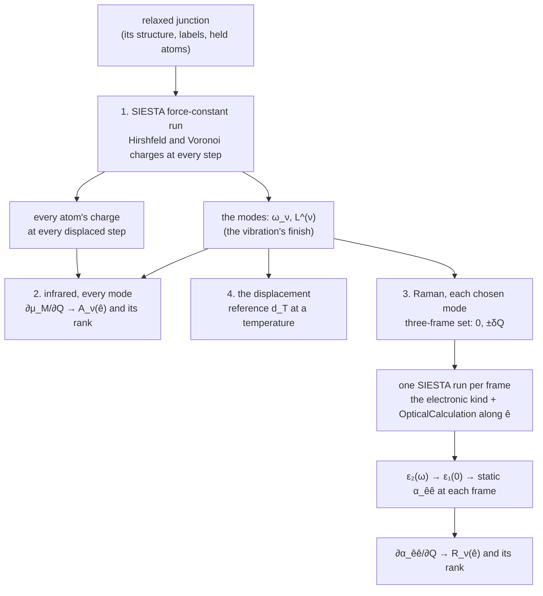
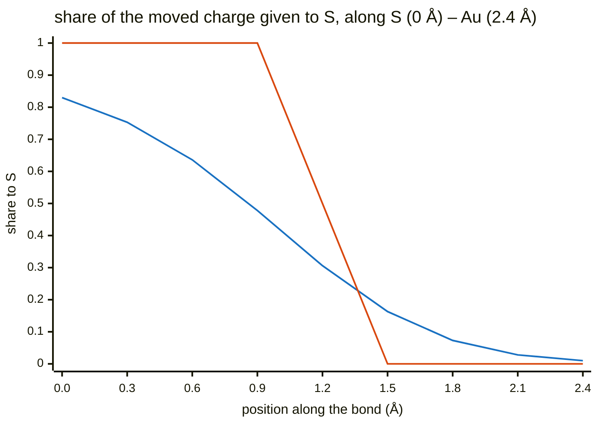
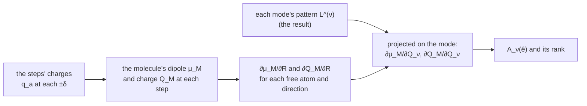

# The optical activity of a SIESTA vibration — infrared and Raman

**Role:** science reference — a method; the charges it reads are written
since 2.35.2, the rest is not built
**Domain:** science
**Companions:** [`engines/vibration.md`](?doc=engines/vibration.md) § 5.3 (the
force-constant input), § 5.10 ② (the charge each mode moves), ③ (a mode's
frames) and ④ (the `electronic` kind); [`vibrational-averaging.md`](?doc=science/vibrational-averaging.md)
§ 5 and § 2a (the displacement); [`normal-modes.md`](?doc=science/normal-modes.md)
§ 4b.7 (why SIESTA offers no infrared or Raman today); `plans/plan.md` § 1ac.

*Written 2026-10-24 at the user's request: "we need a new method document for
this, science, procedure design, and quantitative explanation, all formula
should be latex and checked, with diagram of workflow and explanation of
dependency". Its scope, the user's: "it is simple: siesta calculate correctly
optical activity and evalaute the displacement"; "all i asked is a vibration
calculation, assumed an EM in the vacuum"; "here we focus for a unit EM
intensity with a specific direction how the molecule respond".*

---

## 0. In short — the question, and the workflow

A SIESTA [Soler2002, Garcia2020] vibration gives a junction's modes: the
molecule and the metal atoms left free beside it move, the electrodes are
held.

```text
   held electrode                 the molecule M                 held electrode
  ● ● ● ● ● ● ○ ─ S ─────────── C6H4 ─────────── S ─ ○ ● ● ● ● ● ●
              └──────────── the free set F: every atom that moves ───┘
                     ○ a free metal atom      ● a held one

        light in vacuum, its field along a direction ê the person chooses
        ──────────────────────────────────────────────►  (z, the gap's axis, for one)
```

**Which modes are infrared- or Raman-active, and how strong is each relative
to the others**, for light polarized along $\hat e$? And **where should the
frames along a mode sit** — the maximum displacement?

Everything comes from SIESTA's own electronic structure at the mode's
geometries. **No field is applied in any calculation, and the metal's own
response is left out** *(the user: "the polarizability of the metal cluster is
a fake statement")*.

| | a mode shows in the spectrum when it changes … | read from |
|---|---|---|
| **infrared** | the molecule's **dipole** — how its charge sits | the charges SIESTA prints at every step of the vibration itself |
| **Raman** | the **polarizability** — how easily light shifts the electrons | SIESTA's optical calculation at the mode's displaced geometries |

### 0.1 What the person gives

| input | for | default |
|---|---|---|
| the relaxed junction — its structure, labels and held atoms | everything | — |
| the molecule — a label the person names (`BDT` on AuBDTAu) | the infrared dipole | — |
| the light's direction $\hat e$ | infrared and Raman | — |
| the charge partition | infrared | Hirshfeld (§ 1a) |
| the modes to compute Raman for | Raman | — |
| a temperature | the displacement's reference | — |

### 0.2 The workflow

| step | what runs | molbuilder today |
|---|---|---|
| **1. The vibration** | SIESTA's force-constant run on the relaxed junction, as today: each free atom nudged ±0.0212 Å along x, y and z, a self-consistent solution at each — $1 + 6\,n_{\mathrm{free}}$ of them; SIESTA prints every atom's Hirshfeld and Voronoi charge after each | **exists** — the charges since 2.35.2 |
| **2. Infrared, every mode** | nothing more: the vibration's finish reads the charges of step 1 → each mode's dipole change → its infrared strength $A_\nu(\hat e)$ and rank (§ 2; a worked example, § 2.4) | to build |
| **3. Raman, the chosen modes** | for each mode, its three-frame set — the geometries at $0$ and $\pm\delta Q$ (§ 3.2); one SIESTA run at each frame with its optical calculation (the `OpticalCalculation` option: the light-absorption spectrum from its own states, § 3.1) → the static polarizability at each → its change → the Raman strength $R_\nu(\hat e)$ and rank (§ 3) | the frame set **exists** (2.35.0); the runs need the `electronic` calculation kind (§ 5), **not built** |
| **4. The displacement** | nothing: the reference maximum displacement at the person's temperature, from the vibration result, beside the person's own (§ 4; an example, § 4.1) | to build |



**What it costs**: infrared and the displacement, nothing beyond the
vibration already run; Raman, three SIESTA runs per chosen mode — frame 0 the
same geometry for every mode, so $1 + 2\times$(the number of modes) distinct
runs.

**Which atoms.** The modes are defined on the **free set** $F$, every atom the
vibration moves. The infrared dipole is the **molecule's**, $M$; the free
metal atoms move in the modes, and when they move the molecule's charges
change — that is counted — but their own charges are the metal's and are not.

### 0.3 Where each number comes from

| number | file | written by |
|---|---|---|
| the modes $\omega_\nu$, $\mathbf L^{(\nu)}$, the masses | `<label>.spectra.json` | the vibration's finish (`engines/vibration.md` § 5.5) |
| every atom's charge at every force-constant step | `<label>…-run0.out`, its *Hirshfeld* and *Voronoi Atomic Populations* blocks | SIESTA (2.35.2's input) |
| $\varepsilon_{2,\hat e\hat e}(\omega)$ at a frame | `<label>.EPSIMG` | SIESTA's optical calculation, in the `electronic` kind's run (not built) |
| the zero-point amplitude $Q_{\mathrm{zp}}$ | `<label>.spectra.json` (`zero_point_amplitude_amu12_ang`) | the vibration's finish |

---

## 1. The quantities

| symbol | what it is | unit |
|---|---|---|
| $F$ | the free set: every atom the vibration moves | — |
| $M$ | the molecule: the atoms of the label the person names | — |
| $m_k$ | atom $k$'s mass, as the vibration result states it | amu |
| $\omega_\nu$ | mode $\nu$'s frequency, as the result states it | cm$^{-1}$ |
| $\mathbf L^{(\nu)}$ | mode $\nu$'s displacement pattern over $F$, normalised with the masses, $\sum_{k\in F} m_k\,\lvert\mathbf L_k^{(\nu)}\rvert^2 = 1$ (`engines/vibration.md` § 6.3); zero on every held atom | amu$^{-1/2}$ |
| $Q_\nu$ | how far the structure is moved along mode $\nu$: atom $k$ moves by $Q_\nu\,\mathbf L_k^{(\nu)}$ | amu$^{1/2}$ Å |
| $q_a$ | atom $a$'s partial charge: its valence charge less the electrons a partition gives it — positive where electrons left it; by Hirshfeld [Hirshfeld1977] or Voronoi [FonsecaGuerra2004], both computed (§ 1a) | $e$ |
| $\bar{\mathbf r}_M^{\,0}$ | the molecule's centre at equilibrium, $\frac{1}{N_M}\sum_{a\in M}\mathbf r_a^0$ — a fixed point | Å |
| $\hat e$ | the direction of the light's field, the person's choice | — |
| $\varepsilon_{\hat e\hat e}(\omega)$ | the cell's dielectric function for a field along $\hat e$, $\varepsilon_1 + i\varepsilon_2$ | — |
| $V_{\mathrm{cell}}$ | the cell's volume | ų |

### 1a. The two charge partitions — Hirshfeld and Voronoi

*(Decided by the user, 2026-10-24: "both on"; "default to hirshfeld".)*
**Both are computed, every number is stated with the partition it came from,
and Hirshfeld is the one shown unless the person picks Voronoi.**

**What they share.** Both give each atom a charge, and both start from the
same thing — how the electrons moved when the atoms bonded: the real electron
density $\rho$ less the density the same atoms would have as neutral, isolated
atoms,

$$
\Delta\rho(\mathbf r) = \rho(\mathbf r) - \sum_{b} \rho_b^{\mathrm{free}}(\mathbf r) .
$$

(SIESTA works with the valence electrons; $\rho_b^{\mathrm{free}}$ is atom
$b$'s neutral valence density on its own basis.) A charge of $+0.1\,e$ means
the atom ended with 0.1 electron fewer than it had alone. **The two differ
only in how they share $\Delta\rho$ between neighbouring atoms**:

$$
q_a^{\mathrm{Hirshfeld}} = -\int w_a(\mathbf r)\,\Delta\rho(\mathbf r)\,d\mathbf r,
\quad w_a(\mathbf r) = \frac{\rho_a^{\mathrm{free}}(\mathbf r)}{\sum_b \rho_b^{\mathrm{free}}(\mathbf r)} ;
\qquad
q_a^{\mathrm{Voronoi}} = -\int_{V_a} \Delta\rho(\mathbf r)\,d\mathbf r ,
$$

$V_a$ the points nearer to atom $a$'s nucleus than to any other.

- **Voronoi draws a hard wall.** Every point belongs to the nearest nucleus —
  by distance alone, whatever the atoms' sizes — so on the S–Au bond the wall
  sits exactly halfway between the two nuclei, and each atom takes all the
  moved charge on its side (a point exactly on the wall is shared equally).
- **Hirshfeld shares softly.** At each point it asks how much density a lone
  neutral S and a lone neutral Au would each have there, and splits the moved
  charge in that ratio: near S, S takes nearly all of it; at the bond's middle
  it is shared; near Au, Au takes it — no wall, a split that changes smoothly
  through the bond.

**The two shares along a bond, drawn.** The share of the moved charge that
goes to S, at points along an S–Au bond 2.4 Å long. *An illustration with
model densities* — one-dimensional Gaussians for the two neutral atoms (S: 6
valence electrons, width 0.8 Å; Au: 11, width 1.3 Å), not SIESTA's:



*(Blue: Hirshfeld — a smooth hand-over through the bond, set by the two atoms'
own densities. Orange: Voronoi — everything on S's side of the midpoint, a
step.)*

Both are read in SIESTA 5.4.2's source (`partial_charges.F90`: Voronoi
subtracts the neutral-atom density at each grid point and gives the rest to
the nearest atom; Hirshfeld weights the density by $w_a$); the Hirshfeld form
above follows because $w_a\sum_b\rho_b^{\mathrm{free}} = \rho_a^{\mathrm{free}}$
integrates to the atom's valence charge.

**What it means for this method.**

1. **Every number changes with the partition.** The molecule's charge
   depends on where the S–Au boundary is drawn, and that boundary is a
   convention — no partition is the true one. What should not change is the
   ranking of the modes; where it does, that is a finding — the ranking is
   then set by how the bond is split, not by the molecule. (In the worked
   example of § 2.4 the two partitions give the same ranking and strengths
   about five times apart.)
2. **Smoothness as atoms move.** The derivatives compare charges at
   geometries $2\delta$ = 0.042 Å apart. Under Voronoi the wall moves with the
   atoms and points of SIESTA's grid jump from one atom to the other; under
   Hirshfeld the shares change gradually, so its derivatives are expected to
   be less noisy — the reason it is shown first. This is expected, not yet
   measured; a displacement sweep (§ 6) shows it, where one is run.
3. **The cost is the same and small**: each is a sum over SIESTA's grid after
   every step, with no extra self-consistent solution, and both are asked for
   in the same run.

---

## 2. Infrared — the dipole change along a mode (workflow step 2)

**The idea.** Light whose field points along $\hat e$ pushes positive and
negative charge apart along $\hat e$. A mode absorbs it when moving along the
mode changes the molecule's dipole along $\hat e$ — the charges move, or the
charged atoms move, or both. How strongly is the square of that change.

```text
   equilibrium              the mode at +Q             what the light sees
   δ−   δ+                   δ−      δ+               the dipole along ê
   ●────●            →       ●───────●                changes:  Δμ ≠ 0  → infrared-active
                         (bond longer, charge         stays:    Δμ = 0  → infrared-silent
                          shifted)
```

### 2.1 The molecule's charge and dipole

**Why partial charges.** The cell's own dipole is not defined for a periodic
metal, and the Born effective charges SIESTA can compute come from the
Berry-phase polarization, which is defined for an insulator [KingSmith1993]
(SIESTA 5.4.2 manual, `BornCharge` and `PolarizationGrids`: the system "must be
an insulator"; `normal-modes.md` § 4b.7); the charges of the molecule's own
atoms are defined in any cell. From them, at any geometry $R$:

$$
Q_M(R) = \sum_{a\in M} q_a(R),
\qquad
\boldsymbol\mu_M(R) = \sum_{a\in M} q_a(R)\,\bigl(\mathbf r_a(R) - \bar{\mathbf r}_M^{\,0}\bigr).
$$

As the molecule vibrates, its electrons shift at the bonds to the metal, so
$Q_M$ changes along a mode (the user: "the bridge's charge transfer (electron
density) correctly calculated in different modes"). Two numbers are reported
for each mode:

- **the dipole change** $\partial\boldsymbol\mu_M/\partial Q_\nu$, taken about
  the molecule's own fixed centre — no point outside the molecule enters it;
- **the charge the mode moves** $\partial Q_M/\partial Q_\nu$ between the
  molecule and the metal — beside it, not folded in: its dipole depends on
  where in the metal the charge comes from, which these charges do not say.
  (`engines/vibration.md` § 5.10 ② reads the same charges for the whole free
  set and each element in it; this is the molecule's.)

### 2.2 Read from the force-constant run, with no extra calculation

SIESTA's force-constant run moves each free atom $k$ by $\pm\delta$ along x,
y and z in turn (`FC.Displacement`, 0.04 bohr = 0.0212 Å by default) and
solves the electrons self-consistently at each step. With
`Charge.Hirshfeld geometry` and `Charge.Voronoi geometry` in its input —
written there since 2.35.2 (`engines/vibration.md` § 5.3) — SIESTA prints
every atom's partial charge, by both partitions, "at the end of every geometry
step" (SIESTA 5.4.2 manual, `Charge.Hirshfeld`; `grdsam.F`), to $10^{-6}\,e$
(`partial_charges.F90`), each column summing to zero for a neutral cell.

The steps come in a fixed order — displaced atom, then direction, then side,
$-$ before $+$ (`engines/vibration.md` § 5.4):

```text
 step 0          the relaxed geometry
 steps 1–6       free atom 1:  −x, +x, −y, +y, −z, +z
 steps 7–12      free atom 2:  −x, +x, −y, +y, −z, +z
 …               every free atom in turn: 1 + 6·n_free steps
```

By central differences, each displaced geometry's dipole taken at that
geometry's own positions — so both the charges changing and the charged
atoms moving are counted:

$$
\frac{\partial\boldsymbol\mu_M}{\partial R_{k\beta}}
\approx \frac{\boldsymbol\mu_M(R^{+}_{k\beta}) - \boldsymbol\mu_M(R^{-}_{k\beta})}{2\delta},
\qquad
\frac{\partial Q_M}{\partial R_{k\beta}}
\approx \frac{Q_M(R^{+}_{k\beta}) - Q_M(R^{-}_{k\beta})}{2\delta},
$$

where $R^{\pm}_{k\beta}$ is the geometry with free atom $k$ moved by
$\pm\delta$ along $\beta \in \{x, y, z\}$. Every free atom counts, the metal
ones too: moving a free gold atom changes the molecule's charges. Projected
onto each mode,

$$
\frac{\partial\boldsymbol\mu_M}{\partial Q_\nu}
= \sum_{k\in F}\sum_{\beta} \frac{\partial\boldsymbol\mu_M}{\partial R_{k\beta}}\;L^{(\nu)}_{k\beta},
\qquad
\frac{\partial Q_M}{\partial Q_\nu}
= \sum_{k\in F}\sum_{\beta} \frac{\partial Q_M}{\partial R_{k\beta}}\;L^{(\nu)}_{k\beta}.
$$

Every mode's values come out of the one run that gave the modes, once for
each partition.



### 2.3 The infrared strength for a unit field along $\hat e$

For a molecule held in one orientation, in light whose field points along
$\hat e$, mode $\nu$'s integrated absorption is

$$
A_\nu(\hat e) = \frac{N_A}{4\varepsilon_0 c^2}\,
\Bigl(\hat e\cdot\frac{\partial\boldsymbol\mu_M}{\partial Q_\nu}\Bigr)^{2}
= 126.768\ \tfrac{\mathrm{km}}{\mathrm{mol}}
\times \Bigl(\hat e\cdot\frac{\partial\boldsymbol\mu_M}{\partial Q_\nu}\Bigr)^{2} ,
$$

with the derivative in D Å$^{-1}$ amu$^{-1/2}$ (a charge of $e$ moved 1 Å is
4.8032 D, so a derivative in $e$ amu$^{-1/2}$ is multiplied by 4.8032). A free
molecule tumbles in the light, and its average over orientations is the
familiar $\frac{N_A}{12\varepsilon_0 c^2}\lvert\partial\boldsymbol\mu/\partial Q\rvert^2
= 42.256\ \mathrm{km/mol}$ per $(\mathrm D/\text{Å})^2/\mathrm{amu}$
[Porezag1996] — a third of the value above, since a tumbling dipole lies along
the field a third of the time; held in the junction, it does not tumble. (Both
prefactors computed from the CODATA constants.)

**Reported**: $A_\nu(\hat e)$ for every mode, and
$A_\nu(\hat e)/\max_{\nu'}A_{\nu'}(\hat e)$; the charge the mode moves beside
it.

### 2.4 A worked example — the toy junction, from its real run

The charges are those the force-constant run of § 7 printed: the toy junction
`claude-transport-walk` — a straight chain of 22 hydrogen atoms, nine held on
each side, its four-atom `bridge` (user indices 9–12) the molecule $M$, its
middle two (10, 11) free; $\hat e = \hat z$, along the chain. The steps were
read and the derivatives formed by a measurement script, as § 2.2 states
them — no molbuilder code reads them yet.

**The modes** (the run's result): two free hydrogen atoms give six modes. The
four that move them across the chain are imaginary (−666.35 and
−481.53 cm⁻¹, each twice) — a straight hydrogen chain is not a minimum
sideways; their dipole change along z is zero. The two along the chain:

| mode | frequency | the two free atoms | $\partial\mu_{M,z}/\partial Q$ ($e$ amu$^{-1/2}$), Hirshfeld / Voronoi | $A_\nu(\hat z)$ (km/mol), Hirshfeld / Voronoi | $\partial Q_M/\partial Q$ ($e$ amu$^{-1/2}$), Hirshfeld / Voronoi |
|---|---|---|---|---|---|
| 5 | 2023.77 cm⁻¹ | move together, both along −z | −0.0853 / −0.1865 | **21.3 / 101.8** | 0 / 0 |
| 6 | 2548.37 cm⁻¹ | move apart, mirror images | 0 / 0 | **0 / 0** | −0.0395 / −0.0373 |

**Why — the symmetry, and what it checks.** The chain is the same on both
sides of a mirror plane through the bridge's centre ($z$ = 11 Å).

- **Mode 6** is its own mirror image: the two atoms move apart as each
  other's reflection. The dipole along z changes sign under that mirror, so
  it cannot change in this mode — **infrared-silent**, under either
  partition. The bridge's total charge does not change sign under the
  mirror, so it *can* change — and does: the mode moves charge between the
  bridge and the metal.
- **Mode 5** turns into its own reverse under the mirror (both atoms shift the
  same way). Now the dipole along z can change — **infrared-active** — and
  the total charge cannot change at first order.

Both zeros come out of the numbers, not out of an assumption: the method
reads symmetry correctly. The two partitions **rank the modes the same** and
put mode 5's strength about five times apart (21.3 against 101.8 km/mol) —
§ 1a's point, in numbers. (Each free atom's own $\partial\mu_{M,z}/\partial z$
is $0.0606\,e$ under Hirshfeld and $0.1324\,e$ under Voronoi: how much charge
the molecule's dipole sees move with the atom.)

---

## 3. Raman — the polarizability change along a mode (workflow step 3)

**The idea.** Light's field shifts the electrons; the polarizability says how
easily. A mode is Raman-active when moving along it makes the electrons
easier or harder to shift — when the polarizability changes along the mode.
How strongly is the square of that change.

### 3.1 The static polarizability at one geometry, from SIESTA's own states

The polarizability is a property of the electrons at a geometry: how far
light of a given polarization would shift them. **It is computed from the
states SIESTA has already solved — no field is applied.**

**What "the optical calculation" is.** After SIESTA has solved the electrons
at a geometry it holds every occupied and every empty state. Its
`OpticalCalculation` option then computes, for each pair of an occupied and
an empty state, how strongly light polarized along $\hat e$ couples the two
(the dipole transition between them), and from those couplings the
structure's light-absorption spectrum, $\varepsilon_2(\omega)$. The static
polarizability is the same couplings, each weighted by the energy between its
two states — one integral over that spectrum (below).

```text
   empty states   ─────────  ─────────  ─────────
                      ▲          ▲           ▲         each arrow: one pair, its coupling to
                      │          │           │         light along ê, at the energy of the gap
   occupied       ─────────  ─────────  ─────────
                  → ε₂(ω): every pair's coupling, placed at its gap ħω (the absorption spectrum)
                  → the static polarizability: the couplings weighted by 1/gap, summed
```

In the input it is:

```text
OpticalCalculation        true
Optical.PolarizationType  polarized
%block Optical.Vector
  0.0  0.0  1.0           # e, here along z
%endblock Optical.Vector
```

with `Optical.Mesh` (its k-points), `Optical.NumberOfBands` (all bands by
default) and `Optical.Energy.Maximum` (10 Ry by default). In SIESTA's words:

- `OpticalCalculation true`, with `Optical.PolarizationType polarized` and
  `Optical.Vector` $\hat e$: the imaginary part of the dielectric function for
  a field along $\hat e$, $\varepsilon_{2,\hat e\hat e}(\omega)$, "using first
  order perturbation theory" from "the dipolar transition matrix elements
  between different eigenfunctions of the self-consistent Hamiltonian", in the
  momentum formulation for a solid — a cell periodic in three directions, as
  the junction's is (SIESTA 5.4.2 manual, `OpticalCalculation`;
  `Src/optical.F`). It covers the transitions between different states
  (interband) and is written to `<label>.EPSIMG`.
- The static real part is one integral of it — the Kramers–Kronig relation
  at zero frequency:

  $$
  \varepsilon_{1,\hat e\hat e}(0) = 1 + \frac{2}{\pi}\int_0^{\infty}
  \frac{\varepsilon_{2,\hat e\hat e}(\omega)}{\omega}\,d\omega .
  $$

**Static, as the Raman activity is defined** — the Raman shift is the mode's
own frequency, whatever the laser's, and the activity uses the static
polarizability [Porezag1996], as molbuilder's PySCF Raman computes it
(`engines/vibration.md` § 4). The cell's polarizability along $\hat e$, as a
polarizability volume:

$$
\alpha_{\hat e\hat e} = \frac{V_{\mathrm{cell}}}{4\pi}\,
\bigl[\varepsilon_{1,\hat e\hat e}(0) - 1\bigr]
$$

(from $\mathbf P = \varepsilon_0(\varepsilon_r - 1)\mathbf E$, a dipole
$\mathbf P V_{\mathrm{cell}}$, divided by $4\pi\varepsilon_0$).

**The metal is left out.** Its free electrons' response — the Drude term
SIESTA's `Util/Optical/README` adds for a metal — is not used. The held
metal's own transitions are in $\varepsilon_2$ at every frame and are the same
at $\pm\delta Q$, since the held atoms do not move: they cancel in the
difference of § 3.2. What the difference keeps is what the mode changes — the
molecule and its bonds to the metal.

### 3.2 Its change along a mode, and the Raman strength

The two geometries at $\pm\delta Q$ along mode $\nu$ are frames 1 and 2 of
the mode's three-frame set (`engines/vibration.md` § 5.10 ③) written with its
maximum displacement set to $\delta$: every free atom moved by
$\pm\delta Q\,\mathbf L_k^{(\nu)}$, $\delta Q = \delta/\max_k\lvert\mathbf L_k^{(\nu)}\rvert$,
the one that moves most by $\delta$ — the force-constant run's own step, in
the same linear range. Each frame is one SIESTA run of the `electronic` kind
(§ 5) with the optical calculation in its input.

```text
   frame 2: −δQ                 frame 0: equilibrium              frame 1: +δQ
   every free atom moved        as relaxed                        every free atom moved
   by −δQ·L  (largest: −δ)                                        by +δQ·L  (largest: +δ)
        │                             │                                 │
   one SIESTA run               one SIESTA run                    one SIESTA run
   α(−δQ)                       α(0)                              α(+δQ)
        └──────────── ∂α/∂Q ≈ [ α(+δQ) − α(−δQ) ] / 2δQ ───────────────┘
```

$$
\frac{\partial\alpha_{\hat e\hat e}}{\partial Q_\nu}
\approx \frac{\alpha_{\hat e\hat e}(+\delta Q) - \alpha_{\hat e\hat e}(-\delta Q)}{2\,\delta Q},
\qquad
R_\nu(\hat e) = \Bigl(\frac{\partial\alpha_{\hat e\hat e}}{\partial Q_\nu}\Bigr)^{2}
\quad[\text{Å}^4/\mathrm{amu}] .
$$

$R_\nu(\hat e)$ is the Raman strength for light polarized along $\hat e$,
incoming and scattered. The textbook Raman activity $45a'^2 + 7\gamma'^2$
[Porezag1996] — $a'$ the mean of the polarizability's derivative, $\gamma'$
its anisotropy — is a tumbling molecule's, averaged over orientations and
summed over both scattered polarizations. The same $\hat e\hat e$ component,
averaged over orientations, is
$\langle\alpha'^{\,2}_{\hat e\hat e}\rangle = (45a'^2 + 4\gamma'^2)/45$
(checked by sampling random rotations of a random tensor): related, not the
same number.

**Reported**: $R_\nu(\hat e)$ for each chosen mode, and
$R_\nu(\hat e)/\max_{\nu'}R_{\nu'}(\hat e)$. Frame 0's $\alpha$ is the
equilibrium polarizability, the same for every mode, reported once.

**On the toy junction of § 2.4**, the step would be
$\delta Q$ = 0.0300 amu$^{1/2}$ Å for both real modes (each free atom
carries $\lvert\mathbf L\rvert$ = 0.7043 amu$^{-1/2}$); no Raman number is given
here — the runs need the `electronic` kind (§ 5).

### 3.3 What the optical calculation is, and is not

- **Independent states.** SIESTA's "simplest approach": transitions between
  the self-consistent states, with no correction for the field the response
  itself creates (no local-field effects).
- **A difference of large numbers.** The held metal's transitions cancel
  between $\pm\delta Q$ (§ 3.1), but they are large, so the derivative is a
  small difference of large numbers; how far it stands above the k-point
  mesh, the broadening and the band count is the person's judgement, with the
  settings stated beside the value.
- **The integral needs the whole spectrum**: $\varepsilon_2$ up to
  `Optical.Energy.Maximum` over enough bands (`Optical.NumberOfBands`).

---

## 4. The displacement (workflow step 4)

The frames along a mode sit where the person's **maximum displacement** puts
them: the move, at the outermost frames, of the atom that moves most in the
mode. Its reference at a temperature T, from the vibration result alone, is
the displacement whose frames sample the mode's thermal spread
(`vibrational-averaging.md` § 5),

$$
d_T = \sqrt2\,x_{\mathrm{out}}\;Q_{\mathrm{zp}}\sqrt{\coth\!\left(\frac{\hbar\omega}{2k_BT}\right)}\;\max_k\lvert\mathbf L_k\rvert
\qquad (\sqrt3\,\sigma_T\max_k\lvert\mathbf L_k\rvert \text{ for three frames}),
$$

$x_{\mathrm{out}}$ the rule's outermost node ($\sqrt{3/2}$ for three frames,
2.0202 for five) and $Q_{\mathrm{zp}}$ the mode's zero-point amplitude, which
every result states; a mode driven by light spreads further
(`vibrational-averaging.md` § 2a). The value stays the person's. Raman's
$\pm\delta Q$ (§ 3.2) is a different thing: a step for a derivative, not a
spread to average over.

### 4.1 An example — the toy junction's two real modes

From the result of § 2.4's run, computed with the vibration code's own
functions (`spectra.derived`):

| mode | frequency | $Q_{\mathrm{zp}}$ (amu$^{1/2}$ Å) | largest atom's zero-point move | $d_T$, three frames, 4 K / 300 K | $d_T$, five frames, 300 K |
|---|---|---|---|---|---|
| 5 | 2023.77 cm⁻¹ | 0.0913 | 0.0643 Å | 0.111 / 0.111 Å | 0.184 Å |
| 6 | 2548.37 cm⁻¹ | 0.0813 | 0.0573 Å | 0.099 / 0.099 Å | 0.164 Å |

Both modes are stiff — $\hbar\omega$ is about ten times $k_BT$ at room
temperature (0.251 and 0.316 eV against 0.026 eV) —
so their thermal spread is their zero-point spread at 4 K and at 300 K alike
($\sigma_T/Q_{\mathrm{zp}}$ = 1.000 at both). A soft mode, tens of cm⁻¹ — a
contact or a whole-molecule rocking — widens several-fold by room
temperature (`vibrational-averaging.md` § 2).

---

## 5. Why Raman needs the `electronic` calculation kind

molbuilder runs SIESTA in three kinds of calculation today — an
optimization, a vibration and a transport calculation. Raman's step 3 needs
something none of them does: **SIESTA run once at a fixed geometry — a single
point — at each frame of a mode, with the optical calculation in its input.**

| kind | what SIESTA does | the geometry | the optical response it could give |
|---|---|---|---|
| optimization | relaxes the structure | moves, step by step | the final geometry's only |
| vibration | the force-constant run: $1 + 6\,n_{\mathrm{free}}$ nudged geometries | nudged and restored | the last displacement's only |
| transport | electrodes and the device, for a current | fixed | not this question |
| **`electronic`** (decided, not built) | **one self-consistent solution per frame** | **each frame, as given** | **each frame's — what Raman needs** |

- **The vibration cannot give it.** Its force-constant run does visit
  displaced geometries, but SIESTA computes the optical response once, after a
  run's last step, for its final geometry — `siesta.F` calls
  `siesta_analysis`, where `optical` is called, once, after the run. One
  force-constant run would give one geometry's response, its last
  displacement's, and not the mode's.

The vibration contract has already decided the kind this needs
(`engines/vibration.md` § 5.10 ④, decision D4): **`electronic`** — one
self-consistent SIESTA solution per frame of a frame set, in the cell and at
the settings of the vibration the frames came from, each frame its own
record, the frames as sub-folders of one run (`01_scf/run-0/f000/`, `f001/`,
`f002/` — the layout § 5.10 ④ proposes). Raman is that kind with SIESTA's
optical calculation added to its input (`OpticalCalculation`,
`Optical.PolarizationType polarized`, `Optical.Vector`, `Optical.Mesh`,
`Optical.NumberOfBands`, `Optical.Energy.Maximum`), each keyword checked
against SIESTA's manual before it is written, as § 5.10 ④ asks. **Building it
is most of the Raman work**; infrared and the displacement need nothing of
it.

---

## 6. Numerical choices, and their checks

Every choice is stated beside the values it gave; the checks below cost
nothing beyond reading what the runs wrote.

| choice | proposed | check |
|---|---|---|
| $\delta$ (`FC.Displacement`) | the run's own, 0.0212 Å by default | where the person runs a displacement sweep (`engines/vibration.md` § 5.9), the charge derivatives are read at each of its steps, as the force constants are |
| the charges' grain | Hirshfeld or Voronoi charges are integrated on SIESTA's real-space mesh, so an atom moved by $\delta$ against the mesh changes its charge a little even with no physics behind it | the same sweep, where it is run |
| $\delta Q$ for Raman | $\delta/\max_k\lvert\mathbf L_k^{(\nu)}\rvert$ — the largest atom moved by $\delta$, the force constants' own linear range | — |
| `Optical.Mesh`, `Optical.Broaden`, `Optical.NumberOfBands`, `Optical.Energy.Maximum` | the person's, stated with every value | — |
| the charge sum | — | at every step the charge column over all atoms sums to zero (measured, § 7) |
| symmetry | — | a mode the structure's symmetry forbids reads zero (as § 2.4's mode 6 does) |

---

## 7. What is measured, and what is not yet

**Measured** (2026-10-24, the toy junction `claude-transport-walk`: a chain
of 22 hydrogen atoms, its middle two free) — **the charges at every
force-constant step**: the vibration `frequency/h-vib-q`, through jobset, its
input asking for both partitions (2.35.2): 13 steps, 13 Hirshfeld and 13
Voronoi blocks, every atom in each, each summing to zero within
1.2 × 10⁻⁵ e. A free atom moved across the chain leaves the charges unchanged
both ways; moved along it, it changes them with opposite signs — as the
chain's symmetry asks. Molbuilder's reader reads the output without a
warning, and the modes are the earlier run's to the last digit. **From the same
run, the infrared strengths of § 2.4**: the symmetry-forbidden mode reads
zero under both partitions, the allowed one does not.

**Not yet shown — the proof before anything is built**: on a molecule whose
answer is known independently, SIESTA's infrared (§ 2) and Raman (§ 3)
against PySCF's, which molbuilder computes already (`engines/vibration.md`
§ 4): water in a box, the same modes, compared mode by mode and in rank. The
infrared half needs only the two vibrations that exist; the Raman half needs
the `electronic` kind (§ 5). **What water cannot prove**: SIESTA computes an
isolated molecule's optical response with the position operator and a solid's
in the momentum formulation (its manual, `OpticalCalculation`); water in a box
takes the first, the junction the second, so the Raman comparison checks the
chain from the response to $R_\nu$, not the junction's formulation.

---

## 8. What the method assumes

1. **Point charges** (infrared): the molecule's dipole is its atoms' partial
   charges at their positions; each atom's own dipole is not in it, and two
   partitions give two answers.
2. **Independent states** (Raman): SIESTA's optical calculation, without
   local-field effects (§ 3.3).
3. **The metal left out** (Raman): no free-electron (Drude) term; the held
   metal's own transitions, the same at both geometries, cancel in the
   difference.
4. **Static polarizability** (Raman): the activity as it is defined, away
   from the molecule's electronic resonances.
5. **Harmonic modes**, and derivatives taken in their linear range.

---

## 9. Words used here

| word | what it means here |
|---|---|
| **mode** | one pattern in which the free atoms move together, with one frequency (`engines/vibration.md` § 6.3) |
| **force-constant run** | SIESTA nudging each free atom both ways along x, y and z and recording the forces — the vibration's own SIESTA run |
| **partial charge** | the charge a partition gives one atom: its valence charge less the electrons assigned to it (§ 1a) |
| **dipole change** | how the molecule's charge distribution shifts as it moves along a mode — what infrared sees (§ 2) |
| **polarizability** | how easily light's field shifts the electrons — what Raman sees through its change (§ 3) |
| **dielectric function** $\varepsilon$ | the material's response to light; its imaginary part $\varepsilon_2$ is the absorption, its real part $\varepsilon_1$ at zero frequency gives the static polarizability |
| **the optical calculation** | SIESTA's `OpticalCalculation`: $\varepsilon_2$ from the couplings between its occupied and empty states (§ 3.1) |
| **static** | at zero frequency — away from the molecule's electronic resonances |
| **frame set** | one mode written as a few geometries along it, each its own frame (`engines/vibration.md` § 5.10 ③) |
| **single point** | one SIESTA solution at one fixed geometry, nothing moved |
| **the `electronic` kind** | the calculation kind that runs a single point at each frame of a frame set — decided, not built (§ 5) |

---

## References

Each checked against Crossref, 2026-10-24, and in `references.bib`.

- [Soler2002] J. M. Soler, E. Artacho, J. D. Gale, A. García, J. Junquera,
  P. Ordejón, D. Sánchez-Portal, *J. Phys.: Condens. Matter* **14**,
  2745–2779 (2002), doi:10.1088/0953-8984/14/11/302 — the SIESTA method.
- [Garcia2020] A. García, N. Papior, A. Akhtar, E. Artacho, V. Blum,
  E. Bosoni, P. Brandimarte, M. Brandbyge, J. I. Cerdá, *et al.*, *J. Chem.
  Phys.* **152**, 204108 (2020), doi:10.1063/5.0005077 — SIESTA's recent
  developments and applications.
- [Hirshfeld1977] F. L. Hirshfeld, *Theor. Chim. Acta* **44**, 129–138
  (1977), doi:10.1007/BF00549096 — bonded-atom (Hirshfeld) partial charges.
- [FonsecaGuerra2004] C. Fonseca Guerra, J.-W. Handgraaf, E. J. Baerends,
  F. M. Bickelhaupt, *J. Comput. Chem.* **25**, 189–210 (2004),
  doi:10.1002/jcc.10351 — Voronoi deformation density charges, assessed
  against Mulliken, Bader, Hirshfeld and Weinhold.
- [KingSmith1993] R. D. King-Smith, D. Vanderbilt, *Phys. Rev. B* **47**,
  1651–1654 (1993), doi:10.1103/PhysRevB.47.1651 — the Berry-phase
  polarization of an insulator.
- [Porezag1996] D. Porezag, M. R. Pederson, *Phys. Rev. B* **54**, 7830–7836
  (1996), doi:10.1103/PhysRevB.54.7830 — infrared intensities and Raman
  activities in density-functional theory.
- SIESTA 5.4.2 manual, `OpticalCalculation`, `Optical.*`, `Charge.Hirshfeld`,
  `BornCharge` and `PolarizationGrids`; its source `Src/optical.F`,
  `Src/partial_charges.F90`, `Src/grdsam.F`, `Src/siesta_analysis.F90`,
  `Src/siesta.F`; `Util/Optical/README`.
