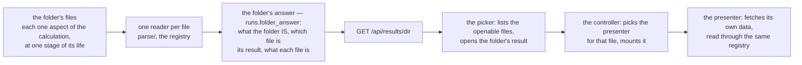
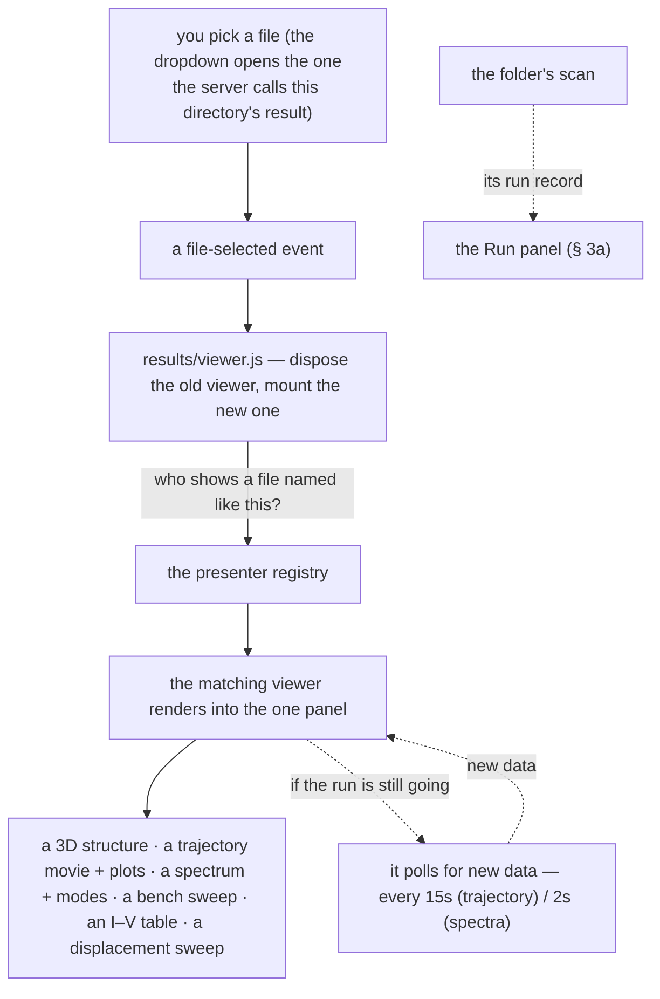
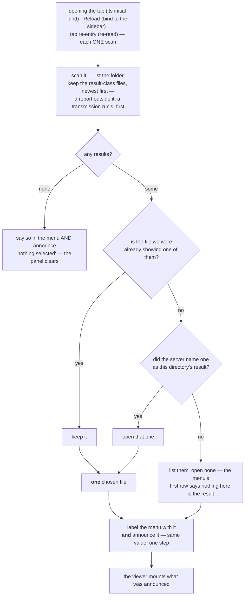
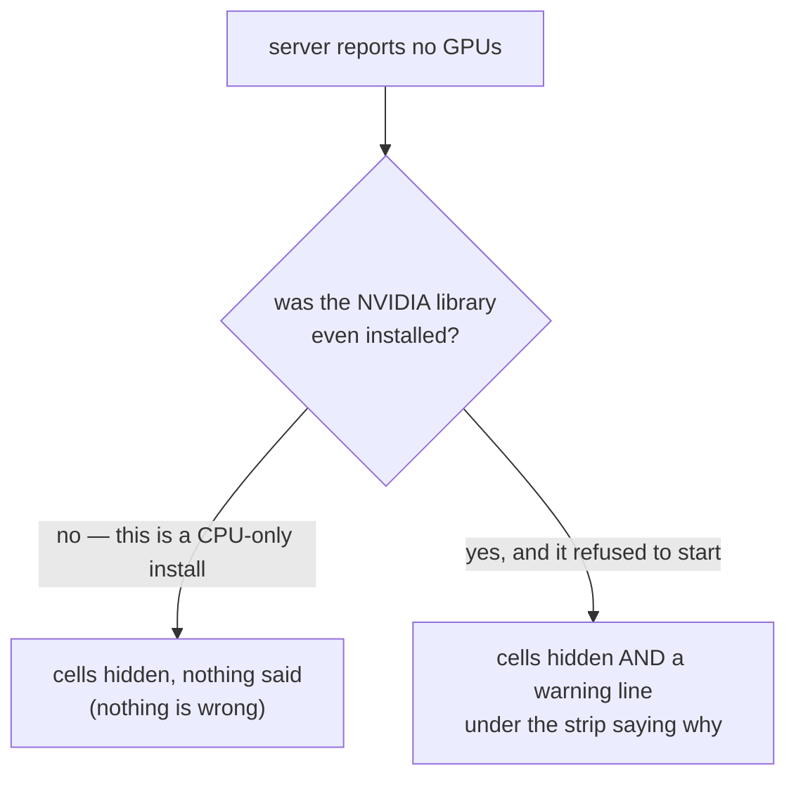

# Results tab — opening a finished calculation

**Role:** contract
**Domain:** web
**Companions:** [`execution/runs-of-points.md`](?doc=execution/runs-of-points.md) (a run of points: its words, data, operations and doors); [`presenters.md`](?doc=web/presenters.md) — the registry that
picks the viewer (this tab drives it); `trajectory.md` and `spectra.md` — the two
heavy viewers this tab hosts (their own docs); [`projects.md`](?doc=web/projects.md)
— the sidebar's file layer, which sets this tab's scope; [`model/parse.md`](?doc=model/parse.md)
§ 5 — the directory reader behind `/api/results/dir`, this tab's primary server
call; [`web-api.md`](?doc=web/web-api.md) — that route, plus `/api/watch/*` and
`/api/system/load`.

You ran a calculation; you open it on the **Results** tab. The tab is a
**dispatch shell**: a file picker across the top, and one panel below that
becomes *whatever viewer fits the file you picked* — a 3D structure, a trajectory
movie, a spectrum, a bench sweep, a transport run's I–V table, or a vibration's
displacement sweep. The tab draws no file itself — every file
type is a viewer's — only the Run panel (§ 3a) and the server-load strip (§ 6).

## 0. The tab as a system — read this first

**What it is.** You open a folder; the tab shows the result that folder holds,
in the way that kind of result is read. It is three parts in a row: the
**server** says what the folder is and what each file in it is; the **picker**
lists what can be opened and opens the folder's own result; a **presenter** —
one per kind of result — shows it.



### 0.1 Each kind of folder, and what it is shown as

| the folder is | the picker opens | shown by | its data |
|---|---|---|---|
| **one run** — an attempt directory | the run's result: its product if it made one (a spectrum, an optimized structure), else the engine's output (`<label>_<stage>.out`; a PySCF run's stdout no parser claims, so its progress log opens — `parse.md` § 5.5), else its progress log (§ 2.3) | the viewer for that file — trajectory (steps, energy, forces, SCF, how the run ended), spectra or structure | `/api/watch/*` parses the one file through the registry ([`trajectory.md`](?doc=web/trajectory.md)); `/api/spectra/*`; the structure's file door |
| **a run of points' root** — a SIESTA vibration's `run-<n>/`, holding its calls' folders ([`engines/vibration.md`](?doc=engines/vibration.md) § 5.11 § 2); a bias sweep's `run-<n>/`, holding its points' ([`engines/transport.md`](?doc=engines/transport.md) § 2a.11) | the run's own result where its root holds one — a vibration's spectrum, its record step's — and until then the result of the point at work (§ 3a); the run's index — every run of points' one, offered by its registry parser `run-points-json` ([`execution/runs-of-points.md`](?doc=execution/runs-of-points.md) § 2.3) — and its notification record listed beside it as aspects, never opened first; each point's folder opens as one run | the spectra viewer, or the point's own; the Run panel of the point at work, under the run's count (§ 3a) | as one run's; the run of points' view (§ 0.2) |
| **a calculation root** | a result file at the root if it holds one, **beside** the **ladder** — each rung's state and **every run of the calculation**, any of which is opened here when picked (§ 2.4) | the ladder card, and the picked run's presenter | `/api/results/dir` → `ladder` (`jobset/runstatus.py`) |
| **a benchmark** | its `job-set.json` (`kind: sweep` — a ladder's `job-set.json` is not openable) | the bench summary: its trials compared ([`bench-summary.md`](?doc=web/bench-summary.md)) | `/api/bench/summary` (`jobset/summarize.py`) |
| **a transport calculation** | its **`task.json`** — the description is the report's handle, as a benchmark's `job-set.json` is (the registry's `transport-task` parser claims only a transport calculation's); `<label>.transport.json` is `summarize task`'s copy for the command line, opened as a file. A **transmission run's** result is this report at its point, as its kind's record declares ([`execution/architecture.md`](?doc=execution/architecture.md) § 3.3): its ladder row opens the report with that bias selected (§ 2.4), and so does the run's own folder — the run door answers it with the calculation's `task.json`, the run of points' view with the point (§ 2) | the transport report: each rung's state (the ladder's own answer, its chip and detail), the I–V table, each point pending or failed in its run's words, and what is not drawn | `/api/transport/record` — composed on read from the rungs as they are now ([`engines/transport.md`](?doc=engines/transport.md) § 2a.12), never the copy `summarize task` wrote |
| **a SIESTA vibration with a displacement sweep** | its `<label>.fc-sweep.json`, once `summarize task` has written it | the sweep: each force-constant stage and what it varied, each mode's frequency per stage, the force-constant changes, the paths of each stage's own files ([`engines/vibration.md`](?doc=engines/vibration.md) § 5.9) | the record file itself |
| **a folder not marked as part of a calculation** | nothing: no file in it is claimed as a run's, so none opens on its own — the files a viewer shows read alone are listed, and you pick one ([`model/parse.md`](?doc=model/parse.md) § 5.0) | as above, for the file picked | as above |
| **a device run's `tsgf/`** (role `scratch`, [`engines/transport.md`](?doc=engines/transport.md) § 2a.11) | nothing: the page says *the engine's scratch of the run above*, and the sidebar lists what it holds; no file in it opens | — | — |
| **a transmission point's `shared/`** (role `shared`, [`engines/transport.md`](?doc=engines/transport.md) § 2a.16) | the point's report, as the point above it opens: the sidebar says *the energies this point shares with* the point its `.copied-from` names | — | — |

**A single run and a higher-level report are different by nature.** A run is
reported from its own files. A ladder, a benchmark and a transport calculation
are built from their rungs or trials, each by its own presenter, and each
answers its own question — *which rung is next*, *which setting is fastest*,
*what is the conductance*. They are never merged into one report.

### 0.2 How it is built

| part | module | what it does |
|---|---|---|
| the folder's answer | `runs.py` — the run door's `folder_answer`, of the one folder ([`execution/architecture.md`](?doc=execution/architecture.md) § 3.2, floor 2) | where the folder is (`place`: run · container · scratch · not marked; its calculation, what it is, and the stage, run, trial and point it sits in, the point as its folder — [`execution/project-layout.md`](?doc=execution/project-layout.md) § 1.4a, *Where am I*), its engine, the file to open (`openable`) — a transmission run's, its calculation's report, with that report's own row (`report`, § 2); per file, its whole path, its role, label, stage, whether a parser reads it (`parser`) and what it is (`about`, § 3b) |
| the views | `jobset/runstatus.py`, floor 6 — `views_of`, over the run door and a run of points' rows (`continuation.point_rows`) | at a calculation root, the **ladder** (`jobset_status`, each stage's every run inside it, § 2.4); at a run of points' root and each of its points' folders, the **run of points' view** (`points_view`): its state and count, the point at work with its record and the file it opens, what the run opens (§ 3a); at a folder of a rung with points, **the point it is** (`point_of`, § 2) |
| the route | `web/blueprints/results.py::api_results_dir`, floor 7 | the folder's answer **whole**, and beside it what `views_of` answers — `ladder`, `points`, `point`; it lists no field of either and decides no view, so a field a door adds reaches the page with nothing changed here |
| the picker | `lib/results/file-picker.js` | scans the folder the sidebar scopes, drops files nothing can read and files no presenter calls a result, opens `openable` — at a run of points' root, the view's `points.opens` — and announces the choice with `place`, `ladder`, `points`, `point`, `record`, the folder's `files` and where the file lies by the answer (`lies`: one of the folder's files, the report it opens, the point at work's file, a run picked off the ladder) |
| the file card | `lib/results/file-card.js` (§ 3b) | what the file in hand is — the dropdown's, or one clicked in the sidebar inside the folder whose files the card holds (after a run is picked off the ladder, that run's folder): what it holds and who wrote it, or *not written by molbuilder* |
| the Run panel | `lib/results/run-panel.js` (§ 3a) | the run the folder's files came from — its `record` — above whichever presenter is mounted; hidden for a container and a folder with no run |
| the controller | `results/viewer.js` | picks the presenter for the announced file, disposes the old one, mounts the new one; with nothing to show, the card that says what the folder is, and its ladder |
| the presenters | `lib/inspectors/*.js`, through `registry.js` ([`presenters.md`](?doc=web/presenters.md)) | one per kind of result; each loads its own data |
| their data | trajectory: `/api/watch/load`, `/api/watch/data` (`watch.py`) · spectra: `/api/spectra/*` · bench: `/api/bench/summary` · transport: `/api/transport/record`, composed on read · the displacement sweep: `/api/files/*` | each but the displacement sweep's reads its file through the registry — the readers the rest of molbuilder uses ([`model/parse.md`](?doc=model/parse.md)); the displacement sweep's page reads its record whole, the file the registry claimed by its role and schema (`fc-sweep-json`) before the picker offered it |

### 0.3 The rules that keep it right

- **A run's files do not conflict.** Each is the same calculation reporting
  one aspect at one stage of its life — the deck what was asked, `run.json`
  that it was sent, the engine's output its own account, the monitor the
  machine's, `.concluded` the exit — and the catalogue (`runfiles.WRITTEN`)
  says which is which. Two files stating related facts are two aspects, not
  two answers to reconcile.
- **One reader per file, one presenter per kind of result** — not one
  presenter for everything, and never a second reader beside a file's own.
- **The folder's kind decides its report.** A run's report is not a ladder's,
  a benchmark's or a transport calculation's, and none is built from another.
- **The server says what a file is; the browser does not guess from its
  name** (§ 2.3).
- **The page shows what it is sent, and composes no path.** Every path the
  page opens or sends back is whole — a file's, a run's folder, the file a
  ladder row opens, the deck a record names: the absolute path the server
  resolves a request's path to — so the page joins none to another; a name it
  only shows (a run's `run-0`, a stage's folder) stays a name. **It knows where
  a file lies by the answer it holds, never by a path's prefix or a base
  name**: a file of the folder is one of its `files`, the report is the
  `report` row, the point at work's file its own row, a picked run's folder
  its row's `dir`; a row that opens its calculation's report says so
  (`opens_report`). Its own translations are MolView's frame display, the
  one wording of a point (`lib/results/point-words.js`, § 2.5), and a path
  it only shows, from the projects folder as the sidebar names it
  (`projects.relativeToProjects`). Which
  presenter shows a file stays the presenter registry's (`presenters.md`).

### 0.4 Designed, not built yet

- **`status`**, on the same answer — how the run is doing — is served and not
  yet shown for a run folder beyond the Run panel's verdict; the trajectory
  viewer's badge shows the run's state as the server sends it with the file
  (§ 4.1); only a file that belongs to no run shows its own ending.

## 1. What the page is

`/results` renders a template and does the rest in the browser. Its controller
(`results/viewer.js`) owns one mount point (`#inspector-host`) and one live
viewer handle; on each selection it **picks** the viewer for the file,
**disposes** the previous one and **mounts** the new one. Beside that it draws
the header readout, the loading cover, and — at a calculation root — the
ladder card, a run picked off it opened in place (§ 2.4). All the file-type knowledge lives in the
viewers (the "presenters", [`presenters.md`](?doc=web/presenters.md)), not here —
so adding a result type is a new presenter module, never an edit to this
controller.



## 2. Picking a file

The picker (`lib/results/file-picker.js`) asks **one route** — `GET
/api/results/dir` — what is in the current project folder, and shows what comes
back. Two gates decide the menu, in this order:

1. **the server's**: each file arrives carrying `parser`, the answer to *can
   anything here read this file* (`parse.registry.detect`). `null` is dropped —
   the browser must not offer a file nothing can open.
2. **the presenter's**: of what survives, the files some viewer marks as a
   result (`isResult`, see presenters.md).

What is left is listed newest first, grouped by kind (the group with the newest
file floats to the top). **The opened file is the server's answer, not the
newest** — `openable`, from the run door (`runs.folder_answer`), which opens
the run the folder speaks for at what its *calculation* produces, and looks at
no date (`model/parse.md` § 5.1–§ 5.2). The picker mirrors your pick to
the sidebar so the highlight matches — a file inside the folder; a report
outside it is not mirrored, and the sidebar highlights nothing.

**A transmission run's folder answers its calculation's report.** TBtrans
writes no file a viewer reads on its own — its result is the report at its
point (§ 0.1), as its kind's record declares — so the run door answers such
a folder with the calculation's `task.json` (`openable`), and the point the
folder is, `{frame, of, bias_v}` (`point_of`) — a rung that runs once, its one
point — the point the ladder's row for the run names too (§ 2.4). The menu lists the report first, under its heading, and
opens it with that point selected, as the ladder row's *open* does; the
folder's own files stay listed below it, and the meta line gives the report
its age alone, counting the folder's own files. The header says so —
*&lt;folder&gt; — its result is its calculation's report, &lt;the report&gt;* — and does
not flag it as a file outside the folder. A return to the tab, reading the
folder again, keeps the point you picked since. The Run panel above it is the
transmission run's record — TBtrans's loop among it (§ 3a) — and the file
card knows the report: its row rides with the folder's files (§ 3b).
TBtrans never updates the progress log the wrapper seeds at launch, so a
transmission run's folder never opens it.

A filename guess cannot stand in for the door: over 110 real run directories
it offered 13 files no parser reads, hid 155 a parser handles, and differed
from the door's pick on 18 of 96.

### 2.1 The sidebar sets the scope; the dropdown decides what you see

These are the only two controls that touch what this tab displays, and they do
**different jobs**. Getting them confused is what produced the worst defect this
tab has had, so the division is written out in full:

| You do this | What happens |
| --- | --- |
| **Navigate the sidebar to another folder** | **nothing here.** The panel stays on the folder it is bound to, and the header says the sidebar has moved on |
| **Single-click a file** in the sidebar | the **file card** says what it is (§ 3b), when it is in the folder whose files the card holds — the panel's, or the run picked off the ladder; nothing else here changes — a single click is a preview, and the mounted viewer stays |
| **Double-click a file** in the sidebar | opens it in the sidebar's own **file viewer** (the same modal the View button opens). It does **not** reach this panel |
| **Pick from the dropdown** | that file is mounted, and everything below follows it |
| **Reload from the sidebar's folder** | **binds the panel to wherever the sidebar is now**, lists that folder's results, and opens the file on screen again (§ 2.3). This is the sidebar's whole authority over this tab |
| **Come back to the browser tab** | re-reads the folder already bound, **once**, so files written while you were away appear; it does **not** re-point. Coming back is the page turning visible, the browser's `visibilitychange` to `visible` — a tab brought to the front, or a page restored from the back/forward cache, which turns visible just before its `pageshow`. The picker and each viewer that asks on coming back listen to that one event |
| **Open the tab** | binds the panel to the folder this tab was last pointed at and scans it **once**. `pageshow` fires on every load; on a fresh load it only binds a panel the mount found no folder for; a restore is a coming back (the row above) |

**A double-click shows a file; it never mounts one here.** A double-click runs
the active tab's *use this file* action; on this tab that action is the
sidebar's file **viewer**, not a mount: the panel is built from the
list and the list is re-read only when you ask, so a sidebar gesture that
mounted something would put back the coupling Reload replaced. You can look
inside any file you like without disturbing what you are reading.

Not every tab has a double-click action: `/transport-calculation` shows the
sidebar and subscribes to **neither** channel, deliberately — the citation is
that tab's one structure door, and a sidebar commit would be a second source
for one fact (user, 2026-08-29). It is kept by review
(`process/code-audit.md` § 1c).

**The panel owns a folder; Reload is the only thing that moves it.** The
button says *"Reload from the sidebar's folder"* and not *Refresh*: a name
that described the effect on the listing would say nothing about *where
from*, which is the part a person has to know. Browsing
is browsing — scrolling the sidebar around to see what is where cannot disturb
a result you are reading. What you get back is an explicit gesture.

**The dropdown dictates the display within that folder.** The four plots, the
run-state badge, the convergence-target card, the 3-D structure and the
trajectory all render the dropdown's current selection and nothing else. There
is no second route to a mounted viewer: nothing mounts a remembered file
before the scan.

> **Why the header names the folder.** A panel bound to one folder while the
> sidebar shows another would draw another run's numbers with nothing on
> screen saying so — a live job shown as a finished one, plausibly. The header
> names the folder and says when the sidebar has moved on. Following the
> sidebar is the other way to keep the panel honest; **if the header readout
> ever goes away, the subscription has to come back** — `results/style.css`
> carries the same warning.

### 2.2 One scan, one choice, one announcement

Everything the picker does is one pass, and the shape matters because two of
this tab's three worst defects came from the same mistake — **deriving "which
file is current" twice, by two different routes.**



**The chosen file is computed once and used for both.** The menu's label and the
mounted viewer are two uses of one value, never two derivations of "the right
one". Announcing without labelling — or labelling without announcing — is the
bug, not an optimisation.

> **Why one value.** Two orderings of the same files — ties broken by name in
> one, by category in the other — agree until several results share a
> timestamp, which is what a job does when it flushes its outputs in one
> second; the menu would then name one file while another is shown. A folder
> with no results must announce *nothing selected*, or the previous run stays
> on screen.

### 2.3 A run is one result, not a pile of files

A calculation writes several files, and they are **not peers**. One of them is
the result; the rest are its working parts — the input echoed back, the seed the
next run warm-starts from, the optimizer's own per-stage streams, the engine's
verbose log. The menu lists **the result**, once.

**The master absorbs its satellites.** A presenter that recognises a master file
also says which files in the same folder that master subsumes; those do not get
their own entry. So a PySCF relaxation is one line in the menu, not five.

**Which files are one run is READ, never cut out of the names.** A run file is
`<label>_<stage><role>`
([`execution/job-contracts.md`](?doc=execution/job-contracts.md) § 2.2a), and
the boundary between the label and the rest cannot
be found from the string alone — a role may contain `_` (`_geom_optim.xyz`) and
so may a label. The server reads each name back with its run's label — the
description's, through the run door ([`execution/architecture.md`](?doc=execution/architecture.md)
§ 3.2) — and sends `label`, `stage` and `role` per file (`/api/results/dir`), so
a presenter asks *same run?* as an equality:

| the satellite | what it shares | how it is told apart |
|---|---|---|
| `<label>_initial.xyz` · `<label>_optimized.xyz` | the label | it **carries between rungs**, so it has no stage |
| `<label>_<stage>_geom_optim.xyz` | the label | it is **this rung's**, so its stage is the master's |

That second column is why a stage matters here at all: a ladder is *N* results,
one per rung (`stages.md` § 1.1a), so `03_tight`'s master must leave
`01_coarse`'s stream to `01_coarse`'s own master.

**A run's parts are told by their readers** — `pyscf-geom` (the input echoed
back, the geometry reached) and `pyscf` (geomeTRIC's trajectory) — which
claim only them, each by its name ([`model/parse.md`](?doc=model/parse.md)
§ 4). SIESTA's own `<label>.xyz` is no part: `xyz` reads it, and it lists
under *Structure*, opened in the structure preview with the box its run had
([`model/structure-periodicity.md`](?doc=model/structure-periodicity.md)
§ 6.0).

> A label cut from a stem by pattern matches leftmost: `au_2_bdt_02_fine`
> would read as label `au`, none of the run's satellites would match, and a
> different job named `au` would have its files absorbed. So the label is the
> server's reading, never a cut.

Two rules keep this from hiding anything:

- **Absorption needs the master present.** A satellite is only dropped when the
  file that subsumes it is in the same listing. Delete the master, or run a job
  that never wrote one, and the satellites list normally — you can always reach
  what is on disk.
- **The sidebar still shows every file.** Absorption narrows *the result menu*,
  which is a question about what you'd want to inspect. It is not a permissions
  or visibility rule; open any file from the sidebar as always.

#### The door the picker asks

> `GET /api/results/dir` is the HTTP surface over the directory door, the run
> door's `folder_answer` ([`model/parse.md`](?doc=model/parse.md) § 5) —
> **one route, one question, one answer per directory.** It reports what the
> directory IS (`runs.place_of`, as `place`: its role, its calculation, what
> it is, and the stage, run, trial and point it sits in — `calcdirs.where`,
> [`execution/project-layout.md`](?doc=execution/project-layout.md) § 1.4a,
> *Where am I*), which engine ran (the
> description's), which file a viewer should open (the run the folder speaks
> for, its result), and — for a run — its
> `status` (`run_status` with its launch record,
> [`running-a-job.md`](?doc=execution/running-a-job.md) § 4.2) and its
> `record` (§ 3a); per file, its whole `path`, its `role`, `label`, `stage`, `parser` and `about` (§ 3b). What a
> directory is decides what is asked of it, and that rule is the directory
> door's ([`model/parse.md`](?doc=model/parse.md) § 5.2), not the route's: a
> container has no state and no record — a run of points' root is read as its
> run of points instead, by the view floor 6 composes (`points_view`: its
> state, its points, the point at work and that point's record), which the
> route serves beside the folder's answer; a folder that does
> not say what it is holds no run of ours: listed, with nothing claimed and no
> state asked. The picker is the route's browser consumer and decides nothing from a
> filename; `presenters.md` § 2 is where that answer becomes each viewer's
> `meta`.
>
> **It is not a second ladder reader**: for a calculation root it answers
> `ladder` by consuming `jobset/runstatus.py::jobset_status`, the one ladder
> door (§ 2.4), and copies none of it.
>
> **One answer per directory, and a view across several beside it.**
> `openable` answers one folder. What a reader needs across folders — a
> calculation root's ladder, every run of it with what each opens; a run of
> points with the point it is at — is a view floor 6 composes over the run
> door, and the one door that says which views a folder is read with is
> `views_of` ([`execution/architecture.md`](?doc=execution/architecture.md)
> § 3.2): the route serves the folder's answer and those views beside it, and
> decides none of it.

- **A file-selected event is the single source of truth.** When you choose from
  the dropdown, it fires a `fileSelected` event that the controller listens for.
- **Reload re-scans the folder and opens the file on screen again**: the
  viewer showing it is put away and mounted afresh, the clean reload a file
  switch gives (§ 4) — every viewer the same way. So a trajectory opens again
  at its newest frame, as a load does, and what a viewer holds only for itself
  starts over (the movie's speed and loop, the force scale); preferences kept
  in the workspace survive it (the spectra viewer's, `spectra.md` § 7). The
  picker stays visible even when a folder has zero results, so Reload is
  always reachable, and it re-scans automatically when you return to the tab
  (so a file written while you were away shows up).

### 2.4 A calculation root shows its LADDER

A calculation root — the directory holding `task.json` — is a
container, so it has no run state and no record
([`project-layout.md`](?doc=execution/project-layout.md) § 1.4a); what it has
is a **ladder**: N rungs, each a run directory below it. Each rung's run writes
its own result in its directory — a vibration's spectrum in its `freq` attempt
([`engines/vibration.md`](?doc=engines/vibration.md) § 5.5); only a
calculation that GATHERS its rungs into one result has one at the root — a
transport calculation's report, composed on read from its rungs as they are
and opened through its `task.json` (§ 0.1), and a SIESTA vibration's
displacement sweep, once `summarize` has compared its force-constant stages
(§ 5.9 there).
`GET /api/results/dir` answers
such a root with `ladder: {complete, first_incomplete, stages: [{name, seq,
state, detail, dir, attempt, …}], offer, steps}` —
`JobSetStatus.to_dict`, the one wire form of `jobset_status`, the ladder door the
CLI's `status` verb reads — consumed, never copied: every stage of the
description with its group's number (`group`), the ones not prepared yet
among them (`described`), the prepared ones not launched *ready to launch* or *waits
for* ([`execution/job-system.md`](?doc=execution/job-system.md), *The task*),
before anything is prepared too — and `null` for anything else (a rung's directory). A queued rung's row carries its **standing** — the kind's `standing` query through the run door (`runs.standing_of`; [`execution/running-a-job.md`](?doc=execution/running-a-job.md) § 4.2), asked only where this machine sent the job (its address on the jobs list, asked on the cluster it was sent to — the one rule `molbuilder jobs` asks by, [`execution/job-system.md`](?doc=execution/job-system.md) § 6.0a): `{asked_on, listed: true, state, reason, start, priority, say}` as the scheduler states it, `{asked_on, listed: false, say}` when it no longer lists the id, and `{asked_on: null, say: "ask on <machine>"}` from any other machine. The row shows `say`, the one line. A sent rung still running says how long since its folder was last written; one the scheduler here no longer lists is written down as ended by the look that found it, and reads `failed` on every machine from then on; one whose newest write is older than its wall reads `failed` anywhere ([`execution/running-a-job.md`](?doc=execution/running-a-job.md) § 4.2, *Asked once, written once* and *Past its wall*). A bias sweep's rung is one run, its state the one rule
`status` asks (`continuation.points_state`): *running* while a point runs, or
between two points while its job is going (a sequence's group launch reading
its own job's run by its points instead, [`execution/job-system.md`](?doc=execution/job-system.md) § 6.0); *queued* while nothing it walks
has started; *finished* once every point's run finished, converged or not —
its converged column says *SCF NO* when one did not — else *failed*; its
detail counts the points done, how many failed and how many are *not run* —
never started by its ended walk — and names the first not done
([`engines/transport.md`](?doc=engines/transport.md) § 2a.11). A run a
transport calculation copied in from a finished one it reuses is shown as any
run, *copied from* the run its `.copied-from` names beside its state
([`engines/transport.md`](?doc=engines/transport.md) § 2a.16).

The page's empty-state card draws it: one row per rung in ladder order — its
name whole, a name longer than its column broken inside its own cell, so the
table stays within the card (a stage's name is one word of any length,
[`engines/stages.md`](?doc=engines/stages.md) § 2; the UI review, 2026-11-09) —
the state in the one state chip (`lib/state-chip.js`), in `jobset status`'s words
([`running-a-job.md`](?doc=execution/running-a-job.md) § 4.2) — *not run*, a
point its ended walk never started, in the warn tone, never the bad tone
of *failed* ([`runs-of-points.md`](?doc=execution/runs-of-points.md) § 1.3) — whether its run
converged (`SCF yes` / `NO`, `geometry yes` / `NO` for a relaxation, `—` before
its output says or for a run that converges nothing, TBtrans's) beside it, then
the detail — and after it, ` · ` between them, a queued rung's standing (above)
and a device rung's line about the leads' surface Green's function files
(`tsgf`, the status door's, [`engines/transport.md`](?doc=engines/transport.md)
§ 2a.11); the title says how many stages, and *every stage finished* once they
have; the rung to resume from is the highlighted row. **Under the rows, the
next step** — the ladder answer's `steps`, [`execution/job-system.md`](?doc=execution/job-system.md),
*The task*, *The next step*: the next group's words and the lines that move it,
as the terminal prints them — a group another molbuilder prepared says so in
its words, and its prep line follows the launch line, *`# if the launch
refuses it, first`* — and each later group's words: a group a sequence still
going holds, *goes in job N — after group K* (one job launching several
groups in turn, [`execution/job-system.md`](?doc=execution/job-system.md)
§ 6.0, *A sequence of groups*), its runs read as any once it is launched. It is a hint, read
only — the page launches nothing — and it **says when it was read**, *What
is next — read at 14:05; Reload reads it again*: the panel reads the ladder again when the tab is shown again or the
folder reloaded, never on a timer, so a run that ends while you watch is not
shown ended until then *(the user, 2026-10-15)*.
A person who opens a five-rung transport calculation therefore sees which of
the five is outstanding — `engines/transport.md` § 2a.12's third requirement
— and what to type to go on, instead of *pick a file*. A rung's files are read by opening the
rung's directory; the product, when present — a transport root's `task.json`
from `molbuilder describe` on — is what `openable` picks at the root.

**Every run of the calculation, in one place, picked in place** *(user,
2026-10-03: "this gives a bird's eye of one parent task dir that can
have different run results in one place such that result tab would be able to
show them (don't have to get into individual run dir to probe, and rather
result can display the result by simply select which run to pick")*. The
root's answer lists every run of the calculation under its stage — each stage's
attempts, a benchmark's trials, a run of points as the run it is — its state
and count, the file it opens: its own result, else the point at work's
(`points_view`) — and each of its points below it, each with its state, its
folder and the file it opens (the ladder's view, `views_of`, each stage's runs
in it, `runstatus.every_run`, a run of points' rows read once,
`continuation.point_rows`: under each `stages[]` row,
`runs: [{run, frame, of, bias_v, dir, state, converged, detail, opens, opens_report, opens_at, deck, validation, copied_from}]`, every path whole — a point's frame index, the set's frame count and its voltage, the point's one wire form (`stages.Point.to_wire`); a SIESTA vibration's call its phase, its name and, for an optical call, its mode, side and frequency beside them (`vibration_phases.Call.to_wire`, [`engines/vibration.md`](?doc=engines/vibration.md) § 5.11 § 7); a transmission run once, at one voltage, carries its one point — `bias_v` 0, its frame and set `null` — as the report opens it (`point_of`), where another run-once rung carries all three `null` —, `opens` the run door's answer for that folder
(`runs.openable`), so
**a transmission run's is the root's `task.json`, with its
`point`**, and `opens_report` says so (§ 2): its result is the report at that bias (§ 0.1), and its row's *open*
re-announces the calculation with that point — its frame and its voltage — as the report's selection (the handle's `selectPoint({frame, bias})`) — and when the panel shows another file of the calculation, `<label>.transport.json` opened as a file, the ladder says so: *open the report first — choose task.json in the Result file menu* *(the user, 2026-10-10)*
(§ 2.5), never a file of its own — TBtrans writes none a viewer reads); the states are
status's reading of each run (`run_state_of`), which reads **every** attempt,
so a launched run that has not ended is never hidden behind a newer one.
**Picking a run shows its result in this panel** — the file that run's own
folder would open, with its Run panel: the page asks the run door for that
folder (`/api/results/dir`) and announces its file with the root's ladder kept
— while the sidebar stays on the calculation, the record read in the run's
own folder, its deck named whole (the Run panel's **View** opens it as sent),
and the Result file menu's first row saying which, `(showing <file>, a run picked
from the ladder)`, so the menu never names a file that is not shown (§ 2.2);
a folder that does not answer is said under the ladder, and a pick overtaken
by a later one or by a new selection is dropped; *back to the calculation*
re-announces the root, and the menu names the root's file again. **The pick
outlives a look at the calculation**: Reload, or coming back to the tab, reads
the ladder and asks the run door for the picked run again — Reload opening what
it answers afresh, coming back keeping the view when it is the same file — and a
run that opens nothing now, or no longer answers, leaves the pick: the
calculation is shown and the reason said under the ladder. A file chosen in the
Result file menu is shown in the run's place and leaves the pick too. A transmission row's *open* re-announces the
calculation at its point instead, with no Run panel — that run's record,
TBtrans's loop among it, is shown in the run's own folder (§ 2). A calculation's
own product — a transport I–V, a displacement sweep — is shown **with** the
ladder, never instead of it, and its rows name the attempt and the point each
fact came from.

**And what each run read, and what was checked before it was written** *(the
user, 2026-10-11: "this would give the view a logical starting place so the
user see the summary and guide to go down to other places")*. Each run's row
carries two more buttons, under *files*: **input** — the deck the run read,
in its own folder (`Run.deck`) — and **check report** — the `.validation.txt`
prep wrote beside the deck it copied, in the folder prep wrote it in
(`Run.report`, in `Run.prepared`, § 3a) — while that deck is
the same calculation as the one the run read (`deck_record.same_calculation`,
the record's `current`, [`job-request.md`](?doc=execution/job-request.md) § 6): a re-prep for a job request
keeps it so, and the check there is the run's too; one that changed the
calculation draws an earlier run no *check report*. Each opens in the
sidebar's file viewer, as the Run panel's **View** does (§ 3a); the panel
keeps its result. The server names both files, whole, on each run of
`runs[]` (`deck`, `validation`, `runstatus.every_run`); a button whose file is
not there is not drawn. So a transport calculation's every input — each
rung's, each frame's and each voltage's — is one click from the ladder.

### 2.5 A transport calculation's report

> *"we need the result to render not just the single numbers, but plot the scf
> converging process, display the structure of the device of the selected frame
> (transport support multiframe), and synced with the selected frame, the
> transport TE plot, and PDOS plot etc. … use cards, tabs, and modules we have
> already built such as molview and embedded plotly … in a good css system"*
> (user, 2026-10-07)

**What it is.** A transport calculation's root shows one report of the whole
calculation, **below the ladder card** (§ 2.4 — with the ladder, never instead
of it) — whether or not `summarize task` has written `<label>.transport.json`:
the report is the root's product, composed on read
(`/api/transport/record`, [`engines/transport.md`](?doc=engines/transport.md)
§ 2a.12), so a ladder in progress has one and a rung that ran since is shown as
it is now. The root opens it through its **description**, `task.json` (§ 0.1),
which is there from `molbuilder describe` on — never through the record file, which
exists only after a first `summarize task`.

**The PDOS by region** shows only the regions whose atoms are in TBtrans's
device region; a lead's atoms are its electrode, not the device.

**A spin-polarised calculation shows each spin and their total, told apart by
colour and legend** *(the user, 2026-10-11: "use color/legend to correctly
present up and down spin and total current")*. Every number is the record's
— the sums too — and the colours are the plot theme's (`plotTheme()`): spin
up the first series colour, spin down the second, the total the ink, bold:

| chart | a polarized point | from |
|---|---|---|
| T(E) | the selected point's **$T_\uparrow$**, **$T_\downarrow$** and **$T_\uparrow + T_\downarrow$ (total)**; the other voltages' totals as thin curves in the muted ink; under *all frames* each frame's $(T_\uparrow + T_\downarrow)/2$, the transmission the mode's average is of, the axis saying so | `channels.up` · `channels.down` · `transmission_total`; `transmission` |
| DOS | the device's DOS **↑**, **↓** and **total**; the regions, the leads and your selections as totals; the eigenchannels per spin, *channel k ↑* / *↓* | `dos.by_spin.{up,down}.total` · `dos.total`; `dos.by_label` … summed over the two channels; `dos.by_spin.{up,down}.eigenchannels` |
| I–V | **$I_\uparrow$**, **$I_\downarrow$** and **I total** | `iv.current_up_a` · `iv.current_down_a` · `iv.current_a` |

The DOS reads both of the run's channels — TBtrans's k-averaged text files
of each (`<label>.TBT_UP.AVDOS`, `<label>.TBT_DN.AVDOS`, …) and, for the
regions, each data file's digest (`<label>.TBT_UP.digest.nc`, `.TBT_DN.digest.nc`;
[`model/parse.md`](?doc=model/parse.md) § 5e) — each quantity summed over the
two and each spin's own total and eigenchannels kept beside
(`tbtnc.point_dos`); a selection's PDOS is the two digests' sum. Under the low-bias approximation each
spin's current is the record's own integral of that spin's T(E, 0),
$I_\sigma = (e/h) \int T_\sigma(E, 0)\, [f(E - eV/2) - f(E + eV/2)]\, dE$, beside the total.
**A non-polarized calculation draws one curve per quantity**, its axes saying
what its curves are — *T (each spin, ↑ = ↓)*, *DOS (states/eV, each spin)*: SIESTA and
TBtrans compute one channel and treat the other as the same, TBtrans's T and
DOS carry no spin factor (the DOS per orbital $-\mathrm{Im}\bigl[(G - G^\dagger)\,S\bigr]/2\pi$, which is $-\mathrm{Im}\,[G\,S]/\pi$, `m_tbt_tri_scat.F90`;
the current's prefactor $e^2/h$, *"no spin degeneracy"*,
`m_tbt_save.F90`), $G = G_0 \cdot T(E_F)$ carries the spin's factor 2 in
$G_0 = 2e^2/h$, and the total current is twice the channel's TBtrans printed — so
a polarized run's $T_\uparrow + T_\downarrow$ and its DOS ↑ + ↓ stand where a non-polarized run's
$2T$ and $2 \cdot \mathrm{DOS}$ would. A polarized DOS axis says *↑ + ↓ unless marked* on one
frame — the regions, the leads and your selections are the two spins summed —
and *↑ + ↓* under all frames, where every curve is a total. Under the
low-bias approximation every computed current is dashed, and on one frame its
legend says it is *computed from T(E, 0)*; under all frames each legend names
its frame.

**Two selections, each with one owner** — the spectra tab's pattern (one state
owner, every view mirrors it through a cheap door; [`spectra.md`](?doc=web/spectra.md)
§ 3–4):

| selection | its one owner | what follows it |
|---|---|---|
| **the frame** — which structure of the calculation's frame set (one structure: MolView hides its bar) | MolView's model: `data.setCurrentFrame(i)` / `data.onFrameChange(fn)` ([`molview.md`](?doc=web/molview.md) § 6.4), once the junction is in it — nothing keeps its own copy; until then, or when the junction cannot be opened, the report holds the frame a pick asked for | the structure, every chart's *one frame* view, the points table's row, the device's convergence and a selection's PDOS — and in *all frames* the frame drawn bold |
| **the bias point** — one of the sweep's voltages (one for a single-bias calculation) | the report: one `bias`, set by clicking a curve, an I–V point or a row of the points table — a row and the ladder setting the frame too, through its owner (`selectPoint({frame, bias})`) | the highlighted curve in T(E) and DOS, the marked I–V point, the points table's row, and the device convergence tab, which shows that point's device run |

**The layout** — the page's cards (`.card`, `.card-row`; [`ui-contract.md`](?doc=web/ui-contract.md)
§ 4) and panel tabs (`.panel-tabs`, `.panel-tab`, `.panel-tabpanel`), every
colour a token, the presenter owning its sheet (`lib/inspectors/transport.css`):

```
┌ the ladder card (§ 2.4) ─────────────────────────────────────────────────┐
└──────────────────────────────────────────────────────────────────────────┘
┌ Transport — <label> ── … · frames · points · not ended · not run · failed┐
│ ┌ Device (MolView, read-only) ─────┐ ┌ [ T(E) | DOS | I–V ] ───────────┐ │
│ │ the device's structure at the     │ │ T(E): one curve per bias, log T, │ │
│ │ selected frame, its box, its      │ │ E − E_F; the selected bias bold, │ │
│ │ labels (L-electrode · bridge ·    │ │ its eigenchannels beneath; DOS:  │ │
│ │ R-electrode) on the Selection     │ │ total, PDOS by label, PDOS of    │ │
│ │ page; select atoms here for PDOS  │ │ selections you add; leads' DOS;  │ │
│ │ the frame bar when there          │ │ I–V: the curve, its points       │ │
│ │ are several frames                │ │ clickable, the table below it    │ │
│ └───────────────────────────────────┘ └──────────────────────────────────┘ │
│ ┌ Convergence [ seed | electrode L | electrode R | device ] ─────────────┐ │
│ │ each rung's SCF: energy and residuals per iteration; the device's two   │ │
│ │ phases — periodic start, then NEGF — as separate traces; its NEGF E_F,  │ │
│ │ iterations, charge; each residual's tolerance; how the run ended (chip) │ │
│ └─────────────────────────────────────────────────────────────────────────┘ │
│ ┌ Stages and provenance ──────────────────────────────────────────────────┐ │
│ │ one row per rung: state chip, detail (the transmission's loop at its    │ │
│ │ running point, the points after it, a finished point's loop)            │ │
│ │ E_F, energy, iterations,                                                │ │
│ │ converged, the run it came from; the                                    │ │
│ │ chain — relaxation → seed, leads → device → transmission, read from     │ │
│ │ each rung's `.gathered-from`; the DFT–NEGF caveat                       │ │
│ └─────────────────────────────────────────────────────────────────────────┘ │
└──────────────────────────────────────────────────────────────────────────┘
```

Below the width where two cards fit side by side, the cards stack in this
order. A card whose data is not there says why in one line — *the transmission
has not run* — never a blank plot.

**Each part, and where its data comes from** — every number from a door that
exists or is named here; nothing worked out in the browser:

| part | data | door |
|---|---|---|
| ladder, rung states | `stages[]` — the status door's state and detail | `/api/transport/record` |
| a transmission's loop | each point's TBtrans output through the reading pass, in its one sentence (`tbtrans.loop_words`, `model/parse.md` § 5d.5) — what the point's run record states as `computation.time.progress` · `estimated_at` (§ 5d.1b) | `/api/transport/record`: each point not finished whose run wrote its output — running, or stopped — carries `progress` `{said, estimated_at}`, `estimated_at` only while an estimate stands; the transmission rung carries its running point's, with that point (`frame`, `of`, `bias_v`), how many points are still to come after it (`after`) and the last finished point in the ladder's order with its loop (`measured`: its point and `loop_elapsed_s`, its passes' loops summed, `model/parse.md` § 5c.1). The rung's row: *at 0.2 V: unpolarized (1 of 1): 40 % done, about 3h left (TBtrans's estimate) · estimated 10m ago — 3 more points after it; the loop at 0 V took 6h*; the point's line: its `said` and the age. A point named as every page names one (`lib/results/point-words.js`), a time and an age as every page says them (`lib/time-ago.js`, [`ui-contract.md`](?doc=web/ui-contract.md) § 4) |
| device structure | the device run's own structure — the composed junction with its `.molstruct.json` (labels, cell, `engine_offset`), the frame the engine had ([`model/structure-periodicity.md`](?doc=model/structure-periodicity.md) § 6.0) | MolView mounted read-only (`owner: "results:transport"`), the structure presenter's door (`projects.parser.openMolecule`, `lib/inspectors/structure.js`) — opened in the user order (`openMolecule(…, {restore: true})`, the load route's `restore`), its notice saying so — a junction whose order is not recorded (I9) opened as a viewer opens it, in TranSIESTA's order, marked — MolView's notice says so — and the record's way on below it (`order_way`); `junction.xyz` itself stays the engine's record ([`model/overview.md`](?doc=model/overview.md) § 2.2a) |
| T(E) | per point and spin channel, from `.TBT.AVTRANS_<L>-<R>` (and `TBT_UP` / `TBT_DN`) | `points[].transmission` in the record — per spin channel, $(T_\uparrow + T_\downarrow)/2$ for a polarized point — each channel kept in `channels` and their sum in `transmission_total` (`record.point_transmission`) |
| DOS and PDOS | from the transmission run's files, each read by the SIESTA family's parser ([`model/parse.md`](?doc=model/parse.md) § 5e; [`engines/transport.md`](?doc=engines/transport.md) § 2a.12): **DOS** — the device's total density of states, its Green-function DOS (`TBT.DOS.Gf`), from TBtrans's k-averaged `<label>.TBT.AVDOS`; the **left** lead's spectral DOS (`TBT.DOS.A`, `.TBT.AVADOS_<L>` — TBtrans writes it for the first electrode only unless `TBT.DOS.A.All`, which the catalogue does not carry); both leads' bulk DOS (`TBT.DOS.Elecs`, `.TBT.AVBDOS_<lead>`); **PDOS** — the same DOS split by region, summing each label's orbitals (L-electrode, bridge, R-electrode — the labels molbuilder owns, [`molview.md`](?doc=web/molview.md) § 6.6), so the bridge's PDOS shows where the molecule's levels sit against E_F — from the point's **digest**, the data file `<label>.TBT.nc`'s device DOS per orbital, k-averaged once and kept beside it | per point in the record as `dos: {total, by_label: {label: [...]}, lead_spectral: {L: [...]}, lead_bulk: {L: [...], R: [...]}}` on the data file's energies, $E - E_F$ (`tbtnc.point_dos`) — `by_label` present only when the point's digest is kept; a block holding no curve is no DOS, its `dos_why` said instead (`tbtnc.NO_CURVE`: TBtrans wrote none, or not every part of a sharing point's grid holds one) |
| a point's digest | each finished transmission point's data files, their reading kept or not — at the top of the DOS tab: one line per data file, *its point: its file (its size) — kept / not read yet / out of date / being read by whom, k-point i of n, since when*; **Read the DOS per orbital** when one is not kept and not being read, or its reading's process on this host is gone; **Read again** (every one, kept or not); **Take over** when one is being read on another host; while any reading runs — this tab's, another tab's, `summarize task`'s, another host's — the line is asked again every 2 s and the rest of the report stays in use; when it ends, the record is fetched again — the regions drawn, a selection's PDOS asked again | `GET /api/transport/digest?path=` the readings' states, nothing read; `POST /api/transport/digest` `{path, fresh, take_over}` reads them in the request (`tbtnc.read_points`); per point in the record as `digest` |
| PDOS of a selection | the same per-orbital DOS, summed over **the atoms you choose**, optionally only their orbitals of one type — below | `GET /api/transport/pdos?path=&point=&frame=&atoms=&orbitals=` (`frame` a frame set's index) — stateless, read from that point's digest and the device run's `.ORB_INDX` on request, on the data file's energies, refused by name while the digest is not kept (`tbtnc.NOT_READ`) — the atoms chosen in the user order, as the junction is drawn, mapped into the junction's through its order record and the answer's atoms back (`transport.record.selection_pdos`); refused by name for a calculation whose junction's sidecar states no order record |
| eigenchannels | `TBT.T.Eig` (4 by default): the transmission of each channel at each energy — eigenvalues only; TBtrans writes no channel wavefunctions with this deck | from TBtrans's k-averaged `<label>.TBT.AVTEIG_<L>-<R>`, on the data file's energies: per point `dos.eigenchannels: [[...], ...]`, drawn under T(E) on the same axis |
| I–V | `iv` in the record | `/api/transport/record`: the table and the curve drawn from the same arrays |
| convergence | each rung's SCF history, phase-tagged: `cycle, energy, delta_E, dDmax, dHmax, ef, phase` (`periodic` / `negf`), and on a NEGF row the charges, `dq` and `vha_ev` (the SIESTA reader, `siesta_reader.py`) | in the record: per rung `scf: [...]`, read by the same parse the record already makes of each rung's output. `/api/watch/*` cannot serve it: it holds one file for the whole server, the trajectory viewer's |
| device NEGF figures | the NEGF phase's E_F, iterations, and charge | in the record's device stage, read from the same parse (the periodic start's never shown as the device's, § 2a.12) |
| provenance chain | each rung's `.gathered-from` (`runrecord.read_gathered_from`) — and, a calculation that reuses a finished one, what each point is a copy of (`copied_from`, `runrecord.copied_of`) beside what it started from ([`engines/transport.md`](?doc=engines/transport.md) § 2a.16) | in the record: `provenance.chain` |
| export | the report's header: **Export** — *CSV* · *NetCDF* — every result of the calculation as it stands, downloaded: `<label>.transport.nc`, or the tables and their `README.txt` as `<label>.transport-csv.zip` ([`engines/transport.md`](?doc=engines/transport.md) § 2a.12, *Export*); beside the buttons, how many points export without their DOS by region and the way to read them (the DOS tab's *Read the DOS per orbital*), a refusal in its words, both buttons disabled while one runs; and a link, *How to read these in Python*, to [`engines/transport-postprocessing.md`](?doc=engines/transport-postprocessing.md) | `GET /api/transport/export?path=&format=` — composed on request from what is there (`transport.export`), no data file read; the file handed over by `projects.downloadExport`, the line beside the buttons written by the one status writer |
| what a point is a copy of, and what it shares | a calculation that reuses a finished one: each point's `copied_from` and `shared` — the finished point, the energies it holds and those its own run computed — said under the points table in the manifest's words ([`engines/transport.md`](?doc=engines/transport.md) § 2a.16) | `points[].copied_from`, `points[].shared` in the record |

**PDOS of the atoms you choose** *(user, 2026-10-07: "what if we want to be
able to show PDOS of selected atoms/labels? such as S atom, or carbon atoms or
some pi system we are interested in?")*. The DOS tab draws the total and the
three regions by default, and **any set of atoms you select** as a curve of
its own:

**Three numbered steps, in the order a person takes them** *(the user,
2026-10-23: "start with like first select the group of atoms you would like
to extract information from, and then you have to like say give a name to
this selection, and then add this to the plot" — a name box beside a button
read as if typing the name selected the atoms)*:

1. **Select atoms in the Device view** (the card on the left) — MolView's
   Selection page, as anywhere else: atoms picked one by one, *by element*
   (every S, every C), *by label* (any label of the structure, the user's
   included — a label is only a set of atoms here, read and never
   interpreted). **A line under the step says what is selected now** —
   *Selected now: 2 atoms (#13 S, #14 S)* — each atom's number as the view
   shows it and its element — or *none yet* — following the selection
   through MolView's handle (`data.selection.get()`, `subscribe`); the report
   keeps nothing of its own.
2. **Which orbitals** — one menu: *all*, *s*, *p*, *d*, *p_x*, *p_y*, *p_z*.
   The curve is then the selected atoms' orbitals of that type. Each
   orbital's type is the device run's own `<label>.ORB_INDX`, which SIESTA
   writes by default (`WriteOrbitalIndex`, read in `read_options.F90`): one row
   per orbital — its atom, species, `n`, `l`, `m`, zeta, whether it is a
   polarization orbital, and its name (`s`, `px`, `pz`, `dxy` …). **A π
   system** is the selected atoms' *p_x*, *p_y* or *p_z* — the one
   perpendicular to the ring, which is exact when the ring lies in a
   coordinate plane. TBtrans writes each orbital's own DOS and not the terms
   between orbitals, so a *p* orbital pointing any other way cannot be formed;
   the step says so in one line under the menu.
3. **Name the curve and add it** — the name (`S`, `ring C`; left empty,
   *selection N*) and *Add to the plot*, which stays disabled until step 1
   has atoms. A point whose DOS per orbital is not kept says so here, naming
   the *Read the DOS per orbital* above, before anything is asked.

**The curves on the plot** are listed under the steps, each with its atom
count and orbitals, its colour the next of the plot theme's, several
overlaid, each removable; they follow the selected bias point and frame like
every other curve, and stay while the report is open. **Computed on the
server, on request** — the per-orbital DOS summed over those atoms'
orbitals, from the point's digest (the data file's DOS per orbital,
k-averaged once — the DOS tab's digest line above). Nothing is precomputed
for selections nobody asked for.

**Which index the atoms carry, said where they are picked**
([`model/overview.md`](?doc=model/overview.md) § 2.2b): one line in the Device
view — *Atoms are numbered as in your structure (user index + 1). The
engine's own files list them by engine index — the digest, and `.TBT.nc` as
sisl reads it, counted from 0; `molbuilder atom-index` shows both, and the
post-processing document how to use them* — the last a link to
[`engines/transport-postprocessing.md`](?doc=engines/transport-postprocessing.md).
A junction whose order is not recorded (I9) is drawn as TranSIESTA lists it,
and the line is not drawn: MolView's notice says so, and the record's way on
is said below the drawing, in its words (`order_way`).

**Shared, not copied** — what this needs from modules that exist:

* **One SCF plot**, `lib/scfplot/scfplot.js`, draws into the element it is
  given, each phase its own trace; the trajectory viewer and this report both
  draw through it.
* **One Plotly theme**: every chart here reads its colours and its font from
  the tokens through one small helper, `lib/plot-theme.js` (`plotTheme()` —
  grid, axis, ink, the muted ink, the success colour of a target line, a hover
  label's ground, edge and words, the series palette, `--font-sans` — and
  `themedLayout()`): the transport report's, the SCF plot, the bench chart, the
  trajectory's energy and force, and the spectra viewer's level diagram and
  thermochemistry (`_esTheme`). A token that is
  not there is said, never covered by a second copy of its value. **One series palette**: a chart's
  curves are told apart by `--series-1` … `--series-5` (blue, orange, green,
  pink, purple — distinct on the dark card and to the common colour-vision
  deficiencies), the n-th curve or bar the n-th colour, a chart of one curve
  the first; a severity keeps its meaning, the target line's success colour,
  never one curve among others *(the user, 2026-10-10)*. SpectrumChart keeps
  its own sealed palette ([`spectrumchart.md`](?doc=web/spectrumchart.md)
  § 11).
* **One Plotly box**: every chart on this page — the transport report's, the
  SCF plot, the spectra tab's level diagram and thermochemistry, the bench
  chart, the trajectory's energy and force — is drawn through one door,
  `lib/plot-box.js` (`molbuilder.plotBox.draw`, `say`, `release` — `say` the
  sentence a box shows in place of its chart, why there is none), into a box that
  states its size: the module's markup makes the element a box (the
  `plot-box` class beside its own — `draw` refuses any other), so it stands
  at its size before a drawing and after one; `lib/plot-box.css` gives it a
  stated height, content-box sizing (what Plotly reads is the area it draws
  in, a frame around it the module's) and no floor wider than its track; the
  module's own class says the height (`--plot-box-h`, a token). The chart is
  redrawn when **its box** changes — a
  sidebar folding, a tab shown, a grid reflowing — never on the window's
  resize alone, and a box with no size, in a hidden tab, is fitted when it is
  shown: a chart drawn in a hidden tab at the library's default width never
  shrinks back, and pushes what follows past the card's edge. SpectrumChart keeps its own sealed door to the same rules
  ([`spectrumchart.md`](?doc=web/spectrumchart.md) § 11).
* **MolView unchanged**: mounted read-only, the frame through its own API. It
  does not colour atoms by label in the scene today; the labels are on its
  Selection page, and `by label` selects a region. Colouring the regions in
  the scene is MolView's to add if wanted — a separate decision, not part of
  this view.
* **The state chip** is the ladder's (`molbuilder.stateChip`, `lib/state-chip.js`).

**What it does not do.** It decides nothing about the physics: no fit, no
smoothing, no number the record does not carry. A curve it cannot draw — a
point not run, an output not written — is said in its card.

**The frame family — the frame an axis of every result** *(the user,
2026-10-10: "frame is orthogonal to all those
calculations so the logical way to present it is that each presentation of
T(E), DOS etc would be able to either plot results from different frames in
one plot with legends, or select a frame for display"; the record's half is
[`engines/transport.md`](?doc=engines/transport.md) § 2a.12: each point names its frame and carries that frame's rows,
the I–V a `frame` column, the record the mode's `average`)*. The frame is an
axis, as the voltage is, and **every chart card carries the one frame control**
— *one frame* or *all frames* — one component, shown only when the
calculation holds several frames:

| chart | *one frame* — the frame bar's | *all frames* — a legend entry each |
|---|---|---|
| T(E) | that frame's curve at each voltage, the selected voltage bold — as for one structure | every frame's T(E) at the selected voltage; beside them, dashed, the frames' average at it when every frame states a weight (`record.average`), and under the card the averaged conductance, its change from frame 0's, the weights' sum and the assumptions |
| DOS | that frame's total, regions, leads and your selections, at the selected voltage | every frame's total DOS at the selected voltage |
| I–V | that frame's curve, the selected voltage marked | one curve per frame |
| convergence, the device | that frame's device run at the selected voltage | every frame's device SCF at the selected voltage, on one axis |

The seed and the leads have no frame, so their convergence tabs carry no
control. **The points table** lists every (frame, voltage) — each row named
as the frame bar counts, *Frame 2 of 3 · 0.2 V* — and a click moves the frame
bar and the selected voltage together; **the ladder's rows** name the frame
the same way and open the report at that point. A legend entry clicked hides
its curve — Plotly's own legend, nothing built. **The selected frame's
`customized` rows** are MolView's Info page's, which follows the frame bar
([`molview.md`](?doc=web/molview.md) § 6.4) — never a second copy here.
**The PDOS of a selection** is asked at the selected frame and voltage
(`/api/transport/pdos`, its `frame`) — once the frame has settled: while
MolView's movie plays the charts follow each frame from the record and no
PDOS is asked, and its stop asks at the frame it stopped on
([`molview.md`](?doc=web/molview.md) § 9.2). **One selection model, one lookup,
one wording**: the frame is MolView's and the voltage the report's, a point is
found by the pair of them and nothing else, and every place a point is named
— the legend, the table, the ladder — says it as `lib/results/point-words.js`
does, the frame bar's numbers through MolView's `toDisplay`; the ladder's row
for a SIESTA vibration's call, by the same module, in the words its wire
form carries — *the relaxation*, *the force constants*, *the equilibrium*,
*mode 3 (2548 cm⁻¹), +δQ*, a mode's frequency in whole wavenumbers, one a
hair below zero 0 (`Call.words`, the one wording of a call, the run's index
and `status` say it too; `runPointWords` names any run's point from its wire
form). The device's
*all frames* is the one SCF plot drawing several runs on one axis
(`lib/scfplot/scfplot.js`, which takes a list of runs, one or many).

## 3. Showing the file

The controller asks the registry "who shows a file named like this?", disposes
whatever was mounted (dropping its timers and 3D contexts so nothing leaks), and
mounts the chosen viewer into the one panel. For the slow, 3D viewers
(trajectory, structure, spectra) it first drops a near-opaque **"parsing…"
cover** over the panel — the page's own background at 78 % with a blur — so
the *previous* scene can't be mistaken for the new result while it loads; the
cover lifts when the viewer signals it has painted, or failed to (a viewer
that cannot load its file says so and signals too), or after a 15-second
safety timeout.

**A reordered run is shown in the engine's order, marked**
*([`model/overview.md`](?doc=model/overview.md) § 2.2a)*: a SIESTA vibration's stages and the transport rungs (all but
the electrode rungs, which run on a cell of their own) run on a reordered
copy; their frames, forces, held atoms and labels agree with each other in
the engine's order, and the viewer says so above its tabs — *The atoms are
listed in the engine's order (held atoms first)*, or *(TranSIESTA's order)*,
*; a save or a download writes them in the user order* — from the structure it
holds, at every redraw, never a notice that a poll would clear: the server
words it from the order record (`atom_permutation.SORT_KEY_WORDS`), as it
works out the resolved box. Saving or exporting from it writes the user
order, restored, and says so (I1); the transport report draws its junction
restored, said by the load's notice — one whose order is not recorded as
TranSIESTA lists it, marked, its record's line saying so. **A run prepared before 2.10.0** states no order: the load
says so — the trajectory tab's status line, kept on every summary line it
writes — and a save, download or hand-over from it writes the structure as
the engine listed it (I9; user, 2026-10-14: "Write it, warned").

The viewers you can land in — **six, all from the result dropdown**
([`presenters.md`](?doc=web/presenters.md) § 1 is the registry's own list).
Each sits on page-shell's `.card` surface: the structure, spectra and the
three record viewers as one card each, the trajectory viewer's 3-D view on
one, with its run badge, notes and plots around it:

- a **read-only 3D structure** for a `.xyz`/`.pdb`,
- a **trajectory movie + plots** for an optimization log (`trajectory.md`),
- the **modes and a chart** — the spectrum where a strength was computed,
  the mode positions where none was — for a `.spectra.json` (`spectra.md`),
- a **bench sweep summary + chart** for a sweep's `job-set.json`
  (`bench-summary.md`),
- the **transport report** for a transport calculation's `task.json`,
- a SIESTA vibration's **displacement sweep** for a `<label>.fc-sweep.json`.

The **markdown editor** and the **plain paginated text pane** are registered
too, `isResult: false`, and the menu never lists them — so on this tab they
never mount: nothing reaches a viewer except through the dropdown (§ 2.1),
and a double-click opens the sidebar's own file viewer instead. No other page
loads the registry, so they mount nowhere; they are kept registered by
decision (2026-09-28) until you decide whether the markdown editor returns to
this tab.

`presenters.md` § 1 carries the list checked against the registrations; this
prose is a tour, and that table is the count.

## 3a. The Run panel — what ran, with what, and how it went

**A viewer shows a file; the Run panel shows the run the files came from.**
When the folder the picker is bound to is a run of ours — a run directory
([`project-layout.md`](?doc=execution/project-layout.md) § 1.4a; a folder no
calculation claims holds none, `model/parse.md` § 5.0) —
`/api/results/dir` carries its `record` (`model/parse.md` § 5d), and
the panel sits between the picker and the viewer: the same panel for an
optimization, a vibration, each transport rung and a PySCF run, whichever of
the run's files is open — or, in a transmission run's folder, its
calculation's report (§ 2). It is not a presenter — no file picks it — and it is
hidden where there is no record: a container (a stage directory, or a
calculation root, whose ladder is § 2.4's), and a folder with no run in it.

**A run of points' folder shows the point at work** *(the user, 2026-10-28:
"go with your recommendation")* — a SIESTA vibration's `run-<n>/`, whose
points are its calls, and a bias sweep's run. The folder is not one run: its
points are, each in a folder of its own, so it has no record of its own. The
run of points' view (floor 6, `points_view`, served beside the folder's
answer as `points`) carries **the point the run is at** — the point that is
running; else the last, in the walk's order, whose run holds an engine output;
none before any has — with that point's record, its one wire form, its folder
and the row of the file it opens, each path whole. The panel leads with the
run's count — the view's detail, *relax done · fc done · optical 7 of 21 done* —
and names the point in the page's one wording (`lib/results/point-words.js`,
§ 2.5), *at work: mode 12 (1250 cm⁻¹), −δQ* while the run runs, *the last
to run: …* once it does not; its Deck section is that point's. **What the folder opens is the view's** (`points.opens`): the run's
own result once its root holds one, until then the point at work's file,
listed first by its row — the relaxation's trajectory while it runs.
Re-read with the directory, as every record is: a Reload shows the point the
run has moved on to, and the run's result once it is written.

**A fact has one source; the page may show it twice.** The panel and a
viewer that states the same fact read it from the same file through the same
reader — the trajectory viewer's runtime line (SIESTA version · solver) and
the panel's engine and solver are both the SIESTA family's line readers on the
one `.out` (`siesta_grammar`) — so the two cannot disagree, and the viewers
keep their lines: a run directory copied out of its calculation keeps them too
*(user, 2026-09-27: "the key is to have information source unified rather than
worrying about repeats")*. What must not happen is one fact computed from two
kinds of evidence — a rate estimated from timestamps beside the SCF-timing
instrument's, an end time taken from a file's modification time beside the
output's own `>> End of run`.

**Closed, it is one line** — the engine and version, the ranks, the engine's
wall time, how it ended, whether each phase converged, and how
many findings — so it never pushes the result off the screen. **Open, it has
four sections**, in the order a person asks them when a number looks wrong:

| section | what it shows | from |
|---|---|---|
| **Verdict** | how the run ended — its one ending, since a run is one start ([`project-layout.md`](?doc=execution/project-layout.md) § 1.6.1) — each phase's convergence, each finding as a sentence with its number; the last step's largest force on its free atoms and, when it is the larger, on the held atoms; the stress in the (x, y) plane, a transport run's electrode plane — its xx, yy and xy components, in kbar, as the engine printed them in the tensor the record keeps raw — or, for a TranSIESTA device, the sentence that it computes no forces or stress (`model/parse.md` § 5d.6) | `verdict` |
| **Setup** | one table — parameter · default · asked · used — the rows where asked ≠ used first and marked; an item the deck does not set reads *engine default*; a key read to several values shows them all, and the engine's own echo beside them; then, folded with its count, the keys the engine read that no catalogue item names; then the pseudopotentials | `setup` |
| **Computation** | engine, build and solver; host and environment; the launch asked beside the ranks the engine ran on — and, for a run a sequence's group sent, the sequence that sent it, by its name, its job the sequence's (`computation.launch.sequence`); start, end, engine wall time, seconds per iteration by phase; TBtrans's account of its loop and, while its estimate stands, when it was made (a transmission); peak memory against its limit; the exit | `computation` |
| **Deck** | its path and sha256; whether it is still the stage's current deck — the deck prep wrote for it, read with the files beside the run's own, so a vibration call's coordinates, which its job writes, never read as a change (`runs.Run.current`); for a gathered rung, what was taken from which run — a point of a run of points, its run's gather and its own (`.gathered-from` at `run-<n>/` and in the point's folder); **View**, which opens it in the sidebar's text viewer (`projects.showPreview`) | `deck` |

**Generic, so a new fact is a label.** The panel does not know engines or
kinds. It walks the record's parts and renders each field through one table
of labels and formatters keyed by the field's name — a duration as a
duration, a byte count as memory, a time of day as a time of day — so a field
the backend starts stating appears with one label added, and a field the
record leaves out ([`model/parse.md`](?doc=model/parse.md) § 5d.1a: not stated,
so not shown) leaves no row. A field the table has no label for yet shows
under its own name, so nothing the record states is hidden; the table's order
is the rows' order.

**It is re-read with the directory**, not on a timer: the picker's scan is
the one source (§ 2.1). The picker carries the record in the same selection
event as `place` and `ladder` (§§ 2.3–2.4), and forgets it at the start of
every scan, so a failed or superseded scan cannot leave one folder's record
under another folder — the fault § 2.1 records. A live run's panel shows the
record as of the last scan; Reload refreshes it with the menu.

*Module:* `lib/results/run-panel.js` renders into `#results-run-panel`,
listens to the picker's selection event — and to its scope event, because a
scan that fails announces nothing: from the moment the panel is bound to
another folder it is hidden until that folder's scan lands — and owns
`lib/results/run-panel.css`. `results/viewer.js` does not know it: § 1 keeps
it to pick, dispose and mount.

## 3b. The file card — what a file is, and who wrote it *(user, 2026-10-04)*

*("we can have a UI component where it would respond to the currently selected
file under a directory: if it is part of a manifest file, it can explain where
this file comes from and what it contains. if it is generated by the engine,
then the UI would just say this is not part of the file generated by
molbuilder.")*

**One line about the file in hand, beside the picker.** The file in hand is the
dropdown's, or a file single-clicked in the sidebar inside the folder whose
files the card holds (`projects.onChange`, `web/projects.md`) — the panel's, or,
after a run is picked off the ladder, that run's folder while the sidebar stays
on the calculation; a click changes the card and nothing else — the mounted
viewer stays (§ 2.1). A file clicked in another folder leaves the card as it
was.

| the file is | the card says |
|---|---|
| **one molbuilder writes** — a row of the catalogue, read back with its run's label | what it holds, who writes it and when: *"the marker the wrapper writes when the job ends. Written by the run script, its last act; or its exit trap, when the script fails on its own before it."* |
| **one half of a saved structure pair**, in a folder no calculation claims — a structure with its sidecar beside it, or that sidecar | what it holds and who saves it — Save on the Molbuilder tab, or Export on the Results tab (`runs.saved_pair_row`) |
| **a file of a calculation whose description does not read** — its `task.json` refused by its reader, as one an older molbuilder wrote is | *whose file this is cannot be said here*, then the reader's own words — the way out among them (*`molbuilder jobset migrate --bundle …` rewrites it*) — never *not written by molbuilder*: the folder is a calculation's, and what its files are waits on its description *(the user, 2026-10-13: every file of three spectrum calculations described before the stage groups read as not molbuilder's)* |
| **anything else** — the engine's, SLURM's, a person's | *not written by molbuilder* |

**The words are the catalogue's, and the card composes none.** Each file of
`/api/results/dir`'s answer carries `about` — `{ours, what, writer, when}`,
`{ours: null, unread}` (the reader's refusal of the folder's description,
`runs.place_of`'s `problem`), or `{ours: false}` — the run door's `about(path)`
([`execution/architecture.md`](?doc=execution/architecture.md) § 3.2) over the
one catalogue, `runfiles.WRITTEN`
([`execution/job-contracts.md`](?doc=execution/job-contracts.md) § 2.2), whose
rows are also the contract's manifest
([`execution/project-layout.md`](?doc=execution/project-layout.md) § 5) and the
Task setup card. A file is the catalogue's only when its name reads back with
its run's label, so SIESTA's `fdf.<stamp>.log` is not taken for a log of ours
by its suffix. In a transmission run's folder, the report the menu lists
first rides with the folder's files, so the card says what `task.json` is.

*Module:* `lib/results/file-card.js` renders into `#results-file-card`, listens
to the picker's selection event and to `projects.onChange`, reads the `about`
the picker's scan already holds — no request of its own — and owns
`lib/results/file-card.css`.

## 4. What a mounted viewer remembers

Each viewer keeps a small amount of state, and it's worth knowing the shape
because it explains how Reload behaves. A viewer holds: the **parsed file**
(replaced whole on a file switch, never patched), your **per-file view** (which
frame or which mode you're looking at — reset when you switch files), and your
**per-session preferences** (which survive a file switch). While the run is
live, a **poll timer** is running (§ 4.1).

The one rule to remember: **"Reload = open the same file again."** Reload is
not a special path — it runs the exact same clean reload a file-switch does
(cancel anything in flight, clear derived data, reset the view, keep your
preferences). That single rule is what eliminated a whole class of
half-refreshed-state bugs. Two guards back it up: a **late response from a
previous file can't write into the current view**, and **partial frames** the
parser flags as in-progress are shown in the list but kept out of the plots.

### 4.1 A viewer follows the run, and the server says how the run is doing

A viewer showing a file **follows the run the file belongs to**: it polls
while the run is **live** — queued or running — and stops when it is not:
finished, failed, *not run* (a point its ended walk never started), or never
launched, when nothing more will arrive. *Live* is
the run's state, and that state has one door: `run_status`, built on how the
run's process ended (`runrecord.ending` —
[`running-a-job.md`](?doc=execution/running-a-job.md) § 4.2,
[`architecture.md`](?doc=execution/architecture.md) § 3.2), the answer the
Run panel and `jobset status` give. The server sends it with the file:
`/api/watch/load`, `/api/watch/data` and `/api/spectra/load` each carry
`run: {state, detail, live, engine_elapsed_s}` for the run the file
belongs to — its folder, and the run its name reads back to
(`runstatus.run_answer`: the run door's state for a run's file, the run
of points' one reading for a file at a run of points' root; once it is not live, its
own length, the engine's wall from launch to exit its record states — the
Run panel's — or `null`) — or `null` for
a file that belongs to no run, an upload. A run whose launch record does not
read — or a run of points whose records do not, at its root — is
`unreadable`, never live, the file named in its `detail` — the
viewer stops and says it. **A viewer never decides from the
file's own ending**: an output that states its end belongs to a job that may
still be deriving its result, and one killed mid-step states nothing at all,
so a viewer that decided by the file would follow it until the page closed.

**The end is read before the file's last read.** When the server finds the
run no longer live, it reads the file again if it has changed since the read
before — so what a viewer stops on is the file's last state, in the answer
that says the run is over; a run that stops — a crash, a kill its monitor
saw — stops the polling in the same step as a finish.

**What a poll costs.** On the trajectory routes (`/api/watch/*`) the run's
state is asked whenever the file has nothing new — a load, and a poll that
finds it unchanged; a poll that brings new content leaves it as it was, since
the run was writing. The spectra load asks it at every load and every poll. Each output's
ending is read once per version of the file (`_run_ending.ending_of` keeps it
by the file's size and modification time), so a quiet poll costs a look at
the run's folder; and an output that states how it ended takes the ending
its own parse just read, so a load reads its file once.

### 4.2 The buckets, and how they are written

**The buckets have names in the code — five, not the four described above.**
Read from `lib/trajectory/core.js`, which is the shipped implementation:

| bucket | holds | reset |
|---|---|---|
| `fileState` | path, mtime, format, label, the parsed data | replaced **atomically** on each `LOADING → LOADED` |
| `viewState` | per-file interaction (first fit, picks) — **not the playhead**, MolView owns that | on a file switch |
| `uiPrefs` | per-session knobs — empty on the trajectory viewer, whose playback knobs are MolView's; the spectra viewer's view preferences (`spectra.md` § 7) | never — this is the "survives a file switch" half |
| `lifecycle` | the poll timer and the abort controllers | on `LOADING` |
| `derived` | recomputed from `fileState` — empty on both viewers today | with `fileState` |

#### What "atomically" means

**A name and the data that belongs to it are written together, or neither
is.** `transition("APPLY", …)` will not accept a payload without a `path`,
and drops one whose path is not the file on screen — whatever the viewer is
doing when the answer lands: a trajectory viewer polls while it follows a
run, and again when the browser tab comes back into view, a file that
settled or stopped included. **One answer names the file instead of being
checked against it: a load's.** The trajectory viewer takes the name the
server read (below) — it may differ from the one asked for — and every later
answer must name that one. A poll that finds nothing new (`changed: false`)
carries no name: the viewer gives it the name of the file it polled for,
read when the poll went out.

**Where the name comes from — and it is NOT the same on both sides.**
Getting this backwards would break a viewer completely, so it is spelled
out:

| viewer | the name compared | where it comes from |
|---|---|---|
| trajectory | `r.path` | the SERVER's reply — `/api/watch/load` and `/api/watch/data` carry it when they send a file, the file the server actually read |
| spectra | the requested path | the browser's own string, echoed by `fetchResults(path)` — **`/api/spectra/load` returns no `path` at all** |

Either way `APPLY` compares against `state.fileState.path`, and either way
a stale reply is refused because its own name no longer matches rather than
because a number moved.

> **Do not "tidy" the spectra side into using a server-echoed path.** There
> is none to use, and adding one would not be equivalent:
> `blueprints/spectra.py` resolves the request through
> `_resolve_within_roots`, which expands `~` and follows symlinks. The echoed
> absolute path would then differ from the string the viewer was handed
> whenever either applies, `APPLY` would drop
> **every** payload, and the viewer would render nothing at all — in
> silence, because a dropped payload is a `return`, not an error. The
> spectra guard is correct precisely because one string feeds both sides.

**The guard is the path.** The status banner, the consecutive-error count and
`stopWatch` each ask *is `path` still `state.fileState.path`?* A fetch still
in flight when the viewer is put away fails it, because `fileState.path` is
null by then. A path cannot tell two loads of the *same* file apart;
`signal.aborted`, checked beside it, does.

Two consequences worth stating, because they are the point:

- **an anonymous write cannot be expressed.** `APPLY` throws without a
  path, so "write this data" with no file attached is not a thing a future
  caller can accidentally do;
- **there is one door per panel to the load endpoint**: every load and every
  poll goes through `fetchResults`, which returns the answer paired with the
  name it asked for, and `loadByPath(path)` takes the dropdown's pick as its
  argument.

**Both halves are proved on runs the road made** *(user ruling, 2026-09-03:
"e2e means you can calculate a CO2 molecule within 5 min and use that output
to do this")*: the trajectory viewer draws a real H2 relaxation
(`test_siesta_run_in_the_viewer_e2e.py`) and the spectra viewer a real CO2
vibration's spectrum, picked from the dropdown
(`test_siesta_vibration_e2e.py::test_the_results_tab_shows_a_siesta_vibrations_free_atoms_infrared`)
-- a load whose caller lost its `path` draws nothing. The guards themselves
are fed what the server answered while real runs ran
(`test_the_viewers_follow_a_real_run_e2e.py`): an answer for another file and
one after dispose, through both arms of the trajectory's `applyNewData` --
the one for an answer with nothing new among them -- and an answer refused
draws nothing: another file's frames never reach a movie that could take
them.

`derived` is the one the prose above folds into "the parsed file", and it is a
separate bucket for a reason: it is **recomputed**, never written by a
handler, so it resets with its source and cannot outlive it.

One `transition(target)` moves between `IDLE`, `LOADING`, `LOADED`,
`WATCHING` and `ERROR`. **`fileState`, `lifecycle` and `derived` are written
only inside it**; `viewState` and `uiPrefs` are the two an event handler may
touch directly, because a frame scrub and a hide-frozen toggle are not state
transitions.

> **Both shapes exist in the source, on purpose.** The render code still reads
> the flat `state.X` names, and the buckets carry
> getter/setter aliases so those keep working — the storage moved, the callers
> did not. It is a bridge, not a second design: there is one home for each
> value and the alias reads it.

## 5. A finished run is cited, never bundled

**One kind of job never bundles itself up for another** (user ruling): a
calculation that builds on a finished result CITES it — the transport tab
picks the junction attempt, and prep fuses the final geometry with the labels
itself, with the sort and the gates
([`engines/transport.md`](?doc=engines/transport.md) § 1,
`transport/compose.py`). Structure → execution hand-overs (builder/modify →
parameter tab → Task setup) are a different thing.

## 6. Watching the machine — the server-load strip

Below the viewer sits the always-visible **Server load** card — what
the machine itself is doing, as opposed to what your calculation produced. It
mounts on this tab and no other, because this is the tab you sit on while a run
proceeds; putting it on every page meant every page paid for a 1 Hz hardware
probe nobody was reading.

**It is collapsed on your first visit.** You click the `≡` pill to open it, and
that choice is kept while this browser tab is open (it resets when the tab
closes, and another browser tab starts collapsed — a page's layout, not a
setting). The default is deliberate: an expanded strip would cover the bottom
of the plots on every fresh visit, so you opt in to it rather than it opting
you in.

While it is open, it asks the server for a fresh reading **once a second** and
keeps the last **600 readings — ten minutes** — as a sparkline behind each
number. It stops asking entirely when you collapse it, and pauses while the
browser tab is in the background: a hidden widget doing 1 Hz server work is pure
waste. Each cell colours its line by the current value — green below 50%, amber
below 80%, red at 80% and above.

### 6.1 The five cells, and the question each answers

| Cell | Number on the strip | The question it answers |
| --- | --- | --- |
| **CPU** | busy %, and `~N/M cores` | Is the run actually using the cores you gave it? |
| **RAM** | busy %, and used/total GB | Is this box about to run out of memory? |
| **GPU** | SM compute % | Are GPU kernels actually running? |
| **GPU BW** | memory-controller % | Is the GPU waiting on memory rather than computing? |
| **VRAM** | busy %, and used/total GB | Will a bigger system fit on this card? |

The GPU cells only appear when the server reports a usable GPU (§ 6.3).

### 6.2 The detail block is the part that diagnoses

Under each number is a text block that is always on screen, never a hover
tooltip: a tooltip re-positions on every 1 Hz redraw and cannot be read. The
blocks carry the numbers a percentage alone hides:

- **CPU** — how many physical cores this box has, how many logical ones if SMT
  is on, and how many core-equivalents are busy right now. *Why it matters:*
  "50%" on a 20-physical / 40-logical box could mean ten cores pinned or twenty
  threads half-idle; `~10.0/20 cores` says which. It also prints the Unix load
  average over 1, 5 and 15 minutes and flags **`[over-subscribed: load > physical
  cores]`** — a run queue that is queueing looks identical to a healthy one at
  100% CPU, and only the load average tells them apart.
- **CPU, per socket** — on a multi-socket box, one row per socket. When one
  socket is above 70% and another more than 50 points below it, the block says
  **`[asymmetric: likely NUMA-pinned to one socket]`**. *Why it matters:* a
  SIESTA-GPU run pins its ranks to the socket nearest the GPU, so the other
  socket sitting idle is the sign the pin is **working** — aggregate CPU% reads
  that same healthy state as "the machine is half-used". Both sockets half-busy
  is the bad case: ranks spread across sockets, paying the interconnect penalty.
  (Absent on single-socket hosts and wherever `lscpu` can't be read.)
- **RAM** — used and total in GB.
- **GPU / GPU BW / VRAM** — one breakdown per device: name, SM compute %, memory
  bandwidth %, VRAM used/total, power draw, temperature, SM clock and memory
  clock. *Why those four extras matter:* power dropping mid-run means a thermal
  or power cap has engaged, and the SM clock falling while utilisation stays at
  100% is usually the underlying cause. The GPU BW cell adds the reading that is
  hardest to guess: **high bandwidth with low SM compute means the kernel is
  waiting on memory, not computing — more ranks won't help, a smaller block size
  might.** Fields the chip doesn't expose show as `—` rather than a zero.

### 6.3 When the GPU cells are missing

An empty GPU list has two causes, and they are opposite news:



The server tells them apart with a `gpu_error` field on every reading: `null`
when this host simply has no GPU support installed (no `nvidia-smi` to ask), and
the reason as text when `nvidia-smi` **is** there — meaning this box is meant to
have a GPU — and could not answer: its own words when it exits with an error, or
that it timed out. Only the second case prints anything, because only the second
case is something being wrong.

A silent empty strip reads as *this machine has no GPU*: a driver whose
userspace library runs ahead of the loaded kernel module leaves `nvidia-smi`
dead, and every GPU calculation submitted meanwhile fails, since CUDA reaches
the driver the same way.

**You do not have to open the card to find out.** A fault that is only visible
inside a folded-away card is a fault nobody sees, and the card is folded by
default — so when the reading comes back faulted, the `≡` pill itself turns
amber and grows a `!`, and hovering it gives the reason. That is the one part of
the card that is always on screen. To get it, a collapsed card makes **exactly
one** request when the page loads and reads nothing from it but `gpu_error` —
one request per page load, not a stream, so the "collapsed means no polling"
rule still holds.

One more thing to know when you see that warning: **the server asks the driver
again every few seconds** (a reading is kept 3 s, and `nvidia-smi` runs as a
child process with a time limit, so a stuck driver never holds the server). Fix
the host and the next reading clears the warning — nothing needs restarting.
The server log carries the same message at warning level on each reading that
fails, so it is also in the terminal you started the server from.

## 7. A worked example

You just ran a SIESTA geometry optimization; its run folder is
`projects/BDT/<stage>/run-0/`. Open the **Results** tab and pick that folder:
the picker opens what the run door answers, the run's `<label>_<stage>.out`,
and the controller mounts the **trajectory** viewer — a 3D movie of the relaxation plus energy and max-force
plots. The structure the viewer holds carries the run's own periodicity,
composed on the server (`/api/watch/load`: the cell from the output logs, the
axis kinds from the run's own deck, `runs.declared`) — so what the Cell
page shows, and what an Export → Data writes, is the run's stated intent
rather than a browser guess. Because the run is
still going, the viewer polls `/api/watch/data` every
15 seconds and appends new frames live.

When it converges, **you do nothing here** — the next calculation CITES this one.
You open the tab that owns it (Transport, for a junction) and pick this attempt;
`prep` fuses the final geometry with the labels itself, with the sort and the
gates a hand-made copy never had (§ 5).

## 8. When there's nothing to show

If no presenter is registered at all, the error goes to the browser console
and every file falls to the fallback card; if the registry did not load, the
picker bar is hidden. Neither leaves a blank panel. If the folder simply has no results yet, the picker
shows a placeholder and stays put — Reload remains one click away.

## 9. Where the module stands (current → target ESM)

The Results shell is still **classic**: `results/viewer.js` plus
`lib/results/file-picker.js` are global-registered scripts
(`window.molbuilder.*`), not ES modules — they lean on the runtime registry to
load in order. Converting them is the "remaining classic modules" pass,
alongside the runtime registry and the shared primitives
([`overview.md`](?doc=web/overview.md) § 6, #103). The heavy viewers this shell *mounts* are on
a different track — the trajectory and spectra engines convert in the
presenters pass (#102, same section; see [`presenters.md`](?doc=web/presenters.md)).

## 10. Test map

- `test_results_blueprint.py` — the page + the registered presenter set + script
  order.
- `test_coming_back_to_the_tab_e2e.py` — coming back to the tab (§ 2.1,
  *Come back to the browser tab*; `trajectory.md` § 5) on a real run: a page
  restored from the back/forward cache makes one scan and one
  `/api/watch/data`; a tab made visible again asks `/api/watch/data` at once.
- § 2, a transmission run's folder:
  `test_transport_on_a_real_junction_e2e.py::test_a_transmission_runs_folder_opens_its_report_at_its_point`
  (the run door's answer, every point of the road's two calculations) and
  `::test_the_results_tab_opens_a_transmission_folder_at_its_point` (the
  menu, the point selected, the header, the Run panel's loop, your pick kept
  on a rescan).
- `test_results_views.py` — the folder's answer and the views it is read
  with, through the route, on a road-made vibration and optimization: each
  folder's own state, the run of points' view at its root and its points'
  folders, the point a folder is, the ladder's every run, and every path
  whole (§ 0.2, § 0.3, § 2.4, § 3a).
- `test_results_file_picker_e2e.py` — a tab return's rescan of the file on
  screen leaves no *Parsing…* up (§ 2.1, § 2.2). The picker's other rules — one
  scan per visit, Reload, the folder it owns — are owed a test on a real run
  (F9).
- `test_siesta_stopped_run_e2e.py::test_the_run_panel_says_what_ran_and_why_it_stopped`
  — the Run panel (§ 3a) on a SIESTA run the road makes and stops: the closed
  line, the four sections, the deck's View, and hidden for a container and
  under a rebind whose scan fails.
- `test_trajectory_transition_js.py` and `test_spectra_transition_js.py` —
  § 4.2 run on each viewer's own state machine: each transition, what it
  clears and the timer it leaves running, and the older names writing
  through to their buckets.
- § 4.1, the run followed by the server's answer: `test_the_viewers_follow_a_real_run_e2e.py` (the trajectory's
  settle, badge and poll loop and the spectra viewer's follow, each fed what the
  server said of real runs as they ran, finished and failed, and of a
  calculation prepared and never launched).
