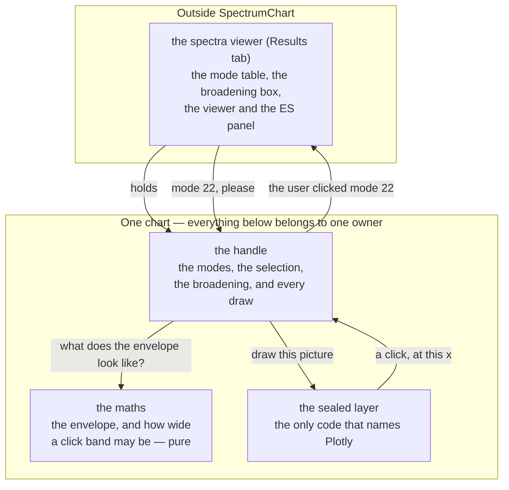

# SpectrumChart — drawing a vibrational spectrum, and picking a mode out of it

**Role:** contract
**Domain:** web
**Companions:** [`spectra.md`](?doc=web/spectra.md) — the spectra viewer on the
Results tab (`lib/spectra/core.js`, mounted by `lib/inspectors/spectra.js`),
which drives this chart: where the modes come from, what a Raman activity is,
and what else on the page moves when a mode is picked;
[`vibrationview.md`](?doc=web/vibrationview.md) — the viewer beside it on that
same tab: the mode a click here selects is the mode it animates, and the two never
speak to each other directly; [`overview.md`](?doc=web/overview.md) — the register
of web modules.

SpectrumChart is the one component in the browser that draws a vibrational
spectrum. Hand it a list of modes and it draws them as sticks with an optional
broadened envelope over them — and when the user clicks near a peak, it says
which mode they meant.

**This document is the design of that component** — what it is for, what it
refuses to do, what it holds, what each API is for, and how its tests are derived.
It is not a tour of the code; § 13 maps the parts to files.

> **Words used in this document.**
>
> - **A chart** — one mounted SpectrumChart: one drawing surface and everything
>   it holds. Two on a page are two of these, sharing nothing.
> - **The handle** — the object you get back from `mount`. It *is* the chart;
>   there is no other way to reach one.
> - **The box** — the rectangle the chart lives in on screen. Its width is
>   decided by whoever puts the chart on the page; its height is the chart's
>   own frame's (§ 5.4, § 11).
> - **The sealed layer** — the one file in this module allowed to name Plotly.
>   Nothing above it knows that library exists.
> - **A mode** — one row of the spectrum: a wavenumber, optionally a strength
>   in each channel the chart draws (§ 6.1), and whether it is imaginary. The
>   chart holds a list of them.
> - **A stick** — one mode drawn: a vertical line at its wavenumber, as tall as
>   its activity.
> - **The envelope** — the smooth curve laid over the sticks, a sum of
>   Lorentzians of a chosen width. It is what a measured spectrum looks like.
> - **The band** — the invisible region around each stick within which a click
>   counts as clicking that mode (§ 6.3). It is the reason picking a mode is not
>   a test of aim.
> - **Heights only where strengths exist** — with strengths known, a stick's
>   height means its strength; with none known the chart draws **mode
>   positions** — one line of one height at each mode, no curve, no height
>   scale — which are for finding and picking a mode, not for reading a
>   strength (§ 6.2).
> - **An imaginary mode** — one whose frequency came out imaginary, meaning the
>   structure is not sitting at rest (§ 6.4).

---

## 1. The goal

**One component that draws a spectrum, and turns a click into a mode.**

Here is the whole job in one picture. A calculation produces a list of **modes** —
each one a way the molecule can vibrate, with a frequency and a strength. The
chart draws each as a vertical line, a **stick**, at its frequency and as tall as
its strength, then lays a smooth curve over them so the picture looks like a
spectrum you would measure rather than a barcode:

```
  strength
  (Å⁴/amu)
      │                        ╭─╮  ← the smooth curve: what a real
   14 │                       ╭╯ ╰╮    spectrum looks like, because
      │        ╭╮             │   │    real lines have width
   10 │       ╭╯╰╮            │ ┃ │
      │       │  │           ╭╯ ┃ ╰╮
    6 │      ╭╯  ╰╮      ╭─╮ │  ┃  │
      │      │ ┃  │     ╭╯ ╰╮│  ┃  │
    2 │     ╭╯ ┃  ╰╮   ╭╯ ┃ ╰╯  ┃  ╰╮
      │  ╭──╯  ┃   ╰───╯  ┃     ┃   ╰──╮
      └──┴─────┸──────────┸─────┸──────┴────────────▶  frequency (cm⁻¹)
              323        826   1131
                                ▲
                                └── the selected mode, drawn in its own colour

              each ┃ is one mode;  the curve is their sum
```

**And clicking it is not a test of aim.** A stick is one pixel wide. Around each
one the chart keeps an invisible **band**, roughly as wide as the curve you asked
for — § 6.3 says exactly — so a click anywhere inside it means *that* mode:

```
        the sticks               what you may click
        ─────────                ──────────────────
             ┃                     ▒▒▒▒▒┃▒▒▒▒▒
             ┃                     ▒▒▒▒▒┃▒▒▒▒▒        ← invisible; the
        ─────┸─────                ▒▒▒▒▒┸▒▒▒▒▒          user just finds
                                                        the peak easy to hit
```

So: a user opens a result, sees where the modes are and how strong they are,
broadens them until it looks like the spectrum they would measure, clicks at a
peak, and the rest of the tab follows to that mode.

**Drawing it honestly means one thing in particular:** nothing is invented. A mode
whose strength has not been computed yet is shown as *not computed*, never as
*weak* (§ 6.2).

---

## 2. What SpectrumChart is not

Each boundary is here because something on the other side of it would plausibly
drift across.

| Not | Whose job it is | Why the boundary is there |
|---|---|---|
| a **mode viewer** | VibrationView | it draws no molecule and holds no geometry. It knows a mode by its index and its frequency, and it never learns where the atoms are |
| a **spectroscopy calculator** | the server, and the spectra viewer on the Results tab | what a Raman activity is, which normalization produced it, what temperature was assumed. SpectrumChart is handed numbers and draws them |
| a **mode list** | the tab | the sortable table, the filter box, the CSV export. A chart shows a distribution; a table answers "what is mode 22?" — two jobs, two surfaces, and the tab owns the one made of rows |
| the **selection itself** | the tab | it reports a click and is *told* what is selected. Two components that each believed they owned the selection is how the highlight and the viewer drift apart |
| a **control panel** | the tab | the broadening box, the mode filter, the export buttons. SpectrumChart draws no controls (§ 5.3) |

---

## 3. The overall shape



Four things to read off it:

**A tab owns none of it.** A tab has a handle. It does not have the plotting
surface, the marks on it, or a way to reach Plotly.

**The selection is a loop through the tab, not a shortcut inside the chart.** A
click goes *out* as an event and comes *back* as `setSelected`. The chart never
decides that a click changed the selection — because the table, the viewer and
the electronic-structure panel must move together, and only the tab can say when
they have. A chart that highlighted its own stick first would be right most of the
time and out of step exactly when a selection is refused.

**The maths knows nothing about drawing.** It answers two questions — what curve
does this broadening make, and how wide may each band be — with numbers, for
anyone who asks.

**Nothing flows back up past the seal** except a click — and, asked, the drawing
as an image, for the chart's own Export (§ 8.4). The sealed layer is never asked
what is drawn, what the axes are, or where a point landed on screen; what is
drawn is read from the handle's one read-only door, `drawn` (§ 8.3).

---

## 4. SpectrumChart is a self-contained module

**SpectrumChart is one module — one folder the browser loads by name — and it is
sealed at every edge.** It is imported by name, it reaches nothing else in the app
by name, and nothing in the app can reach inside it.

**Why this module in particular has to say so.** When the drawing, the
selection, the mode table and the watch poller can reach into one another's
variables, selecting a mode redraws the whole spectrum (§ 5.1). The boundary
holds only because it is written down and tested, not because the files sit in
their own folder.

**One entry point, and nothing else is importable.**

```js
import { mount } from "/static/lib/spectrumchart/index.js";
```

That is the whole surface. Every other file in the module is internal — the
maths, the sealed layer, the stylesheet. A consumer that imports one of them
directly has broken the module, not found a shortcut.

**A folder is not a seal, so the boundary is made three ways:**

- **The entry point exports one name.** Importing `index.js` hands back `mount`,
  and there is nothing else on it to find.
- **Every internal file is underscore-prefixed** — `_maths.js`, `_seal.js`. An
  import of `_maths.js` reads as a violation where it is written.
- **Review guards the boundary** — nothing outside the package may name any
  path inside it but `index.js`. A test that read the source for it would
  measure spelling, not behaviour, so it is review's
  ([`process/code-audit.md`](?doc=process/code-audit.md) § 1c,
  [`process/testing.md`](?doc=process/testing.md) § 3a).

**Nothing it needs comes from the app's globals, and nothing it holds is published
to one.** It does not read `window.molbuilder` and it does not write to it. A chart
needs one thing at mount: an element to live in.

**Nothing leaks out.** No Plotly object, no DOM node, and no internal function ever
appears on the handle. Inside this module the name `Plotly` occurs in exactly one
file.

**And the module brings what it needs.** No template links its stylesheet, and
no page has to load Plotly for it: the sealed layer links the sheet at mount,
uses the library when the page already carries it, and fetches it when the page
does not (§ 8.4, § 11).
A dependency the host has to remember is a dependency some host will forget, and
the result — an empty box or an unstyled one, no error, far from its cause — is
found only by someone looking at the screen. If the library will not load, the
mount fails with a message (§ 7). And if it arrives as a script that publishes
`window.Plotly`, that name is read in the one file already allowed to say it and
nowhere else: no page put it there, and no page can rely on it being there.

**No special door for tests.** Tests import the module and drive the handle
exactly as a page does (§ 12): there is nothing a test can reach that a page
cannot.

**The test of all of this:** delete every other web module and SpectrumChart still
loads, mounts, draws and reports clicks.

---

## 5. The ideas everything else follows from

Four of them. A design choice that breaks one is wrong no matter how convenient.

### 5.1 The door says the cost

Opening a different result and clicking a different stick are not the same amount
of work, so they are not the same call:

```
   setModes()      rare — you opened a different result
                   → redraw every mark, recompute the curve,
                     and fit both axes to the new numbers

   setSelected()   often — you clicked another stick, or another table row
                   → recolour one mark, and nothing else
                   → no curve, no axis change, no refit
```

**The measurement is why the rule is here.** When one function draws
everything and selecting a mode calls it, a single click on the benzene-dithiol
result, at the default broadening, recomputes an 806-point envelope from 36
Lorentzians — **29,016 terms** — to change the colour of one stick. The waste
is not the point; the *coupling* is. A chart that cannot recolour without
rebuilding has no way to be told a cheap thing, so every caller
pays for the expensive one and nobody can tell which they asked for.

### 5.2 One place holds each fact

The modes, the selection, the broadening: each has one home inside one chart,
written through one door. Two homes for a fact means a mechanism to keep them in
step, and that mechanism is where they fall out of step.

The **selection lives in the tab** and is mirrored here for drawing — one
direction only, so "mirrored" stays true (§ 3).

**The broadening is the same shape**: the tab owns the control the user types
into, and the chart holds the width it was last told. The mirror is one-way for
the same reason — a chart that changed the width itself would be a second author
of a number the tab displays.

### 5.3 The controls are not ours

SpectrumChart draws **no controls** — no heading, no broadening box, no export
button. It fills the element it was given with a spectrum. The drawing library's
own toolbar is the library's, shown on hover — zoom, pan, reset — less its
picture button, the chart's Export being the page's, in the wrap around the
module ([`results.md`](?doc=web/results.md) § 1.2), reading the module through
its one read-only door (§ 8.3); less box and lasso select, a selection picking
nothing here; and less its logo and its share button, each a way off the page.
A press on the toolbar is not a pick, nor is the pointer over it a position
(§ 8.4).

### 5.4 The host gives the width; the chart's frame states its height

The host hands the chart an element, and **its width is the host's**: the chart
fills it, and the module watches *its own box* rather than the window — a
panel opening beside it, a sidebar collapsing, a tab becoming visible: each
changes the box while the window sits perfectly still. **The height is the
chart's own frame's** (§ 11: the frame states its size, from the module's one
value block), so a host draws no frame and states no height of its own around
it.

A host that states a height of its own around the frame clips it — the frame's
height reaches 460 px (§ 11) — so a host gives the width alone. A host that
needs a different height is a change to the module's value block, not a rule on
the host.

The box rules are written where they can be enforced: § 11.

---

## 6. The data a chart holds

### 6.1 The one shape a caller must know

Everything the chart draws comes from a list of these, and nothing else:

```js
mode = {
    index:     22,                          // required — the caller's own number
    freq:      1131.8,                      // required — cm⁻¹, may be negative
    values:    { raman: 12.86, ir: null },  // optional — one per CHANNEL
    cls:       "raman-only",                // optional — the activity class
    imaginary: false,                       // optional — default false
}
```

| Field | Required | Unit | Absent means | Refused when |
|---|---|---|---|---|
| `index` | **yes** | — | *(the record is refused)* | missing, not a finite number, or repeated within the list |
| `freq` | **yes** | cm⁻¹ | *(the record is refused)* | missing, or not a finite number |
| `values[<channel key>]` | no | the channel's own | **not computed yet** — drawn as pending, never as zero (§ 6.2) | present but not a finite number |
| `cls` | no | — | `"partial"` | never — an unknown string draws as `partial` |
| `imaginary` | no | — | `false` | never — it is read as yes-or-no (JavaScript truthiness): `false`, `0`, `""`, `NaN`, `null` and missing are no, anything else is yes |

**A mode has heights, not a height.** One Hessian yields several property
derivatives on one set of eigenvectors, so activity is an attribute of a mode
**in a channel**, and the keys in `values` are the `key`s the caller declared
at `mount` (§ 8.2). A key no channel declared is not drawn, though a value
under it that is not a number still refuses the list; a channel with no value
for a mode draws that mode as pending in **its own lane only**.

`cls` is the mode's activity class — `both`, `ir-only`, `raman-only`, `silent`
or `partial` — **decided server-side** and passed through, never computed here
(§ 8.4). It colours the rug, and a `silent` mode additionally gets a line
across the full height of every panel.

*A finite number* above means an ordinary number — not text, not `NaN`, not
infinity. A caller that hands over `"1131.8"` where a frequency belongs has a bug
one line earlier, and the chart says so rather than drawing at a place it made up.

**A record that must be refused takes the whole call with it.** `setModes` draws
the list it was given or it draws none of it; it never quietly skips the bad rows
and renders a spectrum missing modes without saying so. A caller with one
malformed record has a bug one line earlier, and a chart that hides it is a chart
that helped.

**And a refused list leaves an empty chart, not the last one.** The old spectrum
staying on screen is exactly the hiding this rule is against: the caller sees
something plausible and never learns the call did nothing. So the chart empties —
visible, on screen — and the reason for the refusal goes to the console, where a
developer will look, because a caller's bug is not something a user can act on.

**`index` is the caller's numbering, carried and handed back untouched.** The
chart does not renumber and does not sort — it draws the modes in whatever order
they arrive and hands back exactly the number it was given. So a caller may use
1-based mode numbers, row numbers, or any other finite number it can recognise
later; the chart has no opinion about what the number means, because it means
something only to whoever wrote it.

**But the numbers must differ from each other.** A list carrying the same index
twice is refused whole. `setSelected(22)` names one mode and a click hands one
number back; with two modes numbered 22 neither sentence has an answer, and the
chart would have to invent a tie-break no caller could predict.

**Nothing else travels.** No structure, no eigenvector, no run metadata, no
label, no colour. If a future need seems to want a fifth field, the question to
ask first is whether it is a fact about *the picture* or about *the science* —
the second belongs to the tab, and this list is how the boundary in § 2 stays
real rather than aspirational.

### 6.2 Heights only where strengths exist — decided by the data, not by a setting

A run computes frequencies before it computes intensities, and some results
carry none until a view is derived from them (SIESTA's, whose infrared is
derived at every load and whose Raman waits on a laser, [`engines/vibration.md`](?doc=engines/vibration.md)
§ 5.10 ②, § 5.11 § 10), so a result can arrive with some strengths or with none:

```
  SOME STRENGTHS KNOWN
  height means strength

      │      ┃
      │      ┃   ┃
      │  ┃   ┃   ┃
      │  ┃   ┃   ┃  ×   ×
      └──┸───┸───┸──────────▶
                 ↑
          × = computed as zero?
              No — NOT COMPUTED, and
              marked so it cannot be
              mistaken for silent
```

**None known draws mode positions.** With no strength anywhere there is no
height to draw, and the chart draws where each mode IS: **one lane, one line of
one height at every mode's frequency, no curve and no height scale** — the lane
is titled as positions, its axis carries no numbers, and the lines are picked
exactly as sticks are, so the chart is still the place a mode is found and
chosen for its animation and its electronic structure (§ 6.3):

```
  NONE KNOWN
  mode positions -- no heights

      │  │   │  │      │
      │  │   │  │      │
      └──┴───┴──┴──────┴────▶  cm⁻¹
```

*(User, 2026-09-28: "we can still have the modes ploted as one straight bar in a
wave-number plot. this visualization can be useful in selecting different modes
for showing animation and electronic structure, just like the pyscf case the
only differene is that there is no 'peak fitting with lorentz shape or peak
height', just bar/line to show where the mode is".)* A list with no strength
draws no curve: lines of one height under a broadened curve would read as an
intensity spectrum wherever modes crowd (§ 9).

**The marking is drawn in the plot**, as the picture shows: the `×` on the
axis. It is not a label beside the chart or a banner above it — a chart made of
one drawing surface stays a chart made of one drawing surface, and § 5.3's "no
controls" holds without an exception carved for it.

**A lane with nothing to draw says why across its own panel, and its axis
names its quantity alone.** The reason — *not computed*, the caller's words
(`setAbsentWords`, § 8.3), *no band* (`presentFloor`, § 8.2) — is as long as
whoever wrote it made it, while a title along an axis is only as long as its
panel is tall: a reason as long as *type the laser's wavelength — the
strength depends on it* would run past its panel into the next lane's title
if it were written along the axis. Written across the empty panel, the
reason has the panel's width, and the axis title is the label and the unit
the caller declared.

**Which picture you get is derived, never configured.** A flag would be a second
place to believe something the data already says, and the failure mode is a flat
axis with nothing on it and no explanation.

### 6.3 A click lands on a band, and the nearest band wins

Each mode gets an invisible band centred on it, and its half-width is the
**broadening width** — *the same number that draws the envelope*, so the region a
user aims at is the region they see. A tolerance set independently of the picture
would be a second fact about the same thing (§ 5.2), and it drifts the moment
either is changed alone.

**Two things bend that, and both only upward.** Below **8 cm⁻¹** the band is
wider than the curve, because a target that narrow cannot be hit with a mouse.
And no band is ever narrower **on screen** than **8 pixels**, whatever the axis
is showing: twenty wavenumbers is a comfortable target across a wide panel and
about a pixel and a half in a narrow one, so a width that is honest about the
science is not by itself a target anyone can hit.

What never happens is the picture being changed to match the band: the curve is
the claim about the science, the band is only about aiming, and where they must
differ it is the invisible one that gives way.

**Bands overlap where modes crowd, and a click takes the nearest one.** That is
the whole rule. "The nearest" is an answer that never needs a tie-break, so
nothing has to be moved or shrunk to keep it unambiguous — and because no band
depends on its neighbours, there is **one width for the whole spectrum** rather
than one per mode.

Bands are never cut back to keep neighbours apart. A click is read as a
position (§ 8.4), so "nearest" settles any overlap, and a clamp would shrink
crowded targets to a fraction of a pixel, leaving some peaks impossible to hit.

**Two modes at the same frequency** cannot be told apart by any band. Both keep
theirs, so both stay reachable; which of the two a click reports is undefined —
they are the same distance away — and separating them is the table's job.

### 6.3.1 The band, made visible

An invisible target is a guess. So **the mode a click would pick lights up as the
pointer moves**, which is the band shown without drawing it: slide across a
crowded region and the answer changes under you, and what you see is what you
would get.

**And a line of words says what you are near, at every position.** The highlight
answers *what would a click take*, which has no answer in a wide gap; the words
answer *what am I near*, which has one everywhere. So the readout names the
nearest mode — its number, its frequency, its strength if there is one — whether
or not a click there would take it, and it is drawn in the plot rather than
beside it (§ 6.2).

Three rules keep it honest and cheap:

- **What you picked outranks what you are pointing at.** A chosen mode keeps its
  colour under the pointer, or a selection would appear to flicker away while you
  reach for something else.
- **Nothing is redrawn until the answer changes**, and then only the part of it
  that did (§ 5.1). A pointer crossing the plot reports hundreds of times a
  second: sliding inside one band changes neither the colours nor the words and
  costs nothing at all; crossing a gap from one mode's side to the next
  changes the words alone, and the colours are not repainted to say so; pointing at the mode already chosen
  changes the words alone as well, because chosen outranks hovered.

### 6.4 An imaginary mode is drawn, marked, and left out of the curve

A mode can come back **imaginary**. That is not a very slow vibration: it means
the structure is not sitting at rest, and the "vibration" is the direction it
would fall away in. No measured spectrum contains such a line.

So the chart does three separate things with one, and each is its own sentence of
the contract:

- **It is drawn**, at the frequency the caller gave, and it is **clickable like
  any other mode** — an imaginary mode is very often the one the user opened the
  result to look at.
- **It is marked apart**, so it can never be read as an ordinary weak line. *How*
  it is marked is the seal's business (§ 8.4); *that* it is marked is this
  contract's.
- **It never joins the envelope** (§ 9), because the envelope is what a
  measurement would look like and no measurement contains this.

**`imaginary` and a negative `freq` are two separate facts, and neither implies
the other.** Runs differ over whether they report these frequencies as negative
numbers. Which convention produced a number is science, and science belongs to the
tab (§ 2): the chart draws the number it is handed and marks the mode the flag
names, and it never infers one from the other.

---

## 7. Making and tearing down a chart

```js
const chart = await mount(hostEl, { onSelect: (index) => …, broadening: 20 });
```

The options are written out in § 8.2; this section is about what `mount` *gives
back* and how it ends.

**`mount` is asynchronous and always resolves.** The handle it returns is live:
the surface is built, and every door works from the first call. There is no
readiness flag — a chart that is not ready yet is a state a caller can get wrong,
so it is not offered.

**Failure is a handle, never a rejection and never `null`:**

```js
{ ok: false, error: "…", dispose() {} }
```

so a caller branches on `ok` and can call `dispose()` unconditionally. A live
handle carries `ok: true`. Same mount contract as MolView and VibrationView, for
the same reason: teardown must never have to ask whether setup worked.

**A failed handle carries those three keys and no others** — no inert `setModes`,
no `setSelected` that quietly does nothing. A caller that skipped the `ok` branch
then fails at its first door, loudly and at the line that made the wrong
assumption, instead of feeding data to a chart that was never there.

**What that costs a caller is one line, and the shape is worth naming:** keep the
handle only if it is live — `this.chart = chart.ok ? chart : null` — and reach it
with `?.` from then on (§ 10 shows it). The alternative, doors that accept every
call and do nothing, would spread the same branch invisibly across the module and
turn a dead chart into a silent one.

**A library that will not load is a failed mount, not a broken page.** The module
fetches Plotly itself (§ 4); if that fails — offline, blocked, the file not
there — the mount resolves with `ok: false` and a message the tab can show. The
mode table beside it still works.

**The module owns the inside of its host, and nothing else about it.** `mount`
empties the element it is given before it draws, so whatever was in there — a
placeholder, a spinner, a chart from a previous result — is gone. The element
itself, its width and its place on the page remain the host's (§ 5.4).

`dispose()` releases the drawing surface, disconnects the box watcher and leaves
the host element empty. Calling it twice is safe.

---

## 8. The APIs, and who each one serves

### 8.1 The entry point

```js
import { mount } from "/static/lib/spectrumchart/index.js";
```

One name. § 4.

**And that name is all a page needs.** Here is a complete, standalone use — no
framework, no tab, nothing else from this app:

```html
<div id="chart" style="width: 640px"></div>

<script type="module">
import { mount } from "/static/lib/spectrumchart/index.js";

const chart = await mount(document.getElementById("chart"), {
    onSelect: (index) => console.log("the user picked mode", index),
});

if (chart.ok) {                   // the one branch every caller makes (§ 7)
    chart.setModes([            // no channels declared: one lane keyed `activity`
        { index: 1, freq:  323.5, values: { activity:  2.9 }, imaginary: false },
        { index: 2, freq:  826.6, values: { activity:  5.4 }, imaginary: false },
        { index: 3, freq: 1131.8, values: { activity: 12.9 }, imaginary: false },
        { index: 4, freq: 3175.4, values: { activity:  0.0 }, imaginary: false },
    ]);
    chart.setBroadening(20);      // draw the curve 20 cm⁻¹ wide
    chart.setSelected(3);         // colour mode 3 as the chosen one
}
</script>
```

That is the whole surface: **seven doors in, one that reads back what is
drawn, and one callback.** The page above styles
a box, hands over four numbers per mode, and gets a spectrum it can click. There
is no stylesheet `<link>` and no library `<script>` — the module brings both
(§ 4) — so this really is the whole page.

### 8.2 What `mount` takes

```js
mount(host, options) -> Promise<handle>
```

| What is passed | What it is | Required | Default |
|---|---|---|---|
| `host` | the element the chart lives in. The **host gives its width** (§ 5.4); the module never writes a width or a height onto it — its own frame, inside, states the height (§ 11) | yes | — |
| `options.channels` | the channels this chart draws, in order: `[{ key, label, unit, direction, relative?, valueUnit?, presentFloor? }]`. `direction` is `"up"` or `"down"` and picks the lane's colour (`--spectrumchart-lane-up` / `-down`). The panels stack in the order the channels are declared, the first on top. `relative: true` normalises that lane's drawn heights to its own strongest band, for a channel whose conventional axis is not the unit it was computed in; what the axis is CALLED still comes from `unit`, because this module names no quantity. `valueUnit` is the unit the measured value is read in — what the readout prints beside the number — `unit` when unsaid; a relative lane names its value's own (the infrared: axis *arb. units*, readout *km/mol*). `presentFloor` is the channel's band floor in that value unit: a lane whose strongest real value is at or below it has no band — every value residue — draws no stick and no curve, and says *no band* across its panel (§ 6.2), rather than scaling its residue to full height; the caller's number (the spectrum page's: `spectra/activity.py`'s floors, `engines/vibration.md` § 6.6), 0 when unsaid | no | one generic lane keyed `activity` — what a caller with a single quantity still means |
| `options.onSelect` | `(index) => void`, called when a **user** clicks a mode. Never called by anything the tab does (§ 8.3) | no | nothing is reported |
| `options.modes` | the first mode list, exactly as `setModes` takes it | no | empty — an empty chart, not an error |
| `options.selected` | the first selection, exactly as `setSelected` takes it | no | none chosen |
| `options.broadening` | line width in cm⁻¹, exactly as `setBroadening` takes it | no | `0` — bare sticks, no curve |

**`mount` refuses exactly one thing: a host that is not an element.** Everything
else it is given it can work with, and a missing or wrong host is the one mistake
that leaves it nowhere to draw. It refuses the way every failure here is reported
— a handle with `ok: false` and a message (§ 7), never a throw.

**A mount option is the first write through the door of the same name, not a
second way to hold the fact.** `mount({ broadening: 20 })` and
`setBroadening(20)` reach the same one place; there is no separate "initial"
value kept anywhere, so nothing can disagree with anything (§ 5.2).

Everything else about the chart — its size, its position, when it is visible — is
the host's, and is expressed in CSS rather than passed here.

### 8.3 The handle — the only way data goes in

```
setModes(list)               a different result: redraw, refit the axes (§ 5.1)
setSelected(index | null)    recolour one mark — nothing else moves
setBroadening(width)         how wide to draw each line, in cm⁻¹ — and therefore
                             how wide it is to click (§ 6.3)
setDisplayFloor(pct)         hide bands below this percentage of the
                             strongest peak IN EACH CHANNEL — relative,
                             because one control serves two incommensurate
                             units.  Changes what is DRAWN and nothing
                             else; the rug is never filtered
setAbsentWords(key, words)   what a lane with no value says across its panel
                             in place of "not computed" -- the caller's reason,
                             such as what the person must name first
drawn()                      what is drawn -- the one door that reads back
                             (below); nothing goes in through it
refit()                      re-measure the box and redraw at its size
dispose()                    release, disconnect, empty
```

Seven doors in, and **every fact the chart holds arrives through exactly one
of them.** There is no property to assign, no options object to mutate after the
fact, no global to publish into, and no second path that "also" sets something.
Data goes in one way; what comes back out is a click, and — asked, through
`drawn` — what is drawn.

**Each door, precisely:**

| Door | Takes | Refuses | Returns |
|---|---|---|---|
| `setModes` | an array of mode records (§ 6.1). An empty array is legal and means *an empty chart* | anything that is not an array; a record missing `index` or `freq`; the same `index` twice — the whole call, and **the chart empties** rather than leaving the last spectrum standing (§ 6.1) | nothing |
| `setSelected` | one `index`, or `null` for *nothing chosen*. It is **remembered whether or not the current list holds it**, and drawn as soon as a list does | nothing — an index no list holds is not an error (below) | nothing |
| `setBroadening` | a width in cm⁻¹, $\ge 0$. Zero means *no curve*: bare sticks, and click bands at their floor (§ 6.3) | a negative number or a value that is not a number — the width already set stands, because substituting a default would hide a caller's bug | nothing |
| `setDisplayFloor` | a percentage, `0`–`100`, of each channel's strongest peak; `0` hides nothing | a value outside `0`–`100` or not a number — the floor already set stands, for the same reason | nothing |
| `setAbsentWords` | a channel's key and the words its lane says across its panel while no mode has a value in it (§ 6.2) — *type the laser's wavelength …* where the strength waits on what the person names (`web/spectra.md` § 3.3); `null` restores *not computed*; the words already set, given again, draw nothing. The module names no quantity and knows no reason: the caller's words, drawn as given | words that are not a non-empty string or `null` — the words already set stand | nothing |
| `drawn` | — | — | `{lanes: [{key, sticks: {x, y}, curve}], image(fmt)}`: each lane's bands' frequencies and drawn values — `null` for a band not drawn, a relative lane's values its screen percentages — and its broadened curve (`null` at zero width); `image` the drawing's data URL, made inside the seal; after `dispose`, no lanes and an image that refuses |
| `refit` | — | — | nothing |
| `dispose` | — | — | nothing; safe to call twice |

**Order does not matter.** Any door may be called before any other, any number of
times, in any order: selecting before there are modes, broadening an empty chart,
re-selecting the same index. Each call writes one fact and redraws what that fact
affects. A caller that has to remember a sequence is a caller that will get it
wrong.

**Which is why `setSelected` records rather than refuses, and the highlight is
derived from what it recorded.** An index the current list does not hold
highlights nothing; if a later `setModes` brings that index in, the highlight
appears without the tab having to say it again.

> A mirror that refused would be worse than one that shows nothing. The tab does
> `state.selected = 3` and then `chart.setSelected(3)`: a refusal leaves the tab
> believing 3 is selected while the chart still highlights 7 — the two out of step,
> which is the exact drift § 5.2 exists to prevent. And the mistake a refusal was
> meant to catch, choosing a mode that is not there, still shows: as no highlight.

**Nothing the caller wrote is read back.** There is deliberately no `getModes`,
no `getSelected`, no `getBroadening` and no accessor of any kind: every one of
those values was written by the caller, so a second copy inside the module would
be a second place to believe something (§ 5.2). **One door reads back what the
caller never had — what is drawn**: `drawn()` answers each lane's `key`, its
bands' frequencies and drawn values (`sticks`: a band the display floor hides is
`null`; a relative lane's values are its screen percentages) and its broadened
curve as the module computed it (`curve`, or `null`), and `image(fmt)`, the
drawing's data URL, which the seal makes (`image`, § 8.4) — so a chart's own
Export reads the chart without opening the seal *(the user, 2026-11-17: "Add the
one door"; [`results.md`](?doc=web/results.md) § 1.2)*. The module names no
quantity: the caller tags each lane it declared. The chart's Export, in the
wrap around it, is the one way out (§ 5.3). What the module knows that the caller does not is
*where the marks landed on screen*, and that is the seal's business and never
leaves it (§ 8.4).

**`onSelect` is given once, at mount.** It is how a click leaves (§ 3). A chart
with no `onSelect` draws normally and reports nothing — a legitimate thing to be,
for a figure nobody is meant to click.

**`setSelected` never emits `onSelect`.** The event means *a user clicked*, not
*the selection changed*; a caller that wires the two together in the obvious way
would otherwise get an endless round trip. Nothing the tab does to the chart ever
comes back out of it.

**A click that lands in no band reports nothing at all.** `onSelect` is not
called, and nothing on screen changes. It does not report `null`: the event means
*the user picked a mode*, and there is no mode to name — a `null` would oblige
every caller to handle a case whose meaning is "nothing happened". Whether an
empty click should clear the selection is a decision about the whole tab, and the
tab is where the selection lives (§ 5.2).

**`refit` exists because of a rule, not because of a library's behaviour.**

> **The module never draws into a box it cannot measure**, and it cannot know on
> its own when an unmeasurable box becomes real.

A chart in a hidden tab has no box. The module watches its own box (§ 5.4), and
that covers a box that *changes size*; what it cannot be relied on to cover is a
box that did not exist. `refit` is how the host says **the box is real now**.

Justifying this door by what the browser's box-watching machinery happens to do
would put somebody else's behaviour inside this contract, where it cannot be
tested and cannot be relied on.

### 8.4 The sealed layer — commands down, clicks up

```
draw(picture)                   put this picture on the surface
recolour(marks, words)          change the colours already drawn, and the line
                                naming what the pointer is near — either may be
                                left out when it did not move; no rebuild
resize()                        the box changed; fill it
onClick(cb)                     the user clicked: hand up where it landed on
                                the frequency axis, and what a pixel is worth there
onHover(cb)                     the pointer moved: the same, continuously, or
                                null over nowhere in particular
image(format)                   the drawing as an image -- its data URL, at
                                the size it stands at (the chart's own Export)
purge()                         release the surface
```

**A picture is what goes down.** The handle hands the seal a plain object, and
nothing in it is a colour or a mode:

```js
picture = {
    lanes: [{                                     // one per channel, in order --
                                                  // or ONE, the positions, when no
                                                  // channel has a number (§ 6.2)
        key, direction: "up" | "down",            // the lane's colour; its panel is its place in the list
        title,                                    // the words on ITS axis: the label,
                                                  // the unit included -- nothing else
        words,                                    // what the lane says across its own
                                                  // panel when it has nothing to draw
                                                  // (§ 6.2), or nothing
        known,                                    // whether this channel has numbers yet
        positions,                                // true on the positions lane only:
                                                  // its heights carry no number
        sticks: { x: [...], y: [...], width: [...],
                  state: ["plain" | "chosen" | "hovered" | "pending" | "imaginary", …] },
        curve:  { x: [...], y: [...] } | null,    // null when there is no curve
    }, …],
    rug: { x: [...], cls: [...], index: [...] }   // EVERY mode, position only
          | null,
    xTitle,                                       // the words on the shared axis
    note,                                         // one line inside the plot, or nothing
    readout,                                      // the mode nearest the pointer
}
```

**Why lanes, and not one `sticks`.** Activity is an attribute of a mode in a
channel, so a picture with a single `sticks` could draw only one quantity, and
its y-title would have to name it. Channels are declared at `mount`, each mode
carries `values[key]`, and this layer learns nothing about what Raman or IR
are.

`positions` is what a lane says about layout: it marks the lane of § 6.2's
*none known* picture, whose lines all stand at one height that means nothing,
so the seal draws its y-axis with no numbers and no grid. Each lane is its own
stacked panel, drawn upright on its own y-axis on the left, over one shared
frequency axis, because both channels peak at the same frequencies and the
quantities are incommensurate: sharing one panel would make them collide, and
forcing them onto one scale would make the taller **unit** look like the
stronger physics.

**The rug is position and nothing else.** A mode active in neither channel has
no height in either, so the sticks cannot show it at all — and giving it one
would be a lie in whichever direction it pointed. Ticks on the zero line carry
every mode and never vary in height. `cls` is the activity classification
**decided server-side** (`spectra/activity.py`): the line between a band and
numerical residue is a judgement about a whole run, and a second copy of it
here could not be tested against one.

**A spectroscopically dark mode gets a line across the full height of every
panel**. Being invisible to both techniques does not mean the
molecule is still there — it is a real vibration, and a tick on the axis alone
would say the opposite: that it was a footnote to the spectra rather than one of the
modes they are spectra *of*. Full height is what makes the mark honest, because
a line spanning the axis asserts a FREQUENCY and no intensity at all, where any
finite bar height would be a claim about a quantity that is zero. Drawn as a
layout shape `below` the traces, so it marks the position without competing
with a band.

**Nothing in the picture says where a click may land**, and that is deliberate:
the bands are not drawn and not handed down. § 8.4 says where they are used
instead.

**A state is a word, never a colour** — the layer above says a mark is *chosen*
and the seal decides what chosen looks like (§ 5.1's cheap door hands down the
same words and nothing else). **And every word the user reads comes down in the
picture too**: each lane's axis title with its unit, the units beside a hovered
value, the "not computed" line, a lane's reason across its panel. The seal writes none of them, because "cm⁻¹" is a fact about
spectroscopy and this layer knows none.

It answers **no** question about what is drawn, and it does not know what a mode
is. **A click comes up as one number** — a position on the frequency axis — and
the handle turns that into a mode through the bands (§ 6.3).

That is deliberately the only mechanism. A drawn mark carrying its own label back
would be the obvious alternative and it cannot work here: the click a band exists
to catch lands in *empty space* beside a peak, where there is no mark to have
carried anything. So the seal reports a position, which is a number, and stays as
ignorant of chemistry as before — "mode" is a word this layer never learns.

What a selected stick *looks like* is decided here too. The layer above says
*which mark* is the chosen one, never what colour it should be: a colour riding on
data is how a drawing decision ends up in three places.

**The palette is read from the stylesheet, not written in code.** Plotly takes
colours as JavaScript values, so a chart cannot inherit them the way an element
does — which is precisely how two tab controllers ended up carrying private copies
of the same nine hex literals. The sealed layer reads **this module's own tokens**
(§ 11) off the module's own outermost element and hands the library the answer,
so the sheet stays the one source of truth for how the chart looks.

**`recolour` is the cheap door § 5.1 is about.** It exists so that the expensive
one does not have to be called for a click.

**A click, and the pointer, are read off the surface rather than off a mark.** The drawing library reports
a click only when the pointer is over one of *its own* points — so nothing it
offers can hear a click in the empty space beside a peak, and that space is the
whole purpose of a band. So the seal takes the click from the surface itself and
converts it: where the pointer was, across the plot area, read against the axis
range. That conversion is the one place in this module that reads inside the
library, and this is the file whose job is to know it.

> **Why not draw the bands as invisible marks instead?** Because then the *seal*
> would be deciding which mode you clicked — the mark it reports would already be
> the answer — and the handle's band lookup would be a rubber stamp. The division
> this section states would be true on paper and false in the code. A raw
> position keeps it true: the seal knows where, the handle knows which.

**Two things a pointer does that are not a pick**, both learned from the built
chart rather than from the design:

- **A drag is a click.** The browser fires one whenever a press and a release
  share an element, however far the pointer travelled — so the library's own
  drag-to-zoom ends in one, and the chart would otherwise select whatever sat
  under the release. A pick is a click that stayed within a few pixels of where
  it went down.
- **A press on the library's toolbar is a button, not a place.** The toolbar
  sits at the chart's top right, so its zoom or reset lies above some
  frequency; a click or a pointer whose target is inside the toolbar is no
  position. It is told by *what* is under the pointer, not by where — a button
  is a button wherever the library puts it.

**Vertical position is never consulted.** A spectrum is picked by frequency, so
every point at that frequency is the same request: level with a peak's tip,
halfway down it, or beside the axis — never bounded by the plot area
vertically, which would leave the tick-label strip dead.

**The seal takes the library as it finds it, and never assumes it is ready.**
Two consequences, both found by building against this contract rather than by
reading it:

- **A page that already carries the library is used as it stands** — the Results
  page loads Plotly for other figures — and only a page without it is served the
  fetch. Either way one page holds one copy and one stylesheet link, however many
  charts are mounted on it.
- **A click asked for before the first draw must still arrive**, because § 8.3
  promises any door may be called in any order. Listening on the surface rather
  than on the library's own event machinery is what makes that free: the surface
  exists from the moment the chart is mounted, drawn on or not.

---

## 9. How a spectrum gets drawn

The sticks are the data. The envelope is a sum of Lorentzians — the narrow peak
with long tails that a real spectral line has — one per mode with an activity:

$$
y(x) = \sum_i A_i\cdot\frac{\gamma^2}{(x - x_i)^2 + \gamma^2} ,
\qquad \gamma = \text{half the width you asked for}
$$

so each mode contributes a peak of height $A_i$ at $x_i$, and the sum is what a
measured spectrum looks like when lines have width.

**Where the curve is sampled follows the width, not a fixed setting.** The curve
is worked out at a list of frequencies — the grid — and a fixed grid is either too
coarse for a narrow line or wasteful for a broad one; the width is the only number
that knows which. Two requirements say how far that goes, and
they are stated as accuracy rather than as constants so a test can check the
result instead of the arithmetic:

- **A peak is smooth** — at least **eight samples across the full width** of the
  narrowest peak drawn. Fewer and a Lorentzian shows its corners.
- **The curve ends, rather than being cut off** — the grid extends past the
  outermost mode until the envelope has fallen below **1% of the tallest peak**.

Both are consequences of the width alone, so neither is a number anyone tunes.

**And the grid is a window around each mode, not one ruler laid end to end.**
Both draw the same curve where a curve is worth drawing; the difference is what
they cost. One ruler at a sharp broadening spends nearly all its points on empty
space between modes — at 0.05 cm⁻¹ across a 3,000 cm⁻¹ spectrum that is millions
of points and the browser stops — while windows cost about eighty points per
mode at *every* width. The consequence worth stating: between two distant modes
the curve is drawn as a straight line across a region where it is already near
zero. That is a sampling choice, and it is the one place this module draws
something it did not compute.

**What the sum runs over follows the picture you are in** (§ 6.2), because the sum
has to mean the same thing the stick heights mean:

- **Strengths known** — the sum runs over the modes that have one. A mode whose
  strength has not been computed contributes **nothing**, not a zero-height peak:
  it is missing, not weak.
- **None known** — there is no curve: a sum over heights nobody computed would
  be a picture of nothing (§ 6.2).

**No imaginary mode is ever in the sum** (§ 6.4).

A lane with no known height draws no curve, so a run that computed Raman but
not infrared shows no curve under the infrared lane's *not computed*.

---

## 10. Who drives it

The spectra viewer on the Results tab (`lib/spectra/core.js`,
[`spectra.md`](?doc=web/spectra.md)); the Spectrum calculation tab loads the same
script for its form and draws no chart. It hands the chart a result, tells it
what is selected, and listens for clicks:

```js
const chart = await mount(host, { onSelect: (index) => tab.selectMode(index) });
if (!chart.ok) showMessage(chart.error);   // the mode table still works without it
tab.chart = chart.ok ? chart : null;       // a dead handle is not kept (§ 7)

// a result arrives
tab.chart?.setModes(modes);      // `?.` = do nothing if there is no chart

// the user clicks a stick, or a table row, or arrows through the list
tab.selectMode = (index) => {
    state.selected = index;          // ONE home for the fact (§ 5.2)
    tab.chart?.setSelected(index);   // the chart mirrors it
    viewer.showMode(…);              // and so does everything else
    renderEsPanel();
};
```

Read the loop: a click enters the tab and comes back to the chart as an
instruction. The chart never highlights on its own, so the highlight cannot
disagree with the viewer (§ 3).

---

## 11. The module's own stylesheet

The module ships one stylesheet and links it itself at mount, once — the drawing
library arrives the same way and for the same reason (§ 4), so a host provides one
thing: an element. `mount` waits for the sheet to load, because the sealed layer
reads the chart's colours out of it (§ 8.4) and a stylesheet loads asynchronously;
appending it and carrying on would give the first chart fallback colours,
invisibly, for exactly as long as the two agreed.

Five rules, and they are the ones peculiar to *this* module:

- **Its names are its own.** Every class is `spectrumchart` (the frame) or
  starts `spectrumchart-`. Nothing else on
  the page styles those names, and this sheet styles nothing else — the same
  boundary as `mount`, in another language.
- **Its values sit in one block at the top** — the colours, the spacing, the
  type — and every rule below reads them by name. Changing how the chart looks is
  changing that block, not hunting through the rules.
- **It inherits nothing from the page.** Those values are the module's own, so
  deleting every page stylesheet leaves the chart looking right. It matches the
  app because its values were *chosen* to, not because it reads the app's — and
  the app has one palette, with no light/dark switch to follow. If that ever
  changes, what changes here is this one block.
- **The frame states its size; the surface fills it, carries no padding, and
  never spills past it.** All three come from real breakage on one day: a height
  that came from the plot being sized to it collapsed to a ten-pixel strip; a
  padded surface drew wider than its frame, because the width the library asks for
  counts padding in; and the drawing then overflowed across the panel beside it.
- **It reacts to its own box, never to the window.** The chart can sit in a
  full-width panel, a half-width tab, or beside a sidebar that collapses; all
  change the box while the window sits still. There are no media queries in the
  sheet: one surface filling one frame has nothing to re-arrange, so responding
  is one thing: redraw at the box's new size. Its one window-dependent value is
  the frame's height, 34 % of the window's height, kept between 220 and 460 px.

**The repository's CSS conventions apply here as they do everywhere else** — one
class per rule, no ids, no `!important`, no value written twice — and they are
*not* restated in this contract. They live in
[`ui-contract.md`](?doc=web/ui-contract.md) (§ 1 the layers, § 1.1 a module
owns its CSS, § 2 the tokens), which is also where the page-versus-module
boundary is argued. A rule that would be true of any stylesheet
in this repository does not belong in the design of a spectrum chart.

The sheet stays a real `.css` file rather than a string inside JavaScript, so the
repository's existing CSS audits can read it.

---

## 12. How the tests are designed

**Every test is derived from this document, never from the source.** A test that
reads the implementation to build its assertion can only confirm that the code
still says what it said.

| Level | Runs | Derived from | Shows |
|---|---|---|---|
| **Behaviour, no browser** | node | § 6, § 9 | the envelope and the band widths — values in, values out |
| **Boundary behaviour** | node, with a stand-in that obeys § 8.4 | § 5, § 8 | what each door costs, and that nothing above the seal names the library or a colour |
| **End to end** | a real page | § 1, § 6.3 | clicking beside a peak selects that mode; clicking in a gap reports nothing |

**The stand-in replaces the drawing library, not a file of this module.** Nothing
inside the module is swappable, and no door exists for a test that does not exist
for a page (§ 4). The stand-in stands where Plotly stands; the module cannot tell
the difference, because § 8.4 is the whole of what it asks of that library.

### What each rule obliges a test to show

**A rule with no row here is a rule nothing guards.**

| The rule | A test must show |
|---|---|
| § 2 — the tab keeps its own | the module contains no table, no filter, no CSV, no poller, and no form |
| § 4 — self-contained | the module mounts given only a host element; it reads no global of the app's and writes none, and the only global name it reads at all is the library's, in the seal |
| § 4 — nothing else is importable | the entry point exports exactly `mount` |
| § 4 — no hidden way in | list everything on the handle, hiding nothing: not one entry leads to the drawing surface or to the module's own state |
| § 4 — the module brings what it needs | a page holding only a host element and one `import` draws a **styled** chart: no `<script>` and no `<link>` of its own, and mounting twice adds one link, not two |
| § 4 — the library name appears once | `Plotly` occurs in exactly one file of the module, and no file above it names the library at all |
| § 5.1 — the door says the cost | `setSelected` computes no curve and changes no axis; `setModes` does both |
| § 5.1 — recolouring is not redrawing | after `setSelected`, the picture handed to the seal is the same picture, with only its colours changed |
| § 5.2 — the selection is mirrored, not owned | a click emits `onSelect` and changes **nothing** on screen until `setSelected` is called; a chart mounted without `onSelect` still draws |
| § 5.3 — no controls | a mounted chart contains no heading, button, input or control of its own — the library's toolbar is the library's |
| § 5.4 — the host gives the width | the module writes no width or height onto its host — not at mount, not at any door — and a box that changes size redraws while the window sits still |
| § 6.1 — the two required fields | a record without `index`, or without `freq`, is refused |
| § 6.1 — a refusal takes the whole call | one malformed record among many draws **nothing**, rather than a spectrum quietly missing that mode |
| § 6.1 — a refused list empties the chart | after a refused `setModes`, the previous spectrum is gone from the screen rather than left standing as though the call had worked |
| § 6.1 — absent is not zero | a mode with no value for a channel, and one whose `values[<key>]` is `null`, are treated the same and neither is drawn as a strength of zero |
| § 6.1 — the caller's numbering is carried, not interpreted | an unsorted, sparse, 1-based list draws in the order given, and the index a click reports is the index that was handed in |
| § 6.1 — the indices must differ | a list containing the same index twice is refused whole, rather than resolved by a rule the caller cannot see |
| § 6.2 — the picture is derived | a result with no activities anywhere draws one lane of equal lines at the modes' frequencies, an imaginary one among them marked apart, no curve and no height scale — and the same chart draws its lanes with heights and a curve once activities land; one with some activities draws the rest as pending — and neither picture is reachable by a setting |
| § 6.2 — the markings are in the plot | the pending marks and the "not computed" wording are drawn on the surface: the module's markup carries no label, banner or text node beside the chart |
| § 6.2 — a lane's reason is across its panel | a lane with no value, given the caller's words, says them inside its own panel, its axis titled with its label and unit alone; given `null`, it says *not computed* there |
| § 6.3 — one width, two uses | changing the broadening changes both the envelope and the band widths, and there is no way to set either alone |
| § 6.3 — every mode keeps a full-size target | the width does not take the frequencies as an argument at all, so no arrangement of neighbours can shrink one |
| § 6.3 — the floor applies below it | at any broadening under 8 cm⁻¹, zero included, a band is 8 cm⁻¹ half-wide |
| § 6.3 — a band is never a target too small to hit | where the axis is zoomed out enough that the width is worth less than 8 pixels, the band is 8 pixels instead |
| § 6.3 — the nearest band wins | where bands overlap, a click reports the mode whose frequency is closest to it |
| § 6.3 — the band bends, never the picture | where the floor overrides, the envelope drawn is still the envelope for the width that was set |
| § 6.3.1 — the pointer shows what a click would take | moving over a band recolours that mode, and only it |
| § 6.3.1 — and says what it is near, everywhere | at any position, including a gap where a click would take nothing, the words name the nearest mode |
| § 6.3.1 — the words are drawn in the plot | the module's markup is still a frame and a surface: no text node is added beside the chart, and the plot leaves room above itself for the line |
| § 6.3.1 — one label, not two | the drawing library shows no hover label of its own: a tooltip needing exact aim would say less than the readout and undo what the bands are for |
| § 6.3.1 — pointing costs only what changed | sliding inside one band makes no call at all; a move that changes the words alone does not repaint a colour |
| § 6.3.1 — what you picked does not flicker | a chosen mode keeps its colour under the pointer |
| § 8.4 — a drag is not a pick | a press and a release far apart report nothing; a click a pixel or two from the press still reports |
| § 8.4 — a toolbar press is not a pick | a click, or a pointer, whose target is inside the library's toolbar reports nothing, wherever the toolbar sits |
| § 8.4 — vertical position is not consulted | clicks at one frequency and different heights — including beside the axis — all report the same number |
| § 8.4 — the scale comes up with the position | what goes up says both where the pointer was and what one pixel is worth there |
| § 6.4 — an imaginary mode is drawn and clickable | it appears at its own frequency and a click on it reports its index, exactly like any other mode |
| § 6.4 — an imaginary mode is marked | it is drawn differently from an ordinary mode of the same height |
| § 6.4 — an imaginary mode is not in the curve | adding one to a list leaves the envelope unchanged |
| § 6.4 — the flag and the sign are independent | a negative `freq` without the flag is drawn as an ordinary mode; the flag with a positive `freq` is drawn as imaginary |
| § 7 — mount always resolves | a mount with no library still resolves with `ok === false` **and** a working `dispose`; nothing rejects and nothing returns null |
| § 7 — a failed handle has three keys | its keys are exactly `ok`, `error`, `dispose`: calling any other door throws rather than silently doing nothing |
| § 7 — the module owns the inside of its host | a host with content in it is empty of that content after mount, and empty again after `dispose`; the watcher stops (a resize after `dispose` draws nothing) and a second `dispose` neither acts nor throws |
| § 8.2 — a host that is not an element is the one refusal | `mount(null)` and `mount("#chart")` each resolve with `ok === false` and a message, and neither throws |
| § 8.2 — a mount option is the first write | `mount({ broadening: 20 })` and `mount()` then `setBroadening(20)` leave the chart in the same state, and no "initial" value survives a later write |
| § 8.3 — one way in | the handle exposes no settable property and no options object; changing a fact is possible only by calling its door |
| § 8.3 — nothing the caller wrote is read back | there is no `getModes`, `getSelected` or `getBroadening`, and nothing else hands those values back either; the handle's keys are its doors and `drawn` |
| § 8.3 — `drawn` reads back what is drawn | a band the display floor hides comes back `null`, a drawn band its value, and the curve the one on screen — at zero width none |
| § 8.3 — order does not matter | selecting before any modes exist, broadening an empty chart, and re-selecting the same index each leave a coherent chart and no error |
| § 8.3 — the selection is recorded, not refused | `setSelected(3)` before any modes exist, followed by a `setModes` containing 3, draws 3 as chosen with no second call; an index no list ever holds highlights nothing and raises nothing |
| § 8.3 — a new list keeps the recorded selection | `setModes` with a list that still holds the selected index leaves it drawn as chosen; with a list that does not, nothing is drawn as chosen and the recorded value stands |
| § 8.3 — a bad width keeps the old one | a negative width, and a value that is not a number, each leave the width already set standing |
| § 8.3 — an empty list is a state, not a failure | `setModes([])` draws an empty chart and does not error |
| § 8.3 — an empty click is silent | a click landing in no band calls `onSelect` **not at all** — not with `null` — and changes nothing on screen |
| § 8.3 — refit redraws at the box's size | a chart whose box was zero-sized when drawn fills its box after `refit`, with no other call |
| § 8.4 — the seal faces downward | what is drawn, how it is laid out and what the axes span cannot be read out of it; its one answer upward beside a click is the drawing as an image (`image`) |
| § 8.4 — a picture carries words, never colours | the object handed down names states (`chosen`, `pending`, `imaginary`) and carries every axis title, unit and note; no colour and no mode index appears in it |
| § 8.4 — a click asked for before the first draw still arrives | `onClick` then `draw` reports a click, in that order as well as the other |
| § 8.4 — a click comes up as a position | the seal reports where the click landed on the frequency axis and nothing more; a click in empty space beside a peak still reaches the handle |
| § 8.4 — appearance is the seal's | nothing above the seal names a colour, and the palette the seal uses comes from the module's own values (§ 11) — never from a page variable, never from a literal in the module |
| § 9 — the envelope is the sum | the curve at a mode's frequency equals that mode's activity plus the tails of the others, computed independently of the implementation |
| § 9 — the sum follows the picture | with strengths known, a mode without one adds nothing; with none known anywhere, there is no curve |
| § 9 — a peak is smooth at every width | at any broadening, the narrowest peak drawn carries at least eight samples across its full width |
| § 9 — the grid is bounded by the modes, not by the width | a 36-mode spectrum at a 0.05 cm⁻¹ broadening draws from a grid of a few thousand points, not millions, and its peaks are still smooth |
| § 9 — the curve ends rather than being cut off | at any broadening, the envelope at both ends of the grid is below 1% of the tallest peak |
| § 11 — the sheet inherits nothing from the page | with every page stylesheet removed, the chart's own values still resolve and the colours handed to the library are unchanged; no page variable is named anywhere in the module |
| § 11 — the values are declared, not sampled | every colour the seal hands the library was read from a `--spectrumchart-` value on the module's own element |
| § 11 — the sheet stays this module's | every class it writes is `spectrumchart` (the frame) or begins `spectrumchart-`, it styles the frame and the surface and nothing else, and its values are declared in one block rather than written into rules |
| § 11 — the box traps | the frame declares a height and never `auto`; the drawing surface carries no padding; nothing it draws spills outside the frame or scrolls the page sideways |
| § 11 — the chart responds to its own box | no media query in the sheet, and a box that changes size while the window does not causes a redraw at the new size |
| § 11 — the mount waits for the sheet | the first chart on a cold page draws with its own colours, not with fallbacks |

---

## 13. The file map, and where the code stands

Everything below lives under `lib/spectrumchart/`; the spectra viewer on the
Results tab draws through it.

| File | Holds |
|---|---|
| `index.js` | the handle, the state, and every draw it causes, and the box watcher |
| `_maths.js` | the envelope, the band widths — pure |
| `_seal.js` | the only file naming Plotly — it fetches the library when the page lacks it, links the sheet, reads the palette from the tokens, and turns a click into a position |
| `_style.css` | the module's own namespaced sheet |

**What stays.** The mode table, the filter, the CSV export, the selection and its
consumers, the watch poller, the load path, the generator form, the
electronic-structure panel.

**The electronic-structure level diagram is not part of this module** and is not a
module. It is a small figure belonging to the electronic-structure panel, with
different data and a different job; it stays where it is.

Converting `lib/spectra/core.js` to an ES module is still to do, and no plan item
holds it ([`overview.md`](?doc=web/overview.md) § 6 lists what remains); its chart
is already sealed here.

**No general charting layer.** `_seal.js` is this module's seal over Plotly, not a
shared abstraction waiting for consumers. If another module ever needs the same
seal it gets promoted then, with a real second caller rather than a guessed one.
