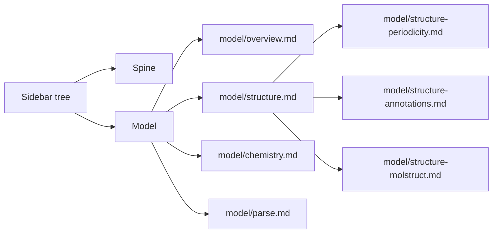

# Tabs — how the pages compose the modules

**Role:** contract
**Domain:** web
**Companions:** [`molview.md`](?doc=web/molview.md) — the 3D viewer every
build/edit tab mounts; [`projects.md`](?doc=web/projects.md) — the sidebar file
browser + the load/save doors; [`form-schema.md`](?doc=web/form-schema.md) — the
engine-option forms; [`spectra.md`](?doc=web/spectra.md) and
[`results.md`](?doc=web/results.md) — the two tabs with their own docs;
[`web-api.md`](?doc=web/web-api.md) — every route named below.

The reusable modules each have their own doc. **This doc is about the *pages*** —
the handful of tabs a user actually clicks between — and how each one is a thin
controller that *wires the modules together*. A tab owns almost no logic of its
own: it mounts MolView, drops in a schema-built form, subscribes to the projects
sidebar, and routes button clicks to the server. The interesting, reusable parts
live in the module docs; here we map **which tab wires which modules, and the
three protocols that cut across all of them**.

## 1. The tab roster and the shared shell

There are **nine tabs**, and their order is defined in exactly one place — the
`TABS` list in `tabs.py`. In canonical order:

| Tab | Path | What it's for | Own doc |
|---|---|---|---|
| **Molbuilder** | `/molbuilder` | build / edit / assemble a structure | this doc § 2 |
| **Structure optimization** | `/structure-optimization` | collect a SIESTA/PySCF relaxation's parameters and Send them to Task setup (the deck itself is written by `prep`, on the machine that runs it) | this doc § 3 |
| **Spectrum calculation** | `/spectrum-calculation` | describe a vibrational-spectrum calculation (the vibration kind) and Send it to Task setup; a finished `.spectra.json` is read on the Results tab | [`spectra.md`](?doc=web/spectra.md) |
| **Transport calculation** | `/transport-calculation` | describe the transport COMPOSITE: cite a finished junction attempt, set the bias, and write the finished `task.json` and `job-request.json` directly (no hand-over) | this doc § 4 |
| **Task setup** | `/task-setup` | read a calculation folder's description — its stages, and the machine settings you chose or measured — and edit `task.json` and `job-request.json`, an editor tab each | [`task-setup.md`](?doc=web/task-setup.md) |
| **Results** | `/results` | open a finished calculation | [`results.md`](?doc=web/results.md) |
| **This machine** | `/this-machine` | the box you are signed in to, not a calculation: its notification channels and its run-report listener. **The only surface where a secret is typed** | [`this-machine.md`](?doc=web/this-machine.md) |
| **Documents** | `/documents` | read the in-app docs (this page!) | this doc § 5 |
| **JupyterLab** | `/jupyternb` | a JupyterLab framed in the tab, running on its own env's python — the one tab that runs *your* code rather than an engine's. **Optional**: the env is opt-in and nothing starts the server but you | [`jupyter.md`](?doc=web/jupyter.md) |

> **Task setup is a shared surface** that starts from a calculation folder
> rather than from a form, so every describing tab above feeds one
> implementation instead of each growing its own stage table. Its design is
> [`task-setup.md`](?doc=web/task-setup.md).
>
> **It reads AND writes.** It follows the projects sidebar's selected folder,
> resolves a hand-over (`task.1st.json`) or an existing description, offers
> the stage table, the machine card and the benchmark panel as views of the
> editor buffers, and **Save writes `task.json` and `job-request.json` through its own door**
> (`POST /api/task-setup/save`) — the same reader and the same preflight the
> CLI uses, so a description that fails its own checks is refused with the
> findings, not repaired. Pinned by `tests/test_task_setup_tab.py`.
>
> **Why it is not called "prep".** `prep` is the CLI verb that resolves the
> machine and renders the deck — *exactly what this tab does not do* — so a user
> standing in a tab called "Job Prep" would reasonably expect it to prep. *Job*
> is taken twice over besides: a `Job` is a member of a `JobSet`, and it is the
> scheduler's word. **Task** is the file the tab edits (`task.json`,
> `molbuilder/task@2`, beside its job request), chosen for the same reason: it describes one task, and
> the stage list is *how* that task is broken up.

**Molbuilder is the landing tab** — a bare `/` redirects to whatever is first in
`TABS`. The tab nav bar itself is injected into every page from that one list (a
Flask context processor hands `tabs` to every template, and the shared
`_app_header.html` renders them), so adding or reordering a tab is a one-line
edit to `TABS`, never a template hunt.

Every build/edit tab also mounts the **projects sidebar**
([`projects.md`](?doc=web/projects.md)) down the left — the file browser you pick
a structure from. The exceptions are Documents and This machine, which need no
files of yours — the second because it is about the machine rather than about
anything you are working on.

**Each route spells out its tab's visible label** — `/structure-optimization`,
not `/optimize`. The URL is then self-describing in browser history and a shared
link carries its own intent. It is also a maintenance discipline: renaming a tab
without renaming its route quietly recreates the "*Build* — what does that do?"
problem the long names were introduced to solve.

### Why the tabs don't hand each other data

Two rules shape everything below:

1. **Molbuilder is the only interactive workspace.** It holds a live in-memory
   canvas. Every other tab reads from disk.
2. **The task tabs are file-driven.** Structure optimization and Spectrum
   take their input structure from a file you picked in the sidebar;
   Transport takes its ONE input from the citation its picker names (the
   viewer follows the cited calculation's structure — there is no sidebar
   commit channel on that tab).  None of them reads Molbuilder's in-memory
   canvas.

So the way to move a structure between tabs is to **save it** — there is no
in-memory "send to" hand-off (`modify.html`: *"all cross-tab transfer now goes
THROUGH a saved project file"*). One extra click, deliberately.

That click buys four things. If a task tab generated its script from "whatever
is in the Molbuilder tab right now", then:

- the script would depend on hidden state you can't see in the project
  directory;
- re-running the same task tab *after* an edit would silently produce a
  different script;
- two people working from the same project would get different scripts;
- exporting or re-importing the project directory would lose information.

Reading from disk removes all four at once: **the same project directory always
produces the same script**, no matter which tab you came from. That is the whole
reason the save step exists, and why no "send to tab" button will be added.

## 2. Molbuilder — build, edit, assemble

This is the workbench. Its page is a **"Init structure" source bar** across the
top, a **fused MolView card** in the middle, and a row of **Modify op-tabs**
below. The controller code is deliberately thin glue:

- **The 3D viewer is mounted by `selection-bootstrap.js`**, not by the tab's main
  `viewer.js`. One call — `mount(host, workspace, {owner: "modify", …})`,
  editable because it names no `mode` — and the **MolView module builds the
  entire fused card itself**:
  the viewer, the selection panel, the view toggles, the cell panel. The tab
  hand-builds no viewer chrome. `selection-bootstrap.js` does only page glue:
  mount the module, turn a sidebar file-pick into a *candidate* (you still click
  "Load" to commit — a stray click can't swap your structure mid-edit), and
  respect a restored canvas so a reload doesn't clobber it.
- **`modify/viewer.js` wires the Modify op-tabs** — Atom (add/delete),
  Transform (translate/center/rotate/orient), plus the state timeline
  (save-state / undo). Crucially, applying an op does **not** hand-roll a fetch:
  it calls `molview.data.applyOp(op)` and lets the module talk to the server
  (`/api/modify/<op>`).
  Each op of `molbuilder/modify.py` returns a new `Structure` and leaves the one
  it was given as it was, so a script can keep the original.
- **`modify/slab-panel.js` is the Slab op-tab** — one fcc slab, placed from
  absolute coordinates rather than relative to a picked group, which is the
  whole point of the redesign. It is the one
  controller that fetches a route directly: `GET /api/modify/meta`, for the
  element and plane menus, so the closed list of supported metals has one home
  rather than a copy in the page. **The lattice constant is the number in its
  box** *(the user, 2026-09-07: "the box is never blank: the panel shows the
  number it will build with")*: picking a reference fills it, typing makes it
  *Custom*, and **Add slab with the box empty sends nothing** and says what
  to do — type the constant or pick a reference — rather than building with a
  number the panel does not show.
- **`modify/periodicity.js`** is the Cell op-tab — vacuum, per-axis periodicity,
  the unit cell, the cell origin — and commits through
  `molview.data.commitPeriodicityOp`, the cell's one door (`POST /api/structure/periodicity`; the server re-resolves the effective cell).

### Creating a structure — the in-gate

The "Init structure" bar is how a molecule reaches the canvas. Every source in
that bar, no matter how different, funnels through **one gate**:
`structurePage.loadIntoCanvas(structure, source, how)`, handed the server's
envelope (`web-api.md` § 1), never a document the browser wrote.

**With nothing open, the incoming structure IS the canvas**:
`molview.data.installMolecule`, the timeline anchored at its point 0.

**With a structure open, it is ADDED** — `applyOp("append")`, an edit like any
other, a point on the timeline — so a session is assembled piece by piece
*(user, 2026-09-07: "the load from project or other generators should by
default ADD their results into the molview structure instead of clear the
existing one")*. The merge's rules are `model/structure.md` § 2.2b: the
incoming atoms centred on the origin, a label the canvas already has numbered
(`frozen_atoms` excepted), the canvas's cell, axis kinds and `info` kept — and
each decision returned as a receipt. A generator's result is added without a
question.

**A project file asks first** *(user, 2026-10-09: "add one guard to the load
button: ask user 'do you want to add the structure to the existing view or
clear the current view?' default is add")*. The Load button, and a double-click
on a structure file in the Projects sidebar, which is the same action, ask —
when a structure is open — *Do you want to add the structure to the existing
view or clear the current view?* **Add** is the default: its button has the
focus, and Enter or Escape takes it. **Clear** replaces the view with the file
— the gate's `how.replace`, `installMolecule` over what was there, the timeline
starting again — and the question says so when the view holds unsaved changes:
an edit since the structure was last written or loaded, or a structure no file
was ever written from — the page's own note (§ 6), never the viewer's
timeline, whose points each edit lays down.
A file's pair is a whole structure — its labels, its cell, its recorded
calculation — and adding it to another keeps the other's record, so the
question is where the person chooses which they meant. With nothing open the
file is installed and nothing is asked.

**A file of several frames asks which one first** *(user, 2026-10-09: "the
edit or modify tab would only load a single frame. If it's pointed to a
multi-frame, it will warn you or ask you, which frame do you want to load?")*.
The tab holds one frame (`molview.md` § 9.4): a frame set is a data set made by
scripts and never edited (`model/structure.md` § 2.2e). So when the load's
answer says the file holds `F > 1` frames (`n_frames`, `web-api.md`), the tab
asks *This file holds F frames — which one do you want to load?* (1 … F,
frame 1 offered) and loads that one (`frame`); Cancel loads nothing. The frame
arrives as a one-frame structure — the shared facts, `info`, the structure's
`customized` rows, and that frame's rows as its own, as written
(`model/structure.md` § 2.2e) — and the add-or-clear question above follows
as for any file. So every edit here acts
on one frame (user, 2026-10-10: *"when we constrain what is loaded, calling
modify would always work on a single frame"*); a file of several frames is
never edited, and is viewed in the Results tab's MolView.

The sources, and what each produces (all POST `/api/build/molecule` with
`{kind, input}` unless noted):

| Source | `kind` | Backend | Notes |
|---|---|---|---|
| **SMILES** | `smiles` | RDKit first, **OpenBabel fallback** | the fallback rescues big/awkward molecules RDKit chokes on; the response says which backend won |
| **By name** | `name` | PubChem → SMILES → (same fallback) | type "aspirin", get a structure |
| **Project file** | — (`/api/build/load`, `{path}`) | the server reads the `.xyz` and its `.molstruct.json` sidecar, or a `.pdb` alone — read, never written (`StructureCodec`) | asks which frame when the file holds several, and add-or-clear when a structure is open (above) |
| **DNA** | `dna` | 3DNA (X3DNA) / AmberTools / RDKit | B/A/Z forms, single strand or duplex, optional clash relief |
| **RNA** | `rna` | A-form canonical | |
| **Peptide** | `peptide` | PeptideBuilder | extended chain from a sequence; its C-terminus as the kit writes it, which the findings say |

**One chain for the five generators** *(2026-10-13)*. Each source's panel
checks its own input and names its request — SMILES and name, whose input is
one line of text, through the slot's `generateText` (blank refused, the text
trimmed); what follows is one chain, the panels' shared slot (`generate`,
`modify/structure/panel-deps.js`): its dependencies resolved and checked, a
missing one refused naming the panel, then the POST,
then the page's load gate (`structurePage.loadIntoCanvas`, with the record of
what made it), **under the page's fence** with a Cancel that aborts the
request ([`ui-contract.md`](?doc=web/ui-contract.md) § 10 — a build is real
server work, and a tab or folder taken meanwhile would lose or misplace the
result), and **one answer for every panel**: `{ok: true, n_atoms,
backend_used}` — the backend that built it when the server names it — the
answer's notices drawn under the panel's status through the one renderer, all
of them ([`science/validation.md`](?doc=science/validation.md) § 4.1 R5, R3:
what the build found — a peptide's aldehyde end, a nucleic acid's steric clash, a
form or terminal the backend does not build — and what the structure check says
of what was built, a defaulted cell's vacuum), the panel's earlier findings
cleared at every build —
`{ok: false, cancelled: true}` when the gate declines or the fence's Cancel is
pressed — nothing was put on the canvas, and no error is said — else `{ok:
false, error}`.

The tabs that show one file at a time — Structure optimization, Spectrum, the
Results inspector — open a file through `projects.parser.openMolecule`, which
replaces what the viewer holds after its own discard-unsaved check; the
Molbuilder tab does not, because it adds.

## 3. Structure optimization — describe a relaxation and send it to Task setup

`/structure-optimization` is **three cards**: inspect a structure, read the
charge and spin it will carry, describe the calculation and Send it. It mounts:

- a **read-only MolView** (`mode: "readonly", owner: "structure-opt"`) — you look,
  you don't edit;
- two **schema-built forms** (one SIESTA, one PySCF), rendered by form-schema from
  `GET /api/build/schema/siesta?calculation=optimization` and `.../pyscf?calculation=optimization`;
- the **chemistry card** ("Charge and spin", `lib/chemistry.js`) and each form's
  **chip** (`lib/detection-chip.js`): the charge and spin each form's calculation
  will carry, resolved by the one electronic-state class for exactly what that
  form says, each value with its reason
  ([`science/chemistry-correctness.md`](?doc=science/chemistry-correctness.md)
  § 2a, § 2.5). It fills nothing in — a blank field is the instruction "work it
  out" — and it follows every edit to a charge or spin field.

The flow: **inspect** → **Charge and spin** (`POST /api/structure/analyze` with the
structure the viewer holds and both forms' four state items, on every load,
restore and edit) → **Send to Task setup** (`POST /api/task-setup/handover`,
into the folder selected in the sidebar). No route renders a deck for a
browser: a deck is rendered by `prep`. Live validation runs against
`/api/build/preflight` as you edit.

**The inspect card is the one the Spectrum tab shares**
(`lib/structure-card.js`, `templates/_structure_card.html`): the read-only
viewer, the Load button and its readout, the sidebar's pick and double-click,
the atoms and formula, and one sentence for a load (*Loaded water.xyz — 3
atoms.*) and for a structure put back (*Restored water.xyz — 3 atoms.*). A file
counts as loaded only once it has, so a load that failed can be asked again;
arriving, the tab's own draft comes back first, and only an empty canvas is
seeded from the sidebar's pick. What goes on the canvas goes on one at a time,
the newest asked winning: a load asked while another is under way waits for it,
and one a newer load overtook before its turn is skipped -- so a slow first
file never replaces a second one picked after it, and the structure the tab
sends is the one its readout names.

**A reload keeps the structure and what the forms hold**: the structure the
viewer shows as the tab's own draft in the workspace (`structure-opt:panel`,
[`workspace.md`](?doc=web/workspace.md) § 2, saved when the tab loads one), and
both engines' forms in this browser tab, each tab its own
(`formSchema.keepInTab` over `pagePrefs`, [`runtime.md`](?doc=web/runtime.md) § 3;
the user, 2026-11-11), saved as the page is left and put back after the forms
draw (a field that will not read keeps what it was last saved with).

**It follows the sidebar's folder** *(the user, 2026-11-09)*: the line beside
Send says where a Send writes — the folder selected in the sidebar, or that
one is to be picked first — and the live check asks of that same folder, so
SIESTA's pseudopotentials are checked against the files there first, the
verdict the Send gives (`handover-procedure.md` § 2.2), before the click. The
sidebar moving, both follow. One read of the folder serves the Send, the line
and the check (`taskHandover.where`); the Spectrum tab does the same
([`spectra.md`](?doc=web/spectra.md) § 5).

What the tab writes today is the DESCRIPTION, via Send to Task setup: the
parameter template, the structure pair and the hand-over — written by the
server, every file or none, the pair through the codec
([`handover-procedure.md`](?doc=web/handover-procedure.md) § 2).  Everything a run
needs beyond that — the deck, the pseudopotentials beside it, the `.run.sh`
wrapper — is written by `prep` on the machine that runs it.

## 4. Transport — the composite's describe surface

The tab writes a transport calculation's description itself — `task.json`,
its job request and its template, into the folder the sidebar selects (no hand-over to Task setup:
the five stages are fixed by design). What it is,
rule by rule, lives in [`engines/transport.md`](?doc=engines/transport.md)
§ 3.8; this section is the map of the page as built.

**Five cards, driven by ONE fact — the citation** (an extension draws them
as its five parts, below):

1. **The junction** — the shared tree-picker cites either kind of
   [`engines/transport.md`](?doc=engines/transport.md) § 3.1: **a finished
   relaxation run of molbuilder's own** — its folder, read as the Results tab
   reads a run — or **a structure pair** — its `.xyz`, a frame set's included,
   whose frames the card's frame-set table states (§ 3.8.1 there), and whose
   pseudopotential directory the shared panel then asks — and **a
   transport calculation's folder**, to extend it (*An extension*, below).
   Anything else
   answers *not citable* with the condition named, and the citation held
   stays held. The describe door answers one
   summary line (how the run ended, what its record states) and **findings** through the one renderer
   ([`science/validation.md`](?doc=science/validation.md) § 4.1): each lead's
   period as information and seam at its weight (a warning where it does not
   continue the crystal), an inverted
   labelling (`L-electrode` the high-z block) as a warning — never a refusal,
   the junction cites and runs — with a *Swap L-electrode and R-electrode*
   button offering the rename as **this calculation's own** (`swap_electrodes`
   in the description; the cited junction is never written — § 4), made
   about one citation: citing another junction starts without it; the
   junction enters the calculation centred in its cell, save a cited
   pair's origin a person assigned, which it keeps (§ 4). A read-only
   **MolView** follows the citation, re-opened on every cite and reload as
   this calculation composes it.
2. **Shared by every rung** — the template's one electronic description, the
   citation's answers with their source named — a run's deck, or the record
   of the optimization a pair carries — editable here for all five rungs at
   once (§ 3.8.2, § 3.8.3).
3. **Charge and spin** — the chemistry card for the transport kind: the cited
   junction's state for what the shared panel says; it changes nothing.
4. **The physics, rung by rung** — first the **bias list** (0.0 first; a
   start/stop/step builder fills it) and, for several voltages, the
   **treatment**: the low-bias approximation or a self-consistent sweep
   (§ 2a.10); then the **engine strip** — one tab per engine molbuilder
   knows, the panel the calculation is described on, an engine that runs no
   transport drawn disabled with its reason (§ 3.8.8: TranSIESTA live,
   PySCF disabled); in it, one **tab per rung**, each holding that rung's own
   settings as its override bag (§ 3.8.2a), its cards folded where the rung
   does not own the group, the rung-fixed items echoed read-only. The
   transmission's tab offers no SCF setting (tbtrans runs none, § 6.1b). For a
   calculation that reuses a finished one, the transmission's tab offers, above
   its fields, its window **fitted to the finished grid** — the range asked
   and how many times finer, the fitted ends and count the server answers
   (`/api/transport/fit`), and *use these*, which writes them into the tab's
   window fields (`lib/transport/fit.js`, the one builder Task setup draws
   too; [`engines/transport.md`](?doc=engines/transport.md) § 2a.16).
5. **Describe** — one button, enabled once a junction is cited and the
   shared panel and the rungs' tabs are drawn for it (until then they hold
   the last citation's values). `POST /api/transport/describe` writes the
   template, `task.json` and `job-request.json` into the selected folder, or refuses: a refusal
   lands beside the control it names (the bias list, its treatment, a rung's
   field on its own tab, brought into view), and the status line says it too.
   The page does not navigate. Describe is one act: a folder that already
   holds a description is refused — a described calculation is changed on
   Task setup: its rung values and run settings on the cards, its electrode
   rename and its bias in its `task.json`; a different junction is a new description
   in a new folder — and so is a folder inside another calculation's, the
   cited run's among them, or one holding a calculation
   ([`project-layout.md`](?doc=execution/project-layout.md) § 7, invariant 2a;
   `engines/transport.md` § 3.1, § 3.8.2a). Task setup
   then opens it as an ordinary description, its editor from then on, and
   echoes the junction — a frame set's card included — the bias list, the
   treatment and the rename.

**An extension** (`engines/transport.md` § 2a.16, *Extending it* and *On
the page*; the describe door's `extend`) draws the five parts in order,
each card headed as its part and the prose about citing not shown:
1. *EXTENDING &lt;name&gt;* — the voltages, frames and window it describes, its
   finished results copied wherever nothing changed — and its way out, *Start
   a new calculation from this junction with these settings*, which cites
   the junction shown again as a calculation that reuses nothing, every card
   starting from the values chosen in the finished one (the lock's `chosen`;
   a value nobody chose blank, the lock's `blank`); 2. the junction — a
   choice of &lt;name&gt;'s junction as it ran or a frame set of it, whose *Choose
   a frame set…* opens the picker, which refuses a set whose first frame is
   another junction where it is picked, the junction held staying; 3. what
   you can change — the voltages, added or removed, their treatment, and
   the device's and the transmission's tabs alone, the transmission's beside
   the window fitted to the finished grid (`/api/transport/fit`), each
   saying what a change re-runs (`extend.says`, drawn as it is), and above
   the tabs a value typed for &lt;name&gt; before, restored, with *Use &lt;name&gt;'s
   own values*; 4. *Fixed by &lt;name&gt;*, folded — the shared values and the
   seed's and the leads', from the schema's `locked`, served with `reuses`;
   the shared panel, the charge-and-spin card and those stages' tabs are not
   drawn, and nothing of them is sent; 5. the plan — what is copied and what
   is computed — worked out again a moment after every change (`plan: true`),
   then Describe, which writes what `molbuilder describe --reuses` writes,
   the fixed rungs holding the finished calculation's own values; a changed
   fixed value, or its rename or its label changed, is refused by name with
   nothing written. Citing anything else leaves the extension: *NEW
   CALCULATION from &lt;citation&gt;*, every card back, the voltages 0.0.

**A reload keeps the citation and what the forms hold**, through the
workspace's one door, each under the tab's own tag
([`workspace.md`](?doc=web/workspace.md) § 4): the citation
(`transport:panel`) — and, extending a finished calculation, the frame set
cited in its junction's place (`frame_set`) — and what the shared panel and each rung's tab hold
(`transport:form` — one note, saved on every edit while a junction is cited
and put back after each surface draws, for the junction it was typed for --
or the finished calculation reused, its folder: the last one edited). The bias list, its
treatment and the electrode rename are not kept: a reload starts them over —
an extension's at the finished calculation's voltages and treatment.

**Beside the five cards, a rail** — the shared two-column page
(`form-components.css` `.page-cols` / `.page-aside`, as Task setup's) with
four cards about the whole calculation, in plain words with an example each
([`engines/transport.md`](?doc=engines/transport.md) § 3.8.10): the five
stages in order (from the schema route's rung list), the three k-point grids
and where each is set, whose SCF settings are whose, and what comes after
Describe.

The deliverable is read on the Results tab: a transport root opens its
`task.json`, which the transport report presents composed on read
([`web/results.md`](?doc=web/results.md) § 0.1, § 2.5).

The tab's four live routes are `/describe`, `/describe_attempt` (which also
describes a citation with the electrode rename, `&swap_electrodes=1`),
`/schema` and `/fit` ([`web/web-api.md`](?doc=web/web-api.md)).

## 5. Documents — the in-app reader (this page)

### 5.1 The sidebar — a tree, not a list

The left rail shows the document tree as **collapsible folders**. Each folder
is a domain (Model, Engines, Web, …) or a parent document with sub-documents.
Click `▾` to collapse a folder, `▸` to expand it. Click a leaf to open the
doc in the right pane.

The tree is NOT a flat alphabetical dump. The order — spine first, then
domain by domain, then archive last — is deliberate, and parent-child
nesting (e.g. `structure.md` with `structure-periodicity.md` under it) shows
which documents belong together.



### 5.2 `toc.json` — the table of contents

The tree shape lives in `docs/toc.json`. It is a single JSON file —
human-readable, hand-editable in any text editor — that lists every domain
folder and every document in display order:

```json
{
  "tree": [
    {
      "label": "Spine",
      "children": [
        { "path": "README.md" },
        { "path": "design.md" },
        …
      ]
    },
    {
      "label": "Model",
      "children": [
        { "path": "model/overview.md" },
        { "path": "model/structure.md", "children": [
          { "path": "model/structure-periodicity.md" },
          …
        ]},
        …
      ]
    },
    …
    {
      "label": "Archive",
      "collapsed": true,
      "children": []
    }
  ]
}
```

Each entry is either a **document** (has `path` — `docs/`-relative) or a
**folder** (has `label` + `children`). A folder with `"collapsed": true`
starts hidden. The Archive folder's children are left empty — the server
fills them in automatically by scanning the `archive/` directory.

The root project `README.md` (`../README.md`) gets its own entry at the very
top of the tree, above the spine.

### 5.3 The tree stays in sync — auto-discovery

When the Documents tab loads, the server reads `toc.json` and then checks
every domain directory for `.md` files that are **not** listed in the TOC.
New files are added to the tree automatically, and written back to
`toc.json` so the file stays in sync.

A new file named `model/structure-symmetry.md` would be discovered and
nested under `model/structure.md` — because the name starts with
`structure-`, the same prefix as its parent. This is the same filename
convention R5 describes: sub-documents share the master's filename as a
prefix.

The server writes back to `toc.json` atomically (temp file + rename), so a
crash during refresh never leaves a half-written TOC.

**`GET /api/docs/toc` is the one door that regenerates the file.** Nothing else
writes it, and nothing depends on what it lists: a test pins what the door does,
on a copy of the tree (`tests/test_docs_tab.py`), and a page a test serves has a
documents tree of its own (`tests/support/live_server.py`), so a new document in a
domain folder needs no step before a test run. A new folder, or a document at the
top of `docs/`, is listed only once the tree has a group for it.

> **When you write a new document:** drop the `.md` file in the right
> directory (e.g. `docs/model/`), open or refresh the Documents tab, and
> it appears.  If the name follows the `parent-` prefix convention, it
> nests under its parent.  `toc.json` is updated automatically — no
> manual editing needed.

### 5.4 Portable links and the root README

Docs stored under `docs/` use internal links in the form
`?doc=<path-relative-to-docs>`. The root `README.md` intentionally uses normal
GitHub-relative links such as `docs/ops/installation.md`, because those links
must work when the README is viewed directly in the repository.

The Documents tab supports both forms. After rendering Markdown, it rewrites
the root README's relative `docs/<path>.md` links to
`?doc=<path-relative-to-docs>` and its `LICENSE` link to `?doc=../LICENSE`,
then opens the result in the reader. External links are left external. This
mirrors the existing image rewrite: source Markdown stays portable, while the
rendered in-app view receives the API route it needs.

The root README and repository `LICENSE` are the only intentional path
exceptions outside `docs/`, and the four indexes (§ 5.6) the only documents
that are no file. The sidebar obtains the README from `/api/docs/toc` as
`../README.md`; `/api/docs/read` accepts that value and `../LICENSE` exactly.
All other paths containing `..` are rejected, and every regular document must
resolve to a real Markdown file inside `docs/`. Opening a doc
writes `?doc=...` back into the URL; loading a URL with `?doc=...` opens that
doc and expands every folder along the path so you can see where it lives in
the tree.

### 5.5 The reading surface starts dark

The app is dark, so the reader starts dark too — a document opening white
inside a dark app would glare. The bar's ◑/◐ button offers a
light reading surface (some people print from this pane), and that choice is a
reading preference kept in this browser after it closes (`pagePrefs`,
[`runtime.md`](?doc=web/runtime.md) § 3): a page opened later in the same
browser starts on the surface last chosen.

### 5.6 The indexes — built from the code each time they are read

*(The user, 2026-09-07: "an index that summarizes key design aspects, such
as api, module, data structure etc. … a reference list that gives the
foundation of all the constants … and paper citations summarized in one
place"; 2026-11-17: "Live from the code".)*

Four documents the server composes each time one is read
(`molbuilder/web/doc_indexes.py`) — never a file on disk, so none can drift
from what it lists. They sit in the sidebar's
**Indexes** folder, added by the server to the tree it answers (never
written into `toc.json`), and read through `/api/docs/read` as
`index/routes.md`, `index/modules.md`, `index/files.md` and
`index/references.md` like any document. Each is one table, **one row per
thing**, and a row says where its fact lives — the chapters that name it —
with at most the one line its owner already wrote; it never restates the
detail.

| index | one row per | from | the row says |
|---|---|---|---|
| **Routes** | route the running server answers, its methods merged | the server's own route table, and its page scripts | its methods, the first sentence of each handler's docstring (by its methods, where several answer), the chapters that name it, the page scripts that write its path — a route no chapter names says so |
| **Modules** | module of the package | the package's files | its layer by `architecture.md` § 3's rule, read there (L1 its index, L3 its sentence *L3 is …*, L2 every other; unknown, and said, where either is not found), its own line (its header's `ROLE`, else its docstring's first sentence), the chapters that name it |
| **Files** | file molbuilder writes into a calculation folder, and each engine file it names | the run-file catalogue's rows, in the one rendering `execution/project-layout.md` § 5 shows too (`molbuilder/catalogue_tables.py`) | that rendering's cells — the file, what it is, who writes it or what the restart list says of it, the one function its readers ask — and the chapters that name it |
| **References** | physical constant, and bibliography entry | `constants.py`, each constant with the first paragraph of the comment above it — what it is, where its value comes from, why this value; `science/references.bib` through its one reader (`references`) | the constant's value and that paragraph; the entry's title, the line that finds it (first author, journal, volume, year) and DOI, and the chapters that cite it — the package's own files alone (its code, its data and their notes), or neither, said so — and each key a chapter cites that the bibliography lacks |

"The chapters that name it" are the live documents — not `archive/`, not
`plans/`, not the changelog, records of what was that name everything —
writing: a route's path, its variable part written as a variable (`<id>`,
`{id}`, `…`, `...`; a value is an example, not a name) and a `{a,b}` list
read as each of its names — a lone `/` is prose, so the root page `/` is
named by no chapter; a module in backticks by its path — a file
(`transport/record.py`) or a package's folder (`jobset/`) — its dotted name
(`transport.record`, `molbuilder.parse`), or its name with one of its own
names after it (`runs.concluded`) — a top-level module's bare word, which a
field or a variable may share, never, nor a bare `.py` or `__init__.py`; a
file's name, alone or inside a folder's path, its fields written as fields
(`<base>.fdf`, never `H2.fdf`; one written field stands for any, so
`<label>.log` names both `<base>.log` and `<group>.log`); a constant's name;
a citation's key in brackets or after `references.bib:`. A page script *writes* a path when its
text holds it — a variable also as `${id}`, its last one left off as a
script builds it (`"/api/x/" + id`); a path it assembles from pieces it
does not write. A cited
key the bibliography lacks is found by its author-and-year shape
(`Papior2019`).

## 6. Save flow — the out-gate

**One door out, and the page does not own it.** Saving a structure is
`projects.molviewFiles.save("project", stem, viewer.exportFile())` — the same
door MolView's own Export → Data row goes through
([`projects.md` § 5](?doc=web/projects.md)). A tab that saves supplies two
things and no more: **what** (the viewer's export) and **a suggested stem**.

1. You click **Save to project**. The door asks **where** — a folder, then a
   name — through `projects.chooseSavePath`, *"one door for every flow that
   deposits"*. Cancel at either step and nothing is written.
2. The model **serialises itself** — `molview.data.exportFile()` — so what is
   saved is exactly what is on screen (*viewer is truth*). The tab does **not**
   scan the structure for regions or frozen atoms; the model already knows
   them, and a browser-side scan is the second source § 7 forbids.
3. The door posts **`POST /api/structure/save`** with `{path, structure}`.
   **The server writes the pair** — `<stem>.xyz` +
   `<stem>.molstruct.json` — and stamps the sidecar's schema version and
   structure hash itself. The browser never authors the sidecar (a sidecar
   the browser wrote is one the load door could reject), and it assembles no
   bytes at all.
4. An existing file answers **`409 {needsOverwrite: true, replaces}`**; the
   door confirms through `confirmOverwrite`, naming what a yes replaces, and
   retries with `overwrite: true`. On success
   the sidebar refreshes and the periodicity gate's `notices` come back
   verbatim — and the panel's line says them after *Saved water.xyz.*, in the
   tone of the most severe — a warning's amber, a note the outcome's own
   ([`science/validation.md`](?doc=science/validation.md) R4) — composed by the
   one composer every save, load and upload line asks
   (`validationFindings.outcome`).

**What the tab keeps is the panel, not the pipeline**: the readout beside the
button — *"Target: `<name>.xyz`"*, *"Unsaved — Target: …"* once you edit
again, and *"Not saved yet"* for a structure that has never been written —
the
button's enabled state, and recording where the bytes went — the page's own
note, because the viewer tracks contents and not files
([`molview.md` § 6.7](?doc=web/molview.md)). **Whether the view still holds
what was written is that note's too**: the page keeps the
structure it last wrote — the payload the save sent, through Save to project
or the viewer's own Export → Data → Save to project, which the page's door
records alike (`savingThrough`, one door out) — or the one a file load
installed, and at every change the viewer announces it compares what the
view holds with that. A change that changed nothing (a timeline *Save
state*) is no edit; a Retract back to the written state reads saved again;
an edit that lands while a save's dialog is open is not in the file, and
stays *Unsaved*. A structure a generator built, or one appended to another,
is held by no file. The readout's *Unsaved* and the Load question's sentence
(§ 2) read it, never the viewer's timeline flag, which every edit clears by
laying down its own point and a timeline save raises with nothing changed.
The note is kept with the page's other facts across a reload (`modify:panel`),
and read back it repaints its readers; a note written before 2.68.2 carries
no such fact and reads as edited unless it names the file the structure came
from or went to, and no note at all as edited.

**The only precondition is that there is something to save.** There is no
"pick a directory first": the directory is part of the question the dialog
asks. A greyed-out Save whose reason is a selection somewhere else on the page
is a control that cannot explain itself.

## 7. Data coherence — one rule, enforced server-side

The invariant that keeps a tab's form and its structure from ever disagreeing:

> **What is in the viewer at generate/save time *is* the input.** The frozen-atom
> and region labels travel in the request body and are applied to the structure
> verbatim — and **every label index must be a valid atom of the current
> structure**, or the server rejects it.

This is enforced where it can't be bypassed — on the server:

- The labels ride **inside the structure envelope**, not beside it, so there is
  one place they can arrive and no second place to drop them. `struct_from_body`
  rebuilds the `Structure` from that one object, and the model validates each
  index itself (`Structure._validate_regions`: `0 ≤ idx < n_atoms`, else a
  visible refusal). Every emitting door goes through it.
- `struct_from_body` honours a per-atom metadata array **only if its length
  equals the atom count** — a malformed array can't corrupt the structure; the
  default is kept.
- On any atom-count change (an add or delete), the client **clears the selection**
  — so no stale index can point at an atom that no longer exists.

There's a **chemistry** half too: one class (`electronic_state`) is the one source
of truth for the charge and spin, every generator tab shows its answer through the
same chemistry card and chip, and a validator finding attaches to the workflow
card it belongs to. (The *visual* coherence rules — palette, role
vocabulary — live in [`ui-contract.md`](?doc=web/ui-contract.md), not here.)

## 8. Where the tab controllers stand — ESM status

The design goal is concealed, independently reusable ES modules. The **modules**
are largely there; the **tab controllers that consume them** are half-migrated:

| Controller | ESM today |
|---|---|
| `modify/viewer.js`, `modify/periodicity.js`, `modify/slab-panel.js` | **yes** — each exports `init(viewer)` and has no tag of its own: `modify/selection-bootstrap.js` imports them and starts them with the viewer it mounts (`modify.html`) |
| `modify/selection-bootstrap.js`, `structure-optimization/viewer.js`, `lib/transport/core.js` | **hybrid** — top-level `import`s (MolView's `mount`), loaded as `type="module"`, but a classic IIFE body that reads the other modules' `window.molbuilder.*` globals (the workspace, the status line, the structure page) |
| `modify/structure/*.js` (the generators), `documents/page.js` | **no** — classic global scripts; `modify/structure/page.js` publishes `window.molbuilder.structurePage` |

So the Molbuilder tab's op-tab controllers are ES modules; the page
controllers that mount MolView (`selection-bootstrap` and the two tab
viewers) have one foot in ESM — they `import` the viewer — while their own
bodies are still IIFEs reading globals; the structure-generation set plus the
Documents controller are fully classic. Finishing these off is not planned.

## 9. Test map

- `test_tab_routes.py` — every canonical tab path renders + the nav contract
  (paths read from `TABS`).
- `test_docs_tab.py` — the Documents tab: the tree (`/api/docs/toc`) holds
  every `docs/*.md` once, `read` returns text + title, and the path-safety
  gate rejects traversal / non-`.md` / outside-`docs`; the Indexes folder
  holds the four indexes, and each holds a row for every route, module,
  catalogue file, constant and bibliography entry (§ 5.6).
- `test_transport_record.py`, `test_transport_cell.py`,
  `test_transport_wizard.py` — the transport surface.
- `test_structure_save_endpoint.py` — the server end of § 6: the route, the
  pair it writes, and the `409 needsOverwrite` contract.
- `test_molview_files_door_js.py` — the door § 6 goes through.
- `test_structure_save_js.py` — the panel: that it delegates, and that it
  records the path the server answered.
- `test_smiles_fallback.py`, `test_structure_smiles_js.py` — the SMILES
  generator + the OpenBabel fallback.
- `test_modify.py` — the Modify ops.
- `test_molbuilder_e2e.py` — the Molbuilder tab end to end.
