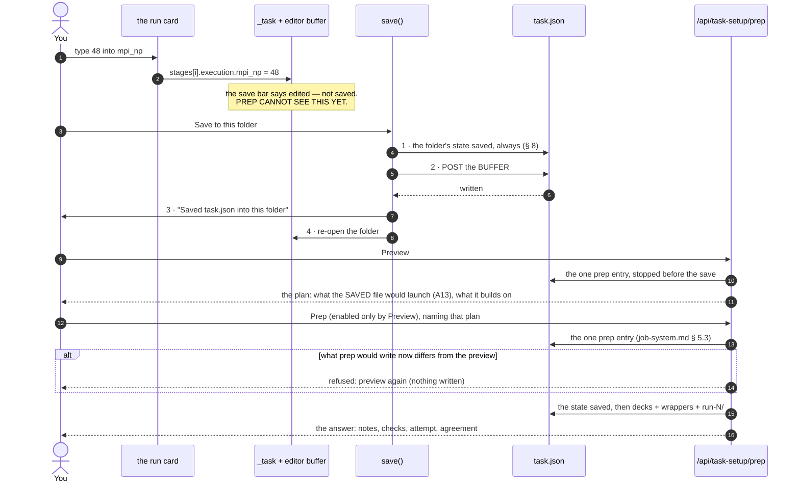

# Task Setup — the tab that writes a description

**Role:** contract
**Domain:** web

**Companions — the contracts this surface is built against, and where the two
disagree those win:**
[`engines/stages.md`](?doc=engines/stages.md) — what a stage is, `varies`,
`shape`, `bench`, and the rule that a job always has at least one stage;
[`engines/template.md`](?doc=engines/template.md) — the catalogue every control
on this page is drawn from, and the rule that a description names no machine;
[`execution/project-layout.md`](?doc=execution/project-layout.md) — what `prep`
does on the target, and why this page renders only from a machine's own record;
[`execution/generator.md`](?doc=execution/generator.md) — *a run is a sweep of
length one*, which is the idea § 5 is built on;
[`execution/run-identity.md`](?doc=execution/run-identity.md) — the id, and what
`start from` expands into;
[`web/form-schema.md`](?doc=web/form-schema.md) — how a catalogue item becomes a
control.

**What this page is for, in one sentence.** A parameter tab has collected the
physics; this page turns that into a **description on disk** — `task.json` plus
the template — and hands you the command to run it somewhere else.

---

## 1. The one rule the page rests on

> **The browser describes. A machine's own facts render. The terminal launches.**

A deck carries values that depend on *how it will be launched* — a block size
whose sensible ceiling is orbitals over ranks, a GPU line that decides which
environment the wrapper activates. **A parameter that depends on the launch
cannot be decided before the launch is known**
([`project-layout.md § 2.2`](?doc=execution/project-layout.md)). A browser on a
laptop does not know the machine, so a deck it "finished" would be full of
guesses.

So this page writes what any machine can read — and **prepares only against a
machine's own record**: its Prep buttons run the command line's `prep`, one
entry for both doors, whose checkpoints and agreement
[`job-system.md`](?doc=execution/job-system.md) § 5.0 states,
rendering from the facts of the machine you chose in § 6, never from the
browser's. **Launching stays at the terminal**: it spends a queue slot, one job
per invocation, by hand. The task's Prep prepares the groups you pick, each
group one job — the stages that share it, a transport ladder's seed and leads
among them ([`project-layout.md`](?doc=execution/project-layout.md) § 1.6.6;
§ 11). What the page writes:

```text
projects/BDT-Au/optimization/au111-series/bdt_au/

    BDT_Au_relax.template.toml   the parameters, with their values
    task.json                    what varies, the stages, what to measure
    Au.psml  S.psml  …           the data files
```

Then, on the machine that will run it (or with this tab's Prep, for a machine
chosen in § 6):

```bash
molbuilder jobset prep task --group 1        # resolves this machine, renders the
                                       # deck and wrapper, builds the attempt
molbuilder jobset launch task --group 1
```

**There is no "run all stages" button, and that is deliberate.** A stage is a
long job, and a chain that continues by itself can spend a week refining a
geometry you would have rejected in a minute
([`project-layout.md § 1.6`](?doc=execution/project-layout.md)). What the page
offers is the next single command.

---

## 2. Where it saves

**The folder selected in the projects sidebar.** This page creates no folders —
make or pick the one you want there first.

**One rule about which folder: somewhere under a topic.** How deep, and how you
group jobs below that, is yours — nest as many folders as suits the work. The
projects root, a project, and a bare topic are not destinations
([`job-contracts.md § 2.5`](?doc=execution/job-contracts.md) fixes the nine
topics).

**Only `task.json` is read to decide what the folder is.** It names the
calculation and its structure, so nothing else in the folder needs inspecting.
Three states, and the third is a refusal:

| what is in the folder | what saving does |
|---|---|
| **no `task.json`** | writes a new job here |
| **a `task.json` for *this* calculation** | its stages load into the table; saving updates them |
| **a `task.json` for a *different* calculation** | **refused.** One calculation per folder, or every later step is guessing which one the folder is (`job-contracts.md § 2.1` Rule 1). The message names the calculation it found |

> **Why refuse rather than offer a subfolder.** Creating a folder to escape a
> collision is a decision about where your work lives, and the sidebar is where
> that decision belongs. A page that quietly nests one is a page that puts
> calculations somewhere you did not choose.

### 2.1 The page holds no state of its own

Everything it shows comes from the selected folder. There is no remembered form,
no in-progress buffer that outlives a directory change, nothing to reconcile on
reload. **The folder is the only link** — which is what lets the same page serve
every producer, and what makes *"open a folder"* a load rather than a merge
(§ 9).

**The page is a function of (folder, engine, machine)**, in that dependency
order, and each tier is answered on its own terms:

| tier | answered by | changes when |
|---|---|---|
| the **folder** | one door — `/api/task-setup/folder?dir=` | the selection moves; **replaced whole** |
| the **engine** | `columns` · `presets` · `sweepable`, keyed on the engine | the engine does — shared across folders |
| the **pair** | `bench-grid{dest, target}`, each stage's command lines (`commands{dest, kind, stage, target, …}`, § 11) and each stage's preview (`prep{…, plan: true}`, § 11.1) | *either* the folder or the machine moves |

Naming the tiers is what keeps the rule precise: "no state of its own" forbids
remembering a *folder's* facts, not caching the engine's vocabulary, and the
pair is the case a single reset would get wrong.

**And every folder-scoped answer names the folder it is about.** A consumer
that has moved on discards it rather than rendering it. This is
[`project-layout.md`](?doc=execution/project-layout.md) § 1.4a's rule applied
to the wire — a record names its own place and the reader checks — and it is
the half that clearing cannot cover: **there are two ways this page shows the
wrong folder, state that LINGERS and an answer that LANDS LATE**, and a reset
only ever addresses the first.

> **This was written before it was kept.** The page assembled itself from
> twelve endpoints, each painting its own card, and cleared the per-folder
> ones with `_resetPerFolderState()` — a hand-written list of eight clears in
> a module with twenty-five variables. Its very existence is the admission: a
> page that held no state of its own would have nothing to reset. It had
> already leaked once (a SIESTA description into the next folder, with Save
> enabled over the wrong calculation); on 2026-09-19 it leaked again, and a
> six-trial bench plan — `mpi_np` 4/8/16 × `omp` 1/2 — rode into a brand-new
> calculation whose hand-over declares no `varies`, on a four-core box. There
> was no `AbortController` anywhere among the twelve, so the late-answer half
> was unguarded entirely.

### 2.2 What this page asks, and what `_is_bundle_root` asks

*Corrected 2026-08-16.* This section used to say the check **is**
`checkpoint.py::_is_bundle_root` and "must not be written a second time". That
was wrong in a way worth keeping: **the two answer different questions**, and
the tab neither uses nor duplicates it.

| | asks | answers |
|---|---|---|
| `checkpoint.py::_is_bundle_root` | *does this path declare itself the root of one multi-directory unit of work?* | one boolean, over `task.json` **or** `job-set.json` — enough to decide the folder owns its subdirectories (`checkpointing.md` **L1**) |
| **this page** | *does this folder hold a description to edit, a hand-over to finish, or nothing yet?* (a transport folder is always the FIRST state: the composite describes directly and never produces a hand-over — its `task.json` arrives finished, and this page opens it as an ordinary description and edits it, its shape and its rungs fixed by the kind, § 5.3) | **three** states, and it distinguishes `task.json` from `task.1st.json` — a distinction `_is_bundle_root` does not make and has no reason to |

**The invariant that does bind them**, and it holds today: a folder this page
treats as a described calculation is one the checkpoint system also covers.
Both key on `task.json`, so they cannot disagree about that — which matters
because § 8 takes a state in a folder before writing into it, and a folder the
history did not cover would be one whose state could not be brought back.

**And a folder of finished decks is still not adoptable**, which is a refusal
rather than a missing feature: `varies` **cannot be inferred**
([`stages.md § 6.2`](?doc=engines/stages.md)). Decks do not record which
parameters were *meant* to vary — a cutoff equal in every stage is
indistinguishable from one nobody promoted — so reconstructing intent would be
guessing at the one thing the description exists to state.

---

## 3. What came over, and is not editable here

The identity facts, read-only, from the parameter tab that wrote them: the
calculation's name, the engine, and what it is OF — a structure's file, formula
and atom count; for a transport calculation the junction it cites, the bias
list it walks, how it treats that list (`single-bias`,
`low-bias-approximation` or `self-consistent` — the folder answer's
`treatment`, the one rule the record names it by) and whether it trades the
two electrode labels in its own copy of the junction (`swap_electrodes`,
[`engines/transport.md`](?doc=engines/transport.md) § 4) — and the label every
emitted file is stemmed on. **A cited frame set says what its frames are**,
under them: its count and, for a mode's set, its mode line and a row per
frame — the frame-set card the Transport tab's junction card draws, from the
describe door's own door (`frame_average.answer`,
[`engines/transport.md`](?doc=engines/transport.md) § 3.8.1), through the
folder answer's `frame_set`; a citation that does not read says why, and the
folder still opens.

**Under them, every value shared by every stage** — *Shared by every
stage*: each item the catalogue marks `shared` for this calculation's kind,
by its label, with its value and whose it is (*from the junction you cited ·
you set this · not chosen · not recorded*), read-only
([`engines/template.md`](?doc=engines/template.md) § 6.6 obligation 3,
*2026-10-11*) — and, for a value only some rungs read, which ones
(`template.shared_scope_words`: *read by the device and transmission rungs
only*, § 5's `shared` with `stages`). No stage may change one, so none is a column of the stage table
(§ 5) — which made this card the one place on the page a reader sees them.
The folder's answer carries them (`template.shared`, read by the template's
own reader beside the catalogue's `shared`); the page keeps no list.

**They are shown because you are about to commit a week of compute against
them** — not so they can be changed here. What names the calculation — its
name and what it is of, a structure or a transport calculation's junction —
is its identity: the run id is derived from it, so a different one is a new
calculation, described in a new folder (Save refuses another calculation's
id, § 2). The rest is corrected in `task.json` itself, in the editor below
(§ 9a), as `jobset init`'s refusal says of a described folder — a transport
calculation's electrode rename and its bias list; a shared value
is the template's, changed in that file, which a person reads and edits
([`engines/template.md`](?doc=engines/template.md)). A transport
calculation's Describe is one act and writes into no described folder
([`engines/transport.md`](?doc=engines/transport.md) § 3.8.2a).

The **id** (`<label>_<formula>`) is displayed and never recomputed here: it is
read from the file and checked, which is what makes renaming detectable rather
than silent ([`run-identity.md § 3`](?doc=execution/run-identity.md)).

---

## 4. Shape — asked, never guessed

`"flat"` or `"hierarchical"`, and the page cannot be saved until one is chosen.

| | what it means |
|---|---|
| **flat** | one directory. Stages and attempts told apart by filename — `…_01_coarse-run0.out`. One shared set of warm files, so each stage overwrites the last |
| **hierarchical** | a directory per stage, a directory per attempt — `01_coarse/run-0/`. Every stage's state stays on disk |

**No default, on purpose.** Inferring it — from the stage count, or from what is
already on disk — would hand somebody a directory tree they never asked for, and
the trade it decides (what survives after three stages have run) is theirs to
make ([`stages.md § 6.7`](?doc=engines/stages.md),
[`project-layout.md § 1.2`](?doc=execution/project-layout.md)).

**A kind that fixes the shape shows it fixed.** A transport calculation is
hierarchical — its five rungs exchange files through their own attempts
([`engines/transport.md`](?doc=engines/transport.md) § 2a.11) — so on a
transport folder the card shows that shape, says the kind fixes it, and offers
no other.

**It is fixed once the calculation has produced.** Before the first produce it is
free to change; after, it would orphan every deck, output and warm file. So once
a stage is prepared — as a run or as a benchmark; a prep that was refused counts
for none — the card shows the shape fixed, and Save refuses another, both naming
the way back: the state saved before the first prep, restored
([`execution/job-system.md`](?doc=execution/job-system.md) § 5.0).

**One answer says both**: `prep.shape_fixed` — the shape and why, the way back
included, or nothing while it may still change. The folder answer carries it
(`shape_fixed`) and Save refuses with it, so the card and the refusal say the
same sentence. When the folder's plan is one its readers refuse, the card says
that instead, and Save refuses another shape with the same words.

---

## 5. Stages — the table, and what a column means

Rows are stages, columns are parameters. **Add a parameter to make it a column,
then give it a value per stage. Anything you do not add stays as you set it, for
every stage.**

| Stage | mesh_cutoff | relax_force_tol | relax_type |
|---|---|---|---|
| coarse | 150 | 0.04 | CG |
| medium | 200 | 0.04 | Broyden |
| tight | 300 | 0.01 | Broyden |

**The column set is `varies`; the cells are each stage's `overrides`**
([`stages.md § 6.2`](?doc=engines/stages.md)). A cell left empty means *this
stage uses the template's value* — a real state, and why `overrides` is a subset
of `varies` rather than equal to it.

**Which parameters may be a column of THIS folder** is answered by the
catalogue's markers for the folder's kind, and by nothing the page keeps
([`template.md § 6.4`](?doc=engines/template.md); `/api/task-setup/columns?engine=&calculation=`):
the kind narrows them (`calculations`); **a run setting is not a column** —
the catalogue's `execution` items, the machine's answers among them, are each
rung's run card (§ 6.2b; `stages.md` § 6.8d, plan § 5w K5); a rung's role is
not a column (`role`); and **a value shared by
every rung is not a column (`shared`)** — it is edited in the template, on the
tab that owns it, and a column here would be a per-rung override `prep`
refuses by name. *(Measured 2026-09-24: a transport folder's picker offered
thirteen shared values, `mesh_cutoff` and `basis_size` among them.)* **A column
a rung does not read (`stages`, by the rung's ROLE) shows on that rung's row as
a disabled cell naming the rungs that read it**, never as an editor — a
transmission window on the seed's row, a relaxation tolerance on a vibration's
`freq` — and the picker names those rungs beside the item (*read by
transmission*, 2026-10-11). The payload carries each item's roles and, beside the columns, how the
kind names its rungs' roles (`roles`, `template.stage_role_rule`), so the table
maps each row to its role — the name matched in any case, as `stage_role`
matches it (`stages.md` § 2) — and keeps no rule of its own; the description's own
check and `resolve` refuse such an override on every road *(by role for every
kind since 2026-09-30, plan § 5w K4; for transport's rungs, by name, since
2026-09-24)*.

**Every row states its group** *(user, 2026-10-11:
"the stages should have a group number assigned to it, either repeat the last
group number or add one")*. Beside each stage's name, its **group** — the job
it runs in ([`stages.md`](?doc=engines/stages.md) § 2) — with two choices on
every row but the first: *same as above* (repeat the number) or *new group*
(add one). A row that may not repeat — it builds on a stage in the group
above, or states other values than that group on what a job shares, or that
group was launched — says why beside it and offers only *new group*: the
sentence is the server's (`groups.stages[i].why_same`, from
`group.why_not_join`, the one home of the rule `group.may_join` asks; the
page composes none, 2026-10-18), beside the facts the folder answer gives
(each stage's number, `builds_on`, `linked`, `launched`), and Save's check
(`group.check_groups`) refuses what the rule forbids after edits. Both name
the ways out: a new group — or, for an independent ladder's stage, its run
card's `restart` set to `clean`, so it builds on nothing.
A new description arrives with the defaults (repeat wherever allowed); Save
writes the numbers into `task.json`. **Changing a group of stages that are
prepared and never launched** marks those groups for preparing again (§ 11);
a launched stage's group is fixed and its row's choices are disabled, naming
the restore that changes it — and no row joins it: the row below a launched
group offers only *new group*, saying why.

### 5.1 An empty cell shows the number, and it comes from the folder

An empty cell says *"the template's value"* — so it **shows that value**, greyed,
as a placeholder. That is what makes the § 9 rule *"adding a column changes
nothing on screen"* visible instead of merely true: promote a parameter and every
cell shows the number it was already at.

**The value is read from `<label>.template.toml`, not from the catalogue.** The
distinction is the whole point of the hand-over: a person who chose a 4×4×1
k-grid in the parameter tab has that grid in the template, and a cell naming the
catalogue's recommendation would be naming a number the job will not run. Order,
and it is one way round:

| | shown when |
|---|---|
| the folder's template value | the template answers this parameter |
| the catalogue's `default` | it does not — nothing was sent, or the sender left it alone |

The folder answer (`GET /api/task-setup/folder`, its `template`) reads it, because TOML is a format and
[`projects.md § 3`](?doc=web/projects.md) keeps a format's correctness on the
server. It parses with `read_template` — the same reader `prep` opens the file
with — so the browser cannot become a second reader that disagrees.

**A hover shows both numbers when they differ**: *"This job (probe.template.toml):
450.0 Ry — you set this"* above *"Recommended: 300.0 Ry"* — the value's source
from the template (`template.md` § 6.6 obligation 2), and the default **this
kind** recommends (`template.recommended_for`; a vibration's relaxation is
held tighter than an optimization's), never the general one. Somebody checking a description
before a week of compute should be able to see that the two are not the same.

### 5.2 The declared type decides the cell — both the widget and the value

A parameter's `type` comes from the catalogue and answers **two** questions, and
neither may be answered by looking at the value instead:

| | asked by | answered by |
|---|---|---|
| which control edits this cell | `legalValues` | `bool` / `enum` → a dropdown of the choices **this folder's kind offers** (the columns payload's `choices`, narrowed by `template.offered` — [`engines/template.md`](?doc=engines/template.md) § 6.3a, 2026-09-30: a vibration's relaxation cell offers three relaxers); everything else a text box |
| what the typed text **means** | `CELL_READERS` (`task-setup/cell-readers.js`) | one reader per member of `template.TYPES` |

Guessing either from the value's look is a bug this tab has had twice. A
sweep row born as the number `1` made `use_gpu` a number box (fixed
2026-08-20). And a cell that stored `Number(text)` when the text parsed and
the **raw string** when it did not wrote `"kgrid": "4,4,1"` into a
description — a string where the config declares `Tuple[int, int, int]`.
`kgrid` is `int3`, `Number("4,4,1")` is `NaN`, and the four columns whose
type is a sequence (`kgrid`, `kgrid_displacement`, `species_order`,
`ecp_atoms`) all wrote text. It saved cleanly and failed at `prep`, hours
later, inside a range check that could only call it *"a programmer bug"*
(reported live 2026-08-25).

So: **every type in the vocabulary has a reader, and a type the catalogue can
declare but the tab cannot read is a test failure**, not a silent fallback —
that is the only thing that makes the next addition noisy.

**Three types have a reader and no catalogue item**: `pow2`, `text` and
`intlist`. A column's type comes from the shipped catalogue, so no cell can
carry one today — they are handled in advance because the failure without a
reader is *silent* (the lookup misses, the raw text is stored), and a newly
added item is exactly when nobody thinks to check. So **when such an item
does land, the stage table already reads it** — `pow2` as a whole number
(snapping is `template._shape`'s, not the cell's), `text` verbatim, and
`intlist` as comma- or space-separated whole numbers (not the range syntax
`0-35, 100` the Build form's own control takes — that is a different
control's contract). Do not add a second path for them.

A k-grid takes the three spellings `--kgrid` itself takes — `4,4,1`,
`4x4x1`, `4 4 1` — because one product should not accept a value at the
terminal and refuse it in the browser. Text that is **not** the declared
type is kept exactly as typed and refused by name at the save door
([`stages.md § 6.6`](?doc=engines/stages.md)'s declared-type row); storing a
half-parsed value would be the quiet version of the same bug.

**A job always has at least one stage.** You start with `coarse`; adding another
is one more row. There is no stage-less shape to fall into, so a job's artifacts
are named the same way from the first run — `01_coarse` — and a job that grows a
second stage needs nothing renamed or renumbered
([`stages.md § 6.5`](?doc=engines/stages.md)).

**Names are words, and the ordinal is not part of the name.** A fresh
optimization is one stage, `coarse`, with no overrides (`task.fresh_stages`);
the three tiers `coarse` / `medium` / `tight` (`config/stages.py::STAGE_NAMES`, the engine-neutral home),
each with its preset ([`tuning.md § 4`](?doc=engines/tuning.md)), come with
`jobset init --stage-strategy`.
Position is carried by the artifact token — `01_coarse`,
`identity.stage_token` — so the name never repeats it, and a stage's `seq` is
assigned once and never reassigned
([`project-layout.md § 4.2`](?doc=execution/project-layout.md)).

**A name matches `[A-Za-z0-9_]+` — no hyphen** — because a hyphen announces *a
counter follows* everywhere else in the system, and stage names are compared
case-insensitively, because they key filenames
([`stages.md § 2`](?doc=engines/stages.md)).

### 5.3 A transport folder's stages are its five rungs *(user, 2026-10-11)*

A transport calculation's stages are not refinements designed here: they are
the ladder's five rungs — `seed`, `electrode_L`, `electrode_R`, `device`,
`transmission` — fixed by the kind, in that order, every one: the leads and
the device start from the seed's density, so no description leaves it out
(user, 2026-10-12, withdrawing ruling Q4's skip;
[`engines/stages.md`](?doc=engines/stages.md) § 2;
[`engines/transport.md`](?doc=engines/transport.md) § 3.8.2a); the reader
refuses any other list, naming the five. Their values are each rung's OWN over the template:
the Transport tab's rung tabs state them first, at Describe; once the
description is written it is this page's to edit, as every kind's is
([`handover-procedure.md`](?doc=web/handover-procedure.md) § 6) — Describe is
one act and never writes into a described folder. So on a transport folder
the Stages card has:

| | |
|---|---|
| **rows** | the rungs, numbered as the Transport tab numbers them (*1 · seed* … *5 · transmission*); none is renamed, moved, removed or added, and no preset is offered; each with its group — the defaults 1 1 1 2 3, the device and the transmission never sharing the group above, since each builds on it |
| **columns** | the items a rung may own (the column rule above); the picker names, beside each item, the rung or rungs that read it (*read by transmission*), and a column's cells on the other rungs are disabled, as on every kind |
| **words** | *each rung's own values over the template — set first on the Transport tab, changed here after Describe*, in place of the refinement sentence of § 9's *add a stage* |

What a kind fixes — its shape and its stages — is one answer,
`task.fixed_by_kind`, which the reader's check asks and the folder answer
serves (`fixed`); the page keeps no list. *(Measured 2026-10-11 on
`AuBDTAu/transport/transport_lowbias`: the card offered + Add stage, × on
every rung, the refinement sentence and a picker naming no rung; the shape
card offered Flat, which Save then refused; and the reader accepted a ladder
with a rung removed.)*

---

## 6. The machine — what to measure, and what to run

**This is the page's other half, and it is where the GPU is decided.**

**Two cards, and they are independent** (§ 6.2b): *What to measure* declares
the grid, *What the run will use* states one value each. Both go through the
same resolver — a run is a sweep of length one
([`generator.md § 2`](?doc=execution/generator.md): *`prep` step 2 always
produces a list of resolved configurations; a production run is that list with
one element, a benchmark is the same list with N*) — and neither reads the
other's block.

| card | row | what that means |
|---|---|---|
| measure | `mpi_np` `4` `8` `16` | 3 trials |
| measure | `omp_threads` `1` `2` | × 2 → 6 combinations |
| run | `mpi_np` = `8` | what the run asks for |
| run | *(blank)* | refused at prep, naming this card and the prep flag ([`architecture.md`](?doc=execution/architecture.md) § 5.2) |

**A one-point row in the MEASURE card is the trials' value, never the
run's.** On a non-machine item it pins the template for the trials
(`use_gpu: [true]`, the 2026-08-20 override rule) and for them alone since
2026-09-30; the run reads its own card (`generator.md` § 4.3a).

### 6.1 Two kinds of setting live here, and the difference is not cosmetic

The `staging` group is what a parameter form deliberately does not ask
([`form-schema.md § 1.3`](?doc=web/form-schema.md): `catalogue_to_form_schema`
filters it). Inside it, the catalogue draws a line:

| | which ones | may carry a value? |
|---|---|---|
| **you answer it** | everything in the group the machine does not answer | **yes.** It has a real default — `false`, `clean`, `1` |
| **the machine answers it** | the ones marked as the machine's | **no.** Reading a template with a value on one is **refused** ([`template.md § 6.4`](?doc=engines/template.md)) |

**Neither row is a list, and neither should be written as one.** Each setting in
the catalogue already says whether the machine answers it, so asking that
question sorts the group in two with nothing to keep in step. For SIESTA today
that comes out as `restart` · `continue_retries` · `use_gpu` on the first row
and `mpi_np` · `omp_threads` · `max_memory_mb` on the second — but those are what
the answer *is* right now, not what it is defined as.

> **Corrected 2026-08-18.** Both rows used to be typed out here, and the second
> described the mechanism that sorted them — *"each names an allocation
> resolver"* — which had already been replaced by a single mark on each setting.
> So this table was a hand-kept copy of an answer the data gives, written in the
> vocabulary of a mechanism that no longer existed. The first row was the copy
> that mattered: `restart` sat in it, correctly, while the table on this same
> page could not offer `restart` as a column
> ([`stages.md § 6.2`](?doc=engines/stages.md)) — the page's two halves
> disagreeing about one setting, in one document, three sections apart.

**The vocabularies are the engine's.** The columns, the sweepable set and the
tier presets are fetched for the description's engine — on a hand-over, the
hand-over's — and while either is loaded the page assumes none; the loaders'
own SIESTA fallback is reachable only on a page with neither, where no card
is filled. One fetch per engine key at a time: a second caller for the same
key awaits the fetch in flight rather than reading the previous folder's list. *(Until 2026-09-24 the pickers
read only the saved description and fell back to SIESTA, so a PySCF hand-over
was offered ScaLAPACK knobs and seeded a rank sweep its own preflight refused.)*

So ranks, threads and memory in the **measure** card are always *points to
try* — one of them is one trial, never an answer. What a run uses is the
**run** card, `execution`'s own block (§ 6.2b), and the two cards never read
each other.

> **The line is decision vs finding, not portable vs not.** A description may
> hold *"run it at eight"* — that is a person asking — and may never hold what
> a **machine found**, which is why `summarize` PRINTS its verdict as a report
> no code reads. The argument is
> [`generator.md § 4.3a`](?doc=execution/generator.md)'s;
> [`architecture.md § 5.2`](?doc=execution/architecture.md) carries the
> ladders.

> **This is about CATALOGUE ITEMS, and the tab also holds something else**
> *(2026-08-24)*. The queue card ("Where it runs, and what it may use") sets
> `task.json`'s `allocation` — `domain` / `time` / `mem`, and the GPU binding —
> choosing a queue names it and fills neither the wall nor the memory: each
> queue is shown with the range of its machines — cores, memory, devices —
> and under each field that queue's range for it, never marking what is typed
> invalid; the fit of the whole request is the Preview's, the prep entry's own
> (`scheduler.md` R6). A field stays empty until it is stated
> (`submission.md` S5) — and those are **not**
> points to try. The distinction is the one § 6.8a of
> [`stages.md`](?doc=engines/stages.md) draws: `max_memory_mb` above is a
> per-rank `ulimit` the *deck* carries, a machine-answered template parameter;
> `allocation.mem` is what the *job asks the scheduler for*. A queue name and a
> wall are decisions about this calculation in exactly the way *"use 16
> ranks"* is. What separates the two blocks is not portability but **who is
> being asked**: the scheduler, or the launch.

### 6.2 Why the GPU is decided here and nowhere else

> **Decided by the user, 2026-08-16: *"use GPU or not is set up only at the Job
> Prep UI."***

> **This section owns the SURFACE. The cross-engine rule is
> [`engines/overview.md`](?doc=engines/overview.md) § 3a** (G-1…G-5a) —
> including the one thing this page cannot tell you: **what happens when you
> ask for a GPU and there is none.** The run stops; there is no CPU fallback,
> in either engine, in a run or in a benchmark trial.
>
> *Cross-linked 2026-08-17. Until then this was the only place the GPU
> decision was written down, and it is a **web tab's** contract — so a reader
> coming from the engine side never found it and re-derived the rule instead,
> differently each time. That is why the question kept coming back.*

Three things are true of it at once, and no parameter tab can know any of them:

- **It depends on the machine.** Whether there *is* a GPU is a fact about the
  target, and a description names none.
- **It is a judgement about this problem's scale, not its physics.** CPU is
  often the faster answer — a small system pays more in GPU launch overhead than
  the eigensolve saves ([`siesta.md § 7.1`](?doc=engines/siesta.md)). Choosing
  CPU on a machine that has a GPU is ordinary and deliberate.
- **It can be measured first and decided after — by you.** Add a second point
  and it becomes a bench axis; `summarize` PRINTS a report whose `choice`
  carries `use_gpu` (and writes `bench-result.json` for the Bench card). `prep
  run` does **not** read either one: finding is not permission, and there is no
  rung between the measurement and the run
  ([`project-layout.md § 2.3.3`](?doc=execution/project-layout.md)). You read
  the report and write the value into `execution` yourself.

  > *This said `prep run` "**offers** the verdict and waits" until 2026-09-04 —
  > citing the section that says the opposite. Nothing offered anything: the
  > value fell silently to `auto_ranks` and the benchmark was never applied,
  > which is the exact silent-value failure the 2026-09-02 ruling exists to
  > prevent.*

**What it is not is the eigensolver.** `diag_algorithm` is a `budget` item on the
parameter tab, and it decides no environment and no resource — the packaged
SIESTA carries ELPA through ELSI and runs it on CPU
([`siesta.md § 7.2`](?doc=engines/siesta.md)). Only `Diag.ELPA.GPU true`
re-routes the wrapper. The two are easy to confuse and belong on different
surfaces.

### 6.2a What the machine would actually run, live in the card

The rows above say what to *try*; this block says what the chosen machine
would actually **run**, and it updates as the points are edited *(user,
2026-08-30: "can't this list be just updated in the same card where the
parameters are set… this does not need to be a message with a window")*.

The heading counts them — *"6 combination(s) — 4 kept, 2 left out"* — and
each kept cell shows its label (the same token its trial directory will
carry), its shape, and its fit on the benchmark's queue — the one picked
on the page, as the description will name it
([`generator.md`](?doc=execution/generator.md) § 4.3a) — or, while none is
picked, on each queue of the target's record, so the person sees every
queue's while choosing one. **The target's queues, not "this machine":**
preparing for a machine you are not standing on is ordinary here. A declared
cell is kept whatever its fit says ([`scheduler.md`](?doc=execution/scheduler.md)
R6); a proposed cell no node holds is shown **struck, with the numbers**
rather than dropped: a point that silently
vanished is the thing that sent someone to the CLI to find out why.

Three rules make it trustworthy rather than merely convenient:

- **The browser does not enumerate it.** `POST /api/task-setup/bench-grid`
  hands the axes to `bench_inputs` — the one enumerator, the same one
  `prep` runs — and returns its report. A grid computed in the page would
  be a second decider, free to say a cell is fine where `launch` refuses
  it. That is the exact failure this whole lane was rebuilt to remove.
- **It reads the axes the rows were painted from** — the task
  `renderMachine` was handed, which is the in-memory model, not the file.
  So the list follows what is being typed rather than the last save, and
  it cannot describe a different object than the rows above it. (It stays
  quiet in handover and empty modes: there is no `task.json` for the door
  to resolve against yet.)
- **It is a nicety, and behaves like one.** A stale answer is dropped (a
  sequence guard — typing outruns the network), the request is debounced
  to one call per pause, and a failed fetch says the check could not run,
  with the server's reason, and leaves the card working. **A surface that cannot get its nicety shows what it has;
  only one that cannot get its *substance* may refuse** — the rows are the
  substance here. That rule was learned the hard way on 2026-08-23, when
  an unguarded label fetch left the whole bench card absent and the report
  was "the bench setup is gone".

It shows **what the scheduler decides on** — a wall, a core count, memory,
a GPU count, a policy cap. It does not predict whether the calculation will
fit on the GPU it lands on; that is a runtime failure
the person deals with, and [`scheduler.md § 0`](?doc=execution/scheduler.md)
says why submission must not answer it.

### 6.2b What the run will use — its own card, one value each

*(user, 2026-09-02: "run parameter is independent from bench grid or bench
result. User can run without bench… bench and run share the same framework to
choose/set parameters but run does not produce grid but a single user defined
condition to run." And: "bench is bench and run is run. They are structurally
separated in their dir and they are functionally different as the user decides
to use either.")*

**Two cards, because they answer two questions**, and neither reads the
other:

| card | writes | shape |
|---|---|---|
| **What to measure** | `task.json`'s `bench` | several values per row — one trial per combination, in `<stage>/bench/` |
| **What the run will use** | `task.json`'s `execution` (`stages.md` § 6.8d) | **one value each** — the run, in `<stage>/run-N/` |

**The run card offers the bench's parameters and does not read them.**
Whatever the grid varies appears here as a row, because the thing you measured
is the thing you are deciding about — and the grid's points sit beside each
field in grey (*measuring: 4, 8, 16*) as **information that fills nothing**.
It carries its own *+ Add setting* for a knob no benchmark touched, since a
run may want one a measurement did not. **The first point is typed before the row exists**: picking a setting offers its value in force in the box beside it (the template's value, else the catalogue's default) and a setting with neither leaves the box blank for the person to type; *+ Add setting* with an empty box is refused, saying so, and no number is invented (until 2026-10-19 a valueless setting's row was born at `1`). **Each row's class** — *chosen* (one point, the trials' value), *machine* (the grid's axis), *measured* (several points) — is the grid door's word (`/api/task-setup/bench-grid` `rows`, from prep's own split of the lane, `prep_inputs._declared_execution_pins`); the page paints it and decides none.

**The launch rows stand on every rung's card from the start** *(user,
2026-10-11: "show them and leave blank - explicit setting is better than
implicit, in addition, expose gpu enable and gpu number too")*: the items the
catalogue marks `run_card` — for SIESTA the ranks, the threads per rank, the
GPU switch and the GPU count; for PySCF its threads, the GPU switch and the
GPU count — each a row whether or not a benchmark names it, **blank until
stated** and nothing proposed, written on the rungs that read it (the item's
`stages`, by role, as the stage table's cells follow them). Before
2026-10-11 the rows were the bench's, the condition's and those added by hand
only, so a calculation with no benchmark — every transport calculation —
showed none, and the values prep requires were met first as its refusal. The
marker is the catalogue's ([`engines/template.md`](?doc=engines/template.md)
§ 5), served with each item by `/api/task-setup/sweepable`; the page keeps
no list.

**Two rows are the run's alone and are never the bench's**: `time` and
`domain`, offered by *+ Add setting* beside the sweepable items, served with
them by the sweepable door (`lane_asks`, their words from `task.LANE_ASK_ROWS`;
the page keeps no table, 2026-10-18) and not from the catalogue — no engine has
an opinion about a wall clock
or a queue, and a benchmark that swept its own wall would be measuring the
queue (`stages.md` § 6.8e). They are what makes *"the bench keeps the
calculation's short wall, this run asks for two days"* sayable in one file.
**`mem` is not among them**, and its absence is a decision, not a gap.

**A group's card is one card, and every card is drawn the same way** *(user,
2026-10-11: "even though the stages can be selected to appear to be combined
into one prep, the prep UI clearly still treats each stage separately ... this
creates confusion"; 2026-10-12: "the list here is a container that have all
parameters here")*. The stages of a group run as one job, so they share one
allocation ([`project-layout.md`](?doc=execution/project-layout.md) § 1.6.6).
Their tab (§ 11) holds **one run card for the job — its container of
settings**: **the same rows on every card, in one order** — the catalogue's
run-card items, every setting the bench declares, every one the calculation
states on any stage or for all of them, and any added on this card; ordered
the catalogue's run-card items first, then the other settings the bench lane
speaks, then the run's own `time` and `domain` — and setting a row writes
that value into **every member that reads it** — the item's `stages`, by
role, as the stage table's cells follow them. A row some member does not read
says so (*not read by transmission*), and a row no member reads is shown and
not editable: the GPU switch and count on the transmission's card, which runs
on no GPU. A value stated on a member that does not read it is shown on its
row (*stated on transmission, which does not read it*) with its own × to
remove it — Save and prep refuse it by name until it is removed, as they
refuse an override on a rung that does not read it (`template.reads`, the one
door; `validation.task`). A member whose value
differs is shown beside the field (*electrode_L: 8*), never overwritten unasked,
and for a value the job shares prep refuses the disagreement by name until it
is settled. **The wall is the members' own, and the job asks for their SUM** — a row
per member, *wall clock · <stage>*, each that stage's own time, and beneath the
rows the rule said in words: the group's stages run one after another in a
single job, so the scheduler is asked for the sum of the rows, not the longest
*(the user, 2026-10-18, on Sol: a day typed on each of three stages was a
three-day job, and the card had not said so)*. The sum itself is the Preview's
to show — its `--time` header line — and the page sums nothing (`group.envelope`
is the one rule, `job-system.md` § 5.0). The memory is the calculation's
(`allocation.mem`, the largest of what the job holds). *+ Add setting* offers what at least one
member reads. **A row that stands has no ×** — a launch row, a benchmark's, or
one the calculation states: its blank clears it (the select's blank option,
an emptied box), one way to clear rather than two; a row added on the card and
not yet filled has one, which removes the row, and a value stated on a member
that does not read it has its own *(user, 2026-10-12: "i clicked "x" and it
stayed, just the value being cleared")*. A group of one stage is the same card
with one member.
*(Measured 2026-10-12 on `AuBDTAu/transport/lowbias`: each card listed only
the rows its members read, so the transmission's card had no GPU switch; it
offered a GPU count — every rung read `gpu_count` then — and prep's G5
refusal named the switch that card could not show; a blank row read *not
stated* where the template answered.)*

**A run needs no benchmark.** Not executed, not summarized, not declared. Open
a fresh calculation, type what you want, prep the run. That is the complaint
this whole redesign answers *(user, 2026-09-01: "it requires the bench to be
fully executed… it tries to conceal all decision from user")*, and it is a
property of the data model rather than of this page.

**Blank is a state, and prep refuses it for a launch value.** The ranks, the
cores per rank, a GPU run's count — and on a target with a scheduler the
queue, wall and memory — stated in no row and on no flag are refused at prep,
and the Preview below the card shows that refusal, naming where to state the
value (`architecture.md` § 5.2). **A benchmark never fills a blank row**: it
reports, you decide.

**Three states, and a row shows which one it is in.** They are the visible
form of the placeholder rule above, so they are named rather than left to the
styling: the row carries the state and the CSS reads it.

| the row is | the field holds | it looks | because |
|---|---|---|---|
| **chosen** | this rung's own value, from `stages[i].execution` | ordinary | you decided it here |
| **inherited** | *empty*, with what a blank uses as the placeholder: the calculation-wide value, marked *(every stage)*, else the template's, marked *(template)* — the empty stage cell's rule and helper (§ 5.1) | quieter, never struck | the row is **answered, just not here** — blank on this rung means *no disagreement*, and filling the field with the merged value would make blank unreachable |
| **unstated** | *empty*, placeholder *— not stated* (or a format example for `time` / `domain`) | quieter | **not an error in the card** — a launch value, which no template holds: stated nowhere, it is refused at prep, and the card says so |

That the field is left EMPTY for an inherited row is the load-bearing half: an
inherited value shown as text is indistinguishable from one you typed, and
clearing to blank writes this rung's own block — so with the merged value in
the field it would write nothing and the field would snap back.

**How it fits the machine is the preview's to say** (§ 11.1): the one prep
entry, stopped before the save, places the run the stage resolves to on the
queue it names and answers the plan with its fit — its cores, GPUs, memory
and wall on the target's record, the nodes that hold it and each limit it is
over ([`job-system.md`](?doc=execution/job-system.md) § 5.0, checkpoint 4;
[`scheduler.md`](?doc=execution/scheduler.md) R6) — never a refusal for
it.

> **A check that cannot run says so.** *"I don't know, and here is why"* is
> one of the three answers, beside *fits* and *does not fit* — never a blank.
> The grid card's panel used to hide itself on any failure, on the reasoning
> that the rows above are the substance and the card must not break. That
> produces the worst of the readings: an empty space where a verdict belongs
> is indistinguishable from *everything fits* and from *this feature is
> gone*, and the one thing it never says is the true one. The server's own
> words carry the reason — it knows why, and a paraphrase here would be a
> second author for one sentence. *(User, 2026-09-02: "we can't have a fit
> on. I just said, I don't know. Lack of information.")* Six combinations in
the grid card and one decision in this card is the ordinary picture: a plan to
measure, and a decision, side by side.

> **A single card served both for one day** (2026-09-01), on the rule that
> narrowing a `bench` row to one point *was* the decision. It could not
> express the ordinary case: `{mpi_np: [4, 8, 16]}` and *"run at 8"* at the
> same time. Narrowing the row to say what the run uses **destroyed the plan
> to measure** — you could have a bench or a run decision, never both.

**A rung that differs says so on itself.** `execution` is both
calculation-wide and per stage (`stages.md` § 6.8d), and the two compose field
by field. **This card writes the rung's own block** — it is built per rung,
inside that rung's tab (§ 11); the calculation-wide block is shown behind
each field as its placeholder and is a
`task.json` edit today, and § 7.1's per-stage list shows the **effective**
values for each rung either way.

### 6.3 Only speed knobs may be measured

A key must name a field the catalogue puts in the **`execution`** category —
*"knobs that change speed and not the answer"*
([`template.md § 6.2`](?doc=engines/template.md)). Sweeping anything else means
each point silently measures a different calculation, and the comparison is
meaningless. The page refuses rather than warns.

---

## 7. What gets written

**Four files land in the folder, and two of them are the calculation's
description.** The structure the calculation is *of* —
`<label>.source.xyz` + `<label>.source.molstruct.json` — the `.source`
segment is reserved: no engine output can take a dotted name
([`job-contracts.md § 6.3`](?doc=execution/job-contracts.md)) — arrives with
the hand-over
([`handover-procedure.md § 2`](?doc=web/handover-procedure.md)) and this page
never rewrites it. Of the other two, which one a setting lands in follows from
its point count:

| | goes to | why |
|---|---|---|
| a parameter's value | `<label>.template.toml` | the template holds every parameter with the value in force |
| a column, its cells, the shape, the id | `task.json` | what *changes* |
| a **measure**-card setting | `task.json`'s `bench` | the points to try. A one-point NON-machine entry is the trials' value, a pin over the template for them alone *(user rule, 2026-08-20; trials only since 2026-09-30)*; a machine axis is only ever a point to measure |
| a **run**-card setting | `task.json`'s `execution` | **one value each** — what the run uses (`stages.md` § 6.8d). Independent of `bench`: a run needs no benchmark, and declaring a grid states nothing about the run. **Three destinations, chosen by the catalogue and never by a second key:** a machine item becomes the launch shape; `time` and `domain` are this run's own scheduler ask (§ 6.8e, and the row below); every other catalogue item is a pin over the template |
| the notify card | `task.json`'s `notify` | the reporting policy — when, to which channels **by name**, with which fields ([`stages.md`](?doc=engines/stages.md) § 6.9; the card is § 9b). Never an address or a key: those stay on the machine that runs the job ([`run-reports.md`](?doc=execution/run-reports.md) § 1) |
| a queue, a wall, a memory ask, the GPU binding | `task.json`'s `allocation` | **what this calculation asks the scheduler for** (`stages.md` § 6.8a) — four fields, each optional here; a queue, wall or memory stated nowhere else is refused at prep on a target with a scheduler ([`architecture.md`](?doc=execution/architecture.md) § 5.2). The GPU binding is a tick-box, ticked by default: every GPU ask then carries `--gres-flags=enforce-binding`, and unticking writes `"gpu_binding": false` ([`gpu.md`](?doc=execution/gpu.md) G9). The card writes the block whole, which is why the switch is on it. Not the launch shape: that is a machine-card row, one row above. **And not the last word on two of them:** a run may state its OWN `time` and `domain` on the run card, because a benchmark and a run want different wall clocks and different queues (§ 6.8e). `mem` has no such second home, deliberately — a trial and a run hold about the same memory |

```jsonc
// task.json — molbuilder/task@1
{ "schema": "molbuilder/task@1",
  "engine": { "name": "siesta" },
  "shape":  "hierarchical",
  "run":    { "name": "BDT/Au relax", "id": "BDT_Au_relax_Au38C6H4S2" },
  // `source` is FOLDER-RELATIVE — the .xyz beside this file, not a path from
  // anywhere else.  Its sidecar is found by the pairing rule, never named here.
  "structure": { "source": "bdt_au.xyz", "formula": "Au38C6H4S2", "atoms": 50 },
  "varies": ["mesh_cutoff", "relax_force_tol", "relax_type"],
  "stages": [ { "name": "coarse", "overrides": { … },
                "execution": { "restart": "clean" } }, … ],
  "bench":  { "mpi_np": [4, 8, 16], "omp_threads": [1, 2] } }
```

**There is no `base` key.** What does not change is in the template, once
([`stages.md § 4`](?doc=engines/stages.md)).

### 7.1 And what a prep will write, per stage

*(user, 2026-09-01: "we should have an explicit list of the run tasks for each
stage in that tab so that this information is confirmed and clear".)*

Beside the four files above, this card lists — **one line per stage** —
what `prep` will produce for it: the directory, and the allocation that
directory's wrapper will carry.

```
  01_coarse   run-0/           8 × 6 · htc · 1-00:00:00 · 128G
  02_tight    run-0/          16 × 6 · htc · 2-00:00:00 · 128G
  bench       bench_<token>/   4,8,16 × 1,2 · general · 0-00:30:00
```

**It is a confirmation, not a second answer.** The names and the numbers come
from the same producer `prep` runs — flat and hierarchical name directories
differently (§ 4), and a page that composed them would be free to disagree with
the thing it is describing. What it adds is that you see all of it at once,
before you copy a command, rather than one group at a time in § 11's tabs.

### 7.2 What this calculation writes *(user, 2026-09-07)*

*("we should add a card that list all the generated data file from the setup —
not necessarily the engine generated ones, but more the ones we designed to be
generated".)*

A second card in the aside, listing every file **molbuilder** names, each with
one line saying what it holds. Three kinds of group, and the grouping is the same
distinction the names themselves draw (`job-contracts.md` § 2.3):

| group | what is in it |
|---|---|
| **For the whole run** | `prep`'s own records — the job set, the plan, the machine as probed, the decision ledger — the catalogue's calculation-level rows |
| **Once, for the calculation** | the files that carry **no** stage token, because one run writes one of them |
| **one per rung** | everything stemmed on that rung's token, in the directory the shape puts it in, **spelled as that shape spells it**: an attempt's `run.json` and `.continued-from` in the hierarchy, a run's own `<base>-run<N>.run.json`, `<base>-run<N>.continued-from` and `<base>-run<N>.molwatch.log` in the flat shape — the card names the first run's, `-run0` |

**Each group folds** *(user, 2026-10-13: "the 'what this calculation writes'
panel should have the organization of the files clear by foldable segments
too")*: closed until opened, its head the group's name — *For the whole
run*, *Once, for the calculation*, each rung by name — with where it lands
and how many files it holds — and *Restart files carried between runs*, with
which list it is. The card
reads first as its organization, then one group at a time as its files.

**Not the engine's outputs, and that asymmetry is the point.** An engine's
output set depends on its version and on which options are on, so listing *that*
would be a snapshot pretending to be a rule. What molbuilder writes is knowable
because molbuilder writes it — the catalogue is `runfiles.WRITTEN`
(`job-contracts.md` § 2.2), and the card is a reading of it.

**Every name is composed, not spelled.** `/api/task-setup/prep-plan` calls
`runfiles.manifest(label, token, engine, when, calculation, shape)` and the
browser only lays the answer out; the route keeps no list of its own *(a
hand-kept list of the calculation's records stood beside the call until plan
B13, 2026-10-04 — and the per-rung names came in the flat shape's spelling for
a hierarchical calculation)*. That matters here more than anywhere: the card's whole use
is that you can look for these files afterwards, so a name it invented would send
you looking for something nothing wrote — which is exactly what four readers were
doing about geomeTRIC's trajectory until the grammar was written down.

The description says which calculation and which engine, and both narrow the
list: a SIESTA run is not told about `.py`, and a relaxation is not promised a
`.spectra.json`. A family — the wrapper's session log, one per launch — is
shown with its field's name, `<base>.runwrap-<stamp>.log`, rather than with an
invented timestamp. A file only an opt-in switch writes, or only a machine with
a queue, says so on its line.

**And which restart-file list the calculation follows** *(plan W36 ⑧,
2026-10-03; user: "provide information on the task setup web ui")*. The card's
last group says whether this calculation follows molbuilder's list for its
engine or its own `warm-files.toml` beside `task.json` — the one door's answer
(`warmfiles.warm_list`, [`job-contracts.md`](?doc=execution/job-contracts.md)
§ 4.2a), sent with the plan (`/api/task-setup/prep-plan`'s `warm`) — with the
file's path; and, while it is molbuilder's, where a copy goes to change what
this calculation carries between runs. The copy is made by hand, and the
shipped file opens with how: where the copy goes, what each key means, what an
edit does.

---

## 7a. The path a value takes, end to end *(2026-09-02)*

**Every defect this tab had on 2026-09-02 was a break in this chain, and none
of them was visible from the step either side of it.** So the chain is drawn
once, here, and each step says what it reads and what it must say when it
fails.



**And the window is covered while any of it runs.** A card edit, the save, a
Preview and a Prep all claim the page-wide fence
([`ui-contract.md` § 10](?doc=web/ui-contract.md)) — so nothing else on the
page can start while a parameter is being written, and a save cannot begin
inside an edit. **That is not a timing tolerance, it is a barrier**: a card
edit is three writes that must land together (this rung's `execution` in the
model, the buffer `Save` posts, and the panels rendered from both), and while
it was merely *fast*, a second edit arriving inside it interleaved — type a
memory value, blur, press *+ Add stage* straight away, and the block the
first was writing was gone. *(User, 2026-09-02: "before the parameter is
ready or persistently saved, the user can't do anything … what the fuck do
you care about half a second".)*

**Two ways out, both fenced.** An edit of the stage table, the machine rows
or the plan changes the model and leaves by one door, `commitEdit`, which
writes the editor's text from the model and repaints every panel drawn from
it. The queue and notify cards hold their values in their own controls and
write at each change, so they patch the document in place (`patchDoc`):
both copies move, nothing is repainted, and the control being used keeps its
place. Both run under the fence through `pageBusy.run`, so the claim is
taken in one way, never hand-rolled at a card. A hand-over's first proposal
is not an edit: it builds the description from what came over (§ 3), under
the same fence, and draws the cards from it.

The save was the case § 10 already names as its own example — a multi-step
operation — and only its own button was disabled, so the sidebar stayed live
and switching directories mid-save retargeted the steps after the switch.

**The rule the whole tab hangs on:** `prep` reads `task.json` **from disk**,
never the browser's buffer. The door takes a FOLDER and does
`calc = calculation.open(folder)`, because one assembly serves the CLI and the browser
([`architecture.md` A12](?doc=execution/architecture.md)) and the CLI has only
the file. **So `Save` is not a convenience, it is the only bridge** — and a
card whose values have not crossed it has done nothing, however complete it
looks.

**Save sits in a bar pinned to the bottom of the window** *(user,
2026-10-13: "what's the purpose/function of the button 'save to this
folder'? … should I press this button before i set up the prep parameters
… this is a bit confusing")*, on screen while you work through the main
column; on a window too narrow for two columns the rail's cards come after
it. The bar says one of three things: *edited — not saved* (the page's text
differs from `task.json` on disk), *nothing unsaved* (they agree), or why
there is nothing to save yet; what the last save did stands in it until the
next edit or the next read of the folder, and a save refused says so there,
in the server's words. Every edit — a card, the stage table, a group's run card,
the notify card, the editor — waits for Save; nothing saves itself, because
each save also saves the folder's state (§ 8), and a state per keystroke
would bury the ones worth going back to.

**When to press it: whenever you like, and as often** — each save keeps a
state you can go back to. Prep reads only what is saved: Preview and Prep
refuse while the bar says *edited*, so the last edit before a Preview —
the run settings in a group's tab included — is followed by a Save, and an
edit made after a Prep needs a Save and a new Preview before it is
prepared.

| step | reads | must say, when it fails |
|---|---|---|
| **1 checkpoint** | — the server's, always (§ 8) | *"No state was saved, so nothing was written"* — and it **stops**: the state is the one a redo restores |
| **2 write** | the **buffer**, not the model | *"NOT written — ⟨the server's words⟩"* |
| **3 confirm** | — | **always**, in the bar beside the button, naming the file. A clean save is the ordinary one, and it is the one that used to say nothing |
| **4 re-open** | the folder, again | its own message. The file **is** written; a reload that throws must not swallow step 3 |
| **preview** | `task.json` **on disk** | the server's refusal, verbatim |
| **prep** | `task.json` **on disk** | the server's refusal, verbatim |

**Four things this ordering forbids, each of which happened:**

1. **An offer may not block the thing it is attached to.** The checkpoint tick
   shipped `checked`, a ticked checkpoint requires a note
   (`checkpointing.md` **L3**), and Save is disabled while it has none — so
   **Save was disabled from the moment any folder opened**, with the reason in
   a hint beside the greyed button. Nothing the page wrote ever reached disk.
2. **Success is reported, not inferred.** Step 3 spoke only when the preflight
   had notes, so a clean save was silent — indistinguishable from a dead
   button.
3. **A message about the write belongs to the write.** Step 3 sat *after*
   step 4; a reload that threw skipped it, leaving the file written and the
   page mute.
4. **A preview and a write are two buttons.** One button that changed meaning
   between clicks kept that meaning in a closure, and every repaint rebuilt
   the button — so the click meant to write was a fresh preview
   (§ 9a.2).

---

## 8. Saving is two steps, and the first one is the checkpoint

| | |
|---|---|
| **1 · save the folder's current state** | a first state if the folder has none, otherwise a state of what is there right now — so whatever you are about to change can be brought back |
| **2 · write the description** | `task.json` — the template is the hand-over's, which arrives with it, and Save leaves it as it is (`/api/task-setup/save`, `task.write_task`) |

**The checkpoint is always taken, by the server, and said**
([`checkpointing.md § 9`](?doc=execution/checkpointing.md); user, 2026-10-03,
B10: "make this consistent with B1"): the save route calls the one function
prep calls, `checkpoint.save_before`, before it writes; the state's note is the
time it was taken and what Save is about to change —
`2026-10-03 14:05:12 · before saving the description` — which is the note L3
asks for (*"what you were about to do"*), and the confirmation beside the
button names the state. *(Until 2026-10-03 it was offered: a box that started
unticked, with a note you typed, run step by step by the page.)*

*(This paragraph said the opposite until 2026-09-02 — "a timestamp is added
either way, so every state is identifiable even when you type nothing" — and
the tick shipped `checked`. Together they made Save disabled from the moment
any folder opened, with the reason in a hint beside the greyed button. Nothing
the page wrote ever reached disk, which is exactly how it was reported. The
doc was wrong about the backend; the markup was wrong about the default.)*

**Two tabs write one file**, so a stale-file handshake applies rather than
last-write-wins: the folder may have changed between loads because a `prep` ran
or somebody edited by hand ([`tabs.md § 6`](?doc=web/tabs.md)).

---

## 9. The operations, and what each must not lose

Every one of these can silently destroy a value if its rule is not stated.
On a transport folder the rows are fixed (§ 5.3): no stage is renamed or
moved and no preset is offered, and no rung is removed — the five, every one,
in order (§ 5.3; `task.py` refuses otherwise); columns and cells work as they
do on every kind.

| Operation | What it does | The rule that keeps it safe |
|---|---|---|
| **add a parameter column** | adds it to `varies` | **seeds every stage with the template's current value**, so adding a column changes nothing on screen. It is a statement about *structure*, never about values |
| **remove a column** | drops it from `varies` | **every stage's value for it goes** — the page edits `task.json`, not the template — and the page says so *before* the click, a second click removing it: it names the last stage's value, the production stage's and the one a single run would use, to set in the template if it is to stay |
| **add a stage** | appends a row | **copies the previous stage's overrides.** A refinement starts from what came before; a stage that inherits nothing is a different calculation, not a next step |
| **remove a stage** | drops a row | **refused when it is the last one** — a job has at least one stage (§ 5). **A stage that left files** — prepared, as a run or a benchmark — is removed by the Save that writes the description: its files stay untouched and its number stays taken ([`project-layout.md`](?doc=execution/project-layout.md) § 4.2) *(W38 F5)* |
| **no reorder** | — | a stage's number is assigned once and stages append ([`project-layout.md`](?doc=execution/project-layout.md) § 4.2): its folder, its files and its runs carry it, so moving a stage would rename what it already wrote |
| **edit a cell** | sets one stage's value | nothing else moves |
| **apply a stage preset** | fills a row from a tier | a preset knows several fields. If some are not columns yet it **adds them first** — a preset that half-applied would be worse than one that refused. **And it is offered only where it CAN apply**: the menu holds a tier only when every field it carries may be a column of this folder's kind (`/api/task-setup/presets?calculation=`, the columns route's own membership rule), so an optimization's rows and a vibration ladder's rows carry `coarse / medium / tight` and a transport ladder's rows carry no menu at all — its rungs own none of those fields ([`engines/transport.md § 2a.7`](?doc=engines/transport.md): a rung carries its role's profile). *Until 2026-09-24 every transport rung offered the relaxation tiers (plan W31).* **And a preset fills only what the row's rung reads**: on a vibration ladder the `freq` row takes none of the relaxation tier's values, which the `relax` row alone reads (plan § 5w K4). |
| **add a measurement point** | turns a value into an axis | the value becomes the first point, so measuring never discards what you chose |
| **open a folder** | replaces the whole page from that folder's description | a **load, not a merge**: values, columns, stages and order all come from the file, because a half-loaded description is one nobody can reason about. The id is read, never recomputed |

---

## 9a. The file itself, in an editor

**`task.json` is shown in a real editor, not a read-only pane**, because the
last thing between a description and a week of compute is a person reading it.
The editor is the **vendored CodeMirror 5.65.16**
(`static/vendor/README.md` — served locally, for offline use and a strict CSP;
there is no CDN path).

**Highlighting is chosen by the file's suffix**, and the mode file is fetched
only when a file of that kind is first opened. The map and the loader are
`static/lib/codemirror-load.js`, and the projects-sidebar preview modal reads
the same one — so *"how is this file highlighted"* has one answer, and adding a
language is one row there rather than a second copy per surface.

| | |
|---|---|
| `.json` | the JSON dialect — CodeMirror ships no separate json mode, so the spec is `{name: "javascript", json: true}` |
| `.toml` | which is what `<label>.template.toml` gets |
| `.py` · `.sh`/`.sbatch` · `.md` · `.xml` · `.css` · `.yaml` | the matching vendored mode |
| `.fdf` · `.xyz` · `.out` · `.log` | **plain text, deliberately** — CodeMirror has no upstream mode for molbuilder's own formats, and `mode: null` is a real mode: line numbers, editing, undo and search all work |

**Editing here is not saving.** The editor is where you check and correct the
description before it is written; § 8 is what writes it. An edited buffer that
has not been saved is said by the save bar (§ 7a). **A card never writes over text that does not
parse**: while the editor holds something that is not valid JSON — an edit in
progress — a card's change is refused, said at the top of the page, and the
text is left as typed.

### 9a.1 Every card folds — the page opens as a checklist

*(user, 2026-10-13: "the side panel and the other cards/panels in the task
setup are currently all fully expanded all time. can you make them all
foldable so that the logic flow are clear in first sight? especially the side
bars, can you make only one of them will unfold at a give time?")*

**Every card folds**, through the one foldable component
([`ui-contract.md`](?doc=web/ui-contract.md) § 4), and **its head says its
answer** in a few words — where it saves; what the calculation is; the shape,
and whether it is fixed; the machine; the queue and what it asks; the stages,
their groups and columns; the points to measure; the groups; where each group
stands for Prep — so a folded card still gives what it holds.

**A folder opened anew is a checklist** — picked in the sidebar, or the page
loaded: every card in the main column folded to its head, except one that
asks for you — a question still unanswered (the shape, § 4; the machine,
§ 6), or a refusal or warning about its own subject (a machine record that
cannot be read, a `molbuilder.json` that is never read) — which opens.
Reading the same folder again — after a Save, a Prep, a restore — leaves
every card as you left it. **The page's messages stand above the cards**,
outside every fold — what the folder is, a refusal, the preflight's notes
on the last save — so a fold never hides one.

**The main column is the order you work in**: where it saves, what came over,
the shape, the machine, the queue, the stages, what to measure, what each
group runs, the task's Prep (§ 11) — and last the file itself, `task.json`,
folded: a place to check or correct the description, not a step. The save
bar (§ 7a) is under all of it, on screen while you work through the column.

*(user, 2026-09-01: "we should allow the task.json view to be foldable, and
have its width to be consistent with the other cards, such that the 'what gets
written' card can travel as we scroll the window down".)* The editor card:

- **closed by default.** The description is what the cards above already say;
  the editor is for checking and correcting it, which is a thing you go and do
  rather than a thing you watch. An unsaved edit is said by the save bar, on
  screen whatever is folded, so the fold stays yours.
- **column width, open or closed** (user: *"have its width to be consistent
  with the other cards"*): the main column is the widest thing on the page
  after the page itself, and a card that spanned both columns would cost the
  rail for a few characters of line length.
- **the aside travels.** With one grid the whole way down, the rail is sticky
  — and **capped, with its own scroll**: a five-rung ladder's per-stage list is
  tall, and an aside that outgrows the viewport pins its own top out of reach.

**The rail holds the three cards that are about the whole calculation**, in
this order: *What gets written* (§ 7, § 7.1), *What this calculation writes*
(§ 7.2), *Tell me how it is going* (§ 9b) — **one open at a time**: opening
one folds the one that was open, *What gets written* is open when the page
loads, and the one you opened stays open as you move between folders. The
main column is the sequence you work through; the rail is what is true of all
of it, and its open card stays on screen while you work through the parts.

---

## 9b. *Tell me how it is going* — and the one file it writes

**It is out of the flow, deliberately** — the last of the rail's three cards
(§ 9a.1). The main column is what the calculation *is*; this is what it *says
while it runs*, one answer for every stage, and the rail keeps it out of the
way and one click from wherever you are (user: *"logically that's a global
setup too"*).

**This card writes `task.json` and nothing else.** The addresses and keys are
on the **This machine** tab ([`this-machine.md`](?doc=web/this-machine.md)),
because they are a fact about the box, not about this calculation.

**What the card asks, and what travels** — the `notify` block,
[`stages.md`](?doc=engines/stages.md) § 6.9. Nothing set up — no tick, and
both lists at *every* — writes no block, and no block is no report at all; a
calculation that reports anything also reports its start and its end, so they
are not offered ([`run-reports.md`](?doc=execution/run-reports.md) § 2). A
block is written whole: the period not ticked as `null`, *every* channel or
field as `["*"]`:

| | writes | travels? |
|---|---|---|
| the ticks — *when* to speak | `notify.on_scf_converged`, `notify.every_hours` | **yes** |
| the channel list — *which* channels, **by name** | `notify.channels` | **yes**, and safely: a name is a label the person chose, not a credential |
| the report fields — *what* each message carries | `notify.report` | **yes** |

**The report fields offered are this calculation's.** The card asks
`GET /api/notify/report-fields?engine=<e>&calculation=<c>` and offers what the
server answers: the fields a run of that engine and kind can state, from the
one declaration ([`run-reports.md`](?doc=execution/run-reports.md) § 4.1a) — so
a PySCF calculation is not offered seconds per iteration, and a transport
calculation is not offered a step. The page keeps no list of its own; when it
cannot ask, the description's own list stands rather than being rewritten.

**The names come from the server; the secrets never do.** The list is painted
from `GET /api/notify/channels`, which reports a name, whether it is configured
on this machine, and how the last test went — never an address and never a key,
so nothing on this page *can* see one.

**Ticking nothing means nothing is sent**, and that is a real state rather than
an oversight ([`run-reports.md`](?doc=execution/run-reports.md) § 3.0): reports
off for this calculation on a machine where they are otherwise set up, written
`[]` — and *every channel on this machine* is `["*"]`, never this machine's
names, so a description that travels keeps meaning every channel where it
lands.

**A ticked name this machine does not have is shown as such**, not hidden. That
is the travelling case — a description written at a desk and opened on a
cluster — and it is the one worth seeing *before* submitting, because a channel
that resolves to nothing is silent by design.

---

## 10. What this page does not do

- **It does not render a deck from its own facts.** Its Prep buttons run the
  command line's `prep` against the chosen machine's record (§ 1, § 11).
- **It does not create folders.** § 2.
- **It does not choose the physics.** The parameter tab does, and its form comes
  from the same catalogue this page reads
  ([`form-schema.md`](?doc=web/form-schema.md)).
- **It launches nothing, and watches nothing run.** What has already run is
  read from the folder — how many attempts exist, whether the last converged —
  because you cannot decide what `tight` should be without seeing how `coarse`
  went. That is the page's reason for existing, not a dashboard.
- **It does not name a machine _in what it writes_.** Every value it writes
  means the same thing wherever the folder is copied
  ([`template.md § 7`](?doc=engines/template.md)).
  *(Narrowed 2026-08-22. The page now asks which machine a calculation will
  be prepared FOR and puts `--target` in the command it teaches — because
  `prep` needs the target's measurements and refuses to guess between
  several: a remote machine's record name, and **`--target this` for this
  machine whenever the choice was required** (with one record there is no
  question and no flag; `launch` never carries it — it runs on the machine).
  *(Until 2026-09-24 the flag was omitted for this machine even when the CLI
  refused without it, measured on the UI walk of 2026-09-23.)* That choice shapes a printed command; it never reaches
  `task.json` or the template, so the written description still names no
  machine. See [`preparing-for-another-machine.md
  § 5`](?doc=execution/preparing-for-another-machine.md).)*
  **Once a stage is prepared, the calculation is set to that machine**, and
  that does not change ([`configuration.md`](?doc=configuration.md) M-3): the
  folder's answer names it (`set_to`), and the card shows it chosen, offers
  no other and says why — the way to another machine is the state saved
  before the first prep, and a prep anew. Its commands carry no `--target`
  then: the calculation's copy of the record answers.

---

## 11. Preparing, group by group — what each group runs, then the task's Prep

*(user, 2026-09-01: "we can make the stage axis as a tab to organize the cards
for prep bench and run so the whole page won't extend too long".)*

The page launches nothing (§ 10). What it does, per group, is show what will
be prepared, prepare it for the chosen machine, and hand you the exact command
— and it does that **group by group**: a tab per group for what each job runs,
then one Prep for the task, because a group is one job — what prep writes and
launch sends — and a page keyed by stage would ask the same job's values once
per stage.

**Two cards, in the order the work goes** *(user, 2026-10-13)*: *What each
group runs* — one tab per group, where each job's run is decided — then
*Prep the task*, which prepares what the tabs decided once the description
is saved (§ 7a). The Prep comes after the values it reads.

**The task's one Prep, its own card after the tabs**
([`job-system.md`](?doc=execution/job-system.md), *The task*). It lists every
**group** with its stages, as the folder's answer gives them (`ladder`, the
answer `prep task` shows before it asks) — *not prepared*; *prepared, its
members changed*; *prepared, never launched*; *launched* — and for a
force-constant stage not preparable yet, what it waits for. **Every group has
a box.** A group `prep task` offers — not prepared as described, and
preparable (`ready.prep_offer`;
[`job-system.md`](?doc=execution/job-system.md), *The task*, `prep task`, 2)
— is **ticked when the folder opens**. A group **prepared and never launched**
has a box you can tick: Prep prepares it again, whole — the way a change made
after looking reaches a group not yet launched. A **launched** group's box is
disabled, and so is the box of a group not preparable yet, until its
force-constant stage's Continue from names a `relax` run. Under them the
command for the pick (`prep task --group … --group …`) and the Preview / Prep
pair that does what it does. Each ticked group is one
job (`project-layout.md` § 1.6.6). After a Prep the folder is read again, and
the boxes start again from the new offer. Beside each prepared group, what its
launch will take and whether it can go now — *ready to launch*, or *waits for
electrode_R to finish* — the ready door's answer.

**One tab per group** — the card *What each group runs*. Inside a tab,
everything else you do with that job and its stages:

| | |
|---|---|
| **measure it** | per member: `prep bench <stage>` → `launch bench` → `summarize bench`, and the hint that says which rung is worth measuring — a benchmark measures one stage, never a group |
| **run it** | the group's one run card (§ 6.2b), the Continue-from choice for a group of one stage, and the lines `prep task --group <N>` → `launch task --group <N>` — prepared with the task's Prep below; then, per member, its launch again alone once the group has run; the last line for every kind: a run writes its own result, and a SIESTA vibration's force-constant job derives its modes itself after SIESTA ([`engines/vibration.md`](?doc=engines/vibration.md) § 5.5) |

**What each stage will PRODUCE is not in the tab** — it is § 7.1's list, in the
rail's *What gets written* (§ 9a.1). A tab is one job and that list is the
whole ladder: `01_coarse/` beside `02_medium/` is how you check that the shape
is what you meant, and a per-tab copy would show you one line of it at a time.
The rail travels beside the tabs, so both are visible at once without either
being duplicated.

**What the run will use is asked HERE, in the group's own tab**, immediately
above the `prep task` line that consumes it — the Prep that prepares it is the
next card, *Prep the task*, once saved *(user, 2026-09-02: "that selection
panel card should be next to the prep for run button such that it's obvious
that this is designed for the run. This is not mixed up with the existing
functional bench setup")*. It writes that rung's `stages[i].execution`
(`stages.md` § 6.8d) — for a group, every member's; a field left blank takes
the calculation's own block, which the field shows as its placeholder.

There is exactly one such card per group and none anywhere else — it stood in
the main column for part of 2026-09-02, among the cards that set up the
benchmark, and read as part of the bench setup.

**What the rung continues from is chosen in its tab too.** A group of one stage that
continues from the stage before it — a continuing stage of an independent
ladder ([`job-system.md`](?doc=execution/job-system.md) § 5.4), whose choice
goes on its **launch** line, the first launch taking it — or a vibration's
force-constant stage, which builds on `relax` and whose choice goes on its
**prep** line, its deck being written at that run — shows a **Continue from**
choice: *the stage before it, its
newest run* (the default — *the relaxation it builds on* for a force-constant
stage), each run of that stage with what it was, or the
calculation's structure (`--cold`, where the layout has one and the stage may
start from it — a force-constant stage may not while the ladder holds a
`relax`, [`engines/vibration.md`](?doc=engines/vibration.md) § 5.2a). Under
it, what the choice means: the default's own line — *continues from
01_coarse/run-1 (the stage before it; concluded rc=0 …)* — or, while the
launch (a force-constant stage: the prep) would refuse it, why, whole, with
the commands it names. It is the folder's answer (`continue_from`), the one
the launch — or a force-constant stage's prep — acts on, given each time the
folder is opened and so without the run's relaxation verdict, which that verb
reads; the command line follows the choice (`--from <run>`, `--cold`). A
transport rung and a rung that starts clean show no choice: their first launch
takes their input itself, or none — and a choice the folder no longer offers
(a stage set clean since) is dropped, never sent. A
force-constant stage with no `relax` shows, instead of a choice, why prep
refuses it while its structure is not stated relaxed.

**So a tab holds one job**: how to measure its stages, what it will run with,
and the commands that prepare and launch it. What it will produce is the
rail's list; the Prep that prepares it is the next card.

**A stage is either something to measure or something to run, and which is
a decision only you can make** — unchanged from the card this replaces:

| | what it does | when |
|---|---|---|
| **benchmark this stage** | `prep bench` → `launch bench` → `summarize bench` | you do not yet know what shape this stage wants. The verdict is PRINTED by `summarize` for **you** to read; nothing applies it, so the run uses it only once you have written it into this card |
| **prepare the run** | `prep task` → `launch task` | you know what it wants — from a benchmark you read, from § 6.2b's card, or from flags |

**Any stage may be benchmarked, not only the first.** The bench axes are
declared once for the calculation (§ 6.3), so every stage can be
measured. Which one is worth measuring is a judgement — usually the cheapest
rung that still has the expensive stage's shape — and the page states that as
a hint rather than choosing.

**The order is shown because it is load-bearing.** `summarize bench` writes a
report you read; **you** then fill these rows, and `prep task` uses them.
Skipping the middle step is no longer silent: the rows are right there, filled
or blank, above the command that consumes them — and a blank launch row
reads as *prep will refuse this* rather than as nothing.

**The command lines are the terminal's own.** Each
tab's lines come from the server — `/api/task-setup/commands`, composed by
`jobset/commands.stage_lines`, the composer every printed command shares
([`job-system.md`](?doc=execution/job-system.md) § 5.3, *what molbuilder
prints, you can type*): the calculation named from the projects root, what the
rung continues from and the machine as chosen, and a launch line per mode
the calculation's machine takes where this machine's `molbuilder.json` sets no
`launch.mode` — the queue's only where that machine names one. **A stage already prepared** — a benchmark's — shows the prep entry's
own sentence under its two buttons, neither enabled — the way back in it;
its lines are its launch, as `jobset status` prints them; a prep of it would be refused
([`job-system.md`](?doc=execution/job-system.md) § 5.0).

**The directory names come from the producer.** Flat and hierarchical name
things differently (§ 4), and a page that composed them itself would be a
second answer free to disagree with `prep` — the same rule § 6.2a states for
the grid. What § 7.1's list shows is what `prep` reports it would write.

**Bench and run may ask for different queues and different walls**, and the
file holds one of each because **measuring and running are two preps**
(`generator.md` § 4.1). The calculation's ask is `allocation`; a measurement
that wants a shorter wall states it at its own `prep bench --time`, where it
applies to that prep and no other. A thirty-second measurement queued behind a
two-day reservation is the cost of forgetting that, not a missing field.

**It works the same on a workstation and against a cluster.** The fit is
the target's, *which* machine is § 6's question, answered once above,
and the launch line is the terminal's: one, in this machine's `launch.mode`, or
one per mode the calculation's machine takes where it sets none.

### 11.1 What a Prep button shows — the command line's answer, whole

**Preview is the one prep entry, stopped before the save**
([`job-system.md`](?doc=execution/job-system.md) § 5.0): the plan —
what the rung builds on, with the run's verdict and the files it carries; what
the job will be launched with, line for line as the plan holds it — the header
where a scheduler runs it (a group of several, its one header, once for the
group: its first launch sends that, not a member's own), else the run script's stated counts (A13,
[`architecture.md`](?doc=execution/architecture.md) § 5.2); every file it would write, folded under their count — all of it the
answer a Prep gives, through the same renderer, said as what it would do: what
the description's checks and each deck's own found, the attempt it would open
and what it would bring in, what each stage's first launch will take and from
which stage, whether the
deck agrees with its launch, and which config files answered (the first found
is the record that won, [`configuration.md`](?doc=configuration.md) § 2.2) —
or the refusal prep would give, in its words, with what it had found (below),
and Prep is not offered. Nothing is saved, written or
recorded. A new Preview retires the last one's answer, and Prep with it until
it answers. A stage already prepared says so before any click: the task's Prep
lists its group as prepared, never launched — its box there to tick, to
prepare it again whole — or launched, its box disabled; and a benchmark's tab carries the prep entry's own sentence, the way back in it, with neither button enabled. Preview and Prep each hold the page's fence while they run
(§ 7a): a Save, a stage tab or another folder cannot be taken under them. A
calculation already set to its machine is prepared with no machine named — its
own copy of the record answers, as the terminal's prep with no `--target`.
The task's **Prep** and **Prep bench here** reach the same entry
([`job-system.md`](?doc=execution/job-system.md) § 5.3) **naming the preview's
plan**: when the plan it makes now differs — the folder, the machine's record or
a library file it takes, or molbuilder itself, changed between — it is refused,
saying to preview again; the door takes no Prep that names none. So the tab shows what the terminal prints,
from the same answer:

* **the description's preflight notes**, each with its severity — an error
  refuses, in its own words, and nothing is written;
* **what the inputs said** — a bench's grid: enumerated, left out, kept;
* **the state saved first** — prep saves the folder's state once its checks
  have passed and before it writes, always
  ([`checkpointing.md`](?doc=execution/checkpointing.md) § 9): the state and
  its note, led by the time it was taken. Unsaved edits are not in the
  `task.json` prep reads, so the page refuses a Preview or a Prep while the
  save bar says *edited* — "Save first" (§ 7a). A launched stage is refused
  instead, naming the way back
  ([`job-system.md`](?doc=execution/job-system.md) § 5.0);
* **the folders written**, **what each deck's checks said**, and **the
  attempt** — opened, and what was brought in: the stage's own files — or, on
  a transport rung that runs per point, one folder per point, each named by its
  frame and its voltage as the UI names a point
  (`lib/results/point-words.js`);
* **what each stage's first launch will take** — the stage before it's newest
  run, a transport rung's gather, a force-constant stage's `relax` run (whose
  geometry its deck holds) — copied at that launch, never at prep;
* **where it was placed, and the fit of what it sends** — the queue and
  where each value came from, then the job sent with its header in one line
  and its fit on that queue's machines: a run's own, a run of points' one
  walk, each benchmark shelf, a group's one job once after its last member
  ([`scheduler.md`](?doc=execution/scheduler.md) R4, R6) — the lines the
  terminal prints;
* **the resources** the stage will launch with, and **whether the deck
  agrees**: a deck rendered for another width is said here, before `launch`
  refuses it — and redone by preparing its group again, never launched;
* **what comes next** — after a Prep, the line that launches what it
  prepared, as the terminal's prep ends with it: the launch with nothing
  named (`launch task`), which sends the group that can go, typed at the
  terminal.

**A refusal shows what it had found** — the preflight's notes and what the
inputs said — beside its own sentence: a bench refused because *no cell is
left* points at its cells left out and those dropped, and they are there. A refused prep
wrote nothing ([`job-system.md`](?doc=execution/job-system.md) § 5.0, rule 3).

**The bench is offered on every stage `prep bench` takes**, with or without
declared axes: with none, the target machine proposes the grid, as the command
line does ([`generator.md`](?doc=execution/generator.md) § 4.3a); a one-point
declaration is that one cell. A description `prep bench` refuses outright — a
transport calculation, an engine the bench lane does not speak — has no
Measure step: the folder answer carries the entry's own reason
(`bench_refusal`, [`job-system.md`](?doc=execution/job-system.md) § 5.3), and
the page asks it rather than keeping a list of its own.
