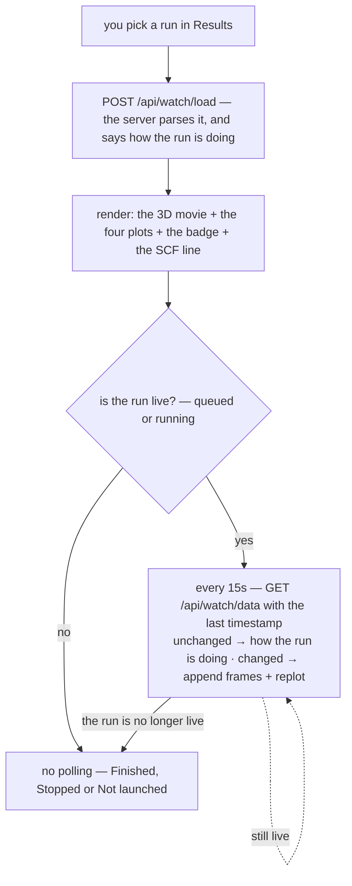

# Trajectory viewer — watching an optimization run

**Role:** contract
**Domain:** web
**Companions:** [`results.md`](?doc=web/results.md) — the Results-tab shell that
hosts this viewer; [`presenters.md`](?doc=web/presenters.md) — how a run file
picks this viewer; [`molview.md`](?doc=web/molview.md) — the 3D viewer that owns
the movie; [`web-api.md`](?doc=web/web-api.md) — the `/api/watch/*` routes;
[`execution/running-a-job.md`](?doc=execution/running-a-job.md) — the run that
produces the file.

Open a geometry-optimization run on the Results tab and this viewer shows it as
a **3D movie of the relaxation, with live convergence plots** that update while
the run is still going. It lands here when you pick a `.molwatch.log`, a SIESTA
`.out`, or a `*_optim.xyz` file. It is a Results-tab viewer only.

## 1. What it is — a data feeder, not a viewer

The trajectory engine doesn't draw the 3D scene itself. It mounts the shared
**MolView** viewer read-only ([`molview.md`](?doc=web/molview.md)) and *feeds* it
the frames and the per-atom forces. MolView owns everything you interact with in
the 3D box — the playback bar, the frame slider, the loop and speed, the unit
cell, atom labels, selection, and measurements. The engine's own job is the
**plots, the run badge, the SCF line, and the live polling**.

Three force controls do belong to the engine (they shape the arrows MolView
draws): a **scale** (Å per eV/Å), a **minimum** (hide arrows below a force),
and **exclude frozen atoms** (skip the constraint-artifact forces on fixed
atoms — this affects the arrows only; hiding atoms in the 3D box is MolView's).

> **This is the trajectory surface, and there is no second one coming**
> *(retired 2026-09-03, user: "retire all of them")*. A separate **MD
> viewer/editor** was named in the design and never built. A relaxation and an
> MD run both arrive as frames with forces, which is exactly what this reads —
> a second viewer would be a second answer to *show me the frames*, and the
> thing that would actually differ (editing a trajectory) belongs to whatever
> writes one, not to the reader.

## 2. The four plots

Below the movie are up to four plots, each answering one question about the run:

| Plot | Shows | Answers |
|---|---|---|
| **Total energy** | energy vs optimization step | is it settling to a minimum? |
| **Max force** | the largest force vs step | is the geometry converging? |
| **SCF energy** | energy across the current step's SCF cycles | is this step's electronic loop settling? |
| **SCF residuals** | every residual the engine converges on, each in its own unit and against its own tolerance line (log scale) — SIESTA's dDmax and dHmax, a NEGF loop's dQ; PySCF's \|g\| and dE (§ 3) | is the electronic loop converging, on every test it must pass? |

Two of them hide themselves when there's no data (the SCF plots only appear once
a run reports SCF cycles), and the grid reflows to fill the gap. **Two rules
every one of them draws by, from the one chart theme** (`lib/plot-theme.js`):
a chart with more than one trace names them in a legend under its x-axis
title, its bottom margin grown to hold it (`legendBelow`), and every threshold
a chart is judged against is a dashed line labelled on itself at its right end,
on a linear axis or a log one (`thresholdMark` — Plotly places a label on a log
axis by its log10, a line by its value).

**A SIESTA run's max-force plot has two lines** — a thin dashed line for *all
atoms* (informational, the held ones included) and a solid line for the *free
atoms* (the convergence signal): SIESTA states both after every step, and with
nothing held the two lie on each other. A PySCF run that holds no atoms states
the one, and its plot has one line. **A TranSIESTA
device computes no forces** (`model/parse.md` § 5d.5): its run carries none, so
there is no max-force line and no force arrow, and the plot's place says
*TranSIESTA does not compute forces in this run (it says they are wrong),
and so not the stress either* —
the reading pass's sentence, `runtime_info.forces_not_computed` *(the user,
2026-10-17; plan F14)*.

**A cycle carries its `phase`, and the SCF plots draw the phases apart.** A
TranSIESTA device converges a periodic SCF for its starting density, then runs
the NEGF loop with open boundaries; the two energies are not on one scale (a
measured device: 7 cycles near −437,029 eV, then 1000 near −205,444 eV), so
each phase is a trace on its own iteration axis. The last is shown by default
and the SCF line (§ 4) names it; a run with one phase — every relaxation, every
PySCF run — draws one trace (`model/parse.md` § 5d.5).

## 3. Convergence targets

**The targets reach the page as said** *(2026-10-18)*: every watch answer
(`/api/watch/load`, `/api/watch/data`, an upload) carries `targets` —
`{source, force_tol_ev_ang, said: [[label, text], …]}` — composed by the
server from the run's `convergence_targets` through the log's one reader
(`trajectory_log.keys.targets_of`: the one stage's leaf of a nested block,
or SIESTA's flat echo as it stands) and the one table of the keys' words and
units (`keys.LEAF_ROWS`: *max |F|* in eV/Å, *rms |F|*, *max displ* in Å,
*rms displ*, *energy step* in eV, *MaxSCFIterations*, *geom steps cap*); the
page draws the rows and the threshold line from that answer and spells no key.

### 3.0 What converged means — two levels, every test at each

*(user, 2026-10-13: "contract document of what convergence conditions are
extracted, ploted and their meaning etc should be updated")*

| level | converged when | extracted from | drawn |
|---|---|---|---|
| **each SCF** — the electrons, inside every geometry step and every single point | **every residual the engine requires is below its tolerance in the same cycle.** SIESTA 5: dDmax ≤ `DM.Tolerance` **and** dHmax ≤ `SCF.H.Tolerance` (`read_options.F90`: both required unless the Harris energy is the criterion, which molbuilder never sets; both written in every deck, [`engines/siesta.md`](?doc=engines/siesta.md) § 3, row 8). A TranSIESTA device's NEGF loop: the same two at TranSIESTA's own tolerances, and dQ ≤ the charge tolerance where the run converges the charge. PySCF: dE ≤ `conv_tol` **and** \|g\| ≤ `conv_tol_grad` | each cycle's row of the output (the residuals); the criteria from the run's own echo — SIESTA's `redata:` lines, TranSIESTA's `ts:` echo, PySCF's read-back — into `runtime_info.scf_criteria` | the **SCF residuals** plot: every residual, each against its dashed tolerance line; the **SCF energy** plot beside it |
| **the geometry** — a relaxation | the largest force on a free atom is below the force tolerance (SIESTA's `MD.MaxForceTol`; geomeTRIC's criteria for PySCF) | each step's forces, free atoms and all atoms; the target from the `redata:` echo or the progress log's header | the **Max force** plot with its target line; the **Total energy** plot |

**The levels depend on each other.** A step's forces are computed from that
step's converged density, so an SCF stopped loose gives noisy forces and the
optimizer chases the noise — which is why molbuilder's density-matrix
tolerance starts a decade under SIESTA's own (`1e-5`, the item's help). **A
residual left off the plot is a test left unseen**: the plot draws every one
the engine requires, never one standing for the rest.

The viewer reads the **targets the run was chasing** and draws them as green
threshold lines — so you can see how far the max force or the SCF residual still
is from the goal. You don't have to keep the input file around: the targets come
from the run's own **output**. A SIESTA run echoes them into its `.out` (the
`redata:` preamble), and a PySCF/geomeTRIC run — whose bare `*_optim.xyz` carries
no targets — gets them from the sibling `*.molwatch.log` the builder writes next
to it. A small label under the plot even says which of these it read them from
("from SIESTA input echo", "from molwatch log header", "from geomeTRIC log").
A run that relaxes nothing chases no force target, so none is drawn: a SIESTA
force-constant run's seeded log carries no targets, because `prep` writes them
only for a deck that relaxes (`jobset/prep._seed_trajectory_log`) — and a
force-constant run nudges atoms, it relaxes nothing
([`engines/vibration.md`](?doc=engines/vibration.md) § 5.1).

A summary band above the plots names the targets and the current distance. When a
value sits far above its target, the plot switches to a **log y-axis** so the
early approach is readable; as it converges the curve heads toward the line.

**Each SCF residual is judged against its own criterion, per phase** —
`runtime_info.scf_criteria`, `{phase: {residual: {tolerance, unit, required}}}`,
one structure for every engine. A line is drawn only for a criterion the run
requires (SIESTA's `Require H/DM convergence for SCF`):

| residual | measures | bounded by | read from |
|---|---|---|---|
| dDmax | the largest density-matrix change per iteration (dimensionless) | the DM tolerance | `redata: DM tolerance for SCF`; TranSIESTA's `ts:` echo |
| dHmax | the largest Hamiltonian change (eV) | the H tolerance | `redata: Hamiltonian tolerance for SCF`; the `ts:` echo |
| dQ | a NEGF loop's charge error (electrons) | the charge tolerance | the `ts:` echo |
| dE | PySCF's energy change between cycles (eV) | its energy tolerance | what the deck read back (`scf_conv_tol`) |
| \|g\| | PySCF's orbital-gradient norm — an energy (eV): dE over dimensionless orbital rotations | its gradient tolerance | what the deck read back (`scf_conv_tol_grad`) |

PySCF states both tolerances in Hartree and requires both (`scf.hf.kernel`);
both PySCF decks read them back off their solver into the progress log's
runtime header (`pyscf/input.emit_scf_criteria_readback`);
the progress log's reader states them in eV, the unit of the residuals beside
them, under the run's one phase, `scf` (`molwatch_grammar.scf_criteria`). A row
that states no phase is judged in the run's one phase. The summary band lists
every criterion; the SCF-residuals plot draws every residual the engine
converges on **as the run declares them** — `runtime_info.scf_residuals`, each
engine's one declaration ([`model/parse.md`](?doc=model/parse.md), the
readers), which the SCF line (§ 4) and the transport report's convergence card
read too; the page keeps no list — each in its own unit, named in the legend
(dDmax is a pure number; no one unit serves the axis), and the dashed line of
each the phase on screen requires, in the residual's colour. Both engines' rows
carry an energy change between cycles; only PySCF's is a criterion, so only
PySCF's is drawn as one, and PySCF's \|ddm\| — reported, bounded by nothing —
is quoted by the run's report and not drawn.

## 4. Is it done, and how fast?

**First, the panel's own status line** (`#trajectory-status`, above the
badge). It carries what nothing else on the panel says: a load that was
refused and why, a viewer that could not mount, an export's result — and, on
an ordinary load, only where the unit cell came from when the run supplied
it. It is otherwise empty. *(Added 2026-09-28: until then the partial had no
such line and every one of those messages was dropped on the Results tab.
It does not repeat the file's modification time or a frame count — the badge
below carries the run's time, and the frame bar its frames.)*

The **run badge** reads **the run** the file belongs to — the state the server
sends with it ([`results.md`](?doc=web/results.md) § 4.1), the one the Run
panel and `jobset status` read: *Finished*, *Stopped* (failed — the reason
beneath: the output's own stop where it states one, else the run's own words,
such as *stopped before its end: no exit recorded*), *Queued*, *Not launched*,
*Record unreadable* (the reader's own words beneath, naming the file and the
way out), else *Running*. A file that belongs to no run — an upload — is read by its own
ending (`run_state`, [`model/parse.md`](?doc=model/parse.md) § 2b): `ended` is
*Finished*, `stopped` or `out_of_memory` *Stopped*, anything else *Running*.
*(It read the file alone until 2026-10-03, so an output that ended read
Finished while its job was still deriving its result, and the Run panel said
running.)* It carries a detail line beneath it with two different facts:

| detail | reads | where it comes from |
|---|---|---|
| **when** — "ended 14:32" | a *time of day* | for a run that has stopped moving, the end its output states — SIESTA's `>> End of run`, `run_end_local` — else the run's own per-step clock, else the file's modification time |
| **total** — "total 2h" | a *duration*, said by the one span rule ([`ui-contract.md`](?doc=web/ui-contract.md) § 4) | how far into the run the last step was |

**Those are two separate readings and neither substitutes for the other.** A
PySCF run writes a real timestamp into its `.molwatch.log`, so it can say when.
A SIESTA `.out` states the time of day only at the run's two ends
(`>> Start of run`, `>> End of run`) and carries no per-step clock — only a
timer counting from the start. So an ended SIESTA run is dated by its own
`>> End of run` — the node's clock, shown as written, since a time with no
zone cannot be converted — and only a running one falls back to the file's
mtime, the one evidence there is of its latest line. The mtime is when the
FILE last changed, which a copy moves: until 2026-09-27 the badge dated every
SIESTA run by it, and a run copied three days after it ended read "ended" at
the copy's time. The two ends are in the run record too
([`model/parse.md`](?doc=model/parse.md) § 5d.2). The parser says *"this engine
cannot tell you the time of day"* rather than handing over its elapsed seconds:
a duration handed over as a time of day shows a run six minutes old as **"last
result Dec 31, 5:06 PM"** — six minutes after epoch zero
([`model/parse.md § 2a`](?doc=model/parse.md)).

**The SCF line** says where the electronic loop is: the step, the SCF cycle and
its iteration count, the residual and ΔE, and for a device its phase (§ 2).
**Its rate is not its own.** Seconds per iteration have one source, the
SCF-timing instrument, one phase at a time
([`model/parse.md`](?doc=model/parse.md) § 5c): the server reads the run's
timing log with the output it belongs to, through the reader the run record
reads it by (`parse.dirs.record.scf_timing_of`), and the line shows the
figure for the phase its current row is in — the number the Run panel shows
([`results.md`](?doc=web/results.md) § 3a). A PySCF run's rows are stamped by
its deck, in its progress log, and timed by the same rule; an output read alone
has no stamped rows and shows none. A rate is never computed from a
timestamp: a PySCF log carries epochs, and a date divided by a count is not a
duration. *(Until 2026-09-27 the viewer estimated its own three ways — SIESTA's
first-iteration timer, the browser's poll times, the output's modification
times.)*

A **stopped** run — a crash, SIESTA stopping because its SCF had to converge
and did not, a kill its monitor saw — settles like a finished one: the badge
shows **Stopped**, with the reason beneath, and the polling stops
([`results.md`](?doc=web/results.md) § 4.1). A run that reaches its end without
converging, where its deck allows that, is **Finished**: convergence rides
beside the badge, never inside it (`model/parse.md` § 2b, P-S2).

## 5. Live updating

The viewer **loads once** (`POST /api/watch/load`), renders, and then — while
the run is live, queued or running — **polls every 15 seconds**
(`GET /api/watch/data`). Each poll sends the last timestamp it saw; the server
replies "nothing changed" with how the run is doing (and the viewer waits, or
stops once the run is no longer live), or "here's the new data" (and the viewer
appends the new frames and redraws only what moved). How the run is doing is
the server's answer, from the one door, and the file the viewer stops on is the
file's last ([`results.md`](?doc=web/results.md) § 4.1).

Appending is the cheap path: the movie keeps playing, the camera holds still,
and your frame position stays put (if you were watching the newest frame, it
follows the tail). **A poll that does not provably extend the movie rebuilds
it** from the whole series instead — the poll that turns a **single**-frame load
into a trajectory, and one in which a frame already shown changed (the step in
flight at the last read, now finished, or a frame count the movie does not
hold); you see the brief "Updating view…" overlay. **The rebuild is the host
replacing what its viewer shows**: the viewer is MolView mounted read-only,
which takes a second install only when its host says it means it
([`molview.md`](?doc=web/molview.md) § 9.4, `enforce`), so every install this
viewer makes says so. *(Until 2026-10-13 none did: every rebuild after the
first load was refused in silence, the frame counter growing while the movie
kept its old frames.)*

**Refresh is a clean reload**, not a nudge: it re-runs the whole load, so the
movie opens again at its newest frame, as a load opens it, and the camera
refits — the same reset a file-switch does. This is deliberate (it closed a class of half-refreshed-state
bugs); a couple of guards make sure a late reply from a previous file can never
paint into the current view, and partial (mid-write) frames are listed but kept
out of the plots.

### 5.1 Omitting a field and clearing it are different answers

A poll's reply is applied field by field, and **a field the server leaves out
is kept, not cleared** — `undefined` means *no news*. Clearing something takes
an explicit `null`.

That is what lets the two calls carry different amounts. The **load** always
sends the run's metadata block — the region labels from the input script, the
cell from the output logs, and `info` from the deck's stated parameters. A
**poll** always omits it, because those three answer *what does this directory
say about the structure it ran on?*, and that does not change while frames
arrive. A poll that sent the block anyway would rewrite it on every tick; a
poll that sent it as `null` would erase what the load recovered.

The one caller with no run directory to search — an uploaded file — answers
**deliberately**: `null` in every field, which reads as *nothing available*.
Saying nothing would have meant *unchanged*, and there is nothing to be
unchanged from.

## 6. Export

One button, **Export all plot data (CSV)**, writes every plotted column (step,
energy, both max-force traces, and the SCF-cycle values) with a self-describing
header. The header's source-path line has the username redacted.

## 7. Under the hood, briefly

- Two endpoints: `POST /api/watch/load` (parse a run) and
  `GET /api/watch/data?mtime=…` (poll for growth) — see
  [`web-api.md`](?doc=web/web-api.md). A folder handed to the load opens the
  file the run door picks (`runs.openable`); a folder whose result is no
  trajectory — a transmission run's, its calculation's report — is refused
  naming that file and the Results tab, which shows it.
- **One file is watched at a time, its parse kept with its mtime.** The server
  holds the current file's parse and the mtime it was read at
  (`blueprints/watch.py`, `_state`); a poll whose file has the same mtime is
  answered from it, and a file whose mtime advanced is parsed again whole.
- The viewer is a small **state machine** (idle → loading → loaded / watching →
  error). All the "which state resets what" rules — why a file-switch clears the
  view but keeps your preferences, why Refresh is a full reload — live in that
  machine; `results.md § 4` has the plain-language summary.
- **Where the module stands (current → target ESM).** The engine
  `lib/trajectory/core.js` already `import`s MolView as an ES module, but its own
  body is still a classic script that publishes `window.molbuilder.trajectoryInspector`
  — a **hybrid**, not yet a clean module. It converts to a full ES module in the
  file-viewer registry + `inspectors` → `presenters` pass
  ([`plans/plan.md`](?doc=plans/plan.md) **W15**), the same pass that converts the sibling
  spectra engine. See [`presenters.md`](?doc=web/presenters.md).

## 8. Test map

- `test_trajectory_csv_redaction_js.py` — the CSV export + path redaction.
- `test_siesta_run_in_the_viewer_e2e.py` — § 4 on a SIESTA relaxation the road
  makes: the SCF line's rate is the run record's (the timing log, one reader),
  and the badge dates the run by its `>> End of run`, in its folder; and every
  element the viewer draws into, looked up on the panel the server sends,
  answers — one element, at the moment it is asked, as the run opens and as
  § 1's three force controls are used.
- § 4's badge and § 5's follow read the run the server sends:
  `test_trajectory_settle_post_load_js.py` (the settle, as a case table) and
  `test_trajectory_transition_js.py` (a quiet poll's answer taken) —
  `results.md` § 10 lists the server's half.
- **Which file the viewer is showing, and why it is the log.**
  *(Corrected 2026-09-04: an earlier note here said "the discovery chain
  prefers the richer per-step log". That is wrong and was written from
  observation instead of from the contract. `/api/watch/load` returns
  exactly the file you ask for -- measured: 5 frames for the `.xyz`, 6 for
  the `.molwatch.log`.)*

  The reason a PySCF relaxation shows the log is **absorption**, not
  preference. `lib/inspectors/trajectory.js`'s `absorbs()` subsumes
  `<stem>_initial.xyz`, `<stem>_optimized.xyz` and
  `<stem>_geom_optim.xyz` into the `.molwatch.log` master, so the picker
  offers ONE entry for the run (`results.md` § 2.3, "a run is one result,
  not a pile of files") and that entry is the log. Absorption narrows the
  MENU; it does not narrow what can be opened -- hand the viewer the
  `.xyz` path and it renders the `.xyz`.

  The two files differ by one frame on purpose. The log's first record is
  `step_index: 0, kind: initial_preview` -- the geometry as handed in,
  before any SCF -- so it has **no energy** and plots as a null. The
  `.xyz` carries geomeTRIC's iterations only. Both counts are right for
  what they are; which you see is decided by which file you opened.

- `test_trajectory_rebuild_js.py` — § 5's rebuild reaching the read-only
  viewer: the viewer's own `rebuildModel` against MolView's real read-only
  model, four frames then six with the fourth moved.
- `test_trajectory_clocks_js.py` — the two clocks: that the badge's "when"
  reads the timestamp series and its "total" reads the duration series, and
  that no per-iteration rate is computed from a timestamp.
