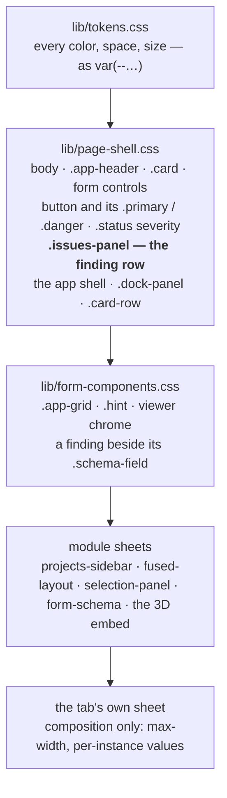

# UI contract — how the pages stay one consistent app

**Role:** contract
**Domain:** web
**Companions:** [`web-api.md`](?doc=web/web-api.md) § 2 — the CSP that
decides what markup may inline (§ 7 here). Every web module ships its own
stylesheet under the rules below; this doc is the cross-cutting layer, not any
one module.

Every tab in molbuilder should feel like **one application**, not a pile of
separately-styled pages. That consistency isn't luck — it comes from a few CSS
rules the whole frontend obeys: one place decides each color, one place owns each
shared widget, and layouts respond to their *content* rather than to hard-coded
screen sizes. This doc is those rules.

## 1. The five stylesheet layers

Stylesheets load in a fixed order, lowest layer first, and **each layer owns a
distinct thing**. What must come first on every app page is loaded by one
partial, `templates/_page_head.html`, which a page's head includes right after
its title: the tokens, the shell, and two components every page has — the one
dialog and the page links' sheet, which name only their own classes, so they
sit with the shell ahead of `form-components.css` — then the runtime and the
status writer. A page
adds its own sheets and scripts after it; the rest every page uses (the
element builder, the page's kept values, the tab strip, the one list, the
server's reader, the path door, the notifications, the one confirm) the shared
header loads (`_app_header.html`). MolView's demo page stands alone, outside
the app, and lists its own.



| Layer | Owns |
|---|---|
| `lib/tokens.css` | **only** the design tokens — every color, spacing, size, and type value (§ 2). Nothing else. |
| `lib/page-shell.css` | the shell (`body`, `.app-header` — the banner, a class, because a bare `header` selector would dress every `<header>` on the page — `main`), the generic form controls and the button's two variants (`.primary`, `.danger` — a dialog opens on every page, and its answer wears one, § 11), `.card`, the `.status` message severities, **the finding row (`.issues-panel`, `.issue-item[data-severity]`)** — one renderer for every surface needs one stylesheet on every surface, and `/results` loads no form sheet but mounts MolView, which draws notices through that renderer — the app-shell + sidebar dock geometry, `.card-row`, the spinner, **the toggle button** (`.toggle-button`, a button that stays pressed — `aria-pressed`) and **the number table** (`.num-table`, numbers in columns — the transport report's tables, the frame-set card on the Transport tab and Task setup) *(2026-10-10)*. |
| `lib/form-components.css` | the **shared form-page widgets** — the form grid, hints, the viewer chrome, the engine strip (`.tabs` / `.tab-btn` / `.tab-panel`, whose behaviour is `lib/tab-strip.js`), the two-column page and its travelling rail (`.page-cols` / `.page-main` / `.page-aside`, Task setup's and the Transport tab's — `--page-aside-w`), and the one findings rule only a form can use (a finding sitting beside its `.schema-field` control). |
| `lib/<module>/*.css` | one self-contained component each (the projects sidebar, the fused MolView card, the selection panel, the form renderer, the embed), class-prefixed so they don't collide. |
| `<tab>/style.css` | **composition only** — arranging a page: max-width, centering, per-instance token values. |

**The one rule to remember: a widget used on more than one page lives in a
*shared* sheet (page-shell or form-components); a page's own sheet only arranges
things.** A shared element has exactly one owner — its rules are declared in one
place, and other sheets don't redeclare them.

### 1.1 A module owns its CSS the way it owns its JavaScript

**A page sheet may not name a module's classes.** MolView is sealed at
`index.js`; `molview.css` is that same seal in another language, and
`molviewer-*` is its private vocabulary — every class `molviewer-<area>-<part>`,
each word spelled out, never abbreviated. A page stylesheet reaching into it is
the same category error as a tab reaching past `mount` — and it fails the same
way, **late and far from its cause**: the module renames a part, and a page
nobody was thinking about goes visually wrong.

**The rule runs in one direction**, and the asymmetry is deliberate: it binds
PAGE sheets, which do not name MODULE classes; it never has a page judge a
module's own sheet, because that is exactly the reach it exists to forbid.

A page that needs a module to look different asks the module for a token or an
option. It does not reach in — the same answer a tab gets when it wants the
viewer to behave differently.

## 2. Design tokens — the one palette file

`lib/tokens.css` names every color, spacing, size, and type value once, in a
`:root` block that every page loads first. Components reference them with
`var(--token)` and **never write a raw palette color**. Change a value there and
it shifts everywhere at once.

Two naming tiers:

- **Global (unprefixed)** — the shared vocabulary: surfaces (`--bg-page`,
  `--bg-card`, …), text (`--text-primary/-secondary/-muted`), the accent
  (`--accent`), the severities (`--success`, `--error`, `--warning`), the chart
  series palette (`--series-1…5`, a chart's n-th curve the n-th colour —
  [`results.md`](?doc=web/results.md) § 2.5), and the
  layout/spacing/type scales (`--radius`, `--gap`, `--space-xs…xl`,
  `--text-2xs…xl`).
- **Module-private (prefixed)** — a module's own tokens, kept out of the shared
  namespace: `--ps-*` (projects sidebar), `--ts-*` (task setup), and so on.
  These live in the same one file, promoted out of scattered per-file blocks —
  the Documents reader's two reading themes too (`--dr-light-*`,
  `--dr-dark-*`; its sheet only points its `--dr-*` names at one set or the
  other, *2.70.1*).

> **`:root` is not component-scoped, and that is why there is no exception.**
> A `:root` block matches the document wherever its sheet is loaded, so a
> token defined in a component file is set for every page that loads it — and
> two components setting the same name differently is decided by `<head>`
> order. The rule as stated: **no token definition outside `tokens.css`,
> prefixed or not**. A name a component sets on its own element is not a
> token: a per-instance size or weight (a card's basis, a chart's height), or
> a name pointed at a token (the Documents reader's `--dr-*` at its light or
> dark set) — never a colour written there. The rule is held by review.

**The embed-safety pattern.** A component that can be dropped into a foreign host
(the 3D embed, an inspector) writes `var(--token, #fallback)` — the token if the
palette is loaded, a literal that *mirrors the token's real value* if it isn't.
That is the main place a literal color appears. The only others are a tagged
set of `/* exempt: */` colors that aren't UI palette at all: a WebGL scene
color (the viewer's wireframe, its canvas clear color), a decorative
gradient, and a couple of lightened text tints on dark severity rows.
Most of them sit in `molview.css` — a WebGL scene's palette is its own, not
the page's. Outside those documented
exceptions, a component never writes a raw palette color.

## 3. Responsive — content decides, not the viewport

The layouts reflow because their *content* stops fitting, not because a phone
hits a magic width. Three mechanisms carry most of it:

- **Grids with a `min()` floor.** An equal-track grid uses
  `minmax(min(340px, 100%), 1fr)` — so a track can shrink to the container width
  instead of forcing a horizontal scrollbar on a narrow phone.
- **`.card-row`** — a flex row whose children declare a weight, a preferred
  width, and a minimum; it wraps when the cards' preferred widths no longer fit
  side by side, with **no media query at all**, and a card alone on its line
  shrinks with the row but never below its minimum — so it never squeezes into
  its neighbor — nor past a row narrower than that minimum: the floor is
  `min(--card-min, 100%)`, the grids' `min()` floor above: a flex line wraps
  on each card's basis, clamped by its minimum.
- **Container queries** — an embeddable sizes itself to *its own* width, not the
  page's. The fused MolView card flips from side-by-side to stacked at
  `@container (max-width: 692px)` (the sum of the viewer minimum, the rail, the
  handle, and the panel minimum). The Task-setup **asks** (`.ts-asks`) do the
  same at `34rem`, and they are the cautionary case: that started as a viewport
  media query, and a viewport query cannot see a block that is only ~318 px wide
  *because* it sits in a card in a column beside a sidebar. At a 1024 px
  viewport the three-column layout stayed in force where it did not fit and the
  row overflowed its container by 10 px. No test measures it now: the layout
test opens each tab empty, where that card is hidden (owed, 2.67.13: Task setup
measured with a folder open).
  **If a block's width is set by its container rather than the window, a media
  query is the wrong instrument**, and a `minmax(0, 1fr)` floor does not save it
  (measured: it does not).

There are still a handful of real screen-width breakpoints for the things that
genuinely depend on the whole viewport: **786px** (at and above, the projects
sidebar docks in-flow; below, it becomes a slide-in **drawer**) — and that
number is *derived*, not chosen: sidebar `18rem` + the shell's insets + the
widest embed's own declared floor (`--molviewer-size-card-min-width`). A
smaller number would dock the sidebar and leave less room than the content
declares it needs, and the viewer card, refusing to shrink past its floor,
would overflow its host by the shortfall. A media query
cannot read a custom property, so the literal stays; the arithmetic lives
beside it in `page-shell.css`, and the narrow side of it (`max-width:
785px`) is also where a few pages trim their own padding. Also **960px**
(form-components' two-column page, `.page-cols`, stacks its rail), **720px**
(Task setup's rows and the Documents tab), **768px** (markdown), **480px**
(the load monitor and MolView) and **40rem** (form-schema's recommended-value
rows, Task setup's fit row, This machine's rows). A pair of figures in a panel
stacks by a `min()` grid floor, never by the window's width. All animation
honors `prefers-reduced-motion`.

Task setup's two breakpoints — a row inside a card in a column beside the
sidebar — are the `.ts-asks` case above, and want a container query.

### 3.1 The app shell — who scrolls, and what a tab has to say to get it

A tab opts in with one attribute: `<body data-sidebars="projects">`. That makes
the body a full-height flex **column** whose middle row is
`[sidebar rail | content]`, and the tab supplies the two children:

```html
<body data-sidebars="projects">
  <header class="app-header">…</header>  <nav class="app-tabs">…</nav>
  <div class="app-body">
    <aside class="sidebar-rail">…</aside>
    <div class="app-content">…the tab…</div>
  </div>
</body>
```

**The body never scrolls — the content pane does.** That one decision is what
keeps the header and the tab nav on top: they are natural-height rows in a
column that has nowhere to go, so they stay put without `position: fixed`,
without JavaScript measuring the header, and therefore without the flash on tab
switch that a measured layout gives you. The sidebar is an ordinary flex
column, in the right place on the *first* paint.

A **`.dock-panel`** is the shared geometry for anything docked in that rail: a
full-height flex column that scrolls internally, so the rail itself never does.
An instance sets only its own width and palette. The projects aside is the one
dock panel; the geometry stays shared for the next panel that docks.

Two rules elsewhere in this document are about this shell, and are not repeated
here: the width at which a panel docks in-flow rather than sliding in as a
drawer (§ 3, and it is derived, not chosen), and why a `.dock-panel` needs its
own `[hidden]` guard (§ 6).

## 4. Staying visually consistent

- **Message severities have one owner.** `.status.error` / `.ok` / `.warn` /
  `.muted` are declared in exactly one place (page-shell) and map to the severity
  tokens. See § 5 for why this matters.
- **The issues panel** is the other severity surface — each issue gets a
  colored left bar and a leading glyph (⚠ / ✗ / i) from the same tokens, owned in
  **page-shell** *(for the reason § 5 gives about `.status`: it is drawn on
  every surface, so it is styled on every surface)*.
- **Cards** — `.card` in page-shell is the canonical surface (background, border,
  radius, padding, shadow), and **it is the only one**: a page that restyles
  it restates the shell and then drifts, so one class has several looks and
  source order picks the winner. The rule is held by review.
- **A card that folds is one component** (2026-10-13). A `<details
  class="fold">` whose `<summary>` is its head: the disclosure marker, the
  title, and `.fold-sum` — what it holds, said in a few words, so a folded
  card still gives its answer. page-shell draws it; `details.card.fold` is a
  card that folds (Task setup's), a `.fold` inside a card is a segment of it
  (the file groups of Task setup's *What this calculation writes*), and the
  parameter forms' foldable cards are `.fold` too
  ([`form-schema.md`](?doc=web/form-schema.md) § 1.3). Which start folded is
  the page's rule; the component decides nothing. Cards of which one is open
  at a time share a `name` — the browser's own exclusive `<details>` group —
  rather than a script that closes the others.
- **One owner survives a rename.** The same declaration under two different
  selectors is a second owner too, invisible to a per-selector check: it
  lives in the module sheet and pages opt in with the class
  (`.molviewer-host`), so a third page needs no third copy. The rule is held
  by review.
- **One inset per card** (2026-08-30). A card states its inset once, on
  itself; everything inside it — title, rule, tab row, fieldsets, form rows —
  **begins at that inset and adds none of its own**. A nested block may add
  *vertical* space; horizontal indentation is a deliberate signal of hierarchy,
  never a by-product of nesting.

  Every nested padding is defensible alone; their sum is nobody's decision,
  which is the failure mode this rule names.

  It is a rule rather than a fix because a fix cannot hold. Subtracting the
  header's 20 lines up a header inside a `.card` and **breaks** one whose parent
  is not a card and has no inset underneath to absorb it — the same component
  has to serve both.
- **One gutter per tab** (2026-08-30). Every top-level block on a page shares one
  left edge, one right edge and one max-width; nothing sits outside the page's
  own container.
- **One family, and the shorthand is where it escapes** (2026-08-30).
  `--font-sans` in `tokens.css` is the app's sans stack. **A `font:` shorthand
  resets `font-family`**, so every rule that uses the shorthand would have to
  retype the stack, and spellings retyped independently stop agreeing on a
  machine where an earlier name hits. The rule: *a
  `font:` shorthand names `var(--font-sans)`, or it is not written* — reach for
  the longhands instead, which leave the family alone.
- **How long ago, said one way** (2026-10-13). An age shown to a person — a
  result's *(5m ago)* in the Results picker, a channel's *reached 2h ago* on
  This machine — comes from one helper, `lib/time-ago.js`
  (`window.molbuilder.timeAgo`): each unit until one and a half of the next
  (90 s, 90 min, 36 h), *just now* below that, past 30 days the date itself,
  nothing when there is no moment. **A length of time a run says of itself is said one
  way** *(user, 2026-10-16)* — the *6d left* an engine estimates, a run's
  wall time in the Run panel, a transmission's loop, the elapsed time and the
  time left in the monitor's status line and its messages: the same helper's
  `window.molbuilder.timeSpan`, each unit until one and a half of the next
  (90 s, 90 min, 36 h), then days, the nearest whole one, a half rounded up
  (`12s`, `5m`, `6h`, `6d`). The same rule is written once more in Python,
  in the module that declares what a report says (`report_fields.span_words`)
  — the monitor's, beside a job where the page's helper cannot reach, and
  every sentence the server composes for a page (`tbtrans.loop_words`, a sent
  run's *last wrote 2h ago*); a
  report field that is a length of time is marked `span` — two languages, one
  rule, stated here, each asked the same rows (`tests/test_span_rule.py`). The
  trajectory badge's *total* is a run's own length too, and takes it. **A benchmark's measured times keep the second** — its wall on the
  page, its monitored window in `summarize bench`'s table (*4m05s*): a
  measurement compared across trials, which a rounded length would hide.
- **Focus: the glow and the ring are each one token**. A text field
  being typed in glows (`--focus-ring`, the shell's input rule, which no field
  adds a ring to); the ring a control draws when the keys reach it is
  `--focus-outline`, its offset its own. One ring keeps a colour of its own: the projects sidebar's edge tab,
  drawn in the accent, where an accent ring would not show. *Not yet one look
  for every control:* the sidebar's rows and its create buttons glow, its
  drawer toggle and the load monitor's toggle change their ground and draw no
  ring, and a plain button, the engine strip's tabs and the page links take
  the browser's own ring — which look each control wears is a look still to
  settle.
- **Rhythm** — spacing, type sizes, and radii all come from the `--space-*` /
  `--text-*` / `--radius*` scales. **Spacing is a 4px grid**: every step is
  a whole number of 4px units, so any two spacings are commensurable and a
  rhythm is either kept or visibly broken.

  Two things are **not** rhythm and stay literal: a **hairline** (under 3px —
  a 1px nudge, a 2px inset under a border) is an optical adjustment, and
  snapping it to the grid would quadruple it; a value **over 40px** is a real
  dimension, not spacing. And a deliberate calm: no harsh gradients,
  and no animation longer than ~120 ms on a hover.

### 4.1 Named, and reachable without a mouse

Every control has an **accessible name** — the text inside it, a `<label>`,
or an `aria-label` when the visible text is a glyph (`×`) or a placeholder;
a `title` is a tooltip, not a name. Every action a click performs has a
**keyboard path**: a control is a `<button>`, a link or an input, never a
`div` or a table row with a click handler alone. A tab strip follows the
ARIA tabs pattern — `role="tablist"` / `tab` / `tabpanel`, each tab with an
`id` and `aria-controls`, the panel `aria-labelledby` its tab, one tab stop
with the arrow keys moving the selection (page-shell's markup contract) — and
it is **one implementation**, `lib/tab-strip.js`, loaded once by the shared
header, which mounts every strip in the app: a page names its tabs
(`data-tab`) and says what it does when one is chosen; the strip keeps
`aria-selected`, the tab stop, the keys and the ids, and each strip's sheet
keys its look on `[aria-selected="true"]`. A strip inside a module that is disposed
registers its listeners through its owner's listener scope (`listeners`, the
inspector's `inspectorLifecycle.listeners()`), so the owner's dispose removes
them with its own. A link that goes to another page is not
a tab: the app's page links are a `nav` whose current page is
`aria-current="page"`. MolView's panel switch is a radio group, which the
browser already gives one tab stop and the arrow keys. A
tree's rows are focusable `treeitem`s carrying `aria-expanded` and
`aria-selected`, Enter picking, the arrows moving and opening. **A list of
choices is one tab stop, and one implementation**, `lib/one-stop-list.js`,
loaded once by the shared header: the item chosen holds the stop, else the
first, and the stop follows the keys; the arrows and Home / End move it,
passing over an item not shown (hidden, or out of view under a filter); Enter
does what a click on the item does, the page's own click handler run by both,
and a key pressed on a control inside an item is that control's. A control
inside an item — a row's menu button, a state's *Restore* — is a stop only
while its item holds the list's, so Tab from the item reaches it and the list
costs one stop. **A list drawn again under the keys keeps them** — on the item
now carrying the id theirs had, else on the stop — so a list redrawn while a
run is followed, or a folder opened by Enter, never leaves them on the page's
body. The projects sidebar's rows are such a list — a `listbox` of `option`s,
Enter opening a folder or selecting a file, and Enter on the selected file
committing it, as the second click of a double-click does *(2026-10-13)* — and
so are the spectrum's modes, Enter showing a mode, and the run history's saved
states — each state's words a button that opens and closes its actions
(`aria-expanded`), the buttons the list's items. A list drawn again with no item holds no
stop, and leaves the keys where they were. **A
control that reads as the text it stands for** — a column's name that sorts, a
folder's arrow — **is `button.plain`**, the page shell's: it looks as its text
does, hovered too, and the focus ring says the keys are on it. A control that
holds a state says so with `aria-pressed`. A control without a name is lost
to a screen reader and to the browser driver alike.

## 5. Why an error looks the same on every tab

A validation error uses `class="status error"`. Only `lib/page-shell.css` defines
`.status.error { color: var(--error) }`, and **every** page loads page-shell —
so the same red (`--error`) appears whether the message is on the Structure
optimization tab's form, the Molbuilder tab's action row, the Spectrum or the
Transport tab. A page
sheet may nudge *where* the status sits (Modify right-aligns it) but never
re-picks the color. Change `--error` once in `tokens.css` and every error on
every tab moves together. That is the whole contract in one example: **one
owner, one token, consistent everywhere.**

**A message with a layout of its own takes the same look.** A Task setup note,
a prep answer, the Transport plan line, the benchmark foot's failed look, the
file preview's line, Modify's timeline status — and This machine's
channel test, Task setup's unsaved flag, Modify's warning hints and its
selection layer's failure, Task setup's *already here* on a file, the
recommended-values panel's summary, the Results readout when it warns, the
dialog's refusal, the folder picker's failed listing, an inspector that
failed, the Run panel's finding and its *differs* tag, the PDOS line, the load
monitor's GPU notice, the benchmark's mismatch head, the projects sidebar's
error lines: each keeps its own classes
and takes the severity as `tone <kind>`, set through `status.tone(el, kind)`
(`lib/status.js`), or written in the markup when the line is never anything
else, and styled beside `.status.<kind>` in `page-shell.css` — so a page keeps
no severity vocabulary of its own. A box whose words take the tone draws its
edge in `currentColor`, the tone's. A box whose words stay plain and only its
edge carries the severity — a notification's stripe, the trajectory's parse
warnings (their box, and each warning's place in it), the one-time secret on
This machine, a row the Run panel marks, Task setup's save bar while unsaved,
the benchmark's mismatch box, the recommended-values panel — keeps that edge
on the severity token the tone itself reads: an edge is not a message. A
component's state mark is the component's own vocabulary, on the same tokens:
a run-state chip, a run's state stripe, a field that will not read, a winning
trial, the load monitor's fault marker. A save's,
a load's or an upload's line that carries the server's notices takes the tone
of the most severe of them, by the one composer
(`validationFindings.outcome`, [`science/validation.md`](?doc=science/validation.md) R2a).

**That line is sharper than *"is this selector duplicated?"*, and the
difference matters.** Four sheets declare `.status` and three of them are
*fine*:

| a page sheet declares | verdict |
|---|---|
| `margin-top`, `margin-left`, `min-height` — **where it sits, how much room it takes** | composition. Legal, and deleting it moves the page. |
| `color`, `font-size`, `font-weight` — **what it looks like** | a second owner. Illegal, however sincere. |

So **read the properties, not the selector.** A duplicated selector is a
prompt to look; only a re-picked *appearance* is the defect.

### 5.1 And why a *finding* looks the same on every tab

The same rule, one layer up. A scientific finding (a validator `Issue`) is
rendered by exactly one module — `lib/validation-findings.js` — which every page
that shows findings mounts. One row shape
(`li.issue-item[data-severity]`), styled once in `lib/page-shell.css`;
`card` puts a finding on its form card (`template.card_of`, the rule the form
draws its fields by), everything else lands in the
page's residual panel, and **nothing is dropped**.

The full producer-to-panel contract — where the facts come from, how the finding
travels, and what the UI must do with it — is
[`science/validation.md` § 4.1](?doc=science/validation.md).

> **And a NOTICE is a finding** *(2026-09-11)*. The `notices` array beside `ok`
> is the same `{severity, message, where}` row under a different word, so it is
> drawn by the same module — including inside MolView, which reaches down to it
> by `import` rather than carrying a renderer of its own. **A module with its
> own design system composes, it does not re-implement**: MolView's sheet sets
> the row's type scale for its dense panel (`.molviewer-notices.issues-panel
> .issue-item`) and owns nothing about the severity, which is § 5's rule one
> layer up. "One renderer" is held by
> review ([`code-audit.md`](?doc=process/code-audit.md) § 1c), and each
> page that shows findings is asked to draw every one its check returned
> ([`validation.md`](?doc=science/validation.md) § 4.1 R2).

## 6. The `[hidden]` gotcha

One trap worth knowing, because it bites every contributor once. When JavaScript
hides an element by setting the `hidden` attribute, the browser's default
`[hidden] { display: none }` is *low specificity*. So if a class on that element
sets a `display` (say `.dock-panel { display: flex }`), the class **wins** and
the element never hides.

The rule: whenever a class sets a non-`none` `display` on an element that gets
toggled by `hidden`, **pair it with a guard** — `.dock-panel[hidden] { display:
none }`. This is done consistently across the tree, most with a comment
explaining why.

## 7. What may be inline — the CSP boundary

The security policy (owned by the server — see
[`web-api.md`](?doc=web/web-api.md) § 2) draws a sharp line:

- **Inline `style=` is allowed** — the 3D embed and some inspector cards set a
  small amount of inline style (a viewer height, say). The risk is small (a CSS
  injection at worst, never JavaScript). *(This is why the token rule bans inline
  **colors** but not inline layout: a color belongs to the palette, a one-off
  height is a composition detail.)*
- **Inline `<script>` is banned** — `script-src 'self'` has no `unsafe-inline`.
  All behavior lives in linked `.js` files; no `<script>` blocks, no `onclick=`
  attributes. If an XSS payload ever landed, the CSP would block it.
- **Markup comes only from the source, or from four counted writes**
  *(2026-09-25)*. In first-party JS (`vendor/` bundles excepted), the three
  properties that parse HTML — `innerHTML`, `outerHTML`, `srcdoc` — are set,
  with `=`, to an empty string or **one literal** written in the source; the
  methods that parse it — `insertAdjacentHTML`, `document.write`,
  `createContextualFragment`, `DOMParser.parseFromString` and kin — are not
  used at all. Text that varies at run time — a file name, a server's `error`,
  an exception's message — is set with `textContent` on an element built with
  `createElement`, however harmless it looks today. HTML made at run time
  enters at four writes, one per file, that `tests/test_xss_audit.py` counts:
  the markdown editor's preview (`lib/inspectors/markdown.js`) and the
  Documents tab (`documents/page.js`), both through `lib/markdown-render.js`'s
  DOMPurify; mermaid's SVG (`lib/markdown-render.js`); and the server's
  `/partials/*` inspectors (`lib/inspectors/_partial_inspector_factory.js`). A
  fifth is a design decision, not a line in that table. A formula is none of
  them: `renderMathIn` hands KaTeX the TeX a document holds in its
  placeholder's attribute, and KaTeX builds the elements itself, `trust: false`
  so no command reaches a URL or raw HTML. The CSP stops an
  injected script from running; this rule stops the injection.

## 8. Is a rule dead? — how to tell, and how not to

Unused CSS is worth removing and **very easy to get wrong**, because every
cheap way of asking gives a confidently wrong answer. Each of the four traps
below gives one, and two of them would delete live styling.

**Trap 1 — grepping for the class name.** A class can be *composed*:

```js
{ class: "workflow-group workflow-group--" + meta.card }   // form-schema.js
el("div", "schema-field-" + f.kind)                   // form-schema.js
```

`.workflow-group--stage` appears in no JS file and is live on the parameter
forms (Structure optimization, Spectrum, Transport) wherever a field is drawn
in the `stage` card — `stage` is a member of `template.GROUPS`. The same trick
had already hidden `.schema-field-checkbox` from an earlier sweep. A grep can
only ever say *"no literal reference"*, which is not the question asked.

**Trap 2 — one page, one state.** Most rules match nothing most of the time.
`form-components.css` reports 42 of its 55 selectors unmatched on
`/molbuilder` — because the parameter forms live on other pages. Dialogs are
closed, panels are collapsed, and error rules (`.structure-error`,
`.source-body-error`) match only when something has *failed*, which no page
walk reaches by accident.

**Trap 3 — `querySelectorAll` cannot evaluate everything.** `::backdrop`,
`::before`, `:hover`, `:focus-visible` and friends are not selectable, so a
zero there is an artefact of the instrument, not a finding.
`.mb-dialog::backdrop` reads "dead" and is live on every modal.

**Trap 4 — the shell lies quietly.** `**/*.js` does **not** recurse without
`globstar`, and an unquoted `--include=*.js` is glob-expanded by the shell
before grep ever sees it. Both search the wrong thing and report success.

### What actually settles it

Load the page, put the component **into the state that uses the rule**, then
read the DOM:

```js
for (const r of sheet.cssRules) {
  // Trap 3: these cannot be evaluated, so a zero would be meaningless.
  if (/::|:hover|:focus|:active|:checked|:not\(/.test(r.selectorText)) continue;
  if (!document.querySelectorAll(r.selectorText).length)
      console.log("unmatched here:", r.selectorText);
}
```

Unmatched in **every** state you can reach is evidence; unmatched once is
not. If a rule guards a failure path you cannot trigger, **leave it** — a
dead rule costs bytes, a deleted live one breaks the UI in exactly the states
nobody is watching.

**And "unmatched" still is not "delete it".** A shared sheet may declare a
*vocabulary* on purpose — `dialog.css` lists the seven parts a modal has,
precisely because the failure it was written to end was JS emitting class
names no stylesheet answered. An unused member of a declared vocabulary is a
promise kept, not residue; if the markup and the vocabulary disagree, **the
markup is the thing to change.** Ask what the sheet's header says it is for
before concluding anything.

### Standing verdicts, so they are not re-derived

| rule | verdict | how it was settled |
|---|---|---|
| `.workflow-group--stage` | **live** | composed from the card key (`card`); every form that draws the `stage` card carries it |
| `.mb-dialog-title`, `.mb-dialog-field` | **live** *(2026-10-13)* | `lib/dialog.js`'s parts (`dialogTitle`, `dialogField`) build every dialog of the one component (§ 11), and the one confirm wears the title. |
| `.mb-dialog::backdrop` | **live** | Trap 3 — not selectable, matches on every modal |
| `.inspector-section{,-header,-hint}`, `.fdf-actions`, `.fdf-output`, `.disabled-tip`, `.structure-error`, `.source-body-error` | **no builder found — deliberately NOT deleted** | no literal reference and no composition prefix, but never observed in their own state either |

## 9. Checklist for changing the UI

- A new **color / size / spacing** value → add it to `tokens.css`; reference it
  with `var(--…)`. No raw palette `#hex` (a `var(--token, #fallback)` in an
  embeddable, or a tagged `/* exempt: */` scene/decorative color, are the only
  literals).
- A widget used on **more than one page** → a shared sheet (page-shell or
  form-components), not a page sheet. One owner.
- A page's own sheet → **arrangement only** (max-width, per-instance values).
- A layout that must reflow → prefer a `min()` grid floor or `.card-row` over a
  new media-query breakpoint.
- A class that sets `display` on a `hidden`-toggled element → add the
  `[hidden]` guard.
- A **negative** token value → `calc(-1 * var(--token))`. **`-var(--token)` is
  not valid CSS**: the minus does not bind to the function, so the browser
  discards the *whole declaration* — including any other values on the same
  line. Nothing errors, nothing renders differently enough to notice, and the
  comment beside it goes on describing a layout that never shipped.
- Behavior → a linked `.js` file; never an inline `<script>` or `onclick=`.
- Text into the page → `textContent` on a `createElement`ed node; outside
  § 7's four producers, `innerHTML` only ever gets `""` or one fixed literal.
- A message in a `.status` element keeps its newlines (`white-space:
  pre-line`): a line break in the source text is a line break on screen.
- A page sheet that repeats a shared selector → **read its properties** (§ 5).
  Position is composition and stays; `color` / `font-size` is a second owner
  and goes.
- About to delete a rule as unused → **§ 8 first.** A grep cannot see a
  composed class, one page state cannot see a dialog or an error, and
  `querySelectorAll` cannot see `::backdrop`. § 8 also carries the verdicts
  already reached, so they are not worked out a fourth time.

## 10. The page busy fence — one cover for every heavy click

*(2026-08-28, user design: "blocking the window is going to block switching —
make it simple".)*

**The problem it solves.**  A user clicks something that makes the server
work for seconds — generate 3-D coordinates from a SMILES, a multi-step
save.  While that runs, every other control is still live: switching the
sidebar directory mid-save retargets the operation's later steps; switching
tabs abandons the result.  Guarding each control separately is
micromanagement that never ends.

**The rule.**  One shell primitive: behavior and DOM in
`lib/page-busy.js`; styles in `lib/page-shell.css` § 2.1 beside the
spinner, because a widget used on every page lives in a shared sheet
(§ 1) — and that sheet loads in every page's `<head>`, so the cover's
geometry exists before the first claim can raise it.  Visibility is the
`hidden` attribute with its § 6 guard, nothing else:

```js
import { pageBusy } from "../lib/page-busy.js";

const ctl = new AbortController();
await pageBusy.run("Generating 3-D structure…", [() => ctl.abort()],
                   () => theOperation(ctl.signal));
```

**`run` is the way an operation takes it**: it claims, runs the operation,
and releases in a `finally`, so the recovery contract below is kept in one
place rather than at every caller.  When the fence is already held, `run`
runs the operation inside that claim: with the mouse and the keyboard
fenced, only the operation holding it can reach another `run`, so the
caller is one of its steps, and two steps compose in one claim. The step
runs under that claim's Cancel — its own cancelers are not added — because
the operation holding the fence owns what Cancel stops.
`claim` and `release` stay for the fence's own tests; a classic script
reaches the same object as `window.molbuilder.pageBusy`.

While claimed, a full-window cover shows the reason, a spinner, and — when
the operation can be cancelled — a **Cancel** button.  The whole window is
covered, so *everything* — tabs, sidebar, forms — is blocked by
construction; nothing is wired per-control.  **The keyboard is fenced
too**: a key pressed anywhere but on the cover, or in a dialog the operation
itself opened, does nothing — Enter on the button just clicked does not send
again.  **Focus comes back where the person left it**. A control
that held focus as the fence went up — the button just clicked — gives it to
the cover until the release puts it back. A fence that goes up while focus
is moving — a field's change runs as Tab or a click leaves it, and the
browser names no control focused then — leaves the move to finish, and the
release puts focus where it went, by the fence's own record of the last
control outside the cover to take focus; a click on bare page leaves focus
on no control. So a value typed and Tab land on the next field, as without
the fence. The release gives focus back once the operation's caller has
ended it — a button it disabled is enabled again — and a move the browser is
making has finished, since an operation can end inside the change that
started it; it never takes focus from a control outside the cover that has
it — where the person's move landed, or where the operation put it. Neither
move scrolls the page: what the operation brought into view, a refusal
beside its field, stays in view.

**A control the operation redrew is found again** by its `id`, or, with
none, by its name — its `aria-label`, a button's text — inside the nearest
container that has an `id`, when exactly one control of its kind there
carries that name: two answering to it, none is guessed, so no keystroke
lands in another stage's field. A redrawn control is named for what it
edits; one whose name an edit can change carries an `id` — a stage row's
controls by the row's number, their names carrying the stage's — so a
rename, then Tab or a click in that row, still finds it, and after a removal
the row below, named for its own stage, takes the number. The record keeps a
control taken out of the page, and the window losing focus clears nothing: a
control an operation's redraw took out is found again at its release, and
one already out of the page when an operation begins is let go — never
brought back. **An operation that redraws without waiting on the server
redraws once the event that started it has finished**: a redraw inside the
change of a field Tab or a click leaves takes out the control the move is
going to, and the browser abandons the move (Task setup's `commitEdit` — a
stage renamed — and the run cards drawn again after a queue or notify card's
write).

**The recovery contract**:
`release()` sits in a `finally`, so a thrown operation still releases;
the cancelers abort the in-flight request; and Cancel, shown when there
are cancelers, is the human override, always clickable — it runs them but
does **not** release (the operation's own `finally` does, after its abort
unwinds).
There is no silent stuck state.  `claim()` while claimed **throws** —
one heavy operation at a time is the design, not a limitation; `run` is
how a step joins the operation already holding it.

**Who claims it.**  User-*triggered* heavy or risky operations only.
Periodic or automatic work (the GPU sampler, status polling) never
claims: there is no click to block, and freezing the page on a timer
would be the bug.  That class is protected server-side instead
(subprocess + timeout — the 2026-08-28 GPU fence).

**Programmatic races.**  The cover blocks clicks, not code.  The
selection's own setter (`projects` `setShared`, `lib/projects/state.js`)
refuses while the fence is claimed, and so does `projects.navigateTo`,
which no page calls today — a future module that moves shared state from
code goes through them and is refused the same way.

**The honest limit.**  The fence protects this window against its own
user.  A second browser tab, or another user of a shared server, still
reaches the backend — that class stays server-side, case by case.

## 11. Dialogs — one component, and never the browser's own

**One component.** Its look is `lib/dialog.css` and its behaviour
`lib/dialog.js`, beside it: `openDialog` shows a `<dialog>` modally and
resolves with its answer — **one at a time** (opening a second answers the
first with its cancel value), and Esc, the native close and a click off the
surface all cancel; `settleDialog` answers it; the parts (`newDialog`,
`dialogTitle`, `dialogHint`, `dialogField`, `dialogError`, `dialogActions`)
build it in the one vocabulary — a field a text or number box, or a choice
among a few values (`options`, a `<select>`); `askFields` is the form dialog —
labelled fields checked as typed, the answer's button enabled only while the
answer can stand, its refusal on a line that is reserved so nothing moves
under the pointer; a caller whose hint or note follows a field is told every
change (`onInput(values, {setHint, setNote})`) and may rewrite either — the
*Write frame set…* dialog's note, what the temperature typed means for the
mode (`web/spectra.md` § 4.3). Buttons run cancel first and the answer last, which wears `.primary`
or, when it costs something, `.danger` — both in `page-shell.css`, because a
dialog opens on every page. The sidebar's questions (`lib/projects/dialogs.js`)
and the tree picker (`lib/tree-picker.js`) are built on it.

**One confirm.** A yes/no question is `warningModal.confirm({title, body,
confirmLabel})` (`lib/warning-modal.js`), loaded by the page header on every
page: its costly answer marked `.danger`, Cancel focused, so the key that
closes it keeps what you had. It is built on the component, so it keeps its
rules: one dialog at a time, a dialog opened over it answering it no, and Esc
or a click off it answering no. The costliest questions — deleting a project or a topic folder with everything in
it — are answered by **typing the thing's name** (`confirmByTyping`), so a
stray Enter cannot answer them. A control that arms on its first click and acts
on its second — Task setup's column removal, This machine's channel removal —
asks no question, and is not one.

**Never the browser's own.** No `prompt()`, `confirm()` or `alert()`: a native
dialog blocks the whole page and the browser's automation with it, takes no
part of the page's look, and stands outside the page fence's keyboard rule
(§ 10). A question is a dialog; what an action *says* afterwards — a refusal,
a failure, an archive that came out incomplete — is a notification
(`notify.show`, [`notifications.md`](?doc=web/notifications.md)) or the page's
own status line. MolView's hosts already held this for a clear
([`molview.md`](?doc=web/molview.md) § 6.7a).

## 12. A server's answer — one reader

**Every question a page asks the server goes through one reader**, `ask` in
`lib/server.js` — an ES module, imported by a module and mirrored on
`window.molbuilder.server` for a classic script, loaded once by the shared
header. A page never parses an answer itself, and **never paints a failed
answer as data**: a refusal is not *"nothing is set up"*, an empty list, or a
menu left empty.

```js
const a = await ask(url, { method, body, signal, as });
// {ok: true,  status, body, headers?}
// {ok: false, status, error, body?, aborted?, signedOut?}
// as: "text" -- an answer that is not JSON (a partial); "file" -- a file,
//     its bytes and the answer's headers (an export's name, what it said)
```

| the server's answer | `ask` returns | `error`, said as it is |
|---|---|---|
| 2xx, JSON, its `ok` not `false` | `{ok: true, body}` | — |
| JSON with `ok: false`, or a refusing status — an empty one too (a rate limit) | `{ok: false, body}` | the server's own `error`, else *"the server refused (HTTP n)"* |
| not JSON — an error page | `{ok: false}` | *"the server's answer could not be read (HTTP n) — its log says why"* |
| no answer at all | `{ok: false, status: 0}` | *"could not reach the server — check the connection, then try again"*, never the browser's own words |
| cancelled (the caller's `signal`) | `{ok: false, aborted: true}` | — the caller says nothing: a newer question replaced it |
| **signed out** — a `401` carrying `login_url`, or an answer the gate sent to the sign-in page | `{ok: false, signedOut: true}` | *"you are signed out"* |

**A module built on the reader answers in its own documented shape** — the
files layer's `{ok, …fields}` ([`projects.md`](?doc=web/projects.md) § 5), a
door's result such as the structure save's `{ok, path, notices}` — and asks
its routes from one place; **a page that asks a route itself reads the
reader's `{ok, body}` and reshapes nothing**.

**Being signed out is said once, for the whole page**, by the reader: one
notification ([`notifications.md`](?doc=web/notifications.md)), *"You are
signed out. What this page holds is kept: sign in in the new tab, then carry
on here"*, its **Sign in** link the page itself opened in a new tab — a page
request the gate sends through sign-in and back to the page
([`ops/access-control.md`](?doc=ops/access-control.md) § 3.3) — so nothing
held here is left behind. Each page says
its own refusal beside the control that asked, as it says any other. A request
the browser makes itself — a download link, an image — is no question the
reader can read.

### 12.1 Its words, drawn — one renderer

**The server's sentences are written once, for the terminal and the page
alike**, and drawn on a page by one renderer, `codeWords` in `lib/dom.js` —
loaded once for every page by the shared header: a command kept in backticks
(`` `jobset init` ``) is drawn as code, never as a backtick, and the terminal's
dash, ` -- `, as a dash (—). **Every place a page shows a sentence of the
server's draws it so** — a status line (`lib/status.js`), a finding
(`lib/validation-findings.js`), a notice in the notification bar, a refusal
beside the control that asked. The page's own sentences are written as a page
writes them. *(MolView and VibrationView reach no module of the app by name,
§ 4 of their contracts; the few server sentences they show are drawn as text.)*

**Why one reader.** A page that reads its answers its own way parses a body
without asking whether the server said yes, calls an error page *"a network
error"*, paints a refusal as data — *"No channels are set up … They live in
undefined."* — and cannot know the person was signed out. One reader makes the
reading one rule, and leaves each page only what it says.
